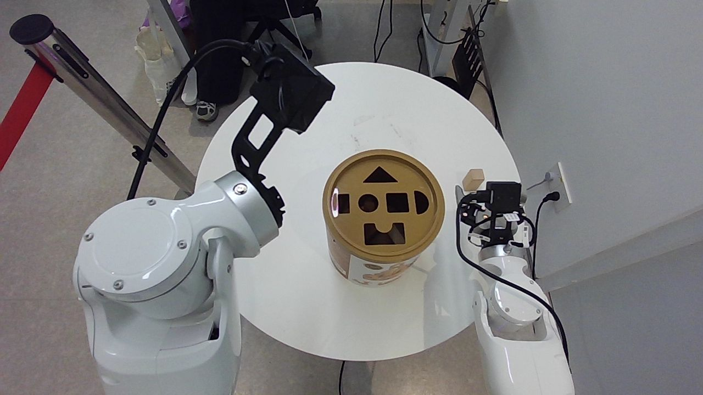
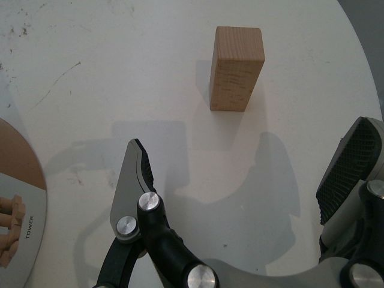

# 两次首发前拒绝的原始请求对照

两条真实请求都在本次技能首发前结束。第一条证明辅助相机增加被误判成身份变化，第二条留下了候选终点复算超过余量的数值。两例均没有本次候选实际碰撞的证据。

每例配一张当时用来规划的 RGB 图。图片由该帧登记的原始字节转为 JPEG，保留原分辨率，无裁剪、遮盖或标注。两条请求的复核帧 118 和 44 在归档中有帧号和内容哈希，对应 RGB 字节未在现有现场副本找到。配图分别取同一请求的规划帧 109 和 38。第二例于 11 月 9 日发生，属于全部历史基线中为解释分类加选的一条。点击原始数据可查看实际请求号、帧时间、结果、原件位置和 SHA-256。

## 可选相机增加后的撤权

11 月 18 日的 V40 运行 `web-5329da48dda549d8ab7e8921e88597cd` 中，请求 `8dbcccb38c734963b051f0cd2741d56c` 正准备接近方块。规划观测 109 有头部和右腕各一路 RGB 与深度；复核观测 118 多了一路左腕 RGB。共有流身份无变化，已规划 3 个路点。控制端记录 `revalidation_camera_identity_changed`，本请求实际首发数为 0。

在同一请求、两帧观测和同一条路径的对照中，V40 去掉新增的左腕图后通过。V42 保留左腕图也通过 140 次细分扫掠，得到 76 行平滑输出；输出被送到内存，后续跟随反馈为模拟。[同请求原始数值与三组回放](optional-camera.json)

**分类 1。** 这里建议将这次相机身份撤权记为非物理拒绝。共有流的相机、标定或时钟域确实改变时继续按相应硬保护处理。这个实例是否符合你对“相机身份误撤权”的统计口径？

## 抓取候选的终点误差超过估计余量

11 月 9 日的 `web-f7234e2584884f6a9310f5ef3d1ea8c1` 在规划观测 38、复核观测 44 上处理抓取请求 `4d54d1d81cdf4411928f0fa59e30ec4a`。控制端在首发前报告 `revalidation_endpoint_outside_remaining_clearance`，标记零运动、可重试。终端回执的 `diagnostic.metrics` 是空对象。

同请求的冻结复算记录了 0.955007 毫米端点平移、0.194171° 端点转角、249.413359 毫米作用半径。平移加转角带来的位移上界为 1.800248 毫米，门限为 1.695021 毫米，超出 0.105227 毫米。这个量描述候选的端点误差上界，现场没有这次候选运动或碰撞的回执。[原请求、冻结判据与独立 FK 核对](endpoint-clearance.json)

**分类 2。** 依 Claude 的基线定义，原因不清先计入非物理拒绝。这里建议暂归该类，另列“候选终点超界”，保留原路径保护。若将几何预测单列为物理保护触发，是否要与有现场限位、碰撞或反馈失联回执的次数分别统计？
