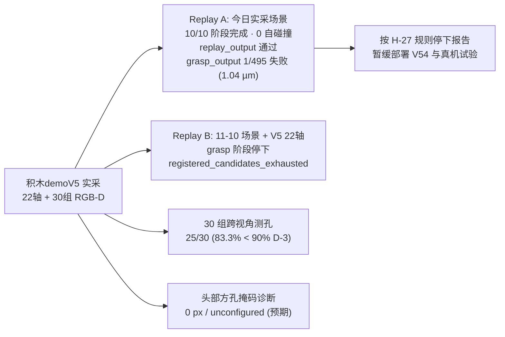

# H-27：“积木demoV5”姿态下零输出回放、跨视角测孔回归与头部方孔掩码诊断

> **结论与停点判定（按规格停下，未请用户做真机试验）**：
> 1. **第 1 项零输出回放未通过输出审计（触发停下条件）**：使用今日在“积木demoV5”下实采的真实 22 轴关节反馈与头部／右腕 RGB-D 跑正常放置全流程零输出回放（Replay A），**10 个阶段全部走完**（`outcome=success`、`hardware_outputs=0`、`paid_model_calls=0`、`wall_s=39.36s`），**右臂与左臂全程 0 自碰撞**（全 1,810 行发射命令 `gate.check_preventive` 0 失败、最小净空 `3.086 mm` 位于 `arm_R_Link7` 与 `body_Link5` 之间、`arm_R` 与 `arm_L` 从未成为最近碰撞对），`replay_output` 审计通过；但 **`grasp_output` 审计未通过**（495 样本中有 **1 处** `contact_and_support_sweeps_clear=false`：起升首步 `support_lift` 时积木角点 0 距桌面平面初始高度 `0.5189 mm <= 1.0 mm` 容差，关节插值产生 **`1.037 µm`** 下探，`native_failures=0`）。另作对照：若用 11-10 旧场景几何拼接今日 V5 22 轴（Replay B），第 2 阶段 `grasp` 因 `registered_candidates_exhausted`（`cartesian_no_progress`，第 14/16 路点）停在 `pending_review`。因严格通过条件要求“10 个阶段走完，输出审计通过，硬件输出为 0”，本轮按 H-27 规格停下报告，未部署 V54，未请用户做真机试验。
> 2. **第 2 项 30 组跨视角测孔回归：25/30（83.3%）——低于 90%（D-3）参考线**。失败 5 组原因均为 `fixture_relocalization_aperture_not_square`。按规格此项不挡第一批试验；后续试验若停在 S5，直接按 H-07 既定结论处理。
> 3. **第 3 项头部方孔掩码诊断**：属于对照表第 1 行（**掩码像素为 0，播种无结果**，`seed_reason=semantic_entity_unconfigured`）——没有模型提示时方孔在头部视角不会被分割出来，固定程序下属于预期，未作修复。
> 4. **第 4 项站点配置左臂数值只读盘点**：已在 V54 候选包 `f1-llm-8818976408ce` 中完整列出文件名与键名，未修改任何站点文件。

---

## 一、采样前提与真实关节状态（零硬件输出）

- **时间与姿态**：2026-11-26，F1-09 处于用户调整后的“积木demoV5”姿态，全程只读订阅 ROS 2 话题（`hardware_publishers=0`，未发送任何控制命令，未重启 4242）。
- **实测 22 轴关节状态（度，取自 `/hal/joint_states` 样本 0）**：
  - `arm_l_j1..j7`：`[56.416, -77.317, -76.892, -119.474, 8.665, 53.199, -53.832]`（`arm_l_j2` 距 −94.0° 下限余量 **16.683°**）
  - `arm_r_j1..j7`：`[-71.824, -88.022, 91.903, -85.465, -2.319, 0.789, -2.486]`
  - `head_j1..j3 + body_j1..j5`：`[0.002, -14.997, -0.005, 0.002, 0.0, -59.597, -68.790, -29.967]`
- **实测 V5 场景（样本 `s00` 经 V54 正式感知管线与跨视角测孔解算）**：
  - `square-1`（右腕 RGB-D）：`[0.8124, -0.2583, 0.5470]` m
  - `bucket-visible-aperture-rings`（头部 RGB-D）：`[0.6351, -0.0568, 0.7726]` m
  - `square-hole-1`（左腕 + 头部跨视角）：`[0.6416, -0.0556, 0.7671]` m

---

## 二、第 1 项：正常放置零输出回放（`v5-live-replay-summary.json`、`v5-live-grasp-output-audit.json`）

使用冻结候选 **V54**（`8818976408ce`）代码与站点配置执行全流程零输出回放（`follower=approved-output`、`--planner baseline`、`hardware_outputs=0`、`physical_motion=false`）。

### 2.1 Replay A（主验收：今日 V5 实采 RGB-D + 今日 V5 22 轴）

| 指标 | 结果 | 说明 |
|---|---|---|
| 阶段完成 | **10 / 10**（`outcome=success`） | `approach_grasp → grasp → verify_grasp → transfer_above_hole → inspect_in_hand → align → insert → release → verify_placed → withdraw_reset` |
| 硬件输出 / 模型调用 | `0` / `0` | 全程零输出、零付费模型调用，耗时 `39.36 s` |
| `replay_output` 输出审计 | **通过** | 共 1,810 行输出；`complete_publications=true`、`immutable_left_arm=true`、`sampled_speed_within_profile=true`（最大 `30.00 deg/s`）；`transfer_above_hole`（1,061 扫掠）和 `withdraw_reset`（1,211 扫掠）全部通过 |
| 右臂与左臂自碰撞核查 | **0 碰撞、0 失败** | 对全部 1,810 行发射命令运行正式 `gate.check_preventive`：0 失败；全局最小净空 **`3.086 mm`**（行 761，`arm_R_Link7` ↔ `body_Link5`）；`arm_R` 与 `arm_L` 在全部 1,810 行中 **0 次**成为最近碰撞对 |
| `grasp_output` 输出审计 | **未通过（exit 1）** | `native_path_clear=true`（`native_failures=0`）、`closure_fingertip_within_registered_goal=true`（位置误差 `0.458 mm`）、`registered_stage_and_gripper_sequence=true`，但 `contact_and_support_sweeps_clear=false`（495 样本中 1 处失败） |

**唯一审计失败明细**（`v5-live-grasp-output-audit.json`）：
- 位置：`grasp` 阶段输出行 `148 / 228`，`phase = "support_lift"`（闭爪保持结束 `closure_arrival_ns=16903732582` 后的第 1 个起升步 `virtual_ns=16963952312`，`fraction=1.0`）。
- 数值：实测积木角点 0 距标定桌面半空间的初始距离 `initial_min_m = 0.00051890 m`（`0.519 mm`，小于 `registered_object_margin_m = 1.0 mm`），步末 `final_min_m = 0.00051787 m`，单步下探量 **`downward_excursion_m = 1.037e-06 m`（1.04 µm）**；`unheld_tool_sweep_clear = true`，`native_failures = []`。
- 机理：`attached_object_sweep_clear` 在距桌面 `<= 1.0 mm` 时执行严格单调离桌判定（`distances[1] >= distances[0] - 1e-9`）。由于现场 `s00` 测得的积木底面初始高度为 `0.519 mm`（落入 `<= 1.0 mm` 区间），Ruckig 从闭爪静止切换到起升的第 1 个关节空间步在末端弧线上产生了 `1.04 µm` 微小下降，被审计脚本拦截；其余 237 个 `support_lift` 样本及全部 `preclosure`（238）、`closure_hold`（19）均通过。

### 2.2 Replay B（对照：11-10 旧场景几何 + 今日 V5 22 轴，`v5-nov10-replay-summary.json`）

| 阶段 | 结果 | 原因与明细 |
|---|---|---|
| `approach_grasp` | `success` | `owner_arrival_and_fresh_scene`（无左臂碰撞） |
| `grasp` | **`pending_review`（停下）** | `numerical_plan_rejected:registered_candidates_exhausted`；`termination=cartesian_no_progress`，卡在笛卡尔路点 `14 / 16`（`iterations=81`、`solves=67`、`cartesian_stalled_ticks=25`），`position_error_m=1.289 mm`、`rotation_error_rad=1.92e-6`，`grasp_strategy=tcp_pitch`、`grasp_pitch_offset_deg=30.0`，终止右臂关节 `[-8.24, -75.45, 69.87, -6.97, -18.08, 2.40, 58.57]` deg，`min_constraint_margin_rad=0.3237`，`active_planes=[]`（非限位、非自碰撞）。 |

---

## 三、第 2 项：30 组跨视角测孔回归（`cross-view-regression-30.json`）

> **低于 90%（D-3）参考线**：30 组同步“头部 RGB + 头部深度 + 左腕 RGB”中，**25 / 30（83.3%）** 成功重建方孔，低于 90% 参考线。按 H-27 规格此项不阻挡 H-21 第一批试验；后续试验如停在 S5，直接按 H-07 既定结论处理。

| 统计项 | 数值 |
|---|---|
| 总样本组数 | 30（V5 姿态同次只读采集） |
| 重建成功 | **25 / 30（83.3%）** |
| 失败组数与原因分布 | **5 组**，全部为 `fixture_relocalization_aperture_not_square`（样本索引 6、8、11、15、22） |
| 失败样本特征检测 | 左腕全部检出 `square=2, triangle=1, circle=1`；头部全部检出 `square=2, triangle=1, circle=1..3`；时间差 `19.02–29.80 ms` |
| 成功样本方孔位置范围 | `x ∈ [0.6397, 0.6417]` m，`y ∈ [-0.0560, -0.0555]` m，`z ∈ [0.7670, 0.7673]` m；地标重投影误差 `0.779–1.654 px` |

---

## 四、第 3 项：头部方孔掩码诊断（`head-hole-mask-diagnostic.json`、`head-roi-crop.jpg`）

- **头部搜索区裁剪图**：`head-roi-crop.jpg`（ROI `[307, 28, 1229, 720]`，文件大小 `98,076` 字节 ≤ 300 KB）。
- **判定依据**（`scene_pipeline.py:1113-1117`）：方孔掩码 `>= 20 px` 且与积木掩码重叠 `<= maximum_overlap_fraction (0.05)` 才判为直接可见。
- **实测结果**：
  - `ConfiguredMaskProvider('head')`（无模型提示，`require_explicit_target_prompt=true`）：`returned_masks = {}`，`hole_mask_pixels = 0`，`block_mask_pixels = 0`，`overlap_fraction = 0.0`，`directly_visible_per_line_1117 = false`。
  - SAM 服务 `discover` 播种探针（`square-hole-1`）：`mask_pixels = 0`，`score = 0.0`，`seed_attempted = true`，`seed_backend = null`，`seed_reason = "semantic_entity_unconfigured"`，`identity_status = "unresolved"`。
  - 对比：`square-1` 在头部全图语义检索返回 2 个候选（`semantic_scope_ambiguous_or_empty`）。
- **结论分类（对照表第 1 行，不做修复）**：**掩码像素为 0，播种无结果**——没有模型给提示时，方孔在头部视角不会被分割出来；固定程序下属于预期。

---

## 五、第 4 项：站点配置中写死的左臂数值只读盘点（`site-left-arm-audit.json`）

对 V54 冻结候选站点目录 `f1-llm-8818976408ce/` 中全部 JSON 文件执行只读检索，未作任何修改：

| 文件名 | 键路径 | 当前写死值（度） / 说明 |
|---|---|---|
| `controller.local.json` | `f710_home.joints.arm_l_j1..j7` | `[69.98, -91.57, -89.16, -85.88, 0.31, -0.16, -0.29]`（来源预设：`积木demo-V1` / `4b88bb21...`） |
| `numerics.local.json` | `spec.gate.config.f710_home.joints.arm_l_j1..j7` | 同上（`积木demo-V1` / `4b88bb21...`） |
| `numerics.local.json` | `spec.gate.full22[0:7]` | `[110.0, -90.0, -90.0, -110.0, 0.0, 0.0, 0.0]`（门控默认回退 22 轴参考） |
| `numerics.local.json` | `spec.gate.limits[0:7]` | 7 轴软件限位（`arm_l_j2` 已收回 `[-94.0, 120.0]`） |
| `gateway.local.json` | `scene.full22_reference[0:7]` | `[69.02, -92.12, -88.91, -88.21, 0.46, -0.83, -0.72]`（`scene.max_age_ms = 500 > 250`） |
| `controller-reuse.json` | `deployment_preparation.arm_l_j2_limit_reclaimed_deg` | `[-94.0, 120.0]`（限位收回记录） |
| `plan.local.json` | 无左臂关节写死值 | `success_posture_prior` 仅包含 7 轴右臂软先验 |
| `masks.local.json` | `cameras` 键含 `left` 配置 | 仅相机参数，无左臂关节数值 |
