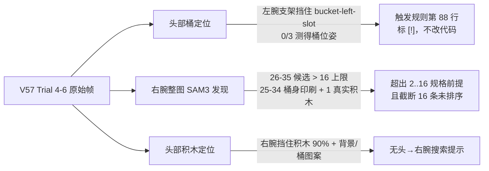

# H-36 第 0 步离线复现报告：双条件阻塞，标 `[!]`，不改代码（2026-11-26）

- 对应条目：`review-round5.md` H-36 第 0 步门槛
- 复现环境：V57 冻结 SAM3 种子服务（`127.0.0.1:19842`）+ V57 Trial 4–6 原始机载网关 RGB-D 帧与失败快照
- 结论：**第 0 步门槛未满足，按规格标 `[!]`，不修改任何代码**

**两个独立事实同时触发了 `review-round5.md` 的 `[!]` 停改条件。** 一是三次运行中头部相机均未测得桶位姿（`independent_fixture` 可用数为 0），因为 `积木demoV5` 预设下的左腕相机支架在头部主视角里直接遮挡了桶盖左槽锚点 `bucket-left-slot`，导致 `locate_fixture` 与 `locate_unprompted_bucket` 全部失败；按规则第 88 行，拿不到同次运行头部实测桶位姿时不得改代码，直接标 `[!]`。二是右腕整图 SAM3 发现返回了 **26–35 个候选**（超过规格中 `2..16` 的上限，且 `semantic_candidate_summary` 仅截断前 16 条未排序条目），其中 25–34 个是桶身纸箱插画上的印刷小木块（`x <= 99 px`，面积 `83–660 px`，分数 `0.20–0.71`），1 个是真实木方块（`x = 376–489 px`，面积 `6,980–7,079 px`，分数 `0.973–0.977`）。

**头部同时没有找到真实积木。** 在 Trial 4–5 中，真实木方块约 90% 被右腕相机与夹爪遮挡（仅露出一角，面积 `819–898 px`，分数 `0.45–0.58`），叠加左上角背景纸箱角（`[0, 0, 46, 79]`，面积 `1,021–1,058 px`，分数 `0.45–0.59`），头部 SAM3 返回 2 个候选报 `semantic_scope_ambiguous_or_empty`；Trial 6 桶身印刷图案同样进入头部视野，返回 13–28 个候选。

## 1. 复现汇总表

| 试验 | Run ID | 采样失败快照数 | 右腕 SAM3 候选总数（`summary` 截断） | 真实木方块候选（框 / 面积 / 分数） | 桶身印刷干扰候选 | 头部实测桶位姿 | 头部未测得桶位姿原因 | 头部积木未找到原因 |
|---|---|---:|---:|---|---|---|---|---|
| V57 Trial 4 | `web-31d266ffe7284581966c9d2b174fb93e` | 2（共 15 blobs） | 26–31（截断 16） | `[391, 196, 488, 298]` / `7,064–7,079 px` / `0.973` | 25–30 个（`x <= 99 px`，面积 `83–660 px`，分数 `0.20–0.71`） | **无**（0/2） | `fixture_relocalization_anchor_missing:bucket-left-slot` + `bucket_landmark_registration_unavailable`（左腕支架遮挡左槽） | 2 候选：右腕遮挡积木（`819–898 px`）+ 左上背景纸箱角 |
| V57 Trial 5 | `web-bbdfb13634e64694bfd5869611481fe2` | 2（共 15 blobs） | 27–32（截断 16） | `[384, 194, 481, 297]` / `7,034–7,042 px` / `0.973–0.977` | 26–31 个（`x <= 99 px`） | **无**（0/2） | 同上（左腕支架遮挡 `bucket-left-slot`） | 同上（2 候选） |
| V57 Trial 6 | `web-a1e9a264ec114fe4800a51d5112819dd` | 2（共 15 blobs） | 30–35（截断 16） | `[376, 193, 471, 296]` / `6,980–7,005 px` / `0.977` | 29–34 个（`x <= 99 px`） | **无**（0/2） | 同上（左腕支架遮挡 `bucket-left-slot`） | 13–28 候选（桶身侧壁印刷木块进入头部画面） |

## 2. 视觉证据（左腕遮挡 `bucket-left-slot`）

- [trial-04-head-left-occludes-slot.jpg](trial-04-head-left-occludes-slot.jpg)（68.6 KB）：Trial 4 头部矫正画面，可见 `积木demoV5` 下左腕相机支架压在桶盖左侧，完全遮住 `bucket-left-slot`。
- [trial-06-head-left-occludes-slot.jpg](trial-06-head-left-occludes-slot.jpg)（68.7 KB）：Trial 6 头部矫正画面，同样遮挡 `bucket-left-slot`，且桶身正面印刷积木进入画面。

> **供 H-38 参考的数据**：本次复现直接证明 `积木demoV5` 左臂静态预设在桶前移（`x >= 0.67 m`）时会遮挡头部视野中的 `bucket-left-slot`，导致 S0 阶段头部无法定位桶体。若后续重新设计 H-36 或调整左臂静态预设（H-38），需先解决左腕遮挡头部看桶盖左槽的问题，同时考虑右腕 SAM3 候选数超过 16 且未按面积/分数截断的事实。

## 3. 证据文件

- [step0-reproduction.json](step0-reproduction.json)：6 帧原始失败快照的完整右腕候选、头部候选与头部桶定位失败诊断。
- [manifest.json](manifest.json)：本目录文件清单与 SHA256。
