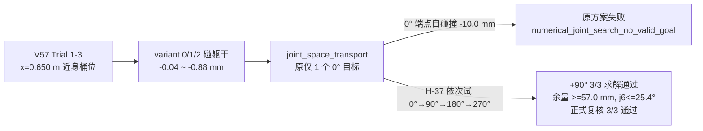

# H-37 近身桶位运输离线诊断与修复验证报告（2026-11-26）

- 对应条目：`review-round5.md` H-37（P0，预授权条件修复）
- 修改文件：`HARNESS/src/f1_harness/transport.py`、`HARNESS/src/f1_harness/joint_motion.py`、`HARNESS/src/f1_harness/skill_services.py`、`HARNESS/tests/test_joint_transport.py`
- 结论：**诊断确认预授权条件完全成立，已完成四向对称朝向实现并通过离线重规划、正式复核与单测验证（未放宽任何碰撞余量、碰撞模型、关节限位或 H-33 的 50° 范围；净新增 `raise HarnessError` = 0）**

**近身桶位（`[0.650, -0.051]` m）运输失败的直接原因是 `joint_space_transport` 仅构造了 1 种绕方孔竖直轴的朝向（`0°`）。** 离线重跑 V57 Trial 1–3 的原始 `harness_planning_started` 输入显示：候选 variant 0/1/2 在第 11 号关节索引处被 `arm_R_Link5 / body_Link5` 自碰撞拒绝（余量 `-0.036 mm` 至 `-0.876 mm`），variant 3 因笛卡尔无进展退出；回落到 `joint_space_transport` 后仅尝试 1 个目标（偏移 `[0, 0]`、`0°` 朝向），3 个 IK 拟合解全部在原生自碰撞门被拒（`arm_R_Link5 / body_Link5` 余量 `-10.0 mm`）。

**按预授权方案给 `joint_space_transport` 补齐 `0° → 90° → 180° → 270°` 四个等价对称朝向后，3/3 近身失败试验全部规划并复核通过，对照组不受影响。** 在相同位置与倾角下，绕孔口竖直轴旋转 `+90°` 使 V57 Trial 1–3 全部在 `4.37–5.48 s` 内（OMPL 耗时 `0.28–0.47 s`）求出安全路线，`arm_r_j6` 最大值仅 `20.16°–25.36°`（远低于 `50°`），全路径最小自碰撞余量提升至 **`57.05–58.71 mm`**，且全部通过 `PlanService.dispatch('revalidate_plan', ...)` 正式复核；V56 Trial 1（`[0.660, -0.064]` m）与 V54 Trial 3（`[0.661, -0.063]` m）仍优先选中原 `0°` 朝向并保持通过。

## 1. 离线诊断（修改前）

### 1.1 常规候选 variant 0 / 1 / 2 / 3

| 试验 | 桶中心 `[x, y, z]` (m) | Variant 0（`demonstrated`） | Variant 1（`orientation_preserving`） | Variant 2（`outside_bucket_reorientation`） | Variant 3（`other_side`） |
|---|---|---|---|---|---|
| V57 Trial 1 (`web-f7c5d2a3...`) | `[0.6500, -0.0514, 0.7655]` | `arm_R_Link5 / body_Link5`, idx `11`, **`-0.0363 mm`** | `arm_R_Link5 / body_Link5`, idx `11`, **`-0.4154 mm`** | `arm_R_Link5 / body_Link5`, idx `11`, **`-0.3297 mm`** | `bounded_IK_did_not_reach_goal`（wp `40`, `cartesian_no_progress`） |
| V57 Trial 2 (`web-82094dda...`) | `[0.6494, -0.0514, 0.7670]` | `arm_R_Link5 / body_Link5`, idx `11`, **`-0.8760 mm`** | `arm_R_Link5 / body_Link5`, idx `11`, **`-0.6439 mm`** | `arm_R_Link5 / body_Link5`, idx `11`, **`-0.2309 mm`** | `bounded_IK_did_not_reach_goal`（wp `43`, `cartesian_no_progress`） |
| V57 Trial 3 (`web-f8b24285...`) | `[0.6499, -0.0514, 0.7657]` | `arm_R_Link5 / body_Link5`, idx `11`, **`-0.6960 mm`** | `arm_R_Link5 / body_Link5`, idx `11`, **`-0.5081 mm`** | `arm_R_Link5 / body_Link5`, idx `11`, **`-0.3633 mm`** | `bounded_IK_did_not_reach_goal`（wp `40`, `cartesian_no_progress`） |
| V56 Trial 1 对照 (`web-0a935b52...`) | `[0.6600, -0.0635, 0.7649]` | `arm_R_Link5 / body_Link5`, idx `11`, **`-0.9464 mm`** | `planning_joint_envelope_exceeded` | `arm_R_Link5 / body_Link5`, idx `11`, **`-0.2313 mm`** | `bounded_IK_did_not_reach_goal`（wp `56`, `cartesian_no_progress`） |

### 1.2 `joint_space_transport` 原目标数、被拒原因与绕孔竖直轴朝向

- 原实现（`transport.py:joint_transport_goal`）对单个位置偏移只生成 **1 个目标（`jst_goal_count = 1`，仅 `0°` 朝向）**，且 `skill_services.py` 对 `transfer_above_hole` 仅以该单一朝向调用关节空间搜索。
- 四个对称朝向（`0°, 90°, 180°, 270°`）逐一探查结果：
  - **`0°`**：V57 Trial 1–3 均有 `ik_pose_fit_count = 3`，但 `native_valid_goal_count = 0`，全部在 `endpoint_native` 被拒：`CandidateSafetyRejected: Arm-body collision risk (clearance = -10.0 mm, pair = arm_R_Link5 / body_Link5)`；V56 Trial 1 对照在 `0°` 直接通过。
  - **`+90°`**：V57 Trial 1–3 全部求解成功（6–8 路点，`arm_r_j6 <= 20.73°`）；V56 Trial 1 也可求解（但因 `0°` 排最前，实际优先选 `0°`）。
  - **`180°` / `270°`**：V57 Trial 1–3 与 V56 Trial 1 均在 `endpoint_ik` 阶段无 IK 拟合解（`ik_pose_fit_count = 0`，位置误差 `41–142 mm`）。

## 2. 修改内容与约束核对

1. `HARNESS/src/f1_harness/transport.py`：新增 `JOINT_TRANSPORT_YAW_OFFSETS_DEG = (0, 90, 180, 270)`；`joint_transport_goal(..., yaw_offset_deg=0)` 保持被持方块中心位置与倾角不变、绕孔口竖直轴 `hole[:3, 2]` 旋转，并重新校验最小抬升高度与路线间隙；仅在 `yaw_offset_deg != 0` 时写入 `goal_yaw_offset_deg`；`uses_joint_transport(...)` 校验 `goal_yaw_offset_deg` 合法性。
2. `HARNESS/src/f1_harness/joint_motion.py`：`reconstruction(...)` 透传 `proposal.geometry_trace[0].get('goal_yaw_offset_deg', 0)`，保证复核重建与原规划朝向一致。
3. `HARNESS/src/f1_harness/skill_services.py`：在 `_solve_candidate` 内对 `joint_search and intent.skill == 'transfer_above_hole'` 按 `0° → 90° → 180° → 270°` 顺序尝试，原朝向 `0°` 优先；并将 `goal_yaw_offset_deg` 同步到末段 `geometry_trace[-1]`。保留 `_solve_candidate` 原签名，净新增 `raise HarnessError` = `0`。
4. 未改动任何碰撞余量、碰撞模型、躯干几何、关节限位、H-33 `50°` 范围或数值服务代码。

## 3. 修改后离线重规划与正式复核验收

通过真实 `PlanService.dispatch('plan_skill', ...)` 与 `PlanService.dispatch('revalidate_plan', ...)`（加载 V57 同款 `planning_joint_envelope_deg: {"arm_r_j6": [-60.0, 50.0]}` 与 `arm_l_j2: [-94.0, 120.0]`）重跑 5 次真实记录：

| 试验 | 桶位 `[x, y, z]` (m) | 规划结果 | 选中朝向 | 路点数 | `arm_r_j6` 范围（`≤50°`） | 全路径最小自碰撞余量（最近碰撞对） | 规划耗时 | 正式复核 `revalidate_plan` |
|---|---|---|---|---:|---:|---|---:|---|
| **V57 Trial 1** | `[0.6500, -0.0514, 0.7655]` | **PASS** | **`+90°`** | 7 | `-2.31° ~ 25.36°`（通过） | **`58.710 mm`**（`arm_L_Link3 / body_Link5`） | `4.37 s`（OMPL `0.28 s`） | **PASS**（`2.42 s`） |
| **V57 Trial 2** | `[0.6494, -0.0514, 0.7670]` | **PASS** | **`+90°`** | 7 | `-1.14° ~ 20.16°`（通过） | **`58.703 mm`**（`arm_L_Link3 / body_Link5`） | `4.40 s`（OMPL `0.29 s`） | **PASS**（`2.45 s`） |
| **V57 Trial 3** | `[0.6499, -0.0514, 0.7657]` | **PASS** | **`+90°`** | 9 | `-2.39° ~ 24.45°`（通过） | **`57.047 mm`**（`arm_R_Link3 / body_Link5`） | `5.48 s`（OMPL `0.47 s`） | **PASS**（`3.33 s`） |
| **V56 Trial 1（对照）** | `[0.6600, -0.0635, 0.7649]` | **PASS** | **`0°`**（不变） | 9 | `14.25° ~ 20.46°`（通过） | `11.894 mm`（`arm_R_Link7 / body_Link5`） | `7.51 s`（OMPL `0.41 s`） | **PASS**（`3.37 s`） |
| **V54 Trial 3（对照）** | `[0.6606, -0.0627, 0.7723]` | **PASS** | **`0°`**（不变） | 9 | `16.97° ~ 21.74°`（通过） | `11.254 mm`（`arm_R_Link7 / body_Link5`） | `4.97 s`（OMPL `0.39 s`） | **PASS**（`3.18 s`） |

- 单元测试：`HARNESS/tests/test_joint_transport.py` 新增 3 条单测（四向几何位置与倾角保持、`0°` 优先回落顺序、`uses_joint_transport` 与 `reconstruction` 复核朝向绑定），定向套件 `20 passed`。

## 4. 证据文件

- [diagnosis.json](diagnosis.json)：修改前 V57 Trial 1–3 与 V56 Trial 1 的 variant 0–3 及 `joint_space_transport` 四向探查原始数据。
- [replan-verification.json](replan-verification.json)：修改后 5 次真实记录通过真实 `PlanService` 规划、全路径自碰撞余量审计与 `revalidate_plan` 复核的完整输出。
- [manifest.json](manifest.json)：本目录文件清单。
