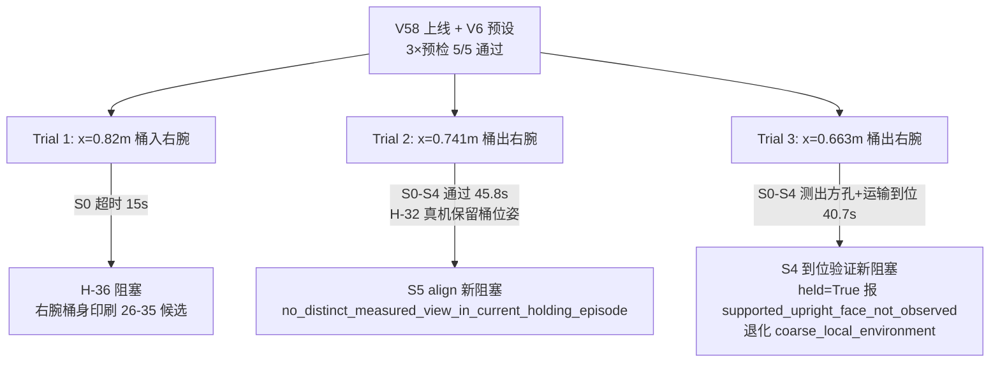

# V58 真机批次验收与新阻塞报告（2026-11-26）

- 版本：**F1 Harness 近身对称朝向关节空间运输 V58**（`cfc9b2ad5696`，含 H-37 + H-32 + H-33 + `fastdds-udp`；不含 H-36）
- 预检：在用户新建静态预设 **V6** 下连续 **3 次只读预检全部 5/5 通过**
- 批次结果：共运行 **3 次真机试验**（因先后暴露 3 个不同阶段的阻塞，操作者要求停下汇总交 Claude 审阅）；全程 **0 次安全事件、0 次 `motion_stalled`、0 次 `camera_sample_feedback_aged:right`、尚无 S8 放置成功**

**V58 上线后，用户的静态左臂新预设 V6 彻底清除了头部主视角遮挡，但在 3 次真机试验中精确暴露出 S0、S5、S4 到位验证三处阻塞。** Trial 1（桶身入右腕）复现 H-36 停在 S0；Trial 2（桶在 `x = 0.741 m`）一路冲过 S0–S4 到达 S5，**H-32 首次在真机触发并成功保留桶位姿**，但因抓起后从未测出方孔导致 `observation_move_reason = no_distinct_measured_view_in_current_holding_episode` 而未执行让开视野；Trial 3（桶拉近至 `x = 0.663 m`）在运输前成功测出方孔且顺利运到桶上方，但到位后对已持块（`held=True`）触发 `object_pose_unavailable:supported_upright_face_not_observed`，场景退化为 `coarse_local_environment`（`fixture=None`）并超时停下。

**H-37 的 `+90°` 对称朝向在离线 3/3 通过，但在本批真机尚未触发。** Trial 2（`x = 0.741 m`）与 Trial 3（`x = 0.663 m`）都在原 `0°` 朝向下由 `joint_space_transport` 一次求解通过（`arm_r_j6 <= 31.08°` 与 `<= 21.33°`，重验到首发 `0.0236 s` 与 `0.0189 s`），均未进入 `[0.650, -0.051]` m 的近身触发区；H-37 近身真机验收建议与下一版 H-36 及 S4/S5 修复一并补完。

## 1. 阶段漏斗与指标汇总

| 指标 | V58 批次结果（共 3 次） |
|---|---|
| 连续 3 次预检（V6 预设） | **3/3 通过（5/5）**；`arm_l_j2 = -47.32°`（限位 `[-94°, 120°]`）；`fixture` 稳定解出 192 / 87 / 233 次 |
| S0 观测就绪 / S1 接近 / S2 抓取 / S3 验抓 | 2 / 3（Trial 1 停在 S0，因 H-36 未合入且桶身进入右腕） |
| S4 `transfer_above_hole` 物理到位 | 2 / 3（Trial 2 & Trial 3 均由 `joint_space_transport` 规划发布并物理到位；重验到首发 `0.0189–0.0236 s`） |
| S4 到位后验证通过 / 到达 S5 `align` | 1 / 3（Trial 2 到达 S5；Trial 3 到位后退化 `coarse_local_environment`） |
| S6 `insert` / S7 `release` / S8 `placed` | 0 / 3 |
| H-36 生效次数 / S0 分割失败次数 | H-36 未合入（`[!]`）；S0 分割失败 1 次（Trial 1） |
| H-37 近身 `+90°` 触发次数 | 0 次（Trial 2 在 `x=0.741 m`、Trial 3 在 `x=0.663 m`，原 `0°` 即可解） |
| H-32 遮挡保留生效 / 让开成功 / 让开后测孔 / `retention_expired` | 保留生效 **1 次**（Trial 2，确认 `retained_static_fixture`）；让开成功 **0 次**（缺历史视点）；让开后测孔 **0 次**；`static_fixture_retention_expired` **0 次** |
| H-33 `arm_r_j6` 规划与实测最大值 | Trial 2 规划 `31.08°` / 实测 `31.01°`；Trial 3 规划 `21.33°` / 实测 `21.89°`（均 `≤ 50°`） |
| `motion_stalled` / `camera_sample_feedback_aged:right` / 安全事件 | **0 / 0 / 0** |

## 2. 两处新暴露的 S5 / S4 根因证据

### 2.1 Trial 2（S5 `align`：H-32 保留成功，但无历史方孔视点导致不让开）

- 证据：`runs/v58-trial-02-web-7fce1b96/owner-trace.jsonl`、`planner-trace.jsonl`；代码位置 `src/f1_harness/live_scene.py:93-110` 与 `src/f1_harness/recovery_programs.py:382-393`。
- 现象：Trial 2 桶在 `[0.7414, -0.0302, 0.7745]` m。`transfer_above_hole` 到位后右臂遮挡头部，H-32 触发 `static_fixture_retained_while_held_arm_occludes_head`（`fixture_collision_geometry = True`），左腕也识别到 `square` / `triangle` / `circle`。
- 阻塞点：`left_aperture_observation` 输出 `observation_move_reason = "no_distinct_measured_view_in_current_holding_episode"`。因为在本次持块期间（`grasp → verify_grasp → transfer_above_hole`）头部一直报 `aperture_not_directly_visible`、从未记录过 `aperture_viewpoint`，导致 `recover_alignment` 没有任何 `observation_move` 候选可执行让开。

### 2.2 Trial 3（S4 运输到位后：持块触发 `supported_upright_face_not_observed`，退化 `coarse_local_environment`）

- 证据：`runs/v58-trial-03-web-a4d29078/owner-trace.jsonl`、`planner-trace.jsonl`；代码位置 `src/f1_harness/surface.py:99-100` 与 `src/f1_harness/scene_pipeline.py`。
- 现象：Trial 3 桶拉近到 `[0.6635, -0.0331, 0.7716]` m。运输前 `OBS:48–49` 完整测出了持块 `square-1`（`held=True`、`eef_object_pose` 有效）与方孔 `square-hole-1`（`[0.6642, -0.0339, 0.7679]` m）。随后 `transfer_above_hole` 规划、复核并物理到位（`32.34 s → 40.69 s`）。
- 阻塞点：到位后的 `OBS:114–146`（连续 78 次 / 15.0 s）中，虽然 `square-1` 明确为 `visible=True, held=True`，系统仍报 `object_pose_unavailable:supported_upright_face_not_observed`，将 `square-1.pose` 与 `eef_object_pose` 置空、同时丢弃 `fixture`（`fixture=None`），场景退化为 `coarse_local_environment`，引发 `post_motion_verification_unavailable:post_motion_scene_not_ready:local_environment_only_supports_world_observation_motion` 及 15 s 超时停下。

## 3. 证据文件

- [funnel.json](funnel.json)：3 次 V58 真机试验结构化漏斗与指标。
- [preflight-3x-summary.json](preflight-3x-summary.json)：V6 预设关节角及连续 3 次预检结果与本机 `result.json` SHA256（原始大文件留存 6000D）。
- [layouts.md](layouts.md)：V6 预设与逐次摆位记录。
- `runs/v58-trial-{01,02,03}-*/{owner-trace.jsonl,planner-trace.jsonl}`：3 次试验脱敏原始轨迹。
