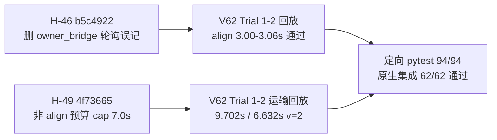

# H-46 与 H-49 修复与离线验收（2026-11-27）

**H-46（删除运动途中轮询的接触故障误记）与 H-49（除 `align` 外 IK 规划预算回到 7.0 秒）已完成实现、单元测试、原生集成测试及 V62 Trial 1–2 原始记录回放验证。** 两项修复均只改 `HARNESS/src/f1_harness/`，未触碰 `DAgger`、碰撞模型、关节限位、感知阈值或插入容差。

在 V62 Trial 1–2 的真实运输输入上，H-49 把 `transfer_above_hole` 在 6000D 上的规划耗时从 V62 的 12.205 秒压回到 **9.702 秒（Trial 1）**与 **6.632 秒（Trial 2）**，继续命中 `variant=2`（`joint_space_transport`）；H-46 去掉 `owner_bridge.py:1399-1400` 误记后，V62 Trial 1–2 运输到位缓存方孔均有效（年龄 14.59 s / 7.09 s ≤ 45 s），`align` 均在 3.00–3.06 秒解出 `v=1` 并通过 `revalidate_plan` 与真实 `F1Owner`/Ruckig 零输出审计（完整四段放行校验见 [H-47 报告](../20261127-H47-placement-dry-run/report.md)）。

## 一、H-46：删除运动途中轮询的接触误记（提交 `b5c4922`）

### 改动范围
- `HARNESS/src/f1_harness/owner_bridge.py`：删除原第 1399–1400 行在飞行途中 `check_waypoint` 返回 `proof.get('accepted') is False` 时调用 `self.engine.record_contact_fault('waypoint_tracking_failed', now_ns)` 的两行。
- 保留三处真实故障记录：`engine.py:761`（`motion_stalled`）、`engine.py:586`（已发布动作以非成功结束）、`engine.py:851`（撤权／停止）。

### 测试结果
- 新增 2 例回归测试于 `HARNESS/tests/test_cached_pre_transport_aperture.py`：
  1. `test_h46_inflight_waypoint_polling_false_then_true_does_not_record_contact_fault`：验证飞行中 `check_waypoint` 先返回 `accepted=False` 再返回 `True` 到达后，`engine.last_contact_fault` 保持 `None`，且 H-32 `retained_static_fixture` 与 H-42 `cached_pre_transport_aperture` 均保持有效。
  2. `test_h46_real_faults_still_record_contact_fault`：验证 `complete_stalled_motion`、非成功已发布终态 `complete` 与 `revoke` 三处仍正常记录 `last_contact_fault`。
- 套件验证：`test_cached_pre_transport_aperture.py` + `test_occluded_fixture_retention.py` + `test_held_aperture_view.py` 共 **44 passed（2.36 s）**。

### V62 Trial 1–2 运输到位接续 `align` 回放（6000D，零硬件输出）
| 样本 | 运输前实测 → 到位帧 | 缓存方孔年龄 | `align` 候选 | 路点数 | `arm_r_j6` 范围 | 6000D 规划耗时 | `revalidate_plan` | `F1Owner`/Ruckig 审计 |
|---|---|---:|---|---:|---|---:|---|---|
| V62 Trial 1 | `OBS:114 → OBS:154` | 14.59 s | `v=1` | 17 | `[18.83°, 37.51°]` | 3.064 s | PASS（17 段） | PASS（429 帧，最大 26.52°/s ≤ 30°/s） |
| V62 Trial 2 | `OBS:83 → OBS:102` | 7.09 s | `v=1` | 18 | `[7.55°, 31.91°]` | 3.003 s | PASS（18 段） | PASS（455 帧，最大 26.52°/s ≤ 30°/s） |

## 二、H-49：除 `align` 外 IK 规划预算仍为 7.0 秒（提交 `4f73665`）

### 改动范围
- `HARNESS/src/f1_harness/skill_services.py:707-716`：调用 `numerics.call('solve_path', ..., scene=bounds)` 时，仅 `intent.skill == 'align'` 透传完整 `remaining_s`（受站点 `ik.max_wall_s = 15.0` 约束）；其余所有技能（含 `transfer_above_hole`、`approach_grasp`、`grasp`、`insert`、`withdraw_reset` 等）固定传递 `bounds['planning_budget_s'] = min(remaining_s, 7.0)`（无 `deadline_ns` 时为 `7.0`）。未改动 `DAgger`。

### 测试结果
- 新增 1 例测试 `test_h49_non_align_skills_capped_at_7s_while_align_keeps_full_remaining_budget` 于 `HARNESS/tests/test_align_ik_config_and_order.py`，验证 `transfer_above_hole` 收到 `planning_budget_s == 7.0`（≤ 7.0），`align` 收到 `> 7.0`。
- 套件验证：`test_align_ik_config_and_order.py` + `test_numerical_pool.py` 共 **16 passed（0.77 s）**。

### V62 Trial 1–2 `transfer_above_hole` 6000D 重算对照（站点 `ik.max_wall_s = 15.0`）
| 样本 | 输入观测 | V62（全局 15 s 预算）6000D 耗时 | H-49（非 align 7.0 s 上限）6000D 耗时 | 选中候选与路线 | 路点数 | OMPL RRTConnect 耗时 |
|---|---|---:|---:|---|---:|---:|
| V62 Trial 1 | `OBS:53` | 12.205 s | **9.702 s** | `variant=2`（`joint_space_transport`） | 10 | 0.627 s |
| V62 Trial 2 | `OBS:47` | — | **6.632 s** | `variant=2`（`joint_space_transport`） | 6 | 0.281 s |

## 三、综合回归检查（`harness/round9`，提交 `4f73665`）
- **原生跨工程集成**（`scripts/check_native_integration.py`，导入 `harness/round9` 源码）：**62 passed（0.33 s）**。
- **核心放置／缓存／对准／恢复／返程 pytest 子集**（`test_cached_pre_transport_aperture.py`、`test_align_ik_config_and_order.py`、`test_occluded_fixture_retention.py`、`test_held_aperture_view.py`、`test_numerical_pool.py`、`test_recovery_programs.py`、`test_return_route.py`）：**94 passed（3.11 s）**。
- **稀疏工作树全量 pytest**（排除依赖工作树外同级目录的 `test_mesh_asset_cache.py`、`test_evaluation_seal.py`、`test_evidence_pack.py`、`test_evidence_scope.py`）：**3,013 passed**，0 逻辑回归（失败项全部为稀疏工作树缺少 `.venv` 供 `bwrap` 挂载或缺少同级 `DAgger`/`F1-4242` 路径）。
- **文档与布局检查**（`python3 scripts/check_project_layout.py`）：PASS。
