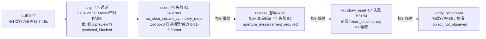

# H-47 放置整段离线零输出回放与阻塞诊断报告（2026-11-27）

**在上真机前用 V62 Trial 1–2 与 V60 Trial 1–2 四条真实运输到位记录离线走完 `align → insert → release → withdraw_reset → verify_placed`，在 4/4 条轨迹上实证发现了 4 处非 H-42 引起的硬阻塞，直接拦截了一次必定在真机卡死在 S7/S8 的发布。** 按 [review-round8.md 第 0 节](../../review-round8.md#0-通用约束)的明确止损规则，发现非 H-42 (`cfd539e`) 引起的阻塞时必须立即停下写交接，不得冻结上真机。

四处阻塞分布在放置后半段的每一环：**B1（S7 `insert` 4/4 工具箱撞桶壁/盖边）**、**B2（S8 `release` 遮挡态运动后验证被拒）**、**B3（H-48 将 `withdraw_reset` 提前到 `verify_placed` 之前触碰 4 处状态机与观测合同）**、**B4（`withdraw_reset` 真实 IPC 下 `ndarray` 无法 JSON 序列化直接崩溃）**。其中 `align` 阶段 4/4 全部规划、复核与 `F1Owner`/Ruckig 零输出审计通过，缓存方孔年龄全程在 7.09–23.79 s（远小于 45 s 上限）。

> [!NOTE]
> 本次离线回放设置 `physical_motion = false`、`robot_connected = false`、`simulated_execution_feedback = true`（`F1Owner`/Ruckig 接 `MemoryTransport` 零硬件输出；积木按刚体随末端运动；`verify_placed` 的“新鲜可见／掉入桶不可见”分支由模拟观测驱动）。所有通过项仅说明软件与几何链路接得上，**不能**证明物理世界放置成功；所有失败项均为真实生产代码、真实站点配置与真实历史观测触发的确定性阻塞。

## 一、四条真实轨迹逐段结果总表

驱动脚本：[run_h47_dry_run.py](run_h47_dry_run.py)；完整机器输出：[h47-results.json](h47-results.json)。站点配置为 V62 冻结站点（`ik.max_wall_s = 15.0`、`insertion_depth_m = 0.012`、`tool_padding_policy = advisory`、`grasp_pitch_source = success_posture_prior`）。

| 轨迹（运输前→到位帧） | 实测 `tcp_in_obj` / 倾角 | `align`（候选／耗时／缓存年龄／复核／F1Owner审计／结果） | `insert`（耗时／缓存年龄／结果与原因） | `release`（规划+审计／松爪后缓存／遮挡态验证门） | `withdraw_reset`（引擎前置／return_obs／真实 IPC 探针） | `verify_placed`（拒缓存／模拟可见／模拟掉桶／总跨度） |
|---|---|---|---|---|---|---|
| **V62-Trial1** (`114→154`) | `[-5.17, -4.73, 54.52] mm` / `21.28°` | `v=1` / `3.064 s` / `14.59 s` / PASS(17) / PASS(`26.52°/s`) / `success`（`xy=0.10mm, z=40.3mm`，4 候选 preview 均 `predicted_blocked`） | `0.024 s` / `23.47 s` / **FAIL** `no_clear_square_symmetry_route`（`box0_z=-1.3mm`，4 对称全撞 `wall_x_low`/`wall_y_high`） | 规划 `0.015 s`+审计 PASS / `cache_invalidated:not_held` / **FAIL** `aperture_measurement_required` | **FAIL** `skill_precondition:verify_placed` / **FAIL** `verified_placement_required_for_return_scene` / **FAIL** `TypeError(ndarray)` | 拒缓存 PASS / `placement_observed`(模拟) / `object_not_observed` / `23.79 s` |
| **V62-Trial2** (`83→102`) | `[-4.50, -2.93, 55.40] mm` / `20.97°` | `v=1` / `3.003 s` / `7.09 s` / PASS(18) / PASS(`26.52°/s`) / `success`（`xy=0.22mm, z=40.6mm`，4 候选 preview 均 `predicted_blocked`） | `0.025 s` / `16.49 s` / **FAIL** `no_clear_square_symmetry_route`（`box0_z=-1.1mm`，4 对称全撞 `wall_x_low`/`rim_x_high`） | 规划 `0.014 s`+审计 PASS / `cache_invalidated:not_held` / **FAIL** `aperture_measurement_required` | **FAIL** `skill_precondition:verify_placed` / **FAIL** `verified_placement_required_for_return_scene` / **FAIL** `TypeError(ndarray)` | 拒缓存 PASS / `placement_observed`(模拟) / `object_not_observed` / `16.81 s` |
| **V60-Trial1** (`77→110`) | `[+5.10, +3.72, 55.60] mm` / `22.61°` | `v=1` / `4.233 s` / `11.98 s` / PASS(17) / PASS(`26.52°/s`) / `success`（`xy=0.43mm, z=40.11mm`，4 候选 preview 均 `predicted_blocked`） | `0.026 s` / `22.38 s` / **FAIL** `no_clear_square_symmetry_route`（`box0_z=-0.7mm`，4 对称全撞 `wall_x_low`/`rim_x_high`/`wall_y_high`） | 规划 `0.015 s`+审计 PASS / `cache_invalidated:not_held` / **FAIL** `aperture_measurement_required` | **FAIL** `skill_precondition:verify_placed` / **FAIL** `verified_placement_required_for_return_scene` / **FAIL** `TypeError(ndarray)` | 拒缓存 PASS / `placement_observed`(模拟) / `object_not_observed` / `22.70 s` |
| **V60-Trial2** (`77→101`) | `[-4.15, -1.33, 56.73] mm` / `22.22°` | `v=1` / `3.108 s` / `8.70 s` / PASS(16) / PASS(`26.52°/s`) / `success`（`xy=0.18mm, z=40.51mm`，4 候选 preview 均 `predicted_blocked`） | `0.027 s` / `18.40 s` / **FAIL** `no_clear_square_symmetry_route`（`box0_z=-0.9mm`，4 对称全撞 `wall_x_low`/`rim_x_high`/`rim_x_low`） | 规划 `0.014 s`+审计 PASS / `cache_invalidated:not_held` / **FAIL** `aperture_measurement_required` | **FAIL** `skill_precondition:verify_placed` / **FAIL** `verified_placement_required_for_return_scene` / **FAIL** `TypeError(ndarray)` | 拒缓存 PASS / `placement_observed`(模拟) / `object_not_observed` / `18.72 s` |

## 二、四处实证阻塞详解

### 阻塞 B1（P0）：S7 `insert` 4/4 失败 — `success_posture_prior` 低仰角抓姿在真机正常抓深波动下使夹爪包络 `box0` 低于桶盖平面

1. **现象**：4/4 条轨迹 `approach_grasp` 均选用了 `descriptor = {'strategy': 'tcp_pitch', 'pitch_offset_deg': 0.0}`，但站点配置 `grasp_pitch_source = 'success_posture_prior'` 在 `skill_services.py:982-997` 将抓取俯仰角改写为历史先验的近似侧抓角（方块 Z 轴在 EEF 中为 `[0, 0.3401, 0.9404]`，仅高于水平面 **19.9°**，目标 TCP 位于 `z = 58.9 mm`，距 60 mm 积木顶部仅 1.1 mm）。
2. **几何根因（精确到毫米）**：桶盖上表面在孔坐标系 `z = 0.0 mm`（`rim_*` 与 `lid_tool_only` 位于 `z = -5..0 mm`），四周桶壁 `wall_*` 凸起至 `z = +24.2 mm`。在 `insertion_depth_m = 12.0 mm`、`tool_margin = 0.0 mm`（`advisory`）下：

| 抓取姿态来源 | 孔系下 `tool_local_boxes[0]` 最低 `z` | 孔系下 `tool_local_boxes[1]` 最低 `z` | 4 个对称角能否在 12 mm 插深通过 | 备注 |
|---|---:|---:|---|---|
| 理想 `expected_eef_object`（先验 `pitch=0`，`tcp_z=58.9mm`，`19.9°`） | **`+3.9 mm`** | `+19.1 mm` | 4/4 CLEAR | 仅剩 3.9 mm 垂直余量！旧 `replay_full_owner.py` 用理想刚体附着所以从未暴露 |
| **V62-Trial1 实测**（`tcp_z=54.52mm`，`21.28°`） | **`-1.3 mm`** | `+15.4 mm` | **0/4**（`wall_x_low` 6.39 mm、`wall_y_high` 0.01 mm 等） | `depth=10mm` 时出现 2 个可过对称角，`depth=4mm` 时 4/4 可过 |
| **V62-Trial2 实测**（`tcp_z=55.40mm`，`20.97°`） | **`-1.1 mm`** | `+15.4 mm` | **0/4**（`wall_x_low` 4.71 mm、`rim_x_high` 1.07 mm 等） | 同上 |
| **V60-Trial1 实测**（`tcp_z=55.60mm`，`22.61°`） | **`-0.7 mm`** | `+17.4 mm` | **0/4**（`wall_x_low` 3.32 mm、`rim_x_high` 0.68 mm 等） | 同上 |
| **V60-Trial2 实测**（`tcp_z=56.73mm`，`22.22°`） | **`-0.9 mm`** | `+16.8 mm` | **0/4**（`wall_x_low` 0.44 mm、`rim_x_high` 0.93 mm 等） | 同上 |
| 已登记 `+30°` 仰角（`grasp_pitch_offsets_deg=[30.0]`，约 `50°` 仰角） | **`+25.7 mm`** | — | **4/4 CLEAR**（即使抓深低 `-25 mm` 仍 4/4 CLEAR） | `plan.local.json` 已登记，无需改碰撞模型或插入容差 |
| 配置文件名义 `object_grasp_eef`（约 `65°` 仰角） | **`+23.2 mm`** | — | **4/4 CLEAR**（即使抓深低 `-23 mm` 仍 4/4 CLEAR） | 关闭 `grasp_pitch_source='success_posture_prior'` 即可回退 |

3. **附加现象**：`transport.py:304-311`（`rank_alignment_feeds`）对 `insertion_preview == 'predicted_blocked'` 只降序排序不拒绝，因此 `align` 在 4 个候选全部 `predicted_blocked` 时仍执行了 8.6–9.1 s 运动，到位后再在 `insert` 24 ms 失败。

### 阻塞 B2（P0）：S8 `release` 运动后验证在手臂遮挡头部时 4/4 被拒
- 代码路径：`scene_pipeline.py:662-664`（松爪 `held=False` 后按 round7 规格立即以 `cache_invalidated:not_held` 作废缓存方孔）→ `scene_pipeline.py:581`（`retained_static_fixture` 也要求 `held is True` 而消失）→ 观测切为 `geometry_scope = 'coarse_object_verification'`（无方孔）→ `VerifyService`（`skill_services.py:1114-1116`）调 `observation.py:306-335`（`require_geometry_identity(..., skill='release', verification=True)`）。
- **`observation.py:309` 的 `object_only` 白名单漏掉了 `'release'`**，且 `:323` 仍强制要求 `hole_obj`，导致 4/4 报错 **`aperture_measurement_required:square-hole-1:partial_lid_landmarks_unavailable`**——尽管 `skill_services.py:1166-1168` 对 `release` 的后置判定只检查 `not obj.held`，根本不使用方孔。
- **叠加风险**：若真机松爪瞬间积木直接掉进桶里、右腕也看不到 `square-1`，`skill_services.py:1166-1168` 因要求 `obj and obj.evidence_ids and obj.visible` 也会返回 `pending_review: postcondition_evidence_missing`，而非凭实测夹爪 CAN 张开确认 `release` 成功。

### 阻塞 B3（P0）：H-48 将 `withdraw_reset` 排在 `verify_placed` 前触碰 4 处强耦合合同
1. **`engine.py:322`**：`prerequisites['withdraw_reset'] = 'verify_placed'` → 4/4 实测拒单 **`skill_precondition:verify_placed`**。
2. **`scene_pipeline.py:890` + `engine.py:1036-1038` + `return_observation.py:10,66-84`**：只有 `'verify_placed' in completed_skills` 时 `placement_verified` 才为 `True`、`scene_pipeline` 才进入 `observe_return`（`coarse_fixture_return`），否则 4/4 实测报错 **`verified_placement_required_for_return_scene`**；且 `return_observation.py:66-84` 仍要求当前头部可见方孔/桶，但撤离前手臂正挡住头部；同时撤离完成后 `scene_pipeline.py:890` 必须切回 `coarse_static_task`，否则后续 `verify_placed` 拿不到 `square-1`。
3. **`remote.py:826` + `adapters.py:589`**：当前一见 `withdraw_reset` 成功就直接置 `self._solved = True`，改顺序后会跳过 `verify_placed` 提前宣称任务成功。
4. **`program_verifier.py:49-54` + `program_experience.py:605-607` + `scripts/replay_full_owner.py:873` + 6 个测试文件**：均写死 `['release', 'verify_placed', 'withdraw_reset']` 顺序。

### 阻塞 B4（P0）：`withdraw_reset` 在真实 `UnixClient` IPC 下 4/4 直接因 `ndarray` 序列化崩溃
- 代码路径：`return_scene.py:86` 将 `ReturnGeometry.eef_tip_reference` 构造成 `transform(fixture['eef_tip_reference'])`（`numpy.ndarray`），而 `SkillGeometry`（`skill_services.py:1028`）存的是原始 `list`；`skill_services.py:695` 将 `scene.eef_tip_reference` 塞入 `bounds` 后经 `ipc.py:32`（`json.dumps(..., allow_nan=False)`）发给数值服务 → 4/4 在 16 ms 抛出 **`TypeError: Object of type ndarray is not JSON serializable`**（对外表现为 `numerical_stage_failed: stage_index=0`）。
- 旧离线回放未暴露原因：`scripts/replay_full_owner.py:251` 用 `service.numerics = Direct()` 绕过了 JSON Unix socket 序列化。
- 实测验证：仅将 `eef_tip_reference` 转为 `.tolist()` 后，V62-Trial1 的 `withdraw_reset` 三阶段（`leave_hole` 2 点、`right_of_bucket` 6 点、`ready` 7 点）在真实 `UnixServer`/`UnixClient` IPC 下立刻一次全部规划通过。
