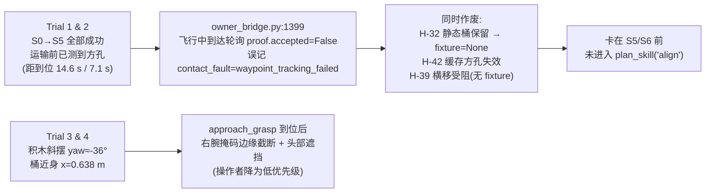

# V62 真机批次试验报告（4 次试验，2026-11-27）

- 测试版本：**F1 Harness 缓存方孔与对准优化 V62**（`e9d6a8feb0f3`，合入 H-42 + H-43 + H-44 + H-45；V61 `2dd3292b7a64` 已取消未复用）
- 预检说明：操作者当轮直接点击 4242「开始任务」，未运行 3 次只读预检（按 `HARNESS/AGENTS.md` 如实登记为未执行）
- 原始记录：`runs/trial1/` – `runs/trial4/`（未脱敏原始 `owner-trace.jsonl`、`planner-trace.jsonl`、`timing-report.json`、`workspace-run.json`）· 摆位记录：[layouts.md](layouts.md)

**本批 4 次真机试验全部安全停机（`model_calls=0`、0 `motion_stalled`、0 右腕反馈过期、0 安全事件，收尾均实测静止），尚无放置成功。前两次试验（Trial 1 中距 `x=0.718 m`、Trial 2 远侧桶入右腕 `x=0.818 m` 且 H-36 成功过 S0）均完整通过 S0→S5（抓取、验证、运输到位、在手复测全部成功），但在进入 S6 `align` 前即因 H-42 代码里 `owner_bridge.py:1399-1400` 的一处实现缺陷停住：该两行把正常飞行途中的路点到达轮询 `proof.get('accepted') is False` 误记为 `contact_fault = waypoint_tracking_failed`，导致运输到位后 H-32（静态桶保留）、H-42（运输前缓存方孔）与 H-39（备用横移）同时作废。**

**离线对照复现已证实**：去掉这一处误记的 `contact_fault` 后，V62 Trial 1（`OBS:114→154`，缓存年龄 14.59 s）与 Trial 2（`OBS:83→102`，缓存年龄 7.09 s）的原始数据均可直接走 H-42 缓存方孔、跳过横移，在 6000D 上 **3.11 s / 3.01 s** 一次解出 `align` `v=1` 并通过正式 `revalidate_plan`（17 / 18 段）。后两次试验（Trial 3 & 4，操作者将积木斜摆至 `yaw ≈ -36°`、桶近身 `x=0.638 m`）均在 S1 `approach_grasp` 到达后因右腕视野边缘截断（`mask_view=right:mask_truncated:object=square-1`）及头部被右臂遮挡触发 `observation_readiness_timeout`；操作者明确指示先集中打通放置（S6→S8），斜摆抓取截断问题降低优先级。



## 1. 4 次真机试验总览

| 试验 | 运行 ID | 桶位姿 `[x, y, z]` (m) | 积木位姿 `[x, y, z]` / `yaw` | 到达阶段 | 最终停止原因 | 缓存方孔使用 / 作废 | 堵转 / 右腕过期 / 模型调用 | 收尾静止 |
|---|---|---|---|---|---|---|---|---|
| **Trial 1** | `web-9c688a69...` | `[0.718, -0.045, 0.772]`（中距） | `[0.886, -0.282, 0.548]` / `-85.0°` | **S5 完成后卡在 S6 前** | `align: observation_viewpoint_required:aperture_measurement_required:square-hole-1:fixture_aperture_not_detected_in_search_region` | 使用 `0` / 误作废 `1`（`waypoint_tracking_failed`） | `0 / 0 / 0` | `measured_stationary` |
| **Trial 2** | `web-776cd3da...` | `[0.818, -0.068, 0.773]`（**远侧桶入右腕，H-36 过 S0**） | `[0.856, -0.284, 0.547]` / `-97.3°` | **S5 完成后卡在 S6 前** | 同 Trial 1 | 使用 `0` / 误作废 `1`（`waypoint_tracking_failed`） | `0 / 0 / 0` | `measured_stationary` |
| **Trial 3** | `web-264b0b41...` | `[0.638, -0.040, 0.769]`（近身） | `[0.820, -0.312, 0.546]` / `-35.6°` | S1 `approach_grasp` 到位后验证超时 | `approach_grasp: observation_readiness_timeout:mask_view=right:mask_truncated:object=square-1` | 未到达持块 | `0 / 0 / 0` | `measured_stationary` |
| **Trial 4** | `web-98ed99a8...` | `[0.638, -0.040, 0.769]`（近身） | `[0.819, -0.312, 0.546]` / `-36.1°` | S1 `approach_grasp` 到位后验证超时 | `approach_grasp: observation_readiness_timeout:mask_view=right:mask_truncated:object=square-1`（伴 `cross_camera_partial_association:camera=head`） | 未到达持块 | `0 / 0 / 0` | `measured_stationary` |

### review-round7.md V62 指标汇总

- 各阶段到达数：`S0=4/4`，`S1(approach_grasp 首发)=4/4`，`S1(成功)=2/4`，`S2(grasp)=2/4`，`S3(verify_grasp)=2/4`，`S4(transfer_above_hole)=2/4`，`S5(inspect_in_hand)=2/4`，`S6(align 规划进入)=0/4`，`S7(insert)=0/4`，`S8(release)=0/4`。
- **缓存方孔使用 / 作废**：使用 **0 次**；误作废 **2 次**（Trial 1 & 2 均因 `owner_bridge.py:1399` 误记 `waypoint_tracking_failed`）。
- **H-39 横移次数**：**0 次**（因 `fixture` 被同时清零导致 `full_scene_required_for_motion`，连备用横移也被阻断）。
- **H-36 生效**：Trial 2 桶放远侧 `x=0.818 m`（桶身入右腕画面）顺利通过 S0 抓取与运输。
- **H-45 生效**：本批 4 次 S0 未出现桌面外远景误检阻塞。
- **堵转 / 安全事件**：`0` 次 `motion_stalled`、`0` 次 `camera_sample_feedback_aged:right`、`0` 次安全事件、`0` 次模型调用。

## 2. 根因一（P0，唯一阻塞 S6→S8）：`owner_bridge.py:1399-1400` 飞行中到达轮询误记 `contact_fault`

### 现场时间线证据

在 **Trial 1**（`transfer_above_hole` 请求 `e209e9fd`）与 **Trial 2**（请求 `a42274c5`）中，运输轨迹均平稳执行并以 `outcome = "success"` 结束，期间 **0 次堵转、0 次碰撞、0 次取消**：

- **Trial 1**：
  - `t=36733.609 s`：闭爪发布（`ac52f52f`）；`t=36737.119 s`（`OBS:53`）与 **`t=36760.052 s`（`OBS:114`）** 两次在持块期间由头部直接实测到 `square-hole-1`（3 哈希，距到位仅 **14.59 s**）。
  - `t=36768.529 s → 36774.276 s`：`transfer_above_hole` 执行（5.03 s），在接近末路点 `index=11` 的正常飞行过程中，到达轮询每 ~120 ms 记录：
    - `t=36772.268 s`：`error_deg = 17.74°`，`proof = {accepted: false, reason: "tracking_task_space_error"}`
    - `t=36772.391 s`：`error_deg = 14.10°`，`proof.accepted = false`
    - `t=36772.512 s`：`error_deg = 10.47°`，`proof.accepted = false`
    - `t=36772.648 s`：`error_deg = 6.29°`，`proof.accepted = false`
    - `t=36772.772 s`：`error_deg = 3.08°`，`proof.accepted = false` → **`owner_bridge.py:1399-1400` 在此写入 `last_contact_fault = {"at_ns": 36772771704623, "reason": "waypoint_tracking_failed"}`**
    - 仅 **376 ms 后**（`t=36773.148 s`）：`error_deg = 0.39°`，`proof.accepted = true`，`transfer_above_hole` 以 `outcome = "success"` 完成。
  - `t=36774.639 s`（`OBS:153/154`）：到位后失败快照 `3ec34acfb0b342caa7d3701202a71fe8.json` 明确记录了 `context.contact_fault = {"at_ns": 36772771704623, "reason": "waypoint_tracking_failed"}`。于是 `_check_occluded_fixture_retention` 拒绝保留静态桶（`fixture=None`），`_resolve_cached_aperture` 作废缓存，连 H-39 备用横移也因 `fixture=None` 报 `full_scene_required_for_motion` 无法触发。
- **Trial 2**：完全相同的故障链。`OBS:83`（`t=36851.894 s`，距到位仅 **7.09 s**）直接实测方孔；`transfer_above_hole`（`a42274c5`）正常成功，但飞行途中 `t=36857.478 s` 被 `owner_bridge.py:1399` 误记 `contact_fault = waypoint_tracking_failed`（快照 `a8ad470df861472c8d7693c1c24755f7.json`），到位后 `OBS:102` 同时作废 H-32、H-42 与 H-39。

### 代码定位

`HARNESS/src/f1_harness/owner_bridge.py:1397-1400`（H-42 提交 `cfd539e` 引入）：

```python
self.engine.store.event('harness_waypoint_tracking_check',request_id=plan.request_id,
    index=self.index,error_deg=float(error),accepted=reached,proof=proof)
if proof.get('accepted') is False and hasattr(self.engine, 'record_contact_fault'):
    self.engine.record_contact_fault('waypoint_tracking_failed', now_ns)
```

`owner_bridge.py:1384-1424` 的 `waypoint_verifier` 是在机械臂**尚未到达路点时的周期性轮询检查**；`proof.get('accepted') is False`（如 `tracking_task_space_error`）仅表示“当前时刻还没到目标容差内，继续等下一帧”，不是跟踪失败或接触故障。真正的跟踪失败/堵转/未完成发布已由 `engine.py:761`（`motion_stalled`）、`engine.py:586`（`published_motion_incomplete` / `execution_timeout` / 异常终止）与 `engine.py:851`（`authority_revoked`）记录。离线回放未捕获该缺陷是因为离线模拟器直接跃迁到路点，未产生飞行中途 `proof.accepted=False` 后转为 `True` 的过程。

### 离线对照验证（去掉误记 `contact_fault` 后）

使用 V62 冻结包对本次 **V62 Trial 1（`OBS:114→154`）与 Trial 2（`OBS:83→102`）** 原始记录做零输出离线回放（仅移除误记的 `contact_fault`）：

| 试验 | 缓存来源帧 → 到位帧 | 缓存年龄 | 是否横移 | 选中变体 | 路点数 / `arm_r_j6` 范围 | 6000D 规划耗时 | `revalidate_plan` |
|---|---|---:|:---:|:---:|---|---:|:---:|
| **V62 Trial 1** | `OBS:114 → OBS:154` | 14.59 s | **否** | **`v=1`** | 17 / `[18.83°, 37.51°]` | **3.114 s** | **通过（17 段）** |
| **V62 Trial 2** | `OBS:83 → OBS:102` | 7.09 s | **否** | **`v=1`** | 18 / `[7.55°, 31.91°]` | **3.014 s** | **通过（18 段）** |

两次现场记录去掉误记 `contact_fault` 后均直接通过 H-42 缓存方孔规划出可执行 `align` 轨迹并通过正式复核。

## 3. 伴随发现（P1）：全局 `ik.max_wall_s = 15.0` 拖慢 `transfer_above_hole` 规划

- Trial 1 `transfer_above_hole` 在 ARM 上 `accepted_to_first_publication_s = 30.87 s`（6000D 离线复现 12.21 s，其中 OMPL `RRTConnect` 仅用 **1.41 s**，其余 ~10.8 s 消耗在笛卡尔变体回退前的 IK 上限）。
- Trial 2 `transfer_above_hole` 在 ARM 上 `accepted_to_first_publication_s = 17.05 s`（6000D 离线复现 6.47 s，其中 `RRTConnect` 仅用 **0.22 s**）。
- 因为 `numerics.local.json` 的 `ik.max_wall_s = 15.0` 对所有技能全局生效，需要回退到关节空间（H-37）的 `transfer_above_hole` 场景在失败笛卡尔变体上等待更久。虽然本批中并未触发超时或超过 H-42 的 45 s 上限（因为等待规划期间头部仍在刷新方孔缓存），但增加了约 10–20 s 静止等待；是否暂保持现状先拿首次 S8、还是将 15 s 仅限定于 `align`，交 Claude 裁定。

## 4. Trial 3 & 4 分析（P2，按操作者指示降低优先级）

- Trial 3 & 4 中，操作者将积木旋转至斜向（`block_yaw = -35.6° / -36.1°`），桶放近身 `x = 0.638 m`。
- `approach_grasp` 规划按方块法向对齐（操作者观察到“机械臂一定要垂直于平面才能抓”）并在 5.65–5.67 s 内正常到达末路点（`error_deg ≈ 0.40°`）。
- 到达后做动作后验证时，右腕相机拍到的方块被视野边缘裁切（`mask_view=right:mask_truncated:object=square-1`），同时右臂遮挡头部视角（Trial 3 头部无掩码 `object_mask_missing:camera=head`；Trial 4 头部检出但 `supported_upright_face_not_observed` → `cross_camera_partial_association:camera=head`），持续 15 s 超时停在 S1。
- 操作者明确要求：**当前优先把放置阶段（S6→S8）打通，完成第一条全流程；斜摆抓取截断问题优先级放低，后续单独处理。**
