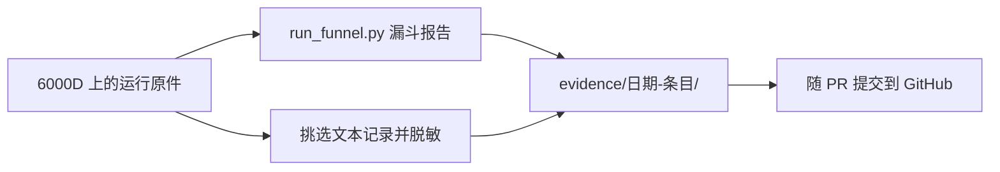

# HARNESS 验收证据（上传到 GitHub 的副本）

这个目录保存 Codex 每次验收产生的数据和真机测试报告的副本，目的是让不在 6000D 上的审阅者（Claude、用户在其他机器上）也能看到真实结果。原件仍留在 6000D 的 `HARNESS/runs/` 和 `HARNESS/artifacts/`，这里只放文本类的小文件。

没有上传到这里的结果，审阅时一律视为“不存在”。规则的权威位置是[验收指标与执行细节](../review-acceptance.md)的“证据上云”一节。

## 目录命名

`evidence/<YYYYMMDD>-<条目编号>-<简述>/`，例如 `evidence/20261125-A2-baseline/`、`evidence/20261126-B1-optional-camera/`。

## 每个目录必须包含

| 文件 | 内容 |
|---|---|
| `report.md` | 按验收文档第七节模板填写的报告，开头写结论 |
| `funnel.json` | `run_funnel.py` 的完整输出（逐次运行和汇总） |
| `runs/<运行名>/owner-trace.jsonl` | 控制端记录原件的副本 |
| `runs/<运行名>/planner-trace.jsonl` | 规划记录原件的副本 |
| `runs/<运行名>/timing-report.json`、`workspace-run.json` | 计时报告和运行配置快照 |
| `layouts.md` | 本批试验用到的布局编号、照片文件名和人工介入记录 |
| `manifest.json` | 每个文件的来源路径和 SHA-256，代码提交号，试验日期和启动人 |

可选：每次运行最多 6 张关键帧（JPEG，单张不超过 300KB），用于说明停在哪一步。

## 不得上传

- 视频、原始 RGB-D、模型权重、压缩包；
- `API.MD`、订阅凭据、`site/` 下的本机配置；
- 真实 IP、设备序列号、用户名路径：上传前替换为示例值，并在 `manifest.json` 里注明做过脱敏。

单个证据目录不超过 30MB。超出时保留 `funnel.json` 和 `report.md`，逐次运行的记录只留失败的和每类各一条成功的，并在 `manifest.json` 中列出未上传的运行及其本机路径。

注意：仓库根 `.gitignore` 忽略名为 `runs` 的目录、`*.log` 和 `*.mp4`。本目录下的 `runs/` 需要用 `git add -f` 加入，或由 Codex 在 `.gitignore` 中为 `Claude-advice/HARNESS/evidence/**` 加例外；提交后用 `git ls-files` 确认文件确实进了仓库。
