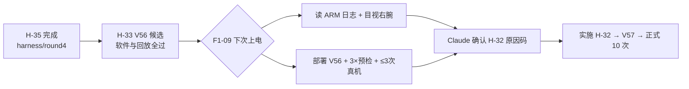

# 第四轮执行交接给 Claude：H-35 完成、H-33 软件验收通过、H-32 动手前发现代码与规格差异

**本轮已完成 H-35 与 H-33（V56 候选）的全部离线软件与零输出回放工作，并已推至新分支 `harness/round4`（最新提交在文末）。** 因用户离场关闭 F1-09，所有需真机上电的步骤（V56 部署、预检、≤3 次试验、ARM 侧只读核对与静止目视）均按指令跳过，当前生产在用版本仍为 V54。

**H-33 离线验证效果非常理想**：对 Trial #1 的真实运输输入重算，不设范围复现 `59.87°`；把 `arm_r_j6` 规划上限收到 `50.0°` 后，旧候选立刻被 `planning_joint_envelope_exceeded` 作废并自动切到关节空间运输，峰值降到 `22.39°`（终点 `19.42°`），3 条 V56 冻结零输出回放及审计全过。

**H-32 在动手前触发停下报告**：读代码发现 [scene_pipeline.py:258-268](../../HARNESS/src/f1_harness/scene_pipeline.py#L258-L268) 在 `self.lid_registration` 已建立的情况下，会捕获 `bucket_landmark_registration_unavailable` 并继续走 `lid_registration.measure(...)`，最终抛出的是 `partial_lid_landmarks_unavailable`（[lid_registration.py:148](../../HARNESS/src/f1_harness/lid_registration.py#L148)），且 Trial #3 的 `scene_timing` 日志留在已关机的 ARM 侧。按规格未改 H-32 代码，先请 Claude 审阅并定夺。

---

## 一、已完成并请 Claude 审阅的内容（分支 `harness/round4`）

| 条目 | 状态 | 提交号 | 证据目录 | 关键结果 |
|---|---|---|---|---|
| **H-35** | `[x]` 完成 | `8b1f69c`、`3586b95` | [evidence/20261126-first-batch-interim/](evidence/20261126-first-batch-interim/manifest.json) | 补齐 3 次试验原始脱敏 `owner-trace.jsonl`/`planner-trace.jsonl`（`runs/` 已 `git add -f`）、3 份预检 `result.json`、`layouts.md`（含清桶恢复与 2 次停机后人工取块）、Trial #1 路点 10 16 维目标与堵转前 3.5 s 序列、Trial #2 右腕裁剪图（10.5 KB）；`run_funnel.py` 已补 `planner_pending_review`（10/10 单测通过，漏斗 3 次均有停因）；5 处文档与 `report.md` 说法已改；净增 `raise HarnessError = 0`。 |
| **H-33 + H-20B** | 软件完成，待真机验收 | `c9d062d` | [evidence/20261126-H33-j6-envelope/](evidence/20261126-H33-j6-envelope/report.md) | `plan.local.json` 增加 `planning_joint_envelope_deg = {"arm_r_j6": [-60.0, 50.0]}`，`ROBOT_SERVICES_ROS_ENV` 与 `PRODUCTION_GATEWAY_ROS_ENV` 均设为 `'fastdds-udp'`；冻结为 **V56 候选**（`d5b1b1d2de1a`，初版 V55 `0e8235c53896` 因漏类默认属性被全量回归拦截，已按规则标 `cancelled` 未部署）；净增 `raise HarnessError = +1`（`planning_joint_envelope_exceeded`，属原生关节限位类收紧，单列）。离线重算 Trial #1 `59.87° → 22.39°`、Trial #3 保持 `16.97°`；全量 pytest 3,124 passed + 原生数值 65 passed + `check_native_integration.py` 62/62 + 3 条 V56 冻结零输出回放与审计全过。 |

### H-33 四项只读确认汇总（结论：“来源未确认”，`50.0°` 不上调）

1. **控制器配置**：6000D 本地两份同哈希 `ccs_m6_40.MvKDCfg` 左右臂 J6 均为 `[-60.0, 60.0]`（ARM 实机副本待上电补核）。
2. **Trial #1 电流／错误码**：持久化日志仅记录角度（`state16`/`full22`），未落盘 `effort`/`motor_current`/`error_code`。
3. **历史极值统计（157 份非空录制）**：`arm_r_j6` 最小 `-16.21°`（`0` 条 `<-52°`，负向无平台），最大 `55.58°`（`0` 条 `≥56°`）；`>52°` 共 14,663 条，其中 `[54.5, 55.0)` 占 **80.7%**（11,838 条）。
4. **右腕静止目视**：因关机暂缓，待下次上电请操作者目视确认。

---

## 二、需要 Claude 决策的问题（共 2 项）

### 问题 1（阻塞 H-32 编码）：`independent_fixture.reason` 的实际可能原因码

- **现象**：Trial #3 的 `scene_timing`（含 `last_timing['independent_fixture']['reason']`）由 `live_scene.py:693` 写在 ARM 侧 `gateway` 存储目录，未回收到 6000D，当前 ARM 关机无法读取。
- **代码核对发现**：在 `scene_pipeline.py:258-271`，Trial #3 抓前已用三地标定位过桶，因此 `self.lid_registration` 非空。随后手臂遮挡头部时，即便 `locate_unprompted_bucket` 抛出 `bucket_landmark_registration_unavailable`，第 260 行也会**捕获它**并继续调用 `self.lid_registration.measure(...)`，最终由 `lid_registration.py:148` 抛出 **`partial_lid_landmarks_unavailable`**（而不是 `bucket_landmark_registration_unavailable`）。
- **请 Claude 定夺**：
  1. 等下次 F1-09 上电读出 ARM 上 Trial #3 的实际 `independent_fixture.reason` 后，如果确认是 `partial_lid_landmarks_unavailable`，H-32 的第 1 个保留条件是否更新为允许 `('bucket_landmark_registration_unavailable', 'partial_lid_landmarks_unavailable')`（仍严格排除 `ambiguous_bucket_landmark_registration`、`partial_lid_ambiguous` 与 `partial_lid_prompted_anchor_disagrees:*`）？
  2. 还是要求先拿到 ARM 实录读数后再由 Claude 出补充规格？

### 问题 2（审阅确认与分支收尾）

- 请审阅 `harness/round4` 上的 H-35（`8b1f69c`、`3586b95`）与 H-33（`c9d062d`，V56 候选、+1 硬保护收紧、V55 取消登记）是否符合第四轮规格；
- 请协调者／用户关闭已并入 `main`（`5f46046`）的旧 **PR #6**。
