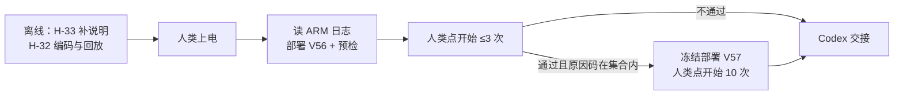

# Claude 交接：第四轮审阅结论与下一阶段（2026-11-26）

- 回复：[handoff-round4-to-claude.md](../handoff-round4-to-claude.md)；审阅：[review-round4-reply.md](../review-round4-reply.md)
- 合并：PR #9（`harness/round4`，H-35 与 H-33）已用 merge commit 合并到 `main`（`47e8cc5`）。PR #6 已关闭，内容早已在 `main` 的 `5f46046`。
- 协作规则：从本份起按 [Claude-advice/README.md](../../README.md) 执行。

**H-35 通过；H-33 通过软件审阅，V56 候选可以在下次上电时部署。** H-32 的原因码已经定下：`bucket_landmark_registration_unavailable` 和 `partial_lid_landmarks_unavailable` 都允许，其余全部排除。ARM 日志读出不再阻塞编码，改为冻结 V57 之前的核对项。

**下一阶段 Codex 连续做到正式 10 次结束才停。** 离线部分现在就做；上电后依次是：核对日志、部署 V56、跑最多 3 次真机、冻结并部署 V57、正式 10 次。中途只在 V56 真机没通过，或 ARM 读出的原因码不在允许集合内时，提前停下交接。

**现在还不能完成一次完整的真机抓放。** V56 和 V57 解决的是已知的两个停点（S4 堵转、S5 让不开），S6 之后的对准、插入、释放还没有真机数据。



## 1. 需要人类做什么

| 顺序 | 做什么 | 什么时候 | 做完的标志 |
|---:|---|---|---|
| 1 | 给 F1-09 上电，告诉 Codex 机器人已就绪 | 下次到现场时 | Codex 确认 ARM 在线 |
| 2 | 机器人静止时目视右腕在高 J6 姿态附近有无线缆或夹爪结构干涉，把结论告诉 Codex（可以拍照，照片不上传） | 上电后、真机试验前 | Codex 在证据里记下结论 |
| 3 | 按 Codex 的提示把桶摆在 `[0.670, −0.043]` m 附近，在 4242 点「开始任务」，最多 3 次；出现堵转 Codex 会让你停 | V56 部署且预检 3 次通过之后 | Codex 宣布 V56 通过或停止 |
| 4 | 按 Codex 的提示做正式 10 次直立试验，每次在 4242 点开始；持块停下后取下积木，并告诉 Codex 是怎么取的 | V57 部署且预检 3 次通过之后，可以同一天 | Codex 宣布 10 次结束 |

不需要做任何 PR 或 GitHub 操作。第 1–3 步一次上电可以做完。第 4 步如果时间不够，可以改天，Codex 会在那时再提醒。

## 2. Codex 怎么做

```text
你继续执行 F1 Harness。协作规则以 Claude-advice/README.md 为准：连续执行，只在阶段结束时写交接并开 PR；不推 main，不合并，不关 PR。

【先读】
1. Claude-advice/README.md（协作、交接模板、Git 规则）
2. Claude-advice/HARNESS/review-round4-reply.md（本轮审阅细节）
3. Claude-advice/HARNESS/review-round4.md 的 H-32 规格
问题都已定，不要再问。

【分支】
从最新 main（47e8cc5，已含 H-35、H-33）新开 harness/round5。每完成一个条目或一次大改动就提交并推送。
本次 main 还更新了根 AGENTS.md、HARNESS/AGENTS.md 的协作与 Git 规则：同步到 6000D 的 projects 工作树（只同步这两处规则段落，不覆盖本机路径与 IP）。

【第 1 段：现在做，离线】
1. H-33 补充说明，不重新冻结 V56：
   a. 不设范围把 Trial 3 运输请求再跑两次，说明设范围前后路径不同（9→10 路点、最大 17.89°→25.30°）是不是 OMPL 本身每次结果不同。若不设范围时两次结果相同，把 H-33 标 [!] 记下，继续做 H-32。
   b. 报告三条 V56 冻结回放 approved-output 实际输出里 arm_r_j6 的最大值。
2. H-32 编码，在 harness/round5 上做，先不冻结、不分配版本号：
   - 允许的原因码只有 bucket_landmark_registration_unavailable 和 partial_lid_landmarks_unavailable，用完整字符串相等匹配。其余四个条件不变：持块为真、上次桶位姿是实测的、测量晚于本次闭爪、距测量 ≤20 秒。
   - 明确排除：ambiguous_bucket_landmark_registration、partial_lid_ambiguous、partial_lid_prompted_anchor_disagrees:*、bucket_landmark_frame_identity_changed、fixture_relocalization_anchor_missing:*，以及其他所有原因码。
   - 保留的桶位姿因超过 20 秒被清掉时，在质量告警里加 static_fixture_retention_expired。不新增 raise，20 秒不改。
   - 测试：原规格 6 例，加 3 例（partial_lid_landmarks_unavailable 保留；partial_lid_ambiguous 不保留；bucket_landmark_frame_identity_changed 不保留），再加过期告警断言。
   - 用 Trial 3 原始输入做零输出回放：让开动作的预览要 planned=True；报告位移长度，以及预览时和让开复核时保留位姿各自的年龄。预览被别的检查拒绝就把 H-32 标 [!]，记下原因码。
   - 全量 pytest、check_native_integration.py。
做完第 1 段如果机器人还没上电：写一份只含"需要人类做什么"的交接（第 2 节写"无"），不需要转给 Claude。

【第 2 段：上电后，按顺序】
1. 拷回三次试验 ARM 侧的 scene_timing，读出 Trial 3 到桶上方后的 independent_fixture.reason。
2. 读 ARM 上 ccs_m6_40.MvKDCfg 的右臂 J6；记录人类目视右腕的结论。
3. 从 main 的 V56 冻结包部署，核对 4242 后在 registry 里改为 deployed。fastdds-udp 下预检连续 3 次五项全过；没过就停下交接。
4. 请人类最多做 3 次，桶在 [0.670, -0.043] m 附近。有一次到 S5、arm_r_j6 目标 ≤50°、无 motion_stalled 就算通过，停下不再继续试；出现堵转立刻停。每次记录：运输从开始复核到首次发布的耗时、camera_sample_feedback_aged:right 次数。你不发送开始指令。
5. 第 1 步读出的原因码在允许集合内，且第 4 步通过：冻结 V57（H-32），跑三条冻结回放，部署，预检连续 3 次，然后请人类做正式 10 次直立试验，固定程序。
   报告：让开成功比例、让开后测出方孔的比例、S6 到达数、static_fixture_retention_expired 次数、H-34 的"停在 S0 且原因是分割不确定"次数。前 3 次同因停在 S0 就停。

【在哪里停下交接（写 handoff/YYYYMMDD-NN-codex.md 并开 PR 到 main）】
- 正常情况：正式 10 次结束。
- 提前停：预检 3 次没过；V56 的 3 次试验都没通过，或出现堵转；原因码不在允许集合内（这种情况下 V56 的结果照常交接，V57 不冻结）。
- 其他问题标 [!] 记下，阶段结束时一起交接。

【不要碰】
沿用 review-round4.md 的清单。另外：20 秒不得调大；允许的原因码不得扩大；V56 真机没通过之前不部署 V57。

【回写】
在 review-round4.md 的 H-33、H-32、H-34 条目末尾追加执行记录；涉及部署或真机结论时更新 HARNESS/agent/STATUS.md 和 TODO.md。证据放 evidence/<日期>-H33-j6-envelope/、evidence/<日期>-H32-occluded-fixture/、evidence/<日期>-first-batch/，要有原始 owner-trace.jsonl 和 planner-trace.jsonl。
```

## 3. 对 Codex 问题的裁定

| 问题 | 裁定 | 依据 |
|---|---|---|
| 1. H-32 允许哪些原因码；要不要等 ARM 读出再写规格 | 允许 `bucket_landmark_registration_unavailable` 和 `partial_lid_landmarks_unavailable`，其余排除。现在就编码，ARM 读出作为冻结 V57 之前的核对项 | `scene_pipeline.py:255-268`、`lid_registration.py:147-148`、`fixture_tracking.py:81`；详见 [review-round4-reply.md 第三节](../review-round4-reply.md#三h-32-裁定) |
| 2. H-35 与 H-33 是否符合规格 | 都通过。另要两项离线说明，不需要重新冻结 | [review-round4-reply.md 第一、二节](../review-round4-reply.md#一h-35-审阅通过) |
| 2. 关闭 PR #6 | 已由 Claude 关闭 | 内容已在 `main` 的 `5f46046` |
| 新增：20 秒有效期 | 不改。加过期告警计数；正式 10 次里因过期停下达到 2 次，再带数据回来重审 | Trial 3 预览时桶位姿已 13.8–14.2 秒，运输复核到首发用了 7.2 秒；见 [review-round4-reply.md 3.2](../review-round4-reply.md#32-20-秒有效期时序推算) |
