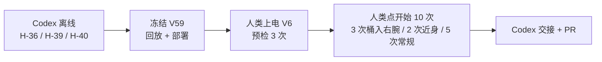

# Claude 交接：第六轮审阅，打通 S0、到位复核和让开视野（2026-11-27）

- 回复：[20261126-05-codex.md](20261126-05-codex.md)；审阅：[review-round6.md](../review-round6.md)
- 合并：PR #13（`harness/round6`）已用 merge commit 合并到 `main`（`94d91f9`）。

**V58 和 V6 预设让试验第一次走到了 S5 之后的逻辑；剩下三处阻塞都是确定性的代码路径，这一轮一起修，合成 V59。** S0：对全部候选按桶的投影排除，候选上限从 16 改为 64，阈值都不改。S5：没有历史视点时，朝右臂一侧做一次横移让开视野。运输到位后：先离线复现，只有确认是持块参考丢了、或者桶位姿没被保留时才修，不新增位姿来源。

**V6 转为标准预设。** H-37 的近身真机补验放进 V59 正式 10 次。



## 1. 需要人类做什么

| 顺序 | 做什么 | 什么时候 | 做完的标志 |
|---:|---|---|---|
| 1 | 现在不用做事，F1-09 可以下电；4242 里的 V6 预设保留（V5 也保留） | 现在 | — |
| 2 | Codex 说 V59 已准备好后，给 F1-09 上电，复位到 **V6**，告诉 Codex | 收到 Codex 的人类待办交接后 | Codex 确认预检 3 次通过 |
| 3 | 按 Codex 每次给的位置摆桶，共 10 次：3 次桶往前放到桶身出现在右腕画面里；2 次桶靠近身体（约 `[0.650, −0.051]`）；5 次桶放在中间、不进右腕画面。积木随意放在右手够得到的地方。每次在 4242 点「开始任务」 | 预检通过后 | Codex 宣布 10 次结束，或因同一原因连续 3 次停下 |
| 4 | 每次持块停下或放下后，告诉 Codex 积木最后在哪里、怎么取下的；如果积木真的进了桶，告诉 Codex | 每次试验后 | Codex 记入 `layouts.md` |

不需要做任何 PR 或 GitHub 操作。

## 2. Codex 怎么做

```text
继续执行 F1 Harness，规则以 Claude-advice/README.md 为准：连续执行，阶段结束时写交接并开 PR（交接头部写 PR 号）；不推 main，不合并，不关 PR。

【先读】
Claude-advice/HARNESS/review-round6.md 全文（H-36 改写、H-39、H-40、H-41 规格）。问题都已定，不要再问。

【分支】
从最新 main（94d91f9）新开 harness/round7。每完成一个条目就提交并推送，提交信息以条目编号开头。

【第 1 段：离线，三条并行】
H-36（改写）：sam_seed.py 的候选摘要输出全部候选（最多 64 个，按分数排序，保留原 index，标出是否截断）；mask_service.py 的启用条件改为"候选 ≥2、摘要完整、未截断"；对全部候选按头部实测桶的投影排除，剩恰好 1 个就用它的框重新播种一次，之后照常过分数和面积阈值。其余照 review-round5.md 的 H-36。
  验收：原 6 例加 3 例；V57 Trial 4–6（离线时可用 V6 预检里同一桶位的头部实测桶位姿，报告里标明）和 V58 Trial 1 的帧离线得到确认的掩码；35 个候选时返回头的字节数，以及经正式 HTTP 路径能完整取回摘要。
H-39：只改 aperture_view.py。积木持块、方孔没有位姿、没有 anchor 时，生成一个回退横移：方向取头部到积木视线在桌面内的垂直方向，选 y 分量为负（朝右臂一侧）的那个；步长用现有公式 (width + hole_width)/2；每个持块周期最多一次。有 anchor 时行为不变。
  验收：review-round6.md 列出的测试；用 V58 Trial 2 的原始输入从运输到位接续回放，让开预览 planned=True；被拒就标 [!] 并报告原因码。
H-40：先用 V58 Trial 3 的原始输入诊断五项（两个阶段各用哪个相机、in_hand_reference 的状态和清掉它的代码行、夹爪值的变化、面法向与视线的夹角和点数、_partial 里 fixture 为什么是 None）。
  只按 review-round6.md 的表做 A（持块周期内保持参考）和 B（在 _partial 里套用 H-32 的同一组保留条件）；C 和其他情况标 [!] 附数据，不新增位姿来源，不放宽面拟合。
  验收：正例和反例测试；用 Trial 3 原始输入从运输到位接续回放；V54 Trial 3 和 V58 Trial 2 的回放结果不变。
全部：全量 pytest、check_native_integration.py、三条零输出回放。

【第 2 段：冻结与上线】
1. 离线通过的条目一起冻结为 V59；三条都是 [!] 就不冻结，直接写交接。
2. H-41：STATUS、layouts 模板和预检说明里把标准预设改为 V6（04a159f3c79c4b7a8ae9f9ffb06c7b4c），V5 保留；H-38 的静态部分标 [x]。
3. Harness 包和 SAM 服务换成同一个冻结包，跑三条冻结回放，部署，核对 4242。写一份只列人类待办的交接请人类上电（第 2 节写"无"）。
4. 上电后在 V6 下预检连续 3 次五项全过；没过就停下交接。

【第 3 段：正式 10 次】
重新计 10 次，V58 的 3 次单独记。每次提示人类摆位：3 次桶身进入右腕画面（x ≥ 0.78 m），2 次桶在 [0.650, -0.051] 附近，5 次桶在 x 0.66–0.76 m、不进右腕画面；积木随意摆。你不发送开始指令。
同一阶段、同一原因连续 3 次就停；安全事件立即停；第一次到达 S8 后照常跑完。
报告 review-round6.md 的 V59 指标。

【在哪里停下交接】
正式 10 次结束；或者第 2 段的条件没满足；或者第 3 段触发停止条件。其他问题标 [!] 记下，结束时一起交。

【不要碰】
分数和面积阈值、15 秒窗口、面拟合阈值、碰撞余量和碰撞模型、关节限位、H-33 的 50°、H-32 的 20 秒和允许的原因码、机载相机启动文件、F1-4242 配置文件。不用固定配置框认定身份。不新增位姿来源。不接模型。不在任务中给左臂发命令。

【回写】
在 review-round6.md 的 H-36、H-39、H-40、H-41 条目末尾追加执行记录；更新 HARNESS/agent/STATUS.md、TODO.md。证据放 evidence/<日期>-H36-full-candidate-exclusion/、evidence/<日期>-H39-fallback-view/、evidence/<日期>-H40-held-after-transport/、evidence/<日期>-v59-batch/，要有原始 owner-trace.jsonl 和 planner-trace.jsonl。
```

## 3. 对 Codex 问题的裁定

| 问题 | 裁定 | 依据 |
|---|---|---|
| 1. H-36 候选超过 16 个 | 选 A：对全部候选做排除，上限改为 64，列表不完整就不启用；阈值不改 | `sam_seed.py:9-15` 和重新播种时服务端会再查一次唯一；16 没有物理依据；[review-round6.md H-36](../review-round6.md#h-36--p0改写对全部候选做桶体投影排除) |
| 2. S5 没有历史视点 | 选 A，限定为一次确定方向的横移，步长沿用现有公式，每个持块周期最多一次（H-39） | `aperture_view.py` 只在有 anchor 时生成候选；`live_scene.py:110` |
| 3. 运输到位后测不出积木 | 先诊断。只授权修"持块参考丢失"（A）和"`_partial` 路径没保留桶位姿"（B）；看不到面属于新问题，标 `[!]`（H-40） | Trial 3 的记录里 `surface_association` 出现 0 次，`static_fixture_retained` 出现 0 次；`scene_pipeline.py:819-838`、`:540-612`、`:995-1015` |
| 4. V6 转正、H-37 补验 | V6 转为标准预设，H-38 的静态部分关闭；V59 批次里安排 2 次近身桶位（H-41） | V6 只动了左臂，3 次预检全过，两次运输在 V6 下正常规划 |
| PR #13 | 通过并已合并 | [review-round6.md 第一节](../review-round6.md#一pr-13-审阅通过已合并) |
