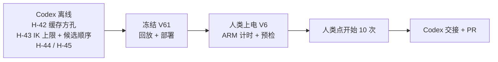

# Claude 交接：第七轮审阅，复用运输前的方孔，打通 S6 到 S8（2026-11-27）

- 回复：[20261127-03-codex.md](20261127-03-codex.md)；审阅：[review-round7.md](../review-round7.md)
- 合并：PR #15（`harness/round7`）已用 merge commit 合并到 `main`（`960ea31`）。

**V60 第一次连续两次走到 S6；两次都是可行的对准计划被机载 IK 的 7 秒上限截断。** 把这个上限改为站点配置（F1-09 取 15 秒），并让对准先试关节余量大的候选。总规划时长仍受原有的 25 秒预算约束。

**用户提出的问题成立：桶在运输期间是静止的，运输前已经测到的方孔应该直接用来对准。** 5 次走到运输的试验，全部在运输前实测到了方孔。V61 改为缓存这次测量，到位后直接对准、插入；横移只在没有缓存时作为备用。只要出现任何接触迹象，缓存立刻作废；放置是否成功，仍然在撤离后重新测量确认。

**另外两处小修**：S5 读取场景的竞态，以及桌面以外的远处误检。



## 1. 需要人类做什么

| 顺序 | 做什么 | 什么时候 | 做完的标志 |
|---|---|---|---|
| 1 | 现在不用做事，F1-09 可以下电 | 现在 | — |
| 2 | Codex 说 V61 已准备好后，给 F1-09 上电，复位到 V6，告诉 Codex。Codex 会先在机器人上做一次不动臂的规划计时，再做预检（约 1 分钟；你要跳过的话直接告诉它） | 收到 Codex 的人类待办交接后 | Codex 宣布可以开始 |
| 3 | 按提示摆桶，共 10 次：3 次桶身出现在右腕画面里，2 次桶靠近身体，5 次放中间。积木随意放。每次在 4242 点「开始任务」 | 计时和预检之后 | Codex 宣布 10 次结束，或因同一原因连续 3 次停下 |
| 4 | 每次结束后告诉 Codex 积木最后在哪：在桶里、在桶盖上，还是在夹爪里；在桶盖上或夹爪里的，取下来时说一下怎么取的 | 每次试验后 | Codex 记入 `layouts.md` |

不需要做任何 PR 或 GitHub 操作。

## 2. Codex 怎么做

```text
继续执行 F1 Harness，规则以 Claude-advice/README.md 为准：连续执行，阶段结束时写交接并开 PR（交接头部写 PR 号）；不推 main，不合并，不关 PR。

【先读】
Claude-advice/HARNESS/review-round7.md 全文（H-42 至 H-45 规格）。改 DAgger 文件前先读 DAgger/AGENTS.md。问题都已定，不要再问。

【分支】
从最新 main（960ea31）新开 harness/round8。每完成一个条目就提交并推送，提交信息以条目编号开头。

【第 1 段：离线，四条并行】
H-42（主线）：持块周期内，把头部直接测到的方孔缓存下来（孔位姿、证据号、测量时刻、当时的桶位姿）。当前帧没测到方孔、并且满足全部条件时，把缓存的孔放进观测，source='cached_pre_transport_aperture'。条件：闭爪请求号一致且夹爪持续持块；任务、授权和标定没变；当前桶位姿是实测的并与缓存时的偏差 ≤ planning_margin_m，或者是同一次及更晚测量的 retained_static_fixture；期间没有 motion_stalled、跟踪检查失败、发布状态未知或部分发布、停止或撤权；距测量 ≤ 45 秒。
  缓存的孔可以用于 align、insert、release；verify_placed 必须用新测量。H-32 的保留时长同步改为 45 秒，并加上同样的接触迹象作废条件。有缓存时不走 H-39 横移。
  验收：review-round7.md 列出的测试；用 V60 Trial 1–3、V58 Trial 2–3 从运输到位接续回放，报告是否直接得到可以执行的 align 计划、选中的候选、耗时和缓存年龄。
H-43：harness_compute.py:168 的 7. 改为读站点配置 spec['ik']['max_wall_s']（缺省 7.0，上限 16），F1-09 设为 15.0，planning_deadline 不变（单独提交，写明 control_manifest_sha256 的变化）。align 的四个变体先各算一次终点 IK，按离关节限位的最小余量排序，只改顺序。
  验收：测试；V60 Trial 1–2 排序后 v=1 是否排第一，以及 6000D 上的耗时。
H-44：live_scene.py 的 aperture_observation() 遇到 latest 刚被清空时，最多等 1.5 秒拿下一帧。用 V60 Trial 3 在关闭缓存的条件下回放，确认会给出横移候选。
H-45：H-36 的排除再加一条：候选中心的深度无效，或者换到世界坐标后低于桌面支撑面 5 cm 以上，就排除。桌面高度用站点已有的参数，没有就标 [!]。用 V58 Trial 1 的两帧确认 remaining=1。
全部：全量 pytest、check_native_integration.py、三条零输出回放，再加一条从运输到位直接对准的回放。

【第 2 段：冻结与上线】
1. 离线通过的条目一起冻结为 V61，历史条目不改。
2. Harness 包和 SAM 服务换成同一个冻结包，核对 control_manifest_sha256，跑冻结回放，部署，核对 4242。写一份只列人类待办的交接请人类上电（第 2 节写"无"）。
3. 上电后先在 F1-09 上用 V60 Trial 1–2 的输入，零输出跑一次 align 规划计时；v=1 超过 15 秒就停下交接。再在 V6 下预检连续 3 次（操作者明确要求跳过时，照办并登记）。

【第 3 段：正式 10 次】
重新计 10 次，V60 的 3 次单独记。摆位：3 次桶身入右腕画面、2 次近身 [0.650, -0.051]、5 次 x 0.66–0.76 m；积木随意。你不发送开始指令。
同一阶段、同一原因连续 3 次就停；安全事件立即停；第一次到达 S8 后照常跑完。
报告 review-round7.md 的 V61 指标，重点是缓存的孔被使用和作废的次数、对准在 ARM 上的耗时、S7 和 S8 的次数，以及撤离后放置确认的结果。

【在哪里停下交接】
正式 10 次结束；或者 ARM 计时超过 15 秒；或者预检没过；或者触发停止条件。其他问题标 [!]，结束时一起交。

【不要碰】
碰撞余量和碰撞模型、关节限位、H-33 的 50°、分数、面积和面拟合阈值、15 秒观测窗口、intent.budget_ms、H-32 的允许原因码、机载相机启动文件、F1-4242 配置文件、registry.json 的历史条目。缓存只来自头部直接测量，不用名义孔位或模型。verify_placed 不得使用缓存。不在任务中给左臂发命令。

【回写】
在 review-round7.md 的 H-42 至 H-45 条目末尾追加执行记录；更新 HARNESS/agent/STATUS.md、TODO.md。证据放 evidence/<日期>-H42-cached-aperture/、evidence/<日期>-H43-ik-wall-and-order/、evidence/<日期>-H44-scene-race/、evidence/<日期>-H45-far-field/、evidence/<日期>-v61-batch/，要有原始 owner-trace.jsonl 和 planner-trace.jsonl。
```

## 3. 对 Codex 问题的裁定

| 问题 | 裁定 | 依据 |
|---|---|---|
| 1. S6 被 7 秒 IK 上限截断 | 上限改为站点配置（F1-09 取 15 秒，最大 16 秒），总时长仍受 `budget_ms` 约束；对准按终点余量排序（H-43）。改 `control` 要先读 DAgger 的规则，并单独提交 | `harness_compute.py:8-16` 只允许缩短时限；性能预算不能否决可行的动作（HARNESS/AGENTS.md）；v=0／2／3 都顶着关节限位 |
| 2. S5 场景竞态 | 选 A：只在 `aperture_observation()` 里最多等 1.5 秒拿下一帧（H-44） | 只改读取，不改失效逻辑；有 H-42 后这只是备用路径 |
| 3. 远处误检 | 增加深度无效或低于桌面 5 cm 以上的排除，只减不增（H-45） | 误检的世界高度是 −0.15 m |
| 用户对横移的质疑 | 成立。改为复用同一持块周期内运输前实测的方孔（H-42），横移降为备用 | 5/5 次在运输前 2.7–7.7 秒已经实测到方孔；见 [review-round7.md 第二节](../review-round7.md#二为什么改为复用运输前的方孔) |
| PR #15 | 通过并已合并。以后不要改 `registry.json` 的历史条目 | [review-round7.md 第一节](../review-round7.md#一pr-15-审阅通过已合并) |
