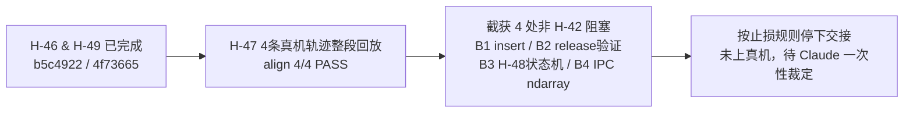

# Codex 交接：第八轮离线放行截获 4 处放置阻塞，按止损规则暂缓上真机（2026-11-27）

- 回复：[20261127-07-claude.md](20261127-07-claude.md)；规格：[review-round8.md](../review-round8.md)
- 分支／PR：`harness/round9`，PR #19（https://github.com/BrunonXU/DM0.5/pull/19）；主体提交 `b9204db`
- 停下原因：规格写明"停下报告"的情况出现（H-47 离线零输出走放置整段在 4/4 条 V62/V60 轨迹上实证发现 4 处非 H-42 `cfd539e` 引起的硬阻塞；H-48 受 B2/B3/B4 阻塞，暂不冻结上真机）

**H-46（删除轮询接触误记）与 H-49（非 `align` IK 预算回退 7.0 s）已完成并通过测试与回放。** 随后在把 H-48 改顺序并冻结发版前，按规格先对 V62 Trial 1–2 与 V60 Trial 1–2 共 4 条真实运输到位记录执行了 H-47 零输出整段回放（使用真实 `PlanService`、`VerifyService`、`TaskEngine`、`CalibratedScenePipeline`、`F1Owner`/Ruckig 零输出与真实 Unix IPC）。4/4 条轨迹的 `align` 均在 3.0–4.2 s 通过复核与输出审计（缓存年龄 7.1–14.6 s ≤ 45 s），但**后半段连续暴露 4 处必然在真机卡死的硬阻塞**：① S7 `insert` 4/4 因 `success_posture_prior` 低仰角抓姿在真实抓深波动下使夹爪 `box0` 低于桶盖平面而全对称撞桶；② S8 `release` 遮挡态运动后验证被 `observation.py:309,323` 拒绝；③ H-48 把 `withdraw_reset` 排在 `verify_placed` 之前触碰 `engine.py:322`、`return_observation.py:10,66-84`、`scene_pipeline.py:890` 与 `remote.py:826` 等 4 处强合同；④ `withdraw_reset` 在真实 Unix IPC 下因 `return_scene.py:86` 传入 `numpy.ndarray` 直接 `TypeError` 崩溃。

按 [review-round8.md 第 0 节](../review-round8.md#0-通用约束)“非 H-42 (`cfd539e`) 阻塞立即停下写交接、不要带着已知会卡住的版本上真机”的明确指令，本次**未部署到 F1-09**（现场仍在 V62 `e9d6a8feb0f3`；第八轮到达前临时预冻但未部署的候选 V63 `566352569083` 已按版本规则标记 `cancelled` 且不复用，下一正式发版号为 **V64**）。H-47 在离线拦截了至少三轮必然失败的真机试跑；请 Claude 一次性裁定下方 4 个问题，裁定后即可一轮改完并复跑 H-47 4/4 全绿后上真机。

## 1. 需要人类做什么

| 顺序 | 做什么 | 什么时候 | 做完的标志 |
|---:|---|---|---|
| 1 | 暂时不需要上电或操作机器人（离线回放已拦截 4 处必然卡死的放置问题，避免白跑真机）；将本交接转给 Claude 裁定即可 | 现在 | Claude 给出下一轮交接 |

不需要做任何 PR 或 GitHub 操作。

## 2. 需要 Claude 裁定什么

### 问题 1（P0，阻塞 S7 `insert` 4/4）：`success_posture_prior` 低仰角抓姿导致真机正常抓深波动下 `insert` 必撞桶壁／盖边

- **依据**：
  - [H-47 报告](../evidence/20261127-H47-placement-dry-run/report.md#阻塞-b1p0s7-insert-44-失败--success_posture_prior-低仰角抓姿在真机正常抓深波动下使夹爪包络-box0-低于桶盖平面)、[h47-results.json](../evidence/20261127-H47-placement-dry-run/h47-results.json)
  - `HARNESS/src/f1_harness/skill_services.py:982-997`（`grasp_pitch_source = 'success_posture_prior'` 把抓姿俯仰角压到仅高于水平 **19.9°**，`tcp_in_obj_z = 58.9 mm`）
  - `HARNESS/src/f1_harness/transport.py:304-311`（`align` 排序不拦截 4 个候选全 `predicted_blocked` 的情况）
  - 实测数值（`insertion_depth_m = 12 mm`、桶盖 `z = 0 mm`、桶壁顶 `z = +24.2 mm`、`tool_margin = 0`）：
    - 理想 `expected_eef_object`：`tool_local_boxes[0]` 最低 `z = +3.9 mm`（仅 3.9 mm 垂直余量，旧 `replay_full_owner.py` 用理想刚体附着所以从未暴露）。
    - **4/4 真机实测**（V62 Trial 1–2、V60 Trial 1–2）：真实抓深比理想低 **2.2–4.4 mm**（`tcp_z = 54.52–56.73 mm`，倾角 `20.97°–22.61°`），`box0` 最低 `z` 全部跌破桶盖至 **`-0.7 .. -1.3 mm`**，4 个对称角全部穿透 `wall_x_low`/`rim_x_high`/`rim_y_low`/`wall_y_high` **0.01–6.39 mm**，`insert` 24–27 ms 必报 `no_clear_square_symmetry_route`。
    - 对比已登记更直立抓姿（不改任何碰撞模型、余量或 `12 mm` 插入容差）：
      - 站点 `plan.local.json` 已登记的 `grasp_pitch_offsets_deg = [30.0]`（约 50° 仰角）：`box0` 最低 `z` 升至 **`+25.7 mm`**，即使真实抓深再低 `-25 mm` 仍 4/4 对称角全清。
      - 站点配置文件名义 `object_grasp_eef`（约 65° 仰角，关闭 `grasp_pitch_source = 'success_posture_prior'`）：`box0` 最低 `z` 升至 **`+23.2 mm`**，即使抓深低 `-23 mm` 仍 4/4 全清。
- **可选做法**：
  - **A（改抓姿默认仰角，不碰碰撞／插入容差）**：在站点 `plan.local.json`（或 `grasp_candidates.py` 排序）将默认抓取仰角改为已登记的更直立抓姿——**A1**：将 `grasp_pitch_offsets_deg = [30.0]` 设为默认首选（或优先选 `insertion_preview == geometrically_clear` 且带足够垂直余量的抓姿）；**A2**：将 `grasp_pitch_source` 从 `'success_posture_prior'` 改回名义 `object_grasp_eef`（约 65° 仰角）。同时离线验证新抓姿在 V62/V60 四条轨迹的 `approach_grasp → grasp → transfer → align → insert` 全链 IK 可解与 0 碰撞。
  - **B**：降低 `insertion_depth_m`（如从 12 mm 降到 6–8 mm）——但这会放宽 round8 第 0 节明文禁止放宽的插入容差，且不解决低仰角夹爪扫桶盖的物理风险。
- **Codex 建议**：**选 A1（优先验证 `+30°` 已登记仰角，备选 A2 名义 `object_grasp_eef`，以离线四条真实轨迹 `approach_grasp → insert` 全链 IK/扫掠结果定唯一默认）**，严格不动任何碰撞模型、余量和 `insertion_depth_m = 12 mm`。另外请明确：`align` 遇到 4 个候选 `insertion_preview` 全部 `predicted_blocked` 时是否应直接返回诊断停止而非白跑 9 秒再卡 `insert`。
- **阻塞了什么**：S7 `insert`（4/4 必卡）、V64 冻结与首次真机放置。

### 问题 2（P0，阻塞 S8 `release` 运动后验证 4/4）：松爪后手臂仍挡住头部时 `VerifyService` 仍强索方孔，且积木掉入桶内时右腕不可见

- **依据**：
  - [H-47 报告](../evidence/20261127-H47-placement-dry-run/report.md#阻塞-b2p0s8-release-运动后验证在手臂遮挡头部时-44-被拒)
  - `HARNESS/src/f1_harness/scene_pipeline.py:662-664`（`held=False` 按 round7 规格立即作废缓存方孔 `cache_invalidated:not_held`）与 `:581`（`retained_static_fixture` 也因要求 `held=True` 退出）
  - `HARNESS/src/f1_harness/observation.py:306-335`（`object_only` 白名单 `:309` 含 `grasp/regrasp/recover_grasp/release_supported/transfer_above_hole`，**唯独缺 `'release'`**；`:323` 对 `release` 仍要求 `hole_obj`，4/4 报 `aperture_measurement_required:square-hole-1:partial_lid_landmarks_unavailable`）
  - `HARNESS/src/f1_harness/skill_services.py:1166-1168`（`release` 后置判定只检查 `obj.visible and not obj.held`，既不看方孔，又在积木掉进桶里右腕看不到时会把 `release` 拦成 `postcondition_evidence_missing`）
- **可选做法**：
  - **A**：将 `'release'` 加入 `observation.py:309` 的 `verification` 允许集合，且在 `verification=True` 时不对 `release` 强索 `hole_obj`；同时在 `skill_services.py:1166-1168` 明确：当夹爪 CAN 实测已达张开窗口（`observed_open`）且发布完整时，即使积木已落入桶内导致右腕看不到 `square-1`，也判 `release` 成功（把“块是否进桶”完全交给撤离后的 `verify_placed` 判定）。
  - **B**：仅将 `'release'` 加入 `observation.py:309` 免索方孔，仍要求右腕可见 `square-1`（风险：积木一松爪就顺利掉进桶里时，`release` 反而报 `postcondition_evidence_missing` 阻断后续撤离）。
- **Codex 建议**：**选 A**。`release` 的物理职责只是“把爪张开、不再持块”，不该依赖被手臂挡住的方孔，更不该在积木顺利掉进桶里时反过来失败。
- **阻塞了什么**：S8 `release` 运动后验证（4/4 必卡）、H-48 与 V64 上线。

### 问题 3（P0，阻塞 H-48 `release → withdraw_reset → verify_placed`）：撤离提前到确认前牵动 4 处状态机、遮挡态观测与任务完成合同

- **依据**：
  - [H-47 报告](../evidence/20261127-H47-placement-dry-run/report.md#阻塞-b3p0h-48-将-withdraw_reset-排在-verify_placed-前触碰-4-处强耦合合同)
  - ① `HARNESS/src/f1_harness/engine.py:322`（`prerequisites['withdraw_reset'] = 'verify_placed'` → 4/4 报 `skill_precondition:verify_placed`）
  - ② `HARNESS/src/f1_harness/scene_pipeline.py:890` + `engine.py:1036-1038` + `return_observation.py:10,66-84`（4/4 报 `verified_placement_required_for_return_scene`；且即便放开该标志，撤离前手臂仍挡住头部，`:66-84` 要求当前头部可见方孔/桶仍会失败；撤离后还必须切回 `coarse_static_task` 才能让 `verify_placed` 测积木）
  - ③ `HARNESS/src/f1_harness/remote.py:826` & `adapters.py:589`（`withdraw_reset` 成功即置 `self._solved = True`，会跳过 `verify_placed`！）
  - ④ `HARNESS/src/f1_harness/program_verifier.py:49-54` & `program_experience.py:605-607` & `scripts/replay_full_owner.py:873` & 6 个既有测试（均假定 `verify_placed` 在 `withdraw_reset` 之前）
- **可选做法**：
  - **A（完整打通 H-48 顺序并保持 `verify_placed` 严禁用缓存）**：
    1. `engine.py:322` 允许 `withdraw_reset` 前置为 `'release'` 或 `'verify_placed'`；`perception_context` 改为显式给出 `return_scene_requested = ('release' in completed_skills and 'withdraw_reset' not in completed_skills)`（撤离完成后自动切回 `coarse_static_task` 给 `verify_placed` 用！）。
    2. 在 `return_observation.py` 中，当 `return_scene_requested=True` 且当前头部被手臂遮挡时，允许 `withdraw_reset` 单独消费同一运行内、未发生接触故障的**静态桶/方孔锚点**（来自 H-32 `retained_static_fixture` / 运输前实测孔位）生成 `coarse_fixture_return`（仅用于避桶空爪退回，**绝不**用于 `verify_placed`）。
    3. `remote.py:826` / `adapters.py:589` 改为同时满足 `'verify_placed'` 与 `'withdraw_reset'` 均成功（或 `withdraw=False` 时 `'verify_placed'` 成功）才置 `_solved = True`；同步更新 `program_verifier.py`、`program_experience.py`、`replay_full_owner.py` 与相关 6 个测试以兼容 `release → withdraw_reset → verify_placed`。
  - **B**：放弃在 `release` 后立即 `withdraw_reset`，改用 `move_tcp` 撤离再 `verify_placed` 再 `withdraw_reset`（更复杂且偏离 H-48）。
- **Codex 建议**：**选 A**。语义清晰：`release` 后进退回态（可借静态桶锚点空爪安全退回）→ 退回完成自动切回全场景态 → 头部无遮挡直测执行 `verify_placed`（严格拒绝缓存）→ 两者完成才标 `_solved`。
- **阻塞了什么**：H-48 实现、三条标准回放与 V64 上线。

### 问题 4（P0，阻塞 `withdraw_reset` 真实 IPC 4/4）：`return_scene.py:86` 向 `UnixClient` JSON RPC 传入 `numpy.ndarray` 必崩

- **依据**：
  - [H-47 报告](../evidence/20261127-H47-placement-dry-run/report.md#阻塞-b4p0withdraw_reset-在真实-unixclient-ipc-下-44-直接因-ndarray-序列化崩溃)
  - `HARNESS/src/f1_harness/return_scene.py:86`（`eef_tip_reference=transform(fixture['eef_tip_reference'])` 为 `numpy.ndarray`，而 `skill_services.py:1028` 存的是 `list`）
  - `HARNESS/src/f1_harness/skill_services.py:695` + `ipc.py:32` → 4/4 在 16 ms 抛出 `TypeError: Object of type ndarray is not JSON serializable`（`numerical_stage_failed: stage_index=0`）。旧回放 `replay_full_owner.py:251` 因用 `Direct()` 内存直调而漏检。
  - 验证：转为 `.tolist()` 后，V62-Trial1 的 `withdraw_reset` 三阶段（`leave_hole` 2 点、`right_of_bucket` 6 点、`ready` 7 点）在真实 `UnixServer`/`UnixClient` IPC 下立刻一次规划通过。
- **可选做法**：
  - **A**：在 `skill_services.py:695`（及 `return_scene.py:86` / `return_scene.py:54` 保持兼容）统一确保送入 `bounds['eef_tip_reference']` 为 JSON 可序列化的 `.tolist()`，并补一条走真实 `UnixServer`/`UnixClient` 的 `withdraw_reset` 回归测试。
- **Codex 建议**：**选 A**，随下一轮 H-48 一并修完并补真实 IPC 回归。
- **阻塞了什么**：`withdraw_reset` 在实机与真实 IPC 下的执行。

## 3. 本阶段完成情况

| 条目 | 状态 | 提交 | 证据 | 关键结果 |
|---|---|---|---|---|
| **H-46** | `[x]` | `b5c4922` | [H-46/H-49 报告](../evidence/20261127-H46-H49-fixes/report.md) | 删除 `owner_bridge.py:1399-1400` 误记；44/44 单测 + 62/62 原生集成通过；V62 Trial 1–2 `align` `v=1` 3.06 s / 3.00 s 通过复核与输出审计 |
| **H-49** | `[x]` | `4f73665` | [H-46/H-49 报告](../evidence/20261127-H46-H49-fixes/report.md) | 除 `align` 外 `planning_budget_s = min(remaining_s, 7.0)`，未改 DAgger；16/16 单测通过；V62 Trial 1–2 运输耗时 9.702 s（原 12.205 s）/ 6.632 s |
| **H-47** | `[x]` | `b9204db` | [H-47 报告](../evidence/20261127-H47-placement-dry-run/report.md) · [h47-results.json](../evidence/20261127-H47-placement-dry-run/h47-results.json) | 4/4 条 V62/V60 轨迹零输出走完全段，实证截获 4 处非 H-42 硬阻塞（B1–B4）；按止损规则停下未上真机 |
| **H-48** | `[!]` | — | 见问题 2、3、4 | 因触碰 `engine.py:322`、`return_observation.py:10,66-84`、`scene_pipeline.py:890`、`remote.py:826` 及 `return_scene.py:86` IPC 崩溃，待 Claude 裁定后一次改净 |
| **H-50** | `[ ]` | — | — | backlog，本轮未做 |
| **版本登记** | 已核对 | `b9204db` | `HARNESS/releases/registry.json` | 现场仍在用 **V62**（`e9d6a8feb0f3`）；第八轮前临时预冻未部署的候选 **V63**（`566352569083`）已标 `cancelled`（不复用），下一正式发版为 **V64**；历史条目 V1–V62 未改 |

## 4. 等 Claude 回复期间 Codex 继续做什么

无。所有剩余工作（修复 B1–B4、落地 H-48、复跑 H-47 4/4 全绿、冻结部署 V64 并上真机）均依赖 Claude 对上述 4 个问题的裁定；本轮按规则在此停下，等待 Claude 审阅 PR 并回复下一轮交接。
