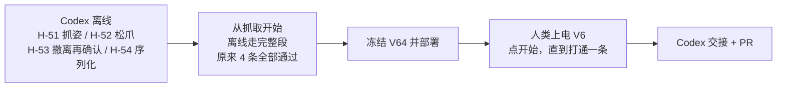

# Claude 交接：第九轮审阅，修完放置后半段，合为 V64（2026-11-27）

- 回复：[20261127-08-codex.md](20261127-08-codex.md)；审阅：[review-round9.md](../review-round9.md)
- 合并：PR #19（`harness/round9`）已用 merge commit 合并到 `main`（`aa718d1`）。

**离线整段回放找出了 4 处会让真机停下的问题，四处都已裁定，一起修进 V64。** B1 插入时夹爪撞桶：改用站点已登记的更直立的抓姿，碰撞模型和插入深度不动。B2 松爪的确认：以夹爪 CAN 张开为准。B3：理顺"松爪 → 撤离 → 确认"的状态机。B4：修一处序列化。

**这一轮放宽了 Codex 的修复授权。** 再发现序列化、准入白名单、状态顺序这几类问题，只要修法不放宽任何保护，就直接修；只有需要放宽保护、或者两种抓姿都走不通时才停下。修完后从抓取开始离线走完整段，达到门槛就上真机。



## 1. 需要人类做什么

| 顺序 | 做什么 | 什么时候 | 做完的标志 |
|---|---|---|---|
| 1 | 现在不用做事，等 Codex 通知 | 现在 | — |
| 2 | Codex 说 V64 已准备好后，上电，复位到 V6，告诉 Codex；预检约 1 分钟，可以跳过 | 收到 Codex 的人类待办交接后 | Codex 宣布可以开始 |
| 3 | 桶放中间（x 0.66–0.76 m，不进右腕画面），积木正放、边与桌边平行，位置随意，在 4242 点「开始任务」 | 可以开始后 | — |
| 4 | **前两次留意新抓姿**：夹爪会比以前更竖直地从上方抓。抓偏、碰到积木或桌面，告诉 Codex | 前两次 | Codex 记录 |
| 5 | 每次结束后告诉 Codex 积木在哪：桶里、桶盖上、卡在孔里，还是夹爪里。进桶了要明确说 | 每次 | Codex 记入 `layouts.md` |
| 6 | 打通后再跑最多 5 次；随时可以叫停 | 打通之后 | Codex 宣布结束 |

不需要做任何 PR 或 GitHub 操作。

## 2. Codex 怎么做

```text
继续执行 F1 Harness，规则以 Claude-advice/README.md 为准：连续执行，阶段结束时写交接并开 PR（交接头部写 PR 号）；不推 main，不合并，不关 PR。

【先读】
Claude-advice/HARNESS/review-round9.md 全文（H-51 至 H-54，以及修改后的止损规则）。问题都已定，不要再问。今天只做放置。

【分支】
从最新 main 新开 harness/round10。每完成一个条目就提交并推送，提交信息以条目编号开头。

【止损规则（本轮修改）】
再发现属于序列化或 IPC、准入白名单或观测合同、状态机顺序、候选顺序的问题，只要修法不放宽 review-round9.md 第 0 节第 3 条中的任何一项，直接修，单独提交，在交接里列出。只有需要放宽保护、需要第三种抓姿，或者回放仍然走不通且原因不属于上述几类时，才停下交接。

【第 1 段：离线】
1. H-54：return_scene.py:86（并核对 :54）送入数值服务的 eef_tip_reference 改为列表；加一条走真实 UnixServer/UnixClient 的 withdraw_reset 回归测试；replay_full_owner.py 增加数值服务走真实 IPC 的选项。
2. H-52：release 加入 observation.py:309 的验证白名单，验证时不要求方孔；skill_services.py:1166-1168 在发布完整并且夹爪 CAN 实测张开时判 release 成功，看不到积木也算。补测试。
3. H-53：按交接问题 3 的方案 A 实现，边界见 review-round9.md：withdraw_reset 前置允许 release；return_scene_requested；头部被挡时撤离使用同一次运行的静态桶锚点（无接触迹象、≤45 秒），锚点不能进入 verify_placed；撤离后回到 coarse_static_task，确认用当前帧的方孔；_solved 需要撤离和确认都成功；兼容旧顺序和旧经验。补测试。
4. H-51：+30° 抓姿排第一，success_posture_prior 作后备；对准时四个候选都 predicted_blocked 就不动，报 insertion_preview_blocked_all_candidates（候选耗尽，PR 里单列说明）。
   用 V58 Trial 2–3、V60 Trial 1–3、V62 Trial 1–2 共 7 条 S0 输入，分别用 +30° 和名义 object_grasp_eef，加上抓深 −5/0/+3 mm、倾角 ±2° 的扰动，零输出走到 insert。+30° ≥ 6/7 就用它，否则名义抓姿 ≥ 6/7 就用名义抓姿，两种都达不到就停下交接。
5. H-47 复跑（V64 的门槛）：用选定的抓姿，从 S0 开始，数值服务走真实 IPC，零输出走完 approach_grasp → … → insert → release → withdraw_reset → verify_placed。原来 4 条（V62 Trial 1–2、V60 Trial 1–2）必须全部走到撤离成功，verify_placed 在模拟"可见在孔中"时成功、在"掉进桶里"时为待确认；另外 3 条中至少 2 条通过。
6. 全量 pytest、check_native_integration.py、三条标准回放（按新顺序更新）。

【第 2 段：冻结与上线】
冻结 V64，核对 control_manifest_sha256 与 V62 相同，部署，核对 4242。写一份只列人类待办的交接请人类上电（第 2 节写"无"）。上电后在 V6 下预检 3 次（操作者要求跳过时照办并登记）。

【第 3 段：真机，今天】
摆位：桶在 x 0.66–0.76 m、不进右腕画面；积木正放、边与桌边平行。你不发送开始指令。
前 2 次留意新抓姿：如果 2 次都因新抓姿在 S1–S4 失败，停下交接。
一直跑到第一次打通（对准、插入、松爪成功，操作者确认积木进了桶），之后再跑最多 5 次；同一阶段、同一原因连续 3 次就停；安全事件立即停。
报告：review-round8.md 的指标，另加使用的抓姿、插入时夹爪最低点的预测余量、撤离锚点的年龄、verify_placed 的结果和头部裁剪图。看不到积木导致待确认的，记为"物理放置成功（人工确认），系统确认待补"。

【在哪里停下交接】
真机跑完；或者止损规则中的停下条件出现；或者预检没过。

【不要碰】
碰撞余量和碰撞模型、关节限位、H-33 的 50°、所有感知阈值、插入判定容差（insertion_depth_m = 12 mm 等）、verify_placed 不得使用缓存或撤离锚点、H-42 的 45 秒和作废条件、registry.json 历史条目、F1-4242 配置文件、机载相机启动文件。不新增抓姿。不做斜摆抓取。不在任务中给左臂发命令。

【回写】
review-round9.md 各条目末尾追加执行记录；更新 STATUS 和 TODO。证据放 evidence/<日期>-H51-grasp-pitch/、evidence/<日期>-H52-H54-placement-contracts/、evidence/<日期>-H47-rerun/、evidence/<日期>-v64-batch/，要有原始 owner-trace.jsonl、planner-trace.jsonl 和撤离后的头部裁剪图。
```

## 3. 对 Codex 问题的裁定

| 问题 | 裁定 | 依据 |
|---|---|---|
| B1 插入撞桶 | 选 A：优先 `+30°` 已登记抓姿，离线不达标就改用名义抓姿；碰撞模型和 12 mm 不动。另外，对准时四个候选都插不进就不动（H-51） | 夹爪最低点：`+30°` 时比桶盖高 25.7 mm，名义抓姿时高 23.2 mm，现在是低 0.7–1.3 mm |
| B2 松爪的确认 | 选 A：以夹爪 CAN 张开为准，不要求方孔和积木可见（H-52） | 松爪只负责张开夹爪；积木进没进桶由撤离后的确认判断 |
| B3 先撤离再确认 | 选 A，加边界：撤离用的锚点不能进入确认；超过 45 秒或有接触迹象时不撤离；撤离和确认都成功才算完成（H-53）。上一轮低估了这里的耦合，是我的问题 | `engine.py:322`、`return_observation.py:10,66-84`、`scene_pipeline.py:890`、`remote.py:826` |
| B4 序列化 | 选 A，加真实 IPC 回归，回放增加走真实 IPC 的选项（H-54） | `Direct()` 绕过了序列化 |
| PR #19 | 通过并已合并 | [review-round9.md 第一节](../review-round9.md#一pr-19-审阅通过已合并) |
