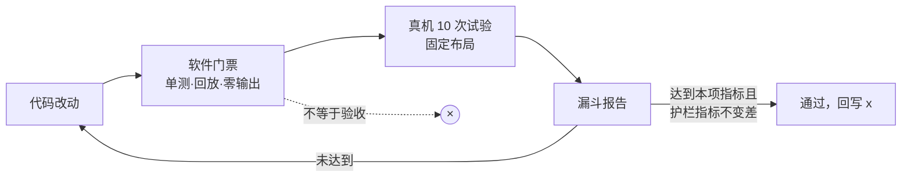

# F1 Harness 验收指标与执行细节（Codex 必读）

- 基线：代码 `750ca46`。上级文档：[改造计划总览](review-roadmap.md)、[核心架构](review-architecture.md)；逐条代码规格见 [review.md](review.md)。
- 阈值是建议值，用户可以直接改。标 `[!]` 的事项须用户确认。标“待核实”的事件名和字段，Codex 动手前先在源码里确认，对不上就停下询问，不要猜。

**这份文档只回答一件事：怎样才算做完。** 答案只有一个口径：真机上走到了第几步、成功了几次、花了多久、问了几次大模型。测试通过数、回放通过、IK 可解、服务健康，都只是“可以上真机”的门票，不是验收。过去 40 多版都拿到了门票，没有一版通过验收。

**同时防止另一种失败：为了让指标好看而加检查。** 所以除了成功率，还要报告“被非物理原因拦下了多少次”和“这次改动新增了多少个拒绝原因”。后两个数字变大，就算测试全绿，这次改动也不通过。



## 一、五条铁律

1. **验收只认真机漏斗指标。** 没有真机试验数据的条目，状态最多写“软件完成，待真机验收”，不得标 `[x]`。
2. **不新增拒绝原因。** 每个 PR 统计本次新增的 `raise HarnessError(...)` 和新的失败原因码数量。净增必须为 0；确需新增时，必须属于 6 类硬保护之一，并在 PR 里逐条说明。
3. **检查失败的默认处理是继续，不是停。** 除 6 类硬保护外，任何检查不通过时，只能做三件事之一：用最新测量重算、换一个候选、记告警后继续。
4. **先量基线，再改。** 每项改动前后都跑同一组布局、同样次数，报告前后对比。没有“改之前”的数字，就不算验收。
5. **目标没达到不许改目标。** 指标未达标时如实报告差距和下一步，不得调低阈值、缩小布局集合或更换统计口径；需要调整时由用户决定。

## 二、指标定义

全部从一次运行的控制端记录 `collected/owner/harness/trace.jsonl` 和规划记录 `planner/trace.jsonl` 计算。事件名取自现有代码。

### 漏斗阶段

一次运行“到达某阶段”，指该阶段的技能返回了成功结果（`skill_result` 事件，`outcome == 'success'`，`synthetic` 为假）。

| 序号 | 阶段 | 判定依据 |
|---|---|---|
| S0 | 开始 | 有授权且有 `task_prepared` |
| S1 | 首动 | 出现第一条 `harness_skill_first_publication` |
| S2 | 接近完成 | `approach_grasp` 成功 |
| S3 | 闭爪完成 | `grasp` 成功 |
| S4 | 确认抓住 | `verify_grasp` 成功 |
| S5 | 运输到位 | `transfer_above_hole` 成功 |
| S6 | 对准完成 | `align` 成功 |
| S7 | 插入完成 | `insert` 成功 |
| S8 | 放置确认 | `verify_placed` 成功，且有对应的 `owner_placement_verified` |
| S9 | 复位完成 | `withdraw_reset` 成功 |

**完整成功** = 到达 S8，全程没有 `manual_intervention`，所有结果的 `assisted` 为假。S9 单独统计。

### 主指标

| 指标 | 定义 |
|---|---|
| 成功率 | 完整成功次数 ÷ 试验次数 |
| 阶段到达率 | 到达各阶段的次数 ÷ 试验次数（S1 至 S9 各一个数） |
| 首动时间 | 授权时刻到 S1 的秒数 |
| 任务时间 | 授权时刻到 S8 的秒数；复位时间另计 |
| 模型调用次数 | 一次运行中向大模型发出的请求数。事件名待核实，候选是 `planner/trace.jsonl` 中的 `model_transport_timing` |
| 模型等待时间 | 上述请求的总耗时 |

### 护栏指标（防过度防守）

| 指标 | 定义 | 要求 |
|---|---|---|
| 非物理拒绝次数 | 每次运行中，`skill_result` 为失败且 `no_motion` 为真，并且原因不属于限位、碰撞、反馈失联、授权的次数 | 以基线为参照至少减半；最终 ≤ 每次运行 1 次 |
| 非物理终止率 | 运行在 S8 之前结束，且最后一个失败原因属于非物理拒绝的比例 | ≤ 10% |
| 撤权次数 | `authority_revoked` 事件数（用户点停止除外） | 每 10 次试验 ≤ 1 次，且原因必须属于 6 类硬保护 |
| 新增拒绝原因数 | 本 PR 相对目标分支净增的 `raise HarnessError` 和原因码 | 0（硬保护除外） |
| 停在哪 | 未成功的运行：最后到达的阶段、最后一个失败原因 | 每次都报告，不设阈值 |

物理原因与非物理原因的划分表，由任务 A-1 产出并交用户确认（`[!]`）。划分不清的原因码先归入“非物理”，宁可多报。

## 三、真机试验协议

1. **布局集合**（任务 A-3 固定后不得更改）：
   - 立放集：10 个布局，覆盖桌面左、中、右和远、近，偏航角分散；
   - 姿态集：10 个布局，横躺 6 个、倾斜 4 个；
   - 留出集：20 个场景，只用于 M4，开发过程中不得使用。
2. **次数**：每项改动的验收跑对应集合各 1 次，共 10 次；M4 跑 20 次。
3. **流程**：用户在 F1infra 4242 任务页现场启动，每次试验点击一次“开始任务”；连续试验用“最近运行 → 复用配置”。不做一次授权连续多次。Codex 不发送开始指令，不替用户判断成功。
4. **如实记录**：人工扶正、重摆、提前停止都要记为人工介入，该次不计成功。
5. **回放和模拟不计入**：回放结果只能写在“软件门票”一栏。

## 四、软件门票（上真机之前）

以下全部通过，才允许请用户安排真机试验：

- 改动涉及的单元测试，加上全量 `pytest HARNESS/tests`；
- `scripts/check_native_integration.py`；
- 一条正常流程和一条最近真实失败的零输出回放；
- `scripts/check_project_layout.py`。

发布部署仍按 `HARNESS/AGENTS.md` 的“每次发布前的全流程零输出验收”。

## 五、各模块的任务、做法和验收

顺序即优先级。每个小项写明：改什么、怎么改、怎么验收。已有代码规格的直接引用 review.md 的 H 编号。

### A. 指标与评测（最先做，不需要真机）

| 编号 | 改什么 | 怎么改 | 验收 |
|---|---|---|---|
| A-1 | 漏斗统计脚本 | 新增 `HARNESS/scripts/run_funnel.py`，输入一个或多个运行目录，按第二节的定义输出每次运行的最远阶段、各阶段耗时、模型调用、非物理拒绝次数和最后失败原因；再输出汇总表。只读，不进入任何运行路径。原因码分类表放在脚本旁的 JSON 里 | 对 `runs/workspace/` 下全部历史运行产出结果，不因个别运行缺文件而中断；抽 5 条运行人工核对，结果一致 |
| A-2 | 基线报告 | 用 A-1 跑全部历史运行，写入 `HARNESS/agent/experiments/` 的新复盘，并按第九节把数据上传到 `Claude-advice/HARNESS/evidence/<日期>-A2-baseline/` | 报告给出：各阶段到达率、最常见的 5 个失败原因及次数、非物理拒绝的均值、模型调用的中位数；`git ls-files` 能列出上传的文件 |
| A-3 `[!]` | 固定布局 | 与用户一起确定三个布局集合，用照片和位置描述登记 | 清单进仓库；用户确认 |
| A-4 | PR 报告模板 | 把第七节的模板加进 `HARNESS/AGENTS.md` 引用的位置 | 之后每个 PR 都带这张表 |
| A-5 | 分阶段耗时预算 | 即 H-18 | 见 H-18 |

### B. 安全内核收敛（目标：M0）

| 编号 | 改什么 | 怎么改 | 验收（真机 10 次，立放集） |
|---|---|---|---|
| B-1 | 可选相机变化不再撤权 | H-01 | 首发前因相机身份撤权 0 次 |
| B-2 | 观测准备时限 | H-02 | 因观测准备超时交回模型的次数 ≤ 1 |
| B-3 | 验证重查次数独立 | H-03 | 因“验证不可用”终止的次数 ≤ 1 |
| B-4 `[!]` | 恢复预算上限 | H-05 | 因预算耗尽终止的次数 ≤ 1 |
| B-5 | 拒绝原因码表 | 列出代码里全部失败原因码，逐个标注属于哪类硬保护或“非硬保护”；非硬保护的在后续条目中逐步改为重扫、换候选或告警 | 表进仓库；非硬保护的原因码数量逐版下降，不上升 |
| B-6 | 哈希不一致改为重扫 | `revalidation.py:745-762` 的证明绑定不一致时，不直接拒绝，改走已有的“保留候选、等新场景重扫”路径（`owner_bridge.py:811-820`）。身份类字段（会话、授权、标定）不一致仍然拒绝 | 因证明绑定不一致导致的零发布 0 次 |

**B 模块整体验收**：非物理拒绝 ≤ 每次运行 1 次；S1 到达率 10/10；至少 1 次完整成功（M0）。

### C. 开发/部署双模式（目标：M2a）

| 编号 | 改什么 | 怎么改 | 验收 |
|---|---|---|---|
| C-1 `[!]` | 程序优先模式 | H-16 | 立放集 10 次：模型调用 0 次的运行 ≥ 8；成功 ≥ 8/10 |
| C-2 | 交接包 | 本地恢复用尽后，交给 Astra 的内容固定为：当前阶段、最后 3 个技能结果、已试候选、发布状态、可续跑的请求号 | Astra 介入的运行中，从断点继续而不是从头重跑的比例 100% |
| C-3 | 开发循环 | 新增开发入口：读运行记录和漏斗 → 改程序 → 等用户在任务页点击下一次“开始任务”。不改授权方式 | 从上一次运行结束到新程序就绪的间隔中位数 ≤ 5 分钟（不含用户摆放和点击的时间） |
| C-4 `[!]` | 开发档经验晋升 | H-12 | 同一布局成功 2 次后，第 3 次直接跑冻结程序且模型调用为 0 |
| C-5 | 请求人示教 | 开发 agent 卡住时向用户提出示教请求；用户用 DAgger 现有设置和遥控器示教，不新增示教入口。Codex 只负责从 DAgger 录制的原件里读出关键位姿（抓取位姿、过渡点、对准位姿）并写入程序 | 横躺抓取从首次尝试到首次成功的真机时间 ≤ 2 小时 |

### D. 接触阶段闭环（目标：M1）

| 编号 | 改什么 | 怎么改 | 验收 |
|---|---|---|---|
| D-1 `[!]` | 判抓以夹爪为主 | H-15 | 20 次抓取：把没抓住判成抓住 ≤ 1 次；把抓住判成没抓住或未知 ≤ 2 次；闭爪完成到判定结束 ≤ 1 秒 |
| D-2 `[!]` | 闭环对准 | H-07 | 到达 S5 的试验中，S7 到达率 ≥ 8/10；对准阶段耗时 ≤ 5 秒 |
| D-3 `[!]` | 持块时的孔位可用率 | 先只读采样：持块停在桶上方，采 30 组，统计能测出孔位的比例 | 可用率 ≥ 90%；达不到就做 D-4 |
| D-4 `[!]` | 左腕自己测孔 | 给左腕做手眼标定，用左腕图像加已知桶盖平面直接算孔位，不再依赖头部深度 | 与头部直接可见时的结果相比，孔中心偏差 ≤ 2 毫米；持块时可用率 ≥ 90% |
| D-5 | 插入兜底 | 插入失败后的恢复改为“抬起 → 重新对准一次 → 再插”，次数受预算约束 | 首次插入失败后的最终成功率 ≥ 50% |

### E. 规划提速（目标：M2b）

| 编号 | 改什么 | 怎么改 | 验收 |
|---|---|---|---|
| E-1 `[!]` | 开启关节空间搜索 | H-04 | 20 次运输：候选全部被拒 ≤ 1 次 |
| E-2 | 运输终点改为区域 | H-06 | 同上，并且运输规划耗时中位数不增加 |
| E-3 `[!]` | 运输路径预先算好 | H-17 | S4 到运输首动 ≤ 1.5 秒 |
| E-4 `[-]` | 规划器对比 | 暂缓（用户决定：组件替换优先级低，先跑通框架） | 不执行 |

### F. 感知升级（目标：M3）

| 编号 | 改什么 | 怎么改 | 验收 |
|---|---|---|---|
| F-1 `[!]` | 横躺抓姿 | H-08 | 姿态集 10 次：S4 到达率 ≥ 7/10 |
| F-2 `[!]` | 身份丢失后自动重新定位 | H-09 | 因身份丢失交回模型的次数 ≤ 每 10 次运行 1 次 |
| F-3 `[-]` | 位姿估计对比 | 暂缓（同上） | 不执行 |
| F-4 `[!]` | 形状配置 | H-14 | 方块的全部结果与改动前一致；新形状达到 M5 |

### G. 经验与 RSI

| 编号 | 改什么 | 怎么改 | 验收 |
|---|---|---|---|
| G-1 | 检索放宽 | H-10 | 指令不同、其余相同的两次运行，后一次能检索到前一次的经验 |
| G-2 | 候选顺序回流 | H-11 | 采用推荐顺序后，规划中被拒绝的候选数下降 |
| G-3 | 修复知识格式 | 经验条目统一为：失败特征、适用条件、修法、验证结果四个字段 | 人为制造同一种失败两次，第二次由本地处理，模型调用为 0 |
| G-4 | 参数统计 | 按姿态类别记录每个候选和参数的成功次数，规划排序读取它 | 30 次运行后，首选候选的一次通过率高于改动前 |

### H. 任务迁移

每上一级台阶，按同一张表报告：真机开发时间、10 个布局的成功率、复用了多少已有技能、新写了多少。口径同 M5。

## 六、里程碑与模块的对应

| 里程碑 | 需要完成 | 判定命令 |
|---|---|---|
| M0 | A-1、A-2、B-1、B-2、B-3 | `run_funnel.py` 显示至少 1 次完整成功 |
| M1 | B 全部、D-1、D-2 | 立放集成功 ≥ 8/10；首动中位数 ≤ 10 秒 |
| M2a | C-1、C-2 | 模型调用 0；成功 ≥ 9/10；任务时间中位数 ≤ 30 秒 |
| M2b | E-1 至 E-3 | 任务时间中位数 ≤ 20 秒 |
| M3 | F-1、F-2 | 姿态集成功 ≥ 7/10 |
| M4 | 以上全部 | 留出集 ≥ 18/20，用现有 `evaluation.py` 判定 |
| M5 | F-4、C-3 | 新形状 ≥ 8/10；开发 ≤ 4 小时真机时间 |

## 七、每个 PR 必须附带的报告

```text
条目：<编号>
软件门票：pytest <通过/失败/跳过>；native 集成 <结果>；零输出回放 <正常/失败场景结果>
真机试验：<布局集合>，<次数>，日期，启动人
                 改动前    改动后
成功率            x/10      y/10
S1..S9 到达率     ...       ...
首动时间中位数    ...       ...
任务时间中位数    ...       ...
模型调用中位数    ...       ...
非物理拒绝均值    ...       ...
撤权次数          ...       ...
新增拒绝原因数：<数字>（如非 0，逐条说明属于哪类硬保护）
未成功的运行：<每次停在哪个阶段、最后的失败原因>
本项指标是否达到：<是/否>；未达到时的差距和下一步
```

没有“真机试验”一栏数据的 PR，只能标“软件完成，待真机验收”。报告里还要写明证据目录的路径（见第九节）。

## 八、说明

- 表中引用的论文数字只用来说明方向，不是本项目的验收依据。
- 10 次试验的统计很粗，只用于决定能否进入下一阶段；对外的结论以 M4 为准。
- D、E、F 中的耗时和毫米级阈值是根据现有实测（验证 0.65 秒、运动 4–6 秒等）给出的初值，A-2 的基线出来后由用户调整。

## 九、证据上云（必须做）

**规则：数据和真机测试报告必须随 PR 上传到 GitHub，否则视为没有做。** 原因是审阅者（Claude）和用户的其他机器看不到 6000D 上的 `runs/` 和 `artifacts/`；上一轮审阅就因为仓库里没有任何运行数据，无法确认现状基线。

1. 位置和内容按 [evidence 目录说明](evidence/README.md)：`Claude-advice/HARNESS/evidence/<日期>-<条目>-<简述>/`，包含报告、漏斗 JSON、每次运行的控制端记录和规划记录、计时报告、配置快照、布局记录和清单。
2. 何时上传：
   - A-2 基线：全部历史运行的漏斗结果，加上最近 10 次运行的原始记录；
   - 每一批真机试验结束后：该批全部运行；
   - 每个里程碑判定时：判定所用的全部运行。
3. 脱敏和体积限制按该说明执行。视频、原始 RGB-D 和凭据不上传。
4. 仓库根 `.gitignore` 会忽略 `runs` 目录和 `*.log`，上传后必须用 `git ls-files Claude-advice/HARNESS/evidence` 确认文件进了仓库，并把输出的文件数写进 PR 报告。
5. 条目回写 `[x]` 时，执行记录里必须带证据目录的路径；缺少时不得标 `[x]`。
