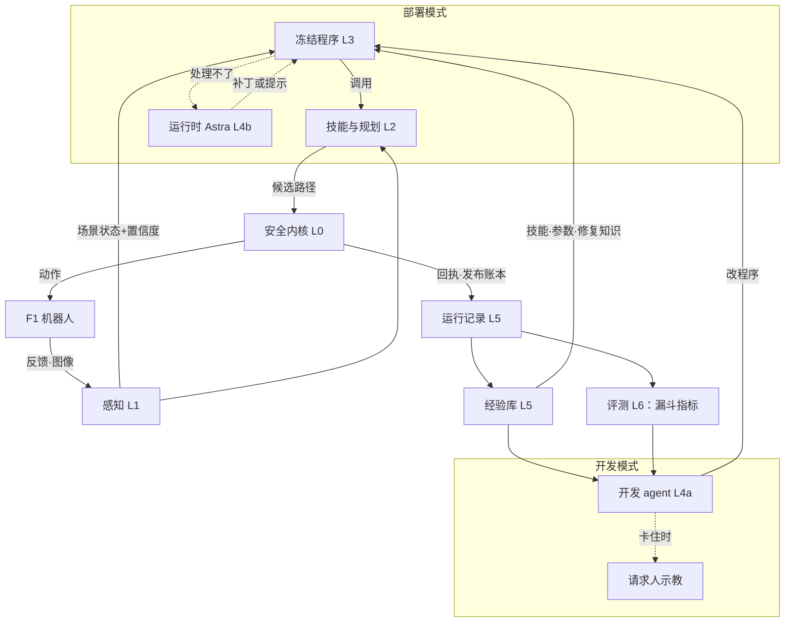

# F1 Harness 核心架构与模块职责（目标形态）

- 基线：代码 `750ca46`。本文描述改造后的目标架构，并标出每个模块对应的现有文件。
- 上级文档：[改造计划总览](review-roadmap.md)；验收见[验收指标与执行细节](review-acceptance.md)；逐条代码规格见 [review.md](review.md)。

**核心思想：只有安全内核有权说“不”，其余模块只负责把事情做成。** 感知给出带置信度的测量，规划给出候选路径，程序决定下一步；它们遇到问题时换方案、重测或上报，不能自己阻止动作。阻止动作的权力只在安全内核，而且只限 6 类硬保护。

**两种运行模式共用同一套模块。** 部署模式跑冻结程序，目标是快和稳，大模型只在程序处理不了时介入。开发模式由编码 agent 在真机上反复试验、修改程序，目标是把新场景变成冻结程序。两种模式经过同一个安全内核，留下同一种运行记录。

## 模块职责表

| 层 | 模块 | 负责什么 | 输入 | 产出 | 不负责什么 | 现有文件 |
|---|---|---|---|---|---|---|
| L0 | 安全内核 | 6 类硬保护；唯一的动作发布者；停止与保持 | 候选路径、实时反馈、授权 | 发布或拒绝（带 `no_motion`、`retryable`）、发布账本、停稳确认 | 不判断感知质量，不判断任务是否成功 | `owner_bridge.py`、`engine.py` 的授权与发布部分；DAgger 的 F1Owner |
| L1 | 感知 | 积木、孔、障碍的位姿；持物状态；每项带置信度和来源 | 相机图像、夹爪 CAN、关节反馈 | 场景状态（位姿、`held` 三态、置信度、告警） | 不阻止动作；质量差只降置信度、出告警 | `live_scene.py`、`scene_pipeline.py`、`mask_service.py`、`gripper_contact.py`、`aperture_transfer.py` |
| L2 | 技能与规划 | 把“目标”变成一条检查过的路径；内部自己选路、换候选 | 场景状态、技能目标 | 候选路径和几何检查结果；失败时给出具体原因 | 不决定任务顺序；候选耗尽只上报，不终止任务 | `skills.py`、`skill_services.py`、`transport.py`、`joint_motion.py`、`revalidation.py` 的扫掠部分 |
| L3 | 程序运行时 | 任务阶段、分支、本地重试、预算 | 技能结果、场景状态 | 下一个技能调用；任务结论 | 不直接发动作 | `programs.py`、`recovery_programs.py`、`astra_programs.py`、`program_reuse.py`、`task_runner.py`、`remote.py` |
| L4a | 开发 agent | 在真机上试验、读记录、改程序，直到通过验收后冻结 | 运行记录、漏斗指标、经验库、人示教 | 冻结程序、修复知识条目 | 不绕过安全内核 | 新增；复用 `program_experience.py`、`program_trials.py` |
| L4b | 运行时 Astra | 冻结程序处理不了时，给出补丁或提示 | 当前阶段、证据、已试方案 | 程序补丁或参数；不是动作 | 不负责常规步骤，不负责给定位框 | `planner.py`、`planner_context.py`、`prompt_contract.py` |
| L5 | 运行记录与经验库 | 记录每次运行；沉淀技能、参数和修复知识 | 回执、观测、程序 | 运行记录；经验条目（适用条件、做法、成功率） | 不自动改硬保护 | `evidence.py`、`run_review.py`、`memory.py`、`parameter_experience.py`、`planning_lessons.py`、`failure_corpus.py` |
| L6 | 评测 | 漏斗指标、固定布局、里程碑判定 | 运行记录 | 漏斗报告、里程碑结论 | 不作为运行时的门槛 | `timing_report.py`、`evaluation.py`；新增漏斗脚本 |

## 安全内核的边界（L0）

**6 类硬保护**（清单以 [HARNESS/AGENTS.md](../../HARNESS/AGENTS.md#claude_advice-审阅建议的执行2026-11-24用户确认) 为准）：授权与会话身份；实时反馈新鲜度；限位、碰撞和实际路径扫掠；未知或部分发布不重放；相机内参、标定和时钟域身份；原始记录写盘失败即停止。

**内核对上层的承诺：**

1. 每个请求必有回执，说明是否发布过、能否重试；
2. 拒绝只因上面 6 类原因，原因码固定在一张表里；
3. 候选路径相对最新测量过期时，内核触发“用最新场景重扫同一条路径”，通过就发布，不要求上层重新规划。

**上层对内核的承诺：** 不伪造反馈和授权；不重发状态未知的动作。

改造时把现有分散的检查按下表归位：

| 现有检查 | 归到哪里 |
|---|---|
| 哈希、观测 ID、场景版本等值比较 | 降级：不一致时由内核重扫，不拒绝 |
| 可选相机集合变化 | 降级：重扫（H-01） |
| 图像年龄 500ms、帧与反馈时间差 | L1 的置信度和告警 |
| 静止历史、多帧确认 | L1 的置信度；只有“机器人正在运动”由 L0 处理 |
| 技能前置链、恢复预算 | L3 的程序逻辑，受任务总时间约束 |
| 实时反馈年龄 200ms、限位、碰撞 | L0，保留 |

## 部署模式的流程

1. 操作者点击开始，内核确认授权。
2. 程序运行时选择程序：经验库里有匹配的冻结程序就用它，否则用内置的单块程序 `SINGLE_BLOCK`。
3. 程序按阶段调用技能：接近 → 抓取 → 判抓 → 运输 → 对准（闭环）→ 插入 → 释放 → 放置验证 → 复位。
4. 每个技能内部：规划给出候选 → 内核按最新测量检查并发布 → 执行 → 感知更新。
5. 技能失败时，程序先做本地恢复（换候选、重观测、重抓）。本地恢复用尽，才把“阶段、证据、已试方案”交给 Astra。
6. Astra 返回补丁，程序从断点继续，不从头重跑。
7. 结束后写运行记录，评测脚本算出本次的漏斗位置和耗时。

## 开发模式的流程

1. 选定一个目标场景类别（例如“横躺方块”）和验收标准。
2. 开发 agent 读取经验库、最近的运行记录和漏斗报告，写出或修改程序。
3. 上真机试一次。安全内核照常工作。
4. agent 读本次记录：每个技能调用前后的关键帧、返回值、失败原因。
5. 判断是程序逻辑、参数、感知还是规划的问题；修改；卡住时请求一次人示教。
6. 重复，直到在该类别的固定布局上达到验收标准。
7. 冻结程序，写入经验库，并登记适用条件（标定、形状、姿态类别）。
8. 冻结程序此后在部署模式中直接使用；遇到反例自动降级，回到开发模式。

## 经验库里存什么（L5）

| 类型 | 内容 | 谁用 |
|---|---|---|
| 冻结程序 | 完整的任务程序及其适用条件 | 部署模式直接执行 |
| 原子技能 | 可复用的小段程序（例如“横躺侧抓”“闭环对准”） | 开发 agent 组合新任务 |
| 修复知识 | 失败特征 → 适用条件 → 修法 → 验证结果 | 运行时本地恢复；开发 agent |
| 参数统计 | 按场景类别记录各候选和参数的成功率 | 规划排序、技能默认参数 |

## 各模块的交付物清单（给 Codex）

| 模块 | 必须交付 |
|---|---|
| L0 | 拒绝原因码表（只含 6 类）；“过期即重扫”路径；每类硬保护的回归测试 |
| L1 | 场景状态里每个量带置信度和来源；告警不再抛异常 |
| L2 | 每个技能的输入输出说明；失败原因码表；候选耗尽时返回全部尝试记录 |
| L3 | 程序优先入口；冻结程序的装载与降级；本地恢复用尽后的交接包 |
| L4a | 开发循环脚本：试验、读记录、改程序、再试；试验间隔统计 |
| L4b | 交接包格式；补丁应用后从断点继续 |
| L5 | 四类经验条目的格式和读写接口；适用条件匹配 |
| L6 | 漏斗统计脚本；固定布局清单；里程碑判定报告 |
