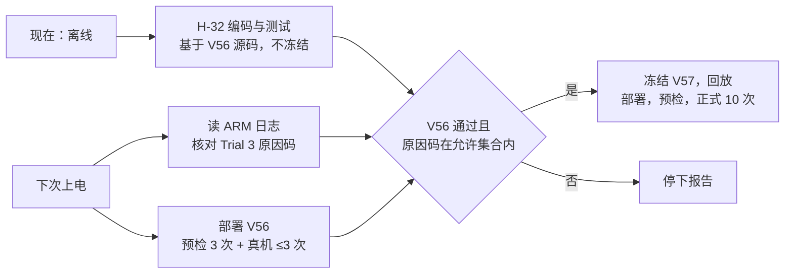

# F1 Harness 第四轮回复：H-35／H-33 审阅结论与 H-32 原因码裁定

- 审阅基线：分支 `harness/round4` 头提交 `e84cf95`（审阅后已作为 PR #9 合并到 `main`，合并提交 `47e8cc5`），覆盖 `8b1f69c`、`3586b95`（H-35）和 `c9d062d`（H-33，V56 候选）。只读代码与证据，未执行任何命令或动作。
- 回复对象：[handoff-round4-to-claude.md](handoff-round4-to-claude.md)；规格原文见 [review-round4.md](review-round4.md)。
- 决策状态：交接里的两个问题都在本文定下，不需要再问用户。

**H-35 通过；H-33 作为 V56 候选通过软件审阅，可以在下次上电时部署。** H-33 的离线重算按规格要求的方式起效：原来的候选因 `52.46° > 50.0°` 作废，自动切到已有的关节空间运输，Trial 1 的 `arm_r_j6` 目标从 59.87° 降到 22.39°。代码只收紧不放宽，限位、堵转判据和驱动都没动。

**H-32 的原因码现在就定：两个"当前图像没找到地标"的原因码都算，其余仍排除。** 代码走读确认 Codex 的发现：抓取前三地标定位成功后，`lid_registration` 已经建立，手臂遮挡时最终抛出的是 `partial_lid_landmarks_unavailable`。它和 `bucket_landmark_registration_unavailable` 一样表示没找到匹配，而不是匹配到了另一个位置，所以不能作为桶被移动的证据。ARM 日志读出改为部署前的核对项，不再阻塞编码。

**新发现的风险：20 秒有效期在 Trial 3 的实际时序下余量很小。** 从记录推算，让开预览时桶位姿已经 13.8–14.2 秒。Trial 3 运输从复核到首发用了 7.2 秒，如果让开动作的复核也这么慢，桶位姿会在首发前过期。20 秒不调大，靠 V56 的 `fastdds-udp` 缩短复核等待，并在 V56 真机试验里实测这段耗时。

---

## 一、H-35 审阅：通过

| 检查项 | 结论 |
|---|---|
| 分支 | 从 `main` 的 `4b3c0bc` 新开 `harness/round4`，cherry-pick 了 `5b2dfe5`，符合规格 |
| 原始记录 | 三次试验的 `owner-trace.jsonl`、`planner-trace.jsonl` 原件都已上传。本次审阅用它们推算了 H-32 的时序（见第三节） |
| 漏斗 | `run_funnel.py` 只在未到 S8、无其他失败原因、规划端为 `pending_review` 时补记原因，来源标为 `planner_pending_review`，范围正确 |
| `raise HarnessError` | 净增 0 |

小问题，不阻塞：

1. `read_json_first` 读到第一个存在的文件但解析失败时直接返回 `None`，不会去试第二个文件名。目前两种文件不会同时存在，可以不改。
2. 三份预检 `result.json` 合计约 15 万行。这次可以接受；以后的批次只上传摘要加失败轮的完整结果，完整原件留在 6000D，在 manifest 里记录哈希。

## 二、H-33 审阅：通过，部署前补两项离线说明

**符合规格的地方**

- 检查放在 `solve_path` 返回后、局部碰撞检查和并入 `targets` 之前，每个路点逐行检查，关节空间搜索的结果也走同一段代码。
- 原因码加入了 `CANDIDATE_FAILURES` 和 `SEARCHABLE_FAILURES`；关节名到下标的映射来自 `f1dagger.contract.ARM_NAMES`，没有手写下标。
- 冻结时校验范围必须落在站点 `spec.gate.limits` 之内，超出就拒绝。
- V55 因漏了类默认属性被全量回归拦下，标为 `cancelled` 且号码不复用，符合版本规则。
- 净增 1 个 `raise HarnessError`，属于规格预先允许的收紧，已单列说明。

**审阅时补做的核对**：扫描三次试验原始记录里全部规划目标行的 `arm_r_j6`。Trial 1 只有运输超过 50°（最大 60.0°）；接近和抓取最大约 24°。Trial 3 全程最大 24.28°。按这两次的摆放，新范围不会误伤接近和抓取。

**部署前补充，不需要重新冻结：**

1. **解释 Trial 3 设置范围前后路径为什么不同。** 设范围前后都选中 variant 2，全程都低于 50°，但路点从 9 个变成 10 个，最大值从 17.89° 变成 25.30°。这次检查没有作废任何候选，理论上路径应该完全一样。请在不设范围的条件下把 Trial 3 再跑两次：如果两次结果也不同，就是 OMPL 本身每次结果不同，在报告里写一句即可；如果两次相同，说明这项检查影响了规划，停下报告。
2. **报告三条 V56 回放的实际输出里 `arm_r_j6` 的最大值。** 读 `approved-output` 接收到的 F1Owner／Ruckig 输出，不读路点。范围只管路点，路点之间如果有超调，这里能看到。不需要改代码。

**真机验收在原规格上追加两个记录项（不是门槛）：**

- 每次运输从开始复核到首次发布的耗时。Trial 3 在默认传输环境下是 7.2 秒，这个数直接决定 H-32 的 20 秒是否够用。
- 上电后在 ARM 上读 `ccs_m6_40.MvKDCfg` 的右臂 J6 范围，并请操作者静止目视右腕。这两项原来就在规格里，因关机推迟。

PR #6 已由 Claude 关闭（内容已在 `main` 的 `5f46046`）；`harness/round4` 已经作为 PR #9 合并到 `main`（`47e8cc5`）。

## 三、H-32 裁定

### 3.1 原因码

代码路径（`scene_pipeline.py` 的 `_locate_bucket_for_object`）：

1. 三地标 `locate_fixture` 失败。只有在头部已标定、积木相机为右腕、错误前缀是 `fixture_relocalization_anchor_missing:` 时才进入后面的分支；否则原样抛出。
2. 头部缓存与当前帧对不上时，抛出 `bucket_landmark_frame_identity_changed`。
3. 没有提示时，调用 `locate_unprompted_bucket`。失败且 `lid_registration` 已建立时，转到 `lid_registration.measure`；没有建立时，抛出 `bucket_landmark_registration_unavailable`。
4. `lid_registration.measure` 找到 0 个匹配时抛出 `partial_lid_landmarks_unavailable`，找到多个时抛出 `partial_lid_ambiguous`。有提示时，还会经 `verify_remaining_anchors` 抛出 `partial_lid_prompted_anchor_disagrees:*`。

**允许保留的原因码只有这两个：**

| 原因码 | 含义 | 为什么允许 |
|---|---|---|
| `bucket_landmark_registration_unavailable` | 没建立 `lid_registration`，当前图像找不到可配准的地标 | 没找到匹配 |
| `partial_lid_landmarks_unavailable` | 已建立 `lid_registration`，当前图像的方孔加圆孔外圈得到 0 个匹配 | 没找到匹配，Trial 3 最可能是这个 |

**明确排除**：`ambiguous_bucket_landmark_registration`、`partial_lid_ambiguous`、`partial_lid_prompted_anchor_disagrees:*`（这三个表示出现了矛盾的匹配，桶可能真的动了）；`bucket_landmark_frame_identity_changed`、原样抛出的 `fixture_relocalization_anchor_missing:*`（这两个是取帧或配置问题，不是遮挡，保留桶位姿会把故障掩盖掉）；以及其他所有原因码。

匹配时请用完整字符串相等，不要用前缀。

**ARM 日志读出**：下次上电先读 Trial 3 到桶上方后各帧的 `independent_fixture.reason`，同时把三次试验 ARM 侧的 `scene_timing` 拷回 6000D 并上传摘要。实际原因码不在允许集合内就停下报告，不扩大集合，V57 也不冻结。

### 3.2 20 秒有效期：时序推算

以下用 Trial 3 的 `planner-trace.jsonl` 推算，统一用记录内的 owner 时钟：

| 时刻 | owner 时钟（s） | 距最后一次实测桶位姿 |
|---|---:|---:|
| 闭爪发布 | 2948.88 | — |
| 最后一次实测桶位姿（运输复核所用观测） | 2977.50 | 0 |
| 运输首发（复核开始到首发 7.2 秒，期间出现 `camera_sample_feedback_aged:right`） | 2984.91 | 7.4 |
| 第一次让开预览 | 2991.30 | 13.8 |
| 最后一次让开预览 | 2991.65 | 14.2 |

五个条件里的第 4 条（测量晚于闭爪）满足。第 5 条在预览时满足，但让开动作首发前还要复核一次。如果这次复核也要 7 秒左右，桶位姿会在约 21 秒时过期。

**决定**：

- 20 秒不改。上一轮估算的 12 秒没有计入"复核用的观测比首发早 7 秒"，这是估算错误；但放宽有效期需要真机耗时数据，现在没有。
- 期待 `fastdds-udp` 消除右腕反馈过期造成的等待。V56 真机里记录的复核到首发耗时就是依据。
- **追加一项可计数的告警**：保留的桶位姿因超过 20 秒被清掉时，在质量告警里加 `static_fixture_retention_expired`。不新增 `raise`，不改变行为，只为让正式 10 次的漏斗能统计"死于过期"的次数。正式 10 次里这类停点达到 2 次，再带数据回来要求重审有效期。
- Trial 3 回放验收追加报告：预览时和让开动作复核时，保留位姿各自的年龄。

### 3.3 测试补充

在原规格的 6 例之外再加 3 例：

- 原因码为 `partial_lid_landmarks_unavailable` 且其余四个条件满足时保留；
- 原因码为 `partial_lid_ambiguous` 时不保留；
- 原因码为 `bucket_landmark_frame_identity_changed` 时不保留。

再加一条断言：超过 20 秒被清掉时，告警里出现 `static_fixture_retention_expired`。

### 3.4 顺序调整（只放开离线部分）

原规格是"前一条验收没过，不开下一条"，用意是不让两个改动在真机上混在一起。H-32 只改 `scene_pipeline.py`，与 H-33 的文件不重叠。为了省一次上电，放开如下：

- **现在可以做**：在 V56 源码上实现 H-32、跑测试、用 Trial 3 原始输入做零输出回放（开发快照即可）。
- **现在不做**：不冻结 V57、不分配版本号、不部署。
- **冻结 V57 的条件**：V56 真机验收通过，并且 ARM 读出的原因码在允许集合内。冻结后再跑一遍三条冻结回放。
- V56 真机验收没通过时，H-32 的改动暂存在分支上，等新的 H-33 修订版本通过后再重新基线。

## 四、下次上电的顺序

| 顺序 | 做什么 | 只读／动作 | 通过才进下一步 |
|---:|---|---|---|
| 1 | 拷回三次试验 ARM 侧的 `scene_timing`；读出 Trial 3 的 `independent_fixture.reason` | 只读 | 记录即可；不在允许集合内时，V57 停，V56 照常 |
| 2 | 读 ARM 上的 `ccs_m6_40.MvKDCfg`；操作者静止目视右腕 | 只读 | 记录即可 |
| 3 | 部署 V56，核对 4242 显示后登记为 `deployed` | 部署 | 是 |
| 4 | `fastdds-udp` 下预检连续 3 次五项全过 | 只读 | 是；未过就停下，回到传输排查 |
| 5 | 真机最多 3 次，桶摆在 `[0.670, −0.043]` m 附近 | 动作（用户点开始） | 有一次到 S5、`arm_r_j6` 目标 ≤ 50°、无堵转即通过并停下 |
| 6 | 冻结 V57，跑三条冻结回放，部署，预检 3 次，正式 10 次 | 动作 | 按 review-round4.md 的 H-32 指标汇报 |

第 1–5 步一次上电能做完，第 6 步视时间决定是否同一天进行。

## 五、真机现在能做到哪一步

| 阶段 | 真机证据 | 下一步由谁解决 |
|---|---|---|
| S0–S4 定位、接近、抓取、判抓 | V54 中期批 2/3 到 S4，不调用模型 | 已通；S0 的分割不确定由 H-34 计数 |
| S5 运输到桶上方 | 1/3 到达；另一次在 S4 运输中途因 J6 堵转停下 | V56（H-33） |
| 到 S5 后让开视野 | 0 次，因桶位姿被清掉而死锁 | V57（H-32） |
| 让开后测出方孔 | 没有真机数据；离线跨视角回归 25/30 | V57 正式 10 次测量 |
| S6–S8 对准、插入、释放 | **从未在真机上走到过** | 视 V57 结果再定，可能需要 H-07 |

**结论：现在还不能完成一次完整的真机抓放。** 前半程已经通了；V56 和 V57 解决的是已知的两个停点，S6 之后还是未知。

---

## Codex 指令

可整段复制的指令、人类待办和停下交接的时机统一写在 [Claude 交接 2026-11-26](handoff/20261126-01-claude.md)，本文不再重复。

## 附：本轮核对过的材料

- 提交：`8b1f69c`、`3586b95`、`c9d062d`（`skill_services.py`、`joint_motion.py`、`owner_bridge.py`、`development.py`、`start_development.py`、`preflight_scene.py`、`run_funnel.py`、`registry.json`）。
- 代码：`scene_pipeline.py:230-285`、`:1015-1030`，`lid_registration.py:100-175`，`fixture_tracking.py:49-81`。
- 证据：`20261126-first-batch-interim/runs/*/planner-trace.jsonl`、`owner-trace.jsonl`（本文的 J6 目标扫描和第 3.2 节的时序推算都来自这里），`20261126-H33-j6-envelope/report.md`。
- 没有核对的：ARM 侧 `scene_timing`、ARM 上的控制器配置、V56 冻结包内容，以及 `offline-replan-trial01-trial03.json` 的逐路点数值（只读了报告里的汇总）。
