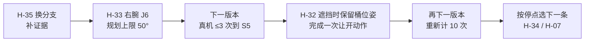

# F1 Harness 第四轮审阅：V54 第一批的前 3 次真机试验

- 审阅基线：分支 `harness/v53` 的提交 `5b2dfe5`（北京时间 2026-11-26 22:34），只新增证据目录 `evidence/20261126-first-batch-interim/`。代码与 `main` 的 `873d71a` 相同（V54，冻结包 `8818976408ce`）。本文行号以 `873d71a` 为准。
- 前几轮：[review-v53.md](review-v53.md)（H-20 至 H-25）、[review-v53-round3.md](review-v53-round3.md)（H-26 至 H-31）。本文新增 H-32 至 H-35。
- 方式：只读代码和证据，没有执行。Codex 的说法逐条对照了三次试验的记录、漏斗和源码。
- 决策状态：Codex 提的问题全部在本文定下，不需要再问用户。文末有可整段复制的指令。

**这是 V50 之后第一次越过 S0 的真机数据，而且一次走到了 S5。** 三次试验分别停在 S4、S0、S5，全程没有调用模型，每次都停稳。两次完成了接近、闭爪和判抓，一次把积木运到了桶上方。抓放的前半程在真机上是通的。

**两个失败都是确定性的，继续跑不会得到新信息，所以停在 3 次是对的。** S4 的堵转是右腕第 6 关节的老问题：10 月就记录过三次，指令到 60°、实测停在 54.8° 附近。S5 的死锁是代码路径造成的：右臂挡住头部后，刚测过的桶位姿被立即丢弃，让开视野的动作因此没有碰撞参考可用。

**下一步一次只做一条，顺序是：先收紧右腕第 6 关节的规划范围（H-33），再让被遮挡时保留桶位姿以完成一次让开动作（H-32），之后才重新计 10 次。** 第三个问题（S0 的积木分割不确定）样本只有 1 次，先攒数据，不现在改。



---

# 第一部分：给人看

## 一、这 3 次走到了哪

数据来自 `funnel.json` 和每次试验的控制端记录摘要。时间是从授权算起的秒数。

| 试验 | 运行 | 最远阶段 | 首动 | 停在哪一步、原因 | 是否停稳 |
|---|---|---|---:|---|---|
| 1 | `web-dbe926ed` | S4 确认抓住 | 4.40 | 运输第 10 个路点，`motion_stalled` | 是，`measured_stationary` |
| 2 | `web-9da20b83` | S0 | 无 | 接近前等观测 15 秒，右腕分割报 `mask_uncertain_requires_new_prompt:object=square-1` | 是 |
| 3 | `web-5653aac6` | S5 运输到位 | 8.51 | 对准没有提交：缺方孔测量，让开视野的预览被 `full_scene_required_for_motion` 拒绝 | 是 |

| 阶段 | 本批（3 次） | 历史基线（106 次） |
|---|---:|---:|
| S1 首动 | 2/3 | 36.8% |
| S4 确认抓住 | 2/3 | 18.1% |
| S5 运输到位 | 1/3 | 5.7% |
| S6 及以后 | 0/3 | 0 |
| 首动耗时 | 4.40 秒、8.51 秒 | 中位 22.95 秒 |
| 模型调用 | 0 | 中位 1 次 |
| 有效授权期异常撤权 | 0 | 22 次 |

样本只有 3 次，比例不能当结论用。能确认的是：固定程序不靠模型就能定位、抓起并判抓，两次判抓各用约 1.06 秒，依据都是夹爪 CAN。

**三次都安全停下。** 试验 1 堵转后 0.6 秒收到实测静止回执。试验 3 结束时右臂持块停在桶上方。有一点证据里没有：两次持块停下之后，积木是谁、怎么取下来的。漏斗里人工介入记为 0，这不准确，要补记。

## 二、进 H-21 之前的检查

| 问题 | 结论 | 依据 |
|---|---|---|
| 预检是否连续 3 次五项全过 | 是，但只有摘要 | `preflight-3x-summary.json`：三次 `passed` 均为真，连续窗口 34.6、16.9、23.4 秒，积木和桶的采样数相等（185、91、125） |
| 桶的问题怎么解决的 | **证据里没有记录** | 报告和提交都没有说明桶是重新摆了、还是重启后自己恢复了 |
| 有没有放宽判据或改代码 | 没有 | `5b2dfe5` 只新增证据文件；`HARNESS/src`、`HARNESS/scripts`、F1-4242、DAgger 相对 `main` 无差异 |
| 实际跑的是不是固定程序 | 是 | 三份 `workspace-run.json` 的 `planner_effective` 都是 `baseline`；漏斗 `mode_counts` 为 `baseline: 3`，模型调用 0 |
| 是不是 V54 原样 | 是 | 漏斗 `version_counts` 为 `54: 3`，清单里的冻结包号与登记一致 |

## 三、两个失败的根因

### 试验 1：右腕第 6 关节在 54.86° 停住

**已证实的：**

- 堵转时实测 `arm_r_j6` 是 54.863°（`harness_motion_checkpoint` 的 `measured16[12]`）。
- 最大单关节误差在 5.009° 上持平了约 2 秒（`harness_waypoint_waiting`，第 10 个路点），然后判堵转。
- 这是已知的老问题，不是这次才出现。`DAgger/docs/F1/incidents/20261015-y-lift-j6-following.md` 和 `20261015-transport-close-and-y-repeat.md` 记录了 10 月 13 日和 15 日的三次同类事件：

| 日期 | 第 6 关节目标 | 实测平台 | 当时第 7 关节 |
|---|---:|---:|---:|
| 10 月 13 日 | 59.57° 至 60° | 54.76° 至 54.9° | 未记 |
| 10 月 15 日 | 58.19° | 54.78° | −45.4° |
| 10 月 15 日 | 60.00° | 54.85° | 约 −49° |
| 11 月 26 日（本次） | 59.87°（推算） | 54.86° | −31.8° |

- 10 月的记录同时确认：47.35° 和 50.70° 时跟随正常，误差约 0.16°。

**是假设的：**

- 目标 59.87° 是用最大误差加实测值推出来的。上传的记录里没有逐关节的目标值，Codex 报告里那张逐关节表的原始数据没有上传。
- 停住的来源。四次事件的平台值相差不到 0.2°，而姿态和负载都不同，所以**负载和线缆干涉的可能性低**：这两种原因不会每次停在同一个角度。**更可能是下位控制器内部的限位，或机械止位**。10 月的只读反汇编已排除上层 SDK 在 55° 截断；驱动 `motor_ctl` 对命令的钳位是 ±60°。到底是哪一种，现在没有证据，10 月那份文档也明确说不能把 55° 写成已证实的硬件限位。

Codex 报告里写“真机物理／固件在 +54.86° 顶死”，方向对，但把假设写成了事实。

### 试验 3：到了桶上方，桶位姿被丢弃，让不开

**已证实的（代码路径）：**

1. 右臂持块到桶上方后，头部看不到桶盖地标。`scene_pipeline.py:1024-1028` 定位桶失败，**当场把上一次测到的桶位姿清掉**（`self.measured_fixture=None`）。
2. 没有桶位姿，场景降级为只有积木（`:1067-1070`，原因 `fixture_aperture_not_detected_in_search_region`）。
3. 固定程序的 `recover_alignment`（`recovery_programs.py:368`）找到了一个“之前看得清孔的持块位置”，想侧移过去。预览了两次都被拒，原因是没有桶的碰撞参考。0.4 秒内三次预览失败，程序结束。
4. 代码里本来就有“保留静态桶位姿”的机制，侧移动作也在它允许的技能里（`geometry_context.py:24`、`observation.py:315-321`）。但保留只在头部时间戳重复或序号不递增时触发（`scene_pipeline.py:989-992`），**被手臂遮挡不在触发条件里**。

所以死锁的直接原因是：桶位姿在最需要它的那一刻被清掉了，而它几秒前刚测过，桶是不会动的刚体。

**“左腕看得到三个孔，直接用左腕测孔行不行”——不行。** 跨视角测孔不是左腕单独测 3D。它要用头部深度在三角孔和圆孔外圈拟合桶盖平面（`aperture_transfer.py:105-153`）。头部被挡住时，这一步同样做不了。必须先让开。

**是假设的：**

- 头部定位桶失败的具体原因码。`independent_fixture.reason` 没有上传。H-32 要求先读出来再动手。
- 让开之后能不能测出方孔。跨视角回归是 25/30，而且是手臂不在桶上方时采的。

另一个值得注意的数：试验 3 从判抓到运输首发等了 32 秒，期间反复出现 `camera_sample_feedback_aged:right` 和 `camera_sample_feedback_unpaired:right`。H-20 重跑里这类原因只出现在默认传输环境（34 次，另两种 0 次）。

## 四、Codex 提的问题，逐个定下

| 编号 | 问题 | 已定 | 理由 |
|---|---|---|---|
| 1 | 停在 3/10 先修，还是跑完 7 次 | **停。** 证据支持你的倾向 | S5 的死锁出在代码路径上，只要手臂挡住头部就会发生，剩下 7 次没有一次能过 S6。第 6 关节的堵转取决于桶的位置，会重复，每次都是对着止位顶约 2 秒 |
| 1 | 第一批 10 次怎么计 | **这 3 次单独记为“V54 中期批”，不并入。两条修完后在新版本上重新计 10 次** | 版本不同，停点也会不同，续计会把两个版本混在一个分母里 |
| 1 | 提前停是否违反止损规则 | 不违反 | 止损规则只规定了“必须停”的情形（前 3 次同因停在 S0）。它没有触发，提前停是另行决定的，Codex 也如实写了 |
| 2 | 问题 A：能否复用桶位姿做一次让开 | **能，条件见 H-32。不走“直接左腕测孔”** | 机制和允许的技能都已存在，只差一个触发条件。左腕测孔依赖头部深度，头部被挡时做不了 |
| 2 | 复用位姿的有效期 | **20 秒，从该位姿的测量时刻算起** | 试验 3 里运输动作 5.4 秒，之后到预览约 1 秒，让开动作估计不超过 5 秒，合计约 12 秒，留不到一倍余量 |
| 2 | 位移上限 | **沿用现有公式，不新设数值** | `aperture_view.py:110` 已把步长限制为“遮挡物宽度加孔宽”的一半，且只在桌面平面内横移 |
| 2 | 哪些硬保护不能绕 | 全部照旧，见 H-32 的“保留” | 保留的桶位姿只能当障碍物用，不能用来对准、插入或释放 |
| 3 | 问题 B：是否在规划里收紧第 6 关节 | **收紧，右臂上限先定 50.0°。只收紧，不放宽** | 50.70° 有跟随正常的记录，四次平台最低是 54.72°。50.0° 在已验证正常的范围内 |
| 3 | 收紧到多少的依据不足怎么办 | **先按 50.0° 执行。只读确认做完后，要再调整须另行审阅；任何情况下不得高于 50.0°** | 不凭一次数据把原因定死，但规划先避开这个区域 |
| 3 | 负方向和左臂要不要一起收紧 | **不收紧** | 没有任何负方向或左臂的平台记录。左臂第 6 关节在 53.0° 静置正常，且 Harness 不给左臂发命令 |
| 4 | 试验 2 的分割不确定 | **排第三，现在不改代码，先补证据并计数** | 只有 1 次。沿用上一轮对 H-16 定的规则：正式 10 次里无需模型即定位成功的少于 8 次，再改用固定提示框 |
| 5a | Codex 还在往 `harness/v53` 推 | **停止向它推。从最新 `main` 开新分支，把 `5b2dfe5` 的证据带过去** | V54 已经压成一个提交进了 `main`，旧分支再合会重复。PR #6 的内容已在 `main`，应关闭 |
| 5b | H-20 的 `winner` 是 `fastdds-udp`，`route` 却是不切传输 | **两个字段都对，文档的说法要改** | 规则是：三种并列时胜出的是 `fastdds-udp`；同时默认环境达到 9/10，所以本批不必等钉死就能开跑。文档写成“本批选定 production-gateway”会被读成它胜出了。应写“本批沿用默认环境，胜出的 `fastdds-udp` 随下一个版本钉死” |

关于 5b 的补充：试验 3 那 32 秒的等待说明默认环境的代价是实在的。`fastdds-udp` 随 H-33 所在的版本一起启用，步骤 B 的代码上上轮已经写好。

## 五、对照“首动之后怎么选下一条”

[review-v53.md 末尾的表](review-v53.md#首动之后怎么选下一条)里，这次的两个停点对应：

| 停点 | 表里写的 | 这次怎么选 | 为什么 |
|---|---|---|---|
| S4，`motion_stalled` | **表里没有这一行** | 新增 H-33 | 表只列了候选耗尽和缺在手位姿，没预料到执行阶段的堵转。这是表的缺口 |
| S5，缺孔位 | 先做 D-3 采样，再做 H-07 | **先做 H-32，H-07 往后放** | H-07 是测到孔之后按误差修正。现在卡在它的前一步：桶位姿丢了，连让开都做不了。H-27 的 25/30 已经顶替了 D-3 的采样 |
| S0，分割不确定 | 表里没有这一行 | 新增 H-34，只计数 | 见上表第 4 项 |

**先做 H-33 再做 H-32 的理由：** H-32 的真机验证必须先到 S5。第 6 关节不处理，到 S5 的路上还会堵转，既拿不到数据，也伤硬件。H-33 改动小，只收紧不放宽。

## 六、因这批数据而改变状态的条目

| 条目 | 之前 | 现在 | 这批数据说明了什么 |
|---|---|---|---|
| H-01 可选相机重扫 | 软件完成 | 软件完成，有初步真机数据 | 7 次首发前复核全部通过，没有因相机身份撤权 |
| H-02 观测 15 秒 | 软件完成 | 真机行为已确认，效果未达成 | 试验 2 等满 15.02 秒后结束，窗口按设计工作；但等待没有换来可用观测 |
| H-04、H-06 运输规划 | 软件完成 | 有初步真机数据 | 两次到 S4 的试验都规划并执行了运输，一次到位。走的是哪种路线没有上传 |
| H-07 闭环对准 | 未动 | 未动，前置条件不满足 | 卡在让开视野之前，见 H-32 |
| H-15 夹爪为主判抓 | 部分完成 | 有初步真机数据 | 2/2 判抓成功，依据是夹爪 CAN，各约 1.06 秒。样本太少，D-1 的 20 次指标未验 |
| H-16 程序优先 | 最小子集（H-28）已上线 | 同左，定位成功 2/3 | 试验 2 说明没有模型提示时积木分割会偶发不确定 |
| H-18 分阶段耗时 | 软件完成 | 真机可用 | 报告指出开始到首动 16.6 秒（预算 2.5 秒）、运输 38 秒（预算 5 秒） |
| H-20 传输 | 本批沿用默认环境 | 下一个版本钉死 `fastdds-udp` | 真机里出现了只属于默认环境的右腕反馈过期 |
| H-21 第一批 | 待做 | 中期批 3 次，暂停 | 重新计 10 次 |
| H-22 新预设 | 采纳 | 真机确认 | 左臂余量 16.3°，三次都没有限位拒绝 |
| H-25 左腕 | 有条件通过 | 真机 3 次无掉线 | 没有 `camera_unavailable` |
| H-26 同戳帧 | 软件完成，预检验证 | 真机 3 次无该故障 | 场景失效的原因里没有重复时间戳 |
| H-28 固定程序入口 | 软件完成 | **真机验证通过** | `planner_effective=baseline`，模型调用 0，跑完了到 S5 的全部技能 |
| H-31 抬升首步下探 | 本批豁免 | 不变 | 两次真机抬升都正常完成，没有新证据要求提前 |
| H-23 实测与命令限位分开 | P2 | P2，但 H-33 提醒了同类风险 | 见 H-33 为什么不改数值服务的限位 |

没有任何条目可以标 `[x]`：还没有一次放置成功。

## 七、证据里对不上或缺的

1. **桶怎么恢复的没有记录。** 这是上一轮明确要求的门槛，结果只有“通过了”，没有“怎么通过的”。
2. **缺原始记录。** 证据目录规定要上传 `owner-trace.jsonl` 和 `planner-trace.jsonl`，这次传的是摘要 `owner-trace-summary.json` 和 `planner-final.json`。逐关节目标值、头部定位桶失败的原因码都在原始记录里，审阅时看不到。
3. **缺三次预检的 `result.json`**，只有一份摘要。
4. **缺 `layouts.md`。** 桶和积木怎么摆的、每次停下后积木怎么处理的，都没有。
5. **漏斗漏了试验 3 的停止原因。** `last_failure_reason` 是空的，因为对准是“待审”而不是“失败”。`run_funnel.py` 应该把这类停点也记下来。
6. **人工介入记为 0 不准确。** 两次持块停下后一定有人取下了积木。

---

# 第二部分：给 Codex 的执行规格

## 0. 通用约束

沿用 [review-v53.md 第二部分第 0 节](review-v53.md#0-通用约束)和 [review-v53-round3.md 第 0 节](review-v53-round3.md#0-通用约束)。本轮追加：

1. **一次只做一条。** 顺序是 H-35 → H-33 → H-32。前一条的验收没过，不开下一条。
2. 每条各占一个版本。版本号读发布登记后取下一个整数，现在最大是 54。
3. 只收紧，不放宽：不改任何关节限位配置、不改堵转判据、不改 12 秒预检窗口、不改 `full_scene_required_for_motion` 的其他触发点。
4. 不对着止位做任何主动试探动作。第 6 关节的确认只读。
5. 规格与代码事实对不上时停下报告。

## H-35 `[ ]` P0：换分支、补证据、改说法

不改运行时，离线可做。

1. **分支**：从最新 `main` 新建分支，把 `5b2dfe5` 用 `git cherry-pick` 带过来（它只新增证据文件）。之后所有提交都推到新分支，不再推 `harness/v53`。在汇报里提一句：PR #6 的内容已在 `main` 的 `5f46046`，请用户或协调者关闭它。不要自己关，不要 force push。
2. **补证据**到 `evidence/20261126-first-batch-interim/`：
   - 三次试验的 `owner-trace.jsonl`、`planner-trace.jsonl` 原件（脱敏后），放在各自的 `runs/<运行名>/` 下；
   - 三次预检的 `result.json`；
   - `layouts.md`：每次试验桶和积木的摆放（用试验里测到的桶位姿即可）、桶是怎么恢复到能解出的、每次停下后积木由谁怎么取下；
   - 试验 1 运输请求里第 10 个路点的 16 维目标值，以及堵转前 3 秒内 `arm_r_j6` 的实测序列（含持平的约 2 秒）。
3. **漏斗**：`HARNESS/scripts/run_funnel.py` 在运行没有失败原因、但规划端以待审结束时，把规划端的 `attention.reason` 记入 `last_failure_reason`，来源标为 `planner_pending_review`。重新生成本批 `funnel.json`。两次持块停下各记 1 次人工介入，在 `layouts.md` 里说明；这 3 次本来就没有成功，不影响成功率。
4. **说法**：把这五处的“本批选定 production-gateway”改为“本批沿用默认环境（production-gateway）；按判定规则胜出的是 fastdds-udp，随下一个版本钉死”：根 `AGENTS.md`、`HARNESS/AGENTS.md`、`HARNESS/agent/STATUS.md`、`HARNESS/agent/TODO.md`、`Claude-advice/README.md`。`STATUS.md` 页首改成本批的事实：3 次试验到了 S4、S0、S5，暂停，下一步 H-33。
5. Codex 报告 `report.md` 里“真机物理／固件在 +54.86° 顶死”改为“实测在 54.86° 停住，来源未确认”，并加上对 10 月两份事故记录的链接。

**验收**：`check_project_layout.py --with-evidence` 通过；`git ls-files` 列出新增文件；重新生成的漏斗里三次试验都有停止原因。

## H-33 `[ ]` P0：右腕第 6 关节的规划上限收到 50.0°

**已核实的事实**

- 规划目标来自数值服务：`HARNESS/src/f1_harness/skill_services.py:640`

```python
                values=self.numerics.call('solve_path',goals=stage['goals'],gripper=stage['gripper'],full22=full,held16=held,
                    scene=bounds)
```

- `values` 的每一行是 16 维目标，下标 7 至 13 是右臂七个关节，**下标 12 是 `arm_r_j6`**（试验 1 的 `measured16[12]` 为 54.863）。
- 候选失败后换下一个候选、以及触发关节空间搜索，靠两个集合：`skill_services.py:18` 的 `CANDIDATE_FAILURES` 和 `joint_motion.py:7` 的 `SEARCHABLE_FAILURES`。

**为什么不直接改数值服务的限位**：数值服务的限位同时用于检查实测反馈（H-23 记录的问题）。把它收到 50° 后，目标贴着 50°、实测超出零点几度时，位姿计算会被拒，任务中途丢场景。所以这一条只检查**规划出来的目标**，不动任何限位配置。

**目标行为**

- 站点规划配置 `plan.local.json` 的 `fixture` 新增可选键 `planning_joint_envelope_deg`，本次取值 `{"arm_r_j6": [-60.0, 50.0]}`。
- 每次 `solve_path` 返回后，逐行检查该键列出的关节。任一目标超出范围，这个候选作废，原因码 `planning_joint_envelope_exceeded`，诊断里写明关节名、目标值和范围。
- 该原因码加入 `CANDIDATE_FAILURES` 和 `SEARCHABLE_FAILURES`，使它与其他候选失败一样：换下一个候选，前两个候选失败后尝试关节空间搜索。关节空间搜索的结果同样要过这个检查。
- 没有这个键时，行为与现在逐字相同。

**具体改法**

1. `skill_services.py`：在 `:640-641` 的调用返回之后、把 `values` 并入 `targets` 之前（`:738` 之前），加检查。关节名到下标的映射用 `f1dagger.contract.ARM_NAMES`，不要手写下标。
2. 配置校验放在服务初始化处（`skill_services.py:30-43` 校验其他 `fixture` 开关的地方）：键只能是 14 个手臂关节名，下界小于上界；不合法时在启动阶段报配置错误。
3. 冻结站点时核对：该范围必须落在站点 `numerics.local.json` 的 `spec.gate.limits` 对应关节的范围之内。超出就是放宽，直接拒绝冻结。
4. 这是新增的一个拒绝原因，属于“原生关节限位”这一类硬保护，方向是收紧。在 PR 里按规则单列说明。

**保留**：不改 `F1-4242/configs/`、`DAgger/F1/configs/`、机器人档案和驱动。不改堵转检测（`owner_bridge.py:1445`、`engine.py:728-747`）和它的阈值。不改左臂和其他关节。

**只读确认停住的来源（与代码改动并行，结果写进报告）**

| 方法 | 做什么 | 能区分什么 |
|---|---|---|
| 读控制器配置 | 读 `motor_ctl/share/motor_ctl/ccs_m6_40.MvKDCfg` 里右臂第 6 关节的范围（上上轮读第 2 关节 −120° 的就是这个文件） | 若写着约 ±55°，来源就是下位控制器的配置限位 |
| 读本次录制 | 从试验 1 的原始录制取堵转前后那 3 秒 `/hal/joint_states` 里 `arm_r_j6` 的 `effort`、`motor_current`、`error_code`，与同一次运输中正常段对比 | 电流顶到饱和说明是机械止位或被挡；电流不高而位置不动说明是控制器不再往前走 |
| 翻历史 | 在全部历史控制端记录和 DAgger 录制里，统计 `arm_r_j6` 实测的最大值、最小值，以及高于 52° 的样本分布 | 确认平台是否一直在 54.8° 附近；负方向有没有类似平台 |
| 现场目视 | 请操作者在机器人静止时看右腕在该姿态附近有没有线缆或夹爪结构干涉，拍一张照片（不上传原图，只写结论） | 排除线缆和结构干涉 |

不发任何动作去试探。四项都只读。结果按下表处理，**无论哪种，50.0° 都不上调**：

| 结果 | 处理 |
|---|---|
| 控制器配置里有明确范围 | 在报告和 `DAgger/docs/F1/incidents/` 新增一份记录里写明，标为已证实。先读 DAgger 的 `AGENTS.md` |
| 配置是 ±60° 或更宽，电流饱和 | 标为“疑似机械止位”，请用户联系硬件方 |
| 都不明确 | 标为“来源未确认”，保持现状 |
| 历史里负方向也有平台 | 报告出来，另开条目；本条不扩大范围 |

**验收**

1. 新增测试：目标 50.1° 的候选被作废且原因码正确；49.9° 通过；没有配置键时不检查；关节空间搜索的结果同样被检查。
2. **离线重算试验 1。** 用试验 1 运输请求的原始输入（观测、22 轴状态、持块参考）重跑规划，分别在不设范围和设 50.0° 时各跑一次。报告：不设时是否重现约 59.9° 的目标；设了之后选中了哪个候选、第 6 关节目标的最大值、规划耗时。**设了之后候选全部耗尽也如实报告，这时停下，不要自行加候选或放宽。**
3. 同样重算试验 3 的运输请求，确认它原本的方案（第 6 关节约 17°）不受影响。
4. 全量 pytest、`check_native_integration.py`、三条零输出回放。
5. 真机：上线后最多做 3 次试验。只要有一次到 S5，且全程 `arm_r_j6` 的目标不超过 50.0°、没有 `motion_stalled`，本条就算通过，停下。请操作者把桶摆在比试验 1 的位置相近处（参考值写进 `layouts.md`），这样才检验得到。出现堵转立刻停，不做第二次。

**随同一版本**：把 `scripts/start_development.py:39` 的 `ROBOT_SERVICES_ROS_ENV` 和 `scripts/preflight_scene.py:1062` 的 `PRODUCTION_GATEWAY_ROS_ENV` 都设为 `'fastdds-udp'`（H-20 步骤 B，判定已完成）。验收：上线后预检连续 3 次五项全过；真机运行里 `camera_sample_feedback_aged:right` 的次数与本批并列报告。

**风险与回滚**：风险是可行解变少，运输改为候选耗尽。离线重算会先暴露这一点。回滚是删掉配置键。

**证据**：`Claude-advice/HARNESS/evidence/<日期>-H33-j6-envelope/`，含两次离线重算的结果、四项只读确认的结论、真机试验的漏斗和原始记录。

## H-32 `[ ]` P0：持块遮挡头部时，保留刚测过的桶位姿，完成一次让开动作

**已核实的代码事实**

- `HARNESS/src/f1_harness/scene_pipeline.py:1022-1029`：

```python
        fixture=None
        if self.fixture_reference_camera is not None:
            try:
                fixture=self._locate_bucket_for_object(observation,object_camera,(hole_depth,hole_evidence,hole_masks))
                self.measured_fixture=fixture
            except ValueError as exc:
                self.measured_fixture=None
                self.last_timing['independent_fixture']=dict(available=False,reason=str(exc))
```

- 同文件 `:989-994`，现有的保留条件只认两种原因：

```python
            if (self.measured_fixture is not None and camera_name and
                    str(reason) in ('capture_faults:duplicate_source_stamp:'+camera_name,
                                    'capture_faults:sequence_not_increasing:'+camera_name)):
                retained=self.measured_fixture.model_copy(update={'source':'retained_static_fixture'})
            else:
                self.measured_fixture=None
```

- 保留的桶位姿下游已有完整约束：`observation.py:315-321` 只允许它用于过渡类技能（含 `move_tcp`）和三种只读技能；`observation.py:308-314` 规定对准、插入、释放、放置验证必须有实测方孔；`revalidation.py` 对保留位姿要求来源完全一致。
- 让开的目标由 `aperture_view.py:76-112` 给出：只借用“上次看得清孔”时的方向，在桌面平面内横移，步长不超过遮挡物宽度与孔宽之和的一半。
- 规则依据已经存在：`HARNESS/docs/FAULT_POLICY.md` 中“保留同一任务／采集／标定作用域内、此前独立测得的静态桶体姿态”一段。本条是给它加一个触发原因。

**动手前先读出并报告**：试验 3 原始记录里，到达桶上方之后各帧的 `independent_fixture.reason`。下面的规格假定它是 `bucket_landmark_registration_unavailable`（`fixture_tracking.py` 里“当前头部图像找不到一组可配准的地标”）。如果是别的原因码，停下报告，不要把条件扩大到那个原因码。

**目标行为**

头部定位桶失败时，下面五个条件**同时**满足，就不清掉上一次的桶位姿，并在本帧把它作为 `retained_static_fixture` 输出：

1. 失败原因码是 `bucket_landmark_registration_unavailable`。地标有歧义、锚点变化之类的原因不算，它们可能意味着桶真的动了。
2. 积木当前的持物判定为真（`held is True`，来自夹爪 CAN）。
3. 上一次的桶位姿来源是 `rgbd_anchor_registration`，即它本身是实测的，不是已经保留过的。
4. 它的测量时刻晚于本次闭爪的发布时刻（`grasp_contact.published_ns`）。也就是它是在这次持块期间测到的。
5. 当前观测的接收时刻减去它的测量时刻不超过 20 秒。

任一条不满足，行为与现在完全相同。

**具体改法**

1. 模块顶部新增常量 `OCCLUDED_FIXTURE_RETAIN_NS = 20_000_000_000`。
2. `:1027-1028` 的 `except` 分支：五个条件都满足时不执行 `self.measured_fixture=None`，并置一个本帧有效的标记（例如 `self._occluded_fixture_retained=True`）；否则照旧清掉。标记在每帧处理开始时复位。
3. `:989-992` 的条件增加一支：该标记为真时同样生成保留位姿。保留位姿沿用原来的测量时刻和证据号，不改写。
4. 该分支生效时，在质量告警里加一条 `static_fixture_retained_while_held_arm_occludes_head`，与现有的 `static_fixture_prediction_from_prior_measurement` 并列。
5. `recovery_programs.py`、`aperture_view.py`、`observation.py`、`revalidation.py`、`engine.py` 都不改。

**保留（不得绕过）**

- 让开动作的整段路径照常做碰撞扫掠，桶就按保留的位姿当障碍物；关节限位、H-33 的范围、反馈新鲜度、授权和首发前复核全部照常。
- 保留的桶位姿**不能**用来对准、插入、释放或放置验证。这四步仍必须有实测方孔。
- 一旦头部重新定位到桶，以新测量为准，保留位姿作废。
- 持物判定变为假或未知、任务或授权周期变化、标定变化：照现有逻辑清掉。
- 超过 20 秒：清掉，回到现在的行为。不得为了凑时间把 20 秒调大。
- 不新增 `raise HarnessError`。

**验收**

1. 新增测试 `HARNESS/tests/test_occluded_fixture_retention.py`，至少六例：
   - 五个条件都满足：输出带保留位姿，范围是 `coarse_static_task`，告警里有新的那一条；
   - 原因码是 `ambiguous_bucket_landmark_registration`：不保留；
   - 没有持块：不保留；
   - 桶位姿测量早于闭爪：不保留；
   - 超过 20 秒：不保留；
   - 保留状态下请求对准：仍被 `aperture_measurement_required` 拒绝。
2. **用试验 3 的原始输入做零输出回放**，从运输到位那一刻接续：让开动作的预览必须 `planned=True`，目标就是记录里的那个持块观察位（见 `planner-final.json` 的 `view.target_tcp_pose`）；记录让开的位移长度。如果预览被别的检查拒绝，报告原因码并停下，不要再放开那一处。
3. 全量 pytest、`check_native_integration.py`、三条零输出回放。
4. 真机：上线后预检连续 3 次通过，然后**重新计 10 次**。本条的指标：
   - 到达 S5 的试验里，让开动作成功发布并到位的比例；
   - 让开之后测出方孔的比例（参考线是 H-27 的 25/30）；
   - S6 到达数。
   让开之后仍测不出方孔时，按 [review-v53.md 的既定结论](review-v53.md#五全部决策已定)做 H-07 的备选：运输途中、手臂遮挡之前测孔并缓存。那是下一条，不在本条里做。

**风险与回滚**：风险是 20 秒内桶被碰动而程序不知道。试验期间没有人或别的臂接触桶，且让开动作自己不接触桶。回滚是还原该提交。

**证据**：`Claude-advice/HARNESS/evidence/<日期>-H32-occluded-fixture/`（软件和回放），以及正式 10 次的 `evidence/<日期>-first-batch/`。

## H-34 `[ ]` P2：没有模型提示时积木分割不确定（先计数，不改代码）

**现场事实**：试验 2 在接近之前等了 15.02 秒，全程是 `mask_view=right:mask_uncertain_requires_new_prompt:object=square-1`，没有动作。H-20 的预检里，同一原因每 10 轮出现两三次，都在启动头一两帧，之后自行恢复；试验 2 没有恢复。

**现在做的**

1. 从试验 2 的原始记录里取出失败时的右腕搜索区域裁剪图和分割诊断，放进 H-35 的证据目录（一张图，不超过 300KB）。
2. 之后每一批试验，漏斗报告单列“停在 S0 且原因是分割不确定”的次数。

**何时改代码**：H-32 之后的正式 10 次里，这类停点达到 3 次（即无需模型定位成功的少于 8 次），按上一轮对 H-16 定的结论执行：固定程序在首次定位失败时，改用 `masks` 配置里的固定提示框再试一次。届时另开一轮规格。

**不做**：不降低分割置信度阈值，不延长 15 秒窗口，不接模型。

## 版本登记

- H-33 加钉死 `fastdds-udp` 是一个版本。H-32 是下一个版本。
- H-35、H-34 不分配版本号。
- 先登记 `candidate`，上线并核对 4242 显示后改 `deployed`。只追加和改当前版本，不改历史条目。
- 本批 3 次试验登记在 V54 名下，标为中期批。

## 可整段复制的 Codex 指令

```text
你继续执行 F1 Harness。分工不变：Claude 只写审阅，你执行、测试、提交、上传证据并回写状态。

【先读】
1. Claude-advice/HARNESS/review-round4.md 全文（本轮的结论和规格）
2. Claude-advice/HARNESS/review-v53.md、review-v53-round3.md 的第二部分第 0 节
3. HARNESS/AGENTS.md、根 AGENTS.md；涉及 DAgger 文档时先读 DAgger/AGENTS.md
本轮的问题都已定，不要再问用户，也不要改结论。规格与代码对不上时停下报告。

【现状】
V54 在用。第一批跑了 3 次就停：S4（arm_r_j6 在 54.86° 停住，motion_stalled）、S0（积木分割不确定）、S5（右臂挡住头部，桶位姿被丢弃，让开动作被拒）。停是对的。这 3 次记为“V54 中期批”，不并入正式的 10 次。

【一次只做一条，前一条验收没过不开下一条】
第 1 步：H-35。从最新 main 开新分支，cherry-pick 5b2dfe5，不再推 harness/v53。补齐三次试验的原始 owner-trace.jsonl / planner-trace.jsonl、三次预检的 result.json、layouts.md（含桶怎么恢复的、停下后积木怎么取下的）、试验 1 第 10 路点的 16 维目标。run_funnel.py 把规划端待审停点记入 last_failure_reason。五处文档里“本批选定 production-gateway”改成“本批沿用默认环境，胜出的 fastdds-udp 随下一个版本钉死”。
  验收：check_project_layout.py --with-evidence 通过；重新生成的漏斗里三次试验都有停止原因。

第 2 步：H-33。plan.local.json 的 fixture 加 planning_joint_envelope_deg = {"arm_r_j6": [-60.0, 50.0]}；solve_path 返回后检查目标，超出就作废该候选（原因码 planning_joint_envelope_exceeded，加入 CANDIDATE_FAILURES 和 SEARCHABLE_FAILURES）。不改任何限位配置、档案、驱动和堵转判据。同一版本把 ROBOT_SERVICES_ROS_ENV 和 PRODUCTION_GATEWAY_ROS_ENV 设为 'fastdds-udp'。
  并行做四项只读确认：读 ccs_m6_40.MvKDCfg 的右臂 J6 范围；读试验 1 堵转前后 3 秒的 effort / motor_current / error_code；翻历史统计 arm_r_j6 实测极值；请操作者静止时目视右腕有无干涉。不发任何试探动作。无论结果如何，50.0° 不上调。
  验收：离线重算试验 1 和试验 3 的运输请求（设与不设范围各一次）；全量 pytest、check_native_integration.py、三条零输出回放；每个提交报告净增 raise HarnessError 数。离线重算若候选全部耗尽，停下报告。
  真机：新版本上线、预检连续 3 次五项全过后，请用户最多做 3 次。有一次到 S5 且 arm_r_j6 目标不超过 50.0°、无 motion_stalled 就算通过并停下。出现堵转立刻停。你不发送开始指令。
  证据：evidence/<日期>-H33-j6-envelope/。

第 3 步：H-32。先读出试验 3 到桶上方之后的 independent_fixture.reason 并报告；不是 bucket_landmark_registration_unavailable 就停下。然后改 scene_pipeline.py：五个条件同时满足时（该原因码、持块为真、上次桶位姿是实测的、测量晚于本次闭爪、不超过 20 秒），不清掉桶位姿，作为 retained_static_fixture 输出。其他文件不改。
  验收：新增 6 例测试；用试验 3 的原始输入零输出回放，让开动作预览必须 planned=True；全量 pytest、check_native_integration.py、三条零输出回放。预览被别的检查拒绝就报告原因码并停下。
  真机：再一个新版本上线、预检连续 3 次通过后，请用户重新计 10 次直立试验，固定程序。报告让开成功的比例、让开后测出方孔的比例、S6 到达数。前 3 次都停在 S0 且原因相同就停。
  证据：evidence/<日期>-H32-occluded-fixture/ 和 evidence/<日期>-first-batch/。

第 4 步：H-34 只计数。正式 10 次里“停在 S0 且原因是分割不确定”达到 3 次，再回来要规格。

【不要碰】
- 任何关节限位配置、机器人档案、驱动、F1-4242 页面。只收紧规划范围，不放宽任何东西。
- 堵转判据、12 秒预检窗口、预检五项的通过条件、分割置信度阈值、15 秒观测窗口。
- 保留的桶位姿只能当障碍物用于让开动作；对准、插入、释放、放置验证必须有实测方孔。20 秒不得调大。
- 不对着止位做主动试探。不接模型。不改机载相机启动文件。
- H-07、H-31 和其余未动的条目，这三步做完之前不做。
- harness/v53 分支和 PR #6：不再推送，不 force push，不自己关 PR。

【版本号】
读 registry.json 取下一个整数，现在最大是 54。H-33（含钉死 fastdds-udp）一个版本，H-32 下一个版本。先 candidate，上线核对 4242 后改 deployed。历史条目只读。

【回写与汇报】
- 提交信息以条目编号开头。在 review-round4.md 对应条目末尾追加执行记录，带证据目录路径；只有软件结果的写“软件完成，待真机验收”。
- 证据要有原始 owner-trace.jsonl 和 planner-trace.jsonl，不能只传摘要。不上传原图和视频，裁剪图单张不超过 300KB。
- 不直接推 main，不自己合并。每一步做完汇报：提交号、验收结果、证据路径、与规格不一致的地方。
```

## 附：本轮核对过的材料

- 证据：`evidence/20261126-first-batch-interim/` 全部 17 个文件；`evidence/20261126-H20-dds-ab-rerun/summary.json`。
- 代码（`873d71a`）：`scene_pipeline.py`、`observation.py`、`geometry_context.py`、`aperture_view.py`、`aperture_transfer.py`、`recovery_programs.py`、`skill_services.py`、`joint_motion.py`、`engine.py`、`site.py`，以及 `DAgger/F1/src/f1dagger/contract.py`、`robot_io.py`。
- 历史记录：`DAgger/docs/F1/incidents/20261015-y-lift-j6-following.md`、`20261015-transport-close-and-y-repeat.md`。
- 协调者的核对记录（V54 合并与预检门槛）。
- 没有核对的：原始 `owner-trace.jsonl`、`planner-trace.jsonl`（未上传）、站点配置、控制器配置文件、机器人上的实际状态。H-32 的原因码和 H-33 的逐关节目标值因此是推断，规格里都要求先读出再动手。
