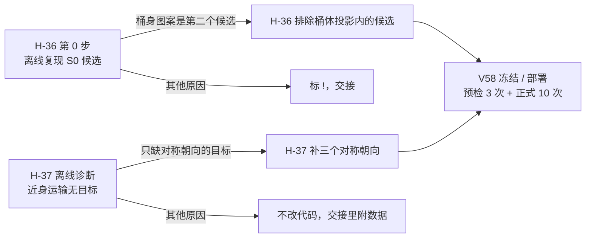

# F1 Harness 第五轮审阅：V56 真机通过、V57 批次 6 次与三个新问题

- 审阅基线：`harness/round5` 头提交 `829ab4a`（`e19bf8b`、`51bba53`、`829ab4a`），已作为 PR #11 用 merge commit 合并到 `main`（`fe254db`）。
- 回复：[20261126-02-codex.md](handoff/20261126-02-codex.md)。本轮指令在 [20261126-03-claude.md](handoff/20261126-03-claude.md)。
- 方式：只读代码与证据，未执行。新增条目 H-36 至 H-38。

**H-33 在真机上通过，H-32 的软件和回放通过，但 H-32 还没在真机上触发。** V56 一次就到了 S5：右腕第 6 关节最高 22.4°，没有堵转，运输从复核到首发只用了 0.02 秒（之前是 7.2 秒）。`fastdds-udp` 的效果也很清楚：8 次真机里右腕反馈过期 0 次。V57 的 6 次没有一次到 S5，所以让开动作还没在真机上验证。

**现在桌面上能放桶的范围只剩约 1 厘米宽。** 桶离身体近（x = 0.650 m）时，运输找不到不碰躯干的路线，4 次全部停在 S4。桶往前挪 3–4 厘米后，桶身进入右腕画面，又因积木识别不唯一停在 S0，3 次。两个问题分别卡住了这个范围的两头，必须都解决，桶才能"随便摆"。

**S0 的根因不是置信度不够，而是候选不唯一。** 没有提示时，右腕在整张图上找"积木"，规则是范围内必须恰好一个候选（`sam_seed.py:9-15`）。桶身上印着积木图案，很可能被当成了第二个候选。所以降低置信度阈值没有用，反而会让桶身上的图案更容易被选中。正确做法是把桶身所在的画面区域从候选里排除。这一点要先离线复现确认，再动代码。

---

# 第一部分：给人看

## 一、PR #11 审阅：通过，已合并

| 内容 | 结论 |
|---|---|
| H-33 补充说明 | Trial 3 不设范围重算两次结果也不同，确认是 OMPL 每次结果不同。三条回放实际输出的 `arm_r_j6` 最大 40.51°，没有超过 50° |
| H-33 只读确认 | ARM 上的控制器配置是 ±60°，与 6000D 的副本哈希一致；目视右腕无干涉。来源仍标"未确认"，50° 不变 |
| H-33 真机 | 通过：一次到 S5，0 次堵转 |
| H-32 代码 | 只改了 `scene_pipeline.py`，五个条件、两个允许的原因码、过期告警都与规格一致；没有新增 `raise HarnessError`；13 条测试覆盖了规格要求的全部情形 |
| H-32 回放 | Trial 3 的让开预览 `planned=True`，位移 0.133 m；保留位姿预览时 13.6 秒、复核时 14.2 秒，复核通过 |
| ARM 原因码 | Trial 3 遮挡帧全部是 `partial_lid_landmarks_unavailable`，与上轮裁定一致 |
| 停下时机 | 合规：H-34 达到 3 次阈值 |

小问题，不阻塞：交接头部没有写 PR 号。以后在"分支／PR"一行写上 PR 号。

## 二、三个问题的裁定

| 问题 | 裁定 | 理由 |
|---|---|---|
| 1. S0 识别不唯一 | **不放宽阈值。先离线复现，确认后把桶体投影区域内的候选排除（H-36）。不用固定提示框** | 失败规则是"候选不唯一"，不是"分数低"。固定提示框只在积木摆在老位置时有用，和随便摆的目标冲突。桶的位姿头部已经测到，把它投到右腕画面里就能算出桶在哪 |
| 2. 近身运输无路线 | **两条同时做：H-36 编码，同时离线诊断运输（H-37）。诊断结果符合预先写好的条件就直接修，不用回来问** | 两件事都不需要上电。下一次上电要验证的是同一个版本，两个修改分别影响 S0 和 S4→S5，在漏斗里分得开。碰撞余量不放宽 |
| 3. 左手动态避让 | **P2，进 backlog（H-38）。** 若 H-36 诊断发现头部看不到积木是因为左臂挡住，可以在交接里带数据提议调整左臂静态预设 | 目前主线是第一次放置成功。Harness 在任务中不给左臂发命令，动态避让是新能力，范围大 |

## 三、近身运输的线索（供 H-37 诊断）

- 失败是自碰撞余量差 0.04–0.88 mm（`arm_R_Link5` 对 `body_Link5`）。这条硬保护不放宽。
- 运输候选只有 4 种（`adapters.py:362-363`），都没有按方块的四重对称改变绕竖直轴的朝向。抓取、重抓和对准都有 `square_variant`（`adapters.py:361`），运输没有。直立方块放进方孔时，转 90° 是等价的。如果关节空间运输的目标只用一种朝向，补上另外三种就能多出肘部离身体更远的解，这不放宽任何检查。
- 这只是假设，必须先用 V57 Trial 1–3 的原始规划输入复现确认。

---

# 第二部分：给 Codex 的执行规格

## 0. 通用约束

沿用 [review-round4.md 第 0 节](review-round4.md#0-通用约束)。本轮追加：

1. H-36 和 H-37 可以并行，各自单独提交。两条都离线通过，就一起冻结为 V58；只有一条通过，就只冻结那一条。
2. 规格与代码不符、或诊断结果不符合预设条件时：把该条标 `[!]`，附上数据，继续做另一条，不要停下等回复。
3. 不放宽：置信度和面积阈值、15 秒窗口、碰撞余量、碰撞模型和躯干几何、关节限位、H-33 的 50° 范围。

## H-36 `[!]` P0：右腕无提示发现时，排除桶体投影内的候选

**已核实的代码事实**

- 积木没有提示框时，右腕在整张图上做语义发现（`mask_service.py:407-416`，搜索框为 `[0,0,w,h]`）。
- 是否采用由 `sam_seed.py:9-15` 的 `unique_scoped_candidate` 决定：候选中心落在搜索框内且恰好一个才采用，否则 `identity_status='unresolved'`，最后报 `mask_uncertain_requires_new_prompt`。这是唯一性检查，不是分数阈值。
- 已有类似的恢复：候选不唯一时，复用一次已测的语义候选框重新播种（`mask_service.py:454-466`，来源 `previous_semantic_seed_bounds`）。本条按同样的方式加一支。
- Trial 4–6 头部同时报 `object_mask_missing:camera=head:object=square-1`。头部没找到积木，所以没有搜索提示投到右腕，右腕只能在整张图上找。

**第 0 步：离线复现（这是门槛）**

用 Trial 4–6 的右腕原始 RGB 帧（每次取第一帧失败帧，再加两帧），在 V57 冻结的 SAM3 种子服务上跑整图发现，报告：

1. 候选数、每个候选的框、分数和面积（即 `semantic_candidate_summary`）；
2. 用同一次运行里头部实测的桶位姿，把桶的碰撞模型投到右腕画面，标出哪些候选落在桶的投影内；
3. 头部为什么没找到积木：在视野外、被左臂挡住，还是语义没识别出来。

| 复现结果 | 处理 |
|---|---|
| 候选 ≥2，恰好 1 个在桶投影外 | 按下面的改法实现 |
| 只有 1 个候选却仍报错，或 0 个候选，或桶投影外有 ≥2 个候选 | 不改代码，把 H-36 标 `[!]`，附数据交接 |
| 同一次运行里拿不到头部实测的桶位姿 | 不改代码，标 `[!]` |

**改法（第 0 步通过后）**

1. **排除区域**，在 `scene_pipeline.py` 计算：对还没有播种的 SAM 目标，在右腕没有搜索提示时，取本任务内最近一次头部实测的桶位姿。条件：来源是 `rgbd_anchor_registration`，并且当前没有持块（`held is not True`）；保留或预测的位姿不用。把桶的碰撞模型（与碰撞检查用的尺寸相同）按当前关节状态下的相机位姿和内参投到右腕画面，取外接矩形，四边各扩 `prompt_padding_px`。没有满足条件的桶位姿时，不生成排除区域，行为不变。
   - 先读代码确认：S0 时头部桶定位是否在右腕发现之前完成，或者不依赖右腕结果。如果不是，只允许调整调用顺序，让同一帧先做头部桶定位，不改定位判据。需要改 `scene_pipeline.py`、`mask_service.py` 以外的文件时，标 `[!]`。
2. **候选过滤**，在 `mask_service.py`：整图发现返回 `unresolved`、`semantic_candidates` 在 2 到 16 之间、并且有排除区域时，去掉中心落在排除区域内的候选。剩下恰好 1 个时，用它的框（扩 `sam_tracking_padding_px`）经现有 `_segment_box(..., reseed=True)` 重新播种一次，记录 `recovery_search_source='fixture_exclusion_unique_candidate'` 和排除掉的候选数。之后照常过 `_mask_missing`，即原来的 `minimum_score`、`minimum_area_px`。剩 0 个或 ≥2 个时，行为不变。
3. **诊断留证**：失败时的 measurement diagnostics 里写入 `semantic_candidate_summary` 和排除区域，以后的 S0 失败可以直接看到候选。这是新增的观测字段，按 HARNESS/AGENTS.md 的要求走正式通信验收。

**保留**：排除区域只能减少候选，不能增加候选，也不能当作身份证明；不用配置里的固定框来认定身份；持块后不启用；后续 RGB-D 几何校验全部照旧；不新增 `raise HarnessError`。

**验收**

1. 新增测试，至少：两个候选、一个在排除区内 → 用另一个重新播种，确认；两个候选都在排除区外 → 照旧报错；没有桶位姿 → 照旧；桶位姿来源是保留或预测 → 不启用；剩下的候选分数低于 `minimum_score` → 照旧报错；`held=True` → 不启用。
2. 用 Trial 4–6 的原始帧走正式分割路径：报告每次是否得到确认的积木掩码，以及由此算出的积木位置是否在桌面上、与裁剪图里的积木一致。再用 V57 Trial 1–3 的 S0 帧确认结果和改动前一样。
3. 全量 pytest、`check_native_integration.py`、三条零输出回放。

> **执行记录（2026-11-26，Codex，标 `[!]`，未改代码）**：第 0 步在 V57 冻结 SAM3 种子服务上复现 V57 Trial 4–6 原始机载网关 RGB-D 帧与 6 帧失败快照，两项门槛同时阻塞：① 三次运行头部均未测得桶位姿（`independent_fixture` 可用数 `0/3`），`积木demoV5` 左腕相机支架直接遮挡头部视角中的 `bucket-left-slot`（触发规格第 88 行停改条件，且为 H-38 提供视觉证据）；② 右腕整图 SAM3 返回 `26–35` 个候选（超出规格 `2..16` 上限，且 `semantic_candidate_summary` 截断前 16 条未排序），其中 `25–34` 个为桶身纸箱插画上的印刷小木块（`x <= 99 px`，面积 `83–660 px`，分数 `0.20–0.71`），`1` 个为真实木方块（`x = 376–489 px`，面积 `6,980–7,079 px`，分数 `0.973–0.977`）；同时头部未能定位真实积木（Trial 4–5 右腕遮挡积木 90% 且与左上背景纸箱角形成 2 候选，Trial 6 桶身印刷图案进入头部形成 13–28 候选）。按规格不改代码，完整复现与裁剪图见 [evidence/20261126-H36-fixture-exclusion/report.md](evidence/20261126-H36-fixture-exclusion/report.md)。

## H-37 `[x]` P0：近身桶位的运输诊断（条件满足才改代码）

**诊断**：用 V57 Trial 1–3 的 `harness_planning_started` 原始输入离线重跑运输规划，报告：

1. variant 0／1／2 各自余量最小的碰撞对、对应的路点和余量；
2. `joint_space_transport` 尝试了几个目标、每个目标被拒的原因、每个目标的最小自碰撞余量；
3. 这些目标绕孔口竖直轴的朝向是否只有一种；
4. 作为对照，重跑 V56 Trial 1（桶在 `[0.660, -0.064]`）。

**预先授权的修改（只在第 3 项为"只有一种朝向"时做）**

- 给 `joint_space_transport` 增加三个目标：同一位置、同一倾角，绕孔口竖直轴依次转 90°、180°、270°。原朝向排在最前。
- 每个目标照常过 IK、碰撞（余量不变）、关节限位、H-33 范围和整段扫掠。
- 修改只能在 `skill_services.py` 或运输候选生成代码里。需要改数值服务、碰撞模型或余量时，不改，标 `[!]`。
- 验收：重跑 V57 Trial 1–3，报告是否找到路线、`arm_r_j6` 最大值、最小自碰撞余量、规划耗时；V56 Trial 1 和 V54 Trial 3 的运输结果不变（仍然成功）。新增测试：只有一种朝向时会补齐三种；原朝向可行时仍然优先选它。

诊断结果是其他情况（例如四种朝向都碰撞，或者 IK 分支有问题）时，不改代码，把数据写进交接，H-37 标 `[!]`。

> **执行记录（2026-11-26，Codex，离线验证通过，冻结为 V58）**：离线重跑 V57 Trial 1–3 原始 `harness_planning_started` 输入确认：variant 0/1/2 在索引 11 被 `arm_R_Link5 / body_Link5` 自碰撞拒绝（`-0.036 mm` 至 `-0.876 mm`），variant 3 笛卡尔无进展；`joint_space_transport` 原仅 1 个目标（仅 `0°` 朝向），3 个 IK 拟合解全部被原生自碰撞门拒绝（`-10.0 mm`）。按预授权在 `transport.py`、`joint_motion.py`、`skill_services.py` 补齐 `0° → 90° → 180° → 270°` 四向对称朝向（`0°` 排最前，零碰撞余量/限位/50° 改动，净新增 `raise HarnessError = 0`），并在 `tests/test_joint_transport.py` 新增 3 条单测（`20 passed`）。通过真实 `PlanService` 规划与 `revalidate_plan` 复核重跑 5 次真实记录：V57 Trial 1–3 全部在 `+90°` 通过（`arm_r_j6 <= 25.36°`，全路径最小自碰撞余量 `57.05–58.71 mm`，规划耗时 `4.37–5.48 s`，正式复核 3/3 通过）；V56 Trial 1 与 V54 Trial 3 对照均继续优先选 `0°` 并通过（最小余量 `11.25–11.89 mm`，复核 2/2 通过）。完整诊断与验收见 [evidence/20261126-H37-near-body-transport/report.md](evidence/20261126-H37-near-body-transport/report.md)。

## H-38 `[x 静态 / backlog 动态]` P2：左臂遮挡头部视野时的避让（backlog）

- **静态预设部分已关闭（`[x]`，H-41，2026-11-27）**：采用操作者保存的 **V6**（`04a159f3c79c4b7a8ae9f9ffb06c7b4c`，`arm_l_j2 = -47.32°`）作为标准静态复位预设（V5 保留在 4242 不删除，不改 F1-4242 配置）。
- **动态避让部分仍为 backlog**：现在不做；触发条件不变（第一次放置成功到 S8 之后，或某一批的首要停因是“左臂挡住头部看积木或桶”）。任务中动态控制左臂需单独审阅。

> **现场补充（2026-11-26，Codex）**：H-36 第 0 步复现证实 `积木demoV5` 左腕支架在头部主视角遮挡 `bucket-left-slot`（0/3 测得桶位姿）；操作者在 V58 真机前新建并保存了静态预设 **V6**（`04a159f3c79c4b7a8ae9f9ffb06c7b4c`，`arm_l_j2 = -47.32°`，右臂/头部/躯干与 V5 一致），连续 3 次预检 5/5 全过、头部稳定测出桶位姿（`fixture` 192/87/233 次），已随交接 `20261126-05-codex.md` 提议将 V6 转为标准静态预设。

## V58 真机（H-36／H-37 冻结后）

1. 部署，核对 4242，预检连续 3 次五项全过。
2. **重新计正式 10 次**。V57 的 6 次单独记为"V57 批次"，不并入。
3. 摆位，由 Codex 每次提示人类：
   - 桶在 x = 0.67–0.72 m、y = −0.10–0.00 m 之间变化，其中至少 4 次让桶身进入右腕画面；
   - 只有 H-37 也进了 V58 时，才另外安排 2 次桶在 `[0.650, -0.051]` 附近；
   - 积木在右臂可达范围内随意摆放。
4. 停止条件：同一阶段、同一原因连续 3 次就停；出现安全事件立即停。
5. 报告：各阶段到达数；H-36 生效次数和它之后的 S1 到达数；近身桶位的运输结果（若做了 H-37）；H-32 的让开成功、让开后测出方孔、`static_fixture_retention_expired` 次数；S6–S8 到达数；H-34 的 S0 分割失败次数。

> **V58 批次执行记录（2026-11-26，Codex）**：仅 H-37 冻结为 **V58**（`cfc9b2ad5696`），3 条零输出回放全过、上线核对 4242 通过，在 V6 预设下连续 3 次预检 5/5 全过。真机运行 3 次后按操作者要求暂停并汇总交 Claude 审阅：Trial 1 停 S0（桶身入右腕复现 H-36）；Trial 2（`x=0.741 m`）到达 S5，H-32 首次真机保留桶位姿成功，但因持块期间从未测出方孔报 `no_distinct_measured_view_in_current_holding_episode` 未让开；Trial 3（`x=0.663 m`）运输前测出方孔且顺利到位，但到位后对持块报 `supported_upright_face_not_observed` 退化为 `coarse_local_environment` 超时。全程 0 安全事件、0 堵转、0 右腕反馈过期；H-37 近身 `+90°` 尚未在真机触发。详证见 [evidence/20261126-v58-batch/report.md](evidence/20261126-v58-batch/report.md)。

## 版本登记

H-36 和 H-37 合为 V58（读登记取下一个整数，目前最大 57）；只做成一条也是 V58。先登记 `candidate`，上线核对后改为 `deployed`。H-38 不分配版本。
