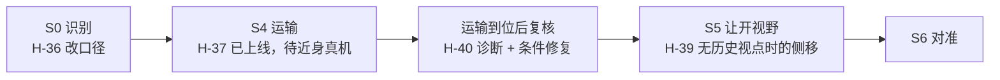

# F1 Harness 第六轮审阅：V58 与 V6 预设下的 3 次真机，S0／S4 到位／S5 三处阻塞

- 审阅基线：`harness/round6` 头提交 `8a0d213`（`ccd5d96`、`15297eb`、`a90537d`、`8512ec6`、`8a0d213`），已作为 PR #13 用 merge commit 合并到 `main`（`94d91f9`）。
- 回复：[20261126-05-codex.md](handoff/20261126-05-codex.md)。本轮指令在 [20261127-01-claude.md](handoff/20261127-01-claude.md)。
- 方式：只读代码与证据，未执行。H-36 改写口径，新增 H-39、H-40、H-41，H-38 的静态部分关闭。

**这一轮第一次在真机上走到了 S5 之后的逻辑，H-32 的保留也第一次在真机上生效了。** 操作者的左臂新预设 V6 解决了头部看桶盖的遮挡。三次试验分别卡在三个不同的地方，每一处都是确定性的代码路径，不是偶发故障。

**三处阻塞都离放置很近。** Trial 3 运输前就测出了方孔，物理上也已经运到桶上方，只是到位后的复核没能测出夹着的积木，就超时停下了。Trial 2 已经保住了桶位姿，只是因为持块期间从来没有看清过方孔，程序不知道该往哪边让开。这两处修好，S6 就有真实的机会。

**H-36 的第 0 步证实了上一轮的判断：问题是候选太多，不是分数太低。** 真实积木分数 0.97、面积约 7,000 px，桶身印刷的小木块有 25–34 个，分数 0.20–0.71、面积 83–660 px。V6 让头部能稳定测到桶，按桶的投影排除候选的前提已经具备。要改的只是上一轮规格里"最多 16 个候选"这个上限。

---

# 第一部分：给人看

## 一、PR #13 审阅：通过，已合并

| 内容 | 结论 |
|---|---|
| H-36 第 0 步 | 合规：两个停改条件同时触发，标 `[!]`，没改代码，并继续做 H-37。复现数据完整（26–35 个候选的逐条框、分数和面积，以及头部失败原因和图像） |
| H-37 代码 | 只在 `transfer_above_hole` 的关节空间搜索里，按 0°／90°／180°／270° 依次试，原朝向排第一；超时检查只在第一次尝试之后生效；朝向写进 `geometry_trace`，复核时按同一朝向重建。余量和检查都没改，净增 `raise` 为 0 |
| H-37 离线 | V57 Trial 1–3 在 +90° 找到路线，最小自碰撞余量 57–59 mm（原来是 −0.04 至 −0.88 mm），`arm_r_j6` ≤ 25.4°；V56 Trial 1 和 V54 Trial 3 仍选 0°；正式复核全过 |
| V58 发布 | 3,140 项测试、62 项原生集成、3 条冻结回放、4242 核对全过 |
| 只列人类待办的交接 | `20261126-04-codex.md` 按规则只列了人类待办，用得对 |
| 批次停在 3 次 | 可以。规则写的是同因连续 3 次必须停；这次是操作者在出现三个不同原因后要求停下，三个原因都有完整的原始记录 |

## 二、四个问题的裁定

| 问题 | 裁定 | 理由 |
|---|---|---|
| 1. H-36 候选超过 16 个 | **选 A。** 排除对全部候选做，上限改为 64；超过 64 或候选列表不完整时不启用。阈值都不改 | 16 是上一轮凭空写的数，没有物理依据。唯一性还有两道检查：排除后必须恰好剩 1 个，并且用它的框重新播种时，服务端会在框内再查一次唯一 |
| 2. S5 没有历史视点，不让开 | **选 A，限定为一个确定方向的横移（H-39）。** 不选 B | B 在远处的桶位本来就测不到。A 和现有的横移用同一个步长公式，只是方向不再借用"上次看清的位置"，而是取头部到积木视线在桌面上的垂直方向 |
| 3. 运输到位后测不出夹着的积木 | **先离线复现，再按预先写好的条件修（H-40）。** 新的位姿来源不在授权范围内 | Trial 3 的记录里没有 `surface_association`，说明持块时的面关联很可能根本没运行；这条路径上也没有 H-32 的保留。两处都是现有机制没接上，可以直接修。如果原因是相机在到位姿态下物理上看不到积木的面，就是新问题，标 `[!]` |
| 4. V6 转正并补验 H-37 | **采用 V6 作为标准静态预设，关闭 H-38 的静态部分；V59 批次里安排 2 次近身桶位（H-41）** | V6 只动了左臂，各关节都在限位内，3 次预检全过，两次运输在 V6 下都正常规划。动态避让仍然是 backlog |

## 三、Trial 3 的线索（供 H-40）

- 运输前 OBS:48–49 已测出持块位姿（`held=True`、`eef_object_pose` 有效）和方孔。
- 到位后 OBS:114–146 连续 15 秒报 `supported_upright_face_not_observed`。全部原始记录里 `surface_association` 出现 0 次，`static_fixture_retained` 出现 0 次。
- 持块时，`scene_pipeline.py:819-838` 本来会用"已测附着关系乘以当前末端位姿"预测面法向，只用来挑选新的深度点。它的前提是 `in_hand_reference`（或隔离区里的参考）存在，而且夹爪值与闭合时的差不超过 `gripper_stationary_delta`。没有这条记录，说明前提没满足。
- 物体位姿测不出时，场景走 `_partial`（约 `:540-612`），它把 `fixture` 原样传下去。但 H-32 的保留只在另一条分支（`:995-1015`）里做，所以 Trial 3 的桶位姿也丢了。

---

# 第二部分：给 Codex 的执行规格

## 0. 通用约束

沿用 [review-round5.md 第 0 节](review-round5.md#0-通用约束)。本轮追加：

1. H-36、H-39、H-40 并行，各自单独提交。离线通过的条目一起冻结为 V59；只有部分通过也冻结 V59，其余标 `[!]` 附数据。
2. 三条分别作用于 S0、S4 到位后和 S5，在漏斗里分得开，可以放进同一个版本。
3. 不放宽：分数和面积阈值、15 秒窗口、碰撞余量和碰撞模型、关节限位、H-33 的 50°、H-32 的 20 秒和允许的原因码。新的观测字段要走正式通信验收。

## H-36 `[x]` P0（改写）：对全部候选做桶体投影排除

> **执行记录（Codex 2026-11-27）**：已完成 `sam_seed.py`（64 候选降序摘要+截断标记）、`mask_service.py`（全候选桶体投影排除与唯一剩余重播）、`services.py`（注入桶 AABB）与 `scene_pipeline.py`（12 边近平面裁剪投影、S0 头部优先定桶与失败诊断）。单元测试 19/19 通过（含新增 10 例与真实 35 候选 HTTP 头往返，`X-SAM-Tracking-Result` = 3,716 字节）；真实 SAM3/SAM2 离线实测中，V57 Trials 4–6（以 V6 预检同桶区头部实测桶位姿为代理）5/6 帧确认（3/3 试验可恢复，实测积木 `[0.820, -0.312, 0.606] m`）；V58 Trial 1 同帧头部实测桶投影排除 31/31 与 32/32 个桶身候选，但因画面右上角桌面外远景（深度 1.81–1.84 m、世界 `z = −0.14 至 −0.16 m`）存在 1 个无关低分误检（`score = 0.258–0.311`），按规格保守保持 `unresolved`（未放宽任何阈值或增加未授权过滤）。证据见 [20261127-H36-full-candidate-exclusion/report.md](evidence/20261127-H36-full-candidate-exclusion/report.md)。

在 [review-round5.md 的 H-36](review-round5.md#h-36--p0右腕无提示发现时排除桶体投影内的候选) 基础上，只改以下几处，其余照旧（桶位姿只用本任务内头部实测、未持块时的 `rgbd_anchor_registration`，排除只减不增，持块后不启用，之后照常过分数和面积阈值）：

1. **候选摘要**，在 `sam_seed.py:60-62`：`semantic_candidate_summary` 输出全部候选，最多 64 个，按分数从高到低排列，每条保留原来的 `index`。为了控制返回头的大小，框取整数，分数保留 3 位小数。超过 64 个时只输出前 64 个，并加上 `semantic_candidate_summary_truncated=true`。
2. **启用条件**，在 `mask_service.py`：原来的 `2 ≤ semantic_candidates ≤ 16` 改为 `semantic_candidates ≥ 2`、摘要条数等于 `semantic_candidates`、并且没有截断。不满足时行为不变。
3. **排除和重新播种**：去掉中心落在桶投影外接矩形（四边各扩 `prompt_padding_px`）内的候选，剩下恰好 1 个时，用它的框经 `_segment_box(..., reseed=True)` 重新播种一次。服务端仍用 `unique_scoped_candidate` 在这个框里再查一次唯一性。
4. **诊断**：失败时写入候选总数、被排除数、剩余数、桶投影矩形和完整摘要。
5. **部署**：`sam_seed.py` 在 SAM 服务进程里运行，V59 部署时 SAM 服务要换成同一个冻结包，并在发布回执里核对模型和代码的身份。

**验收**

- 测试：原规格 6 例之外再加 3 例：35 个候选、其中 34 个在排除区内 → 确认；摘要被截断 → 不启用；摘要条数少于 `semantic_candidates` → 不启用。
- 离线用 V57 Trial 4–6 的右腕帧做（这三次头部在 V5 下测不到桶，所以离线时允许用同一桶位、V6 下预检记录里的头部实测桶位姿，并在报告里标明）；再用 V58 Trial 1 的帧做（V6 下头部有实测桶位）。报告每帧排除前后的候选数、是否得到确认的掩码，以及算出的积木位置是否与真实积木一致。
- 正式通信验收：35 个候选时 `X-SAM-Tracking-Result` 的字节数，以及经正式 HTTP 路径能完整取回摘要。

## H-39 `[x]` P0：持块遮挡、又没有历史视点时，向一个确定方向横移

> **执行记录（Codex 2026-11-27）**：仅修改 `HARNESS/src/f1_harness/aperture_view.py` 并在 `HARNESS/tests/test_held_aperture_view.py` 增补 5 项测试（9/9 通过）。针对 H-32 `object_only` 仅保留右腕帧但 `live_scene.py` 仍提供实测 `head_pose` 的真机事实，在 `aperture_view.py` 内兼容 `scene.fixture.source == 'retained_static_fixture'`（仍要求 `head_pose is not None`）。V58 Trial 2（`OBS:127`）零输出回放：`move_tcp` 候选位移 `0.1100 m`、方向 `[-0.2267, -0.9731, -0.0404]`（右臂负 `y` 侧），`PlanService` 预览 `planned=True`（5 路点，`arm_r_j6 ∈ [28.54°, 31.01°]`），正式 `revalidate_candidate` 通过，保留桶位姿年龄预览 `2.415 s` / 复核 `2.715 s`。证据见 [20261127-H39-fallback-view/report.md](evidence/20261127-H39-fallback-view/report.md)。

**代码事实**

- `aperture_view.py` 只有存在 `self.anchor`（本次持块期间某帧同时看到积木和方孔时的 TCP）时才生成 `self.move`，方向借用"上次看清时的位置"。
- 没有 anchor 时，`live_scene.py:110` 给出 `no_distinct_measured_view_in_current_holding_episode`，`recover_alignment`（`recovery_programs.py:382-393`）就没有候选可用。

**目标行为（只改 `aperture_view.py`）**

当积木持块、位姿有效且证据是当前帧，方孔没有位姿，`self.anchor is None`，本帧有头部图像和 `head_pose`，并且没有动作正在发布时，生成一个回退候选：

1. 方向：从头部相机到积木的视线投到桌面平面（沿 `envelope['normal']` 去掉法向分量）后，取桌面内与它垂直的单位向量。两个可选方向里，选指向右臂一侧（机器人基座坐标系下 `y` 分量为负）的那个。
2. 步长：沿用现有公式 `(width + hole_width) / 2`，`width` 按现有代码沿该方向计算持块和工具的投影宽度。因为没有 anchor，不再与 `distance` 取较小值。
3. 高度和姿态不变。`target_frame='world'`，`source_observation_id` 和 `current_observation_id` 都填当前观测，`source_frame_hashes` 填积木的证据号，`purpose='noncontact_lateral_aperture_reobservation_without_prior_view'`。
4. 每个持块周期最多生成一次。执行过后（不论成败），本周期内不再生成回退候选，防止来回移动。
5. 有 anchor 时，行为与现在完全相同。

**保留**：候选照常走 `move_tcp` 的预览、整段碰撞扫掠（桶按实测或 H-32 保留的位姿当障碍物）、关节限位、H-33 的范围、复核和授权；`recovery_programs.py`、`live_scene.py`、`observation.py`、`revalidation.py` 都不改。让开之后，对准仍然必须有实测方孔。

**验收**

- 测试：没有 anchor 时生成候选，方向的 `y` 分量为负、垂直于视线、步长等于公式值；有 anchor 时与原来一致；执行过一次后不再生成；没有头部图像或 `head_pose` 时不生成；积木没有持块或没有位姿时不生成。
- 用 V58 Trial 2 的原始输入从运输到位接续做零输出回放：预览 `planned=True`，报告位移和方向，以及保留桶位姿在预览和复核时的年龄。预览被拒就报告原因码，标 `[!]`。

## H-40 `[x]` P0：运输到位后测不出夹着的积木（先诊断，条件满足才改）

> **执行记录（Codex 2026-11-27）**：V58 Trial 3 5 项离线诊断同时证实条件 A（`[250]` 瞬时 `mask_truncated` 触发 `reject_measurement()` 时因 `contact_attachment is not None` 跳过隔离保存，导致 `invalidate()` 清空 `in_hand_reference`，到位后 `OBS:114` 法向偏离 `+Z` 19.93° 却正对相机 20.78°、无 `surface_association` 致拟合失败；全程 CAN 恒定 `87.06%`）与条件 B（`reject_measurement()` 清空 `measured_fixture` 且 `_partial_observation` 未走 `_locate_bucket_for_object` 与 H-32 五条件保留）。已在 `scene_pipeline.py` 同时修复 A+B（保持参考仅用于深度点面关联，并在张开/未持/未知/换范围时即刻清空；`_partial` 复用完全一致的 H-32 五条件与 20 s）。新增 13 例正反单测及全部场景/夹爪/保留回归通过；Trial 3 真实 `OBS:49 → [250]/[251] → OBS:114` 零输出回放恢复 `held=True`、`square-1` `[0.6626, -0.0349, 0.8183] m`、`retained_static_fixture`（`7.562 s`），可进入 `align`/`inspect_in_hand`。证据见 [20261127-H40-held-after-transport/report.md](evidence/20261127-H40-held-after-transport/report.md)。

**诊断**：用 V58 Trial 3 运输前（OBS:48–49）和到位后（OBS:114 起）的原始 RGB-D 与状态，离线走正式场景处理，报告：

1. 到位后测积木用的是哪个相机，运输前又是哪个；
2. `in_hand_reference`、`in_hand_quarantine`、`in_hand_gripper` 各自的值。如果参考是在运输过程中被清掉的，找出清掉它的代码行和触发条件；
3. 夹爪值与闭合时的差，和 `gripper_stationary_delta` 相比；
4. 掩码像素数、有效深度点数，以及预测面法向与相机视线的夹角（假设面关联正常运行时能否找到这个面）；
5. 走 `_partial` 路径时 `fixture` 为什么是 `None`。

**预先授权的修改**

| 诊断结果 | 修改 | 限制 |
|---|---|---|
| A. `in_hand_reference` 在运输中被清掉或没有建立，但夹爪 CAN 一直持块、夹爪值变化在 `gripper_stationary_delta` 内 | 修正参考的建立或清除时机，让它在同一个持块周期内保持 | 参考仍然只用来挑选新的深度点，不能直接当位姿。夹爪张开、持物判定为假或未知、换任务或换授权周期时照常清掉 |
| B. 物体位姿测不出时走 `_partial`，丢了 H-32 应当保留的桶位姿 | 在 `_partial` 路径里套用 H-32 的同一组条件（两个允许原因码、持块为真、上次实测、晚于闭爪、20 秒内），输出 `retained_static_fixture` 和同名告警 | 条件和 20 秒不变；保留的桶位姿只能当障碍物 |
| C. 面关联正常运行，但相机在到位姿态下物理上看不到积木的面（夹角太大或点太少） | 不改代码，标 `[!]`，附夹角、点数和图像裁剪 | 不新增位姿来源，不放宽面拟合阈值 |
| 其他 | 不改代码，标 `[!]`，附数据 | — |

A 和 B 可以同时成立，同时修。

**验收（做了修改时）**

- 测试：针对每项修改的正例和反例，例如持块周期内参考保持、夹爪张开后清掉、`_partial` 中五个条件全部满足时保留、任一条件不满足时不保留。
- 用 Trial 3 的原始输入从运输到位接续做零输出回放：到位后的复核得到 `held=True` 且有位姿的积木（A），场景带着桶位姿（实测或保留，B），并报告能否进入 `align` 或 `inspect_in_hand`。
- 对照：V54 Trial 3 和 V58 Trial 2 的回放结果不变。

## H-41 `[x]` P1：V6 转为标准静态预设，H-37 近身真机补验

> **执行记录（Codex 2026-11-27）**：已将 `HARNESS/agent/STATUS.md`、`HARNESS/agent/TODO.md` 及 V59 批次 `layouts.md` 模板（`evidence/20261127-v59-batch/layouts.md`）的标准静态预设更新为 **V6（`04a159f3c79c4b7a8ae9f9ffb06c7b4c`）**（V5 保留在 4242，F1-4242 配置未动）；`review-round5.md` 中 H-38 静态部分标 `[x]`（动态避让保持 backlog）；H-37 的 2 次近身桶位补验已排入 V59 正式 10 次批次。

1. 在 STATUS、`layouts.md` 模板和预检说明里，把 `积木demoV5` 换成 V6（`04a159f3c79c4b7a8ae9f9ffb06c7b4c`）。V5 保留在 4242，不删除。F1-4242 的配置文件不改，预设已经由操作者保存在 4242。
2. H-38 的静态部分标 `[x]`（V6）。动态避让仍为 backlog，触发条件不变。
3. H-37 的真机补验放进 V59 正式批次，见下文。

## V59 真机

1. 部署（Harness 包和 SAM 服务换成同一个冻结包），核对 4242，在 V6 下预检连续 3 次五项全过。
2. **重新计正式 10 次**。V58 的 3 次单独记为"V58 批次"。
3. 摆位，由 Codex 每次提示人类：
   - 3 次桶身进入右腕画面（x ≥ 0.78 m），检验 H-36；
   - 2 次桶在 `[0.650, −0.051]` 附近，检验 H-37；
   - 5 次桶在 x = 0.66–0.76 m、桶身不进右腕画面，检验 H-39 和 H-40 以及之后的 S6–S8；
   - 积木随意摆在右臂可达范围内。
4. 停止条件：同一阶段、同一原因连续 3 次就停；安全事件立即停；第一次到达 S8 后照常跑完 10 次。
5. 报告：各阶段到达数；H-36 生效次数和之后的 S1 到达数；近身运输结果；H-40 到位后测出积木的次数；H-39 回退横移的发布次数和让开后测出方孔的次数；H-32 保留次数和 `static_fixture_retention_expired` 次数；S6–S8 到达数；S0 分割失败次数。

## 版本登记

H-36、H-39、H-40 合为 V59（读登记取下一个整数，目前最大 58）。只有部分通过也是 V59。先登记 `candidate`，上线核对后改为 `deployed`。H-41 不分配版本。
