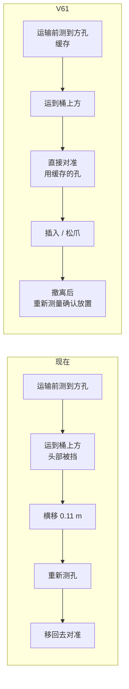

# F1 Harness 第七轮审阅：V60 首次进入 S6，改为复用运输前测到的方孔

- 审阅基线：`harness/round7` 头提交 `38317ea`（`bf1f02e` 至 `38317ea` 共 9 个提交），已作为 PR #15 用 merge commit 合并到 `main`（`960ea31`）。
- 回复：[20261127-03-codex.md](handoff/20261127-03-codex.md)。本轮指令在 [20261127-04-claude.md](handoff/20261127-04-claude.md)。
- 方式：只读代码与证据，未执行。新增 H-42 至 H-45。H-32 的保留时长随 H-42 一起修订。

**V60 第一次连续两次走到 S6。** H-36、H-40、H-32 和 H-39 都在真机上生效了。两次 S6 失败的原因相同：机载规划器给单个候选的 IK 计算设了 7 秒的墙钟上限，ARM 比 6000D 慢，可行的候选还没算完就被截断。离线在 6000D 上，同一个候选 4–5 秒就能解出，并且通过正式复核。

**用户对横移的质疑是对的。** 原始记录显示：5 次走到运输的试验，全部在运输开始前 2.7–7.7 秒、手臂还没挡住头部时，就已经实测到方孔。桶在运输期间是静止的，这个测量本来可以直接用来对准。之所以还要先横移、再测一次、再移回去，是因为代码要求对准时必须用当前帧里看到的方孔（`observation.py:308-314`），之前的规格也一直沿用这条。这条规则的原意是防止桶被碰动而不知道，但桶会不会被碰动和过了多久无关，和有没有接触有关。所以改为：同一个持块周期里、运输前实测的方孔可以直接用来对准和插入，条件是期间没有任何接触迹象；放置是否成功仍然要重新测量确认。横移降为找不到这份测量时的备用方案。

**下一版本 V61 一共四处修改。** 复用运输前的方孔（H-42）；把 IK 墙钟上限改为站点配置，并让对准先试关节余量大的候选（H-43）；修掉 S5 读取场景时的竞态（H-44）；排除桌面以外的远处误检（H-45）。

---

# 第一部分：给人看

## 一、PR #15 审阅：通过，已合并

| 内容 | 结论 |
|---|---|
| H-36 | 摘要最多 64 条、按分数排序、保留原 `index`、标出是否截断；排除对全部候选生效。V57 Trial 4–6 离线 3/3 恢复，V60 Trial 2 真机在桶身入画的情况下直接过了 S0 |
| H-39 | 没有 anchor 时横移，方向朝右臂一侧，每个持块周期最多一次。真机 2/2 让开后测到方孔 |
| H-40 | 修了 A（持块参考在短暂失败时保持）和 B（`_partial` 路径套用 H-32 的保留）；保留条件抽成 `_check_occluded_fixture_retention`，与原分支共用。真机 3/3 到位后保住了持块位姿 |
| H-41 | V6 转为标准预设，H-38 的静态部分关闭 |
| V59 取消、V60 上线 | 符合版本规则：V59 因测试边界不过而取消，号码不复用；SAM 服务与 Harness 换成同一个包 |
| 预检跳过 | 操作者当轮明确要求跳过，Codex 如实登记为未执行，符合 HARNESS/AGENTS.md。正式批次仍建议做预检，只需约 1 分钟 |
| `registry.json` | 历史条目里的绝对路径被统一改成了相对路径。逐条核对过，除了路径前缀和当前版本的 `currently_active`，没有任何字段变化，可以接受。**以后不要改历史条目的任何字段，包括格式** |

## 二、为什么改为复用运输前的方孔

| 试验 | 运输前最后一次实测方孔，到运输首发 | 到运输到位 | 到位后的情况 |
|---|---:|---:|---|
| V60 Trial 1 | 6.1 s | 11.2 s | 横移后重新测孔，S6 被 IK 时限截断 |
| V60 Trial 2 | 3.3 s | 7.8 s | 同上 |
| V60 Trial 3 | 2.7 s | 6.5 s | S5 竞态，没有横移 |
| V58 Trial 2 | 7.7 s | 13.3 s | 没有历史视点，没有横移 |
| V58 Trial 3 | 6.0 s | 14.5 s | 到位后丢了持块位姿（已由 H-40 修复） |

- 运输前测孔用的是头部相机，手臂到位后能测孔的也只有头部相机，到位时它正好被挡住。所以到位后再测一次，只能证明桶没有动，不会让孔的位置更准。
- 对准需要知道积木和孔的相对位置。积木的位置由右腕在当前帧实测（H-40 已打通），孔的位置由头部测量。这两部分的误差来源，用缓存和用现测是一样的。
- 真正要防的是桶在运输中被碰动。能发现接触的现有信号有：堵转（`motion_stalled`）、路点跟踪检查失败、发布状态未知或部分发布。只要出现其中任何一个，缓存立刻作废。
- 万一桶在没有任何信号的情况下被轻轻碰动，结果是插入时积木碰到桶盖。这会表现为堵转并停下，属于可以恢复的失败。最终是否成功，由撤离后重新测量来判定，不会被误记为成功。

## 三、交接里三个问题的裁定

| 问题 | 裁定 | 理由 |
|---|---|---|
| 1. S6 被 7 秒 IK 上限截断 | **H-43：上限改为站点配置（F1-09 取 15 秒），总时长仍受 `budget_ms` 约束；对准先试关节余量大的候选** | `planning_deadline` 只允许调用方缩短时限，不允许延长（`harness_compute.py:8-16`）。7 秒是写死的性能预算，不是安全限位；按 HARNESS/AGENTS.md，性能预算不能一票否决可行的动作。换候选顺序也很必要：v=0／2／3 都顶着关节限位，先试它们会白白消耗总时长 |
| 2. S5 场景竞态 | **H-44：在 `live_scene.py` 的 `aperture_observation()` 里，`latest` 被预览清空时，最多等 1.5 秒拿到下一帧** | 有 H-42 之后 S5 的横移很少会用到，但作为备用路径仍然要正确；只改读取，不改失效逻辑 |
| 3. 桌面外的远处误检 | **H-45：增加一条只减不增的排除——候选中心处深度无效、或换算到世界坐标后低于桌面 5 cm 以下的，排除** | 与 H-36 同一条路径、同样的性质；误检的世界高度是 −0.15 m，远在桌面以下，不会误伤桌上的积木 |

---

# 第二部分：给 Codex 的执行规格

## 0. 通用约束

沿用 [review-round6.md 第 0 节](review-round6.md#0-通用约束)。本轮追加：

1. H-42、H-43、H-44、H-45 并行，各自单独提交，离线通过的一起冻结为 V61。
2. H-43 要改 `DAgger/F1/src/f1dagger/harness_compute.py`。动手前先读 `DAgger/AGENTS.md`，改动只限下文写的那一处，单独提交，提交信息写明 `control_manifest_sha256` 的变化。
3. 不放宽：碰撞余量和碰撞模型、关节限位、H-33 的 50°、分数和面积阈值、面拟合阈值、15 秒观测窗口、`intent.budget_ms`。H-32 的允许原因码不变，只有保留时长按 H-42 修订。

## H-42 `[x]` P0：对准和插入复用运输前实测的方孔

**代码事实**

- `observation.py:308-314`：`align`、`insert`、`release`、`verify_placed` 要求观测里有带位姿和证据号的方孔，否则报 `aperture_measurement_required`。
- `observation.py:315-321`：H-32 保留的桶位姿只能用于过渡类技能。
- 原始记录：5 次走到运输的试验，都在运输首发前 2.7–7.7 秒持块时，由头部直接测到 `square-hole-1`。

**目标行为**

1. **缓存**（`scene_pipeline.py`）：持块周期内（闭爪发布之后、`held is True`），每当头部直接测到方孔（`_direct_aperture` 可见，并且不是预测出来的），就记录这次测量：孔位姿、证据号、测量时刻，以及当时实测桶位姿的 `measured_at_ns` 和位姿。新的直接测量覆盖旧的。
2. **使用**：当前帧没有直接测到方孔时，满足下面全部条件，就把缓存的孔放进观测的 `objects`，`visible=False`，保留原证据号和测量时刻，标 `source='cached_pre_transport_aperture'`，并加质量告警 `aperture_from_pre_transport_cache`：
   - 同一个持块周期：闭爪请求号一致；夹爪 CAN 持续持块；任务、授权周期和标定都没有变化；
   - 当前桶位姿是实测的 `rgbd_anchor_registration` 并且与缓存时的桶位姿相差不超过 `planning_margin_m`（相差过大说明桶动过，作废缓存），或者是从同一次测量（或更晚的测量）保留下来的 `retained_static_fixture`；
   - 从缓存的测量时刻起，**没有**出现：`motion_stalled`、路点跟踪检查失败、发布状态未知或部分发布、停止或撤权、`hold_requested`；
   - 距测量时刻不超过 45 秒（`CACHED_APERTURE_MAX_AGE_NS = 45_000_000_000`）。依据：实测到位用时 6.5–14.5 秒，加上对准规划的总预算 25 秒，再加复核约 1 秒，合计不超过 41 秒。
3. **允许的技能**（`observation.py` 和 `revalidation.py`）：来源为 `cached_pre_transport_aperture` 的方孔可以用于 `align`、`insert`、`release`。`verify_placed` 仍然必须有当前帧直接测到的证据，撤离后由头部重新测量。
4. **H-32 保留时长修订**：H-32 的五个条件不变，保留时长从 20 秒改为与本条相同的 45 秒，失效条件同样加上第 2 项里的接触迹象。理由：同一个静态桶，对准需要它作为碰撞参考，时长必须与缓存的孔一致。`static_fixture_retention_expired` 告警保留。
5. **H-39 降为备用**：只有缓存不存在或已作废时，才走 `recover_alignment` 的横移；有可用缓存时，S5 直接对准。
6. 诊断里写入缓存的孔的年龄、使用的条件和作废原因，作废原因例如 `cache_invalidated:motion_stalled`。

**保留**：缓存只来自头部的直接测量，不来自预测或模型；不把桶模型上的名义孔位当作测量；撤离后的放置确认必须用新测量；不新增 `raise HarnessError`。

**验收**

1. 测试至少包括：满足全部条件时 `align` 可以规划；以下任一情况时作废，回到 `aperture_measurement_required`：闭爪请求号变了、出现过 `motion_stalled`、出现过跟踪检查失败、实测桶位姿偏差超过 `planning_margin_m`、超过 45 秒、标定变了；`verify_placed` 拒绝使用缓存；有当前帧直接测量时优先用它；H-32 在 45 秒内保留，超过 45 秒或出现接触迹象时清掉。
2. 用 V60 Trial 1–3、V58 Trial 2–3 的原始输入，从运输到位接续做零输出回放：报告每次是否直接得到可以执行的 `align` 计划（不经横移）、选中的候选、`arm_r_j6` 范围、最小余量、6000D 上的规划耗时，以及缓存的年龄。
3. 全量 pytest、`check_native_integration.py`、三条零输出回放；另加一条从运输到位直接对准的回放。

> **执行记录（2026-11-27）**：已完成 `contracts.py`、`engine.py`、`owner_bridge.py`、`scene_pipeline.py`、`observation.py`、`revalidation.py`、`verification.py` 改动，实现持块周期内运输前实测方孔缓存（45 s 上限、接触故障/撤权/桶位移/换闭爪作废、兼容 2/3 哈希头部/跨视角直接实测）、H-32 45 s 同步修订与接触故障作废、`align`/`insert`/`release` 允许而 `verify_placed` 拒绝、H-39 自动降级为备用路径。单测 85 passed；V60 Trial 1–3 与 V58 Trial 2–3 共 5 次真实试验从运输到位直接进入 `align` 零输出回放 **5/5 不经横移即解出 `v=1`**（6000D 规划 3.07–4.35 s，缓存年龄 7.60–14.84 s，`arm_r_j6 ∈ [0.17°, 36.12°]`，最小余量 17.06°–44.92°）且全部通过正式 `revalidate_candidate`（17–19 段）。证据见 [evidence/20261127-H42-cached-aperture/report.md](evidence/20261127-H42-cached-aperture/report.md)。已在 V62（`e9d6a8feb0f3`；V61 `2dd3292b7a64` 因 `ForwardKinematics.__init__` 提前读 `idx_qs` 触发 17 例单测 setup 失败已取消未复用）上完成全量 3,195 pytest + 62 原生集成 + 四套冻结零输出回放与审计（含第 4 条 V60 Trial 2 到位缓存直对准回放），并已部署至 6000D 与 F1-09 ARM，见 [evidence/20261127-v62-deploy/report.md](evidence/20261127-v62-deploy/report.md)。

## H-43 `[x]` P0：IK 墙钟上限改为站点配置，对准先试余量大的候选

**代码事实**：`harness_compute.py:168` 是 `deadline=planning_deadline(scene,7.,'bounded_IK_wall_time_exceeded')`。`planning_deadline`（`:8-16`）取 `min(scene.planning_budget_s, maximum_s)`，调用方只能缩短时限，不能延长。`NUMERICAL_RPC_TIMEOUT_S = 18`。

**改法**

1. `harness_compute.py`：把 `7.` 改为从数值服务的站点配置读取 `spec['ik']['max_wall_s']`，缺省为 7.0；加载配置时校验 `0 < max_wall_s ≤ NUMERICAL_RPC_TIMEOUT_S − 2`（即 ≤ 16）。`planning_deadline` 的逻辑不变，仍取它和调用方剩余预算中较小的一个。
2. F1-09 的站点 `numerics.local.json` 设 `max_wall_s = 15.0`。
3. **对准的候选顺序**（`candidate_ranking.py` 的 `order_variants`，或者 `transport.py` 的 `rank_alignment_feeds`）：对 `align` 的四个变体，先各算一次只针对终点的 IK（不算路径），按终点离关节限位的最小余量从大到小排序；终点 IK 失败的排到最后。只改变顺序，四个候选都保留，每个候选照常做完整的笛卡尔路径和全部检查。
4. 报告排序本身花的时间。在 ARM 上排序时间超过 1 秒时报告出来，不阻塞。

**验收**

- 测试：缺省值为 7.0；超过 16 时配置报错；调用方剩余预算更小时仍按剩余预算；排序只改顺序不删候选；终点 IK 失败的排到最后。
- 用 V60 Trial 1–2 的原始输入：排序后 v=1 是否排第一，6000D 上的总耗时。
- **在 ARM 上计时**：V61 上线后，上电时先在 F1-09 上用 Trial 1–2 的输入，离线（零输出）跑一次对准规划，记录 v=1 的实际耗时，再开始真机试验。如果超过 15 秒，停下交接，不要继续调大。

> **执行记录（2026-11-27，离线与 F1-09 ARM 实机计时全部完成）**：
> - 独立提交 `6b04361` 修改 `DAgger/F1/src/f1dagger/harness_compute.py` 读取 `spec['ik']['max_wall_s']`（缺省 7.0，上限 16.0），`control_manifest_sha256` 从 `8c0d2f85...` 变更为 `a62cb692...`；V62 F1-09 站点 `numerics.local.json` 设为 `15.0`。
> - 在 `numerical_service.py`/`numerical_pool.py`/`transport.py`/`skill_services.py` 新增 `endpoint_ik` 终点最小关节余量排序（`c92bff7` 改为延迟解析索引避免假模型单测 setup 失败；保留全部 4 个变体，超 1 s 告警不阻塞）。单测 15 passed；6000D 回放 V60 Trial 1–2 排序耗时 15.08 ms / 14.87 ms，均将 `v=1` 排第 1（4.930 s / 3.861 s）且复核通过。
> - **F1-09 ARM 实机离线零输出计时通过**：在已部署 V62（`e9d6a8feb0f3`）的 F1-09 ARM（`ms-thor`，`aarch64`，`ik.max_wall_s=15.0`）上实测 4 组输入全部将 `v=1` 排第 1（排序仅 28.4–28.9 ms），总规划耗时：V60 Trial 1 横移后 **9.186 s** / 到位缓存直对准 **7.868 s**；V60 Trial 2 横移后 **7.417 s** / 到位缓存直对准 **5.664 s**，全部远低于 15 s 门槛并通过 `revalidate_plan`（38–41 ms）。证据见 [evidence/20261127-H43-ik-wall-and-order/report.md](evidence/20261127-H43-ik-wall-and-order/report.md) 与 [f1-09-arm-offline-align-timing.json](evidence/20261127-H43-ik-wall-and-order/f1-09-arm-offline-align-timing.json)。

## H-44 `[x]` P1：S5 读取场景的竞态

- 只改 `live_scene.py` 的 `aperture_observation()`：当 `viewpoint.move` 存在、作用域一致，只是 `self.latest is None`（因为 `owner_perception_stage_advanced` 刚刚清空）时，最多等 1.5 秒，等到下一帧场景再判断；超时后照原逻辑返回。
- 不改场景失效的触发条件，不改 `recovery_programs.py`。
- 测试：清空后 0.3 秒有新帧时，返回 `observation_move`；1.5 秒内没有新帧时，返回原来的原因；作用域变了时不返回候选。
- 用 V60 Trial 3 的原始输入回放，确认会给出横移候选。注意：有 H-42 之后，Trial 3 应该直接用缓存的孔对准；这条回放要在关闭缓存的条件下做，专门检验备用路径。

> **执行记录（2026-11-27）**：仅修改 `live_scene.py` 的 `aperture_observation()`，在 `self.latest is None`、`viewpoint.move` 存在且作用域匹配时最多等待 1.5 s 后重检。单测 `test_held_aperture_view.py` 13 passed；关闭缓存回放 V60 Trial 3 `OBS:108` 竞态（0.35 s 后下一帧到达）等待 0.3616 s 即返回 `noncontact_lateral_aperture_reobservation_without_prior_view`（右移 0.1194 m）。`[!]` 备忘：`remote.py:532` 仍带 `timeout_s=1`，若帧间隔在 1.0–1.5 s 之间会先触发远端 1 s 超时（本轮按规格未改 `remote.py`）。证据见 [evidence/20261127-H44-scene-race/report.md](evidence/20261127-H44-scene-race/report.md)。

## H-45 `[x]` P1：排除桌面以外的远处候选

- 在 H-36 的同一条路径上（`scene_pipeline.py` 计算排除区域、`mask_service.py` 过滤候选）增加一条排除：候选框中心像素的对齐深度无效，或者按当前相机位姿换算到世界坐标后，高度低于桌面支撑面 5 cm 以上，就排除。桌面高度用站点配置里现有的支撑面或桌面参数；没有这个参数时标 `[!]`，不另设数值。
- 只减少候选，排除后仍然必须恰好剩 1 个，之后照常过阈值。
- 测试：深度无效 → 排除；低于桌面 5 cm 以上 → 排除；桌上的积木 → 保留。用 V58 Trial 1 的两帧离线回放，确认在排除远处误检之后 `remaining = 1`，并得到确认的积木掩码。

> **执行记录（2026-11-27）**：已在 `services.py`（从 `plan.local.json` 提取已有 `table` 半空间 `point`/`normal`）、`scene_pipeline.py` 与 `mask_service.py` 实现中心像素深度无效或低于桌面支撑面 5 cm 以上的只减不增排除。单测 `test_fixture_exclusion.py` 14 passed；V58 Trial 1 两帧真实快照（`:4`、`:5`）接真实 SAM3/SAM2 回放均将 34/33 候选排至 `remaining = 1`（桶排除 32/31 + 低于桌面 1），恢复出 `confirmed` 积木掩码（7061/7075 px，score 0.99995，位姿 `[0.820, -0.313, 0.546] m`）。证据见 [evidence/20261127-H45-far-field/report.md](evidence/20261127-H45-far-field/report.md)。

## V61 真机

1. 部署（Harness 包和 SAM 服务换成同一个冻结包；如果改了 `control`，一并核对 `control_manifest_sha256`），核对 4242。
2. 先做 H-43 的 ARM 计时（零输出）。再在 V6 下预检连续 3 次；操作者当轮明确要求跳过时，照办并如实登记。
3. **正式 10 次**，V60 的 3 次单独记。摆位：3 次桶身入右腕画面，2 次近身 `[0.650, −0.051]`，5 次在 x = 0.66–0.76 m。积木随意摆。
4. 停止条件：同一阶段、同一原因连续 3 次就停；安全事件立即停；第一次到达 S8 后照常跑完。
5. 报告：各阶段到达数；**缓存的孔被使用的次数、作废的次数和原因**；H-39 横移的次数（应当明显减少）；对准每个候选在 ARM 上的规划耗时、选中的候选；S7 插入和 S8 松爪确认的次数；撤离后重新测量确认放置的结果；H-36 和 H-45 生效的次数；堵转和安全事件。

## 版本登记

H-42 至 H-45 合为 V61（读登记取下一个整数，目前最大 60）。先登记 `candidate`，上线核对后改为 `deployed`。历史条目一律不改。
