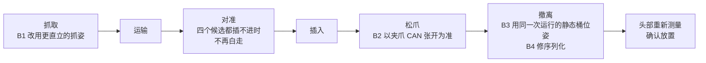

# F1 Harness 第九轮审阅：离线走完放置整段，找到的 4 处阻塞一次修完

- 审阅基线：`harness/round9` 头提交 `ea297fd`（`b5c4922`、`4f73665`、`b9204db`、`ea297fd`），已作为 PR #19 用 merge commit 合并到 `main`（`aa718d1`）。
- 回复：[20261127-08-codex.md](handoff/20261127-08-codex.md)。本轮指令在 [20261127-09-claude.md](handoff/20261127-09-claude.md)。
- 方式：只读代码与证据，未执行。B1–B4 全部裁定，合入 V64；新增 H-51 至 H-54。

**H-47 起了作用。** 放置的后半段（插入、松爪、撤离、确认）此前从来没有在真机上执行过，所以这段代码里积累了一批从未被触发的问题。离线整段回放在一小时内找出了 4 处，每一处都会让真机试验停下。按上一轮的止损规则，Codex 没有带着已知会卡住的版本上真机，这是对的。

**这 4 处里，有一处是我上一轮的规格造成的。** "先撤离、再确认"（H-48）方向正确，但我低估了状态机的耦合：撤离原本要求放置已经确认（`engine.py:322`），撤离的场景也只在确认之后才会建立。这是 B3 的来源。另外，上一轮"其他阻塞立即停下"这条规则太严，又多出了一个来回。这一轮给 Codex 更大的修复授权，只有需要放宽保护时才停。

**四处的裁定**：B1 插入时夹爪撞桶，改用登记过的、更直立的抓姿，碰撞模型和插入容差都不动；B2 松爪的确认只看夹爪 CAN 是否张开，不再要求看到方孔；B3 按 Codex 的方案 A 理顺"松爪 → 撤离 → 确认"的状态机；B4 改一行，加真实进程间通信的回归测试。

---

# 第一部分：给人看

## 一、PR #19 审阅：通过，已合并

| 内容 | 结论 |
|---|---|
| H-46 | 删掉了运动途中轮询的接触误记，并加了注释说明真正的接触由哪里记录；V62 Trial 1–2 对准 3.0–3.1 秒通过复核 |
| H-49 | 除 `align` 外 `planning_budget_s = min(剩余, 7.0)`，没有截止时刻时也设为 7.0；V62 Trial 1 运输从 12.2 秒降到 9.7 秒 |
| H-47 | 用的是真实的 `PlanService`、`VerifyService`、`TaskEngine`、场景处理、F1Owner／Ruckig（零输出）和真实 Unix IPC。B4 正是因为用了真实 IPC 才被发现，旧回放里的 `Direct()` 绕过了序列化 |
| V63 取消 | 符合规则，号码不复用，历史条目没有改动 |
| 停下交接 | 符合上一轮的止损规则 |

## 二、四处阻塞的裁定

| 阻塞 | 现象 | 裁定 | 理由 |
|---|---|---|---|
| B1 插入撞桶 | 现在的抓姿只比水平高 19.9°。积木插入 12 mm 时，夹爪最低点理论上只比桶盖高 3.9 mm；真实抓深比理想低 2–4 mm，4/4 次夹爪低于桶盖 0.7–1.3 mm，四个对称朝向都撞 | **选 A。** 抓取时优先用站点已登记的 `+30°` 俯仰偏置，约 50° 仰角，夹爪离桶盖还有 25.7 mm，抓深再低 25 mm 也不撞；离线验证不过关时，改用名义 `object_grasp_eef`，约 65° 仰角。碰撞模型、余量和 12 mm 插入深度都不动（H-51） | 两种抓姿都已经登记在站点配置里，不是新造的抓姿。降低插入深度属于放宽，不采纳 |
| B1 附带 | 四个候选都预测插不进时，`align` 仍然执行了 8.6–9.1 秒的运动 | **对准规划时，四个候选都是 `predicted_blocked` 就不动，报 `insertion_preview_blocked_all_candidates`**，作为候选耗尽处理 | 避免一次注定插不进去的对准运动 |
| B2 松爪确认 | 松爪后手臂挡着头部，确认被"需要方孔"拒绝；积木掉进桶里时右腕也看不到它 | **选 A。** `release` 加入只需物体证据的验证白名单（`observation.py:309`），验证时不要求方孔；成功条件改为"夹爪 CAN 实测进入张开窗口，并且发布完整"，看不到积木也算松爪成功；积木进没进桶交给撤离后的确认（H-52） | 松爪的物理职责只是张开夹爪。CAN 是实测证据，不是推断 |
| B3 先撤离再确认 | 撤离要求放置已经确认；撤离的场景只在确认后建立；`withdraw_reset` 一成功就标记任务完成；多处写死了旧顺序 | **选 A，并加上边界**（H-53） | 只有这样才能打破"撤离要求先确认、确认要求先撤离"的死循环 |
| B4 序列化 | `return_scene.py:86` 把 `ndarray` 传进 JSON IPC，4/4 次直接崩溃 | **选 A**：改为 `.tolist()`，并加一条走真实 `UnixServer`／`UnixClient` 的撤离回归测试（H-54） | — |

## 三、为什么这次能更快

- 修复授权放宽：再发现属于序列化、准入白名单、状态顺序这几类问题，并且修法不放宽任何保护的，Codex 直接修，列进交接即可，不再停下等回复。
- 整段回放从抓取开始，不只从运输到位开始，因为 B1 改了抓姿，运输到位时的状态和之前不一样了。

---

# 第二部分：给 Codex 的执行规格

## 0. 通用约束

沿用 [review-round8.md 第 0 节](review-round8.md#0-通用约束)，**但修改其中的止损规则**：

1. H-47 复跑时，或实现过程中再发现阻塞，属于以下类型并且修法不放宽第 3 条中任何一项的，直接修，单独提交，在交接里逐条列出：序列化或 IPC；准入白名单或观测合同与本规格不一致；状态机顺序与本规格不一致；候选顺序。
2. 只有以下情况才停下写交接：需要放宽第 3 条中的任何一项；需要第三种抓姿；整段回放中有轨迹仍然无法走通且原因不属于第 1 条。
3. 不放宽：碰撞余量和碰撞模型、关节限位、H-33 的 50°、所有感知阈值、插入判定容差（`xy_tolerance_m`、`insertion_depth_m = 12 mm`、`yaw_tolerance_rad`、`tilt_tolerance_rad`）、`verify_placed` 不得使用缓存、H-42 的 45 秒和作废条件、`registry.json` 历史条目。

## H-51 `[ ]` P0：抓姿改为更直立的已登记姿态；对准时四个候选都插不进就不动

1. **抓姿选择**：`approach_grasp`／`grasp` 的候选顺序中，`grasp_pitch_offsets_deg = [30.0]` 对应的抓姿排第一，`success_posture_prior` 排在后面作为后备。不新增抓姿，不改站点抓取点和 TCP。
2. **离线选定**：用所有现有的真机 S0 输入（V58 Trial 2–3、V60 Trial 1–3、V62 Trial 1–2），从 `approach_grasp` 开始走到 `insert`（零输出，模拟执行反馈），分别用 `+30°` 和名义 `object_grasp_eef` 两种抓姿各跑一次。附着关系在理想值上加扰动：抓深 −5、0、+3 mm，倾角 ±2°。
   - 报告每条轨迹、每种抓姿、每种扰动下：接近和抓取能否规划、`arm_r_j6` 的最大值、运输能否规划、对准选中的候选、插入时夹爪最低点比桶盖高多少、插入能否规划。
   - **定默认值的规则**：`+30°` 在 ≥ 6/7 条轨迹上全链通过就用它；否则用名义抓姿，前提是名义抓姿 ≥ 6/7；两种都达不到就停下交接。
3. **对准的快速失败**：`rank_alignment_feeds` 之后，如果全部候选的 `insertion_preview == 'predicted_blocked'`，不规划运动，以候选耗尽 `insertion_preview_blocked_all_candidates` 返回（加入 `CANDIDATE_FAILURES`，诊断里写明各候选的阻挡原因）。这是新增的一个拒绝原因，目的是避免无效运动，在 PR 里单列说明。
4. 测试：`+30°` 抓姿排第一；后备仍然可用；四个候选都被阻挡时对准不动；只要有一个候选可行就照常规划。

## H-52 `[ ]` P0：松爪以夹爪 CAN 张开为准

1. `observation.py:309`：`release` 加入 `verification` 时只需物体证据的白名单；验证 `release` 时不要求方孔。
2. `skill_services.py:1166-1168`（`release` 的后置判定）：发布完整并且夹爪 CAN 实测进入张开窗口（`observed_open`）时，判 `release` 成功，不要求右腕看到积木。CAN 不是张开状态、发布不完整或状态未知时，照原逻辑处理。
3. 松爪后缓存方孔照原规则作废（`cache_invalidated:not_held`），不改。
4. 测试：CAN 张开、积木不可见 → 成功；CAN 张开、积木可见并且未持块 → 成功；CAN 未张开 → 不成功；发布不完整 → 不成功。

## H-53 `[ ]` P0：理顺"松爪 → 撤离 → 确认"

按交接中问题 3 的方案 A 实现，并加上以下边界：

1. `engine.py:322`：`withdraw_reset` 的前置条件允许是 `release` 或 `verify_placed`。`perception_context` 显式给出 `return_scene_requested = ('release' in completed_skills and 'withdraw_reset' not in completed_skills)`。
2. `return_observation.py`：当 `return_scene_requested` 为真、而头部被手臂挡住时，`withdraw_reset` 可以使用同一次运行里的静态桶锚点（实测桶位姿，或 H-32 保留的桶位姿，或运输前实测的孔位）生成 `coarse_fixture_return`。条件与 H-42 相同：期间没有接触迹象、距该锚点的测量不超过 45 秒、任务、授权和标定都没变。**这个锚点只能用于撤离的避桶路径，不能用于 `verify_placed`。** 超过 45 秒或出现接触迹象时，撤离不规划，停下并报告原因。
3. 撤离完成后，场景回到 `coarse_static_task`，`verify_placed` 必须使用头部当前帧直接测到的方孔。
4. `remote.py:826`、`adapters.py:589`：`withdraw=True` 时，`withdraw_reset` 和 `verify_placed` 都成功才置 `_solved = True`；`withdraw=False` 时，`verify_placed` 成功才置。`verify_placed` 是待确认（例如 `object_not_observed`）时，`_solved` 为假，任务以"放置待确认"结束。
5. `program_verifier.py`、`program_experience.py`、`scripts/replay_full_owner.py` 和相关测试里写死的顺序，改为同时接受新顺序；旧经验数据仍然能读。
6. 撤离后 `verify_placed` 的头部裁剪图照 H-48 保存。
7. 测试：松爪后可以撤离；撤离用静态锚点并且锚点不进入确认；锚点超过 45 秒或出现接触迹象时不撤离；撤离后确认用当前帧的方孔；只有撤离成功、确认待定时不标记完成；`withdraw=False` 时保持原顺序。

## H-54 `[ ]` P0：撤离的序列化

- `return_scene.py:86`（并核对 `:54`）：送入数值服务的 `eef_tip_reference` 必须是可 JSON 序列化的列表。
- 新增一条走真实 `UnixServer`／`UnixClient` 的 `withdraw_reset` 回归测试。
- `scripts/replay_full_owner.py` 增加一个选项，数值服务走真实 Unix IPC；H-47 复跑使用这个选项。

## H-47 复跑（V64 上线的门槛）

1. 先用 H-51 第 2 项选定的抓姿，从 S0 开始，用 V58 Trial 2–3、V60 Trial 1–3、V62 Trial 1–2 共 7 条记录（至少要包含原来的 4 条），零输出走完 `approach_grasp → grasp → verify_grasp → transfer_above_hole → inspect_in_hand → align → insert → release → withdraw_reset → verify_placed`，数值服务走真实 IPC。
2. **门槛**：原来的 4 条（V62 Trial 1–2、V60 Trial 1–2）全部走到 `withdraw_reset` 成功，`verify_placed` 在模拟"积木可见在孔中"时成功、在模拟"积木掉进桶里"时为待确认；另外 3 条中至少 2 条同样通过。
3. 每段报告：是否规划成功、候选、耗时、复核、输出审计、结果和原因码、缓存年龄、撤离使用的锚点年龄。
4. 全量 pytest、`check_native_integration.py`、三条标准回放（按新顺序更新）。

## V64 真机（今天）

1. 冻结 V64（H-46、H-49、H-51 至 H-54，以及第 0 节第 1 条授权范围内的修复），核对 `control_manifest_sha256` 与 V62 相同，部署，核对 4242。
2. 预检 3 次（操作者要求跳过时照办并登记）。
3. 摆位与 review-round8.md 相同：桶在 x = 0.66–0.76 m，不进右腕画面；积木正放、边与桌边平行。
4. **第一次真机特别留意新的抓姿**：接近、闭爪、判抓是否正常。前 2 次中如果有 1 次因为新抓姿在 S1–S4 失败，记下原因并继续；如果 2 次都因此失败，停下交接。
5. 一直跑到第一次打通（对准、插入、松爪成功，操作者确认积木进了桶），之后再跑最多 5 次。同一阶段、同一原因连续 3 次就停；安全事件立即停。
6. 报告指标同 review-round8.md，另加：使用了哪种抓姿；插入时夹爪最低点的预测余量；撤离所用锚点的年龄；`verify_placed` 的结果和头部裁剪图。

## 版本登记

V64（V63 已取消）。先登记 `candidate`，上线核对后改为 `deployed`。历史条目不改。
