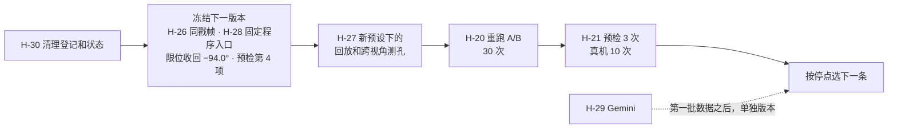

# F1 Harness 第三轮审阅：V53 上线后的现场实测

- 审阅基线：分支 `harness/v53`，提交 `c68beee`（北京时间 2026-11-26 17:35，[PR #6](https://github.com/BrunonXU/DM0.5/pull/6)）。本文行号以该提交为准。
- 上一轮：[review-v53.md](review-v53.md)（条目 H-20 至 H-25 和全部决策）。本文只写变化的部分，新增条目 H-26 至 H-30。
- 方式：只读代码和证据，没有执行。Codex 的汇报逐条对照了 30 份预检结果、H-22 和 H-25 的证据文件以及源码。
- 决策状态：三项决定都已定，Codex 不需要再问用户。文末有可整段复制的指令。

**Codex 的主要说法成立：头部相机的重复时间戳是打断预检的主因。** 我用 30 份 `result.json` 重算，通过次数与 Codex 报的 6、3、1 一致。把“只因头部重复时间戳而失败”的采样当作有效再算一遍，三种环境都变成 10/10。任务中途没有出现空帧。

**三项决定：** 重复时间戳在 Harness 软件侧处理，本轮不改机载相机启动文件。方孔不作为第一批试验的前置条件，预检第 4 项改为只要求积木和桶。本轮不接 Gemini，第一批试验用不调用模型的固定程序跑。三件事和把左臂限位收回 −94.0° 一起冻结为下一个版本。

**有六处对不上或需要补。** 最要紧的是发布登记里 53 个版本的路径被整体改写，带出了真实用户名。另外 `STATUS.md` 仍写 V52 在用，H-25 的机器结论字段是 `false` 而报告写通过。Codex 没有改判据、没有放宽限位、没有新增拒绝原因，也没有动 F1-4242 的配置文件。



---

# 第一部分：给人看

## 一、Codex 的汇报，逐条核实

| Codex 的说法 | 核实结果 | 依据 |
|---|---|---|
| V53 已上线，登记为 `deployed` | 成立 | `HARNESS/releases/registry.json`：`active_version` 53，`active_bundle_id` 以 `53af3b1d4406` 开头 |
| 未重启 4242，保持 `robot-v22.json` | 仓库内无法核实 | 仓库里 F1-4242 的配置没有改动；现场状态只有 Codex 的文字记录 |
| 预检脚本两处修补未改通过判据 | 成立 | `preflight_scene.py` 的改动在 `:606-730` 和 `:1060` 之后，`evaluate_preflight`（`:317-450`）没有变 |
| 通过次数 6/10、3/10、1/10 | 成立 | 用 30 份 `result.json` 的 `contiguous_s` 重算，结果相同 |
| 30 轮 0 轮空帧 | 成立，但证据文件里有一个字段写反了 | 无帧错误共 176 次，全部在每轮第一份有效采样之前；`summary.json` 的 `empty_frame_reproduced` 却是 `true` |
| 头部重复时间戳是根因 | 作为主因成立 | 30 份结果中约 600 份采样因 `duplicate_source_stamp:head` 被判头部无效，右腕 0 份。去掉它的影响后三种环境都是 10/10 |
| 重复时间戳来自 `time_domain=global` 加主机时间同步 | 是假设，没有证实 | 证据只有参数快照和 100.12 毫秒的阶梯现象，没有改参数后的对照 |
| “问题不在 DDS 传输层” | 说过头了 | 默认环境下头部彩色回调中位数 781.5，另两种约 1,428 和 1,407.5；`camera_sample_feedback_aged:right` 18 次全部出现在默认环境 |
| H-22 采用 −77.315°，余量 16.69° | 成立 | `static-60s-v5.json`：60 秒 2,998 个样本，−77.3150° 到 −77.3149° |
| H-22 的 −92.5° 实测 | 成立，且没有达到我给的条件 | 静置 −93.5626°，比我定的 −93.5° 低 0.06°；下垂 1.06°，超出我按旧数据估的 0.32° 到 0.81° |
| H-25 通过 | 有条件成立 | 帧间最大间隔 0.0348 秒。但 `left-wrist-5min.json` 的 `passed` 是 `false`，内核日志摘录在采样窗口内外都是空的 |

第 8 行需要说清楚。默认环境通过次数最多，一部分原因是它收到的帧少，撞上重复时间戳的机会也少。这不说明它更好。H-20 还没有结论，要在重复时间戳处理之后重跑。

## 二、三项决定

### 决定 1：重复时间戳在软件侧处理，本轮不改机载启动文件

**结论：改 `observation.py`，同一时间戳、像素不同的帧在 250 毫秒内只丢弃、不报相机故障；超过 250 毫秒照旧报故障。机载 `head_gemini330.launch.py` 本轮不动。**

理由：

1. **启动文件是共用的。** DAgger 录制、π0.5 推理和 4242 都用这台头部相机。改它的时间域会影响别的工程，而驱动侧的根因还只是假设。
2. **Harness 并不依赖这个时间戳做配对。** 现场采样的配对质量都是 `receipt_only`（来源时钟未核验），彩色与深度、图像与关节反馈都按接收时间配对。来源时间戳只用于识别重复和倒退。
3. **对陈旧帧的保护不变。** 被保留的是同一时间戳下第一帧，它的接收时间和有效期不变，现有的帧龄检查继续生效。时间戳冻结超过 250 毫秒、时间戳倒退、序号不递增，三种情况照旧报故障。
4. **250 毫秒的来源。** 实测阶梯是 100.12 毫秒，实测最大到达间隔是 200.5 毫秒。250 毫秒是实测阶梯的 2.5 倍，也大于最大到达间隔。

驱动侧的分工：现在只做一件只读的事，把右腕相机的运行参数导出来与头部并排比较（右腕 0 次重复）。改启动文件另开任务，条件是软件处理之后仍有“超过 250 毫秒”的故障，届时按 DAgger 的规则走。

### 决定 2：方孔不作为第一批试验的前置条件

**结论：不等第 4 项全绿。预检第 4 项改为只要求积木和桶，方孔改为报告项。同时做一次限定范围的只读诊断和一次跨视角测孔回归，结果只写进报告，不挡第一批试验。**

理由：

1. **空手阶段用不到方孔。** 接近、闭爪、判抓只需要积木和桶。方孔从运输开始才需要，而那时测孔走的是另一条路：左腕加头部的跨视角测量（`scene_pipeline.py:1139-1146`，只在持块或放置阶段启用）。预检没有授权、没有持块，这条路在预检里根本不会运行。
2. **方孔缺失不是新预设造成的。** −92.5° 和 −77.3° 两个姿态下，没有一份采样解出方孔；带 `aperture_not_directly_visible` 告警的采样分别是 227 份和 221 份。
3. **桶已经解出来了。** 两个姿态下桶的采样分别是 47 次和 40 次，说明头部看得到桶盖上的地标。
4. 让一个任务前半程用不到的量挡住任务，正是 `HARNESS/AGENTS.md` 禁止的“测试阈值成为动作的一票否决项”。

新预设之后要重做的东西：

| 项 | 是否要重做 | 说明 |
|---|---|---|
| 相机内外参标定 | 不用 | 头部、身体和右臂的关节都没有变；左腕不用手眼标定，靠地标做单应性映射 |
| 头部掩码和搜索框 | 不用重做，但要诊断一次 | 头部视角没变。方孔掩码为空的原因要查清，见 H-27 |
| 零输出回放 | **要重做** | 现有三条回放的关节状态都来自左臂在 −93° 附近的旧记录。左臂换了姿态（7 个关节都变了），右臂路径是否会被左臂挡住没有验证过 |
| 跨视角测孔回归 | **要重做** | 这条路依赖左腕同时看到三角孔、圆孔和方孔。V40、V42 的回归是在旧姿态下做的 |
| 站点配置里的左臂数值 | 要查一遍 | 只读检查站点配置是否有写死的左臂关节值 |

### 决定 3：本轮不接 Gemini，第一批试验用固定程序跑

**结论：不新增 Gemini 客户端。网页入口加一个站点级开关，让任务走不调用模型的固定程序（`--planner baseline`）。Gemini 排到第一批数据之后，单独一个版本，先做离线回放对照。**

理由：

1. **不用模型也能跑。** 命令行早就有 `--planner baseline`（`cli.py:27`），历史 106 次运行里有 33 次是固定程序。只读预检在没有任何模型的情况下已经解出积木和桶。
2. **归因。** 相机修复和换模型放进同一个版本，第一批试验的任何变化都分不清是谁造成的。固定程序没有模型这个变量。
3. **限流。** 付费通道下历史上已有 9 次运行死于 429 或超时。免费档的配额只会更紧，现在的规划循环每次任务要发多轮带图请求。
4. **数据外发。** 现场图像会发给新的第三方，免费档的数据使用条款需要用户看过并明确同意。这不是工程上能替用户定的。
5. **工作量和新故障面。** `config.py:9-10` 把提供方、接口和模型名写死成一组。接 Gemini 要新增一套传输、工具调用适配和凭据路径，每一处都是新的失败原因。
6. 固定程序正是 H-16 要去的方向，现在做不浪费。

代价：固定程序失败后没有模型接手，该次运行直接结束。第一批试验的目的是看停在哪，这个代价可以接受。

## 三、越界核对

| 检查项 | 结论 | 依据 |
|---|---|---|
| 改通过判据 | 没有 | `evaluate_preflight` 未变 |
| 放宽限位 | 没有 | `F1-4242/configs/`、`DAgger/F1/configs/` 在 `04e0ee3` 之后没有改动 |
| 新增拒绝原因 | 没有 | `HARNESS/src/` 在 `04e0ee3` 之后没有改动。`start_development.py` 新增一处配置取值校验（`ValueError`），不是运行时拒绝 |
| 动 F1-4242 配置 | 仓库内没有；现场改了预设 | 仓库只改了 `F1-4242/docs/STATUS.md`，是 H-24 要求的。现场 `presets.json` 改了旧预设并新增“积木demoV5”，旧预设改动在 H-22 范围内，新预设是用户定的 |
| 启用步骤 B 或冻结 V54 | 没有 | `ROBOT_SERVICES_ROS_ENV = None`，登记最大版本仍是 53 |

**发现的不一致，共六处：**

1. **发布登记被整体改写。** `registry.json` 里 53 个版本的 `artifact_directory`、`manifest` 等路径从 `/home/user/…` 变成了带真实用户名的路径，共 235 行。历史登记不该改写，脱敏也被撤销了。
2. **状态文档没有跟上。** 登记显示 V53 在用，`HARNESS/agent/STATUS.md` 和根 `AGENTS.md` 的近况仍写 V52 在用。`TODO.md` 第一项仍是“联机后上线 V53、预设改为 −92.5°”。
3. **H-25 的机器结论与报告相反。** `left-wrist-5min.json` 的 `passed` 是 `false`，原因是它把首帧前 2.95 秒的发现延迟算进了间隔。报告用文字改判为通过。
4. **H-25 的内核日志证据偏弱。** 摘录在窗口内、窗口前都是“无”。无法区分“没有事件”和“没读到日志”。现场确认的原因是线缆接口偏松，没有记录是否已经紧固。
5. **H-20 的证据里留着两处过时说法。** `summary.json` 的 `empty_frame_reproduced: true` 与报告相反。报告第 4 节第 1 点把原因写成“到达抖动造成配对失配”，与第 5 节的根因矛盾；`review-v53.md` 里 H-20 的执行记录也是旧说法。
6. **H-22 没有按三行表走。** 实测落在我的表没有覆盖的情况：三个孔可见，但最小值比条件低 0.06°。这是我的规格有缺口。用户现场定了新预设，结果比表里任何一行都好，予以采纳。

## 四、旧结论的更新

| 旧结论 | 现在 | 理由 |
|---|---|---|
| H-22：预设先改 −92.5° | **改为采用“积木demoV5”，`arm_l_j2` = −77.315°** | 距 −94.0° 有 16.69°；左腕能看全五个孔 |
| V53 的 −94.7° 保留到 H-23 完成 | **不再保留。下一个版本就收回 −94.0°** | 左臂已经离限位 16.69°，放宽没有用处了。限位取保守一侧，同时让关节合同与驱动、与 4242 重新一致 |
| H-23 排在首次首动之后 | **降为 P2，不在首次成功的路径上** | 触发它的问题已经由换姿态解决。结构问题仍在，留作待办 |
| H-20：三种环境选一种钉死 | **处理重复时间戳之后重跑 30 次，规则不变** | 这一批的通过次数被头部问题盖住了 |
| H-21 第 3 步：预检五项全过 | **第 4 项改为只要求积木和桶** | 见决定 2 |
| H-25：通过后继续 | **有条件通过** | 补证据字段，并请现场把接口紧固 |
| 观测超时交回模型不超过 1 次、模型调用次数等目标 | **第一批不适用** | 固定程序不调用模型 |
| 旧预设“积木demoV3-左腕观测” | **保持 −92.5°，不再使用** | 比原来的 −93.345° 更靠内，留着无害 |

H-23 的新触发条件：任一次预检里 14 个手臂关节的最小余量低于 1.0°，或真机运行出现由实测反馈引起的 `ArmLimitRejected`。目前余量最小的是右臂第 2 关节，5.98°。

## 五、下一步顺序

1. H-30：清理登记、状态文档和三处证据字段。离线可做。
2. 冻结下一个版本，内容四项：H-26、H-28、预检第 4 项、限位收回 −94.0°。
3. H-27：新预设下的回放、跨视角测孔回归和方孔掩码诊断。
4. 上线后重跑 H-20 的 30 次 A/B。
5. H-21：预检连续 3 次通过，然后 10 次真机试验。
6. 按停点选下一条。H-29（Gemini）只在这之后考虑。

---

# 第二部分：给 Codex 的执行规格

## 0. 通用约束

沿用 [review-v53.md 第二部分第 0 节](review-v53.md#0-通用约束)。本轮追加：

1. 下一个版本只包含本文列出的四项改动，不夹带别的。
2. 版本号从发布登记读取后取下一个整数，现在最大是 53。
3. 不改机载相机启动文件，不接新的模型提供方。
4. 规格与代码事实对不上时停下报告，不要自行取值。

## H-26 `[~]` P0：同一时间戳、像素不同的帧，短时间内只丢弃不报故障

**位置**：`HARNESS/src/f1_harness/observation.py:99-114`，`ObservationBuffer.add`。

**当前行为**

```python
                repeated = queue and queue[-1].source_ns == frame.source_ns
                if repeated:
                    self.rejected_source_frames += 1
                    self._diagnostic('duplicate_source_stamp',frame,queue[-1],disposition='discard')
                    if previous and previous != frame.blob_sha256:
                        # Conflicting pixels with one source identity are a real
                        # acquisition fault. Do not silently reuse that identity.
                        self.transient_faults[key] = 'duplicate_source_stamp:' + frame.camera
```

同一时间戳的第二帧像素不同时，丢弃该帧并给这路相机记一个临时故障，直到时间戳前进才清除（`:122-123`）。`snapshot`（`:155`）把临时故障并入观测的故障集合，这一轮头部被判无效。

**目标行为**

- 像素不同、且该帧的接收时间距队尾帧的接收时间不超过 250 毫秒：丢弃该帧，不记临时故障。队尾帧就是这个时间戳下被接受的第一帧，它的接收时间和有效期不变。
- 超过 250 毫秒：与现在完全相同，记 `duplicate_source_stamp:<相机>`。
- 像素相同的重复投递、时间戳倒退、序号不递增：不改。

**具体改法**

1. 模块顶部新增常量 `SOURCE_STAMP_HOLD_NS = 250_000_000`。
2. `__init__`（`:46-47` 附近）新增计数器 `self.held_source_frames = 0`。
3. 把 `:105-108` 的分支改为：

```python
                    if previous and previous != frame.blob_sha256:
                        held_ns = frame.received_ns - queue[-1].received_ns
                        if 0 <= held_ns <= SOURCE_STAMP_HOLD_NS:
                            # The driver held one stamp across new pixels. Keep the
                            # first accepted frame with its original time and TTL.
                            self.held_source_frames += 1
                        else:
                            self.transient_faults[key] = 'duplicate_source_stamp:' + frame.camera
```

4. `:104` 的诊断记录保留，并加上 `held_ns` 字段，便于事后统计。
5. 不改 `snapshot`、不改 `scene_pipeline.py:986-992` 对该故障的保留桶位姿处理、不改 `conditions.py:86`。

**动手前先核对**：站点网关配置里场景的 `max_age_ms`（`live_scene.py:293`、`:352` 使用）必须大于 250。不大于时停下报告，不要改任何一个数。

**保留**：帧龄检查、图像与关节反馈的时间差检查（`frame_state_skew_ms`）、相机身份检查全部不变。不新增 `raise HarnessError`。

**验收**

1. 新增测试文件 `HARNESS/tests/test_source_stamp_hold.py`，四例：
   - 同戳不同像素，间隔 33 毫秒：不记故障，队列里仍是第一帧，`held_source_frames` 为 1；
   - 同戳不同像素，间隔 300 毫秒：记 `duplicate_source_stamp:head`；
   - 同戳同像素：行为与改动前相同，`duplicate_source_frames` 加 1；
   - 时间戳倒退：仍记 `source_time_reversed:head`。
2. 现有引用 `duplicate_source_stamp` 的 8 个测试文件（`grep -l duplicate_source_stamp HARNESS/tests`）全部通过；断言发生变化的逐条列在提交说明里。
3. 全量 pytest、`check_native_integration.py`、三条零输出回放。
4. 真机：H-20 重跑的 30 次里，`duplicate_source_stamp:head` 造成的头部无效采样，每轮中位数为 0。

**同时做的只读工作**：导出右腕相机节点的运行参数（时间域、主机时间同步、帧同步、帧率），与头部并排写进证据报告。只导出，不改。

**风险与回滚**：风险是头部最新可用帧最多旧 100 毫秒左右。头部是固定相机，用于桶和孔的静态几何，影响可以忽略。回滚只需还原该提交。

**证据**：`Claude-advice/HARNESS/evidence/<日期>-H26-stamp-hold/`，含测试回执、右腕与头部参数对照、上线后一次预检的 `result.json`。

> 执行记录：2026-11-26，分支 `harness/v53`，提交 `c430186`、`133f523`，V54（`8818976408ce`）已上线并完成只读实测（证据目录 `Claude-advice/HARNESS/evidence/20261126-H26-stamp-hold/`）：动手前核对站点 `scene.max_age_ms = 500 > 250`；全量软件回归 3,190 例、原生集成 62/62、3+1 零输出回放全过，净增 `raise HarnessError = 0`。上线核验通过（4242 显示 V54、未重启、保持 `robot-v22.json`，`start_sent=false`），上线后只读预检五项全过（`arm_l_j2 min_margin_deg = 16.68° >= 16°`，`contiguous = 37.81 s`，`dup_stamp:head = 0`），右腕 vs 头部相机运行参数已只读导出对照。H-20 重跑前 23/30 轮中 `duplicate_source_stamp:head` 每轮中位数为 0（剩余 7 轮待 F1-09 重连补齐）。

## H-27 `[~]` P0：新预设下要重做的三件事

三件都是只读或零硬件输出。结果写进报告，**不挡 H-21**，除非第 1 件失败。

**1. 零输出回放（失败则停下）**

- 在“积木demoV5”姿态下取一份真实的关节反馈和一组头部、右腕 RGB-D 作为回放的初始输入。
- 用它跑正常放置这一条全流程零输出回放。回放输入的 22 轴关节状态必须来自这份新反馈，不能沿用旧记录。
- 通过条件与发布验收相同：10 个阶段走完，输出审计通过，硬件输出为 0。
- 失败时报告停在哪个阶段、原因码和被拒候选的明细。特别留意右臂路径与左臂的自碰撞。此时不要请用户做真机试验。

**2. 跨视角测孔回归**

- 在同一姿态下只读采 30 组同步的头部彩色、头部深度和左腕彩色。
- 用 V40、V42 做方孔跨视角现场回归时的同一脚本和同一口径（见 `HARNESS/agent/STATUS.md` 的 V40、V42 两行）离线计算，报告 30 组里重建出方孔的组数，以及每类失败原因的次数。
- 参考线是 90%（验收文档 D-3）。低于它不挡第一批试验，但要在报告开头写明，试验停在 S5 时直接按 H-07 的既定结论处理。

**3. 头部方孔掩码诊断（只做一轮）**

- 取一帧头部图像，保存：头部搜索区域的裁剪图、方孔掩码的像素数、积木掩码与它的重叠比例、分割服务对方孔的播种结果。
- 判定所依据的代码：`scene_pipeline.py:1113-1117`，方孔掩码不少于 20 个像素且重叠不超过 `maximum_overlap_fraction` 才算直接可见。
- 报告属于下面哪一种，不做修复：

| 情况 | 含义 |
|---|---|
| 掩码像素为 0，播种无结果 | 没有模型给提示时，方孔在头部视角不会被分割出来。固定程序下属于预期 |
| 掩码有像素但少于 20 | 方孔在头部图像里太小或被遮住 |
| 掩码足够但重叠超限 | 方孔与积木掩码混在一起 |

**同时只读检查**：站点配置里有没有写死的左臂关节值或依赖旧左臂姿态的参考量。列出文件名和键名，不改。

**证据**：`Claude-advice/HARNESS/evidence/<日期>-H27-v5-preset/`，含回放回执、30 组回归表、一张裁剪图（不超过 300KB）和诊断结论。

> 执行记录：2026-11-26，分支 `harness/v53`，证据目录 `Claude-advice/HARNESS/evidence/20261126-H27-v5-preset/`。在 F1-09“积木demoV5”姿态下只读采集 30 组同步数据（`hardware_publishers=0`）并完成四项检查：（1）**零输出回放（触发停下条件）**：Replay A（今日 V5 实采 `s00` RGB-D + V5 22 轴）10/10 阶段全部走完（`outcome=success`、`hardware_outputs=0`、`paid_model_calls=0`），全 1,810 行发射命令 `gate.check_preventive` 0 失败、右臂与左臂 0 自碰撞（最小净空 `3.086 mm`，位于 `arm_R_Link7`↔`body_Link5`），`replay_output` 审计通过，但 `grasp_output` 审计未通过（495 样本中 1 处 `contact_and_support_sweeps_clear=false`：`support_lift` 首步行 148 初始离桌 `0.519 mm <= 1.0 mm` 容差，单步下探 `1.04 µm`，`native_failures=0`）；对照 Replay B（11-10 旧场景 + V5 22 轴）停在 `grasp`（`registered_candidates_exhausted`、`cartesian_no_progress` 路点 14/16，非自碰撞）。按规格停下报告，未部署 V54、未请用户做真机试验。（2）**30 组跨视角测孔回归**：25/30（83.3%，**低于 90% D-3 参考线**），5 组失败均为 `fixture_relocalization_aperture_not_square`。（3）**头部方孔掩码诊断**：0 像素、`semantic_entity_unconfigured`，属对照表第 1 行预期情况，未修复；裁剪图 `head-roi-crop.jpg`（98 KB）。（4）**站点左臂配置只读盘点**：见 `site-left-arm-audit.json`，未作任何修改。

## H-28 `[~]` P0：网页入口可以跑固定程序

这是 H-16 的最小子集，只为在没有模型通道时解锁第一批试验。

**位置**

- `HARNESS/src/f1_harness/web_process.py:237-247`，`start_planner`：

```python
        mode = request['config']['mode']
        if mode not in ('astra','vla_astra'):raise ValueError('unknown_task_strategy')
        ...
                '--image-gateway', 'http://127.0.0.1:19841', '--planner', mode]
```

- `HARNESS/src/f1_harness/cli.py:27`：`run-task` 已支持 `--planner baseline`。
- `HARNESS/src/f1_harness/task_runner.py:470`、`:540`：只有 `astra` 和 `vla_astra` 才创建模型规划器。

**目标行为**

- 工作区配置（`workspace.local.json`，即 `self.config`）新增可选键 `planner_override`，取值只能是缺省或 `"baseline"`。
- 设为 `"baseline"` 时，`start_planner` 传给命令行的是 `--planner baseline`。页面发来的 `mode` 校验不变，仍只接受 `astra` 和 `vla_astra`。
- 实际生效的规划方式写进该次运行的配置快照（`workspace-run.json`）的新字段 `planner_effective`。
- `HARNESS/scripts/run_funnel.py` 统计运行模式时优先读 `planner_effective`，没有该字段时行为不变。
- 其他取值一律报配置错误，在启动服务之前，不在任务中途。

**动手前先核对并写进报告**

1. `run-task --planner baseline` 在硬件模式下全程不创建模型客户端、不读取模型凭据。发现有读取时停下报告。
2. `vla_astra` 的专属准备步骤（`web_snapshot.py:95`、`web_process.py:205-209` 的模型检查）在 `planner_override` 生效时不会被触发。请求模式为 `vla_astra` 且设置了覆盖时，直接报配置错误。

**不做**：不改 F1-4242 页面。不改 `web_snapshot.py:18` 的模式集合。不实现“失败后交回模型”。

**现场说明**：4242 页面上显示的仍是 Astra。请在报告和 `STATUS.md` 里写明这一批实际跑的是固定程序，以 `planner_effective` 为准。

**验收**

1. 新增用例：设置覆盖后，生成的命令行包含 `--planner baseline`，快照里 `planner_effective` 为 `baseline`；未设置时与现在逐字相同；非法取值报错。
2. 一条零输出回放用 `--planner baseline` 走完 10 个阶段，`model_requests` 为 0。
3. 真机：H-21 的 10 次运行，漏斗里模型调用全部为 0。

**回滚**：删掉工作区配置里的键即可，不需要回退版本。

> 执行记录：2026-11-26，分支 `harness/v53`，提交 `d7d10f9`，冻结候选 V54（`8818976408ce`，提交 `2bbc5cd`）：**软件完成，待真机验收**。动手前核对确认 `run-task --planner baseline` 全程不创建模型客户端、不读取模型凭据（零输出基线回放中投毒 `ResponsesPlanner` 并指向不可读凭据路径验证通过），且 `vla_astra` 与 `planner_override` 组合在服务启动前即报 `ValueError` 配置错误。已在 `web_process.py`、`web_execution.py`、`run_funnel.py` 实现 `planner_override="baseline"`、`planner_effective` 快照与漏斗优先读取，净增 `raise HarnessError = 0`。新增 `test_planner_override.py` 并通过全量 3,190 pytest、62/62 原生集成测试及 `normal-baseline` 零输出回放（10 阶段完成、`model_requests=0`、`paid_model_calls=0`、全部输出审计通过）。待 H-27 评审结论后上线并进 H-21 真机验收。

## 随同一版本的另外两处改动

**1. 预检第 4 项**

位置：`HARNESS/scripts/preflight_scene.py:381-395`。

- 删除 `3d_geometry_missing:square_hole` 和 `3d_geometry_missing:complete_block_bucket_hole_scene` 这两条失败原因。
- 第 4 项的通过条件变为：积木采样数大于 0、桶采样数大于 0、分割请求增量大于 0。
- 在 `checks['scene_geometry_solved']` 里新增报告字段 `hole_direct_count`（取 `geometry_counts.get('hole', 0)`）和 `full_scene_count`（取 `geometry_counts.get('full', 0)`）。它们不参与通过判定。
- `HARNESS/tests/test_preflight_scene.py` 里断言 `3d_geometry_missing:square_hole` 的用例相应更新，并在提交说明里列出。
- 第 1、2、3、5 项和 12 秒连续窗口不改。

这是审阅方改的判据。对应的物理失效：无（方孔在空手阶段不参与任何动作）；适用阶段：运输及以后；恢复方式：持块后的跨视角测量和 `recover_alignment`。

**2. 左臂第 2 关节下限收回 −94.0°**

- 还原 V53 对这三个文件的数值改动：`F1-4242/configs/f1-09.json`、`F1-4242/configs/f1-09-joints.json`（`arm_l_j2` 下限回到 −94）、`DAgger/F1/configs/f1_infra_binding.json`（`configs/f1-09-joints.json` 的哈希回到 V52 的值）。
- 新版本的站点配置和机器人档案用回 −94.0°，与 4242 运行的 `robot-v22.json` 一致。
- V53 改过的 DAgger 测试是按 `mapping.limits` 参数化的，不用回退。
- 删除 `F1-4242/docs/STATUS.md` 里 H-24 加的那段差异说明，改成一句“已于某版本恢复一致”。先读 F1-4242 和 DAgger 的 `AGENTS.md`。
- 验收：`F1-4242` 关节合同测试、`DAgger/F1` 数值边界测试通过；上线后预检第 1 项通过，`arm_l_j2` 的 `min_margin_deg` 不小于 16°。
- 若左臂被归位到旧预设，预检第 1 项会失败并写明关节名。这是预期行为，不要为此再放宽。

## H-20 更新：重复时间戳处理之后重跑

新版本上线后，按 [review-v53.md 的 H-20 步骤 A](review-v53.md#h-20---p0钉死正式网关的-dds-传输) 原样重跑 30 次，判定规则不变。姿态用“积木demoV5”。

- `production-gateway` 达到 9/10：不必等钉死传输，直接进 H-21。胜出环境随下一个版本启用。
- `production-gateway` 不到 9/10 而另一种达到：先启用步骤 B、冻结并上线，再进 H-21。
- 三种都不到 9/10：停下报告，附每种环境里打断窗口的原因分布。

报告里另加一列：每轮 `held_source_frames` 的值和头部无效采样数。

证据：`Claude-advice/HARNESS/evidence/<日期>-H20-dds-ab-rerun/`。

> 执行记录：2026-11-26，分支 `harness/v53`，证据目录 `Claude-advice/HARNESS/evidence/20261126-H20-dds-ab-rerun/`。在 V54（`8818976408ce`）与“积木demoV5”姿态下已完成 **23/30 轮**（第 24 轮 `cyc-08` 时 F1-09 离线断连，剩余 7 轮待重连补齐）：**23/23 五项全过**（`production-gateway` 8/8、中位连续 `25.30 s`、`held` 中位数 46.5、头部无效中位数 2.5、`dup_stamp:head` 中位数 0；`fastdds-udp` 8/8、中位连续 `46.15 s`、`held` 中位数 114.5、头部无效中位数 0、`dup_stamp:head` 0；`cyclone` 7/7、中位连续 `46.57 s`、`held` 中位数 119、头部无效中位数 0、`dup_stamp:head` 0），0 轮空帧复现。

## H-21 更新

- 预检连续 3 次通过，第 4 项按新条件。
- 10 次试验用固定程序。本批目标改为：S1 到达率 10/10；模型调用 0；至少 1 次完整成功。其余护栏指标照报。
- 止损规则不变：前 3 次都停在 S0 且原因相同，本批到此为止。
- 试验期间左臂保持在“积木demoV5”，不要手动碰左腕线缆。

## H-29 `[ ]` P2：Gemini 规划通道（第一批数据之后再做）

本轮不执行。进入条件和做法先写在这里，届时不用再问。

**进入条件**（全部满足）

1. H-21 第一批数据已上传。
2. 用户看过免费档的数据使用条款，并明确同意把现场图像发给该服务。同意要有文字记录，写进条目。
3. 第一批的停点表明确实需要模型接手，例如固定程序在初始定位或恢复上反复失败。

**做法**

1. 先离线对照，不上真机。输入用三条发布回放的初始场景，加历史运行里 10 份 Astra 首轮请求的原始输入。逐份比较：工具调用是否合法、生成的程序能否通过 PyRUA 沙箱校验、首轮耗时、被限流的次数。
2. 合法工具调用和程序校验通过率都达到 12/13，才写接入代码。
3. 接入作为独立版本，不与任何感知或控制改动同版。`config.py:9-10` 的提供方校验扩成白名单，凭据走已有的本地认证组件，不进日志和仓库。
4. 限流按实际控制台显示的配额写进报告，不引用文档里的数字。

**证据**：`Claude-advice/HARNESS/evidence/<日期>-H29-gemini-offline/`。请求体里的图像不上传，只上传结构化结果。

## H-30 `[x]` P1：清理登记、状态和证据字段

离线可做，不改运行时。

1. **发布登记**：把 `HARNESS/releases/registry.json` 里版本 1 至 52 的条目恢复成 `04e0ee3` 时的内容。版本 53 保留这次的状态更新（`deployed`、`currently_active`、`activation`、`verification` 等），但路径用脱敏后的 `/home/user/…` 形式。恢复后用 `git diff 04e0ee3 -- HARNESS/releases/registry.json` 核对，差异只应出现在版本 52 的 `currently_active`、版本 53 的条目和文件末尾的四个 `active_*` 键。真实用户名已经进了提交历史，是否清理历史由用户决定，在报告里提一句即可。
2. **状态文档**：`HARNESS/agent/STATUS.md` 页首改为 V53 在用，并写明现在的阻塞是头部重复时间戳和模型通道；`TODO.md` “现在做”换成本文的顺序；根 `AGENTS.md` 的 F1 Harness 近况同步，保持一两句话。
3. **H-25 证据**：`left-wrist-5min.json` 的 `passed` 改为按规格的条件计算（断开次数为 0 且帧间最大间隔不超过 2 秒），首帧发现延迟单列。补一行说明内核日志的读取命令和它在本次开机以来返回的总行数，证明日志读得到。请现场把左腕线缆接口紧固，并在报告里记一句是否已做。
4. **H-20 证据**：`summary.json` 的 `empty_frame_reproduced` 改为 `false`；`report.md` 第 4 节第 1 点和 `review-v53.md` 里 H-20 执行记录的“到达抖动、配对失配”改成与第 5 节一致的说法，并补上“默认环境的图像回调数约为另两种的一半”这一事实。
5. **review-v53.md**：H-22 的执行记录后追加一行，写明采纳“积木demoV5”和本文的更新；H-23 标题的优先级改为 P2，追加新的触发条件；H-25 的 `[x]` 改为 `[~]`，待第 3 点补齐后再改回。

**验收**：`python3 HARNESS/scripts/check_project_layout.py` 通过；`grep -r` 仓库工作树里不再出现真实用户名。

> 执行记录：2026-11-26，分支 `harness/v53`；已完成（1）恢复 `HARNESS/releases/registry.json` 版本 1–52 为 `04e0ee3` 脱敏原文，`git diff 04e0ee3 -- HARNESS/releases/registry.json` 差异仅限于 V52 `currently_active`、V53 条目及末尾 4 个 `active_*` 键（注：历史提交 `0d459d9` 中已写入过真实用户名，是否改写历史由用户决定）；（2）同步 `HARNESS/agent/STATUS.md`、`HARNESS/agent/TODO.md` 及根 `AGENTS.md` 近况；（3）修正 `20261126-H25-left-wrist/` 的 `passed=true`、单列 `first_frame_delay_s`、补充 `journalctl -k -b --no-pager` 自开机共 52,203 行（130 行 USB/UVC）核验并如实注明现场接口尚未做机械紧固；（4）修正 `20261126-H20-dds-ab/summary.json`（`empty_frame_reproduced=false`）、`report.md` 第 4 节第 1 点及 `review-v53.md` H-20 记录；（5）更新 `review-v53.md` 的 H-22、H-23（P2 及新触发条件）与 H-25（暂保留 `[~]` 待现场紧固接口）。验收：`check_project_layout.py` 通过，工作树检索真实用户名 0 处，净增 `raise HarnessError` 为 0；证据：`Claude-advice/HARNESS/evidence/20261126-H25-left-wrist/`、`Claude-advice/HARNESS/evidence/20261126-H20-dds-ab/`。

## 版本登记

- 下一个版本包含四项：H-26、H-28、预检第 4 项、限位收回 −94.0°。名称建议“F1 Harness 同戳帧保留与固定程序入口”，编号取登记里的下一个整数。
- H-20 步骤 B 若要启用，另占一个版本。H-29 另占一个版本。
- H-27、H-30、H-20 重跑、H-21 都不分配版本号。
- 先登记 `candidate`，上线并核对 4242 显示后改 `deployed`。登记文件只追加和改当前版本，不改历史条目。

## 可整段复制的 Codex 指令

```text
你继续执行 F1 Harness。分工不变：Claude 只写审阅，你执行、测试、提交、上传证据并回写状态。

【先读】
1. Claude-advice/HARNESS/review-v53-round3.md 全文（本轮的决定和规格）
2. Claude-advice/HARNESS/review-v53.md 第二部分第 0 节和 H-20、H-21
3. HARNESS/AGENTS.md、根 AGENTS.md
三项决定已定，不要再问用户，也不要改结论：重复时间戳在软件侧处理，不改机载相机启动文件；方孔不挡第一批试验；本轮不接 Gemini，用固定程序跑。规格与代码对不上时停下报告。

【按顺序做】
第 1 步（离线）：H-30。恢复发布登记里版本 1–52 的历史内容并重新脱敏，更新 STATUS、TODO、根 AGENTS 近况，修正 H-25 和 H-20 的三处证据字段。
  验收：check_project_layout.py 通过；registry.json 相对 04e0ee3 的差异只在版本 52、53 和 active_* 键；工作树里搜不到真实用户名。

第 2 步（离线）：冻结下一个版本，只含四项，各自单独提交：
  a. H-26：observation.py 同戳不同像素的帧 250 ms 内只丢弃不报故障。先核对站点 max_age_ms 大于 250。
  b. H-28：workspace 配置 planner_override="baseline"，网页入口跑固定程序，快照写 planner_effective，run_funnel.py 读它。先核对 baseline 路径不读模型凭据。
  c. 预检第 4 项只要求积木和桶，方孔改为报告字段。
  d. arm_l_j2 下限收回 −94.0°（F1-4242 两个配置、DAgger 绑定哈希、站点和档案）。先读 F1-4242 和 DAgger 的 AGENTS.md。
  验收：全量 pytest、check_native_integration.py、三条零输出回放、其中一条用 --planner baseline 且 model_requests=0；每个提交报告净增 raise HarnessError 数，必须为 0。
  版本号：读 registry.json 取下一个整数，先登记 candidate。

第 3 步：H-27。在“积木demoV5”姿态下取新的初始输入，跑正常放置的零输出回放；做 30 组跨视角测孔回归；做一轮头部方孔掩码诊断；只读列出站点配置里写死的左臂数值。
  回放失败就停下报告，不要请用户做真机试验。另外两件只报告、不挡后面。
  证据：evidence/<日期>-H27-v5-preset/。

第 4 步：上线新版本，核对 4242 显示。导出右腕相机运行参数与头部对照。
  证据：evidence/<日期>-H26-stamp-hold/。

第 5 步：重跑 H-20 的 30 次 A/B，规则不变，多报 held_source_frames 和头部无效采样数。production-gateway 达到 9/10 就直接进第 6 步；它不到而另一种达到，先启用步骤 B 另成一版再进；都不到就停下报告。
  证据：evidence/<日期>-H20-dds-ab-rerun/。

第 6 步：H-21。预检连续 3 次通过（第 4 项按新条件）。在 workspace 配置里设 planner_override="baseline"，请用户在 4242 做 10 次直立试验。你不发送开始指令，不替用户判断成功。前 3 次都停在 S0 且原因相同就停。
  报告写明这一批实际跑的是固定程序，页面显示的 Astra 不作数。
  证据：evidence/<日期>-first-batch/，含 funnel.json、每次运行的两端记录、计时报告、manifest。

第 7 步：按 review-v53.md 末尾“首动之后怎么选下一条”的表选一条，一次只做一条。

【不要碰】
- 机载 head_gemini330.launch.py 和任何相机驱动参数。只导出参数，不改。
- 不接 Gemini 或任何新的模型提供方。H-29 的进入条件满足之前不写接入代码。
- 六类硬保护；不放宽任何关节限位；不放宽左腕无新帧时的撤权；不改 12 秒连续窗口和预检第 1、2、3、5 项。
- 不改 F1-4242 页面和它的运行档案版本。
- 发布登记的历史条目只读。
- 第 6 步出数据之前，不做 H-07 至 H-19 里未动的条目，不做 H-23。

【回写与汇报】
- 提交信息以条目编号开头。在 review-v53-round3.md 对应条目末尾追加执行记录，带证据目录路径；只有软件结果的写“软件完成，待真机验收”。
- 证据提交后用 git ls-files Claude-advice/HARNESS/evidence 核对文件数并写进 PR。
- 不直接推 main，不自己合并。每一步做完汇报：提交号、验收结果、证据路径、与规格不一致的地方。
```

## 附：本轮核对过的材料

- 代码：`harness/v53` 在 `c68beee` 的 `HARNESS/src/f1_harness/observation.py`、`scene_pipeline.py`、`live_scene.py`、`web_process.py`、`cli.py`、`task_runner.py`、`config.py`、`conditions.py`，以及 `HARNESS/scripts/preflight_scene.py`、`start_development.py`。
- 证据：`evidence/20261126-H20-dds-ab/`（30 份 `result.json`、`summary.json`、`report.md`）、`20261126-H22-left-preset/`、`20261126-H25-left-wrist/`。
- 登记与状态：`HARNESS/releases/registry.json`、`HARNESS/agent/STATUS.md`、`TODO.md`。
- 没有核对的：机器人上的 `presets.json`、相机启动文件、站点配置、4242 的运行状态。涉及它们的事实都转引自 Codex 的证据报告。两张左腕图片没有逐像素核对孔的可见性。
