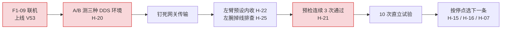

# F1 Harness 第二轮复审：V53

- 复审基线：分支 `harness/v53`，提交 `04e0ee3`（北京时间 2026-11-26 01:17，[PR #6](https://github.com/BrunonXU/DM0.5/pull/6)，未合并）。本文行号以该提交为准。
- 上一轮基线：`750ca46`（2026-11-18，V42）。上一轮正文见 [review.md](review.md)。
- V53 的身份：发布登记 `HARNESS/releases/registry.json` 中 V53 为 `candidate`，冻结包 `53af3b1d4406`，**没有部署**。登记的 `active_version` 是 52。`main` 在 `a2f93ae`（PR #5，V50–V52）。
- 分工不变：Claude 只写审阅，Codex 执行。本文第二部分的新条目 H-20 至 H-25 沿用 [Claude-advice 说明](../README.md)的状态标记。
- 决策状态：2026-11-26 用户授权 Claude 代为决定全部待定项。结论见第一部分[第五节](#五全部决策已定)，本文不再有待用户确认的条目。直接可粘贴的开工指令见 [review-v53-handoff.md](review-v53-handoff.md)。
- 后续：第三轮审阅见 [review-v53-round3.md](review-v53-round3.md)。其中更新了 H-20、H-21、H-22、H-23、H-25 的结论，与本文不一致处以第三轮为准。

**结论：软件按上一轮建议做完了第一批，真机一步没有前进。** 上一轮 19 条里，8 条已完成软件改动，漏斗脚本、S0–S9 指标和证据上传都已落地。但 V50 之后只有 2 次真机任务，都停在 S0，机械臂没有动过。H-01 至 H-18 的改动在真机上一次都没有被执行到。

**挡路的不是抓放逻辑，是取帧。** 任务拿不到可用场景有三个原因：正式网关偶发收到空帧，根因没有查清；左臂第 2 关节静置时越过命令下限，位姿计算被拒；左腕相机掉线后控制端撤权。V53 只处理了第二个，办法是把限位放宽 0.7°，余量很薄。机器人目前离线，这三件事都还没有在真机上验证。

**下一步只做一件事：让任务在 S0 稳定拿到三维场景，然后跑满 10 次。** 在此之前不要再做新功能。下面第二部分给出 6 个新条目，所有决策都已定，Codex 可以直接按顺序执行。



---

# 第一部分：给人看

## 一、V53 在哪里

| 项 | 实际情况 |
|---|---|
| 分支与提交 | `origin/harness/v53`，两个提交：`ce4e732`（限位与预检脚本）、`04e0ee3`（离线验收证据与文档） |
| 与 main 的关系 | 以 `a2f93ae` 为基，领先 2 个提交，[PR #6](https://github.com/BrunonXU/DM0.5/pull/6) 未合并 |
| 发布登记 | V53 `status: candidate`，`bundle_id` 以 `53af3b1d4406` 开头，`deployment_pending_reason` 写明 F1-09 离线 |
| 现场在用版本 | V52（`04bc818d7424`） |
| V53 改了什么 | `HARNESS/src/` 一行未改。只改了三个配置里的一个数（左臂第 2 关节下限 −94.0° 改为 −94.7°），新增只读脚本 `scripts/preflight_scene.py` 和它的测试 |

“到了 V53”的意思是冻结了一个候选包，不是真机上跑到了 V53。

## 二、从上一轮基线到 V53 实际变了什么

按影响分四组。

**1. 评测体系建起来了（有效）。** `scripts/run_funnel.py` 从控制端和规划端记录算出 S0–S9、耗时、模型调用和拒绝次数。历史 106 次运行的基线已上传：39 次有首动，19 次确认抓住，6 次运输到位，0 次放置成功。`Claude-advice/HARNESS/evidence/` 下有 9 个证据目录、104 个跟踪文件。这是本轮最有价值的产出，第一次能看到停在哪。

**2. 过度拦截的五处已放开（软件完成，真机未触达）。** 可选相机变化改为重扫，观测准备 15 秒，只读补验独立计 6 次，恢复预算上限 4/3，运输终点五点候选。经验检索不再精确匹配指令，运行后输出分阶段耗时。

**3. V43 至 V50 的现场修补一次并入。** 提交 `3dc1af9` 把已部署的 V50 源码整体带进仓库，包括：缺孔位时换视点再对准（`recovery_programs.py:368-446` 的 `recover_alignment`），夹爪 CAN 判抓按一次闭爪锁定（`gripper_contact.py:88-138` 的 `GraspClosureEpisode`），桶盖配准和持物看孔两个新模块。这些不在上一轮规格里，但部分覆盖了 H-07 和 H-15 的前提。

**4. V53 本身是一处现场补丁。** 拆掉左夹爪后左臂变轻，静置时第 2 关节停在 −94.156°，越过 −94.0° 的命令下限，正运动学被拒，任务拿不到场景。V53 把这一个关节的下限放宽到 −94.7°，并写了一个只读预检脚本。

账面：上一轮基线（V42）之后登记了 11 个版本（V43–V53）。按上一轮建议改动之后（V51 起）真机任务 2 次，首动 0 次。

## 三、H-01 至 H-19 完成情况

“软件完成”指代码已改且测试通过，没有真机数据。按验收规则，这些条目都不能标 `[x]`。

| 条目 | 状态 | 证据（`HARNESS/src/f1_harness/`） | 说明 |
|---|---|---|---|
| H-01 可选相机重扫 | 软件完成 | `revalidation.py:390-402`、`:454-463` | 头部按“不算必需”实现。真机两次都没走到复核 |
| H-02 观测 15 秒 | 软件完成 | `remote.py:15`、`:624` | 真机走满过一次 15 秒，结束时仍是空帧 |
| H-03 补验独立计数 | 软件完成 | `engine.py:40`、`:295`；`owner_bridge.py:1056`；`recovery_programs.py:86` | 正式程序的循环次数也已改为 6 |
| H-04 关节空间搜索 | 已确认 | 证据 `evidence/20261125-B-batch/h04-site.json` | 三个开关现场均为 true；`skill_services.py:398` 的触发顺序未动 |
| H-05 恢复预算上限 | 软件完成 | `contracts.py:412-413`；`recovery_programs.py:55-57`；`web_snapshot.py:19`；`development.py:260-263` | 上限 4/3，默认 2/1，现场模板 2/2 |
| H-06 运输终点区域 | 软件完成 | `transport.py:72-113` | 中心加四个偏移，复核沿用同一偏移 |
| H-07 闭环对准 | 未动 | `recovery_programs.py:456-487` | 仍是一次性对准。V50 的 `recover_alignment` 解决的是“看不到孔时换视点”，不是按误差修正 |
| H-08 横躺抓姿 | 未动 | `skills.py:524-528` | 决策已定，排在 M1 之后 |
| H-09 身份丢失重新播种 | 未动 | `scene_pipeline.py:354`、`:370` | |
| H-10 检索放宽 | 部分完成 | `memory.py:400-410` | 失败与探索经验已放宽。程序复用仍精确匹配指令：`program_experience.py:598-599`、`:640`、`:679` |
| H-11 候选顺序发布 | 未动 | 没有 `scripts/publish_candidate_order.py` | |
| H-12 开发档晋升 | 未动 | `config.py:17`；`memory.py:264-266` | |
| H-13 明确不改 | 已遵守 | `skill_services.py:398` | |
| H-14 形状抽象 | 未动 | `engine.py:126`；没有 `shapes.py` | |
| H-15 夹爪为主判抓 | 部分完成 | `gripper_contact.py:88-138`；`scene_pipeline.py:1283-1303` | CAN 结论不再被“目标不在夹持区”否决。但这段代码只在当前帧看得到积木时才运行；`verification.py:20` 仍要求可见；`transport.py:90`、`:141` 仍要求实测在手位姿 |
| H-16 程序优先模式 | 未动 | `web_snapshot.py:18` | 网页仍只有 `astra`、`vla_astra` |
| H-17 运输预算复用 | 未动 | `skill_services.py:237-279` | |
| H-18 分阶段耗时 | 软件完成 | `timing_report.py:9-17`、`:97` | 没有运行路径读取预算 |
| H-19 连续过点 | 未动 | `trajectory.py:30-42` | 按约定排在首次成功之后 |

**12 个 `[!]` 决策项**：复审时已定 3 个，未定 9 个。未定的 9 个已于 2026-11-26 全部定下，结论见[第五节](#五全部决策已定)。

| 决策项 | 复审时的现状 |
|---|---|
| H-01 头部是否必需 | 已定：不算，已实现 |
| H-04 现场开关 | 已定：三个均开启 |
| H-05 预算取值 | 已定：上限 4/3，现场 2/2 |
| H-07、H-08、H-09、H-12、H-14、H-15、H-16、H-17 | 未答复，代码未动 |
| H-19 | 等同已定：首次完整成功后再做 |

**评测与证据**

| 项 | 状态 | 证据 |
|---|---|---|
| A-1 漏斗脚本 | 完成 | `HARNESS/scripts/run_funnel.py`、`funnel_reasons.json` |
| A-2 历史基线 | 完成 | `evidence/20261125-A2-baseline/`（106 次，含最近 10 次原始记录） |
| S0–S9 指标 | 完成 | `run_funnel.py:193-292`；V52 两次真机也按同一口径出了 `funnel.json` |
| 证据上传 | 完成 | `git ls-files Claude-advice/HARNESS/evidence` 共 104 个文件 |
| B-5 拒绝原因码全表 | 部分 | `funnel_reasons.json` 只分类了历史上出现过的原因，不是代码里的全表 |
| B-6 证明绑定不一致改重扫 | 未动 | |

**做偏的两处**

1. **用放宽命令限位来容纳实测反馈。** `F1-4242/configs/f1-09-joints.json:167-171` 现在写 `command_range_deg: [-94.7, 120]`，`command_source` 仍是 `driver_command_range`。但 V53 自己的报告写明，驱动 `motor_ctl` 对命令的钳位仍是 −94.0°。合同声称的来源与数值不再一致。
2. **改了规则列为不改的工程。** `HARNESS/AGENTS.md` 的 `[CLAUDE_ADVICE]` 第 4 条规定不改 DAgger 和 F1-4242。V53 改了两者的配置和测试。PR 说明写的是按用户决定，但 F1-4242 自己的状态文档没有相应记录，仓库里的 F1-4242 配置与现场运行的 `robot-v22.json` 已经不同。

## 四、距离真机跑通还差什么

以下排序是静态判断。V50 之后没有一次真机运行越过 S0，S1 以后的所有结论都没有新证据。

| 排序 | 挡路项 | 类型 | 依据 |
|---|---|---|---|
| 1 | 机器人离线，V53 未部署，三个取帧问题都没有复测 | 现场 | 登记 `deployment_pending_reason`；管理隧道 11 月 25 日断过两次 |
| 2 | 正式网关偶发空帧，根因未定 | 代码加现场 | `web-bcfd8730`：底层录像有 1,683 组同步帧，网关 160 次检查全空。网关的 DDS 传输没有钉死：`scripts/start_development.py:57` 只执行 `source /opt/ros/jazzy/setup.bash`。V53 报告测到本机默认 Fast DDS 多次出现“有发布者、收 0 包” |
| 3 | 左臂第 2 关节贴着限位 | 决策已定，待现场执行 | 同一目标 −93.345° 下静置值在 −93.667° 到 −94.156° 之间，下垂 0.3° 到 0.8°。Codex 计划把预设改到 −93.667°，按同样的下垂会停在 −94.0° 到 −94.5°，离新下限 −94.7° 最少只剩 0.2° |
| 4 | 左腕相机 USB 掉线，控制端撤权 | 现场硬件 | `web-e992a2d9`：左腕 0 帧，有效授权期异常撤权 1 次 |
| 5 | 机器人到 6000D 走 Wi-Fi | 现场 | 有线口载波为 0。分割服务在 6000D，图像经无线往返 |
| 6 | 实测反馈被当作命令做限位检查 | 代码，决策已定 | `numerical_service.py:47-50` 对实测值调用 `check_action`；`owner_bridge.py:559` 要求左臂目标等于实测值。任何一个手臂关节静置时越限 0.001°，整个任务拿不到场景。V53 只给一个关节加了 0.7° |
| 7 | S1 之后停在哪，未知 | 现场数据 | 历史停点：候选耗尽 12 次（S0 5 次、S4 5 次），模型 429 或超时 9 次，S5 之后规划无进展 3 次 |
| 8 | H-15、H-16 未实现 | 代码，决策已定 | 历史上 9 次运行死于模型传输错误；V52 第二次任务没有场景可看，仍等了 Astra 21.6 秒 |

第 1 至 5 项解决之前，改抓放代码没有意义：任务走不到那些代码。

## 五、全部决策（已定）

2026-11-26 用户授权 Claude 代为决定。下面每项都是最终结论，Codex 不需要再问。涉及硬件安全限位和碰撞余量的，取了更保守的一侧。只有现场数据才能定的，写成“先按 X 执行，复测后按 Y 条件调整”。本节替代 [review.md 的待人工确认决策表](review.md#待人工确认决策表)。

**Codex 留下的问题和新条目**

| 编号 | 问题 | 已定 | 理由 |
|---|---|---|---|
| Q1 | 预检脚本默认用哪种 ROS 环境 | 已定：默认保持 `production-gateway`，同时按 H-20 把正式网关的传输钉死 | 预检要测任务实际使用的环境，换一套环境会出现预检通过、任务空帧 |
| Q2 | 上线时 F1-4242 是否切到 `robot-v23.json` | 已定：不切，4242 留在 `robot-v22.json`，不重启 | 驱动的命令钳位仍是 −94.0°，4242 保持 −94.0° 是更保守的一侧，功能上也不需要 |
| Q3 / H-22 | 任务预设的 `arm_l_j2` 取多少 | 已定：先改为 −92.5°。复测后若左腕看不全三个孔，改为 −93.0° 再测一次；仍看不全则恢复 −93.345° 并停下报告 | −92.5° 时最差静置值 −93.3°，不越原来的 −94.0° 下限 |
| Q4 | 04:24 网关全空的根因 | 已定：不再追旧记录，做 H-20 的 A/B | 旧记录查过两轮没有结论，A/B 能直接回答哪种环境会空 |
| Q5 | 拆掉左夹爪后的碰撞模型 | 已定：保留原夹爪包络，不缩小 | 更保守 |
| Q6 | 左腕不出帧时预检怎么判 | 已定：判失败 | 控制端在左腕无新帧时会撤权，预检放行没有用 |
| Q7 | 是否继续放宽限位 | 已定：不再放宽任何关节限位。V53 的 −94.7° 保留到 H-23 完成，之后恢复 −94.0° | 限位属于硬保护，越限用改姿态和分开检查来解决 |
| H-23 | 实测反馈与命令目标的限位检查是否分开 | 已定：分开，做法与 F1-4242 相同。命令限位不变；实测反馈容差读取档案里已有的 `feedback_limit_recovery_deg`，不新设数值。排在首次首动之后 | 实测值越限 0.001° 不该让任务拿不到场景；做完后限位可以收回 −94.0° |
| H-25 | 左腕相机掉线 | 已定：先查硬件（线缆和接口），不放宽控制端的撤权。连续 3 次预检左腕不过就停下报硬件问题 | 撤权与原始记录完整性有关，属于硬保护 |
| 网络 | 机器人到 6000D 走 Wi-Fi | 已定：能接有线就先接；接不上照常试验，报告里写明往返时延 | 不值得为它挡住第一批试验 |

**上一轮留下的决策项**

| 条目 | 已定 | 理由 | 何时做 |
|---|---|---|---|
| H-15 判抓 | 已定：夹爪 CAN 为主，加提起后 1 秒内的跟随或离桌校验，没有则降回未知。`pre_closure_relative` 取闭爪首发复核所用的那份观测 | 补偿夹到相邻积木或桶沿的误判 | 首批试验停在 S3 时 |
| H-15 缺在手位姿时能否运输 | 已定：先不允许，保持 `measured_in_hand_transform_required`。复测后若 10 次中有 2 次以上因此停在 S4，再允许用标称附件运输，且持物的规划余量加上现有的 `tracking_tolerance_m` | 附件误差影响碰撞余量，取保守一侧 | 同上 |
| H-16 程序优先模式 | 已定：新增可选模式 `program_first`，不设为默认。初始定位先用现有的语义播种；复测后若 10 次中无需 Astra 即定位成功的少于 8 次，改用 `masks` 配置的固定提示框。“见过”只按同一 `calibration_id` 和形状、且初始定位无需 Astra 判定。达到 C-1 指标后再改为默认 | 历史 9 次运行死于模型 429 或超时 | 首批试验停在 S0 且原因是模型时；否则在 M0 之后 |
| H-16 页面选项 | 已定：F1-4242 页面加模式选项另开任务，按 F1-4242 的规则做。此前用配置快照指定模式 | 不在 HARNESS 范围内 | 随 H-16 |
| H-07 闭环对准 | 已定：先做 D-3 持块孔位采样 30 组。`tol_xy` 取站点 `hole_clearance_m` 的一半，`tol_yaw` 取现有 `yaw_tolerance_rad`，`step_max` 取 `free_space_goal_tolerance_m`，循环 3 次，不占用 `local_corrections`。D-3 可用率低于 90% 时，改为运输途中手臂遮挡之前测孔并缓存，D-4 暂不做 | 阈值全部取自现有配置，不新设 | 首批试验停在 S5 至 S7 时 |
| H-08 横躺抓姿 | 已定：对称候选改为绕支撑轴，参数由 Codex 从站点配置读出并写进提交说明。预抓终点沿用旧位姿不做 | 沿用旧位姿去闭爪有误抓风险，取保守一侧 | M1 之后 |
| H-09 身份丢失重新播种 | 已定：接受，仅限本次任务里该积木还没有被闭爪接触过。投影框沿用 `search_projection.py` 现有的搜索框参数 | 积木被碰过后旧位姿不可信 | M0 之后 |
| H-12 开发档晋升 | 已定：开发档里同一 `calibration_id`、形状和目标下成功 2 次即可复用，出现 1 次反例自动降级。正式晋升规则不变 | 否则经验永远无法晋升 | M0 之后 |
| H-14 形状抽象 | 已定：先只做重构，方块结果逐位一致。新形状先按三角 3 重对称（不翻面）、圆柱顶抓登记；实物到位后按实测尺寸调整 | 没有实物，不猜尺寸 | M1 之后 |
| H-17 运输预算复用 | 已定：抓稳后再登记，不新增“抓前”键 | 改动小 | M1 之后 |
| H-19 连续过点 | 已定：首次完整成功后再做，必须通过输出审计，输出限速 30°/s 不变 | 切角有撞桶的先例 | 首次完整成功之后 |

---

# 第二部分---

# 第二部分：给 Codex 的执行规格

## 0. 通用约束

执行、状态和回写约定见 [Claude-advice 说明](../README.md#codex-执行与回写约定)。硬保护清单和冲突优先级以 [HARNESS/AGENTS.md](../../HARNESS/AGENTS.md) 为准。本轮追加三条：

1. **H-20、H-22、H-25 完成并取得第一批真机数据之前，不做 H-07 至 H-19 中任何未动的条目，也不做 H-23，不冻结新功能版本。** 决策已定不等于现在就做。
2. 新增拒绝原因数必须为 0。本轮所有条目都不新增 `raise HarnessError`。
3. 机器人离线期间只能做 H-20 的步骤 B 和 H-24。不要用离线回放替代步骤 A。

执行顺序：上线 V53 → H-20 步骤 A → H-20 步骤 B（胜出环境不是当前环境时，冻结新版本并上线）→ H-22 → H-25 → H-21 → 10 次试验。

## H-20 `[ ]` P0：钉死正式网关的 DDS 传输

**位置**

- `HARNESS/scripts/start_development.py:57`：机器人端服务（网关、校验、数值）的启动命令。

```python
    remote='source /opt/ros/jazzy/setup.bash\nexec '+shlex.join(service_argv)
```

- `HARNESS/src/f1_harness/site.py:213-225` 的 `_safe_environment`：`RMW_IMPLEMENTATION` 和 `FASTRTPS_DEFAULT_PROFILES_FILE` 会传给子进程，所以在上面那一行设置即可生效。
- 对照：控制端在 `HARNESS/src/f1_harness/web_process.py:210-216` 显式设置了 Cyclone。这一处不改。
- `HARNESS/scripts/preflight_scene.py:1029-1061` 的 `_build_remote_ros_prelude`：三种环境的定义已经写好。

**当前行为**：网关不设置 RMW，继承 SSH 非交互环境，实际是默认 Fast DDS（含共享内存传输）。发布端 `motor_ctl` 和相机节点也是 Fast DDS。V53 报告第 3 节测到默认 Fast DDS 多次“发布者 1 个、收包 0”，切到仅 UDPv4 后恢复。11 月 25 日 04:24 的任务网关全程空帧。两者是否同一原因，没有证据。

**步骤 A：只读 A/B（需要机器人在线，不改代码）**

1. 用现有脚本，三种环境轮流跑，每种 10 次，共 30 次：

```bash
python3 HARNESS/scripts/preflight_scene.py --ros-env production-gateway --seconds 12 --output <目录>/pg-01
python3 HARNESS/scripts/preflight_scene.py --ros-env fastdds-udp        --seconds 12 --output <目录>/udp-01
python3 HARNESS/scripts/preflight_scene.py --ros-env cyclone            --seconds 12 --output <目录>/cyc-01
```

2. 顺序必须是 pg、udp、cyc、pg、udp、cyc 这样交替，不能一种跑完再跑下一种。每次都是新进程。
3. 每次记录：五项检查各自是否通过；头部和右腕的彩色、深度回调数；关节反馈回调数；从启动到第一组配对样本的秒数；`result.json` 里的 `rmw` 和 `middleware_environment`。
4. 汇总成一张 3 行的表，上传到 `Claude-advice/HARNESS/evidence/<日期>-H20-dds-ab/`，包含 30 份 `result.json`。

**判定规则（按此选，不要另行权衡）**

- 以检查项 `dual_rgbd_feedback_paired` 的通过次数为准。
- 通过次数最多的环境胜出。
- 并列时选 `fastdds-udp`，条件是它的头部和右腕彩色、深度回调数中位数不低于 `production-gateway` 的 90%。不满足则选 `production-gateway`。
- 三种环境都是 10/10：仍按上一条选，并在报告中写明“空帧未复现”。
- 没有任何环境达到 9/10：停下，把表写进报告，不改代码。这种情况说明问题不在传输层，回到相机和驱动一侧排查。

**步骤 B：代码改动（可以离线先写，按步骤 A 的结果启用）**

1. 新增文件 `HARNESS/configs/fastdds-udp-only.xml`，内容与 `preflight_scene.py:53-68` 的 `FASTDDS_UDP_ONLY_XML` 逐字节相同。
2. 在 `start_development.py` 新增函数 `robot_services_ros_prelude(remote_bundle)`，返回一段 shell 文本；第 57 行改为 `remote=robot_services_ros_prelude(args.remote_bundle)+'exec '+shlex.join(service_argv)`。返回的文本取决于步骤 A 的胜出环境，三种写法如下，每行以换行结束：
   - 胜出 `fastdds-udp`：

```bash
source /opt/ros/jazzy/setup.bash || exit
export RMW_IMPLEMENTATION=rmw_fastrtps_cpp
export ROS_AUTOMATIC_DISCOVERY_RANGE=SUBNET
export FASTRTPS_DEFAULT_PROFILES_FILE=<remote_bundle>/configs/fastdds-udp-only.xml
```

   - 胜出 `production-gateway`：

```bash
source /opt/ros/jazzy/setup.bash || exit
export RMW_IMPLEMENTATION=rmw_fastrtps_cpp
```

   - 胜出 `cyclone`：与 `web_process.py:210-216` 的七行环境设置相同。
3. `preflight_scene.py` 的 `_build_remote_ros_prelude` 增加参数 `remote_bundle`（调用处 `:1119`，变量在 `:1075` 已有）。`production-gateway` 分支返回原有的 `unset …` 一行，后接与上面函数相同的文本。脚本保持独立，不导入运行时模块，所以用一条单元测试保证两处一致：在 `HARNESS/tests/test_preflight_scene.py` 新增用例，用同一个包路径调用两边，断言预检的返回值去掉首行后与 `robot_services_ros_prelude` 的返回值相等。
4. `start_development.py:77` 的非网页 owner 命令和 `web_process.py:122-128` 的启动复核不在本条范围，不改。
5. 这一改动进入冻结包，需要一个新版本。按发布登记分配编号，走发布前全流程零输出验收。胜出的是 `production-gateway` 时，不必为它单独冻结，直接用 V53 做 H-21，这处改动随下一个版本带上。

**保留**：不改相机、`motor_ctl` 或 F1-4242 的 DDS 配置；不改 `web_process.py:210-216`；不加任何运行时检查。

**验收**

- 软件：全量 pytest、`check_native_integration.py`、`check_project_layout.py`。
- 真机：H-21 的预检连续 3 次通过；之后 10 次任务中，“首个观测为空帧”的次数为 0。空帧的判定：`planner/trace.jsonl` 中首次观测的帧数为 0，或原因含 `observation_unavailable`。

**风险与回滚**：仅 UDP 时大图像可能丢帧，所以判定规则里有回调数不低于 90% 这一条。回滚只需把常量改回一行 `source`。

## H-21 `[ ]` P0：V53 上线后的预检和第一批真机试验

**位置**：`HARNESS/scripts/preflight_scene.py`（已有，不改判定逻辑）；`HARNESS/agent/TODO.md` “现在做”第一项。

**做法**

1. 机器人联机后按现有流程上线 V53，核对 4242 显示 V53。4242 留在 `robot-v22.json`（见第一部分 Q2）。H-20 产生了新版本时，本条对新版本执行。
2. 归位到任务预设后，连续运行 3 次预检，每次 `--seconds 12`，`--ros-env` 用默认值。
3. 三次的五项检查必须全部通过：`joints_within_limits`、`dual_rgbd_feedback_paired`、`left_wrist_streaming`、`scene_geometry_solved`、`readonly_safety`。
4. 另外从三份 `result.json` 的关节统计里取 14 个手臂关节的 `min_margin_deg`，写进报告。任一关节小于 0.5° 时，在报告开头标出关节名和数值，并先做 H-22。这只是报告项，不改脚本的通过条件。
5. 通过后请用户在 4242 做 10 次直立试验，每次点一次“开始任务”。Codex 不发送开始指令。
6. 结束后按 [验收文档第七节](review-acceptance.md#七每个-pr-必须附带的报告)的模板出报告，上传到 `Claude-advice/HARNESS/evidence/<日期>-V53-first-batch/`。

**止损规则**：前 3 次试验如果都停在 S0 且最后失败原因相同，本批到此为止，不必跑满 10 次。报告这 3 次的原因和预检结果的差异，然后停下。

**本批目标**（与上一轮开工指令相同，不调整）：S1 到达率 10/10；因相机身份撤权 0 次；观测准备超时交回模型不超过 1 次；至少 1 次完整成功。达不到就如实报告停在哪。

**报告里必须回答的一个问题**：预检通过之后，任务的第一次观测是否也拿到了场景。如果预检通过而任务仍是空帧，说明预检与任务的启动路径仍有差别，把两者的 `middleware_environment` 并排列出。

## H-22 `[ ]` P0：任务预设的左臂第 2 关节向内收

> 决策记录：2026-11-26，用户授权 Claude 代为决定。已定：先改为 −92.5°，按下面的条件调整。

**位置**：机器人上的 `presets.json`，预设“积木demoV3-左腕观测”（id `5f080cd1a61f4b098a6f33041a4574b3`）。不在仓库里。

**当前情况**（数据取自 `evidence/20261125-V53-left-baseline-preflight/joint-limit-rebaseline.json`）

| 预设目标 | 静置实测 | 下垂量 |
|---:|---:|---:|
| −93.345° | −94.156°（10:01 UTC，294 个样本） | 0.81° |
| −93.345° | −93.667°（14:01 UTC，归位后 201 个样本） | 0.32° |

Codex 原计划把目标改为 −93.667°。按同样的下垂，静置值会在 −93.99° 到 −94.48° 之间，距 V53 的下限 −94.7° 最少 0.22°。

**做法**

1. 先备份原文件。把该预设的 `arm_l_j2` 改为 **−92.5°**。按 0.32° 到 0.81° 的下垂，静置值在 −92.82° 到 −93.31° 之间，距原下限 −94.0° 至少 0.69°。其余关节和两个出厂预设不动。
2. 归位后静止采样 60 秒，再跑一次预检，并存一张左腕静止图。
3. 按下表处理，只走这三步，不试别的数。

| 复测结果 | 处理 |
|---|---|
| `arm_l_j2` 最小值不低于 −93.5°，预检五项通过，左腕图中三角孔、圆孔、方孔都可见 | 采用 −92.5° |
| 三个孔看不全 | 改为 −93.0°，重复第 2 步。此时最差静置值 −93.81°，仍在 −94.0° 以内 |
| −93.0° 仍看不全 | 恢复 −93.345°，停下报告，附两张左腕图 |

三个孔是否可见由 Codex 按预检结果里左腕的孔口候选判断，并把图上传到证据目录。

**不做**：不再修改任何关节限位。V53 已冻结的 −94.7° 保留到 H-23 完成。

**证据**：`Claude-advice/HARNESS/evidence/<日期>-H22-left-preset/`，含 60 秒采样的最小值和最大值、预检 `result.json`、左腕静止图。

## H-23 `[ ]` P1：把“实测反馈”和“命令目标”的限位检查分开

> 决策记录：2026-11-26，用户授权 Claude 代为决定。已定：分开，做法与 F1-4242 相同。排在首批试验出现首动之后。

**这是 V53 那处补丁背后的结构问题。**

**已核实的代码事实**

- `HARNESS/src/f1_harness/numerical_service.py:47-50`：

```python
    def forward_pose(self, *, full22, held16):
        full = self.vector(full22, 22, 'full22')
        held = self.mapping.check_action(held16)
        return self._pose(full, held)
```

- `HARNESS/src/f1_harness/live_scene.py:460` 用实测值调用它：`forward_pose(full22=feedback['full22'], held16=feedback['measured16'])`。
- `DAgger/F1/src/f1dagger/contract.py:61-64` 的 `check_action` 对 14 个手臂关节逐个比较命令限位，越限即抛 `ArmLimitRejected`。
- `numerical_service.py:30-33` 的 `_pose` 只把 `held[7:14]`（右臂）写进运动学，左臂取自 `full22`。也就是说，左臂的实测值并不参与这次右臂末端位姿的计算，却能让它失败。
- `HARNESS/src/f1_harness/owner_bridge.py:559` 和 `:732` 要求 `targets[:,:7]==measured16[:7]`，即每个目标的左臂七个关节等于实测值。所以左臂静置越限时，后续每个目标也会越限。
- 对照：F1-4242 把两者分开处理。`F1-4242/robot/adapter.py:465` 对不动的关节取钳位后的实测值；`:476` 用 `feedback_limit_recovery_deg`（现场为 1.0°）容忍实测值略微越限。

**目标行为**

- 命令目标的限位检查完全不变，仍是硬保护。
- 实测反馈只在超出“命令限位加 `feedback_limit_recovery_deg`”时才拒绝。该值从机器人档案读取，不新设阈值；档案里没有这个字段时，容差按 0 处理，即保持现在的行为。
- Harness 不发命令的关节（左臂 7 个）在目标里取钳位到命令限位之内的实测值，做法与 `adapter.py:465` 相同。
- 做完后 `arm_l_j2` 的下限恢复为 −94.0°，`f1-09-joints.json` 的 `command_source` 重新与驱动一致。

**执行步骤**

1. 先只读查明并写进报告：Harness 的控制端发布时是否包含左臂目标。查 `DAgger/F1/src/f1dagger/` 中 owner 的发布路径和 `enabled` 参数。
2. 按结果二选一：
   - 不发布左臂：只改实测位姿这一条路径。在 `numerical_service.py` 新增 `measured_pose` 方法，对输入只检查长度和有限性，再按上面的容差比较；`numerical_pool.py:19` 的 `METHODS` 加上它；`live_scene.py:460` 改为调用它。`owner_bridge.py:559`、`:732` 的相等检查改为与钳位后的实测值比较。
   - 发布左臂：除上面之外，发布给驱动的左臂目标也用钳位后的值。这一步要改 DAgger，另开任务，先读 `DAgger/AGENTS.md`。
3. `forward_pose` 和 `forward_path` 对规划目标的 `check_action` 不动。

**保留**：命令限位、耦合腕限位（`contract.py:65-67`）、碰撞与扫掠检查全部不变。不新增拒绝原因。

**验收**

- 新增用例：左臂实测 −94.156°、下限 −94.0°、容差 1.0° 时，实测位姿成功，目标里的左臂值为 −94.0°；实测 −95.1° 时仍被拒绝；任何命令目标为 −94.001° 时仍被拒绝。
- 全量 pytest、`check_native_integration.py`、三条零输出回放。
- 真机：把站点的 `arm_l_j2` 下限恢复为 −94.0° 后，预检连续 3 次通过，10 次试验中因关节限位停在 S0 的次数为 0。

**风险与回滚**：风险是把真正的越限当成漂移。容差沿用 4242 已在用的 1.0°，超出照旧拒绝。回滚为还原提交并继续使用 −94.7°。

## H-24 `[ ]` P2：把 V53 留下的不一致记清楚

只改文档和登记，不改运行时。可以离线做。

1. `F1-4242/docs/STATUS.md`：补一条，写明仓库里 `F1-4242/configs/f1-09.json` 与 `f1-09-joints.json` 的 `arm_l_j2` 下限为 −94.7°，现场 4242 仍运行 `robot-v22.json`（−94.0°），两者不同是有意的，以及何时统一（H-23 完成后回到 −94.0°）。先读 F1-4242 的 `AGENTS.md`。
2. `Claude-advice/HARNESS/review.md`：
   - H-10 末尾追加一行：`program_experience.py:598-599`、`:640`、`:679` 仍精确匹配 `operator_instruction`，程序复用未放宽，随 H-16 一并处理。
   - H-15 末尾追加一行：V50 已有 `GraspClosureEpisode`，CAN 结论不再被夹持区检查否决；剩余缺口是 `verification.py:20` 的可见性要求和 `transport.py:90`、`:141` 的在手位姿要求。
   - H-07 末尾追加一行：V50 的 `recover_alignment` 覆盖“缺孔位时换视点”，误差闭环未做。
   - 这三行是事实补充。
   - 把 H-07、H-08、H-09、H-12、H-14、H-15、H-16、H-17、H-19 的 `[!]` 改为 `[ ]`，每条末尾追加一行：`> 决策记录：2026-11-26，用户授权 Claude 代为决定，结论见 review-v53.md 第五节。`
3. `HARNESS/agent/TODO.md` “现在做”第一项：把“更新 `arm_l_j2` 至实测停放角”改为“按 H-22 改为 −92.5°”。

**验收**：`python3 HARNESS/scripts/check_project_layout.py` 通过。

## H-25 `[ ]` P0：左腕相机掉线

> 决策记录：2026-11-26，用户授权 Claude 代为决定。已定：先查硬件，不放宽撤权。

**现场事实**：`web-e992a2d9` 中左腕驱动一度找不到设备，USB 两次断开后重新枚举，任务期间左腕 0 帧，控制端因左腕无新帧撤权（`evidence/20261125-B-gateway-check/historical.json`、`evidence/20261125-B-first-run/report.md`）。

**做法**

1. 机器人联机后，只读采样左腕彩色话题 5 分钟，同时保存这段时间的内核日志中与 USB 断开、重新枚举有关的行。
2. 记录：帧数、最大帧间隔、断开次数。
3. 断开次数为 0 且最大帧间隔不超过 2 秒（与预检 `left_wrist_streaming` 的现有条件相同）：通过，继续 H-21。
4. 否则停下，报告里写明这是硬件问题，请现场更换线缆或换接口后重测。不要改软件去绕过。

**不做**：不放宽控制端在左腕无新帧时的撤权；不把预检的左腕检查降为告警；不改相机驱动参数。

**证据**：`Claude-advice/HARNESS/evidence/<日期>-H25-left-wrist/`，含采样统计和脱敏后的内核日志摘录。

## 首动之后怎么选下一条

10 次试验的漏斗出来后，按最常见的停点选一条做，不要同时开几条。决策都已定，见第一部分[第五节](#五全部决策已定)，选中后直接执行。

| 最常见的停点 | 最后失败原因 | 下一条 |
|---|---|---|
| S0 | 空帧或 `observation_unavailable` | 回到 H-20，换判定规则里的下一个环境 |
| S0 | `ArmLimitRejected` 或关节越限 | 核对 H-22 是否生效；仍出现则做 H-23 |
| S0 | 左腕无新帧、`camera_unavailable` | H-25 |
| S0 | `model_http_429`、模型超时、`planner_no_progress_budget_exhausted` | H-16 |
| S0 至 S2 | `registered_candidates_exhausted` | 上传该次的候选拒绝明细，交 Claude 复审，不要自行加候选 |
| S3 | `grasp_held_evidence_missing`、`object_not_observed` | H-15 |
| S4 | `registered_candidates_exhausted` | 先核对 H-04、H-06 是否生效，再上传拒绝明细 |
| S4 | `measured_in_hand_transform_required`、`in_hand_transform_missing` | 10 次中出现 2 次以上时，按第五节启用标称附件运输 |
| S5 | 缺孔位、`planner_no_progress_budget_exhausted` | 做 D-3 的持块孔位采样 30 组，再做 H-07 |
| S6、S7 | 插入失败 | H-07 |
| 有首动，无上述集中停点 | — | H-23，把限位收回 −94.0° |

## 附：本轮核对过的材料

- 代码：`harness/v53` 的 `HARNESS/src/f1_harness/`、`HARNESS/scripts/`、`F1-4242/robot/adapter.py`、`F1-4242/robot/joint_contract.py`、`DAgger/F1/src/f1dagger/contract.py`。只读，未执行。
- 状态与登记：`HARNESS/agent/STATUS.md`、`HARNESS/agent/TODO.md`、`HARNESS/releases/registry.json`、PR #4 至 #6 的说明。
- 证据：`evidence/20261125-A2-baseline/`、`20261125-B-batch/`、`20261125-B-first-run/`、`20261125-B-gateway-check/`、`20261125-B-software/`、`20261125-V53-left-baseline-preflight/`。
- 没有核对的：6000D 和机器人上的站点配置、`presets.json`、`robot-v22.json`、`robot-v23.json`、冻结包内容。涉及这些文件的数值都转引自 Codex 的证据报告。
