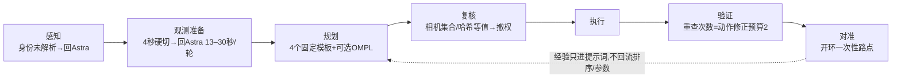

# F1 Harness 审阅与改进执行规格

- 审阅基线：`750ca46`（2026-11-18 13:37，北京时间），即用户确认的最新 HARNESS 代码，部署身份为 V42；本文所有行号以该提交为准。
- 审阅者：Claude（只读审阅，未改 HARNESS 业务代码）；执行者：Codex。
- 状态：全部条目为 `[ ]` 待执行，带 `[!]` 的条目须先由用户确认。执行与回写规则见 [Claude-advice 说明](../README.md)。

**结论：推理一直跑不通，主要原因是“默认拒绝、例外放行”的倾向，而不是缺某一项能力。** 同一个动作要在感知、引擎、规划复核、首发前几层反复核对身份、哈希和相机集合。现场一旦出现没预料到的组合，就会零发布或撤权，例如多出一路左腕图（V40）、观测包变大（V36）。每次修复只给这个组合加一条特例：两周登记了 42 个版本，仍没有一次完整的单块抓放成功。真正必须保留的硬保护只有五类：限位/碰撞、实时反馈失联、授权与会话身份、未知或部分发布不重放、原始记录写盘失败。其余检查都应尽量变成“用最新测量重扫后继续”或有界等待。

**最快让推理跑通的顺序：** 先把可选相机与证据的变化改成“重扫同一路径”，不再判为身份故障；拉长观测准备时限；把只读验证的重查次数与动作修正预算拆开；确认现场已开启关节空间搜索。之后再做三个难点（横躺抓取、运输终点、闭环对准），最后打通 RSI 的检索和排序回流。第二部分逐条给出 Codex 可直接执行的规格；不确定处标“待人工确认”，不允许猜测。

---

# 第一部分：给人看

## 核心问题



| 严重度 | 问题 | 现场表现 |
|---|---|---|
| S0 | 复核把“可选相机或证据变化”当身份故障（`revalidation.py:348`） | V40 首发前撤权；V42 只给左腕加了特例（`revalidation.py:331-347`） |
| S0 | 每次技能提交前，观测准备只给 4 秒（`remote.py:559`） | 超时后交回 Astra，每轮 13–30 秒，300 秒的任务预算被模型轮次耗尽 |
| S0 | 只读验证的重查次数绑定动作修正预算 `local_corrections≤2`（`engine.py:294`、`owner_bridge.py:1006`） | 遮挡时补验很快用完次数，任务停在“证据不足” |
| S1 | 运输终点是单个精确位姿，模板固定为 4 个（`transport.py:17-22,72-92`） | 四个候选全被拒绝；代码注释也写着“目标区域是后续工作” |
| S1 | 对准开环，在手偏移不修正（`transport.py:240-267`、`recovery_programs.py:339-368`） | 最后对准阶段问题集中 |
| S1 | 横躺积木：抓姿对称只绕物体 Z 轴旋转（`skills.py:524-528`）；预抓终点近距离深度缺失后，物体姿态丢失 | 10:52 倒块测试在预抓终点停住 |
| S2 | RSI 只记录、不回流：检索精确匹配 `operator_instruction`（`memory.py:400-401`）；规划顺序教训不进入实时排序（`skill_services.py:259`）；晋升要求真机几乎达不到 | 真实晋升为 0 |

## 改进方向与执行优先级

| 优先级 | 条目 | 一句话 |
|---|---|---|
| P0 | H-01 | 只比较本动作必需的相机，可选相机变化改为重扫 |
| P0 | H-02 | 观测准备 4 秒改为 15 秒 |
| P0 | H-03 | 只读验证重查次数独立计数（上限 6），不再占用动作修正预算 |
| P0 | H-04 `[!]` | 确认现场已开启 `joint_space_transport` 和 `joint_space_free_motion` |
| P0 | H-05 `[!]` | 恢复预算上限放宽（只改 schema 上限，实际取值由用户定） |
| P1 | H-06 | 运输终点改为孔口上方的小区域（复用现有 15mm 自由空间容差） |
| P1 | H-07 `[!]` | 闭环对准程序：左腕孔位加小步 `move_tcp` 修正 |
| P1 | H-08 `[!]` | 横躺积木抓姿对称改为绕支撑轴；预抓终点允许沿用接近前已确认的物体位姿 |
| P1 | H-09 `[!]` | 身份未解析时先用上次 3D 位姿投影重新播种，失败再交回 Astra |
| P2 | H-10 | 经验检索不再精确匹配 `operator_instruction` |
| P2 | H-11 | 规划顺序教训经人工确认后发布到 `candidate_order` |
| P2 | H-12 `[!]` | 开发档的参数和程序经验晋升门槛（属于政策决定） |
| — | H-13 | 明确不改的项（防止误改） |
| P1 | H-14 `[!]` | 形状抽象：把方块的 4 重对称、盒体和方孔识别从代码里抽到形状配置 |
| P0 | H-15 `[!]` | 判抓以夹爪 CAN 为主；闭爪后看不到积木时，用闭爪前的位姿确认积木在夹持区内 |
| P0 | H-16 `[!]` | 网页开放“确定性程序”模式：见过的场景不调用 Astra，失败再交回 Astra |
| P1 | H-17 `[!]` | 抓取时预算出的运输路径，交给提交时复用，省掉抓后的串行规划 |
| P1 | H-18 | 每次运行输出分阶段耗时对照 20 秒预算，只告警、不拦截 |
| P2 | H-19 `[!]` | 运输中间路点连续过点（提速项，须在首次完整成功后、经输出审计） |

## 补充问答（2026-11-24，基于 750ca46 核实）

### 1. 扩展到其他形状能否沿用同一套逻辑？

**主干流程可以沿用，但“方块”写死在很多地方，不能直接换形状。** 感知、抓取、运输、对准、插入、验证的流程，以及 owner 硬保护，都与形状无关。真正写死的有四类：

- **形状准入**：`engine.py:123-125` 直接拒绝非方块任务；网页只接受 `square_block`（`web_snapshot.py:14-15`）。
- **4 重对称**：抓姿、对准、位姿对齐、跟随误差、候选编号都按 4 个 90° 分支写死（`skills.py:216-224,286-290,524-528`、`geometry.py:124-139`、`grasp_tracking.py:14-15`、`contracts.py:491-492`、`remote.py:632`、`engine.py:663-664`、`joint_motion.py:80`）。
- **物体模型是盒体**：位姿由矩形面边长匹配盒体尺寸得到（`scene.py:35-64`）；碰撞、抓高检查都用 `object_local_box`（`skills.py:33,112-147,317`）。圆柱和三棱柱不适用。
- **孔位识别只认方孔**：桶盖方孔要求 4 个角点、边长比不超过 1.3（`fixture_tracking.py:66,97-99`）；左腕补孔用三角孔加圆孔作锚点，再按距离认方孔（`aperture_transfer.py:94-153`）。

扩展时需要抽象一个“形状配置”，至少包含：对称阶数（方 4、三角 3、圆形为连续对称）、物体几何（盒体、棱柱、圆柱）、孔口检测器和抓姿模板。详见 H-14。

### 2. 判抓到底用的是什么信号？还在等图像吗？

**CAN 夹爪实测是主信号，但判抓结果仍然要等一帧处理完的 RGB-D 图像才能产出。** 核实如下：

- **夹爪判据**（`gripper_contact.py:40-85`）：读取右夹爪外部 CAN（`socketcan_external`）。闭爪指令发布后，在一个静止窗口（`stationary_window_ns`，0.2–2 秒）内至少 3 个样本，开度波动不超过 `gripper_stationary_delta`，并且停在“既没张开、也没闭到底”的位置，才判为受阻闭合（`measured_blocked_closure`）。空爪闭到底会被拒绝，这正好排除了空抓。
- **仍要看图的两处**：
  1. 受阻闭合必须配合同一帧里“积木位于本次闭爪的夹持区内”才算数（`scene_pipeline.py:1131-1134`，`target_in_closure_region`）；
  2. `verify_grasp` 要求一帧在动作之后采集、积木可见并带证据的观测（`verification.py:18-20`、`skill_services.py:954-990`，最多等 2 秒）。

  也就是说，夹爪是主判据，图像用来确认“夹住的是这块积木”。
- **耗时**：实测抓持验证约 0.65 秒（`agent/experiments/20261117-local-capabilities.md:234`），ARM 上感知处理 p50 约 301ms（同文件 `:290`），等图并不是瓶颈。真正的风险在于闭爪后夹爪遮挡积木，图像里看不到积木，于是判抓卡在“证据不足”。

**夹爪判抓的可靠性风险**：

| 情形 | 夹爪信号会怎样 |
|---|---|
| 夹到积木边角或棱 | 开度同样受阻，但抓持不稳，提起时可能滑落 |
| 夹到相邻积木或桶沿 | 开度受阻，会误判为抓住 |
| 积木很薄，接近闭到底 | 代码已明确交给视觉判断（`gripper_contact.py:79-80`） |
| CAN 断流或时间戳异常 | 已被拒绝，不会误判 |

**应保留的最小图像校验**：闭爪前，积木位于预定夹持区内；提起后，一帧确认积木随手离开了桌面，或者桌面上原位置已经没有积木。

### 3. “新场景问 Astra，见过的场景 20 秒内完成”是否可行？

**思路对，代码里也已经有一半基础，但网页入口没有接通，而且还有串行等待。**

- **PyRUA 在代码里对应什么**：上游 PyRUA-Lean（`pyrualean` 包，`adapters.py:11-13`）提供 Python 沙箱，模型或宿主在里面写程序、调用机器人技能。`recovery_programs.py` 把内置恢复流程编译成 PyRUA 辅助函数（`pick_and_place`、`place_held_block` 等，见 `astra_programs.py:25-28`）。`programs.py:9-40` 的 `SINGLE_BLOCK` 是完全不需要模型的确定性单块程序。
- **已有的不经 Astra 的路径有两条**：
  1. CLI 的 `--planner baseline`（`cli.py:17,27`）直接运行 `SINGLE_BLOCK`；
  2. Astra 模式下，若经验快照里有已晋升的程序，会在第一轮模型调用前先执行（`task_runner.py:562-580`，`try_verified_programs`）。
- **断点**：网页只允许 `astra` 和 `vla_astra` 两种模式（`web_snapshot.py:18`），baseline 不可选；已晋升程序数为 0；“见过”只按标定、形状、指令和目标匹配，不看场景（`program_experience.py:601-627`）。另外，初始定位常需要 Astra 给提示框，V40 中两轮模型调用花了 29.28 秒（实验记录 `:377-379`）。
- **运输规划仍是串行的**：抓取时虽然会试算运输（`_grasp_continuation`，`skill_services.py:459`），但明确不提交，结果不复用；抓稳后要重新规划，约 5–7 秒，再加完整复核 2.6–4.5 秒（实验记录 `:256-265`）。

**单块抓放 20 秒预算拆分**（假设场景已见过、零模型调用、规划与执行并行）：

| 阶段 | 预算 | 参考实测与说明 |
|---|---:|---|
| 开始 → 首动（定位 + 接近规划 + 复核） | 2.5 s | 感知约 0.3 s；接近规划 0.75–1.6 s（实验 `:42-44`）；复核约 0.6 s |
| 接近执行 | 4.0 s | 原接近动作 4.10 s（`:147`） |
| 闭爪 + CAN 静止窗口 | 0.8 s | 窗口 0.3 s（`:282`），加闭爪动作 |
| 抓持验证 | 0.7 s | 0.65 s（`:234`） |
| 运输（规划已在抓取时完成，只做复核） | 5.0 s | 运动 4.24–5.76 s（`:168-169`）；复核需与闭爪、验证并行 |
| 对准（含一次闭环修正） | 2.5 s | 尚无实测，属于估计 |
| 插入 + 释放 + 放置验证 | 2.5 s | 尚无实测，属于估计 |
| 合计（到放置验证为止，不含避桶复位） | 18.0 s | 留 2 s 余量；复位另计约 2–3 s |

要达到这个预算，有三个前提：运输规划必须提前（H-17）；初始定位不能依赖 Astra（H-16 `[!]`）；运动速度维持现有 30°/s 配置。用户已决定在首次完整成功之后再做提速。

### 4. 补充核实（来自另一份审阅，已逐条回到源码和实测记录）

**左腕补孔并不是用左腕自己测 3D。** `aperture_transfer.py:157-208` 的流程如下：

1. 只取左腕 RGB（`('left','rgb')`），提取二维的三角、圆、方孔特征；
2. 用三角加圆这对地标，算出左腕到头部图像的单应性映射（`_lid_maps`，`:39-84`）；
3. 把方孔角点映射到头部图像，再用头部深度在三角孔、圆孔外圈拟合桶盖平面，求出方孔位姿（`_measure_candidate`，`:105-153`，内部调用 `square_on_lid`）。

因此，对准阶段同时依赖以下条件，任何一项不满足都会失败：

- 左腕看见三角、圆、方三个孔；
- 头部看见三角、圆两个孔，且两孔外圈都有有效深度（每圈至少 20 个点，`:121-130`）；
- 两孔高度一致（`:132-133`）；
- 测得的方孔尺寸与登记尺寸相差不超过 2 倍孔隙（`:136-139`）；
- 三帧的接收时间差不超过 `max_pair_skew_ns`（`:196-197`）；
- 匹配结果唯一（`:178-179`）。

持块到桶上方时，手臂可能挡住头部视线中的桶盖。这一点直接影响 H-07 闭环对准能否每步都拿到孔位，而 V40 的 30 组只读采样都是在手臂不在桶上方时采集的。

**判抓耗时：0.3 秒与 0.65 秒不冲突。**

- 0.3 秒是 CAN 受阻判据的静止窗口（V35 沿用 300ms，`agent/experiments/20261117-local-capabilities.md:282`；代码中为 `stationary_window_ns`，`gripper_contact.py:66-76`）。这是纯 CAN 判定的理论下限。
- 0.65 秒是整个抓持验证的实测耗时（同文件 `:234`），包括等新图像和感知处理。

若按 H-15 把判抓与图像解耦，可以接近 0.3 秒，但这只是推算，尚无实测。

**运动速度：以 30°/s 为准，40°/s 只是离线候选，50°/s 不成立。** 依据 `docs/EXPERIENCE_PROGRAMS.md` 的“参考速度并不是执行器速度”一节：

- 原输出限速 30°/s 保持不变；
- 运输和返程的参考推进提到 40，使完整模拟从 15.96 秒降到 15.70 秒，5 例输出审计通过；
- 参考提到 50 或 60，分别有 500 和 702 个输出点在工具与桶模型间审计失败。

40 只存在于离线试验配置，线上没有使用。“自由空间 40–50°/s”的说法不成立，不并入。

**纯运动时长：15.7–16.3 秒是 11 月 9 日的合成模拟，不含规划和等待。** 依据同一文档：

- 默认 10 阶段完整模拟为 23.60 秒；
- 协调返程后为 16.62 秒，到位重查改进后为 16.32 秒，参考 40 时为 15.70 秒；
- 模拟时钟不计规划等待，这些数字属于 V42 之前的配方，未在当前版本重跑。

由此可知：若 20 秒要包含避桶复位，纯运动就要占约 16 秒，留给感知、规划、验证的只有约 4 秒，这些计算必须与运动并行。若 20 秒只算到放置验证，按上表约 18 秒，余量也只有 2 秒。

**停顿点：** 只有空手返程的两段允许连续过点（`trajectory.py:30-42`，`continuous_return_transit` 仅限 `right_of_bucket` 和 `return_bend`），其余各段在每个语义路点停稳，到位后有 settle 窗口。运输中间路点改为连续过点属于提速项，见 H-19 `[!]`。

---

# 第二部分：给 Codex 的执行规格

## 0. 通用约束（每条都适用）

**范围**：只改各条列出的文件。不改 DAgger、F1-4242、RLinf，也不改 `third_party/` 下的上游源码。每条单独提交，提交信息以 `H-xx:` 开头。

**不得移除或放宽的硬保护：**

1. 授权与会话身份：`engine.py:279-285`、`owner_bridge.py` 中的 `revoke` 路径。
2. 实时反馈新鲜度：`owner_bridge.py:869-870`（`feedback_age_ns`）、`live_scene.py:275-278`（`feedback_expired`）。
3. 原生关节限位、自碰撞、环境碰撞，以及对实际 FK 路径的扫掠：`revalidation.py:650-668` 的 `_motion_clear` 逐段循环、原生数值后端。
4. 零发布判定与不重放：`engine.py:542-545`、`engine.py:774-785`，以及 `remote.py:626-628` 的 `retryable/no_motion` 条件。
5. 相机内参、标定、时钟域身份：`revalidation.py:297-304` 中的 `host_boot_id`、`acquisition_instance`、`clock_domain`、`calibration_id`，以及 `identity()` 元组对“两侧都存在的流”的比较。
6. 原始记录写盘失败即停止（`docs/FAULT_POLICY.md`“如何区分故障”表第一行）。

**验收环境**：本仓库检出中没有 `.venv` 和 `third_party/`，测试须在 6000D 上运行（环境见 `HARNESS/agent/HANDOFF.md` 第 8 节）。

```bash
OPENBLAS_NUM_THREADS=1 OMP_NUM_THREADS=1 PYTHONPATH=HARNESS/src:HARNESS/third_party/RPent \
HARNESS/.venv/bin/python -m pytest HARNESS/tests -q
HARNESS/.venv/bin/python HARNESS/scripts/check_native_integration.py
```

发布前的全流程零输出验收按 `HARNESS/AGENTS.md`“每次发布前的全流程零输出验收”一节执行，本文不放宽这一要求。

**遇到 `[!]` 条目**：先停下，向用户说明需要确认的具体问题，得到答复后再动手。

---

## H-01 `[ ]` P0：复核时只比较必需相机，可选相机集合变化改为重扫

**位置**：`HARNESS/src/f1_harness/revalidation.py:289-363`，函数 `_measurement_identity`；需要修改的是第 348 行。

**当前行为**（非 local、非 retained 分支，最后一句）：

```python
        if before!=after:raise HarnessError('revalidation_camera_identity_changed')
        return
```

其中 `before`、`after` 是“规划相关帧”的 `{(camera,stream): identity}` 映射（`revalidation.py:309-314`）。只要两次观测的相机流集合不同（多一路或少一路可选流），就抛出 `HarnessError`。`owner_bridge.py:839-842` 把它当作 `revalidation_proof_rejected:*` 丢弃计划，V40 中表现为撤权。V42 只在第 331-347 行给 `('left','rgb')` 加了特例。

**目标行为**：

- 两侧都存在的流，`identity` 不相等时照旧抛 `revalidation_camera_identity_changed`（真实换相机，属于硬保护）。
- 必需集合 `required={(c,s) for c in (original.geometry_camera, latest.geometry_camera) for s in ('rgb','depth')}` 在任意一侧缺失时，照旧抛错。
- 其余情况，即只多或只少非必需流，`return True`。按 `proof_observation` 的现有约定，返回 `True` 表示“证据源变化，需要 worker 重扫同一候选”：`revalidation.py:777` 接住返回值，第 801-802 行转成 `RevalidationEvidenceUpdated`，`owner_bridge.py:811-820` 把计划保留在 `pending_revalidation_plan` 并等待重扫。
- 在 `revalidate_candidate`（`revalidation.py:521`）这条调用路径上，返回值被忽略。worker 本来就对 `latest` 做全路径扫掠，因此行为正确。

**具体改法**：把第 348 行替换为：

```python
        shared=set(before)&set(after)
        if any(before[key]!=after[key] for key in shared):
            raise HarnessError('revalidation_camera_identity_changed')
        required={(camera,stream) for camera in (original.geometry_camera,latest.geometry_camera)
                  for stream in ('rgb','depth')}
        if not required<=shared:
            raise HarnessError('revalidation_camera_identity_changed')
        return before.keys()!=after.keys()
```

第 331-347 行的左腕特例保留不动，它对孔位证据另有检查。

**待人工确认**：头部 `('head','rgb'|'depth')` 是否必须列入 `required`？当前的 `geometry_camera` 是右腕时，桶体障碍来自头部深度。如果头部流消失，路径障碍证据会变化。另有 `retained_static_fixture` 分支（第 328-331 行）处理头部缺帧，因此建议不列入；但须用户确认后再定。

**验收**：

1. 新增测试 `tests/test_revalidation_optional_camera.py`，包含三例：
   - 只多一路可选流：返回 `True`，且不抛错；
   - 共有流的 `publisher_id` 不同：抛 `revalidation_camera_identity_changed`；
   - 缺少 `geometry_camera` 的 depth：抛错。
2. 用 V40 现场原输入回放（`HARNESS/artifacts/optional-camera-revalidation-v42-20261118/field-request-v40.json`，驱动参照同目录 `field-request-frozen.json`），确认首发前进入重扫，不再撤权。
3. 全量 pytest 加 `check_native_integration.py`；`tests/test_program_reuse.py` 中引用该原因的用例须仍通过，或说明预期变化。

**风险与回滚**：风险是相机被换掉但共有流身份不变，代码会把它当成“可选流变化”。由于 `identity()` 包含 `camera_info_sha256`、`publisher_id` 和 `source_epoch`，这种情况的概率很低。回滚只需还原这一处提交。

---

## H-02 `[ ]` P0：观测准备时限 4 秒改为 15 秒

**位置**：`HARNESS/src/f1_harness/remote.py:559`。

**当前行为**：

```python
        observation_deadline=min(deadline,time.monotonic()+4.)
```

每次技能提交，等待可用观测最多 4 秒。超时后返回 `observation_readiness_timeout:readiness_budget_exhausted`（`remote.py:577-578`），程序交回 Astra，每轮模型响应 13–30 秒（`agent/HANDOFF.md` 中 V6 和 V40 的计时）。`remote.py:228` 的 30 秒告警在 4 秒硬切下实际上永远触发不到，与 `docs/FAULT_POLICY.md` 中“观测等待达到 30 秒记录警告，不结束任务”的说法矛盾。

**目标行为**：每次技能的观测准备时限改为 15 秒，仍受 300 秒任务期限约束（`min(deadline, …)` 保留）。

**具体改法**：

- 在 `remote.py` 模块顶部新增常量 `OBSERVATION_READINESS_S = 15.`。
- 第 559 行改为 `observation_deadline=min(deadline,time.monotonic()+OBSERVATION_READINESS_S)`。
- 第 558 行的注释同步改成 15 秒。不新增配置项。

**保留**：任务期限 300 秒（`remote.py:554-556`）和技能期限（`remote.py:592-596`）不变；等待期间的授权/epoch 检查（`remote.py:222`）不变。

**验收**：

1. `tests/test_remote_readiness.py`、`tests/test_observation_deadline.py`、`tests/test_planner_bootstrap_observation.py` 中凡是断言 4 秒的用例，按新常量更新，并在提交说明中列出。
2. 用最近一条“观测准备超时后交回 Astra”的现场 run 回放，确认在 15 秒内取得观测并继续执行。

**风险与回滚**：真缺帧时，返回 Astra 会晚 11 秒，但这仍然比一轮模型调用短。回滚只需改回常量。

---

## H-03 `[ ]` P0：只读验证的重查次数独立于动作修正预算

**位置**：

- `HARNESS/src/f1_harness/engine.py:290-296`
- `HARNESS/src/f1_harness/owner_bridge.py:995-1006`

**当前行为**：

```python
# engine.py:294
                    or checkpoint['attempts'] >= self.task.local_corrections
# owner_bridge.py:1006
                        verification_request_id=key if checkpoint['attempts']<self.engine.task.local_corrections else None))
```

验证类技能（`verify_grasp`、`inspect_in_hand`、`verify_placed`、`reobserve`，见 `contracts.py:397`）不发布任何动作，但它的补验检查点次数被 `local_corrections`（默认 2、上限 2）限制。遮挡或短暂缺帧时，补验用完次数后返回 `post_motion_verification_unavailable`，任务停在待审状态。

**目标行为**：验证检查点使用独立上限 `VERIFICATION_RECHECK_LIMIT = 6`；动作修正预算 `local_corrections` 只约束动作类重试。由于验证是只读操作，总耗时仍受 300 秒任务期限约束。

**具体改法**：

- 在 `engine.py` 顶部（第 39 行附近）新增 `VERIFICATION_RECHECK_LIMIT = 6`。
- `engine.py:294` 改为 `or checkpoint['attempts'] >= VERIFICATION_RECHECK_LIMIT`。
- `owner_bridge.py:1006` 改为 `from .engine import VERIFICATION_RECHECK_LIMIT` 后使用 `checkpoint['attempts']<VERIFICATION_RECHECK_LIMIT`。
- `owner_bridge.py:995` 的内部等待次数 `attempts<2` 不变。

**保留**：`motion_resume_checkpoint_or_budget_invalid`（`engine.py:298-304`）仍用 `local_corrections`；`correction_budget_exhausted`（`engine.py:419-420`）不变。

**验收**：

1. 新增用例：连续 5 次补验返回 `held=None`，第 6 次返回 `held=True`，结果为 `success`；第 7 次补验被拒绝。
2. 原有用例中，凡是断言“第 3 次补验被拒”的，按新上限更新并逐条列出。

**风险与回滚**：持续缺证据时最多多花 4 次补验（每次约 2 秒等待，见 `skill_services.py:954`），之后照旧上报。回滚只需还原常量。

---

## H-04 `[!]` P0：确认现场已开启关节空间搜索（仅改配置）

**位置**：现场 `HARNESS/site/plan.local.json` 中的 `fixture`。该文件不在仓库中，属于本地私有配置。

**当前行为**：

- 运输阶段的 OMPL 需要 `fixture['joint_space_transport'] is True`，并且前两个 Cartesian 候选失败后才会尝试（`skill_services.py:365-372`），另有兜底路径（`skill_services.py:418-425`）。
- 接近阶段和 `move_tcp` 需要 `joint_space_free_motion is True`（`joint_motion.py:15-19`）。
- 两个开关默认都是 False（`skill_services.py:30-33`）。
- 已有证据：E2 和 V25 中，部分场景只有 OMPL 能解出路径（`HARNESS/agent/experiments/20261117-local-capabilities.md:117-138,174`）。

**目标**：两个开关在现场均为 `true`。

**待人工确认**：当前站点配置的实际取值。Codex 只读 6000D 上的 `HARNESS/site/plan.local.json`，报告这两个值；用户确认后才能修改并走发布流程。

**明确不改**：`skill_services.py:365` 的 `len(attempts)>=2` 保持不变。依据是同一份实验第 256-260 行：首次失败就调用 OMPL，两例都比原顺序慢（7.164 秒对 7.872 秒，5.439 秒对 6.848 秒）。

---

## H-05 `[!]` P0：恢复预算的 schema 上限放宽（默认值不变）

**位置与当前代码**：

```python
# contracts.py:412-413
    local_corrections: int = Field(default=2, ge=0, le=2)
    regrasp_limit: int = Field(default=1, ge=0, le=1)
# recovery_programs.py:53-56
    if type(local_corrections) is not int or not 0<=local_corrections<=2: ...
    if type(regrasp_limit) is not int or not 0<=regrasp_limit<=1: ...
# web_snapshot.py:17-19
            or config['corrections'] not in (0, 1, 2)):
```

此外，`development.py:260-261,296` 对开发档的 scope 也写死了 `≤2` 和 `regrasp_limit==1`。

**目标**：只把上限放宽为 `local_corrections le=4`、`regrasp_limit le=3`，并同步修改 `recovery_programs.py:53-56` 和 `web_snapshot.py:19`（改为 `in (0,1,2,3,4)`）。默认值保持 2 和 1，这样未改配置时 `digest(task)` 和 task_hash 都不变，历史回放兼容。

**待人工确认**：

1. 用户希望现场实际使用的取值；
2. F1-4242 页面的修正次数选择器是否同步扩展。页面不在本规格范围内，需要另开任务。
3. `development.py` 的开发档 scope 是否一并放宽。

**验收**：`tests/` 中引用 `local_corrections` 和 `regrasp_limit` 的 11 个文件全部通过；新增用例覆盖 `local_corrections=4` 时 `compile_library` 不报错、`Task` 能通过校验。

**风险**：同一失败会被重复更多次。总时间仍受 300 秒约束，物理保护不变。

---

## H-06 `[ ]` P1：运输终点由单点改为孔口上方的小区域

**位置**：`HARNESS/src/f1_harness/transport.py:72-92`，`joint_transport_goal`；以及 `propose_transport` 第 135-142 行的 `object_goal`。

**当前行为**：终点固定为 `hole[:3,3]+normal*height`，即孔中心正上方的单点。函数注释写明：“This first implementation keeps an exact endpoint; goal regions are future work.”

**目标行为**：只在 `joint_transport_goal`（OMPL 路径）中，依次尝试 5 个终点：孔中心，以及在孔平面内沿 `hole[:3,0]`、`hole[:3,1]` 方向的 `±r` 偏移，其中 `r = fixture['revalidation']['free_space_goal_tolerance_m']`。该容差已由 `revalidation.py:227-234` 校验不超过 `min(planning_margin_m, approach_clearance_m, transfer_clearance_m)`，因此不引入新阈值。取第一个通过 `_check_route` 的终点。精确对准仍由后续 `align` 阶段负责，它从当前位置重新规划（`transport.py:240-267`）。

**具体改法**：

- 把 `joint_transport_goal` 内部的 `goal=…` 和 `_check_route` 改为循环 `for offset in (0,(r,0),(-r,0),(0,r),(0,-r))`。捕获 `HarnessError` 中以 `scene_sweep_blocked` 开头的错误后继续下一个；全部失败时抛出最后一个错误。
- 在 stage 上记录 `goal_region_offset_m`。
- 若缺少 `free_space_goal_tolerance_m`，保持原单点行为。
- 4 个 Cartesian 模板不改。

**验收**：

1. 新增用例：中心点被障碍阻挡、`+x` 偏移可行时，返回偏移终点。
2. 复核路径：`revalidation.py:620-624` 对自由空间阶段只比较最后一个目标，偏移终点必须能通过 `_near(..., goal_threshold)`。由于 `goal_position_m` 正是 `free_space_goal_tolerance_m`，按设计可以通过；须用测试证明。
3. 用 V25 困难输入回放（`HARNESS/artifacts/latency-repair-20261117/`），对比改动前后的成功率与耗时。

**风险**：终点偏离孔中心最多 r，align 阶段的移动距离会变长。回滚只需还原该函数。

---

## H-07 `[!]` P1：闭环对准程序

**位置**：

- `HARNESS/src/f1_harness/recovery_programs.py:339-368`（`place_held_block`）
- 新增辅助函数 `align_with_feedback`，放在同一编译库字符串内，并在 `astra_programs.py:25-28` 的 `helper_names` 中登记。

**当前行为**：`place_held_block` 依次调用 `skill("align")` 和 `skill("insert")`，插入失败时走 `INSERTION_RECOVERY`。`align` 是一次性的 4 段路点：上抬、转向、到孔上方、终点（`transport.py:240-267`），用的是规划时刻的 `eef_object` 和孔位，执行过程中不根据新观测修正。

**目标行为**：`align` 成功后、`insert` 之前，读取一次新观测（`skill("inspect_in_hand")`），比较在手物体位姿与孔位的平面误差 `e_xy` 和偏航误差 `e_yaw`：

- 若 `e_xy<tol_xy` 且 `e_yaw<tol_yaw`，直接进入 `insert`；
- 否则调用 `move_tcp`，使用 `target_frame='hole'`（`contracts.py:438` 已支持），平移 `-e_xy`、旋转 `-e_yaw`，单步平移不超过 `step_max`，然后重新观测。
- 最多循环 `N` 次，超过后按原失败分支处理。

所有动作仍走原 owner、原复核和原硬保护。

**待人工确认**（不得自行取值）：

1. `tol_xy`、`tol_yaw`：应小于孔隙余量，取决于 `hole_clearance_m`，而该值在站点配置中；
2. `step_max`：建议不超过 `free_space_goal_tolerance_m`，须确认；
3. `N`：建议 3，须确认；
4. 在手位姿和孔位从 `inspect_in_hand` 结果中读取的具体字段名，须核对 `verification.py:32-36` 与观测合同 `contracts.py` 中的 `eef_object_pose`；
5. 是否计入 `local_corrections`；
6. 左腕补孔依赖头部同时看清三角孔、圆孔，以及两孔外圈的深度（见第一部分“补充核实”）。持块到桶上方时，手臂可能挡住头部视线，导致闭环中途拿不到孔位。需要先用真机持块状态采样确认可用率，再决定是在运输途中提前测孔并缓存，还是另外给左腕接入手眼外参、直接测 3D。

**验收**：

1. 离线回放 V40 两组运输后的左腕补孔输入（`HARNESS/artifacts/relative-aperture-v40-20261118/align-field-report.json`），证明修正后的目标通过原生检查；
2. 全流程零输出回放走通“对准、修正、插入”；
3. 真机由用户启动，开发侧不发送 START。

**风险**：观测噪声可能导致来回振荡，因此需要 `N` 上限和单步上限。回滚只需不调用该辅助函数。

---

## H-08 `[!]` P1：横躺积木的抓姿与预抓终点续接

**已核实的代码事实：**

- 抓姿候选为 `obj@symmetry@grasp`，`symmetry` 只绕物体 Z 轴旋转 4 次（`skills.py:524-528`）。
- 接近方向默认取 `support_axis(scene)`（`skills.py:98-105,541`），即物体上最接近桌面法向的那根轴。
- 抓高检查同样用支撑轴找接触轴（`skills.py:316-317`）。
- 面到盒体的配准会按观测到的两条边长匹配登记尺寸，平躺时可以得到正确的物体坐标系（`scene.py:35-64`）。
- 表面选择要求平面法向与 `normal_world` 的夹角在 `normal_tolerance_deg<45` 以内（`surface.py:24-31`）。因此平躺的积木可以测出位姿，斜靠的不行。

**推断的问题**（须人工核对 `object_grasp_eef` 后才能确认）：如果登记的 `object_grasp_eef` 是沿物体 Z 轴的顶抓，横躺时物体 Z 是水平的。4 个绕 Z 轴的对称候选都会变成从端面水平接近，与 `support_axis` 给出的竖直接近方向不一致，容易出现 `scene_sweep_blocked` 或夹爪方向错误。

**现场事实**（`20261117-local-capabilities.md:352-358,369`）：10:52 的倒块测试在预抓终点停住，原因是近距离缺深度，导致续接时没有物体位姿，最后交给 Astra 换视点。这个断点不依赖上面的推断。

**目标**：

1. 当 `support_axis` 不是物体 Z 轴时，对称候选改为“先把支撑轴旋到物体 Z 位置，再绕它旋转 4 次”；
2. 预抓终点若尚未接触积木，允许沿用接近前最后一次已确认的物体位姿，并标注来源，类似 `retained_static_fixture`（`docs/FAULT_POLICY.md` 支撑接近一节）。过期条件照旧。

**待人工确认**：

1. 站点 `object_grasp_eef` 的实际取值，以及积木三边尺寸和夹爪最大开度（横躺时夹持方向的宽度可能不同）；
2. 第 2 项是否符合用户的安全预期：沿用旧位姿去闭爪，有误抓的风险。

未确认前不得修改代码。

---

## H-09 `[!]` P1：身份未解析时自动重新播种

**位置**：`HARNESS/src/f1_harness/scene_pipeline.py:291-295` 抛出 `object_identity_unresolved`；`sam_service.py:128-145,166-170` 在跟踪 mask 为空且播种失败时标记为 `unresolved`。

**现场事实**：V38 ARM 采样 27 组中有 10 组需要新的右腕提示；V35 的 27 次处理中有 5 次身份歧义。每次都要交回 Astra 补提示，每轮 13–30 秒。

**目标**：在抛出异常之前，用上一次已确认的 3D 物体位姿，经 `search_projection.py` 投影到当前相机，得到搜索框后重新播种一次。成功则标记 `identity_source='reprojected_last_pose'` 继续；失败再按原样抛出。

**待人工确认**：

1. 积木已被移动（例如被夹爪推动）时，用旧位姿播种可能锁到错误目标，是否接受这一风险；
2. 投影框的扩边像素值。

---

## H-10 `[ ]` P2：经验检索不再精确匹配 `operator_instruction`

**位置**：`HARNESS/src/f1_harness/memory.py:400-401`，以及第 428 行和 exploration 的 scope 比较（第 449-450 行）。

**当前行为**：`scope` 包含 `operator_instruction`，网页每次运行写入的指令（`web_snapshot.py:85-87`）只要不同，失败和探索经验就检索不到。

**目标**：匹配时使用 `summary_scope` 的同类集合（`synthetic`、`calibration_id`、`shape`、`goal`），不含指令；指令哈希仍保留在输出中供参考。

**具体改法**：新增 `match_scope = {k:v for k,v in scope.items() if k!='operator_instruction'}`。第 428 行改为比较 `observed_task_scope(rows)` 去掉 `operator_instruction` 后是否等于 `match_scope`；exploration 的 `record.get('scope')` 同样去掉该键后再比较。输出 schema 不变。

**验收**：新增用例：两条运行指令不同、其余 scope 相同，经验能被检索到；`calibration_id` 不同则检索不到。

**风险**：指令语义不同（例如目标不同）的经验可能混入；`goal` 和 `shape` 仍参与匹配。

---

## H-11 `[ ]` P2：规划顺序教训经人工确认后发布

**当前行为**：

- `planning_lessons.py:60-120` 会生成 `planning-candidates/*.candidate.json`（`execution_enabled=False`）；
- 实时排序读取的是 `fixture['candidate_order']`（`skill_services.py:257-259`），并校验它必须是完整排列（`candidate_ranking.py:23-30`）；
- 两者之间只有离线对比脚本 `scripts/compare_planning_order.py`，没有发布工具。

**目标**：新增脚本 `HARNESS/scripts/publish_candidate_order.py`。它只读 `experience/planning-candidates/`，按 skill 统计同 scope 下各顺序出现的次数，输出建议的 `candidate_order`，以及将对 `site/plan.local.json` 做的 diff。默认 dry-run；加 `--write` 时才写入，写入前必须由用户确认。

**验收**：用测试夹具生成 3 条候选（其中 2 条顺序相同），dry-run 输出多数顺序；写入后 `order_variants` 返回 `ordering_source='configured_registered_order'`。

---

## H-12 `[!]` P2：开发档的经验晋升门槛（政策决定）

**当前行为**：

- `config.py:17-18` 在 `automatic_promotion` 为真时直接报错；
- 真机晋升要求 `heldout`、`scene_manifest_sha256` 与发现场景不同，以及 `owner_placement_verified`（`memory.py:264-269`）；
- 参数候选只在“放置成功并完成返程”时才会产生（`parameter_experience.py:78-85`）。

结果是系统没有完整成功，经验就永远无法晋升。

**待人工确认**：是否设立“开发档经验”，例如同布局 2 次成功即可在开发档复用、遇到反例自动降级。这是 2026-11 用户确认过的政策边界，Codex 不得自行修改。

---

## H-13 明确不改的项

| 项 | 位置 | 不改的原因 |
|---|---|---|
| OMPL 触发顺序 `len(attempts)>=2` | `skill_services.py:365` | 有实测反例：提前启用更慢（见 H-04） |
| SAM `minimum_score=0.9` | `mask_service.py:360-375` | 对 sam2 和跟踪后端不生效（`_mask_missing` 的第 375 行只在非 sam、非跟踪时比较分数）；不是主要阻塞 |
| 首发前的观测过期 | `owner_bridge.py:847-860` | 粗档下 `geometry_age_limit_ns` 返回 None（`observation.py:223-224`），已不阻塞 |
| 静止历史不足 | `observation.py:239-242` | 粗档下已降为告警；`observed_motion` 是否频繁阻塞，须先看现场日志 |
| `motion_already_attempted_use_registered_recovery` | `engine.py:311-312` | 零发布时会恢复 `attempted_motion`（`engine.py:546-553`），只在真实发布后才限制，属于合理保护 |
| 验证三态 | `verification.py:32-54` | 已按阶段区分：抓取类只看 `held`，三态只用于 `verify_placed` |
| 帧与反馈时间差 50ms | `live_scene.py:293` | V40 的 30 组采样中只有 1 组因此失败，样本不足，先观察 |

---

## H-14 `[!]` P1：形状抽象（为三角、圆形积木做准备）

**目标**：新增 `HARNESS/src/f1_harness/shapes.py`，集中定义 `ShapeProfile`：

- `symmetry_order`：方 4、三角 3、圆形为 `None`，表示连续对称，采样时用 `circle_samples`；
- `object_model`：`box`、`prism`、`cylinder`；
- `aperture_detector`：孔口检测函数名；
- `grasp_templates`：抓姿模板。

下表各处改为读取该配置，方块配置必须与现状逐位等价。

| 写死位置 | 当前代码 | 改为 |
|---|---|---|
| `engine.py:123-125` | `if self.task.shape != 'square': raise HarnessError('first_demo_supports_square_only')` | 改为 `shape not in SHAPE_PROFILES` 时报错 |
| `web_snapshot.py:14-15` | `body['task_id'] != 'square_block'` | 改为允许已登记的任务 ID 集合 |
| `geometry.py:124-139` `align_square_pose` | 固定 `(0,π/2,π,3π/2)` | 新增 `align_symmetric_pose(pose, reference, order)`；原函数保留，作为 `order=4` 的封装 |
| `grasp_tracking.py:14-15` `square_rotation_error` | 调用 `align_square_pose` | 改为按形状阶数调用 |
| `skills.py:216-224` `_square_goals` | 4 个 90° 分支 | 按 `symmetry_order` 生成分支 |
| `skills.py:286-290` `candidate_variants` | 写死 `range(4)` | 改为 `range(n)`；连锁修改下面三行 |
| `skills.py:524-528` | 抓姿 4 次绕 Z 旋转 | 同上 |
| `contracts.py:491-492` | `candidate_start le=3`、`excluded_candidates max_length=4` | 上限取所有形状中的最大分支数 |
| `remote.py:632` | `0<=rejected<=3` | 同上 |
| `engine.py:663-664`、`joint_motion.py:80` | `range(4)`、`shape != 'square'` | 同上 |
| `scene.py:35-64` `box_frame_from_face` | 用矩形面边长匹配盒体 | 棱柱和圆柱另写配准函数（圆柱：端面圆加轴线） |
| `fixture_tracking.py:66,97-99` `square_on_lid` | 4 角点、边长比不超过 1.3 | 按孔口形状检测 |
| `aperture_transfer.py:94-153` | 用三角孔加圆孔锚点识别方孔 | 锚点和目标孔都从配置读取 |
| `skill_services.py:123` | 只有方块启用抓姿建议 | 按形状启用 |
| `hybrid.py:83-138` | 提示词和枚举写死方块 | 按形状生成 |
| `return_observation.py:56`、`host.py:16`、`evaluation.py:49` | `shape='square'`、`square-1` | 从任务配置读取 |

**待人工确认**：

1. 下一批形状的种类和尺寸，以及桶盖上对应的孔；
2. 圆柱的抓姿（侧抓还是顶抓）；
3. 三角孔插入时的对称分支，是 3 还是 6（是否允许翻面）。

**验收**：方块的全量 pytest 和全流程零输出回放结果，与改动前逐位一致（同输入、同候选、同输出）。新形状另行验收。

---

## H-15 `[!]` P0：判抓以夹爪 CAN 为主，遮挡时不卡在“缺图像证据”

**当前行为**：

- 受阻闭合（`gripper_contact.py:40-85`）成立后，还要求同一帧中“积木可见且位于夹持区内”（`scene_pipeline.py:1131-1134`）：

```python
        if proof['accepted'] and self.contact_attachment is None and not target_in_closure_region(
                relative, contact['expected_eef_object'], cfg.get('search_object_box'),
                cfg.get('tracking_tolerance_m',cfg['uncertainty_m'])):
            proof.update(accepted=False, reason='visible_target_outside_published_closure_region')
```

- `relative` 来自当前帧测得的积木位姿。积木被夹爪挡住时，这一帧根本不会产生 `relative`，`_primary_evidence` 也不会被调用。
- `verify` 要求 `target.visible and target.evidence_ids`（`verification.py:20`），否则返回 `object_not_observed`，状态变为待审。

**目标行为**：闭爪发布前最后一次已确认的积木位姿 `pre_closure_relative`，如果位于预定夹持区内（复用 `target_in_closure_region`），并且闭爪后 CAN 受阻闭合成立，就判 `held=True`，证据来源标为 `independent_gripper_contact_preclosure_target`，即使闭爪后这帧看不到积木。提起后，正常的跟随证据（`following_evidence`）继续工作：一旦测得积木没有随手离开，照旧判 `held=False`。

**具体改法**（细节须先确认）：

- `grasp_contact` 在 `engine.py:715-720` 写入，现有字段为 `request_id`、`publication_id`、`published_ns`、`object_id`、`target_closure`、`expected_eef_object`。在同一处增加 `pre_closure_relative`，取闭爪发布前最后一次已确认的积木相对位姿；它经 `engine.py:1022-1023` 进入感知上下文。
- `_measured_contact` 在 `relative` 不可用时，用它做区域检查；
- `verification.py` 中 `verify_grasp` 这一支，允许 `target.visible=False`，但 `held=True` 的来源必须是上述 CAN 证据。

**待人工确认**：

1. 是否接受“夹到相邻积木或桶沿也会受阻”的误判风险。建议的补偿是：提起后 1 秒内必须出现一次跟随或离桌证据，否则降回未知；
2. `pre_closure_relative` 从哪一份观测取：发布前最后一次观测，还是接近完成时的观测。Codex 须核对 `engine.py:700-720` 能拿到的观测后报告。

**保留**：实测张开会清除持物状态（`scene_pipeline.py:1189-1190`），CAN 时间和序号校验（`gripper_contact.py:46-67`）不变。

**相关阻塞（并入本条一起确认）**：运输在没有视觉在手变换时直接拒绝，见 `transport.py:80,120` 的 `measured_in_hand_transform_required`。也就是说，即使判抓改为 CAN 快判，运输仍要等到一帧能看清在手积木的图像。

待人工确认：是否允许在缺视觉在手变换时，用本次抓取发布的 `expected_eef_object`（`engine.py:717-719` 已记录）作为标称附件启动运输，等到桶上方再精测。附件误差会影响运输途中的碰撞余量，因此必须由用户决定。

---

## H-16 `[!]` P0：网页开放“确定性程序”模式（见过的场景不调用 Astra）

**当前行为**：

- 网页只接受 `mode in ('astra','vla_astra')`（`web_snapshot.py:18`）。
- CLI 有 `--planner baseline`（`cli.py:27`），运行 `programs.py:9-40` 的 `SINGLE_BLOCK`，零模型调用，但只能在终端使用。
- Astra 模式下，若快照中有已晋升程序，会在第一轮模型调用前尝试（`task_runner.py:562-580`），但目前快照中没有已晋升程序。

**目标行为**：网页新增 `mode='program_first'`，流程如下：

1. 先运行 `try_verified_programs`；若没有已晋升程序，就运行 `SINGLE_BLOCK`；
2. 中途任一步返回 `needs_attention`、待审或候选耗尽，保留现有进度，交回 Astra 接续，即 `task_runner` 现有的“程序尝试后刷新 `initial_summary` 再交给模型”路径（`task_runner.py:581-600`）；
3. 记录 `model_requests` 和各阶段耗时，用于判断这个场景是否“见过”。

**“见过”的初版判定**（待人工确认）：

- 同一 `calibration_id` 和形状；
- 初始定位无需 Astra 提示即可得到积木位姿（固定提示框或 SAM 语义播种成功）；
- 积木姿态类别（立放、平躺、斜靠）在历史成功运行中出现过。

**待人工确认**：

1. 无 Astra 时，初始定位用什么：`masks` 配置的固定提示框，还是 `sam_service.py:128-145` 的语义播种（需要 `seed_provider` 配置了该物体）？现场是否可用？
2. F1-4242 页面要增加一个模式选项，属于另一个工程，需要另开任务；
3. 是否把 `program_first` 设为默认。

**验收**：用保存的成功场景做零输出回放，`model_requests=0` 并走完 `verify_placed`；人为注入定位失败后，交回 Astra，且不重复已发布的动作。

---

## H-17 `[!]` P1：抓取时的运输试算结果交给提交时复用

**当前行为**：

- `approach_grasp` 规划时，若 `native_grasp_lookahead` 开启，会试算抓取和运输（`skill_services.py:312-313,403-404,459-470`），但只用作建议（docstring 写明 “never submit future motion”）。
- 预览复用缓存 `preview_candidates`（`skill_services.py:195-211`）只接收同一请求的预览。
- 抓稳后，运输重新规划约 5–7 秒（实验记录 `:256-265`）。

**目标行为**：把 lookahead 得到的运输候选，以“未发布预览”的身份放进 `preview_candidates`。`transfer_above_hole` 提交时，由 `rebind_preview_candidate`（`revalidation.py:103`）用当前持物变换完整重扫：通过就直接用，不通过就按原流程重新规划。owner 首发前的检查不变。

**待人工确认**：

1. 已核实：`preview_submission_key`（`revalidation.py:76-101`）要求技能为 `transfer_above_hole`，且键内包含 `target.held` 和 `attached`。lookahead 生成时积木尚未抓住（`held=False`），无法构造出同一个键，需要新增一种“抓前预算运输”的键，或者在抓取验证成功后再登记。具体采用哪种方案，须用户确认；
2. `native_grasp_lookahead` 在现场是否开启。

**验收**：用 V32/V35 两对真实预览与提交输入回放，对比提交时“新增搜索次数”（期望为 0）和重绑耗时；加一个新障碍的负例，必须仍被拒绝。

---

## H-18 `[ ]` P1：分阶段耗时对照 20 秒预算（只告警）

**位置**：`HARNESS/src/f1_harness/timing_report.py`（运行后由 `run_review.py:36-38` 生成 `timing-report.json`）。

**目标**：

- 在报告中新增 `stage_budget_s`：首动 2.5、接近 4.0、闭爪 0.8、验证 0.7、运输 5.0、对准 2.5、插入释放 2.5，合计 18.0；
- 逐阶段输出实际耗时、超出量，以及模型调用次数和等待时长；
- 只写进报告和告警，不进入任何运行判断。这一点与 `HARNESS/AGENTS.md` “耗时预算不替代 watchdog”一致。

**验收**：用一条已有 run 的 trace 生成报告，各阶段字段齐全；`grep` 确认没有任何运行路径读取 `stage_budget_s`。

---

## H-19 `[!]` P2：运输中间路点连续过点（提速项，排在首次完整成功之后）

**当前行为**：`trajectory.py:30-42` 的 `stage_requires_stop` 只对 `semantic_stage in ('right_of_bucket','return_bend')`、并标注了 `continuous_return_transit` 的空手返程段放行连续过点，其余段在每个语义路点都停稳。

**目标**：把运输阶段的中间路点（不含终点）登记为可连续过点。终点、夹爪切换和接触阶段仍然停稳。

**前提与待人工确认**：

1. 用户已决定把运输轨迹和速度优化排在首次完整单块成功之后（`agent/TODO.md`），未获用户确认前不得执行；
2. 必须先通过实际 F1Owner/Ruckig 输出审计。11 月 9 日的教训是：参考 50 和 60 时，转弯切角导致工具撞上桶模型（`docs/EXPERIENCE_PROGRAMS.md`“参考速度并不是执行器速度”一节）；
3. 输出限速 30°/s 不变。参考推进提到 40 的配方，只能作为另一条候选单独验收。

**验收**：固定路径，对比同一次技能调用在逐点停稳和连续过点两种方式下的最小净距、耗时，以及输出审计结果（与 `agent/TODO.md` 中“单独比较运输速度”一条合并执行）。

---

## 附：证据来源

- 子审阅原稿（Project store internal）：`over-defensive-runtime-gates.md`、`rsi-experience-loop-audit.md`、`harness-stage-failure-code-review.md`。本文已逐条回到源码复核；与子审阅不一致之处以本文为准，例如 SAM 0.9、验证三态、横躺抓姿种子。
- 现场记录：`HARNESS/agent/experiments/20261117-local-capabilities.md`、`HARNESS/agent/HANDOFF.md`。
- 设计约束：`HARNESS/docs/ARCHITECTURE.md`、`HARNESS/docs/FAULT_POLICY.md`、`HARNESS/AGENTS.md`。
