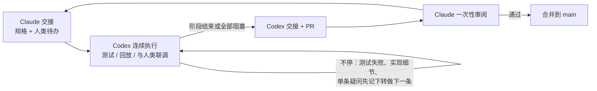

# Claude-advice：审阅、交接与合并规则

本目录存放 Claude 的审阅和执行规格，也存放 Codex 与 Claude 之间的交接文档。本页是三方协作的唯一规则：谁做什么、什么时候停下来找对方、交接文档怎么写、代码怎么进 `main`。各项目的 `AGENTS.md` 只补充本项目的硬保护和执行范围，不重复本页内容。

**协作方式（2026-11-26 用户确认）：Codex 连续执行，只在阶段结束时停下来，一次性把问题交给 Claude；Claude 一次答完，并负责审阅和合并。** 人类只负责必须由人完成的事：机器人上电、摆放物品、在 4242 点击开始、静止目视检查。人类不参与 PR。每一方结束时都写一份交接文档，第一节固定写"需要人类做什么"。

**当前（2026-11-26）**：V57（`de4f6b0beaea`，H-32）已部署；V56（H-33）真机一次通过；V57 正式批次跑至第 6 次触发 H-34 3/3 阈值暂停。最新交接：[Codex → Claude 2026-11-26](HARNESS/handoff/20261126-02-codex.md)。尚无真机放置成功。



## 目录与命名

| 路径 | 内容 | 谁写 |
|---|---|---|
| `<项目>/review*.md` | 审阅结论与逐条执行规格。体量大时按轮次分文件，从 `review.md` 或本页链接 | Claude |
| `<项目>/handoff/YYYYMMDD-NN-codex.md` | Codex 阶段交接 | Codex |
| `<项目>/handoff/YYYYMMDD-NN-claude.md` | Claude 回复交接 | Claude |
| `<项目>/evidence/<日期>-<条目>/` | 验收证据、真机原始记录 | Codex |

- `NN` 是当天两方共用的递增序号，从 01 开始，用来排出先后。
- 2026-11-26 之前的交接文件（如 `HARNESS/handoff-round4-to-claude.md`）保留原名，不迁移。
- 每份交接的头部链接它所回复的上一份交接。本页"当前"一行指向最新一份。

## 一、Codex：什么时候停，什么时候不停

**默认不停。** 按 Claude 最新交接里的指令依次做：写代码、跑测试和回放、冻结候选、部署，以及在规格允许时与人类一起做真机试验。

**只在以下情况停下来写交接：**

1. 当前交接里的条目全部做完（包括规格要求的真机验收），或者剩下的条目全部被阻塞；
2. 一批真机试验结束，即达到规格写的通过条件、停止条件或止损规则；
3. 需要放宽任何硬保护、阈值或验收口径，或者改动必须超出条目范围；
4. 规格写明"停下报告"的情况出现了，并且没有其他未被阻塞的条目可做。

**以下情况不停：**

| 情况 | 怎么处理 |
|---|---|
| 测试或回放失败 | 修。修不好就写进交接，转做下一条 |
| 规格范围内的实现细节 | 自己定，在交接里写一句理由 |
| 只影响某一条的疑问或规格与代码不符 | 把该条标 `[!]`，记进"待 Claude"清单，转做下一个不受影响的条目 |
| 真机联调 | 直接和人类配合，按 Claude 给的通过条件判定。Codex 不发开始指令 |

**问题汇总：** 一个阶段最多交接一次，所有问题一次列全。真机出现安全事件时立即停下并告诉现场的人；这件事放进下一次交接，不另开一轮。

**只是在等人类时：** 如果没有需要 Claude 裁定的问题，只是在等人类操作（例如等上电），交接第 2 节写"无"，人类照第 1 节做就行，不需要转给 Claude。

## 二、Claude：怎么回复

1. 一次答完 Codex 交接里的全部问题。每个裁定都写明依据（`文件:行号` 或证据路径），不把问题退回给 Codex 再问一轮。
2. 只有超出项目规则范围的事才交给人类决定，例如更改项目目标、采购硬件、规则以外的安全授权。这类事写在"需要人类做什么"一节里，其他问题不问人类。
3. 每次回复都写一份 Claude 交接。较长的审阅另写 `review*.md`，交接只放结论、人类待办和 Codex 指令。
4. 审阅 Codex 的 PR，通过就合并（见第四节）。不通过就在交接里写清要改什么。
5. 不改运行时代码，只写审阅、交接和协作规则。

## 三、交接模板

两份模板的第一节固定是"需要人类做什么"，没有就写"无"。只写必须由人完成的事，每件都写清楚什么时候做、做完的标志是什么。

### Codex 交接

```markdown
# Codex 交接：<阶段名>（YYYY-MM-DD）

- 回复：<上一份 Claude 交接的链接>
- 分支／PR：<分支>，PR #<n>；最新提交 <sha>
- 停下原因：<条目全部完成 | 真机批次结束 | 需要放宽 | 剩余条目全部阻塞>

<2–3 段导读：做了什么，结果如何，现在卡在哪里。>

## 1. 需要人类做什么
| 顺序 | 做什么 | 什么时候 | 做完的标志 |
|---:|---|---|---|

## 2. 需要 Claude 裁定什么
<没有就写"无，请审阅并合并 PR #n"。>
### 问题 1：<一句话>
- 依据：<文件:行号、证据路径>
- 可选做法：A …；B …
- Codex 建议：<A 或 B，理由>
- 阻塞了什么：<条目或真机步骤>

## 3. 本阶段完成情况
| 条目 | 状态 | 提交 | 证据 | 关键结果 |
|---|---|---|---|---|

## 4. 等 Claude 回复期间 Codex 继续做什么
<不受上述问题影响的工作；没有就写"无"。>
```

### Claude 交接

```markdown
# Claude 交接：<主题>（YYYY-MM-DD）

- 回复：<Codex 交接的链接>；审阅：<review 链接，可无>
- 合并：PR #<n> 已合并（<sha>）| 未合并，原因 …

<2–3 段导读：结论是什么，对下一步有什么影响。>

## 1. 需要人类做什么
| 顺序 | 做什么 | 什么时候 | 做完的标志 |
|---:|---|---|---|

## 2. Codex 怎么做
<可整段复制的指令：先做什么、再做什么，每步的通过条件和停止条件、不要碰的东西、下一次在哪里停下交接。>

## 3. 对 Codex 问题的裁定
| 问题 | 裁定 | 依据 |
|---|---|---|
```

## 四、Git 与 PR

| 角色 | 可以做 | 不可以做 |
|---|---|---|
| Codex | 在任意非 `main` 分支上新建、提交、推送；每做完一个条目或一次大改动就提交并推送；阶段结束时向 `main` 开 PR，PR 描述里链接 Codex 交接；PR 打开后可以在同一分支追加提交 | 推送 `main`；合并任何 PR；关闭 PR；对已经开了 PR 的分支 force push；删除分支 |
| Claude | 审阅 PR，通过后用 **merge commit** 合并，不用 squash，这样执行记录里的提交号在 `main` 上仍然有效；关闭已被替代或已并入的 PR；把自己的文档放在 `claude/<主题>` 分支，开 PR 后自行合并 | 修改运行时代码（`src/`、`scripts/`、`configs/`、`tests/` 等），这类问题写进交接，由 Codex 改 |
| 人类 | 不参与 PR | — |

- **`main` 的含义是"已通过 Claude 审阅"。** 部署状态只看各项目的发布登记（如 `HARNESS/releases/registry.json`）。合并不等于部署，部署也不等于合并：候选版本可以先从分支部署做真机验收，代码在审阅通过后合并。
- 下一阶段开始时，Codex 从最新的 `main` 新开分支，或者把 `main` 合并进当前分支。已推送的提交不 rebase。
- 合并时遇到冲突：文档冲突由 Claude 解决；代码冲突退回 Codex 处理。
- 本规则是用户对提交、推送和合并的常设授权，只适用于上面列出的角色和范围。

## 五、状态标记

| 标记 | 含义 | 谁来改 |
|---|---|---|
| `[ ]` | 待执行 | Claude 写入 |
| `[~]` | 进行中（附分支名） | Codex |
| `[!]` | 待 Claude 裁定：Codex 记进"待 Claude"清单，转做其他条目，阶段结束时一并交接 | Codex 或 Claude 标记；Claude 裁定后改回 `[ ]` |
| `[H]` | 待人类操作或决定，写进交接的第一节 | 任意一方 |
| `[x]` | 已完成（附提交号与验收结果） | Codex |
| `[-]` | 不执行或已被替代（附原因） | Codex 或 Claude |

## 六、执行与回写

1. 开工前先看当前代码与审阅基线的差异：`git log <基线>..HEAD -- <项目目录>`。行号对不上时，按引用的代码片段定位；片段已经不存在，就把该条标 `[!]`。
2. 按优先级执行。每个条目单独提交，提交信息以条目编号开头，例如 `H-01: …`。
3. 完成后在对应的 `review*.md` 里把条目改为 `[x]`，并在条目末尾追加：

```text
> 执行记录：YYYY-MM-DD，提交 <sha>，分支 <branch>；验收：<测试命令与结果>；偏差：<无或说明>
```

4. 回写只改状态和执行记录，不改写审阅结论，不删除历史条目。
5. 本目录的规格不能替代项目自身的规则。项目 `AGENTS.md` 里的硬保护、发布验收和授权规则始终优先。

## 审阅历史（HARNESS）

| 轮次 | 文档 | 结论 |
|---|---|---|
| 1 | [roadmap](HARNESS/review-roadmap.md) · [architecture](HARNESS/review-architecture.md) · [acceptance](HARNESS/review-acceptance.md) · [review](HARNESS/review.md) · [handoff](HARNESS/review-handoff.md) | 先去掉相机、观测和复核上的过度拦截，再做横躺抓取、运输终点和闭环对准 |
| 2 | [review-v53](HARNESS/review-v53.md) · [handoff](HARNESS/review-v53-handoff.md) | 软件第一批已完成，真机停在取帧；新增 H-20 至 H-25 |
| 3 | [review-v53-round3](HARNESS/review-v53-round3.md) | 头部重复时间戳在软件侧处理；本轮改用固定程序；新增 H-26 至 H-30 |
| 4 | [review-round4](HARNESS/review-round4.md) · [reply](HARNESS/review-round4-reply.md) | V54 前 3 次真机试验停在 S4、S0、S5；按 H-35 → H-33 → H-32 推进 |
