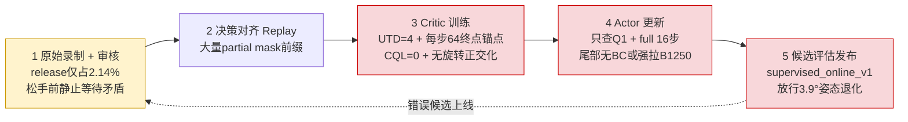

# F1 积木任务（DAgger 数据管线与 RLT 在线学习）审阅与改进执行规格

- 审阅基线：`36314a8`（2026-11-24 17:42，北京时间），对应 V41/V47 `decision_prefix_relative_eef10_v1` 决策对齐分支；本文所有行号以该提交为准。
- 分工：只做只读审阅、不改业务代码；Codex 按第二部分逐条执行。分工原则与执行、回写约定见 [Claude-advice 说明](../../README.md)，本任务专属规则见 [tasks/F1_ComplexyToys/AGENTS.md](../../../tasks/F1_ComplexyToys/AGENTS.md#claude_advice-审阅建议的执行)。
- 状态：带 `[!]` 的条目须先由用户确认，汇总见第一部分末尾的[待人工确认决策表](#待人工确认决策表)。
- 配套审阅：F1 控制运行时、RTC 预取与人工边界恢复见 [DAgger 运行时审阅](../../DAgger/review.md)。

**结论：当前 RLT 上线 1280+ critic / 256+ Q 更新仍未超过 BC400、且在开发验证集上出现 3.6°–3.9° 的系统性姿态偏转，根本原因不是“数据量不够”或“训练步数不够”，而是 Actor-Critic 目标函数、动作表示和发布门禁上存在 4 个明确的结构性错配。** 具体是：(1) Critic 训练用 `min(Q1, Q2)`、Actor 更新却硬编码只取单头 `Q1` 且在无 CQL 约束的 full 16 步空间求梯度；(2) Critic 默认关闭旋转正交化，物理等价 6D 向量评分漂移；(3) Actor BC 默认只监督已执行前缀，留出 34.3% 无约束尾部 Q 梯度，而全参考正则又把自主段强拉回本就停滞的冻结 B1250；(4) `supervised_online_v1` 把姿态退化和误松全降级成只打印不拦截的诊断项，导致退化候选直接推上真机。

**DAgger 数据管线结论（HG-DAgger 视角）：** 本仓库的 `build_training_index.py` 和 `prepare_v1_dagger.py` **已经严格隔离了 `hil_latched` 人工段与 `action_time_mask` 截断，并没有犯“把 `policy-on` 错误动作混进 SFT 正样本”的低级错误**。真正影响 DAgger SFT 与 RLT 释放能力的，是**松爪转折仅占 2.14%（单次跳变导致 `release` 阶段零时长）** 以及 **专家松手前 0.42–2.68 秒静止等待造成的矛盾倒计时标签**。

**最快的收敛顺序：** 先不动真机，离线依次修掉 4 个 P0 算法/门禁缺陷——Actor 改双 Q 最小值并默认开启 Critic 旋转正交化（R-01）、拆分人工专家与冻结参考的 BC 权重并消除尾部真空（R-02）、在 full `plan_mask` 空间开启 CQL 保守正则与 Critic 预热（R-03）、给在线发布恢复姿态与误松安全底线（R-04）；用 256 步受控离线对照确认“倾斜 10° 探针 Q 下降 + 姿态 MAE < 1.5°”后再切上线。之后再处理小数据 UTD/终点过拟合（R-05）、释放稀疏与静止等待清洗（R-06）、后台健康告警（R-07）与 schema4 SFT/配置统一（R-08）。

---

# 第一部分：给人看

## RLT 在线学习闭环大白话与当前病灶



### 为什么 Critic 终点校准看着不错（MAE 0.081），Actor 却越训越歪？

从第一性原理看，这是离线/在线混合 Actor-Critic 在小数据上的经典 **OOD 动作利用（Exploitation of Critic Extrapolation Error）**，且被四处代码细节同时放大：

1. **单头查询放大过估计**：`rlt_online.py:158` 算 TD 目标用的是双 Q 最小值 `min(Q1, Q2)`，但 `rlt_online.py:226-227` 更新 Actor 时只取了 `[:, 0]`（只最大化 `Q1`，丢掉 `Q2`），直接放弃了双 Critic 抑制过估计的作用。
2. **训练在 partial mask，查询在 full 16 步，且 CQL=0**：局部人工纠正有大量不足 16 步的 `partial mask` 转移，而 Actor 更新和上线推理都在 `plan_mask`（全 16 步）上查询 Critic。`conservative_q_weight` 默认 `0.0`，Critic 在 full 16 步的 OOD 倾斜动作上毫无下行约束，于是 V40 实测 **95.2% 验证样本把姿态歪 10° 反而获得更高 Q1**。
3. **物理等价 6D 向量未规范化**：`critic_rotation_projection` 默认为 `None`，把 `rotation6D` 两行同时乘 0.5（物理旋转完全不变）就能让 Q1 跳变 `-0.118`，Actor 很容易通过扭曲 6D 数值尺度骗取虚假高 Q。
4. **BC 约束与 Q 梯度的双重错配**：默认 `actor_bc_coverage='executed_prefix_v1'` 导致 34.3% 的姿态 Q 梯度落在 BC 梯度为 0 的尾部；而一旦切到全参考正则，又在自主段用 `bc_weight=5.0` 把 Actor 死命拉回本就闭爪停滞的冻结 B1250（实测 Q 与 BC 梯度范数比 0.84、余弦 `-0.783`，剧烈拔河）。

## 核心问题汇总

| 严重度 | 问题 | 实测表现与代码位置 |
|---|---|---|
| S0 | Actor 更新只取 `Q1`（`[:, 0]`）而非 `min(Q1, Q2)`，且 Critic 旋转正交化默认关闭 | 验证集 100% 样本 Q1 偏好偏转姿态；6D 缩放 0.5 致 Q1 跳变 -0.118（`rlt_online.py:133,226-227`、`rlt_stage2.py:108`） |
| S0 | Actor BC 尾部真空（`executed_prefix_v1`）且人工专家与冻结参考共用同一高权重 `bc_weight=5.0` | 34.3% 姿态 Q 梯度落在无 BC 约束尾部；Q 与 BC 梯度余弦 `-0.783`（`rlt_online.py:34-51,220-222`、`rlt_stage2.py:76-94`） |
| S0 | `conservative_q_weight` 默认为 0，且现有 CQL 分支只作用在 partial `mask` 上，未覆盖 Actor 查询的 full `plan_mask` | 沿相对轴倾斜 -10°，95.2% 验证样本 Q1/minQ 双双上升（`rlt_online.py:168-184`） |
| S0 | `supervised_online_v1` 放行姿态严重退化和误松的候选模型 | 姿态误差从 0.74° 恶化到 3.94° 仍可通过 `passed=True` 发布上真机（`rlt_evaluation.py:113-131`） |
| S1 | 小数据高 UTD（`updates_per_transition=4`）+ 每步额外 64 条重复终点锚点（`terminal_anchor_weight=1.0`） | 11 个训练终点（8 成功 1 失败 + 2 历史失败）每步重复采样 6 倍，过拟合终点却排序失效（`rlt_async_workers.py:418-422,444`、`rlt_online.py:186-194`） |
| S1 | DAgger/RLT 释放转折仅占 2.14%，且松手前 0.42–2.68s 静止等待造成矛盾松手倒计时 | `sample_phase/release=0`；小 Actor 漏开率 53/54，释放召回仅 52.6%（`prepare_v1_dagger.py:51-55`、`rlt_training_batch.py:10-36`） |
| S1 | 后台 Env/Rollout 协程无独立健康心跳，异常或拒收时 `actor.json` 仍像正常等待 | 无法区分等待新数据、额度耗尽、缓存拒收和协程静默死亡（`rlt_async_workers.py:58-163,446-457`） |
| S2 | 在线配置文件停留在 1029 旧版，拆左夹爪 schema4 通用 SFT 导出器未打通 | 离线试验参数与线上配置文件漂移；schema4 新录制无法直接走通用 SFT（`configs/rlt_online_q_20261029.json`、`prepare_hil_correction.py:63-64`） |

## 改进方向与执行优先级

| 优先级 | 条目 | 一句话 |
|---|---|---|
| P0 | R-01 | Actor 更新改用双 Q 最小值 `min(Q1, Q2)`，且 `decision` 合同下默认开启 `serving_gram_schmidt_v1` |
| P0 | R-02 | 拆分 `bc_human_weight` 与 `bc_ref_weight`，覆盖完整 16 步同时避免失败的冻结 B1250 压制人工纠偏 |
| P0 | R-03 | 在 `plan_mask` 动作空间扩展 CQL 保守正则，配合 Critic 预热与 Q 渐增，先跑 256 步离线对照验证倾斜探针 |
| P0 | R-04 | 给 `supervised_online_v1` 补回姿态 MAE、误松率与 Critic 倾斜探针底线，拦截退化候选发布 |
| P1 | R-05 `[!]` | 降低小数据阶段 `updates_per_transition` 与 `terminal_anchor_weight` / 终点批大小，缓解过拟合 |
| P1 | R-06 `[!]` | 按窗口内是否含夹爪跳变做显式分层采样，并支持审核清单标记/跳过松手前超长静止等待起点 |
| P1 | R-07 | 为 Env/Rollout/Actor 分别输出健康心跳与拒收摘要，接入 `rlt_pipeline_status.py` |
| P2 | R-08 `[!]` | 整理与 V41/V47 对齐的权威在线配置模板，并按需补齐通用 schema4 SFT 导出 |
| — | R-09 | 明确不改的硬约束清单（防止误改） |

## 待人工确认决策表

| 编号 | 问题 | 选项 | 推荐 |
|---|---|---|---|
| R-05 | 小数据阶段（< 2000 转移）的更新配比：`updates_per_transition` 和 `terminal_anchor_weight` 调整幅度 | 维持 4 / 1.0；改为 2 / 0.25；改为 1 / 0.25 | 改为 `updates_per_transition=2`、`terminal_batch_size=16`、`terminal_anchor_weight=0.25`，先在 256 步离线对照验证 |
| R-06 | 释放稀疏与松手前静止等待的处理方式 | 仅加夹爪跳变分层采样桶 / 分层采样 + 审核跳过 >0.5s 静止等待起点 | 两者配合：先在 `rlt_training_batch.py` 加夹爪跳变桶（如占 expert 批的 20%），静止等待起点裁剪仅作为显式审核选项、绝不自动删帧 |
| R-08 | 拆左夹爪（schema4）通用 SFT 导出器是否本轮启动？ | 本轮顺带补齐 / 继续暂缓，先集中把 RLT 局部 Q 跑出正收益 | 暂缓，优先完成 R-01 ~ R-04 让局部 RLT 真正超越 BC400 |

---

# 第二部分：给 Codex 的执行规格

## 0. 通用约束（每条都适用）

**执行规则不在这里重复。** 通用状态标记、执行顺序和回写格式见 [Claude-advice 说明](../../README.md#codex-执行与回写约定)；本任务的实验合同、W&B 规范和单臂/动作表示边界见 [tasks/F1_ComplexyToys/AGENTS.md](../../../tasks/F1_ComplexyToys/AGENTS.md)。

**硬保护在代码中的位置**（只供定位，清单以 `tasks/F1_ComplexyToys/AGENTS.md` 为准）：

| 硬保护 | 代码位置 |
|---|---|
| 训练/验证按 episode 与 source_group 严隔离 | `rlt.py:44-54`、`rlt_stage2.py:129-137`、`rlt_async_workers.py:332-346,461-462` |
| 原始数据只读与决策前缀因果重建 | `rlt_decision_replay.py:25-178`、`DataPrehandle/build_training_index.py:102-129,243-348` |
| 专家动作审核独立于结果（`expert_approved`） | `rlt_supervision.py:5-30`、`prepare_hil_correction.py:39-48` |
| 源码/特征/统计/动作表示身份强绑定 | `rlt_online.py:114-135`、`rlt_async_workers.py:212-249,293-317` |
| 撤回已训练目标必须阻断续训并回溯重训 | `rlt_async_workers.py:320-331,387-389` |

**验收环境**：本地/H20 均须绑定固定 RLinf core 源码路径，禁止混用不同版本 RLinf 源码；任何训练或对照实验必须接入 W&B 并记录真实 group/job_type，未通过对照前 `publish_updates=false`。

```bash
cd tasks/F1_ComplexyToys
PYTHONPATH=src:<PINNED_RLINF_CORE_ROOT> python -m pytest tests/test_rlt*.py -q
```

---

## R-01 `[ ]` P0：Actor 更新改用双 Q 最小值，并在 `decision` 合同下默认开启 Critic 物理旋转正交化

**位置**：`tasks/F1_ComplexyToys/src/f1_toys/rlt_online.py:133-138,225-227`、`tasks/F1_ComplexyToys/src/f1_toys/rlt_stage2.py:108`。

**当前行为**：

```python
        # tasks/F1_ComplexyToys/src/f1_toys/rlt_online.py:133-138
        projection = cfg.get('critic_rotation_projection')
        if projection and representation not in (REFERENCE, DECISION):
            raise ValueError('Rotation projection requires the controller-input contract')
        self.critic = TemporalCritic(fresh.q_head, cfg['model']['chunk_len'],
            condition_on_elapsed=representation == SUBMITTED,
            rotation_projection=projection).to(self.device)
```

```python
        # tasks/F1_ComplexyToys/src/f1_toys/rlt_online.py:225-227
        plan_mask = planned_mask(obs, mask)
        q = self.critic(self.model._critic_state(obs), pi, plan_mask,
                        plan_mask.sum(-1).to(elapsed))[:, 0].mean()
```

```python
        # tasks/F1_ComplexyToys/src/f1_toys/rlt_stage2.py:108
        q = model.sac_q_forward(obs, action)[:, 0].mean()
```

**目标行为**：
1. Actor 目标中的 Q 估计改为双 Q 最小值 `q_all.min(dim=-1).values.mean()`（同时在 `metrics` 中记录 `actor_q1_mean`、`actor_q2_mean` 和 `actor_q_disagreement` 便于监控双头分歧）；
2. 当 `action_representation` 为 `DECISION` 或 `REFERENCE` 且配置未显式指定 `critic_rotation_projection` 时，默认使用 `'serving_gram_schmidt_v1'`（保留显式传 `None` 做消融的能力，并把实际生效值写入 `identity` 确保不混用旧 checkpoint）。

**具体改法**：
1. 在 `rlt_online.py:226-227` 将 `[:, 0].mean()` 改为：
   ```python
   q_pair = self.critic(self.model._critic_state(obs), pi, plan_mask,
                        plan_mask.sum(-1).to(elapsed))
   q = q_pair.min(dim=-1).values.mean()
   ```
   并在 `metrics` 追加 `actor_q_twin_gap=(q_pair[:, 0] - q_pair[:, 1]).abs().mean().item()`；
2. 在 `rlt_stage2.py:108` 同步改为 `q = model.sac_q_forward(obs, action).min(dim=-1).values.mean()`；
3. 在 `rlt_online.py:133` 改为：
   ```python
   default_proj = 'serving_gram_schmidt_v1' if representation in (REFERENCE, DECISION) else None
   projection = cfg.get('critic_rotation_projection', default_proj)
   ```
   并同步确认 `rlt_async_workers.py:229` 的 `recipe_sha256` 能区分该字段（将解析后的 `projection` 写回 `self.cfg` 或 `recipe`）。

**硬保护（不得改动）**：
- `TemporalCritic.forward` 中对退化 rotation6D（范数 `< 1e-6`）的报错校验（`rlt_online.py:92-93`）不得移除；
- 绝不修改已保存的历史 checkpoint 文件，开启正交化后必须从全新 Critic 初始化启动新分支。

**验收与测试**：
- 单测验证：把输入 `rotation6D` 两行同乘 `0.5`，`TemporalCritic` 输出差为 `0`（`< 1e-6`）；构造 `Q1 >> Q2` 的测试 Critic，验证 Actor 梯度来自 `min(Q1, Q2)` 而非仅 `Q1`。
- 运行 `pytest tests/test_rlt_online.py tests/test_rlt_stage2.py -q`。

**风险与回滚**：
- 风险：旧配置若从旧 Critic 恢复会因 `recipe_sha256` 变化被拒绝（这是预期保护，防止混用不同旋转表示的 Critic）。
- 回滚：回退本条提交即可。

---

## R-02 `[ ]` P0：拆分人工专家与冻结参考的 BC 权重，消除尾部真空且不再强拉回失败的 B1250

**位置**：`tasks/F1_ComplexyToys/src/f1_toys/rlt_online.py:34-51,219-223`、`tasks/F1_ComplexyToys/src/f1_toys/rlt_stage2.py:76-94`。

**当前行为**：

```python
# tasks/F1_ComplexyToys/src/f1_toys/rlt_online.py:34-51
def actor_bc_loss(pi, labels, mask, mode='executed_prefix_v1'):
    error = (pi.reshape_as(labels)-labels).square().mean(-1)
    prefix = (error*mask).sum()/mask.sum()
    tail = (error*~mask).sum()/(~mask).sum().clamp_min(1)
    if mode == 'executed_prefix_v1':
        loss = prefix
    elif mode == 'full_reference_v2':
        loss = error.mean()
    elif mode == 'prefix_plus_reference_tail_v2':
        loss = prefix+tail
```

```python
# tasks/F1_ComplexyToys/src/f1_toys/rlt_online.py:220-222
labels, human = bc_targets(self.model, obs, actions, expert_mask(data))
bc, prefix_bc, tail_bc = actor_bc_loss(pi, labels, mask,
    self.cfg.get('actor_bc_coverage', 'executed_prefix_v1'))
```

双重问题：
1. 默认 `executed_prefix_v1` 让 `~mask` 尾部 BC 梯度完全为 0，Q 梯度在尾部无任何锚定；
2. 即使切到 `full_reference_v2` / `prefix_plus_reference_tail_v2`，`bc_targets` 对所有 `human == False` 的步（包括自主探索/自主执行段）都填入冻结 B1250 参考动作，并且乘以和人工专家一样的高权重 `bc_weight = 5.0`，导致 Actor 在自主段被死命拉回本就闭爪停滞的 B1250。

**目标行为**：
- 新增 `actor_bc_coverage='split_human_and_ref_v3'`，把 16 步动作块清晰分成三部分：
  1. **已审核人工专家步**（`human & mask`）：用高权重 `bc_human_weight`（默认 `5.0`）精确拟合人工纠偏动作；
  2. **非人工已执行前缀**（`~human & mask`）：用轻权重 `bc_ref_prefix_weight`（默认 `0.5`）做弱锚定，允许 Q 在自主段探索并超越冻结 B1250；
  3. **未执行尾部**（`~mask`）：用适中权重 `bc_ref_tail_weight`（默认 `1.0`）锚定冻结参考动作，彻底封死尾部 OOD Q 梯度真空。
- 保留旧 `executed_prefix_v1` / `full_reference_v2` / `prefix_plus_reference_tail_v2` 兼容分支用于消融对比，但将 `DECISION` 合同下的默认模式切到 `split_human_and_ref_v3`；
- 在 `metrics` 中分别记录 `bc_human_loss`、`bc_ref_prefix_loss`、`bc_ref_tail_loss`。

**具体改法**：
1. 在 `rlt_online.py` 新增辅助函数 `split_actor_bc_loss(pi, labels, mask, human, *, human_weight, ref_prefix_weight, ref_tail_weight)`：
   ```python
   error = (pi.reshape_as(labels) - labels).square().mean(-1)
   h_mask = human & mask
   rp_mask = (~human) & mask
   rt_mask = ~mask
   h_loss = (error * h_mask).sum() / h_mask.sum().clamp_min(1)
   rp_loss = (error * rp_mask).sum() / rp_mask.sum().clamp_min(1)
   rt_loss = (error * rt_mask).sum() / rt_mask.sum().clamp_min(1)
   weighted = (human_weight * h_loss * h_mask.any().float()
               + ref_prefix_weight * rp_loss * rp_mask.any().float()
               + ref_tail_weight * rt_loss * rt_mask.any().float())
   ```
2. 在 `LocalLearner.update`（`:220-237`）中，当 `mode == 'split_human_and_ref_v3'` 时直接使用 `weighted`（不再重复乘 `bc_weight`），并将三项子损失写入 `metrics`；
3. 若某批次内 `h_mask` 全空，确保 `h_loss` 不引入 `NaN` 且不误乘权重。

**硬保护（不得改动）**：
- `expert_mask(data)` 仍只认可经人工审核批准的真实人工步骤（`rlt_supervision.py:5-11`），绝不把 `policy-on` 动作放进 `human` 掩码；
- 参考尾部只作为 Actor 正则项，绝不伪造 Critic 的执行前缀、下一状态或奖励。

**验收与测试**：
- 单测验证：在含 partial mask 的混合 batch 上，检查 (a) `~mask` 尾部对 Actor 存在非零 BC 梯度，(b) 纯自主样本（`human=False`）的参考梯度按 `ref_prefix_weight=0.5` 缩放而不被 `5.0` 淹没，(c) 纯人工样本的人工前缀梯度保持与原先同量级。

**风险与回滚**：
- 风险：`ref_prefix_weight=0.5` 降低自主段对 B1250 的锚定后，必须与 R-03（CQL + Critic 预热）配合使用，防止弱约束下被不可靠 Q 拉偏。
- 回滚：配置将 `actor_bc_coverage` 切回 `prefix_plus_reference_tail_v2` 即可。

---

## R-03 `[ ]` P0：在 Full `plan_mask` 动作空间扩展 CQL 保守正则并接入 Critic 预热

**位置**：`tasks/F1_ComplexyToys/src/f1_toys/rlt_online.py:168-185,225-237`。

**当前行为**：

```python
        # tasks/F1_ComplexyToys/src/f1_toys/rlt_online.py:168-184
        conservative_weight = float(self.cfg.get('conservative_q_weight', 0.))
        ...
        if conservative_weight:
            with torch.no_grad():
                actor_actions = self.model.sac_forward(obs, deterministic=True)[0].reshape_as(actions)
                teacher = self.model._get_ref_chunk(obs).reshape_as(actions)
                generator = torch.Generator(device=actions.device).manual_seed(int(self.cfg['seed'])+104729*self.step+31)
                perturbed = actions + .05*torch.randn(actions.shape, device=actions.device,
                                                     dtype=actions.dtype, generator=generator)
                proposals = [with_prefix(x, obs) for x in (actor_actions, teacher, perturbed)]
            qs = torch.stack([self.critic(self.model._critic_state(obs), a, mask, elapsed,
                              data.get('execution_fraction')) for a in proposals], dim=0)
            conservative_loss = (torch.logsumexp(qs, dim=0)-torch.log(qs.new_tensor(len(proposals)))-predicted).mean()
            q_loss = q_loss + conservative_weight*conservative_loss
```

问题：
1. 线上配置默认 `conservative_q_weight = 0.0`、`critic_warmup_steps = 0`；
2. 即使开启 `conservative_q_weight`，`:181-182` 也只在历史 partial `mask` 上对 counterfactual 求 `logsumexp`，而 Actor 在 `:225-226` 查询的是 **full `plan_mask`**，导致 Critic 在 full `plan_mask` 上对 OOD 扰动（尤其是姿态倾斜 5°–15°）完全没有压制。

**目标行为**：
1. 在 `conservative_q_weight > 0` 时，除在当前 `mask` 上对 `[actor_actions, teacher, perturbed]` 施加 CQL 外，增加一个面向 `plan_mask` 的 OOD 姿态/动作保守项：
   - 构造 `full_actor = with_prefix(actor_actions, obs)` 与 `full_perturbed`（含平移高斯扰动 + 相对旋转 5°–15° 随机小扰动，经 `with_prefix` 保留已承诺前缀）；
   - 用 `plan_mask` 评估 `q_full_ood`，惩罚 `relu(q_full_ood - q_data_anchor)` 或纳入同一 CQL `logsumexp` 对比（基准取同观测下 `predicted.detach()` 与 `teacher` 的保守值，绝不伪造成功/失败标签）；
2. 在 V41+ 推荐训练配方中默认启用：`conservative_q_weight = 0.1`、`critic_warmup_steps = 128`、`q_ramp_steps = 128`（先固定 Actor 预热 Critic 128 步，再在接下来 128 步线性拉起 `q_weight`）。

**具体改法**：
1. 在 `rlt_online.py:174-184` 新增 `plan_mask = planned_mask(obs, mask)` 与 `plan_elapsed = plan_mask.sum(-1).to(elapsed)`；
2. 为 `perturbed` 增加 3D 轴角随机小旋转扰动（作用在 `actions[..., 3:9]`，幅度 0.1–0.25 rad ≈ 6°–14°），并在 `plan_mask` 上评估 `actor_actions` 和 `perturbed_rot`；
3. 将 `plan_mask` 上的 OOD 保守惩罚 `full_cql = (torch.logsumexp(qs_full, dim=0) - torch.log(qs_full.new_tensor(len(full_proposals))) - predicted).mean()` 与原 `conservative_loss` 平均后乘以 `conservative_weight` 加入 `q_loss`，并在 `metrics` 记录 `critic_full_cql_loss`；
4. 跑一组 **256 步受控离线对照**（复用 V40 固定开发集，BC400 + 新 Critic，W&B 独立 group），核查 V40 倾斜探针（沿轴 0 转 -10°、轴 2 转 +10°）的 `min(Q1, Q2)` 是否从“95.2% 上升”转为“下降”，且验证集姿态 MAE `< 1.5°`。

**硬保护（不得改动）**：
- 严禁给 counterfactual 动作发明任何虚假的 reward 或 terminal 标签；
- 必须先完成 256 步离线对照并核实倾斜探针通过，才允许在在线配置开启 `enable_q_guidance=true`。

**验收与测试**：
- 单测验证 `conservative_q_weight > 0` 时 `critic_full_cql_loss` 有限且能对 `plan_mask` 输入产生有效梯度；
- 在 H20 跑 256 步离线对照脚本（复用 `scripts/audit_rlt_q_direction.py`）输出倾斜探针报告与 W&B 链接。

**风险与回滚**：
- 风险：`conservative_q_weight` 过大可能压扁正常高价值动作的 Q 区分度，导致 `critic_report` 成功终点低于 `0.75`；因此以 `0.1` 起步并在 256 步对照中同时检查 `success_min`、`failure_max` 和倾斜探针。
- 回滚：配置设 `conservative_q_weight: 0.0` 即可退回无 CQL。

---

## R-04 `[ ]` P0：给 `supervised_online_v1` 恢复姿态、误松与 Critic 倾斜底线，拦截退化候选上真机

**位置**：`tasks/F1_ComplexyToys/src/f1_toys/rlt_evaluation.py:113-131`、`tasks/F1_ComplexyToys/src/f1_toys/rlt_async_workers.py:473-493`。

**当前行为**：

```python
# tasks/F1_ComplexyToys/src/f1_toys/rlt_evaluation.py:121-131
    metrics = report['candidate']
    checks = dict(
        finite=bool(metrics['finite']) and all(math.isfinite(v) for v in metrics.values()),
        validation_coverage=metrics['release_steps'] > 0 and metrics['hold_steps'] > 0,
        ik_nonregression=report.get('kinematics', {}).get('passed') is True)
    if 'critic' in report:
        checks['critic_finite'] = report['critic']['checks']['finite']
    report.update(checks=checks, passed=all(checks.values()),
                  promotion_policy='supervised_online_v1',
                  scope='supervised_trial_requires_runtime_guards_not_success_improvement')
    return report
```

当前只要数值有限、验证集非空且 IK 不退化，`passed` 就为 `True`；哪怕候选模型姿态 MAE 暴涨到 3.94°（基线 0.74° 的 5.3 倍）或持物误松率飙升，依然会被自动批准发布到真机。

**目标行为**：
- 保留 `supervised_online_v1`“允许策略偏离演示、不要求死卡 BC MSE 1.05x”的初衷，但补回 3 条明确的**防退化底线**：
  1. `rotation_nonexplosion`：`candidate['rotation_mae_deg'] <= max(baseline['rotation_mae_deg'] * 2.0, 2.0)`（基线 0.74° 时上限 2.0°，既允许小幅探索，又坚决拦住 3.9° 的系统性歪斜）；
  2. `no_severe_premature_release`：`candidate['premature_release'] <= baseline['premature_release'] + 0.02`（防止持物中途乱松爪）；
  3. `critic_tilt_nonpreference`（仅当 `enable_q_guidance=True` 且报告含 `critic_tilt_probe` 时检查）：将验证集人工动作沿相对轴绕 X/Z 偏转 ±10° 后，Critic 的平均 `min(Q1, Q2)` 不得高于原动作（`mean_delta <= 0.0`），直接把 V40 发现的病灶变成自动化守门员。

**具体改法**：
1. 在 `rlt_critic_calibration.py` 新增轻量的 `critic_tilt_probe(learner, data, angle_deg=10.0)`（在最多 64 个验证样本上做 ±10° 绕轴 0/2 旋转扰动，计算 `min(Q1, Q2)` 平均变化量，纯前向无梯度，CPU 耗时 < 0.2s）；
2. 在 `rlt_async_workers.py:_evaluate`（`:474-481`）当 `enable_q_guidance=True` 时调用 `critic_tilt_probe` 写入 `report['critic_tilt_probe']`；
3. 在 `rlt_evaluation.py:supervised_online_checks`（`:121-130`）加入上述 3 条底线检查，并将结果写入 `report['checks']` 参与 `passed = all(checks.values())`。

**硬保护（不得改动）**：
- `kinematic_screen`（`rlt_evaluation.py:135-169`）与 `promotion_checks`（`:88-99`）保持不变；
- `incumbent` 指针不得回退，未通过检查的快照只留档审计（`deployment_approved=False`），不更新 `latest.json`。

**验收与测试**：
- 单测构造姿态 MAE=3.5° 或误松率=0.10 或倾斜探针 `mean_delta=+0.05` 的候选，验证 `supervised_online_checks` 返回 `passed=False`；正常候选（姿态 MAE=1.1°、误松=0、倾斜探针 `mean_delta=-0.02`）返回 `passed=True`。
- 运行 `pytest tests/test_rlt_critic_calibration.py tests/test_rlt_snapshots.py -q`。

**风险与回滚**：
- 风险：初期 Critic 未充分校准时可能拦住若干轮候选发布，这正是预期效果——宁可继续用稳定的 BC400 / incumbent 采集，也不把歪斜 4° 的模型推上真机。
- 回滚：回退 `rlt_evaluation.py` 中新增的 3 个检查项即可。

---

## R-05 `[!]` P1：降低小数据阶段 `updates_per_transition` 与 `terminal_anchor_weight`

**状态**：`[!]` 待人工确认。

**位置**：`tasks/F1_ComplexyToys/src/f1_toys/rlt_async_workers.py:232,418-422,442-444`、`tasks/F1_ComplexyToys/src/f1_toys/rlt_online.py:186-194`。

**当前行为**：

```python
        # tasks/F1_ComplexyToys/src/f1_toys/rlt_async_workers.py:418-422
        if self.critic_anchors is not None:
            from .rlt_critic_calibration import subset
            terminals=self.critic_anchors['train']
            terminal_batch=subset(terminals,torch.randint(len(terminals['actions']),(batch_size,)))
```

当前配置 `updates_per_transition=4`、`batch_size=64`、`terminal_anchor_weight=1.0`，而实际训练终点只有 11 个（8 成功 1 失败 + 2 历史失败），导致每一步训练都把那 11 个终点重复抽 6 遍并给 1.0 权重，严重挤压中间步 TD 传播与通用动作排序学习。

**需要用户确认的问题**：
- 在局部训练转移数 `< 2000` 阶段，是否将在线配置调整为：`updates_per_transition=2`、`terminal_batch_size=16`（按现有 11 个终点最多覆盖 ~1.5x）、`terminal_anchor_weight=0.25`，并先在 256 步离线对照里与旧配比 A/B 对比？

**硬保护（不得改动）**：
- `rlt_async_workers.py:350-363` 的转移级额度去重账本（`new_credits`）保持不变；验证集转移绝不增加训练额度。

---

## R-06 `[!]` P1：解决释放转折 2.14% 极度稀疏与松手前静止等待矛盾标签

**状态**：`[!]` 待人工确认。

**位置**：`tasks/F1_ComplexyToys/scripts/prepare_v1_dagger.py:40-69`、`tasks/F1_ComplexyToys/src/f1_toys/rlt_training_batch.py:10-36`。

**当前行为**：
1. `prepare_v1_dagger.py:51-55` 用指令跳变点标 `release`，因手柄 100→0 为瞬时跳变导致 `release` 阶段长度为 0，`sample_phase/release=0`；
2. `rlt_training_batch.py:25-34` 在 `expert` 池内完全均匀抽样，导致包含松爪转折的窗口在训练批中仅占 ~2.14%；
3. `20261023-release-supervision.md` 已核实专家松手前存在 0.42–2.68 秒静止等待，导致相同观测绑定互相矛盾的松爪倒计时。

**需要用户确认的问题**：
1. 是否在 `rlt_training_batch.py` 增加**夹爪跳变分层桶**（按未来 16 步内 `actions[..., 9]` 是否跨越 0 阈值自动识别，不依赖零时长阶段名，建议占 `expert` 批样本的 20%，同时监控 `premature_release` 防止误松反弹）？
2. 对“松手前静止等待 > 0.5s”和“人工刚接管后前 0.2s 反应过渡帧”，是否只在审核工具中自动标注供人工确认排除，绝不在训练代码里静默删帧？

**硬保护（不得改动）**：
- 原始录制和审核原件绝不修改；
- `premature_release` 必须与 `release_recall` 同步监控（防止重现 10 月 23 日诊断中“召回涨到 12/12 但持物误松涨到 12/24”的过拟合）。

---

## R-07 `[ ]` P1：补齐 Env / Rollout / Actor 三端后台健康心跳与缓存拒收摘要

**位置**：`tasks/F1_ComplexyToys/src/f1_toys/rlt_async_workers.py:58-105,123-163,386-400,446-457`、`tasks/F1_ComplexyToys/scripts/rlt_pipeline_status.py`。

**当前行为**：
- 只有 `F1ActorWorker._health` 写 `health_root/actor.json`；`F1EnvWorker.interact` 和 `F1RolloutWorker.generate` 发生未捕获异常或连续缓存拒收时，tmux 进程仍可能存活，外部只能看到 `actor.json` 停留在 `waiting_for_new_transitions`，无法第一时间区分“没新数据 / 额度用完 / 缓存拒收 / 协程挂了”。

**目标行为**：
- `F1EnvWorker` 每轮扫描写 `health_root/env.json`（含 `status`, `updated_unix`, `seen_count`, `last_error`），捕获 `Exception` 时写 `status='failed'` 与异常堆栈摘要后再向上抛出；
- `F1RolloutWorker` 每处理一条或空闲心跳写 `health_root/rollout.json`（含 `status`, `updated_unix`, `last_episode`, `rejected_count`, `last_error`），捕获 `Exception` 时写 `status='failed'` 后再抛出；
- `rlt_pipeline_status.py` 读取三份文件，若任一文件 `updated_unix` 超过 60 秒未更新或 `status == 'failed'`，明确告警并打印最近拒收原因。

**硬保护（不得改动）**：
- 不吞掉任何通信或校验异常（`rlt_async_workers.py:34`“Transport failures must remain visible”保持不变）；
- 写入全部走 `atomic_json`，防止状态文件半写损坏。

**验收与测试**：
- 在 `tests/test_rlt_async_admission.py` 补充用例：模拟 `RolloutWorker` 拒收和 `EnvWorker` 异常，验证 `env.json`/`rollout.json` 状态与 `rlt_pipeline_status.py` 输出准确区分正常等待与失败。

**风险与回滚**：
- 风险：极低，仅增加每轮几百字节的原子 JSON 状态文件写入。
- 回滚：回退本条提交即可。

---

## R-08 `[!]` P2：统一 V41/V47 在线配置模板并按需补齐 schema4 通用 SFT 导出

**状态**：`[!]` 待人工确认。

**位置**：`tasks/F1_ComplexyToys/configs/rlt_online_q_20261029.json`、`tasks/F1_ComplexyToys/scripts/prepare_hil_correction.py:63-64`。

**当前行为**：
- 仓库 `configs/` 下的最新在线配置仍停留在 `rlt_online_q_20261029.json`（旧 `submitted` 合同、旧 `sync_c16_hold_then_execute`、无 `actor_bc_coverage`/`conservative_q_weight`/`critic_rotation_projection`）；
- `TODO.md:160` 标注通用 schema4（拆左夹爪）SFT 导出器尚未打通。

**需要用户确认的问题**：
- 是否在 R-01 ~ R-04 离线对照通过后，固化一份 `configs/rlt_online_decision_v47.json` 作为唯一权威在线配置模板？
- 通用 schema4 SFT 导出器是本轮做还是继续暂缓？

---

## R-09 `—`：明确不改的项（防止 Codex 走偏）

以下规则是本任务算法验证与数据可信度的红线，**任何条目执行期间均不得违背**：

1. **绝不把 `policy-on` 未审核动作当成专家正样本**：`build_training_index.py` 的 `hil_latched` 边界检查与 `rlt_supervision.py` 的 `expert_approved` 审核链不得放宽。
2. **绝不按帧随机划分训练/验证**：必须按整条 `episode` 与 `source_group` 隔离，验证集不得增加训练额度。
3. **绝不拿离线 loss 或终点 MAE 代替真机成功率**：每次对照必须同时报告人工动作 MSE、SO(3) 姿态 MAE、释放召回、持物误松、Critic 倾斜探针和 IK 筛查。
4. **绝不静默替换线上 GPU3 生产权重**：离线对照与新合同分支必须在独立目录、`publish_updates=false` 下跑通并通过评审后，再显式切换。
5. **每次训练含预检/恢复必须接入 W&B**：按 `AGENTS.md` 写明 group / job_type / tags，不创建虚假训练结果。
6. **不改冻结的 B1250 权重、token encoder 权重及历史原始录制**。
