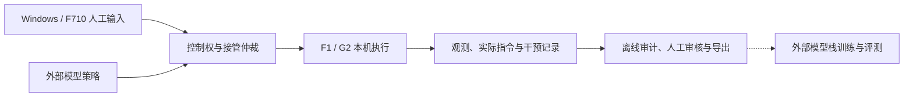

# 目录、依赖与开发

文档整理：2026-10-12。两台机器共用基础组件，各自保留硬件合同、配置和发布边界。

```text
DAgger/
  F1/           F1 配置、f1dagger、脚本、服务和测试
  G2/           G2 配置、g2dagger、脚本和测试
    teleop/     独立 F710 遥操、模型资产和冻结基线
  shared/       dagger_core 与公共测试
  docs/         全部说明；F1/、G2/、G2/teleop/ 分场景
  artifacts/    data/、logs/、results/、releases/、archive/、cache/
```

## 工作流程



策略和人工通过同一运行端交接控制，记录保留来源和事件边界。模型训练/再部署由外部任务完成，当前不是自动训练闭环；能运行或保存一条录制不代表数据已获训练认证。

## 模块边界

- F1：上肢 16D（双臂硬件角度及双夹爪 0–100）、三图 30Hz、F710 示教/策略 HIL、审计与导出。
- G2：34D 动作合同、GDK/策略客户端和机器执行；独立遥操在 `G2/teleop`，不能与 HIL owner 并行抢占输出。
- `shared/src/dagger_core`：输入、协议/ACK、状态机、采集生命周期、chunk 调度、通用 IK 积分、异步写盘和三图渲染。不反向导入 F1/G2，不定义机器人关节/手部映射。
- 工作台只读取低频运行状态、展示启动步骤和已有相机缓存。网页刷新/断开不取得控制权；结束并保存按具体版本的会话身份校验。F1 集成合同见 [工作台说明](F1/HIL_WORKBENCH.md)。

`g2_robot`、DM0.5、F1-infra（工作区 `F1-4242`）、LeRobot、ROS/GDK/XR 等仍是独立依赖，未因此次整理复制进 DAgger。F1 通过 `F1_INFRA_ROOT` 和绑定清单选定工作台版本；G2 按机器配置选择已验证 SDK/客户端，不能用任意同名源码替代。

## 开发与测试

开发机工作目录为 `/home/xza_100850113/projects/DAgger`。复用已验证的数值/机器人客户端环境，从项目根运行：

```bash
python -m pytest
```

根 `pyproject.toml` 收集 F1、G2 和 shared 测试。纯模块可只运行相关测试目录；G2 独立遥操按其 [维护说明](G2/teleop/README.md) 单独检查。依赖缺失应报告环境限制，不改接口或跳过保护来强行通过。离线测试、ARM 数值、真实反馈 shadow 和现场动作分开验收。

F1 本地生成固定版本包：

```bash
python3 F1/scripts/53_package_f1.py --output /tmp/f1-dagger-release.tar.gz
```

发布包仍以 `DAgger/` 为运行根，包含 F1 与固定公共代码，不包含 G2 控制实现。开发树的 `F1/scripts`、`F1/configs` 在 F1 独立包中对应 `scripts`、`configs`；因此机器人历史 release 命令不能机械加上 `F1/`。配置、模型和外部源码哈希必须与验收报告匹配。

## 本次收口与历史

原 `common` 改为 `shared`；平台文档进入 `docs/F1`、`docs/G2`；原独立 G2Teleop 进入 `G2/teleop`，其文档进入 `docs/G2/teleop`。原根 `doc` 的34份文档与平台副本一致，去重保留正文。两份 G2 START/进度合为 docs/G2 的唯一入口。

G2 HIL 与 teleop 的7份历史同名正文仅差状态提示，统一保留在 `docs/G2`；HANDOFF 则合并 teleop 副本独有的 2026-09-08～09-10 补证。迁移前原件在 `artifacts/archive/`，旧来源 JSON 在 `docs/history/`，原哈希和证据内容不改写。准确目录映射见 [本次迁移清单](history/LAYOUT_20261012.json)。

`artifacts/releases/` 保存本地发布候选包和校验资料，未因生成包而部署到机器人。

原 `data/logs/results` 移入 `artifacts`；日志中的旧地址、原机器人路径、历史清单 SHA 保留当时含义。源码开发目录只维护一份，不再靠旧树/软链接提供第二个入口。本次不重启机器人，不搬动其 runtime，也不把旧结论改写成新一轮验收。
