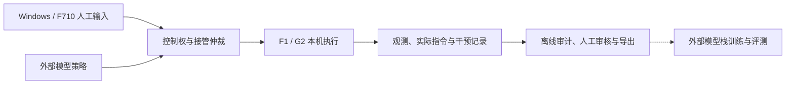

# 目录、依赖与开发

**11月4日V47已正式部署四条豆包短提示。** 云端只在构建时生成WAV，运行时非阻塞本地播放；同类异常去重，恢复取消旧提示。普通RTC／输入抖动和RB确认只显示文字，具体故障原因保留终端。V46控制及评分合同保持，预取预算／人工边界问题尚未修复。

**11月3日现场补证：恢复状态必须与TCP令牌发送一并验收。** V45的自动策略等待状态漏发令牌，V46源码已补；显式评分协议v4将结果与按键计数持久绑定，未评分只拦正常交还和Home，人工接管与异常封存保持。新协议已于11月3日16:59随V46正式激活，Windows配套安装及现场验证待完成；[现场证据与剩余问题](../../tasks/F1_ComplexyToys/inference/experiments/20261103-continuity-validation-V44.md#onsite-v45)。豆包仅在构建端生成[离线语音包](F1/VOICE_PACK.md)，控制运行时不调用云端。Why&How独立维护文案／试听候选状态，不因网页更新改变机器人版本；六种正常音保留，豆包女声需实际生成并经用户试听确认后发布。

F1的ACK活性由有效序号前进判断，旧ACK超时只清理历史。输入200ms失鲜仍撤销动作；同会话自动策略仅在最后有效输入后1秒内、收到新的新鲜性证明后重新观察规划。真实重连、碰撞、人工暂停保持显式恢复。

录制故障停止自动策略和Home，明确标记不可采集；反馈与输出健康时允许真实START＋RB人工退场，原写盘对象仍负责封存已提交前缀。无记录退场sink不生成数据或成功回执。详见[验收与边界](../../tasks/F1_ComplexyToys/inference/experiments/20261103-continuity-validation-V44.md)。

## F1 V45：故障与录制分离

适用范围：2026-11-03控制V45已部署；Windows V45整包已上传待安装，现场验收待完成。历史版本说明保留，勿覆盖新客户端。

**V42已部署RTC真实预算和暂停提示修复，通过ARM 219项与正式真实反馈零输出，现场连续性待验。** V41实录中的三次VLA候选碰撞暂停没有自动取得人工控制权，但错误播放接管音；现在只在真实START受理后提示接管。纯时序重规划携带真实VLA／RLT阶段，动作授权仍由唯一owner管理。

训练记录与RTC计划解耦：只保存真实执行证据，局部成功终态在交VLA／Home前冻结，未执行尾段不当RL动作。F1优先打包、6000D上传、H20准入／后台学习和候选发布已实际运行，最新条曾增加27条转移；用户拒绝该条后，数据与其梯度影响均已撤回到干净1024／256状态。数据准入、软件运行与自主效果分别核对，详见[V42统一复盘](../../tasks/F1_ComplexyToys/inference/experiments/20261103-rlt-rtc-V42.md)。

V41于11月3日部署局部RLT前缀RTC。执行旧承诺前缀时异步计算新后缀，复用原RTC时钟、唯一owner与epoch取消；固定actor版本只在下一次→切换，START／↑／Y操作不变。此前ARM及零输出证据仍见[V41部署边界](../../tasks/F1_ComplexyToys/training/experiments/20261102-rlt-rtc-V41.md#deployment-20261103)，不代表随后现场已实现连续RTC。

V39将首次START授权与首动作前的短暂输入失鲜分开：同会话新鲜challenge通过后重新观测继续，不强迫操作者绕一遍HIL；首个policy发布、真实断连、换会话和人工动作都撤销该例外。录制准备完成不能覆盖等待状态，过期epoch结果不可执行。机器人已部署，ARM及真实反馈零输出通过，现场待验，见[V39整改](../../tasks/F1_ComplexyToys/inference/experiments/20261102-rlt-repair-V39.md)。

V38 Windows显示使用原生Unicode与增量UTF-8解码，SSH日志由启动器打开句柄。单个文件读取失败不阻断诊断状态轮询；Windows与控制端分别编号，实际配套版本以[F1状态](F1/STATUS.md)为准。详见[V38证据与边界](../../tasks/F1_ComplexyToys/inference/experiments/20261102-session-unicode-V38.md)。

11月3日版本显示改进已作为V43部署到局部RLT控制入口，Windows V43包单独发布、待操作者安装。本机启动器、机器人实际控制版本和局部actor分开呈现：启动器版本由打包器显式注入并进入安装检查与会话日志；控制版本来自运行端校验后的`F1 IDENTITY`，显示技术名、V号及清单短身份；每次真实→进入局部段后，低频状态报告实际采用actor、训练step和Q更新次数。未知身份明确显示未知，不拿启动health中的BC400代替实际候选，也不因屏幕显示授予动作权限。rollout／普通HIL沿用各自既有客户端，装配V号不能冒充所有模式实际控制版本；[版本显示验收](../../tasks/F1_ComplexyToys/inference/artifacts/20261103-v42-two-rollouts/version/audit.md)。

V37将手柄转发与终端拆为独立SSH；终端读取先落盘／解析就绪，再通过有界队列显示，诊断线程不等待打印。RLT音频由启动时预开的PCM进程播放，控制线程只提交可取消提示。Windows操作端退出与日志由独立会话层管理：实际Ctrl+C或同run的F1停止状态先停止sender重连，再有界等待并释放本次SSH、恢复控制台；结束请求复用既有session-bound finish邮箱，不启动Home。五类诊断日志独立SSH按哈希／偏移续传、6000D只读镜像，失败不阻塞控制。见[V37实现与验收边界](../../tasks/F1_ComplexyToys/inference/experiments/20261102-session-audio-V37.md)。

两台机器共用基础组件，各自保留硬件合同、配置和发布边界。F1当前将手柄仲裁、数值计算、实际输出和录制分开，只有本机唯一owner具有动作发布权限。

本页说明工程职责；F1具体模型、在线训练与现场验收以任务推理recipe和STATUS为准。2026-10-30已部署人工计算进程隔离，实际运动稳定性仍需现场验证。

11月2日已部署的F1 RTC＋局部RLT V34将局部 RLT 的取样完成与实际轨迹收尾分开：owner 持续刷新同一末点，原平滑／保护及反馈到位共同决定下一周期；人工取消仍优先。学习数据传输独立于控制与完整原件归档，详见[执行与异步数据整改](../../tasks/F1_ComplexyToys/inference/experiments/20261102-framework-repair.md)。本地／ARM各153项、正式真实反馈零输出通过，真实运动待现场验收；训练新动作语义仍为独立诊断分支。

```text
DAgger/
  F1/           F1 配置、f1dagger、脚本、服务和测试
  G2/           G2 配置、g2dagger、脚本和测试
    teleop/     独立 F710 遥操、模型资产和冻结基线
  shared/       dagger_core 与公共测试
  docs/         全部说明；F1/、G2/、G2/teleop/ 分场景
  artifacts/    data/、logs/、results/、releases/、archive/、cache/
```

## 工作流程



策略和人工通过同一运行端交接控制，记录保留来源和事件边界。模型训练/再部署由外部任务完成，F1局部RLT已接入外部异步学习器，G2不因此自动具备该能力；能运行或保存一条录制不代表数据已获训练认证。

## 模块边界

- F1：上肢 16D（双臂硬件角度及双夹爪 0–100）、三图 30Hz、F710 示教/策略 HIL、审计与导出。
- G2：34D 动作合同、GDK/策略客户端和机器执行；独立遥操在 `G2/teleop`，不能与 HIL owner 并行抢占输出。
- `shared/src/dagger_core`：输入、协议/ACK、状态机、采集生命周期、chunk 调度、通用 IK 积分、异步写盘和三图渲染。不反向导入 F1/G2，不定义机器人关节/手部映射。
- 工作台只读取低频运行状态、展示启动步骤和已有相机缓存。网页刷新/断开不取得控制权；结束并保存按具体版本的会话身份校验。F1 集成合同见 [工作台说明](F1/HIL_WORKBENCH.md)。

`g2_robot`、DM0.5、F1-infra（工作区 `F1-4242`）、LeRobot、ROS/GDK/XR 等仍是独立依赖，未因此次整理复制进 DAgger。F1 通过 `F1_INFRA_ROOT` 和绑定清单选定工作台版本；G2 按机器配置选择已验证 SDK/客户端，不能用任意同名源码替代。

## 开发与测试

开发机工作目录为 `/home/user/projects/DAgger`。复用已验证的数值/机器人客户端环境，从项目根运行：

```bash
python -m pytest
```

根 `pyproject.toml` 收集 F1、G2 和 shared 测试。纯模块可只运行相关测试目录；G2 独立遥操按其 [维护说明](G2/teleop/README.md) 单独检查。依赖缺失应报告环境限制，不改接口或跳过保护来强行通过。离线测试、ARM 数值、真实反馈 shadow 和现场动作分开验收。

F1 本地生成固定版本包：

```bash
python3 F1/scripts/53_package_f1.py --output /tmp/f1-dagger-release.tar.gz
```

发布包仍以 `DAgger/` 为运行根，包含 F1 与固定公共代码，不包含 G2 控制实现。开发树的 `F1/scripts`、`F1/configs` 在 F1 独立包中对应 `scripts`、`configs`；因此机器人历史 release 命令不能机械加上 `F1/`。配置、模型和外部源码哈希必须与验收报告匹配。

## 本次收口与历史

原 `common` 改为 `shared`；平台文档进入 `docs/F1`、`docs/G2`；原独立 G2Teleop 进入 `G2/teleop`，其文档进入 `docs/G2/teleop`。原根 `doc` 的34份文档与平台副本一致，去重保留正文。两份 G2 START/进度合为 docs/G2 的唯一入口。

G2 HIL 与 teleop 的7份历史同名正文仅差状态提示，统一保留在 `docs/G2`；HANDOFF 则合并 teleop 副本独有的 2026-09-08～09-10 补证。迁移前原件在 `artifacts/archive/`，旧来源 JSON 在 `docs/history/`，原哈希和证据内容不改写。准确目录映射见 [本次迁移清单](history/LAYOUT_20261012.json)。

`artifacts/releases/` 保存本地发布候选包和校验资料，未因生成包而部署到机器人。

原 `data/logs/results` 移入 `artifacts`；日志中的旧地址、原机器人路径、历史清单 SHA 保留当时含义。源码开发目录只维护一份，不再靠旧树/软链接提供第二个入口。本次不重启机器人，不搬动其 runtime，也不把旧结论改写成新一轮验收。


## F1终端与控制计算解耦（2026-10-30）

单窗口就绪判断从tmux屏幕解析迁出：机器人装配独立校验同会话进程身份与新鲜状态；Windows r4处理ANSI、尺寸和QuickEdit，并等待真实手柄握手提示。显示失败不能获得或撤销运动权限。控制客户端已升级manual-compute-r3，原按键保持。

人工IK／候选预检独立进程已接入，保留唯一F1Owner及最终输出检查；一次只允许一项计算、过期或撤销后的结果丢弃，原输入及候选来源单独记录。相机／录制依赖和连续RLT仍待后续处理；具体实施与验收统一见[任务整改记录](../../tasks/F1_ComplexyToys/inference/experiments/20261030-runtime-decoupling.md)，不是所有故障都已可RB恢复。


## F1局部RLT：时序恢复与ACK隔离（2026-10-30）

本轮仅RLT装配通过`rtc_timing_replan=true`启用VLA纯时序重规划。当前POLICY权限且手柄／观测健康时，迟回复或计划耗尽撤销旧epoch与chunk，进入HANDOFF_HOLD；唯一owner提交实测保持后，使用提交之后采集的新观测重启bootstrap。旧结果始终丢弃，不能续跑迟到suffix；START仍转人工，Y、阶段切换和故障撤销该路径。IK拒绝、非法覆盖、反馈或发布错误不使用此自动路径。

IntentServer使用非阻塞select，优先读取输入，ACK有序部分发送；ACK背压不再阻塞接收线程。待发ACK按既有sender的256个未确认请求约束内存，非法协议只撤销该连接权限；运动新鲜度仍为原合同。记录发送端时钟内每序号间隔、接收间隔与接收到消费间隔，不能跨时钟相减声称单向延迟。实际部署与现场验收见[任务实施记录](../../tasks/F1_ComplexyToys/inference/experiments/20261030-four-rollouts.md#loop-repair-20261030)。

## F1局部RLT：真实时序预算与无权限延迟统计（V42）

局部RTC的`plan_origin`来自真实观测网格，D覆盖从该时刻计算，不能从RPC发送时重新计时。V41现场D6名义200ms在发送时仅剩103～140ms，RPC及路径检查完整需要202～319ms；十次guided均失败。原估计仅在guided成功采用后更新、重规划又清空，导致预算无法学到实际耗时。

V42把**延迟统计与动作权限分离**。`RTCPolicyEngine`记录最近十次正常完成请求从提交到worker结束的耗时，含路径检查；RTCHIL在清理已撤销future前提取统计，bootstrap及被撤销epoch的正常完成可供估计。该deque不保存动作，真实START、↑、Y、故障和阶段切换仍清空旧动作权限及结果采用资格。

下一次RLT预取将观测网格已消耗时间、完整请求估计和原有一个采样点裕量共同换算为所需D，并受shift、S及剩余H覆盖限制。当前H16／S8至多D8；超出时只记录一次`rtc_prefetch_deferred`，不发起注定迟到的请求。原计划继续接受逐拍保护且只运行至原有效期，再实测保持、取新观测启动bootstrap。没有扩大旧轨迹有效期、移动观测锚点或绕过路径检查。

`rtc_timing_replan`带`rlt_phase`供反馈模块正确标注。候选碰撞暂停使用“等待START接管”提示，真实START受理才播放接管音；暂停状态本身不产生HIL运动权限。该修复减少错误提示及无效预取，**不能保证当前链路满足连续RTC**；完整时序、数据撤回与分层验收见[V42复盘](../../tasks/F1_ComplexyToys/inference/experiments/20261103-rlt-rtc-V42.md)。
