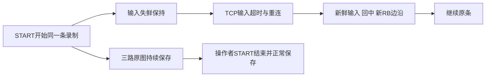

# 2026-10-16 开始录制卡顿：ACK超时主动重连，链路停顿来源待定位

最近一条人工示教在开始后约0.45秒进入输入暂停，约4秒后通过新的RB边沿恢复。用户已确认体感是机械臂控制延迟/断续，并提供同一时段Windows日志：sender因最老未确认包等待515ms主动断开，等待约1秒后重连。相机采集与原始保存继续，没有自动结束或丢弃整条。

该条发生在北京时间11:16，服务器视频传输提速版11:25才上线，因此本条不是新8MiB/s参数直接造成的。不过旧worker从11:06认证恢复后已经运行，缺少当时每块传输暂停日志，不能完全排除旧后台流量影响。现有计时不支持Windows采样/发送线程发生半秒停顿；初始停顿究竟在隧道、网络或ACK返回处理，仍缺逐包证据。本轮只读分析，无压测、重启或控制变更。

## 时间线与因果边界

本次查询时最新录制为f1_hil_20261016T031632Z_e36e25f9，HIL已退出。用户补充日志中同时包含10月15日旧记录和10月16日目标记录；本次结论只使用后者。

事件本身保存F1单调时钟。下表墙钟由manifest.started_wall_ns和demonstration_started.monotonic_ns近似对齐，只用于同机事件/服务时间线对照，不用来计算Windows到F1的单向延迟。

| 北京时间（约） | 已记录事件 |
|---|---|
| 11:06:07 | 旧服务器预览worker访问码修复后重启 |
| 11:15:46 | 最新HIL运行会话创建 |
| 11:16:32.035 | demonstration_started |
| 11:16:32.488 | operator_watchdog，录制继续；状态快照packet_age_ms=211.1 |
| 11:16:32.734（Windows） | 最老未确认包703等待515ms，500ms门槛触发sender主动重连，pending_count=27 |
| 11:16:33.291 | operator_transport_error:intent packet timeout，录制继续 |
| 11:16:33.764（Windows） | generation=2建立连接，新session于33.767创建 |
| 11:16:33.837 | 新sender session被接收，旧按钮状态丢弃 |
| 11:16:36.571 | input_pause_ended / rb_rearmed，同条恢复控制 |
| 11:17:27.589–30.966 | Y直接V1开始与反馈完成，约3.38秒 |
| 11:17:33.473 | 明确start_button结束录制 |
| 11:25:04 | 新服务器v37 worker启动，F1视频模块已定向升级 |

输入暂停持续约4.083秒，其中最长相邻operator_packet消费事件间隔1576.664ms；后续还有170.392/165.466/189.707ms间隔。这个1.58秒包含换会话及接入，不能称为单包网络RTT，也不能把全部4秒都称为网络延迟。

## Windows补证与代码核对

Windows证据来自用户贴回的console日志，未声称直接读取Windows磁盘。连接开始至START前，采样P50为16ms、P99/最大32ms；故障后首个窗口最大47ms。发布到网络线程最大16ms，socket write最大32ms，latest_overwrites=0，没有与515ms同量级的已记录采样/发送停顿。socket写入的是本地SSH入口，成功不等于数据已到F1。

START前成功ACK往返P50约47ms、P95约94ms；故障后的窗口P50升到63–110ms、P95约203–234ms，成功ACK最大375ms。500ms超时包不进入成功ACK的RTT统计，因此不能用故障前“最大141ms”否认这次超时，也不能把ACK往返当作机械臂执行延迟。

两端的会话均为`69e7f282-4393-49b9-99fc-cc858e6e5313`。Windows报告最老未确认序号703，sent=730、acked=703；F1原始journal已记录接受并消费705、706，最后706的单调时间为7187563765718。703、704未单独出现在消费journal，因为接收端提供最新值、控制消费可以跳过中间样本；不能称这两包丢失。

网络线程依次解码、更新latest、调用sendall发送ACK，随后才能处理下一包。因此收到706结合当前代码路径支持此前703的ACK已交给F1本机socket；但sendall成功不证明ACK穿过SSH并被Windows消费。F1之后1秒收不到新包，故障同时涉及输入后续到达中断，不能简单断言仅ACK单向丢失。历史日志没有每次recv/ACK-send的边界计时，尚不能区分网络/隧道停顿与端点调度。

恢复过程也放大了体感：500ms未确认触发连接重建，约1秒重试，再要求新会话、新鲜证明、回中、选侧、新RB边沿。Windows在11:16:34.496、35.508、36.495三次显示可以按RB，前两次又转回等待新鲜输入；34–35秒还出现未选侧的RB请求，36.258才选右侧，36.517按RB，36.716显示恢复。代码对无效/超预算恢复证明清除回中确认，并复用200ms watchdog预算；日志未记录每次证明失败的具体原因，不能把每次反复都归结为RTT超过200ms。另有`input_wait_reconnect`未匹配专用提示，显示“非已识别模式”，是待修的提示缺口。

## 接收与采集证据

- 整条1837组观测，约29.9268Hz；观测间隔均值33.415ms、P99 58.451ms、最大161.156ms。开始10秒最大121.522ms；并非每一帧严格33ms。
- journal和payload均complete，drop_count=0、writer_error=null。相机同步队列仍有左8/右9个丢弃计数，与落盘writer丢弃不同，不宣称零相机丢帧。
- 输入暂停快照中三相机帧龄约12/51/38ms；等待重连时约18/25/11ms。无该时段相机掉线证据。
- 录制期间输入receive_to_consume滚动窗口平均约1.92–2.60ms，窗口P99最高9.05ms、最大13.34ms；该统计不含Windows采样、隧道传输或ACK回程。
- 12512条control记录，发布调用耗时均值0.539ms、P99 1.082ms、最大3.086ms，不代表机械臂物理跟随延迟。
- writer峰值约6.8MB/17项，低于192MiB/256项容量；最大checkpoint 72.66ms，未观察到队列溢出。当前CPU快照不用于反推11:16的历史CPU负载。
- 对照此前10:49的1141组录制约29.9322Hz，也存在154–189ms输入消费间隔，但没有本条的1.58秒断档及输入暂停。两条不是受控A/B，不能据此量化后台视频的影响。

读取journalctl内核与NetworkManager在11:14–11:19窗口未返回事件；仅作为该查询范围无记录，不能证明无线链路无短时抖动。

## 视频链路核查与剩余问题

v36和v37均按HIL进程active暂停source/upload；进程检测缓存约1秒，单块之前检查。当前源码识别teleop/run/shadow/policy-shadow的f1dagger进程。新版本未改控制/录制/200ms watchdog或500ms ACK参数，也未启用F1编码。

HIL本次运行端早于START约46秒创建，按既有门控在录制开始前应已暂停视频传输。但旧worker没有逐次暂停事件或阶段耗时持久记录，已完成任务缓存也按发布收据清理，无法对11:16每个网络块作回放证明。需要保留这个证据缺口，不能把“应该暂停”写成“实测完全无并发”。

下一步补轻量、限频的接收/ACK发送边界计时、恢复证明拒绝原因和视频传输暂停/恢复时间，先分辨初始停顿发生在哪段；需要复现时在现场确认的测试时段，比较视频任务关闭与开启的单变量对照。本轮不做带宽压测、不调整门槛。

改进方向是继续分离运动保持与传输恢复：失鲜时保持机器人和同条录制；评估最老单包ACK过期是否必须立即重建整个连接，以及恢复提示怎样准确体现选侧/新鲜证明条件。不能直接取消失鲜保护，也不能未经验证把200ms动作门槛一起放大。当前已验证同条保存与RB恢复生效；尚未完成降低这类停顿频率的修复，不宣称长期稳定。

## 证据保存

开发机私有artifacts/results/20261016-start-lag/read_audit.py为只读分析脚本，f1-audit.json保存两个样本的汇总、特殊事件、当前console摘要与manifest。未传输图像包、未改原始数据。服务器提速部署/实际发布收据在工作台项目results/deployments/20261016-server-preview-transfer，相关权威说明为该项目docs/incidents/20261016-server-preview-transfer.md。
