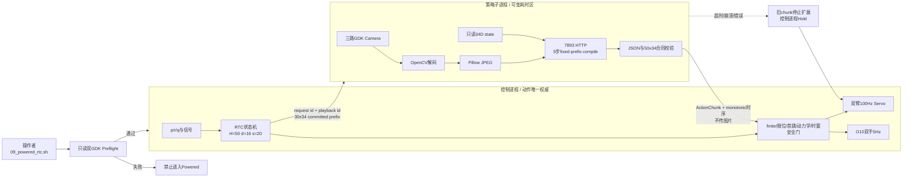

# RTC进程隔离：双GDK候选架构与真机验证路径（已替代）

> 本文保留2026-08-21已经实现的双GDK候选方案和证据，但其中“Policy创建只读Robot”和“双GDK Preflight”不再是目标架构。当前决策见 [`../../robot/RTC_PROCESS_ISOLATION.md`](../../robot/RTC_PROCESS_ISOLATION.md)。

> 日期：2026-08-21  
> 适用范围：NewLora 75K、7893五步fixed-prefix compile、G2完整Split双臂+双手RTC  
> 客户端源码：`/home/xza_100850113/projects/g2_robot`  
> 状态：实现及无GDK测试完成；G2双GDK只读Preflight和新架构Powered尚待操作者现场运行

## 1. 结论

最新日志支持操作者的主观判断：当前线程版RTC虽然消除了旧调度器的“长周期后立即补发”
问题，但运动观感仍不如Sync。主要矛盾不再是模型推理耗时，也不是chunk接缝，而是相机、
图像和HTTP链路与100Hz Servo位于同一个Python进程，造成控制线程周期性错过10ms deadline。

本轮解决方案不是继续调整平滑权重，而是建立进程边界：

- 控制进程只拥有机器人动作、安全状态机、轨迹时钟和100Hz/5Hz下发；
- 策略子进程拥有三路相机、OpenCV、JPEG、HTTP、JSON和只读观测state；
- 图片永不跨进程，只交换约8.2KB的`30×34` RTC prefix和约13.6KB的`50×34`动作结果；
- 策略进程失败、超时或返回过期结果时，控制进程拒绝切换并进入Hold；
- 真机入口保持完整Split：14D双臂100Hz，20D双手5Hz，不是arms-only版本。

## 2. 证据：为什么问题指向同进程竞争

最新同日实测对比：

| 指标 | 线程版RTC | Sync | 解释 |
| --- | ---: | ---: | --- |
| 实际双臂频率均值 | 95.36Hz | 97.80Hz | RTC更常错过10ms周期 |
| 控制间隔P95 | 12.07ms | 11.16ms | RTC周期分布更宽 |
| 全程最大间隔 | 24.14ms | 14.96ms | RTC存在肉眼可感的微停顿 |
| `>15ms`间隔 | 68 | 0 | RTC在运动内部反复掉拍 |
| actual最大加速度P95 | 68.58rad/s² | 33.58rad/s² | RTC掉拍后位置采样更陡 |
| actual最大jerk P95 | 7358rad/s³ | 3464rad/s³ | RTC顿挫更明显 |

旧RTC调度器修复已经把小于5ms的追赶补发从几十次降到0，并使早期RTC的加速度尖峰
P95下降约93%、jerk尖峰P95下降约96%。因此当前问题不是旧bug复发。

剩余长间隔中，29/30集中在每段逻辑tick 13--20，与RTC固定发起下一次三相机观测的阶段
重合。尝试在相机/JPEG阶段添加`time.sleep(0)`后，`>15ms`间隔反而从30增到68，说明线程
级“礼让”不能提供deadline保证。

## 3. 第一性原理

100Hz控制的合同是：每10ms必须产生并发送一个目标。设第`k`个deadline为`D_k`，实际发送
时间为`S_k`，控制质量首先取决于：

```text
lateness_k = max(0, S_k - D_k)
```

模型动作再平滑，如果`lateness_k`周期性达到5--14ms，机器人仍会先长时间维持旧目标，
再跨越更大的轨迹时间发送下一个目标。于是同一条平滑数学曲线在物理时间上变成不均匀采样，
加速度和jerk都会升高。

Python线程不构成实时隔离：

```text
同一进程
  Servo线程：时间采样 → GDK发送 → sleep
  主线程：Camera → OpenCV → Pillow → requests → JSON

共享：GIL调度、进程CPU配额、内存分配器、cache、原生库线程和内核调度
```

OpenCV/Pillow部分操作可能释放GIL，但“可能释放”不等于Servo能在每个10ms deadline及时获得
CPU；原生库还可能启动内部线程和产生内存带宽竞争。进程隔离的本质不是让推理更快，而是让
推理耗时的方差不能直接占用控制进程的Python解释器。

## 4. 已实现架构

### 4.1 进程与数据流



实际采用一个现场启动进程作为控制进程，并由它用`spawn`创建一个策略子进程。二者是独立
操作系统进程、独立Python解释器和独立GIL。无需再增加只负责等待的第三个常驻进程；控制
进程同时承担轻量监督职责。

### 4.2 所有权边界

| 资源/职责 | 控制进程 | 策略子进程 |
| --- | --- | --- |
| GDK生命周期 | 独立`gdk_init/release` | 独立`gdk_init/release` |
| Robot命令实例 | 唯一拥有 | 禁止创建命令适配器 |
| measured state | 执行前安全复查 | 观测输入，只读Robot |
| 三路Camera | 不创建 | 独占 |
| JPEG/HTTP/JSON | 不执行 | 独占 |
| committed chunk | 权威版本 | 只接收本轮prefix副本 |
| RTC切换时刻 | 唯一决定 | 不决定 |
| 限位/Hold/急停 | 唯一决定 | 只能报告失败 |
| 双臂/双手下发 | 14D 100Hz + 20D 5Hz | 0 |

### 4.3 IPC合同

控制到策略：

```text
sequence
RTCRequest | None
  prefix_actions_absolute: (30, 34) float64  # s=20时H-s=30
  parameters: d=16, s=20
```

策略到控制：

```text
sequence
ActionChunk
  request_id
  observation/request/response monotonic timestamp
  actions: (50, 34) float64
  client/server timing_seconds
```

相机图像在子进程内完成编码并上传，绝不通过Pipe传回控制进程。当前每轮只有一个请求在途，
使用有界同步Pipe；不存在请求积压，也不存在旧结果排队执行。序号不匹配、worker退出、管道
断开和有界等待超时全部转成`PolicyError`，控制状态机随后Hold。

### 4.4 为什么使用`spawn`

不能在已经启动GDK或线程后用`fork`复制进程，因为DDS、相机句柄、锁和原生线程状态无法
安全继承。新实现固定使用`multiprocessing.get_context("spawn")`：子进程重新导入模块，
独立执行自己的`gdk_init → Camera/Robot → gdk_release`。

## 5. 安全和失败语义

### 5.1 启动

1. 运行只读Preflight，同时建立父进程只读Robot和子进程Camera+只读Robot；
2. 并发进行父进程state读取与子进程三相机/HTTP；
3. Preflight明确记录`servo_created=false`、`robot_commands_sent=0`；
4. 失败时脚本立即退出，不显示Powered授权提示；
5. 通过后才进入人工`ok`和5秒倒计时；
6. Powered控制进程在首个动作完成全部安全检查前仍严格0 Servo发送。

### 5.2 运行

- 子进程慢：旧chunk继续按RTC合同执行；超过可续接窗口则Hold；
- 子进程崩溃/管道断开：本轮请求失败，控制进程Hold并结束；
- response sequence/request ID不符：拒绝结果；
- pause/stop发生在请求途中：响应丢弃，不能恢复旧请求；
- 新chunk仍由控制进程完成C0投影、suffix C1/jerk、关节限位和实测state检查；
- LOW-LATENCY仍没有GDK空间碰撞保护，进程隔离不改变这一风险。

### 5.3 结束

控制进程先停止Servo并锁存软件急停，再有界关闭策略子进程。策略子进程正常收到`close`后
关闭Camera和HTTP session并执行`gdk_release`；若2秒内不能退出，控制侧终止该子进程。
该终止只作用于无动作权限的策略worker。

## 6. 实现清单

| 项目 | 状态 | 证据 |
| --- | --- | --- |
| 进程化观测+策略pipeline | 完成 | `process_pipeline.py` |
| 图片不进入控制进程 | 完成 | IPC只返回`ActionChunk` |
| Powered RTC使用pipeline | 完成 | `--rtc-process-isolation` |
| 完整Split双手 | 保持 | 09入口仍为split + `rtc_cap_v2` |
| worker失败有界转Hold | 完成 | Pipe/exit/timeout错误合同 |
| CLI误用限制 | 完成 | 仅允许`powered-rtc` |
| 双GDK只读Preflight | 完成 | `11_rtc_process_isolation_preflight.sh` |
| Powered自动先跑Preflight | 完成 | 09入口在授权前调用11 |
| Python编译/Shell语法 | 通过 | 6000D本地检查 |
| process/HTTP/RTC mock集成 | 通过 | 66项相关测试；全仓104 passed |
| G2双GDK并存 | 待现场 | 必须先运行11，官方未直接承诺并发客户端 |
| 真机控制周期优于线程RTC | 待现场 | 必须读取新Powered日志验证 |

## 7. 真机实施路径

### Gate A：6000D服务

确认7893仍为NewLora 75K、五步、fixed-prefix compile，并已完成warmup。此架构不修改模型、
权重、去噪步数、RTC guidance或HTTP合同。

### Gate B：自动只读双进程Preflight

可单独运行：

```bash
cd /home/agi/xza/DM0.5
./scripts/11_rtc_process_isolation_preflight.sh
```

通过条件：

- `ok=true`；
- `servo_created=false`；
- `robot_commands_sent=0`；
- `parent_state_reads_during_inference > 0`；
- 返回严格`50×34`；
- 两个GDK进程均正常release。

### Gate C：完整Split短时Powered

09会自动重新执行Gate B，然后才请求人工授权：

```bash
cd /home/agi/xza/DM0.5
./scripts/09_powered_rtc.sh --duration-seconds 10
```

这不是arms-only：双臂和双手都会执行。必须清空工作空间、专人握住物理急停。

### Gate D：日志验收

第一轮不以“任务做完”为唯一标准，先检查控制周期：

| 指标 | 必须观察 | 第一目标 |
| --- | --- | ---: |
| `<5ms`追赶补发 | 不能复发 | 0 |
| `>15ms`控制间隔 | 是否从线程RTC的68次下降 | 接近0 |
| 全程最大间隔 | 是否低于24.14ms | ≤15ms候选门 |
| interval P95 | 是否接近Sync 11.16ms | ≤11.5ms候选门 |
| RTC schedule missed | 是否发生 | 0 |
| safe_hold/worker错误 | 是否发生 | 0 |
| arm actual accel/jerk | 是否向Sync靠近 | 明显低于线程RTC |

如果周期门通过，再跑100秒完整任务评价抓取、交接、放置；如果周期门未通过，先按
telemetry把剩余长间隔区分为GDK发送、state安全复查、轨迹后处理或操作系统CPU竞争，不能
直接继续调C2和jerk权重。

## 8. 进程隔离之后可能还要做什么

进程隔离解决的是Python进程内竞争，不保证操作系统完全不竞争。只有新日志仍显示相机周期
对应的长间隔时，才按顺序考虑：

1. 限制策略worker中的OpenCV/BLAS内部线程数；
2. 控制进程与策略进程设置不同CPU affinity；
3. 将昂贵的spline tangent和完整后处理预计算移入worker，控制侧只复核安全不变量；
4. 最后才评估受控调度优先级；不直接启用`SCHED_FIFO`。

C2 spline离线能降低曲率jerk，但无法修复deadline miss，因此保持为进程隔离通过后的独立
A/B变量。当前第一轮真机仍使用已经验证较多的`cubic_hermite`，避免同时改变两个因素。

## 9. 不能由当前证据声称的事情

- 尚不能声称GDK 2.6.3在当前G2上一定支持两个并发进程；这正是Preflight的验证目标；
- 尚不能声称进程隔离已经让真机RTC超过Sync；必须由新日志证明；
- 尚不能声称RTC任务成功率超过Sync；控制周期、轨迹质量和任务成功率是三个不同层级；
- 进程隔离不会修复模型右手抓不紧，也不会提供空间碰撞保护。

当前正确状态是：**代码和无硬件验证已达到现场测试候选；下一条证据必须来自只读Preflight，
随后才是操作者授权的10秒完整Split Powered。**
