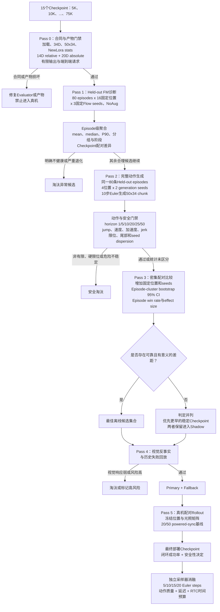

# 从第一性原理设计 NewLora Checkpoint 验证与选拔

> 这是NewLora实验的冻结、自包含设计。跨模型的当前方法入口见 [`../../CHECKPOINT_SELECTION_FIRST_PRINCIPLES.md`](../../CHECKPOINT_SELECTION_FIRST_PRINCIPLES.md)。

## 1. 文档目的与最终决策

NewLora 已完成 75K step 的 LoRA 训练，并从 5K 到 75K 每隔 5K 保存了一个
checkpoint。本次验证真正要回答的并不是“哪个 checkpoint 的训练 loss 最低”，
而是：

> 面对训练阶段没有见过的观测，哪个 checkpoint 能在真实 G2 上产生最安全、
> 最稳定、最有助于完成任务的闭环行为？

训练 loss 只衡量模型对参与参数更新的训练样本拟合得怎么样。它不能证明模型的
泛化能力，也不能直接证明完整推理轨迹质量、视觉依赖性、失败恢复能力和真机任务
成功率。训练 loss 持续下降时，验证集或者真机表现既可能继续提升，也可能已经
持平甚至恶化。

因此，checkpoint 选拔必须由一系列与真实部署逐渐接近的考试组成。本文档在查看
NewLora 验证排名之前冻结验证原则、数据边界、统计方法和选拔流程，防止看到结果
以后再修改规则。

## 2. 必须区分的三种“步数”

当前系统里有三个相互独立、不能混淆的参数：

| 参数 | 当前值 | 实际含义 |
|---|---:|---|
| Flow/Euler 生成步数 | 10 | 服务端为生成一个 action chunk，调用神经网络速度场的次数 |
| 模型 action horizon / chunk size | 50 | 一次推理生成的未来 34D 动作数量 |
| 客户端执行前缀 | 20/50，对应49个区间中的20个 | 重新观测和规划前，客户端实际消费多少个预测动作 |

10 个 Euler step 不是机器人执行10个控制时刻，也不代表 10 Hz。服务端首先采样
一个 `50 x 34` 的高斯噪声张量，然后让整个张量沿模型学习到的 Flow 速度场进行
数值积分。完成10次模型计算后，服务端一次性返回完整的 `50 x 34` action chunk。
客户端再按照执行前缀决定消费其中多少步。

在 30 Hz 下执行20个动作区间，约等于 0.667 秒 open-loop 播放。这个执行时长与
服务端内部进行多少次 Euler 生成没有直接等价关系。

## 3. DM0.5 的10步 Euler 是固定的吗？

不是。它是一个可配置的推理超参数，不是模型结构固定值，也不是训练 horizon。
当前锁定版本中的实现是：

- `DM05InferenceConfig.diffusion_steps` 默认值为 `10`；
- `inference_action(..., diffusion_steps=10)` 将它暴露成函数参数；
- 采样器使用 `dt = -1 / diffusion_steps`；
- 循环执行相同数量的显式 Euler 更新；
- 改变 `diffusion_steps` 不会改变 `chunk_size=50`。

DM0.5 学到的是一个以时间为条件的动作速度场。Flow Matching 训练会在不同连续
时间点训练模型预测速度场，并不是训练一条结构上固定为10层的去噪链。因此无需
重新训练 checkpoint，就可以在推理时尝试 5、10、15 或20步。

但是这个值也不能随意设置，它控制着一个明确的工程权衡：

- 步数更少：推理延迟更低，但数值积分更粗，动作可能更不准确或更不稳定；
- 步数更多：Euler 离散误差可能降低，但 action expert 计算量和服务端延迟增加；
- 步数增加不保证真机效果持续改善，模型误差、数据误差和策略误差依然存在；
- 服务端过慢会影响高频重规划，也会影响未来 RTC 在旧 chunk 用完前准备好新动作；
- 因此不能只看离线动作 MAE，还必须同时测端到端请求延迟和真机闭环表现。

### 3.1 本次 NewLora 的冻结决策

NewLora checkpoint 主选拔统一使用 **10步**，理由是：

1. 这是当前代码和部署的默认参数；
2. OldLora 完整动作验证也使用10步；
3. checkpoint 和 Euler 步数同时变化，将无法判断效果变化来自模型还是采样器；
4. 目前的首要任务是先选模型，不是同时调采样器和控制器。

选出少数 finalist 以后，再做独立的 Euler 消融，例如 `5 / 10 / 15 / 20`。比较时
必须固定：

- 同一个 checkpoint；
- 同一批验证观测；
- 相同初始高斯噪声 seed；
- 相同 normalization 和 mixed-action 还原逻辑；
- 相同离线动作指标；
- 相同真机场景矩阵；
- 相同客户端执行和预取条件。

最终应该选择在安全和动作质量上不弱于最佳结果、同时推理延迟尽可能低的步数。
针对 RTC，还要测服务端请求延迟的中位数、P90、P99，并验证新 chunk 能否在当前
执行/预取时间预算内准备好。

## 4. 从第一性原理定义验证目标

一个真实部署的 VLA 策略至少需要依次解决四个层次的问题：

1. **分布学习：**它是否学会了未见示范中的条件动作分布？
2. **完整生成：**从随机噪声出发，能否通过真实推理路径生成有效 action chunk？
3. **条件行为：**生成动作是否安全、稳定，而且会合理依赖图像和机器人状态？
4. **闭环任务：**收到新的观测以后，能否完成抓取、交接、放置，并对失败作出响应？

没有一个单一 scalar 能同时回答这四个问题：

- FM loss 主要诊断第一层；
- 完整 action generation 主要诊断第二层；
- 视觉反事实与历史回放主要诊断第三层；
- 只有闭环真机 rollout 能直接回答第四层。

所以最低 FM loss 不等于最好完整动作，最好离线动作也不自动等于最高真机成功率。

## 5. 冻结数据边界：让所有 checkpoint 做同一张试卷

### 5.1 Episode 级别的 800/80 划分

- 800 个 episode 只用于训练；
- 80 个 episode 只用于验证，绝不参与模型参数更新；
- 训练/验证 episode ID 必须固化在 manifest 中；
- 所有 checkpoint 使用同一份 manifest；
- 禁止把同一 episode 的一部分帧放训练、另一部分放验证。

相邻视频帧高度相关。如果按帧随机切分，同一条轨迹会同时出现在训练和验证中，
形成严重数据泄漏。真正相对独立的统计单位是 episode，而不是单帧。

这80条验证 episode 不会为每个 checkpoint 重新随机抽取。随机 seed 的用途是固定
Flow 噪声和完整生成的初始高斯噪声，而不是为不同 checkpoint 重新定义验证集。

### 5.2 固定时间采样位置

FM 第一轮可以把每个 episode 按时间划分为16个区间，并从每个区间取固定代表帧：

```text
80 episodes x 16个固定时间位置 = 1,280个唯一观测
1,280个观测 x 3个固定Flow seeds = 每个checkpoint 3,840次样本暴露
```

按时间分桶比全局随机抽帧更容易覆盖接近、抓取、抬起、交接和放置阶段。所有帧
索引、episode 顺序和 seed schedule 都必须在查看排名之前保存。

### 5.3 Clean validation 与 robustness validation 分开

主验证集必须使用原始图像和 `NoAug`。如果验证时随机 crop、rotate、color jitter，
不同 checkpoint 实际上会得到不同试卷，排名会被随机图像变化污染。

图像增强不是不测，而是单独建立固定参数、固定 seed 的 robustness suite：

- Clean validation 回答原始未见数据上的泛化；
- Robustness validation 回答光照、构图和场景变化后的稳定性。

两者必须分别报告，不能把随机增强混入主验证分数。

## 6. 为什么必须使用 NewLora 训练集的34D norm stats

Normalization 不只是方便计算，它定义了模型训练和推理使用的数值坐标系。每一个
动作维度都有自己的均值、标准差或 q01/q99 范围。训练时把物理动作映射到模型数值
范围，推理后再用同一组统计量还原。

NewLora 的输出是混合语义：

```text
训练标签 = [绝对手臂目标 - 当前手臂state,
            绝对灵巧手目标]
```

因此：

- 前14维是通常幅值很小的手臂 delta；
- 后20维是灵巧手 absolute target；
- OldLora 的34维全绝对动作统计量不能用于 NewLora；
- 使用错误 stats 会让归一化标签和反归一化物理动作都发生系统性错误。

正确数据流是：

```text
800个训练episode
       |
       +--> 计算并冻结NewLora 34D state/action stats
                    |
                    +--> NewLora训练
                    +--> 全部validation checkpoint
                    +--> 真机inference部署
```

80个验证 episode 不能参与统计量计算，否则验证过程已经提前看到了 held-out 动作
分布的信息。Validation 也不能自己重新计算一份 stats，而应直接加载训练阶段冻结的：

```text
server/processed/full/NewLora_officialaug_norm_stats/
```

这保证训练、验证和部署处于完全相同的数值坐标系。

## 7. 所有 NewLora 验证必须复现的动作合同

每条验证路径都必须严格复现训练和部署语义：

- action tensor 形状为 `50 x 34`；
- 维度 `0..13` 为 arm-relative；
- 维度 `14..33` 为 hand-absolute；
- state description 为14个 `JOINT` 加20个 `GRIPPER`；
- 使用 NewLora train-only normalization；
- 验证图像 NoAug，顺序为 head、left wrist、right wrist；
- 计算物理误差、跳变和轨迹指标前，把预测与目标都还原到统一绝对动作空间。

对于当前观测 state `s`：

```text
absolute_predicted_arm[t] = s.arm + predicted_arm_delta[t]
absolute_predicted_hand[t] = predicted_hand_absolute[t]
```

50个手臂 delta 都是相对于当前观测时刻的 state，而不是沿 chunk 逐步累加。

旧版验证脚本引用 OldLora 全绝对动作 recipe，不能原样用于 NewLora。新的 evaluator
必须显式实现：NewLora NoAug validation config、NewLora dataset/stats、mixed-action
validation label、完全一致的 `state_desc`，以及 prediction/target 的绝对动作还原。

## 8. Pass 0：合同与产物完整性门禁

从 5K 到 75K 的15个 checkpoint 首先接受不可协商的完整性检查：

- checkpoint 和 processor 能正常加载；
- model/action mask/output 覆盖全部34维；
- 输出有限且形状严格等于 `50 x 34`；
- norm stats 为 NewLora 34D，并记录文件 identity/digest；
- joint order 和 mixed action description 与训练一致；
- 输出反变换只对前14维手臂加回 state；
- 不存在 NaN、Inf、损坏权重或静默截断为32D；
- 使用接近部署的请求可以完成端到端推理。

Gate 0 只处理产物和合同错误，还没有开始比较模型能力。如果失败，需要先判断是
checkpoint 损坏还是 evaluator/服务端配置错误，修好以前禁止上真机。

## 9. Pass 1：Held-out Flow Matching 诊断

FM validation 回答的是一个局部训练目标问题：给定 held-out 真实动作，在一个固定
Flow 时间点加入固定噪声后，模型预测的速度场与目标速度场相差多少。

它不会从纯噪声完整生成 action chunk。所有 checkpoint 使用相同的80个 episode、
相同时间位置和3个固定 Flow seeds。

聚合必须尊重 episode 才是独立单位：

1. 先在单个 episode 内平均不同帧和 seed；
2. 再计算80个 episode mean 的 macro mean、median 和 P90；
3. 保留每个 episode 的结果，用于 checkpoint 配对比较；
4. 尽可能报告任务阶段与四个动作组的 breakdown。

FM loss 只允许淘汰明显不健康的候选，例如非有限结果、在大多数 episode 上严重
退化、某组动作维度数量级异常或 seed 极度不稳定。不能因为总均值只差一点就直接
淘汰。OldLora 已出现过30K FM loss 更低，但35K完整生成动作更好的现象，因此没有
证据表明 FM 排名可以替代部署生成排名。

## 10. Pass 2：完整部署路径 Action Generation

这一层仍然使用同一批80个 held-out validation episode，但考试问题不同。模型只
接收三路真实验证图像、当前34D state、任务 prompt 和固定初始高斯噪声 seed。

随后模型像真实部署一样运行完整10步 Euler sampler，独立生成一个 `50 x 34`
action chunk。验证 episode 中记录的未来示范动作不会参与生成，只会在生成结束后
作为离线参考进行比较。

为了控制计算量，Pass A 可以先使用：

```text
80 episodes x 每条4个固定时间位置 x 2个generation seeds
= 每个checkpoint 320个唯一观测、640次完整生成
```

所有通过 Gate 0 的 checkpoint 都应参加轻量完整生成，不能只让 FM loss 最低的
少数模型参加，否则可能错过真正生成更好的模型。

### 10.1 动作一致性指标

- normalized action error；
- absolute physical-space action error；
- left arm、right arm、left hand、right hand 分组；
- horizon 第1、5、10、20、25、50步；
- episode macro mean、median、P90/P99。

行为克隆任务可能存在多个有效未来动作。模型生成动作与唯一示范不同，并不自动
表示任务会失败。因此 demonstration error 是筛选和诊断指标，不是最终成功率。

### 10.2 稳定性与安全指标

- 生成第一步绝对动作相对 measured state 的跳变；
- 各关节和动作组的 mean、P90、P99、max jump；
- velocity、acceleration、jerk 与示范分布的差异；
- 机器人 mechanical joint limit 违反次数；
- 超出训练 q01/q99 的输出比例；
- action chunk 内相邻动作不连续和饱和；
- G2 控制栈可以提供的碰撞或控制限制检查。

机械硬限位、非有限输出或反复出现的明显危险跳变属于安全淘汰条件。超出训练
q01/q99 只说明动作处于低支持区域，是风险信号，并不等于违反硬件极限。

### 10.3 Generation seed 稳定性

对同一个观测使用多个固定高斯 seed，可以观察模型生成的是一个语义一致的动作族，
还是对初始噪声异常敏感。合理策略可以存在一定多样性，不要求所有输出完全相同。

真正危险的是不同 seed 的首动作方向相反、任务方向明显矛盾、手指开合阶段相互冲突，
或者部分 seed 经常产生关节跳变和越界。目标不是消灭多样性，而是保证任务语义和
安全性稳定。

## 11. Pass 3：对接近候选进行配对加密比较

Pass A 中无法明确区分的候选进入更密集的复测，增加固定时间位置和4至5个生成
seed。具体 manifest、seed 数量和具有工程意义的最小改善阈值，必须在查看该轮新
排名之前冻结。

所有 checkpoint 使用同一个 episode、位置和 seed，因此应该进行 paired comparison。
比较候选 A 与 B 时，对每个 episode 计算指标差值，然后报告：

- paired mean 和 median；
- episode win rate；
- P90/P99 安全尾部；
- episode-cluster bootstrap 95% confidence interval；
- 差异是否超过预先设定的工程意义阈值。

如果置信区间和 effect size 都不能可靠区分两个候选，应明确宣布统计并列，优先保留
更早且稳定的 checkpoint，同时让另一个进入 shadow。不能根据极小均值差异制造一个
虚假的唯一赢家。

## 12. Pass 4：视觉反事实与历史失败回放

### 12.1 固定视觉鲁棒性套件

对同一 state 和观测，比较原始图像与固定的 brightness、contrast、color shift、
轻微 crop/rotation、瓶子位置变化、黑图、三路相机错配图和时间打乱图。

黑图和错配图输出只做 shadow，绝不下发机器人。黑图下模型仍可能依靠 state 和动作
先验输出结构化轨迹，不要求它随机输出或停住。真正应测的是图像变化引起的动作变化
是否具有系统性的任务意义，并且明显大于同输入下的 seed dispersion。

### 12.2 历史真机失败回放

从已有真机日志提取瓶子偏位、抓取前、抓空后的第一张新观测、错误交接和放置失败
阶段，在不执行动作的前提下让 finalist 重新生成。

这组回放帮助区分客户端仍播放旧 chunk、模型收到新观测后仍继续标准流程、视觉条件
影响过弱、模型缺少恢复行为，或者模型输出正确但控制器/本体没有跟上。

离线回放不能证明闭环恢复能力。如果训练数据从未包含“抓空后重新抓取”的示范，纯
BC 没有获得这个状态转移的直接监督，不能假定模型自然具备可靠恢复能力。

## 13. Pass 5：真机配对 Rollout

离线验证最终选出一个 `Primary` 和一个 `Fallback`，而不是直接宣布最终赢家。两个
模型都要在冻结的真机场景矩阵上测试：

- 瓶子中心位置和多种偏移位置；
- 接近数采光照与当前 rollout 光照；
- 相关物体外观变体；
- 相同摆放协议下的重复试验；
- 初始控制条件统一为 powered-sync 20/50。

记录 reach、grasp、lift、handoff、place 成功率，抓空后的 recovery rate、整任务
成功率、重规划次数、完成时间，以及关节限位、碰撞风险、超时和人工急停事件。

最终 checkpoint 以闭环任务成功率与安全性决定，离线指标用于筛选和解释。RTC 属于
后续独立控制器实验，避免把模型质量和 runtime scheduling 的影响混在一起。

## 14. 冻结的 Checkpoint 选拔流程图



## 15. 每一层能证明什么、不能证明什么

| 验证层 | 能证明 | 单独不能证明 |
|---|---|---|
| 训练 loss | 优化仍在进行 | 泛化能力或没有过拟合 |
| Held-out FM loss | 未见数据上的局部 Flow 拟合 | 完整部署生成轨迹质量 |
| 完整动作生成 | 离线动作一致性、稳定性和安全风险 | 闭环成功或失败恢复 |
| 视觉反事实/历史回放 | 视觉敏感性和已记录异常状态响应 | 新动作产生的新未来观测 |
| 真机 rollout | 已测试条件下的闭环任务和安全表现 | 场景矩阵之外的普遍能力 |

整体选拔逻辑为：

```text
合同正确
   -> 未见数据上的分布健康度
   -> 完整采样动作质量
   -> 稳定性与安全性
   -> 视觉和失败状态鲁棒性
   -> 真机闭环成功率
```

最终模型不默认是75K，也不由一个 scalar 决定。如果后期 checkpoint 的 train loss
继续下降，但 held-out generation 或真机 rollout 已经持平/恶化，就应该选择更早的
checkpoint。

## 16. 正式开始验证前需要完成的实现改动

1. 新增 NewLora 专用 `NoAug` validation data config，不能继续引用 OldLora 全绝对
   动作 config。
2. 冻结并版本化80条 validation episode manifest 和所有时间帧索引。
3. 只加载 NewLora train-only 34D normalization statistics。
4. 按 arm-relative、hand-absolute 构造 mixed validation labels。
5. 注入与训练一致的14个 `JOINT` 加20个 `GRIPPER` state description。
6. 计算 physical error、jump 和 trajectory metrics 前，把 prediction 和 target 都
   转换到 absolute physical action。
7. 输出 episode-level 结果、paired difference、bootstrap confidence interval 和
   win rate，不能只保留全局平均值。
8. Gate 0 通过的所有 checkpoint 都参加 Pass A 完整生成，FM 只作为诊断。
9. 每份结果记录 Euler steps、seed schedule、attention implementation、norm stats
   identity 和 checkpoint identity。
10. 所有 manifest、JSON、日志和图表放入 NewLora 独立 evaluation 目录，禁止与
    OldLora 实验结果混合。

在第1至6项通过端到端合同测试以前，任何 NewLora checkpoint 都不应下发真机。
