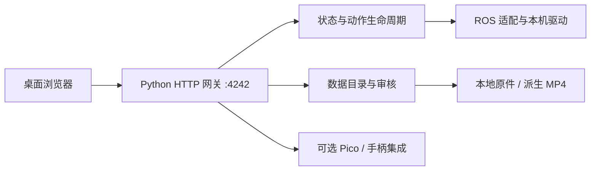

# 项目结构

F1-infra 是浏览器、Python 网关和机器人适配层组成的独立工作台。前端与模型资源随包提供，无需 npm 构建；在线运行使用目标机器的 ROS、驱动和相机环境。

本机配置、运行记录和录制数据与分发源码分开。Pico、DAgger、视频派生和训练导出按用途接入，不要求基础工作台同时安装全部模块。

## 源码目录

| 位置 | 职责 |
| --- | --- |
| `setup.sh` / `deploy/initialize.py` | 四项初始化与只读环境探测 |
| `run.sh` / `project_paths.py` | 加载本机配置，统一路径与运行环境 |
| `server.py` / `core.py` | HTTP、浏览器会话、控制租约、动作生命周期 |
| `robot/` | ROS 反馈、动作适配、运行合同、命令来源监听 |
| `web/` | 桌面前端、本地依赖、URDF / 模型资产 |
| `configs/` | 安装、机器人和数据配置模板；实际配置在本机生成 |
| `teleop/` / `teleop_service.py` | 固定遥操流程与会话监督 |
| `integrations/pico_upper/` | 可选上肢 Pico 适配与必要上游源码 |
| `recording/` / `recording_service.py` | 独立录制、来源核对、统一数据导出 |
| `data_service.py` / `preview_service.py` | 数据索引、审核与受限媒体读取 |
| `hil_service.py` / `hil_media.py` | 外部手柄运行端状态与视频任务 |
| `scripts/` / `deploy/` | 视频处理、服务安装与必要部署工具 |
| `docs/` | 使用、配置与结构说明 |

## 运行边界

启动、打开页面和读取状态不会创建机器人动作。动作与遥操由现场操作者明确启动，并检查本机身份、反馈、控制来源、租约和共用锁。新机模板保持动作关闭。

昵称与网页 IP 保存在 `configs/site.json`，控制合同保存在 `configs/robot.json`；改名不重写控制配置或稳定机器身份。运行目录保存会话、日志、审核和临时产物，原件保存在选定的数据根。

网页视频播放、视频生成与训练导出是不同流程。浏览器只访问本网关，不直接执行 shell 或向 ROS 发送命令；第三方来源与许可证清单随相关资产保留。
