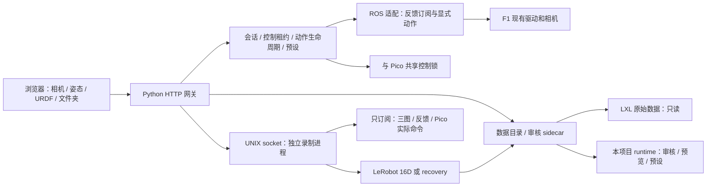

# F1-4242 架构



## 边界与复用

- UI 使用原生 HTML/CSS/ES 模块；不让浏览器直接执行 shell 或向 ROS 发命令。固定 IP 对应一个本机后端，不提供任意地址代理。
- `server.py` 处理 HTTP、会话、同源写请求、控制码校验和 API；控制码只保存服务端盐化摘要，不发到前端。
- `core.py` 管理预设、3 秒控制租约、动作 ID/结果和事件。`robot/adapter.py` 负责新鲜度、实际命令来源监测、显式动作及实测到位判断。运行前校验本机身份和控制器合同。身体动作有独立 200Hz 绝对期限调度，命令线程读后台更新的 ROS 图缓存，保留每周期反馈/外部命令判断；大于 25ms 的发送间隔中止，不积压追发。
- Hall 工程复用调姿、预设的交互思路；不直接搬入其导航、固定动作或全局 Flask 进程。审计见[Hall 来源记录](history/SOURCES.md)。
- meaxiao v1.4.4 提供已有 URDF/STL 和上肢 Pico 的基础；选定 LeRobot 会话/媒体写入代码以源码清单保留来源，再适配为上肢 16D 合同；数据审阅使用独立 sidecar。LXL MCAP 与 meaxiao LeRobot 是不同数据合同，不通过改扩展名或复制按钮冒充兼容。
- `recording_service.py` 通过 UNIX socket 调用 `recording/worker.py`，HTTP 查询不启动采集。第一次显式 start 只启动空闲订阅服务，第二次才在就绪时录制；动作租约与录制认证分离。
- 录制来源为已验证的独立 Pico session + 唯一 ROS graph writer，绑定 PID/starttime/父关系/锁和图端点；F1 Jazzy Python 无逐消息 GID，不能把此校验描述成逐消息 DDS 归属证明。详见[录制合同](RECORDING.md)。
- `data_service.py` 合并只读 LXL 与独立 LeRobot 目录；`preview_service.py` 提供受限文件读取和 HTTP Range，三路播放器和 state/action 曲线使用共同回放时间轴。旧 MCAP 缓存另存，不改原始文件。
- 数据目录、审核、录制与动作控制各自独立。新录制只落自己的 runtime，不建立传输任务。

## 实时值、编辑值和动作

状态保留各关节/相机自己的更新时间；未知值不能填零。姿态页面未编辑时跟随实时值，一旦操作者编辑，则保留目标草稿并与反馈分开。页面刷新不恢复旧目标自动执行；载入预设不执行；滑动不发送动作。

明确确认之后才调用动作 API。统一 `kind:pose` 根据最新反馈计算全部参与部位的同步连续轨迹，速度与加速度上限由后端配置，六秒仅为内部监测窗口，整项任务默认最多60秒；用户不拆分目标。旧单部位动作接口保留原六秒预算。`/api/actions/plan` 只预览，正式执行重新规划。已去掉5°步幅和手动时长，关节行程、反馈、租约和停止仍由后端核对。F1-09的双臂、身体、头部、夹爪和底盘按本机能力合同启用；头部异常起点回程和实际验收见 [STATUS](STATUS.md)。模型仅作姿态预览及有限躯干/头部地面检查，不执行完整碰撞规划。

`robot/command_monitor/` 复用本项目已有的 C++ 只读订阅器，在 ARM 本机编译并绑定 SHA。Jazzy 的 Python 消息信息不能直接提供所需 GID，因此由 `command_monitor_bridge.py` 获取 RMW 消息 GID，识别自己的输出；不使用不同语义的 ROS graph GUID 来代替。`command_activity.py` 允许待命节点共存，外部实际命令在执行期间锁存冲突。ROS 反馈线程持续排空监测队列，无浏览器时也运行；监听失效禁用动作，保留反馈。它不是底层原子仲裁器，也不能代替碰撞检测；原手柄不得同时操作。独立 Pico 原生预检仍保留严格 publisher 检查，未改 LXL main。

## 开发、部署和运行数据

6000D 独立主副本：`/home/user/projects/F1-4242`；共享包根名 `F1-infra`。安装路径由 `project_paths.py` 和 `configs/installation.env` 统一传给网关、录制与遥操进程，不依赖父工程或兼容链接。新装目录示例：

```text
/home/user/Bruno/F1-infra/
  releases/<id>/workspace/F1-infra/
  current -> releases/<id>/workspace/F1-infra/
  runtime/       控制码摘要、访问码、预设、事件、审核
    recorder/    状态、UNIX socket、目录与恢复事务
    recordings/  新上肢 LeRobot 数据与保留观测
    data_previews/ 旧 MCAP 的派生视频和曲线
    recording-venv/ ARM 本机独立采集依赖
    pico_upper/  可选上肢遥操日志、锁状态和模型缓存
  dev/web/       可选前端热更新目录；须显式选用
```

原机器人部署位置保留在 [STATUS](STATUS.md)，本次源码解耦没有迁移它。部署新版本前备份实际旧部署和运行配置；切换只涉及本工作台服务，不重启厂商驱动或相机，也不启动机器人动作。

`watch_web.py` 需显式配置 SSH 主机与远端目标，按变更文件传输网页和资产，上传完成后发布版本记录。浏览器定期检查 revision；后端不会热替换。凭据不进发布包，原数据不进同步任务。runtime 与 release 分离，回退代码不会回滚切换后新增的预设、审核或录制。

## 验证

单元/HTTP 回归覆盖锁、租约、动作停止、数据路径边界、原始数据不变和认证；浏览器检查桌面/手机布局、实时初始化、滑条、控制状态、文件夹、3D 加载及错误。实机只读验证核对状态与图像，机器人运动与真实录制仍分别由现场操作者验收。

## Pico 会话边界（2026-09-24）

`TeleopService` 是 HTTP 到固定临时用户服务的网关；`teleop.worker` 在独立 cgroup 中监督原脚本，以原子 request/status/confirm/stop 文件交换状态。HTTP/浏览器重启不结束遥操，遥操 worker `Restart=no` 不自动恢复输出。上肢原生 TTY 预检门通过 PTY 保留，只有认证的浏览器明确确认才写入 Enter；LXL 则先展示当前初始化配置，确认后才执行原启动器。停机按 cgroup 枚举并用 pidfd 锁定实例，不使用全局 pkill。原 LXL 数据逻辑不变，LeRobot 仍独立。固定启动脚本 SHA、机器 ID、反馈和已有发布者均在启动前核对。详情与限制见 [PICO.md](PICO.md)。
