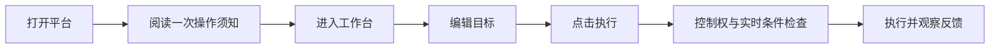

# 直接操作与入口须知

用户于2026-10-22确认桌面候选图：打开平台显示一次操作须知，红字突出点击执行即开始运动、运动空间避让、目标核对与硬件急停。只有“进入工作台”按钮，无密码、勾选、倒计时或逐次动作确认。实际部署状态见 [STATUS](STATUS.md)。

姿态、回放、基础服务和Pico都由明确点击提交。页面打开、刷新、切换标签、目标编辑和载入预设只读取或编辑状态；进入工作台本身不取得控制权，不启动机器人、遥操或采集。操作失败不自动重试。

## 行为与边界

- 入口提示独立加载，不等待整套工作台模块；提示显示期间暂停相机图像请求和调姿模型初始化，点击进入后恢复。系统详情按需读取，首次只初始化一次页面。
- 新文档加载与浏览器恢复页面时显示须知；同一页面内导航不重复显示。桌面验收覆盖1920×1080、1440×900、1280×800，以及1440×650、1280×600可用窗口。已确认紧凑版保留全部文字、取消背景模糊，正文和进入按钮完整显示。
- 姿态执行自动按需取得当前浏览器的租约。重复点击不会排队；停止或释放可取消尚未提交的规划。底盘仍是明确启用后按住方向键点动，松手即停，不会因取得控制权移动。
- 回放/起点对齐重新检查来源与当前状态，消费一次性票据；对齐结束不会自动开始回放。头部合法边界恢复包含在本次执行点击中，驱动绑定、起点幅度、路径和反馈规则保持原合同。
- Start All保持固定脚本哈希与重复启动检查。Pico将单次启动意图保存在本次会话请求的`direct_start:true`；工作进程完成原生预检后继续启动，取消仍优先。旧版遗留的待确认会话不自动迁移；须取消后重新点击启动。
- HIL结束、预设删除和已选择录制的删除由一次明确点击提交。审核来源冲突的选择界面保留，避免用旧草稿自动覆盖更新后的结论。
- 同源Origin、Host及`X-F1-Request: 1`校验、HttpOnly/SameSite会话Cookie、共享控制锁、租约、反馈新鲜度、运行合同、限位、外部命令检测与有界执行保持。网页停止不能替代硬件急停。

## 接口与迁移

`GET /api/session`返回`authenticated:true,password_required:false`。这里的`authenticated`仅兼容既有客户端字段，不表示完成密码验证。`POST /api/login {}`保留为空操作兼容入口；`POST /api/control/acquire {owner?}`直接申请浏览器租约，不接收或验证凭据。`POST /api/logout`仅取消本会话的控制/回放意图，不重新启用密码门槛。

旧请求中的`confirm:true`和`head_boundary_recovery_ack:true`是服务端操作合同字段，由单次点击流程传入，不对应第二个用户弹窗。缺失租约、失效票据、跨浏览器使用租约或控制锁占用仍拒绝。

新版不生成、读取或验证`runtime/control_code.json`和`runtime/access.token`；设置工具和显示访问码脚本不再随源码提供。旧runtime文件原样保留仅供旧版本回退，前端不展示。预览worker改为无凭据兼容连接，不依赖`access_token_file`。

## 验证与部署证据

后端常规回归为`python3 -m pytest -q tests`；此工作区测试数据依赖需同时提供DAgger的`shared/src`与`F1/src`到`PYTHONPATH`。浏览器检查入口为`scripts/check_direct_operation_browser.cjs`，只连接隔离的回环模拟服务，不发送真机动作。

本轮修改前副本、测试日志、桌面截图、发布清单、现场只读核验与回退证据集中在私有`results/deployments/20261022-direct-operation/`。无需密码不等于无需实际条件检查；离线和浏览器通过不等于现场运动验收。
