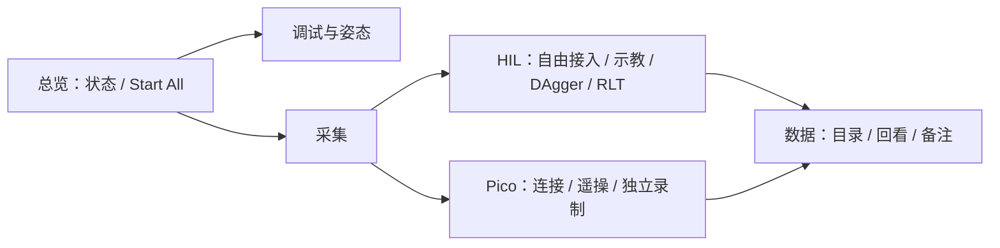

# 四页桌面工作台

本轮按用户确认的 mockup，将入口统一为「总览、调试与姿态、采集、数据」。HIL 与 Pico 共用采集入口，数据目录放在左侧，存储按需展开；左下角 Why & How 直接连接操作指南，不显示虚构用户信息。

**2026-10-30 已部署，手动刷新原4242入口生效。** 用户要求保留的红色控制状态条和总览 Start All 均保留；启动、取得控制权、录制和保存继续使用原有接口与明确点击。本轮只更新网页资源，后端、配置、服务与数据保持；设备状态仍由实际反馈驱动。10月30日后续按用户缩小的范围更新采集页、数据左侧目录及三路视频尺寸；数据内容区保留。



## 页面行为

| 页面 | 本轮变化 | 保留行为 |
|---|---|---|
| 总览 | 统一页面宽度查看完整三路画面；右侧依次为大号Start All、设备状态、最近操作；移除三个重复快捷入口 | Start All 仍为单击请求；已就绪时按钮可见但禁用，启动脚本结束不冒充反馈就绪 |
| 调试与姿态 | 模型居左、关节编辑居右；部位切换；底部显示全部待执行范围 | 红色顶栏、操控状态条、红色执行按钮；预设、底盘、反馈与目标区分、控制锁与停止 |
| 采集 / HIL | 公共设备切换；流程选择；左侧现场／连接／教学／诊断 | 手柄控制、写盘、恢复提示、真实会话身份绑定的结束操作 |
| 采集 / Pico | 三步连接引导；现场旁直接录制；路径折叠；独立结束遥操 | upper 与 LXL 的原有区别；录制服务准备→开始→结束→审核→保存；切页不结束会话 |
| 数据 | 左侧文件夹目录；容量弹层与平面比例条 | 原始录制列表、真实封面、搜索、筛选、分页、备注、组织、批量选择、视频与独立 Replay |

左下角 [Why & How](http://192.0.2.1:4243/?doc=f1-home) 打开新标签页。采集侧栏的启动配方链接已按用户要求移除；安装更新仍在连接页按需展开。原 `#hil`、`#pico`、录制及数据详情链接保持可用，`#capture` 映射到采集选择页。

桌面验收尺寸为 1920×1080、1440×900、1280×800。现场画面随容器宽度按原始比例放大，取消固定高度造成的两侧黑边；头部主画面、两腕辅画面均完整显示，可继续放大查看。

## 10月30日采集页与视频修订

用户确认只更新采集页面，数据仅调整左侧目录。HIL／Pico设备选择移到标题下左侧；HIL入口四张同尺寸竖卡，内页四项始终同组、当前指引高亮。自由接入不录制，选择指引不会启动或切换真实会话。

连接页采用命令／操作步骤与真实连接进度两栏，常用操作和实体按键说明可见；单窗口保留安装更新和备用三端步骤。Pico的上肢版／LXL版本选择只切换说明，启动、控制释放、停止与独立录制继续通过原有明确操作。版本详情和现场脚本保留在展开项内。

采集与数据统一使用从属导航：子项紧贴各自的主Tab下方，只在对应页面展开；缩进、淡蓝灰选中色与左侧短线表达从属关系，四个主导航标签为17px。数据目录不再作为导航外的独立区块；按时间浏览仅保留在数据内容区。对应静态补丁`20261030-capture-sidebar-r4`只更新两个文件，已完成本地三尺寸导航往返、线上21页面及真实三路画面尺寸检查与HTTP哈希核验；发布时后台服务和现场会话保持，复查没有写请求。

数据导航补丁`20261030-data-sidebar-r5`已发布三个静态资源，HTTP哈希核验通过；本地三尺寸验证数据与采集采用同样层级、页面往返及文件夹／时间切换，线上21页面只读检查通过，数据主内容保持。备份和验证在对应私有`results/deployments/`目录。

后续补丁`20261030-data-sidebar-r6`按用户要求移除侧栏“全部录制 · 按时间”及其分隔线，右侧时间切换保持；三尺寸浏览器验证及两个静态资源线上HTTP哈希核验通过，服务、配置和数据未改。

数据左侧首次展示折叠的一级文件夹；按用户后续要求移除重复的“全部录制 · 按时间”入口及其分隔线，时间切换只保留在右侧；内容区、已有浏览默认值、筛选、备注、目录组织及录制原件不变。三路实时视频取消强制短高度，保持完整原图，不裁切、不拉伸、不修改相机采集参数。

静态发布 `20261030-capture-layout-r3` 已完成HTTP哈希核对，后台服务未重启；现场HIL仍持锁，保留自动刷新标记，需用户手动刷新载入。候选图、实现前基线、826项Python通过／8项跳过、三尺寸浏览器和18项视频几何场景证据位于私有 `results/ui-revision-20261030/`；部署备份与回执位于对应 `results/deployments/`。线上三桌面21个页面场景只读复查通过，未见脚本异常或写请求；控制来源仍为f1dagger。没有执行机器人动作或真实录制测试。

## 总览布局与阅读尺度

按10月30日后续要求，“最近操作”移入设备状态下方，日志在卡片内滚动；移除调试与姿态、HIL手柄和Pico遥操三个重复快捷入口。Start All加高到54px、主文字18px，保留真实状态决定可用性的原有逻辑。

总览与其他页面共用内容宽度、标题和卡片间距，三路画面保持完整原始比例；设备名称14px半粗、状态14px加粗，设备标题20px加粗。按用户后续纠正，取消按视口高度收窄整个页面的规则，以阅读尺度和页面一致性为先，内容按需纵向滚动。

历史紧凑版本`20261030-overview-compact-r7`（后续已取消强制一屏宽度）把最近操作移到设备状态下面，删除三个快捷入口，Start All加高至54px并放大文字；日志内部滚动，默认总览在1920×1080、1440×900、1280×800均一屏展示。两个静态资源HTTP哈希、模拟40条日志的布局检查及线上21页面只读验收通过；真实三路画面保持完整比例，无写请求、无服务重启。 备份、截图与回执位于私有`results/deployments/20261030-overview-compact-r7/`。

后续`20261030-overview-scale-r8`按用户纠正，取消按视口高度压窄总览；恢复与其他页面一致的内容宽度、28px标题和卡片间距，设备名称／状态加大至14px并加粗，设备标题20px加粗。保留大号Start All、设备下方最近操作和完整三路画面；不再把强制一屏作为验收目标。本地三尺寸及侧栏展开／收起、线上21页面只读检查通过，单个CSS的HTTP哈希核验通过；服务、配置与数据保持。 证据见私有`results/deployments/20261030-overview-scale-r8/`。

## HIL 单窗口与按键

F1-09 的策略采集显示已安装工作流对应的 Windows PowerShell 指引；命令仅供复制，不在浏览器执行。首次安装与更新见启动配方。

```powershell
# 局部 RLT：默认 rlt400 入口
& "$HOME\DAgger-F1\start_f1_rlt.cmd"
# B1250 HIL / DAgger 纠正
& "$HOME\DAgger-F1\start_f1_rlt.cmd" --model stageb1250
```

人工示教与自由接入继续显示后端返回的真实启动步骤，未伪造单窗口支持。其他机器人也继续使用其后端指引，不自动套用 F1-09 启动器。

局部 RLT：START 开条／人工接管／交回 VLA，→进入本条局部任务，↑确认局部成功，Y 完成回位与反馈稳定两秒后封存整条。普通示教与 DAgger 的↑保存语义分别保留。运行现场根据实际 runtime 的 `rlt_phase` 判断指令；选项仅切换启动指引，实际会话与所选指引不同会提示，不热切换机器人流程。

## 验证与发布

隔离浏览器使用假 API 和本地模型，不代理现场操作。全量 Python 回归 826 项通过、8 项跳过。浏览器覆盖红色状态条、Start All 单次请求、停止在途动作、共享锁、Pico 独立录制保存、HIL 恢复、目录及备注。完整结果、三尺寸实际截图、修改前基线均保存在私有 `results/workspace-redesign-20261029/`。

静态发布为 `20261029-workspace-layout-r1`，后续 `20261030-workspace-layout-r2` 修复HIL空闲运行ID缺失时的结束中误报，以及单窗口页旧提示。两次均核对机器身份、现场文件、服务与采集状态，备份并校验SHA；后端与服务进程、配置、预设、录制身份／审核、自动刷新标记保持。回执位于对应私有 `results/deployments/` 目录。

线上三桌面21个页面场景与数据排序、筛选、备注读取、单次详情通过，无脚本异常或写请求。真机运动、Pico实际遥操与录制未执行；此前快速详情刷新与视频预载超时的压力边界未在本轮重新验证。

另修复内部源码包清单遗漏：`data_archives.py` 与 `data_rlt_assessment.py` 为已有数据模块依赖。本轮不生成或分发新的公开源码包。
