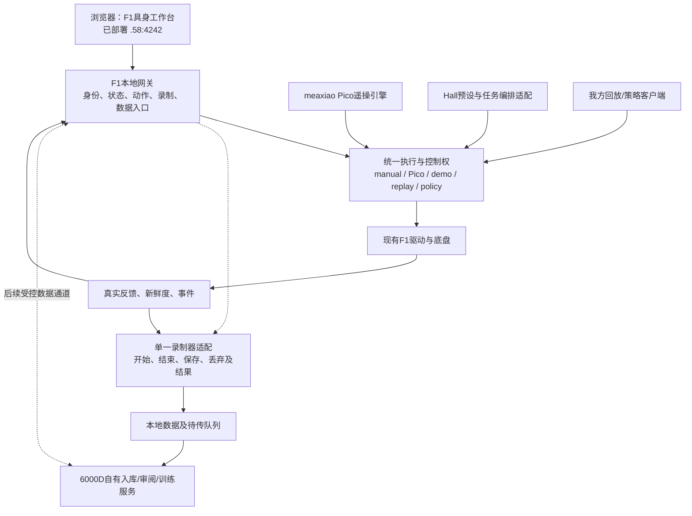

> 归档：这是 2026-09-23 首版设计/验收记录。下文状态、路径和“本轮”均属于历史时点；当前实现见 [架构](../ARCHITECTURE.md)，已记录版本见 [STATUS](../STATUS.md)。原 F1 工作区资料未随包提供，见 [历史来源](SOURCES.md)。

---
updated: 2026-09-23
robot: F1-09
status: deployed_with_onsite_arm_trial
---

# F1 具身研发工作台：Hall、Pico、数采与实验的一体化方案

**已建设独立工作台和公共执行层，借鉴Hall的页面/配置交互，将meaxiao Pico适配为双臂试用。录制/传输按用户要求保持原样，回放与策略客户端作为后续插件接入；不整包启动Hall，也不让lxl、新版Pico和网页并行抢占控制。**

同日后续已按用户授权实施：4242工作台在F1-09运行，`pico_upper`上肢试用包独立部署；数采、上传和中央分析暂不迁移。当前访客默认只读；双臂/夹爪试用已获用户明确同意并启用，现场动作验收仍待用户完成。总功能表见 [F1-infra（历史来源）](SOURCES.md)，lxl/meaxiao 详细比较见 [Pico选型（历史来源）](SOURCES.md)。

## 1. 本次信息从哪里来

| 来源 | 能证明什么 |
|---|---|
| 用户提供的 [Hall归档（历史来源）](SOURCES.md) | 本次新增的页面、配置编辑、导览与运动实现；尚未在F1-09验收 |
| 6000D `/home/user/F1/PICO/pico` | meaxiao v1.4.4 源码与其历史部署记录，不代表F1-09已安装 |
| **2026-09-23 15:11–15:19，SSH 22009登录F1-09** | 本机目录、配置、当前端口、进程名、ROS发现和底盘反馈；没有启动业务服务或发动作 |
| 本项目已有回放/姿态/数据流程 | 可复用源码和其他机器的历史验收；不能自动算F1-09验收 |

Hall原包SHA256：`8f2abbf58677715172ab8f66617a929ea65d870f69ad25667c68d8e85156de4a`。本轮只安全解包审阅源码，没有执行其安装、启动或动作入口；默认认证配置不复制到新项目。[Hall逐文件审计与行号（历史来源）](SOURCES.md)。

15:11–15:19初次只读盘点（历史时点，不能替代下方后续部署状态）：

- `wlan0=192.0.2.3`；隧道已恢复，ROS安装为Jazzy。`/home/user/lxl`存在，`ip_config.py.local_ip=.58`，8888/8899为旧Pico内部端口。
- `/home/user/meaxiao`不存在，`.f1_robot_id`不存在；当时Bruno只有连接目录；同日后续上肢包已部署到Bruno，见下文。
- EC-Master进程和UDP50001存在；此次进程/ROS检查未见motor_ctl、双臂HAL、三路数采相机和Pico服务。文件存在与功能就绪分开显示；本轮没有启动它们。
- CycloneDDS发现62个topic、145个service；5秒只读订阅收到1001条底盘状态。节点名发现不完整，存在type-hash兼容警告，不能以此声称完整ROS图已核全。
- 底盘示例header.sec=`946686605`，与Thor当前2026年墙钟明显不在同一时间基准。必须记录接收时间并核对时钟映射，不能将底盘header直接混入相机/手臂时间轴。本轮未改时钟。
- 本机已有原生22轴具名姿态控制和INI预设；它按插补发送结束报告“完成”，不是实物反馈到位判定。Hall和我们的新层都应避免重复做同一组动作发布器。

[实机证据（历史来源）](SOURCES.md)、[11份本机源码/配置快照（历史来源）](SOURCES.md)。

## 1.1 后续实施状态：已部署与未接入分开记录

- 工作台入口 **`http://192.0.2.3:4242/`**，F1用户临时单元`f1-console-4242`，当前发布`20260923-console-v3`。访客默认只读；用户已明确同意启用双臂与夹爪现场手动试用；临时单元不表示已配置重启自启。操作方式与后续版本见[工作台说明](../../README.md)。
- 前端三文件、Python网关和ROS适配独立维护。已实现身份/能力、真实关节与夹爪反馈、相机新鲜度、预设capture/save/import/export、访问认证、控制锁/租约、动作ID与事件。双臂/夹爪试用接口已按用户明确同意启用，机器启动合同核验通过；现场动作尚未验收；身体控件单位是度。
- 6000D后台`f1-console-web-sync`同步到F1`/home/user/Bruno/F1/console/dev/web`；浏览器2秒检测revision热重载，保留导航和草稿，不自动重发动作。Chrome已验证六页、14/3/5轴表、只读禁用、登录弹窗、草稿刷新保留及390px布局。
- [上肢Pico](../../integrations/pico_upper/README.md)以meaxiao1.4.4为基线，独立v2包已部署。依赖、模型、22轴及双夹爪只读检查通过，v2实机环境纯软件测试61项通过；实际遥操尚待用户验收。仅双臂/夹爪，身体/底盘/复位/采集/上传均不启用，用户在本机执行启动/停止。
- PCService使用F1现有安装，检查时未运行，脚本仅检查而不自动启停。F1-09读取的控制模式为3、imp=1，不沿用其他机器1/1。头部和右腕状态与左腕缺帧分别显示，左腕本轮未收到帧。
- 数采完全保持原逻辑。lxl本地MCAP不等于自动上传；现有7条记录均为09-16。磁盘约883GB可用，按1GB/条、保留100GB估算约782条；RAM约117GiB。没有建立本项目中央存储/审阅服务。

## 2. Hall 值得复用到什么程度

Hall是“展厅讲解应用 + Web配置面板”，不是已经完成的通用具身研发平台。

| 已有用户功能 | 实际实现 | 引入方式 |
|---|---|---|
| 编辑双臂/头部目标并执行 | 网页输入双臂14轴+头3轴，调用Python运动工具；含固定standby | 复用交互和字段，执行统一交给本机动作服务；增加实测/目标对照 |
| 腰部升降/姿态档位 | 电机5/6/7映射body_j3/j4/j5，度单位；档位和手填角度 | 复用“具名身体姿态”概念；不可标成厘米/米绝对高度；要身体高度须另做几何映射和标定 |
| 保存与加载配置 | 编辑目标写Excel，生成导航/动作/姿态/升降YAML；导入导出、方案管理 | 保留导入导出兼容，内部使用带机器/单位/schema的具名配置；这是保存目标，不是读取当前实测姿态 |
| 导航+动作+讲解编排 | 按点位调用导航、动作ID、TTS，支持顺序/语音/手动与暂停/继续/跳过 | 作为可选demo任务插件，后续扩展具身任务步骤；不作为打开网页的默认启动行为 |
| MCAP轨迹回放 | 臂轨迹与左右夹爪历史反馈转为命令 | 保留为“示教反馈轨迹回放”能力；与模型目标动作回放明确区分 |
| 网页电池和日志 | ROS bridge取电池；日志流/进程日志 | 复用显示；加反馈新鲜度和实际进程身份，缺数据不能显示正常 |
| 网页部署/重启 | 生成配置、复制配置、重启原业务服务 | 从普通操作页拆出版本管理流程，不能让“保存预设”隐式重启现场控制 |

**Hall原包没有找到的现成功能：** 网页独立夹爪/灵巧手调节、读取实测并保存为姿态、实时全身URDF映射、三相机实时预览、网页开始/保存数采、完整策略实验管理。C++回放能带夹爪不等于网页已有夹爪控件。

Hall的Flask页面默认10001，ROS bridge仅本地10002；README写Humble，但启动脚本实际加载Jazzy，F1-09也是Jazzy。应按实际依赖和同名消息包定义核验/构建，不能照README安装另一套ROS或覆盖机器人接口包。

必须先改的现有行为：

1. `arm_move_tool.py`等运动工具等反馈超时后可假设全零继续运动。新版必须拒绝缺失/过期起点，不能拿零位生成实机轨迹。
2. `app.py`部分配置写入、生成、部署、重启路由没有登录保护；默认认证配置也不应沿用。统一入口需要统一登录、写请求校验和操作记录。
3. `start_all.sh`广泛结束同名节点。导览初始化虽等待RT开始讲解，但进入standby本身会取消任务、发底盘零速并触发动作0归位。**打开研发页面应只启动只读服务，不能进入这条归位路径。**
4. Web停止仅终止其运动子进程，不能代表所有ROS控制停止；C++升降取消存在等待升降结束的语义。整合后明确“取消请求/正在停止/已停止/失败”，不得统一显示“急停成功”。
5. 腰部工具的duration不直接决定Ruckig实际执行时间；限位拒绝返回False未统一转非零退出码，父进程仅看exit0还可能误报成功。界面时长、进度、到位都应来自实际执行反馈。
6. 桥接器状态仅说明HTTP进程存活，电池缓存缺少过期判定。统一页应分别显示连接、ROS发现、驱动和反馈是否就绪。

因此推荐 **Hall提供页面与配置经验；meaxiao提供遥操/录制；我们的公共执行服务负责控制权、动作生命周期和机器适配**。不是在Hall原`start_all.sh`后再追加一个Pico启动命令。

## 3. 已有供应商网页：保留其擅长的功能

F1-09已监听80，Nginx将根站转到`192.0.2.12:8080`，6001/6004也代理到该内部主机。根页GET返回200，静态源码有地图编辑、站点路线、监控、报警、任务记录和配置入口；未调用这些业务操作做验收。

两个容易误认的页面已经额外查过：

- `robotControl`是电源、灯带、Shaft立柱的速度/目标Z/标零；不能未经硬件核对就当F1腰部body3–5控制，也未发现双臂/夹爪操作。
- `robotModel`是静态URDF加载和模拟错误标注，没有实时关节更新；其引用的URDF本轮GET为404。它不是已可复用的实时全身状态页。

原站继续作为地图/底盘运维入口，新工作台提供清楚的跳转即可；不修改压缩供应商bundle来扩展具身业务。[URL、哈希与最小源码证据（历史来源）](SOURCES.md)。

## 4. 一个独立端口，一套页面

用户希望用独立“42”端口。**42在WHATWG Fetch及Chromium的受限端口列表中，不能作为正常浏览器直连HTTP入口。** **用户已选定`4242`并已完成首版部署**；此前初次盘点未监听的结论已被后续部署取代。[Fetch端口规则](https://fetch.spec.whatwg.org/#port-blocking)、[Chromium实际列表](https://raw.githubusercontent.com/chromium/chromium/main/net/base/port_util.cc)。

当前已启动入口 `http://192.0.2.3:4242/`；电脑/平板须能访问机器人所在局域网。IP不变时无需再填几个后台地址；换机、换网络或DHCP保留失效时仍需用实际IP。采用独立端口可保留原80根站及其绝对资源路径。界面命名可用“F1 具身工作台”，不把内部脚本名暴露成主导航。

| 页面 | 当前用户可用范围 / 后续边界 | 主要复用来源 |
|---|---|---|
| 总览 | 分别看连接、主站、手臂、相机、Pico、底盘、录制器、中央服务；控制者与故障原因 | 本机健康采样 + Hall状态展示思路 |
| 调试与姿态 | 臂/头/夹爪调节、身体姿态、底盘点动、保存实测、预设预览/执行/取消 | Hall编辑交互 + 我方pose/执行层 + 本机能力配置 |
| Pico遥操 | 上肢范围、状态与现场脚本入口；不提供网页启动/录制/保存/丢弃 | meaxiao遥操 + 独立上肢适配 |
| 数据 | 本轮只读流程、现有状态与容量；中央入库/审阅/导出待配置 | meaxiao能力说明 + 本机健康采样 |
| Demo与实验 | 本轮姿态库/事件入口；序列、回放、策略运行与标签待插件接入 | Hall编排经验 + 我方replay/策略客户端 |
| 系统与配置 | 机器profile、预设/模型版本、日志、部署版本、供应商运维入口 | 我方发布/回退流程 |

实时相机接口和新鲜度已接入；缺帧仍显示缺失。实时URDF尚未接入，目前显示原始实测数值，逐组完成名称/正方向/零位/单位映射后再驱动3D模型。

## 5. 后台架构与后续接入边界

下图含未来数据/模型插件，不表示全部已部署：本轮实现Gateway、State、控制权和上肢Pico共享锁；录制、中央服务及任务插件均未接入。

“统一”指统一身份、配置、操作结果、控制权和数据会话；实时执行留在F1，重数据分析/训练留6000D。中央不可达时，控制页和本地状态仍可工作，录制按本地容量/就绪条件运行，数据排队；不要因收数服务失联就假报存盘成功或让整个页面不可用。

### 控制权与动作

首版实现整机一次只有一个受管运动控制者，观察、相机和录制可并行。切换需要释放旧控制者、核验反馈、对齐当前目标，再允许新控制者执行；不能仅把网页按钮置灰，任旧Pico仍发命令。旧lxl保留回退，切到新版时停止旧发布源；不用两套Pico并行。

每次动作返回ID、目标/部位、检查结果、执行进度及实测到位/失败/取消。任务停止、点动松手和硬件急停是不同功能。断连与命令期限在F1本地处理，不靠浏览器定时器或6000D回应。

具身研究应保留：接管/介入事件、命令与反馈分开、预设/URDF/配置/策略版本、实验成功/失败标签。模型执行前的姿态准备和任务动作应可区分；复位过程是否入训练由任务合同决定。

### 录制入口（后续设计，本轮冻结）

meaxiao已有本地UDP8899命令（float64编码的start/stop/save/discard）和`/pico/recording_status`，Pico按钮会跟随录制器状态，可以适配成网页入口。浏览器经网关调用同一个录制器，不另建第二份，也不直接发UDP。

原UDP无请求ID/ACK，状态只有idle/recording/finalizing/review。idle既可能表示正式保存、恢复保留或丢弃，后续需新增结构化结果：请求ID、episode、保存路径、质量/恢复状态和失败原因。Pico与网页交替操作要串行且防重复，页面显示实际结果而非仅显示“请求已发送”。

### 数据审阅入口（后续设计，本轮未接入）

现有dashboard监听6000D回环18976，限制Host/Origin、使用独立认证、根`/api`路径，登录页还禁止嵌框。**不能直接iframe拼进来就称统一页面。** 推荐复用其业务组件/分析模块，统一前端通过本机网关查询自有中央服务；视频Range、场景选择、标注和离线态也要接好。

浏览器中的127.0.0.1指操作者电脑，不是6000D。需建立单独受控的服务器数据通道，不将同事的登录token放到HTML，也不接管其正在使用的数据服务。自有网关认证与上游鉴权都保留；具体通道与端口在部署时验证。

### 数据合同

当前meaxiao动作缺失时回填state，并混收规划目标/最终控制目标；加Hall后会出现更多预设、复位、回放来源。先补`action_source`、逐维有效性、控制者/模式和事件，再做训练导出。底盘时钟已在本机发现差异，更不能只凭“30Hz/27D格式通过”认为同步正确。

保留原始采集与不可变中央修订；派生训练包复用我们的因果对齐、同源分组、mask、归一化和正式reader回读。27D录制与现有任务模型维度以明确映射连接。

## 6. 实施顺序与验收

| 阶段 | 当前状态 | 完成依据 / 余下工作 |
|---|---|---|
| 1 统一只读入口 | **已部署**：4242、机器profile、状态/相机/事件、热更新 | 已有HTTP/浏览器与本机反馈检查；左腕缺帧不标健康 |
| 2 调试与预设 | **预设及执行基础已实现，动作默认关闭** | capture/保存/导入导出与预览；本机profile启用后由现场逐组验收到位/停止/冲突 |
| 3 双臂Pico | **独立v2包已部署** | 依赖/模型/反馈检查、v1纯测试已通过；v2生命周期复核与现场小幅试用另记 |
| 4 数采与中央数据页 | **用户冻结，未迁移** | 后续先确定服务器/分析位置，再核录制来源合同、传输与审阅 |
| 5 Demo与实验 | **待插件接入** | 全身复位、导航、回放/策略执行、人工接管和实验标签各自验收 |

开发主副本位于`F1/console/`，机器人部署位于`/home/user/Bruno/F1/console/`；上肢Pico在独立`pico_upper/`。原lxl和同事原工程保持原样，后续采集/分析模块继续保持明确边界。当前发布、启动与热更新命令见[工作台说明](../../README.md)。
