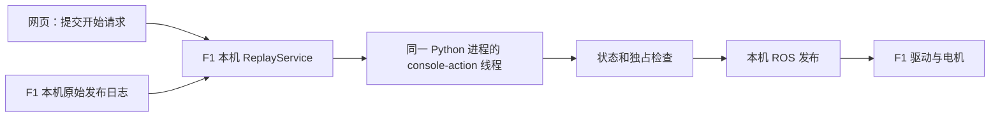

# Replay 本机停顿排查（2026-10-23）

已确认回放文件与执行线程都在 F1 本机，网页提交开始请求后不逐条转发动作。历史中断报告记录了一次 42.7ms 应用调度迟到，但没有线程栈、锁等待或内存回收记录，不能据此认定某个线程或锁就是现场根因。

本轮在同一台 F1、同一份线上回放代码和原录制上做了隔离测量：抓到一次 37ms 的 Python 全量内存回收停顿；随后去掉模拟发送器累计保存命令副本的行为，该段回放不再出现大停顿。因此这项发现解释了模拟实验，尚未证明历史真机中断也由 GC 引起。真实 DDS 图查询的只读测量没有复现长时间锁等待。

本轮没有修改或部署控制代码，没有关闭线上 GC、放宽阈值或启动真机动作。要最终归因现场偶发停顿，需要在下一次现场正常回放前补充执行阶段、锁等待、GC 所在线程与唤醒迟到的关联计时；不能用当前实验补造历史证据。

## 执行位置与代码路径

- `replay_service.py:load/start` 在本机读取原件，把已解析的 Segment 交给执行线程；`robot/replay_action.py:prepare_schedule` 在计时前建立完整命令表。
- `core.py:ActionManager.start` 创建 `console-action`。HTTP 请求、`console-ros` 反馈与图查询、回放线程处于同一 Python 进程。
- `robot/adapter.py:RosTransport.refresh_graph` 在 `self.lock` 内查询四个命令话题的发布者/订阅者；`publish` 使用同一把锁。这是明确存在的等待路径，但路径存在不等于它造成了历史 42.7ms 停顿。
- `StateStore.snapshot` 在另一把锁内复制状态；`CommandActivity` 也有独立锁。不能把数据目录服务自己的锁误称为回放发送锁。

## 实测与对照

现场 `current` 为 `20261022-dagger-model-catalog`；`robot/replay_action.py` SHA256 为 `611ee08933b635a3138dbe3de43c90f5162bce898fd4a712cd74625bfdf5e4e4`，与已发布连续执行修复一致。

回放原件为 `f1_hil_20261022T032053Z_794fb092`，区间 127.647806 秒，25,392 条手臂命令、30,320 个发布事件。两次墙钟演练均使用内存假传输，不加载 ROS，不发送机器人命令。用 `perf_counter`、`thread_time` 和 `gc.callbacks` 记录阶段耗时与 GC 重叠；没有人为注入等待。

| 项目 | 累计保存发送副本 | 仅计数、不保留发送副本 |
|---|---:|---:|
| 执行结果 | 完成 | 完成 |
| 顺延次数 | 1 | 0 |
| 顺延总量 | 37.292ms | 0 |
| 模拟发送函数最大耗时 | 37.099ms | 3.026ms |
| 状态检查最大耗时 | 1.123ms | 1.278ms |
| 等待超过请求时长的最大值 | 2.235ms | 2.474ms |

第一组在原时间轴约 109.965 秒发生停顿：发送函数 37.099ms，其中完整落在该函数内的 generation-2 GC 为 37.018ms，占 99.78%；GC 线程 CPU 时间 35.661ms。该次延迟主要是在当前线程执行内存扫描，不能归因于网络或几十毫秒的 OS 脱调度。GC 回收对象数为 0，也不代表扫描没有成本。

第二组仅替换测试发送记录容器，不改变 GC 设置、轨迹、监测或顺延参数；命令副本仍创建，但不累计保留。整段没有超过 5ms 的被测函数耗时或额外唤醒等待，没有运行中的 generation-2 停顿。回放结束后的比较计算仍出现约 33–38ms GC，不能将其算作运动中的卡顿。第一组逐项核对了全部发布目标与顺序；第二组只核对发布数量，不宣称进行了同样的逐项验收。

这说明测试桩保存大量副本会影响 GC 触发时机。前一轮模拟中自然出现的 39.3ms 停顿没有 GC 探针，本轮结果只提供解释线索，不能回溯认定二者必然同因，更不能将模拟停顿直接等同于真机故障。

另建不创建命令发布器的只读 ROS 节点，使用线上 `refresh_graph` 与相同命令话题进行 30 秒测量：298 次查询平均 0.662ms、最大 1.872ms；另一线程约每 5ms 尝试取得同一把锁，5,898 次中最大等待 0.132ms。独立节点和当前负载不等于当时服务内部环境，这项结果只说明本轮未抓到长锁等待。

## 历史证据边界与后续定位

历史报告 `625f9c2204b845f6ab6cdaa97bcf3187` 在任务用时 21.299 秒停止，已发 5,131 个事件，记录应用调度迟到 42.707660ms。报告不记录该次迟到中线程在哪个函数、是否发生 GC、是否被系统暂停。HTTP Handler 也关闭了常规请求日志；本轮查询故障窗口的用户 journal 返回没有日志文件，不能补回这些缺失信息。

下一步若要区分现场原因，应在同一条时间轴记录：等待唤醒、`live_check`、状态锁、命令活动检查、发送锁、DDS publish 的墙钟/线程 CPU 耗时，以及进程内 GC 起止、代数和线程身份。只保留有界慢事件，在回放结束后写盘，避免逐条日志反过来影响发送。当前还没有部署这些运行探针，不能声称下一次现场回放已自动具备归因能力。

## 证据位置

私有 `results/replay-latency-20261023/` 保存 `probe.py`、两组完整 JSON、`graph_probe.py` 与启动器、`graph.json`、现场 inventory、CPU 快照及历史 journal 查询结果。CPU 快照是当前采样，不是历史故障时的负载；目标机未提供 `/proc/pressure/cpu` 和服务 `cpu.max`，不据此推断当时 CPU 配额或压力。

原始录制与历史报告保持只读。本轮没有停止服务、其他任务或驱动；控制软件仍为既有连续执行版本，部署状态见 [STATUS](../STATUS.md)。
