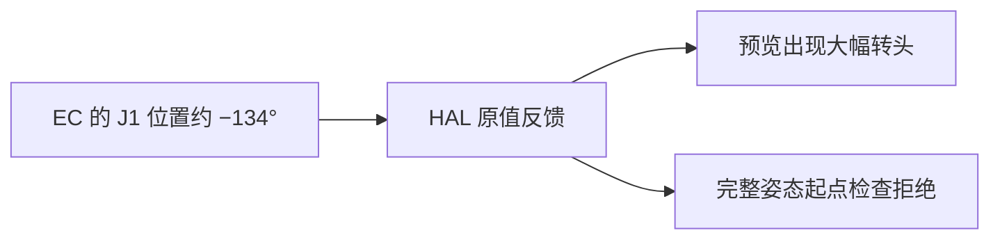

# 头部异常读数与首次执行误报 · 2026-10-26

本次积木姿态不能执行的直接原因是头部 J1 反馈约 −134.11°，超出当前驱动的 ±40°命令范围；不是低头的 J2 单独阻塞。用户确认实物只是低头、刚重启且没有拆装或标零。预览直接使用这份反馈，因此出现明显转头，与实物描述不符。

底层 EC 日志从启动约13秒起已经记录相同的异常位置，能够排除这次网页执行造成该读数。用户再次重启域控后，J1恢复到0°附近，原姿态预检通过；造成异常计数的底层原因仍未知，不能把重启恢复当作永久修复。

用户随后反馈首次执行总报“倒退／过期”、再点一次才能继续。已复现并修复一处独立的接收时间计算错误，后端及明确错误轴与数值的页面摘要均已发布；上线后真实反馈只读检查无误报。首次点击的完整动作仍待下次现场操作验证，不能把软件回归当成动作验收。

## 现场证据

| 项目 | 本轮读取结果 |
|---|---|
| 头部 J1 实测 / 预设 | −134.1064453125° / 0.0017233456° |
| J1 命令范围 | −40°～40° |
| 头部 J2 实测 / 预设 | −27.5655593872° / −15° |
| J2 命令范围与回程 | ±25°；已启用仅限J2、最多超界3°的原合法边界回程 |
| J3 实测 | 约0.000323° |
| 原预设只读 review | `executable=false`，唯一问题 `origin_out_of_range`，关节 `head_j1` |
| 第一次采样 boot ID | `00e1a3ea-7552-4670-8bf2-25e58ca17252` |
| 操作者反馈 | 刚重启、头部没改过；之后又重启域控，J1已恢复 |

J2距合法边界约2.566°，位于既有J2回程的准入范围；该流程不能覆盖另一个无效的J1起点，因此整套动作正确地在准备发布器之前拒绝。此处的范围指现役驱动命令范围，不等于实物机械极限。

EC日志开头 `0000012622` 已有 `Axis[0] Angle=-134.10 deg (Raw=-1245079)`，后续约18分钟处为 `Raw=-1245080`。当前配置 `pulse_per_rev=3342336`，`-1245080 × 360 / 3342336 = -134.1064453125`，与HAL完全相符。`zero_raw=36`仅相当于约0.00388°，不能解释该偏差。日志中的Raw是控制器位置计数，不能未经核验称为不含驱动零偏的绝对编码器原始采样。

当前EC文件SHA256为 `7f2968a64d82b32083ac1a51f4d6b35ba7b21cb31abfe02153a81232ba9b5423`；ROS驱动与profile绑定仍为原审计版本。尚未读取并验证驱动持久HomeOffset、内部编码器状态或重启恢复行为，不能将具体故障定性为“零点丢失”。

### 第二次重启后的现场结果

新boot ID为 `945f5ea7-4f1b-4d44-b900-6d693599714f`。工作台恢复后基础节点最初未启动；操作者点击Start All后收到关节反馈，EC的J1已约0.01°、位置计数约102。用户之后主动执行原积木姿态，观测J1约0.008°、J2约−15°，原预设只读review返回可执行，无阻塞项。

09:41:21（北京时间）首次动作在J2边界观察开始约2.5ms后因“头部反馈接收序号或时间倒退”失败，已发送一次合法边界目标。09:41:24第二次动作继续，头部、身体、右臂和夹爪达到配置容差；09:41:30因左臂跟随偏差停止。之后一次采样左J4实测−88.1966°、目标−85.8826°，偏差约−2.314°，超过原1°到位容差。用户表示姿态已调整完成；软件这次整套任务仍记录failed，不能改写为所有关节到位。此跟随偏差与头部时间误报分开，未扩大到位容差。

## 首次执行时间误报：代码根因

`StateStore.snapshot()`用快照时刻计算每个反馈的`age_s`，旧`head_boundary_recovery._feedback()`却使用稍后的调用时刻减去该年龄。实际重建结果是“接收时刻＋快照之后的处理延迟”；同一接收序号的两次检查，若处理延迟缩短，就会误报时间倒退。

修复使用 `snapshot_monotonic_s - age_s` 还原接收时刻，并在取得反馈锁后采快照时钟，使时基与复制的数据一致。消费快照时再次按原0.25秒阈值检查真实当前年龄；真实序号／时间倒退、停更、反向、幅度和150ms确认要求保留。不能据此断言用户遇到的所有“过期”都是同一个原因。

120次真实GET反馈的只读对照中，使用HTTP返回后的消费时刻重构产生48次假倒退，用快照时刻重构为0次，接收序号倒退也为0次。这证明该计算方式能制造误报；采样经过HTTP，不能冒充当时动作线程的逐帧重放。精确代码回归另以真实StateStore和受控处理延迟复现，验证旧版失败、新版通过。

## 模型与错误提示

`model-viewer.js`将头部HAL度数直接转弧度，无额外反号、零偏或截断；头部J2负值在当前URDF中确为低头。此次未发现前端轴互换或度/弧度错误。模型的身体/头部仍未完成实物标定，历史边界见 [模型审计](../MODEL_AUDIT.md)。

旧 `briefPoseError` 把所有“头部…超出/越界”统一替换成“头部当前状态无法平滑复位”，隐藏了真正的轴与数值。本次仅修改这一摘要函数，保留完整原因和编辑草稿；目标、反馈、模型、后端与控制合同均不改。

## 错误摘要验证与发布

- 头部恢复、边界回程及姿态review专项70项通过，包括“J2可回程但J1异常时仍拒绝，零准备、零输出”。
- 既有直接操作浏览器回归新增本次场景，共17项检查通过；1920×1080、1440×900、1280×800均能读到J1数值与范围，故障点击零写请求、浏览器异常0。
- 验证采用假传输及隔离页面；模型渲染在交互测试中使用stub，不将此项写成实机姿态或运动验收。
- 静态修订`20261026-head-feedback-diagnostic`已在空闲共享锁下热发布，仅更改`app.js`，HTTP哈希核验通过。服务PID2606保持，模型、配置、后端与数据身份不变。

## 接收时间修复验证与发布

三个缺陷均有旧版失败、新版通过的确定性复现：同帧处理延迟变化造成假倒退、等待反馈锁期间收到新帧造成快照时基落后，以及快照在消费前真正过期时必须在首条命令前拒绝。专项95项通过；本地完整回归708通过、8项可选依赖跳过。真实倒退、停更、反向、幅度、单次边界目标与原新鲜度门槛的回归保持。

机器人ARM候选105项假传输测试通过后，发布`20261026-head-feedback-clock`，仅替换`robot/head_boundary_recovery.py`、`robot/adapter.py`及两份测试。切换在空闲共享锁内进行，仅重启工作台服务，重连成功；先前静态摘要、模型、配置、用户预设、录制身份与审核保持。发布准备期间现场目录从116条变为115条，旧基线保留并重新只读核对后，按115条当前身份发布，没有恢复或删除用户数据。

上线后从真实状态API读取120个快照，使用已部署的`_feedback`解析：错误0、接收序号倒退0、接收时间倒退0。检查对象注入禁止访问的传输层，传输访问0，没有调用启动或动作方法。该检查证明当前真实反馈解析链通过，不是刻意使头部越界或首击运动试验；未由代理执行真机动作。原J1异常的底层根因仍未知，真实过期继续报错。

原始证据位于私有 `results/head-feedback-20261026/`：`onsite-readonly.json`保存首次状态、预设、review、事件和进程；`native-readonly.txt`保存配置与二进制身份；`native-logs.json`保存有界日志摘录；`after-domain-restart.json`和`final-state.json`保存重启后状态与操作者动作结果；`receipt-sampling-before.json`保存只读时间对照。摘要开发验证位于 `results/head-origin-20261026/test-receipt.json` 和其 `browser/` 子目录。静态部署备份与回执归 `results/deployments/20261026-head-feedback-diagnostic/`。

时间修复的复现、补丁、源文件前后SHA和完整回归在 `results/head-receipt-clock-20261026/`；ARM结果、版本备份、原基线与刷新后的执行基线、发布回执在 `results/deployments/20261026-head-feedback-clock/`。上线只读脚本与120份解析结果为 `results/head-feedback-20261026/check_live_receipts.py`、`receipt-sampling-deployed.json`。
