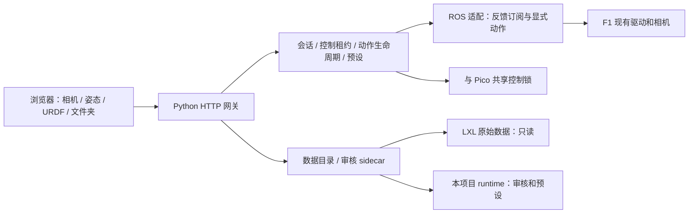

# F1-4242 架构



## 边界与复用

- UI 使用原生 HTML/CSS/ES 模块；不让浏览器直接执行 shell 或向 ROS 发命令。固定 IP 对应一个本机后端，不提供任意地址代理。
- `server.py` 处理 HTTP、会话、同源写请求、控制码校验和 API；控制码只保存服务端盐化摘要，不发到前端。
- `core.py` 管理预设、3 秒控制租约、动作 ID/结果和事件。`robot/adapter.py` 负责新鲜度、发布者排他、显式动作及实测到位判断。运行前校验本机身份和控制器合同。
- Hall 工程复用调姿、预设的交互思路；不直接搬入其导航、固定动作或全局 Flask 进程。审计见[Hall 参考](../../docs/hall_source_review_20260923.md)。
- meaxiao v1.4.4 提供已有 URDF/STL 和上肢 Pico 的基础；数据审阅借鉴其独立 sidecar 思路。LXL MCAP 与 meaxiao LeRobot 是不同数据合同，不通过改扩展名或复制按钮冒充兼容。
- 数据目录读取与动作控制独立，审核只写自己的 runtime。当前录制/上传路径保持原样，不建立新传输任务。

## 实时值、编辑值和动作

状态保留各关节/相机自己的更新时间；未知值不能填零。姿态页面未编辑时跟随实时值，一旦操作者编辑，则保留目标草稿并与反馈分开。页面刷新不恢复旧目标自动执行；载入预设不执行；滑动不发送动作。

明确确认之后才调用动作 API。已有 5° 手动范围、运动速度/加速度、反馈超时、锁与停止行为继续由后端强制检查。图形限位不替代服务端检查；URDF 目标预览不执行规划或碰撞检测。头/身体/底盘仍需各自实机验收才能启用。

## 开发、部署和运行数据

6000D 主副本：`/home/xza_100850113/projects/F1/F1-4242`。本地旧 `console` 仅兼容链接。F1 新部署：

```text
/home/user/Bruno/F1/F1-4242/
  releases/<id>/workspace/F1/F1-4242/
  current -> releases/<id>/workspace/F1/F1-4242/
  runtime/       控制码摘要、访问码、预设、事件、审核
  dev/web/       仅前端热更新
```

F1 原 `Bruno/F1/console` 保留为旧版本回退来源。迁移先备份原部署和运行配置，切换只涉及工作台自己的 HTTP 服务，不重启厂商驱动或相机，也不启动机器人动作。

`watch_web.py` 按变更文件传输网页和资产，上传完成后发布版本记录。浏览器定期检查 revision；后端不会热替换。凭据不进发布包，原数据不进同步任务。新旧部署的 runtime 是版本切换时的快照，回退代码不会自动合并切换后新增的预设或审核。

## 验证

单元/HTTP 回归覆盖锁、租约、动作停止、数据路径边界、原始数据不变和认证；浏览器检查桌面/手机布局、实时初始化、滑条、控制状态、文件夹、3D 加载及错误。实机只读验证核对状态与图像，机器人运动与真实录制仍分别由现场操作者验收。
