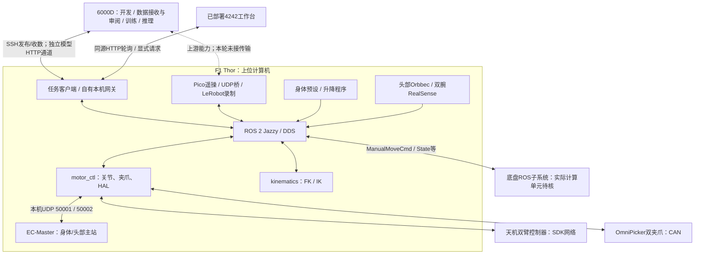

# F1-infra：基础软件复用、域控分布与控制台方案

**本页主要保留2026年9月的架构与现场快照。2026-11-03起F1-09日常入口有线优先，工作台使用`http://192.0.2.7:4242/`，Wi-Fi`.58`仅备用。** 当前主备配置与验收见[工作台状态](../F1-4242/docs/STATUS.md#wired-backup-v38)和[F1系统配置](F1系统配置.md#f1-09-wired-20261103)；下方历史IP、版本和功能边界不代表当前部署。

**F1 已经具备一套可复用的遥操、数采、传输、数据网页、模型资产和机器人控制基础。具身侧优先补统一接口与轻量控制台，不必重写电机驱动、相机、录制器或传输系统。**

你记得的两个基础启动脚本是 **`/home/user/workspace/start_ec_master.sh` 和 `/home/user/workspace/start_all.sh`**。完整 Pico 源码确实在 6000D，但位于另一开发账户：**`/home/user/F1/PICO/pico`**。它已有数据审阅网页和 URDF/STL。我们已在F1-09部署独立4242工作台与状态/动作网关；访客默认只读，双臂/身体/升降/夹爪/底盘现场试用已按用户确认启用，动作能力与实物验收分开管理。

**用户已指定HTML首台目标为 F1-09（22009）。** 用户补充的现场Pico入口是`/home/user/lxl/start_all_pico1.sh`，将它作为F1-09优先核查对象。其他机器及后续独立Pico工程作为复用来源；09-23恢复连接后确认F1-09有`/home/user/lxl`、其IP配置为`.58`，而`/home/user/meaxiao`不存在。同日后续已将独立双臂适配版部署到`/home/user/Bruno/F1/pico_upper/`，不覆盖lxl；源码、部署和现场动作验收仍分开记录。

本文整理跨项目复用、接口细节与前端讨论方案。系统事实统一入口仍是 [F1系统配置](F1系统配置.md)，各机差异看机器专属文档；模型选择与最新任务部署看 [任务当前方案](foam_sort_whole_body/docs/training_plan.md)。最新使用入口见[4242工作台](../F1-4242/README.md)与[双臂Pico现场脚本](pico_upper/README.md)。

## 已知问题：复位左右高度与模型一致性（2026-09-28）

**`F1-09-MODEL-001`：待考察；当前固定关节 demo 非阻塞。** 用户报告复位后的网页与实物左手略高；现用 URDF 在标准 `pose_2` 理想目标下，左 Link7 原点比右侧高约 **24.154 mm**。两处左臂 18 mm 几何偏置的模型差异可以解释网页高差，但尚未证明本机实物适用性，未修改线上几何。**24.154 mm 不是实测 TCP 误差，也不是重复定位误差。**

当前保留一次载入、一次执行的完整姿态交互，不增加分段或人工调平步骤；不为视觉对齐改动原生复位角度。在底盘、工装及工具安装不变、现场确认能回到同一实物工作位置的条件下，继续固定关节 demo。精确 TCP/IK、碰撞规划或仿真对齐，以及回位偏差影响抓取时，再把本问题提升为验收项。

09-28 用户已完成 22 轴全身复位及积木姿态执行；旧终态日志缺少完整实测角度，不能据此宣称重复精度已验收。已部署的 **v22 / 0.6.6** 补充 `arrival_feedback`，保存成功判定当轮目标、实测、误差、容差和接收来源，后续无需操作者额外记录步骤；旧记录不回填。独立“Demo 与实验”页已移除，调姿页的全身复位、双臂复位及用户“积木demo-V0”保留。

系统事实和后续复查条件统一维护在 [F1系统配置](F1系统配置.md#f1-09-reset-model-gap)，原始资料和事件以 [证据归档](reference/20260928_f1_09_reset_model_gap/README.md) 及 [SHA-256 清单](reference/20260928_f1_09_reset_model_gap/manifest.json) 溯源。执行/模型配置见 [全身配置](../F1-4242/docs/JOINT_CONFIGURATION.md)、[模型审计](../F1-4242/docs/MODEL_AUDIT.md)，发布状态见 [STATUS](../F1-4242/docs/STATUS.md)。

## 0. 现有功能总表（姿态、模型与导航更新至2026-09-28）

其余模块保留各自核验日期；本次文档归档不代表重新验收遥操、数采或全部系统功能。

**`http://192.0.2.3:4242/`已在F1-09启动。** 首版独立实现公共架构，借鉴Hall的调姿/配置交互；meaxiao v1.4.4已适配为只控制双臂与夹爪的`pico_upper`试用包。**F1-4242 已升级为独立上肢采集与审阅入口；LXL main 不变。当前发布、检查结果与未验收项统一见[工作台说明](../F1-4242/README.md)，上传和中央分析平台尚未配置。** lxl原目录保留，不与新版遥操同时发布控制；原80供应商站保持独立。

| 功能 | 复用来源 | 当前实际状态 |
|---|---|---|
| 统一网页入口与五页导航 | 自有网关/前端，沿用 Hall 交互经验 | **已部署**：总览、姿态、Pico、数据、系统；“Demo 与实验”页已移除，预设留在姿态页。源码与人类/API 文档统一在独立 [F1-4242](../F1-4242/README.md) |
| 开机自启与进程恢复 | systemd持久用户服务 + Linger | **09-24已启用**：开机启动、退出后自动恢复；网页先于驱动运行时只读等待，后台重试初始合同；资源基线与边界见[自启说明](../F1-4242/docs/AUTOSTART.md) |
| 实时关节、夹爪、底盘与相机状态 | 本机现有ROS反馈 | **已实现并接入**：真实数值、新鲜度与相机图像；09-24 本轮三路均有新帧，各自实时判断新鲜度 |
| 双臂/头部/身体目标与夹爪编辑 | Hall 交互 + 自有统一姿态执行 | **完整姿态一次执行**：22 轴目标与可选夹爪，固定速度上限、后台连续完成长动作；不再要求用户手动六秒分段。命令范围保留，留空同组关节按实测保持。见[姿态任务](../F1-4242/docs/POSE_TASK.md) |
| 保存实测姿态、编辑目标、导入导出 | 自有实测保存 + Hall 预设经验 | **已实现**：当前姿态保存、具名 JSON 预设、导入/导出/删除；载入仅更新待执行目标，完整预设不按当前展开部位裁剪。默认全身与双臂复位保留 |
| 控制权、认证、动作记录 | 自有公共执行层 | **已实现**：服务端控制码校验、持有控制权红色提示、同源写请求、3秒租约、Pico共用进程锁、动作ID/结果/事件；登录审核不占控制权 |
| 底盘按住点动 | 原底盘接口 + 自有执行层 | **已开放现场试用**；按住固定速度点动，松手/失焦/离开页面停止，单次最多 6 秒，现场验收待完成 |
| 双臂Pico、离合与精调 | meaxiao v1.4.4 | **独立v2试用包已部署**；依赖/模型/22轴与双夹爪只读检查通过，v2实机环境纯软件测试61项通过；现场遥操仍待用户验收 |
| Pico脚本入口 | 自有上肢适配 | **已提供**`check.sh/start.sh/stop.sh`，由用户在F1本机运行；不含身体、底盘、复位、录制和传输，不切换控制模式 |
| lxl录制 | 原lxl MCAP链路 | **逻辑完全不变**：采完首先落F1本地；没有证据证明当前lxl会自动上传。现存7条录制日期均为09-16，不能当本轮新采集 |
| 独立上肢录制 | meaxiao LeRobot 会话/编码/导出 + 自有来源与数据合同 | **已实现**16D / 10fps，准备→录制→三路审核→保存；独立 Pico session/graph 验证、真实 action、夹爪保持来源、失败 recovery；就绪按三图与 Pico 命令来源实时检查，现场采集待验收，LXL 原流程不变 |
| 数据回放和审核 | meaxiao 审阅思路 + 自有 MCAP 派生缓存/统一播放器 | **已接入**文件夹、三路同步拖动/倍速、16 通道 state/action 曲线、独立审核 sidecar；七条旧 `all_data` 各有三路视频，原 MCAP 只读 |
| 数据传输与中央平台 | 参考冻结队列、服务器拉取/哈希和中央审阅 | **未配置/未启动**，待确定服务器位置；不继承同事账户白名单、目录和凭据 |
| 存储与运行状态 | 本机只读健康采样 | **已接入**：磁盘约883GB可用，按每条1GB并保留100GB粗估约782条；RAM约117GiB。容量估算不是数据质量保证 |
| 腰部相对升降 | 自有 URDF 平面 IK 与连续插补 | **已接入相对高度草稿**：保持当前前后位置及俯仰，可与转身、双臂和头部合并；直接编辑身体 J3/J4/J5 替代升降意图，不可达时拒绝。模型高度未作实物绝对标定；旧 0–100% 联动来源留在[历史姿态说明](../F1-4242/docs/POSE.md) |
| 全身复位 | 原生 pose_2；双臂与 LXL XY 相同 | **09-28 用户现场完成 22 轴复位**；身体 `[0,0,-5,-10,-5]`、头部 `[0,0,0]`，双臂目标见[全身配置](../F1-4242/docs/JOINT_CONFIGURATION.md)。工作姿态不等于标零，不改变底盘或夹爪 |
| 实时 URDF | 原始 URDF/STL + HAL 到模型映射 | **22 轴实测/目标预览已接入**，v18 修正左 J7、右 J5/J6 模型方向；原始几何未改。复位左右模型高差按 `F1-09-MODEL-001` 待考察，不能作为精确 TCP/碰撞标定。轮组与夹爪仍为静态外观 |
| 任务序列、导航与模型实验 | 供应商站、Hall、任务客户端 | **未作为通用任务编排接入**；独立 Demo 页已移除，用户积木姿态在调姿页保存/执行。预设成功不等于具备导航、自主抓取或整段任务回放 |

09-24已将F1服务改为持久systemd用户单元`f1-console-4242`（enabled、Linger=yes），具体发布以[工作台说明](../F1-4242/README.md)为准；访客默认只读；双臂/身体/升降/夹爪/底盘已按用户确认启用，后续发布及能力开关以[工作台说明](../F1-4242/README.md)为准。6000D后台`f1-console-web-sync`将前端同步到`/home/user/Bruno/F1/F1-4242/dev/web`，浏览器每2秒检查资源版本并刷新，保留导航，目标从实时反馈重新建立，不自动重新取得控制权或重发动作。F1开机可自动启动网页，初始驱动合同每10秒重试直至通过；不自动启动驱动/Pico/录制或动作。服务自身退出后恢复已验证；09-28还观察到一次真实整机重启后网页自启恢复，不外推所有启动/网络组合。详见[自启与资源](../F1-4242/docs/AUTOSTART.md)。

端口42受浏览器限制，因此选择4242；依据[Fetch端口规则](https://fetch.spec.whatwg.org/#port-blocking)。完整边界见[一体化架构与验收](docs/embodied_console_integration.md)、[Hall源码审计](docs/hall_source_review_20260923.md)。

### 9月23日验证与历史录制预览

早先`20260923-f1-4242-v4`通过34项回归，包含原STOP/TTL/新反馈/发后失败覆盖；F1启动合同核验通过，订阅34个具名反馈项，空闲时本服务没有关节/夹爪命令发布者。只启用14臂轴/OmniPicker小幅手动试用，用户现场登录、接管并明确执行；头/腰/底盘仍未启用。没有通过SSH发送动作。此前自动审批要求在披露未实机验收后确认，用户已明确允许双臂/夹爪现场试用。

6000D另有`f1-console-f1-tunnel`，将6000D本机4242转发至F1；VS Code连接6000D后转发4242即可在电脑打开`http://localhost:4242/`。原局域网入口仍为`.58:4242`。

v4 桌面六页、14条关节滑条、真实22轴模型和390px手机检查通过；滑条测试未发送任何POST或动作。完整目录显示9条：下面7条`all_data`，另有09-12的`ros2bags/openbox`与`test1`，均只读。

7条旧lxl录制均为**2026-09-16北京时间16:04–16:20**（bag时间，非mtime）。最大`episode_000004`为5,815,513,850字节，16:10:04–16:18:24，约8分20秒。[完整7条时间/大小表](../F1-4242/results/data_preview_20260923/README.md)。已读取25%/50%/75%附近图像；50%处三路源时间戳最大差76.4ms，75%处左腕无邻近帧，不补旧图冒充同步。原MCAP未改、未向ROS回放，抽取8张原JPEG核验SHA。随后七条均生成三路10fps回放和16通道曲线，缓存只写新工作台 runtime；按bag/log时间提供共用审阅轴，画面超250ms无新记录显示缺帧，不代表训练同步。原[抽帧证据](http://localhost:4242/previews/20260916-000004/preview.html)继续保留。

## 新增：lxl / meaxiao 选型与基础设施引入

**针对F1-09，建议采用 meaxiao v1.4.4 源码作为后续基础，建立本机配置；保留 lxl 原部署作为对照和回退来源。** 新版已有独立臂接管、连续轨迹/精调、全身27D录制、源时间对齐、中央传输和数据审阅，继续从lxl重做这些功能收益不高。v1.4.4的现成参数/部署证据属于D070_01，不能直接套给F1-09。

本轮进一步发现三项必须适配：传输白名单尚无F1-09且路径绑定meaxiao账号；录制器混收两层关节目标并在动作缺失时以反馈回填，需要补逐维动作来源与有效性；现有四阶段分析绑定抓手机/搬运/放盒任务，不能直接当我们的训练预处理合同。

用户确认已获复用同意后，已保存 **56份选定源码/配置/测试的原样参考及SHA256清单**。用户随后明确调整顺序：本轮先部署双臂遥操试用和4242工作台；数采、上传和中央审阅保持原样。此处为早先顺序；同日用户追加要求后，URDF、数据审核和独立LeRobot录制分支已接入；参见第0节当前功能表。独立reset当前存在实物不符锁止记录，不直接采用其固定角度。

详见 [lxl与meaxiao的逐项比较、模块清单和引入顺序](docs/pico_comparison_and_adoption.md)、[源码快照](reference/20260923_pico_comparison/README.md)。系统不允许列出`/home/user`根目录，本轮覆盖其可读取的`F1/`工程；其他账户级平台尚不能宣称查全。原工程未改；已部署的自有目录、只读服务与现场待验收项见第0节。

**同日16:23权限复核：** xx主目录ACL当前已拒绝xza访问；此前读取限于当时开放的F1工程。未发现本会话写入xx或其Ubuntu目录的记录，详见[权限与修改范围核查](docs/xx_access_audit_20260923.md)。

## 1. 阅读范围与证据边界

本轮交叉阅读本工作区系统/协议/连接文档、启动脚本原文、历史实机审计、ROS后端、姿态/归位/运动学/推理客户端；进一步定位并读取另一账户的完整 Pico、数采、网页、模型资产和独立 reset 工程。`results/` 中重复发布包和旧实验不当作新的基础系统。

| 证据 | 如何理解 |
|---|---|
| 09-14～09-20实机归档 | 运行二进制、SHA、参数、消息和部署证据，只代表指定机器和核验时点 |
| 09-23 F1-09在线只读 | 当前目录/配置/端口、ROS发现和底盘订阅；不等于手臂动作及全功能验收 |
| 本轮6000D源码实读 | 证明文件与实现存在，不能单独证明今天机器人运行这版 |
| 厂商接口文档 | 设计接口和历史示例；存在版本差异，不能等同真机验收 |
| 自有工作台实现 | 4242已部署；当前API见第8.2节，默认只读与未接入的后续功能须区分 |

**09-23早先检查时四入口不可用；用户恢复F1-09后，15:11起已通过22009在线核验。** 读取本机目录/启动/Nginx配置、ROS发现及底盘实时状态，取回11份选定源码配置。仍未核全物理接线、底盘主机系统、串口、机械映射；没有启动驱动或发送动作。[本轮在线证据](connect/robots/f1-09/evidence/infra_readonly_20260923/README.md)。

## 2. 软件在哪里，分别在哪台机器运行

### 2.1 开发工程与原厂参考目录是不同版本

| 6000D位置 | 内容 | 机器人位置/运行分工 |
|---|---|---|
| `/home/user/projects/F1/` | 本项目系统证据、泡沫任务、模型与机器人客户端 | 自有部署统一 `/home/user/Bruno/F1/...`；6000D训练/推理，F1执行/观测 |
| `/home/user/F1/PICO/pico/` | 完整Pico v1.4.4源码、LeRobot数采、传输、dashboard、URDF/mesh | `/home/user/meaxiao/pico`；teleop、bridge、recorder、PC Service运行在F1，6000D收数/合并/审阅 |
| `/home/user/F1/reset/` | 独立全身复位v1.1.3源码、机型基准与模型核验 | `/home/user/meaxiao/reset`；部分机型目前被该工程锁止，不能直接作为通用按钮 |
| `/home/user/F1/本体平台/0804_fix_urdf/{origin,make}/` | 原lxl遥操/桥/MCAP录制、加密产物和模型参考 | 用户给出的`/home/user/lxl`链路；原脚本与后续修复脚本另有差异，见第3.1节 |

Pico中央接收/状态目录为 `/home/user/F1/PICO/transfer_6000d/`；数据根目录由 `config/collection.yaml` 指定。源码在6000D不意味着遥操作控制循环也在6000D。原工作区 `reference/20260914_action_mapping*` 只有选定旧源码，不能替代完整项目。[Pico说明][pico-readme]、[独立复位说明][reset-readme]。

### 2.2 域控与控制链

这是有证据的软件分工图，**还不是完整物理接线图**。09-16在ROS网络看到底盘节点，但Thor进程没有找到对应控制程序；`workspace/agv/install`提供消息/接口，不能据此认定底盘控制器就在Thor。对端主机型号/IP、板卡和串口归属仍需补。[系统架构](docs/system_architecture.md)、[底盘核查][base-audit]。

| F1机器人路径/模块 | 职责 | 具身侧复用方式 |
|---|---|---|
| `workspace/f1/install/{motor_ctl,f1_msgs,tj_sdk}` | 电机ROS、消息、天机SDK | 主要执行/反馈接口；D070历史缺src，D071有另取的部分src，逐机核对 |
| `motor_ctl/kinematics.launch.xml`、`libKine.so`、`ccs_m6_40.MvKDCfg` | 双臂FK/IK | 复用服务或数学层，绑定版本和坐标约定 |
| `workspace/ec/EC-Master-V3.2.3.05-Linux-ARM_64Bit-SDK_Dongled/` | 头部/身体EtherCAT主站、ENI、授权 | 保留驱动依赖，从ROS上层接入 |
| `workspace/whole_body_ctl/`；D071另有`0721.gamepad.udplog/whole_body_ctl/gamepad_pose_ctl/` | 具名身体/全身预设、分组插补 | 复用思路和配置；需核对机型与实际计时 |
| `workspace/EC_Line_Control/`；另有`gamepad_waist_updown/` | 腰部升降 | 两套协议不同，见第5节 |
| `workspace/camera/ros2_ws/` | 左右腕D405 | 复用原launch和相机反馈 |
| `workspace/camera/OrbbecSDK_ROS2/` | 头部Gemini系列 | 复用原launch；内外参/时间源另核 |
| `workspace/agv/install/` | 底盘消息和客户端环境 | 订阅状态、发送上层命令，不自写底盘固件 |
| `zxl/src/arm_replay/`与`install/arm_replay` | 原回放器 | 主要反馈轨迹回放，与本项目目标动作回放不同 |
| `Bruno/F1/foam_sort_whole_body/` | 本项目版本化控制/pose/home/user | 提取公共接口，保留任务profile边界 |

### 2.3 多机身份与差异

| 机器人 | 本工作区6000D回环SSH入口 | 已核验范围 |
|---|---:|---|
| F1_D070 | 22022 | 09-14～09-17主要系统/控制证据 |
| [4F-F1 / 软件D071](docs/robots/4F-F1.md) | 22029 | 09-18迁移与后续任务；控制器、身体结构、DDS和底盘参数与D070有差异 |
| [3F-JIMU](docs/connect/3F-JIMU.md) | 22165 | 09-21连接；截图D072标签，硬件和控制环境未独立核全 |
| [F1-09](docs/connect/F1-09.md) | 22009 | 09-23在线确认Jazzy、lxl、本机启动/身体配置、原站和底盘反馈；机械映射及动作待验收 |
| F1_D070_01 | 不在上述四入口中推定对应 | 完整Pico/reset文档中另列的独立物理机器人；不是D070别名 |

多个hostname都为`ms-thor`。前端和预设应绑定机器身份与能力配置，不能按hostname套用。Pico v1.4.4文档明确该轮只部署D070_01，其制动参数不直接沿用到D072或本工作区4F-F1；源码版本不等于全体部署版本。

### 2.4 首台目标F1-09的已知网络与待查分布

09-22只读接入记录确认`ms-thor / user / aarch64 / Ubuntu 24.04.3 LTS`。以下是F1-09自身记录，不能替换成4F-F1的网卡配置：

| 接口 | 已核对地址 | 含义/限制 |
|---|---|---|
| wlan0 | 192.0.2.3/24，网关192.0.2.19 | 到6000D的已核对路由；用户已在路由器保留DHCP地址 |
| enP3p1s0f3 | 192.0.2.11/24，无网关 | 有线维护口 |
| enP3p1s0f1 | 192.0.2.2/24，网关192.0.2.20 | 09-23确认本机CycloneDDS绑定此口；网页转发192.0.2.12，主机系统待核 |
| enP3p1s0f2 | 192.0.2.5/24，网关192.0.2.21 | 已知网段；仍需核天机SDK实际目标和线路 |
| ap0 | 192.0.2.22/24 | AP接口，不是所连Wi-Fi地址 |

09-23已进一步确认Jazzy、DDS配置绑定enP3p1s0f1、lxl部署、原生身体配置及底盘反馈；Nginx网页后端为192.0.2.12。同日后续已追加mode=3、imp=1和22轴/双夹爪反馈核验；运行二进制指纹、相机序列号、URDF映射、底盘主机系统和串口仍按证据逐项补齐。第一版控制台的能力表应由本机核验结果生成，未确认的升降/预设只显示待核，不直接套D070或D071配置。[F1-09原接入记录](docs/connect/F1-09.md)。

## 3. 开机脚本与自启职责

下表基础启动职责主要依据4F-F1 09-18的[原脚本及SHA][startup-evidence]，完整现场命令见[启动说明](docs/robots/4F-F1_startup.md)。**F1-09差异已于09-23读到：EC脚本加载`f1-hm.xml`、Codemeter重启行被注释；本机start_all除臂/相机，还启动升降、22轴姿态和手柄程序。不能逐字套用下表4F启动内容。** [F1-09原件](reference/20260923_f1_09_infra/README.md)。

| 入口 | 有效职责 | 日志/边界 |
|---|---|---|
| `/home/user/workspace/start_ec_master.sh` | 重启Codemeter，启动aarch64 `EcMasterDemoDcMT`并加载`f1-eni.xml` | `workspace/logs/{codemeter,ec_master}.log`；原流程现场sudo/前台 |
| `/home/user/workspace/start_all.sh` | 加载Jazzy、F1、相机环境；启动kinematics、motor_ctl、头/右腕/左腕相机 | `workspace/logs2/`；显式CycloneDDS、`enP3p1s0f1`、domain 0 |
| `gamepad_pose_ctl/start_pose.sh` | 身体预设执行器和手柄触发器 | 独立控制来源，会和其他动作共享通道 |
| `/home/user/lxl/start_all_pico1.sh` | 用户补充的原遥操入口：all_remote、teleop、PC Service三程序 | 09-23已读取F1-09原版，IP=.58；尚未启动Pico做功能验收 |
| Pico `start.sh` / `stop.sh` | 遥操/桥/录制/预检/会话配置管理 | 默认check；动作入口会协调底盘模式与既有控制源，不适合当网页普通按钮直接调用 |
| `f1-6000d-tunnel.service` | 持久SSH登录与文件通道 | 不自动提供DDS、模型端口或控制器健康 |
| `inference_*forward.sh`等 | 独立模型服务转发 | 模型任务需要，基本控制页无需依赖模型 |
| 任务Recorder / Pico录制器 | 各自录包或LeRobot采集 | 不等于基础驱动，格式/生命周期不同 |

4F归档的`start_all.sh`里AGV source、升降、手柄底盘段被注释；它不启动EC、Pico、模型或rosbag。`/home/user/0721.gamepad.udplog/start_all.sh`又是另一脚本，不能按文件名互换。

09-18的`f1_startup.service`为disabled/inactive。原接口清单里的`ec-master.service`、`f1-ros2node.service`是其他时点记录，不保证每台相同。冷启动流程为检查进程→缺时由现场启动EC/ROS→检查真实反馈；只缺一项就按原launch补一项，避免重复节点。SSH恢复也不等于电机主站恢复。

### 3.1 用户补充的lxl原始链路：三个后台程序具体是什么

用户提供的现场流程为：`cd /home/user/lxl` → 修改`ip_config.py`的`local_ip`为连接Pico的机器人局域网IP → `./start_all_pico1.sh`。这段文字也出现在[原安装连接文档][legacy-guide]。本地保存的[原版脚本][legacy-start]确认加载Jazzy/F1工作区和Conda `pico4ultra_py312`，启动：

| 程序 | 原F1路径 | 作用 / 原日志 |
|---|---|---|
| all_remote_lxl.py | `/home/user/lxl/remote_sth/dist/` | 真机桥接、初始化与录制相关；`/home/user/lxl/remote_sth/remote.log` |
| teleop_lxl.py | `/home/user/lxl/XRoboToolkit-Teleop-Sample-Python/dist/scripts/simulation/` | XR输入、运动学/遥操目标；项目根`teleop.log` |
| runService.sh → RoboticsServiceProcess | `/opt/apps/roboticsservice/` | Pico连接/PC Service；同目录`roboticsservice.log` |

原数据说明是MCAP/rosbag：采集写`/home/user/lxl/pico_data/all_data/`，独立轨迹工具`remote_sth/dist/ros2_bag_tool.py`写`pico_data/ros2bags/`。原列表包含HAL、夹爪/TCP命令反馈、三图和lead，但没有底盘命令/反馈。原按键是A开始/B停止、XY复位，不能与新版Pico的X/Y双击录制、B保存/丢弃、27D LeRobot合同混用。

原`ip_config.py`还有`target_left/right`启动姿态与`reset_left/right`复位姿态；启动桥可能主动移动手臂，不是纯后台通信服务。档案内`local_ip=192.0.2.23`只属于那份模板，不能覆盖F1-09已登记的`.58`；新版`meaxiao/pico`内部UDP用127.0.0.1是另一设计，不能原样改给旧脚本。

**“三个程序已启动”的一行输出不能当完整验收。** 原版没有对两个`cd`失败或后台退出做可靠拦截，最后固定打印成功；09-03旧机记录确实出现仅PC Service存活、Pico能连但机器人不动。另一个[PICO/deployment同名修复脚本][legacy-fixed]因那批加密包`Link7_R`与F1模型`arm_R_Link7`不兼容，会明确退出；对应旧机曾改用`start_all_pico2.sh`源码版。这是那批版本的事实，**不证明F1-09也有同样故障，也不构成现在替它换启动入口的依据**。

F1-09恢复连接后应定点读它的`start_all_pico1.sh`、`ip_config.py`、三程序解析路径/版本/日志、UDP监听与录制topic，再判定原链路已完整可用、需要修复，或值得迁移到独立Pico版本。不能仅凭同名脚本把原版、09-03修复版、v1.4.4当成一套系统。

## 4. 已经有的可复用能力

### 4.1 完整Pico远不止“摇操＋数采”

下表路径相对 `/home/user/F1/PICO/pico/`，本轮按源码核对；目标机实际部署另查。

| 能力 | 位置 | 复用价值/边界 |
|---|---|---|
| XR双臂增量、离合、精调 | `vendor/xrobotoolkit/teleop_main.py`、`src/pico_f1/{arm_clutch,precision}.py` | 已有Placo IK、Grip离合、Trigger夹爪、断流/重连基准处理 |
| 轨迹输出 | `src/pico_f1/{trajectory,arm_output}.py`、UDP bridge | Ruckig与高频输出；当前桥已不同于09-14原值即时发布快照，lead不是最终每帧命令ACK |
| 底盘与躯干遥控 | `src/pico_f1/{chassis,braking,buttons,torso}.py` | 摇杆全向、A+B人体跟随、制动/失联状态机、body_j3俯仰；按机型限速，非精确全身高度API |
| 会话复位 | `src/pico_f1/session_pose.py`、`scripts/capture_initial_pose.py`、`vendor/f1_bridge/init_f1.py` | X+Y回本次启动捕获的arm14＋body_j3；不恢复其他身体轴、头部、夹爪或底盘 |
| LeRobot v3采集 | `vendor/f1_bridge/lerobot_recorder.py`、`src/pico_f1/{lerobot_v3,camera_sync,sample_history}.py` | 30Hz三图、27D状态/动作、Parquet＋H264、时间归档、保存/丢弃与recovery |
| 采集校验 | `scripts/{check_lerobot_v3,probe_camera_integrity,verify_stationary_capture}.py` | 数量、时间、视频与质量检查；不自动证明action语义正确 |
| 多机可靠收数 | `src/pico_f1/{collection,collection_control,transfer}.py`、`config/collection.yaml` | 冻结会话、持久队列、SSH拉取、哈希/合同检查、幂等合并、回执和revision；无需重造传输系统 |
| 已有数采网页 | `dashboard/`、`src/pico_f1/{dashboard_server,dashboard_central,episode_analysis}.py` | 历史列表、三视角视频、物理曲线/四阶段统计、标注sidecar、跟随最新；主要是数据审阅 |
| 模型与几何 | `assets/f1_wheel/`、`vendor/f1_safety/` | URDF/STL、Coal/MuJoCo、碰撞与质心、FeedbackViewer；可复用资产，跨机映射仍需验证 |

数采网页配置为6000D `127.0.0.1:18976`，经SSH转发访问。已有`GET /api/review`、`/api/logs`、`/api/episode/<id>`、`/api/video/<id>/<0..2>`及`POST /api/annotations/<id>`等；**它没有已核实的电机动作API，不能把它当成实时遥控台**。[源码与说明][pico-readme]、[网页服务][dashboard]。

**数采复用前最值得补的合同：**

- 当前Pico `state27/action27 = arm14 + head3 + body5 + gripper2 + base3`；泡沫旧MCAP的state21/action19、DM0.5的state19/EEF23是另一些合同，不能共用切片和归一化。
- 新录制器同时订阅`/lead/joint_states`和`/motion_ctl/joint_ctl`，也订阅夹爪/底盘命令，已经能看到复位控制路径；旧“只看lead会漏复位”的问题不能照搬到新版本。
- **动作缺失或过旧时，当前代码会用state回退填入action；两类关节目标还共用动作历史。** 未见逐维来源/fallback mask，所以27D action不能全部称为真实下发目标。新训练应区分目标来源与反馈补值。
- 当前`allow_source_gaps=True`：相机缺口可继续记录，但标`training_ready=false`，保存到recovery而非正式训练索引。README较早“55ms缺口整条拒收”的段落已被后续实现替代。
- 这仍是软件时序对齐，不是三相机硬件曝光同步。保留源戳、接收/单调时间；旧泡沫底盘漏录后的固定距离重标是历史恢复流程，不是新采集默认步骤。

直接依据：[录制器订阅及回退实现][recorder]（约489–497、680–705、727–735行），[Pico后续版本说明][pico-readme]。

### 4.2 本工作区已有控制/实验基础

| 能力 | 代码入口 | 复用方式 |
|---|---|---|
| ROS接入与反馈缓存 | [ros_backend.py](foam_sort_whole_body/robot/f1_replay/ros_backend.py) | 按name聚合、逐关节新鲜度、模式/参数、关节/夹爪/底盘发布和停止确认 |
| 姿态保存/插补恢复 | [pose_model.py](foam_sort_whole_body/robot/f1_replay/pose_model.py)、[pose_backend.py](foam_sort_whole_body/robot/f1_replay/pose_backend.py)、[pose_cli.py](foam_sort_whole_body/robot/f1_replay/pose_cli.py) | 同步插补、计划、反馈到位、日志；原任务后端要求完整目标组；新工作台已有独立适配，目标与实测保持语义见第8节 |
| 调度与分段跟随 | [runtime.py](foam_sort_whole_body/robot/f1_replay/runtime.py)、[pose_segments.py](foam_sort_whole_body/robot/f1_replay/pose_segments.py) | 单调时钟、过期处理、不突发补帧、分段到位；前端不管理实时周期 |
| 局部底盘归位 | [base_home.py](foam_sort_whole_body/robot/f1_replay/base_home.py)、[trial_home.py](foam_sort_whole_body/robot/f1_replay/trial_home.py) | 本机/本次开机里程计锚点、朝向→XY→双臂；无SLAM和绕障 |
| 控制源冲突检测 | [command_monitor](foam_sort_whole_body/robot/command_monitor) | 监听实际外部命令，不只看注册发布者；不是硬件互斥锁 |
| FK/IK | [kinematics.py](foam_sort_whole_body/robot/kinematics.py)、[原生库/服务证据][kine] | NumPy/SciPy数学层与原生SDK核对，参考系/工具点/连续性需保留 |
| 三图/状态与模型客户端 | `robot/f1_policy_client/`、`models/DM0.5/f1_inference/` | 观测、新鲜度、HTTP、shadow/execute/日志；基本网页无需启动模型 |
| 诊断录包 | `f1_replay/recording_check.py`、`f1_policy_client/record_probe.py`及Recorder | ROS C++类型支持、订阅就绪、关闭后核对；这是rosbag诊断，不替代Pico LeRobot writer |
| 数据审计与离线工具 | [通用数据工作流](docs/dataset_workflow.md)、任务`scripts/`与`f1_data/` | 时序/视频/manifest/回放导出可复用；泡沫阶段标签和修复阈值是任务专属 |
| 发布与接入 | [AGENTS](AGENTS.md)、`connect/`、`deploy/sync_project.py` | 版本、哈希、备份、runtime分离；当前同步工具限制泡沫任务目标，不能直接发布任意新目录 |

`RosBackend.snapshot()`主要是位置、夹爪、底盘速度/flags；里程计要复用HomeBackend，电流/力矩/温度/故障要接对应状态，不能宣称现缓存已全覆盖。公共层应保留协议/检查，把机器SHA、轴范围和任务阈值配置化。

### 4.3 整机reset是参考组件，不能标为“通用已验收”

完整reset有22关节＋双夹爪基准、机器身份/目标SHA锁、capture/verify、轨迹/碰撞/质心检查。**本轮读取的最新README明确：D070_01现场实物复位不符后再次锁止，D070_01/D071/D072的check/execute均拒绝。** 本工作区09-18的v1.1.0快照早于完整工程v1.1.3，不应覆盖新记录。

`RESET_VERIFIED`只证明记录的原生反馈达到目标，不能证明实物姿态/模型正确。主站缺失时还出现过默认/缓存值重新带ROS时间戳的风险；页面“数据刚收到”不能等同底层传感器刚采样。[最新reset说明][reset-readme]。

## 5. 基本控制接口与容易误用的细节

### 5.1 手臂、身体、夹爪、底盘

| 功能 | 接口 / 类型 | 单位和约束 |
|---|---|---|
| 手臂目标 | `/motion_ctl/joint_ctl`，`sensor_msgs/msg/JointState` | `arm_l_j1..7` / `arm_r_j1..7`，position为**度**；单臂也需完整7轴 |
| 身体目标 | 同上，`body_j1..5` | 已核验控制器支持与arm14同消息路由；是电机角，不是5个独立笛卡尔轴 |
| 关节反馈 | `/hal/joint_states`，`JointState` | 按name聚合，手臂/身体可能分批到达；每轴分别计新鲜度 |
| 夹爪目标 | `/motion_ctl/gripper/{left,right}`，`control_msgs/msg/GripperCommand` | 0全开、100闭合，不是毫米；已核验OmniPicker忽略max_effort，不能当作力限制 |
| 夹爪反馈 | `/motion_ctl/gripper/{left,right}/state`，`JointState` | 实测开合，需另标定百分比到模型夹爪关节的映射 |
| 底盘速度 | `/move/ManualMoveCmd`，`geometry_msgs/msg/TwistStamped` | `twist.linear.x/y` m/s、`twist.angular.z` rad/s；任务用base_link；速度积分不保证实际走到指定距离 |
| 底盘状态 | `/move/State`，`move/msg/State` | speed、局部里程计、软/硬模式、驻车/避障等；**odometry.orientation.w直接存yaw弧度，不是四元数** |
| 原生FK/IK | `/kinematics/forward_kinematics`、`/kinematics/inverse_kinematics`，`f1_msgs/srv/...` | 左0右1；关节度、平移mm、行优先4×4；IK success与超限/奇异/残差/连续性分别判断 |
| TCP目标/反馈 | `/motion_ctl/{left_arm,right_arm}/tcp_pos_ctl`、`/state/{left_arm,right_arm}/tcp_pos` | JointState装`x,y,z,rx,ry,rz`，mm/度；工具点/坐标/模式需核验后再提供末端拖拽 |
| 系统预设 | `/motion_ctl/whole_ctl`，`std_msgs/msg/Int32` | data=N选INI中的pose_N；原程序有22轴/分组插补，不是通用JSON姿态服务 |

依据：[系统架构](docs/system_architecture.md)、[身体路由][body]、[控制器运行核查][runtime-audit]、[原接口清单](F1系统接口清单.md)、[底盘协议](通用机器人软件接口文档.md)。

编号须按接口分别封装：FK/IK左/右=0/1；手臂模式/拖动服务左/右/双臂=1/2/3；底盘`move/SetControlMode`又是软自动0、软手动1。`tcp_pos`中的TCP是工具中心点，不能据此推断网络传输用TCP。

可复用的限位证据：D070控制器SHA为`898ef58f…bce0c8`，D071为`1ec598c8…086ddc`，已分别核对双臂J1/J3/J5±178°、J2[−94,120]°、J4[−145,60]°、J6±60°、J7±90°；身体j1..5依次为[−130,130]、[−10,10]、[−70,0]、[−95,0]、[−40,0]°。这些是绑定版本的控制器约束，不是所有F1的永久规格；运动学SDK还有限位差异和J6/J7耦合，不能只看任意一张表放行动作。[控制器合同](foam_sort_whole_body/robot/f1_replay/controller_evidence.py)、[新机核验](docs/robots/4F-F1.md)。

三相机当前任务配置的压缩图topic为`/camera/head/color/image_raw/compressed`、`/camera/left_wrist/color/image_raw/compressed`、`/camera/right_wrist/color/image_raw/compressed`。新机逐一核对类型、序列号、有效帧与时间源，不能只检查topic存在。[配置来源](foam_sort_whole_body/configs/inference.f1-29.20k.json)。

原whole_body程序还有两项实现细节：`segment_duration_s`只打印，实际按5ms定时器×插补步数计时（默认500步约2.5s）；动作中收到新pose会保留pending请求。网页连点可能排入后续运动，不能直接把这个旧入口当成已具备统一取消和执行互斥的控制服务。[原身体实现证据](foam_sort_whole_body/results/pose_setup_20260916/body_interface_evidence.json)。

### 5.2 “身体高度”有现成算法，但不是通用绝对高度API

| 项目 | D070 09-16旧入口 | D071 09-18可读源码快照 |
|---|---|---|
| 文件 | `EC_Line_Control/dist/waist_updown_ros2.py`，PyArmor包装 | `gamepad_waist_updown/waist_updown_node.py` |
| 同名topic | `/control/waist/updown`，`std_msgs/Bool` | `/control/waist/updown`，`std_msgs/Int8` |
| 含义 | True/False触发沿模型Y方向±0.05m，默认3s | +1升、−1降、0停，持续点动；源码默认0.01m/s、200Hz、0.3s命令超时 |
| 额外能力 | 内部未完整可读，Pico旧桥可能仍发此类型 | `/control/waist/pitch`，Int8：−1前倾、+1向后点动、0停，默认5°/s |
| 关键边界 | **False不是停止** | 算法可读不等于每台已经部署或完成机械标定 |

新源码是三连杆FK/IK，`L1=0.352, L2=0.385, L3=1.000 m`；`body_j3/4/5`分别对应m3/m2/m1，数学角为`θ1=q5+155°、θ2=−q4−133°、θ3=q3+68°`。升降保持模型L3端点X和朝向，逐周期改变Y并求三轴目标。这个Y尚未证明就是地面到肩部或头顶的绝对高度。[升降源码与同目录配置][waist]、[旧接口证据][body]。

当前提供 body5 具名目标/实测角与 Hall 四档升降姿态（[说明](../F1-4242/docs/POSE.md)）；**按住升降/俯仰为后续待适配项**，绝对米制高度先定义参考点与坐标系、核验机械尺寸和电机映射。保留命令基准重同步/settling逻辑；原代码有settling超时放行，不能把timeout显示成“实测到位”。

### 5.3 四类“复位”要明确区分

| 页面功能 | 现有实现 | 覆盖范围/限制 |
|---|---|---|
| Pico会话复位 | Pico X+Y/session_pose | 本次启动捕获的双臂14＋body_j3；不是整机home |
| 保存/恢复姿态、到demo起姿 | Bruno pose/pose_192等 | 按选定版本恢复arm14/body5/夹爪；头部常为只记录；不回地面起点 |
| 保存/返回试验起点 | trial_home/base_home | 4F配置先转向→平移→双臂；身体、头部、夹爪保存但不发恢复命令；无绕障 |
| 清故障/驱动复位 | 各系统恢复服务、driver/Reset | 改设备状态，不等于回预设姿态；不能自动夹在普通姿态操作里 |

整机reset是另一套带模型/身份审核的工程，当前新机锁止见第4.3节。当前开发代码的底盘home以machine-id/boot-id绑定同次开机；旧启动文档的一小时有效期描述不能代替当前代码，历史release仍按各自实现。里程计重置/重启后局部锚点不能继续当有效全局位置；跨开机单独恢复双臂也不等于可以恢复旧底盘锚点。

### 5.4 还值得核验后复用的能力

通用协议不止移动。下列分别存在定义、部分图发现或实收证据，**没有一概完成动作验收**。

| 能力 | 接口候选 | 后续价值 |
|---|---|---|
| 相对距离/角度移动 | `/move/MoveRelativeCmd`，`move/action/MoveRelative` | x/y米、orientation.w为yaw弧度；图中见feedback/status，先核验取消和实际运动再复用 |
| 健康/电量/报警 | `driver/State`、`driver/stm32/Data`、`driver/battery/Data`、`steward/alarm/Data`、`server/State` | 状态栏；部分已实收，其余需核当前图/字段 |
| 轮速/转向/里程计 | `driver/motor/Data`、`driver/shaft/motor/Data`、`controller/odom` | 底盘跟随诊断已有实收；不能把move特殊yaw语义套到标准Odometry |
| 设备/标定 | `steward/GetDeviceInfo`、`steward/GetSensorsExtrinsic`、`driver/chassis/GetDeviceInfo`、`driver/camera/GetCameraInfo` | 版本/序列号/内外参查询，不必自建底层协议；确认对应哪组设备 |
| 感知 | `driver/lidar/...`、`driver/imu/Data`、`driver/camera/...` | 部分图可见，另有底盘感知，不能与头/双腕三相机混为一组 |
| 地图/定位 | `slam/LocationData`、`slam/Relocation`、`server/StartMapping/StopMapping`、地图查询/切换 | 长期位置复位和移动操作可优先核验；现有局部home不是SLAM |
| 导航任务 | `server/CreateTaskById/ByPose`、`ExecuteTaskById/ByPose`、取消任务 | 可能不必重造导航任务系统；本轮未核验地图/定位/导航闭环 |
| 软件急停/复位 | `driver/SetScram`、`driver/Reset` | 先核定底盘/全机覆盖范围，不能标为硬件急停等价物 |

`AI_Navigation`、`AI_Perception`原文标“暂不开放”，不列为现成能力。通用文档的立柱电机控制/标零不证明F1身体五轴就是该立柱机构。[通用协议](通用机器人软件接口文档.md)、[实收与图证据](foam_sort_whole_body/results/base_controller_review_20260916/live_probe.json)。

## 6. 协议、端口、总线和串口台账

| 链路 | 已知配置/协议 | 证据与缺口 |
|---|---|---|
| 6000D→各F1登录 | 127.0.0.1:22022/22029/22165/22009，SSH | 09-23稍早均不可用，15:11起F1-09/22009已恢复并核验；各机身份独立 |
| F1→6000D持久隧道 | 6000D `192.0.2.1:22` | 配置证据；不自动转发DDS |
| Thor→天机双臂 | 已装launch的SDK目标`192.0.2.4` | 当前IP、SDK传输端口/固件待核，不是已知串口 |
| motor_ctl→头/身体主站 | UDP `127.0.0.1:50001` | 历史参数/监听；电机ID0..2=head_j1..3，3..7=body_j1..5 |
| 主站→motor_ctl反馈 | UDP `50002` | 旧机实测motor_ctl监听，反馈帧格式要读接收实现 |
| 主站→电机 | EtherCAT；4F为`f1-eni.xml`，F1-09脚本为`f1-hm.xml`；`-intelgbe 1 1` | 物理网口/从站拓扑待核，不能将网口序号直接认作DDS网卡 |
| 双夹爪 | 左can0、右can1，OmniPicker | SocketCAN，不是tty；文档有CAN-FD配置示例，当前bitrate/ID/稳定绑定待实机核 |
| Pico头显→PC Service | 旧安装文档记63901；Python SDK回环60061 | 外部XR链路，与下两行本机UDP控制面不同；当前实例监听另核 |
| 原lxl teleop→bridge/录制 | `ip_config.py`的local_ip与8888/8899 UDP | 09-23实读F1-09配置为192.0.2.3；未启动遥操核验链路，不能套新版回环配置 |
| Pico teleop→bridge | 完整源码`config/ip_config.py`：`127.0.0.1:8888/UDP` | 本轮实读开发配置；`scripts/env.sh`通过PICO_F1_CONFIG指定，机器人配置仍需核验 |
| Pico→recorder | 同配置`127.0.0.1:8899/UDP` | float64标量：1开始、0停止、2保存、3丢弃 |
| Pico录制状态 | `/pico/recording_status`，std_msgs/String | idle/recording/finalizing/review；recovery是恢复保留结果，不能仅凭idle区分保存/丢弃/恢复 |
| 自有具身研发工作台（已部署） | F1-09 `http://192.0.2.3:4242/` | 状态/相机/姿态/URDF/认证/事件、独立上肢采集与数据审阅已接入；访客只读，中央传输未配置 |
| F1-09原供应商网页 | Thor80→192.0.2.12:8080；6001/6004同主机转发 | 09-23根页200；地图/底盘运维静态源码已读，业务操作未验收 |
| 数采网页 | 6000D `127.0.0.1:18976` HTTP | 本地监听/SSH转发的配置入口，数据审阅API；未验证今天服务在线 |
| Thor↔底盘ROS | CycloneDDS；4F已核domain 0、enP3p1s0f1 | 对端计算单元/设备总线/时钟同步未闭合；不是单个固定TCP端口 |
| 三相机 | D405双腕＋头部Gemini系列驱动 | launch已定位；当前序列号、USB拓扑和标定逐机核对 |
| 模型服务 | HTTP＋独立SSH转发；已有7892/7894/7896及后续适配端口 | 按实际模型入口查任务当前方案，不是F1硬件固有端口 |
| UART/RS-485/USB串口 | **尚无可靠设备→tty→波特率映射** | 待查/dev/serial/by-id、udev、驱动参数/占用和底盘侧接线；不能猜ttyUSB0/115200 |

Pico8888动作包是NumPy float64原始字节，14D/16D以左7右7承载双臂度数；后两维不证明桥发布夹爪，夹爪另走ROS。该端口还接受标量复位/升降，当前桥的`[1,token]`→`[token,success]`仅为复位流程发送阶段应答，不是通用硬件执行ACK。[开发配置][pico-ip]、[Pico桥][pico-bridge]。

头部/身体低层UDP历史命令为小端`<I B f f f I`，21字节：seq:uint32、motor_id:uint8、角度float32（度）、速度float32、加速度float32、CRC:uint32；原示例后三项置0。留作协议排障，应用优先ROS→motor_ctl路由，不另开绕过限位的直发主站路径。[原接口清单](F1系统接口清单.md)、[已装launch][motor-launch]。

时钟与单位需要逐接口适配：关节度、URDF旋转关节弧度；原生FK平移mm、本地数学层m。底盘header曾比Thor接收时刻落后约87.581s，这是时钟域线索，不是已测网络时延；页面按本机单调接收时间计年龄，另保留源戳。`slam/LocationData`的orientation又有不同字段约定，不能全局套用move的w=yaw。[底盘证据][base-audit]。

## 7. 哪些值得研究，哪些暂时只作为依赖保留

| 层级 | 优先级 | 原因 |
|---|---|---|
| 命令/反馈合同、动作来源、单位/时钟 | 最高 | 直接决定训练数据和真实动作是否一致，尤其action回退、lead/最终输出混用 |
| 身体机械映射、FK/IK、工具点/外参、控制权 | 最高 | 决定高度控制、demo复位和模型显示能否可信 |
| 现有数采、传输、数据网页、姿态/home、诊断 | 直接复用 | 已有实现和证据，提炼机型/任务配置比重写更合适 |
| 相对移动、地图/导航、设备状态查询 | 按任务核验后复用 | 有接口基础，缺当前机完整验收 |
| EtherCAT PDO/DC、CAN帧、电机实时闭环、STM32固件、相机SDK内部 | 当前低优先级 | 保留版本、配置、授权和排障入口；接口行为异常或能力缺口时再下钻 |
| 旧独立安全包、旧部署修复、旧模型拷贝 | 参考/归档 | 不自动与Pico内已整合版本等价，不能按同名文件替换 |

完整工程旁还找到`cyb_safe_control_real`旧安全包、`本体平台/0804_fix_urdf`模型/旧源参考；抽样文件与Pico内版本不同。`PICO/deployment/`是旧lxl部署修复归档，本次用户所述原链路的版本比较有价值，但不自动认作新独立Pico的运行依赖；`openpi/`当前为空，规划文档不算已实现基础设施。底层不是“没有研究价值”，而是当前具身任务无需重复实现它们。

应避免延续的旧结论：身体ROS“弃用”已被后续路由证据修正；start_all不包含一切；launch值不等于运行参数；同名waist话题不等于同协议；URDF可显示不等于实物一致；全身复位反馈达标不等于机械姿态验收。D070曾需Fast DDS子进程读参数，4F同Cyclone可读，也不能把旧DDS修复硬编码给所有机器。

## 8. HTML控制台：当前实现与后续扩展

### 8.1 复用现有网页组件，增加F1本地接口服务

当前开发位于`F1/F1-4242/`，F1发布位于`/home/user/Bruno/F1/F1-4242/`，入口`http://192.0.2.3:4242/`。前端使用原生HTML/CSS/ES modules，后端是独立Python网关与ROS适配；状态轮询、预设、访问会话、控制租约和事件已实现。Hall提供交互参考，不直接启动其导览服务。数据页提供 Windows 文件夹式目录、三路共同时间轴回放、16通道 state/action、文件/话题详情及独立审核；meaxiao 的录制会话与写入模块适配为本机上肢16D / 10fps，来源与完整性检查独立设计。未来APP可复用同一服务合同；实时执行留F1，开发与重数据/模型工作留6000D。

现有dashboard约5秒轮询已提交数据，其播放/暂停是视频操作，不是机器人操控。另在reset记录发现历史“网页调姿/复位”线索，但没有定位服务源码/URL；它值得恢复连接后再查，**本轮不能说整台F1完全没有控制网页，也不能说那个网页已足够复用**。[原网页对比记录][old-web]。

本版使用自有薄网关统一单位、机型、执行/取消和控制占用，不让浏览器直接拼ROS命令或shell；没有引入rosbridge或WebSocket依赖。

当前页面与后续范围（功能状态以第0节为准）：

1. 状态总览：机器人身份、各部件在线/新鲜度、控制来源、软硬模式、报警/电量（有对应反馈时）。
2. 手臂/夹爪：实测与目标并排，完整单臂目标、小步请求、平滑预设；不把浏览器滑块事件频率当电机控制频率。
3. 身体：已开放 body5 具名目标、原始角度及四档升降现场试用；按住升降/俯仰和绝对高度仍待本机适配、定义和标定。
4. 底盘：前后/横移/旋转点动，显示实际速度/局部XY/yaw；松开、失焦、断连结束点动，后端管理命令有效期。
5. 保存/预设/恢复：保存当前姿态、预览、执行、取消；局部地面归位另列，明确每个按钮控制哪些部位。
6. 观察：相机、反馈年龄和动作事件已实现；3D姿态已接入，目标误差列按用户要求移除。过期明确标记，不填0或用目标冒充实测。

动作状态建议接收→检查/规划→执行→反馈到位/失败/取消；每个动作有ID与后端结果。重连不自动重发旧动作。复用现有外部命令监听，并管理本服务单一执行权；它无法完全阻止绕过网关的其他发布器，Pico/手柄/旧回放占用需明确呈现。

网页停止是结束当前任务、底盘零速、按既有策略保持并确认反馈；未经全机覆盖核验不称“硬件急停”。

### 8.2 已实现API与预设配置

以下接口已由自有4242服务实现；动作API存在不代表当前profile允许运动。

| 实际接口 | 用途 |
|---|---|
| `GET /api/robot`、`GET /api/state` | 身份、能力、逐部件实测与反馈年龄 |
| `GET /api/session`、`POST /api/login`、`POST /api/logout` | 只读入口与显式访问码操作会话 |
| `POST /api/control/{acquire,heartbeat,release}` | 控制租约、心跳与释放；与上肢Pico共用锁 |
| `POST /api/actions`、`GET /api/actions/{id}`、`POST /api/stop` | 具名目标、夹爪与带期限点动；动作状态/拒绝/停止 |
| `GET/POST /api/presets`、`POST /api/presets/import` | 列出/保存/导入本机姿态，保存与载入均不触发动作 |
| `GET /api/cameras/{head,left,right}.jpg` | 仅返回新鲜实时帧；缺帧/过期明确失败 |
| `GET /api/events`、`GET /api/system`、`GET /api/storage` | 操作事件、版本和本机容量/健康 |
| `GET /api/dev/revision` | 前端2秒检测版本变化并热重载 |

另有数据目录/详情/审核、三路媒体 Range、关节曲线及独立录制 API，URDF 直接使用本地静态资产和实时状态。完整路径、字段、认证、错误和单位统一见 [F1-4242 API](../F1-4242/docs/API.md)。中央配对、全身home、导航/策略仍未接入；独立录制需要三路新鲜画面和已验证Pico来源。所有写请求统一校验会话及同源标记，运动还需有效租约和本机能力合同。

预设至少包含机器人身份、schema、单位、具名关节/夹爪、执行部位、插补参数、来源/哈希。身体、头部、底盘不能因“全身”两个字自动加入；底盘home引用与姿态目标分开。跨机加载先核对，页面预览目标与动作范围，再由现场操作者执行。

### 8.3 URDF能复用，关键是实测到模型的映射

现成资产已经找到：`PICO/pico/assets/f1_wheel/urdf/f1_wheel_0602_new.urdf`及meshes；Pico入口默认引用它。另有0612等版本与`vendor/f1_safety`副本，需要按实际加载来源/哈希选择，不能只挑文件名最新者。

[URDFLoader](https://github.com/gkjohnson/urdf-loaders/blob/master/javascript/README.md)可以在Three.js加载URDF/mesh并按关节名更新，适合轻量HTML，无需先搭整套仿真。[robot_state_publisher](https://index.ros.org/p/robot_state_publisher/)提供URDF＋关节状态→TF路径，若已有可信TF可直接复用。

显示链为 **真实HAL/夹爪/底盘反馈→按机器配置转换→模型**；目标单独用明确标识的预览层。Pico的`JointStateReceiver/FeedbackViewer`可参考，但同模块及入口还包含真机发送器，不能把整个`F1_state_viewer.py`当纯只读程序直接启动。[可视化组件][viewer]。

| 映射项 | 必须核对 |
|---|---|
| 名称/单位 | HAL arm_l_j1、Pico arm_L_joint1、URDF名字不同；显式名称表与度→弧度/mm→m |
| 正方向/零位 | Pico有符号、±90°和会话动态偏置；不能把任一旧变换直接当通用HAL→URDF映射 |
| 身体结构 | body5为电机空间，闭链/耦合需模型求解；已有资产尚未证明匹配071/072/D070_01实际结构 |
| 工具/夹爪 | 百分比开合到几何关节、SDK端点到真实TCP、左右工具包络与相机外参另核 |
| 底盘 | 特殊yaw字段转渲染旋转，显示局部里程计，不冒充SLAM全局位置 |
| 数据可信度 | 逐轴新鲜度、主站/驱动健康、缓存来源；没验证映射的部位先显示原始数值 |

模型画得像、离散碰撞检查通过、原生反馈到位、实物姿态正确是不同层次。reset已有实物不符记录，不能靠页面看起来一致解除其锁止。

### 8.4 下一步顺序

1. 已完成4242只读部署、网页热更新、上肢Pico独立发布和只读依赖/模型/反馈检查。当前F1-09模式为mode=3、imp=1；不套用其他机器的mode=1。
2. 用户在现场启动上肢Pico，逐项验收Grip、精调、夹爪与断流/停止。PCService沿用现有安装，本次检查时未启动，试用脚本不接管它。
3. 按本机合同启用并现场验收网页关节/夹爪，再决定身体/底盘动作。身体高度、全身复位、URDF与实验插件各自验收。
4. 已按后续授权接入独立上肢LeRobot录制与本地审阅，保留LXL原流程；待左相机恢复后现场验收。服务器与分析位置未定，传输队列保持未配置。

当前最有价值的补全项是：**底盘计算单元和串口/CAN绑定、实际运行版本与现有网页入口、全身机械映射、数采action来源标识、通用状态/动作合同**。它们比重写低层驱动更直接解决“能用什么、怎样复用、显示是否可信”。

[startup-evidence]: foam_sort_whole_body/results/deployments/20260918-4F-F1-v4/backup/remote_state.json
[base-audit]: foam_sort_whole_body/results/base_controller_review_20260916/README.md
[body]: foam_sort_whole_body/results/pose_setup_20260916/body_interface_findings.md
[runtime-audit]: foam_sort_whole_body/results/replay_runtime_fix_20260915/README.md
[kine]: reference/20260916_kinematics/README.md
[motor-launch]: reference/20260914_action_mapping/files/home/user/workspace/f1/install/motor_ctl/share/motor_ctl/launch/motor_ctl.launch.xml
[waist]: foam_sort_whole_body/results/4f_pose_review_20260918/files/home/user/0721.gamepad.udplog/whole_body_ctl/gamepad_waist_updown/waist_updown_node.py
[pico-readme]: /home/user/F1/PICO/pico/README.md
[pico-ip]: /home/user/F1/PICO/pico/config/ip_config.py
[pico-bridge]: /home/user/F1/PICO/pico/vendor/f1_bridge/send2real_robot_f1_udp2topic.py
[recorder]: /home/user/F1/PICO/pico/vendor/f1_bridge/lerobot_recorder.py
[dashboard]: /home/user/F1/PICO/pico/src/pico_f1/dashboard_server.py
[reset-readme]: /home/user/F1/reset/README.md
[old-web]: /home/user/F1/reset/D072_WEB_RESET_COMPARISON.md
[viewer]: /home/user/F1/PICO/pico/vendor/f1_safety/src/python/_f1_state_viewer_components.py

[legacy-guide]: /home/user/F1/本体平台/F1-PICO安装连接.md
[legacy-start]: /home/user/F1/本体平台/0804_fix_urdf/make/lxl/start_all_pico1.sh
[legacy-fixed]: /home/user/F1/PICO/deployment/start_all_pico1.sh

### 4242 网页遥操启停补充（2026-09-24）

| 基础能力 | 整合方式 | 保留边界 |
|---|---|---|
| LXL 遥操启动 | 原 `start_all_pico1.sh` 固定入口，网页展示初始位后明确确认 | 不修改 main；腰部、ABXY、MCAP 路由照旧 |
| meaxiao 上肢启动 | 复用 upper-v2 原预检、Grip 独立接管与当前姿态对齐；网页确认原终端门 | 关闭腰部/底盘/ABXY；LeRobot 从数据页独立录制 |
| 两套停止 | 只清理网页专属 cgroup，pidfd 绑定进程实例 | 不执行 LXL 全局 pkill；外部 PCService/本体驱动不接管 |
| 生命周期 | 4242 网关自启；遥操明确启动且不自动重启 | 关闭网页不会停止遥操；网页停止非硬件急停 |

操作、LXL v1–v5 文档要点、13 主题、原 TCP/回放边界及 SHA 见 [F1-4242/PICO](../F1-4242/docs/PICO.md)。本次未改原数采服务器/上传逻辑。

两个原控制节点的来源已核实：F1-09 的 `start_all.sh` 同时启动驱动、相机及腰部升降/全身预设控制器，因此基础启动后可能触发严格的 Pico 发布者冲突检查。2026-09-24 当前实例来自 `user` 的SSH会话，不属于4242服务；具体进程、来源和“待命发布者不等于正在运动”的边界见 [系统事实补充](F1系统配置.md#f1-09-两个原有控制节点的启动来源2026-09-24-只读核对)。后续研发入口宜将基础驱动和可切换的业务控制器分开管理，保留原 main 启动流程。

### 2026-09-24 姿态工作流升级

4242 v11（2026-09-24 已部署）：顶部执行时输入授权码；右侧 URDF 固定显示，顶部预设列表支持新增实测/导入 JSON、逐项载入/导出/删除。默认零位已核对为 LXL XY 双臂 14 轴复位，不含身体回零；旧用户预设保留。v10 腰部平顺已获用户现场确认。使用、零位证据及部署状态统一见 [姿态说明](../F1-4242/docs/POSE.md) 与 [工作台当前版本](../F1-4242/README.md)。

### 2026-09-24 复合姿态与基础启动补充

| 能力 | 本轮实现与边界 |
|---|---|
| 操控模式 | 首次执行输入控制码，红色持续控制，后续免重复码；手动退出/断线/失效释放 |
| 全身默认姿态 | 原生 pose_2 的22轴，双臂等于LXL XY；分组执行，未实现任意姿态自动安全复位编排 |
| 保持俯仰升降 | 本机URDF两段IK，模型相对Z位移，200Hz；越行程/6秒预算拒绝，实物位移待标定 |
| 身体＋头部 | 八轴同步插补；相对躯干角度，非世界视线保持 |
| 几何检查 | 固定轮底地面，躯干/头部AABB路径采样穿地拒绝；非完整自碰撞/避障/平衡 |
| 基础节点启动 | 总览/系统页明确确认调用原start_all，哈希绑定及已有节点去重；EC-Master另行现场启动 |
| 大屏布局 | 左右臂并排、导航收起、大型固定URDF、预设选择高亮 |
| 沿用能力 | 两套Pico网页启停、独立16D LeRobot录制、文件夹数据/三路回放/曲线审核、状态与事件 |
| 尚未接入 | 中央存储/自动上传、绝对高度标定、全身避障规划、导航规划和世界视线保持 |

当前部署状态见 [工作台README](../F1-4242/README.md)。原始依据与实现边界见 [姿态文档](../F1-4242/docs/POSE.md)，未修改LXL main或其他用户工程。

### v13 统一姿态与简洁页面（2026-09-24）

修复全身预设载入22轴、实际仅执行选中双臂却报完成的问题：全部编辑成为一份pose，执行范围独立于当前视图。整套预检、共享时间进度、逐部位反馈及整体停止；已到位无需发送动作。任一必要部位越界或超总六秒预算时整次拒绝。底盘点动单列，不纳入姿态预设。

页面只保留调姿/移动，双臂并排、夹爪就近、身体头部展开，执行状态在顶部，模型放大，参数与技术说明折叠。原Pico、数采、原始数据、上传策略不改。协议和边界见 [统一姿态任务](../F1-4242/docs/POSE_TASK.md)；实际上线以 [当前版本](../F1-4242/README.md) 为准。

### 2026-09-24 · 4242 v14 已部署：复位诊断与界面收敛

- 导航名称改为 **F1-infra**，副标题 `infra is all you need`；右上角纯图标收起。
- 姿态诊断逐部位汇总问题；本机当前全身复位同时存在头部 J2 起点约 −27.64° 越界及身体约 8.03 秒超预算。
- 全部检查通过、仅时长超预算的关节姿态，可生成逐段目标；每段明确载入并点击执行，每次仍不超过六秒，不自动排队。
- 头部恢复尚未解决：实际已部署 motor_ctl 二进制硬编码 J2 ±25°，并在 UDP 下发前截断越界命令，不能仅改网页容差实现连续回程。具体证据、接口及限制见 [姿态合同](../F1-4242/docs/POSE_TASK.md)。
- 当前是否切换运行由 [F1-4242 当前版本](../F1-4242/README.md)及发布记录确认；软件验证不等于真机动作验收。

### 2026-09-28 · v15 开机恢复

新增 ROS 适配器初次创建失败后的10秒自动重试，解决网卡晚于中台就绪时网页永久空白；原基础启动和数采流程不变。电机参数核验使用独立 Fast DDS 只读进程，避免本机跨 DDS 参数请求超时。恢复不取得操控权、不重放动作、不自动启动驱动/遥操/采集。[自启说明](../F1-4242/docs/AUTOSTART.md)。本机注入网卡缺失后已实测自动恢复，下一次真实整机开机仍待观察。
