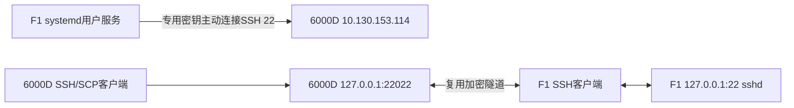

# F1 ↔ 6000D 持久连接

**2026-09-22 新增 [F1-09](F1-09.md)：** Wi-Fi `192.168.31.58`，独立反向入口 `22009` 已部署；免密、自启配置、进程自动恢复和维护网线断开后的连接已验证，Wi-Fi DHCP 地址保留已由用户配置，重连分配待验证。

**2026-09-21 新增 [3F-JIMU](3F-JIMU.md)：** 积木识别分拣投放 demo，现场 IP `192.168.31.165`，独立入口 `22165`；持久服务已部署，免密登录、自启配置和进程退出后自动恢复已验证。

**多机入口：** 本文下方旧记录属于F1_D070（22022）。新机器人正式称[4F-F1](../robots/4F-F1.md)，使用独立SSH配置`F1/connect/robots/f1-22029/client_ssh_config`和22029端口。6000D直连192.168.31.29本次超时，已有反向隧道可用；不得把两机配置或密钥覆盖到一起。

本页对应旧 F1 D070（22022）。2026-09-18 新接入 F1（Wi-Fi `192.168.31.29`）使用独立 22029 入口，见 [新 F1 接入记录](f1-22029.md)。

2026-09-16已部署并验证：F1使用专用密钥建立反向SSH，systemd用户服务负责断线重连，开机启用；6000D仍用`127.0.0.1:22022`登录F1。不经过个人电脑，不依赖IDE或Tailscale。配置、日志、私钥在F1的`/home/user/Bruno/connect/`。

**09-16已测：免密登录、隧道进程退出后自动恢复、权限限制、配置哈希。09-17现场整机重启后又确认一次隧道自动恢复；真实Wi-Fi断开恢复、长期稳定性及传输吞吐仍未专门验收。** 初始连接部署没有发送机器人动作、修改ROS/驱动/回放服务。证据见[部署记录](../../connect/evidence/deployment_20260916.json)与[09-17现场恢复记录](../../foam_sort_whole_body/results/live_feedback_20260917/repair/README.md)。

## 连接逻辑与两套密钥



F1先连接6000D；6000D上的登录请求再沿该连接进入F1，因此6000D不必直接访问F1的Wi-Fi私网地址。数据可双向传输，机器人动作调度仍在F1本地。

| 用途 | 私钥保存位置 | 公钥授权位置 |
|---|---|---|
| F1建立隧道 | F1 `/home/user/Bruno/connect/keys/id_ed25519_6000d_tunnel`，权限600 | 6000D `/home/xza_100850113/.ssh/authorized_keys` |
| 6000D登录F1 | 6000D `/home/xza_100850113/.ssh/id_ed25519_f1`，沿用原密钥 | F1原有 `~/.ssh/authorized_keys`，本次未修改 |

专用隧道密钥无口令，供后台无人值守；私钥没有取回6000D或写入项目。其指纹为`SHA256:DYWU6/ySwGgD5v3V8t9BIL3ACkrpuM7sW8D7sfnjREs`。

6000D对该密钥设置`restrict,port-forwarding`、`command="/bin/false"`：不允许shell/PTY/agent/X11/user rc；远端监听仅允许`127.0.0.1:22022`。`permitopen="127.0.0.1:22"`同时限制其本地转发目标。它是受限转发身份，不是6000D通用登录密钥。测试端口22023已撤销授权并停止服务；未授权22024转发与shell命令均实测拒绝。

F1固定校验6000D的Ed25519主机公钥，来自6000D本机`/etc/ssh/ssh_host_ed25519_key.pub`，指纹`SHA256:IWw8Npjf0zmEsMWqVbyS8p1QzAXMvikX6M0JbaUoovY`。不是网络扫描后无条件信任；主机换钥应独立核对，不能关闭主机校验。

## 日常使用

**6000D终端，任意目录：**

```bash
ssh -F /dev/null \
  -i /home/xza_100850113/.ssh/id_ed25519_f1 \
  -o IdentitiesOnly=yes -o BatchMode=yes \
  -o StrictHostKeyChecking=yes -o HostKeyAlias=f1-d070 \
  -o ConnectTimeout=5 -p 22022 user@127.0.0.1 hostname
```

看到`ms-thor`即登录成功。SCP沿用相同认证参数，端口参数改为`-P 22022`。不要再重复启动手动`ssh -R ...22022...`，否则与自动服务争用同一端口。

**F1的user终端，任意目录：**

```bash
systemctl --user status f1-6000d-tunnel.service --no-pager
systemctl --user is-enabled f1-6000d-tunnel.service
loginctl show-user user -p Linger
tail -n 80 /home/user/Bruno/connect/tunnel.log
```

预期服务`active (running)`、`enabled`、`Linger=yes`。服务active只说明SSH进程存在，端到端应再从6000D运行上面的hostname命令。成功连接时SSH可能不输出日志，空日志不代表失败。日志追加保存，长期运行按需归档；本版未增加日志轮转服务。

## 自动恢复与文件位置

- `Restart=always`，SSH进程退出后等待10秒重试，启动失败不受累计次数限制。
- SSH每30秒发送保活，连续3次无响应则退出；无响应链路通常需要约90秒检测，再加重试/连接时间，不能承诺瞬时恢复。
- `BatchMode=yes`只使用专用公钥，不等待密码；`ExitOnForwardFailure=yes`避免转发失败却留下假连接。
- `Linger=yes`在配置前就已启用。`default.target`已启用本服务，使用户服务可随开机运行，无需IDE保持打开；网络尚未就绪时持续重试。
- 不用`ssh -f`：SSH前台进程由systemd监督。停止服务是显式停用，不会被`Restart=always`重新启动。

| F1路径 | 内容 |
|---|---|
| `/home/user/Bruno/connect/ssh_config` | 专用SSH配置，隔离原`~/.ssh/config` |
| `/home/user/Bruno/connect/known_hosts` | 已核对的6000D主机公钥 |
| `/home/user/Bruno/connect/keys/` | 专用密钥，私钥仅在F1 |
| `/home/user/Bruno/connect/systemd/f1-6000d-tunnel.service` | 实际服务文件 |
| `/home/user/Bruno/connect/tunnel.log` | SSH错误/诊断日志 |
| `/home/user/Bruno/connect/evidence/` | 切换前状态、验证记录 |
| `/home/user/Bruno/connect/README.md` | 本操作说明的部署副本 |

systemd注册需要两处系统管理链接：`~/.config/systemd/user/f1-6000d-tunnel.service`及`default.target.wants/`下同名链接，均指向Bruno内的服务文件。项目文件本体没有散放到其他工作区。6000D侧必须在现有`~/.ssh/authorized_keys`注册公钥，已保留原内容并备份；没有修改sshd全局配置。

源码与非秘密配置见[连接配置目录](../../connect/README.md)。部署时必须保留F1私钥；不要把6000D目录覆盖同步到整个F1 `connect/`。

## 排障与手动恢复

**F1终端：**

```bash
systemctl --user restart f1-6000d-tunnel.service
tail -n 80 /home/user/Bruno/connect/tunnel.log
ip route get 10.130.153.114
```

- `Permission denied (publickey)`：检查专用公钥授权和密钥权限；不是让服务循环输密码。
- `Host key verification failed`：核对6000D主机公钥是否变化，勿改为`StrictHostKeyChecking=no`。
- `remote port forwarding failed ...22022`：检查是否重复启动手动隧道或其他进程占用入口。确认具体归属后处理，不能批量杀SSH进程。
- 超时/网络不可达：先恢复F1到6000D SSH22的网络。服务会继续重试；自动重连不能跨越没有路由或被防火墙阻断的网络。
- `Failed to connect to bus`：确认在F1的`user`登录会话中执行，不要加sudo变成另一用户的服务管理器。

仅在持久服务无法恢复时，先停它，再使用原临时入口（**F1终端**）：

```bash
systemctl --user stop f1-6000d-tunnel.service
ssh -F /dev/null -fNT \
  -o ExitOnForwardFailure=yes \
  -o ServerAliveInterval=30 -o ServerAliveCountMax=3 \
  -R 127.0.0.1:22022:127.0.0.1:22 \
  xza_100850113@10.130.153.114
```

临时方案可能要求6000D密码，不会自动重连。恢复自动方案时先只终止确认属于自己的临时隧道，再`systemctl --user start f1-6000d-tunnel.service`。

## 停用与回退

**F1终端：** 以下会断开经此隧道登录的会话，应从现场终端操作。

```bash
systemctl --user disable --now f1-6000d-tunnel.service
```

保留Bruno内密钥与配置以便恢复。重新启用：

```bash
systemctl --user enable --now /home/user/Bruno/connect/systemd/f1-6000d-tunnel.service
```

永久撤销时，在6000D仅删除`authorized_keys`中对应指纹/公钥的`f1-d070-reverse-tunnel`条目，保留其他授权；不要直接用旧备份覆盖后来新增的密钥。初始备份是`~/.ssh/authorized_keys.before_f1_tunnel_20260916T064319Z`。本次没有改动原6000D→F1登录密钥、机器人业务服务或全局SSH配置。

## 网络历史与用途边界

2026-09-14验证：F1的Wi-Fi为`wlP1p1s0 / 192.168.31.125`，到6000D `10.130.153.114`经`192.168.31.1`；6000D直接连接F1私网地址超时，反向隧道可达。2026-09-16部署时仍观察到F1从`192.168.31.125`连接6000D。Wi-Fi地址变化通常不影响F1主动重建隧道，但新网络必须能到6000D。

原方案是用户手动`ssh -fNT`：关终端通常不结束后台SSH，但进程退出、网络长断或机器人重启后不会自动恢复。2026-09-16已由上面的systemd服务替代。

历史Tailscale状态：6000D `100.102.55.108`、F1 `100.112.143.61`各自Online，但peer列表未包含对方，SSH尝试超时；具体网络归属、共享或访问策略原因未定。本次未改Tailscale。其控制面协调身份和连接，数据面WireGuard加密，优先直连、必要时中继；参考[控制与数据面](https://tailscale.com/docs/concepts/control-data-planes)和[连接类型](https://tailscale.com/docs/reference/connection-types)。这不是当前SSH的数据路径。

本连接用于SSH、明确文件的SCP/rsync与日志读取。模型训练在6000D；[真机replay](../../foam_sort_whole_body/docs/replay_runbook.md)由现场操作者在F1启动。未来F1请求6000D推理服务需另核定服务端口、延迟和超时；本隧道只提供SSH入口，不代表模型服务或机器人动作验收已通过。开发部署约定见[F1 AGENTS](../../AGENTS.md)。
