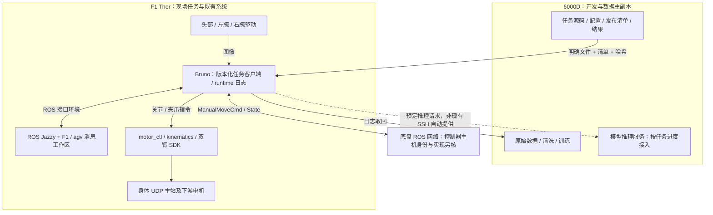

# F1 系统架构、接口边界与迁移经验

**6000D 是本项目开发主副本，F1 的 Bruno 目录是按版本发布的客户端副本；F1 已有的 ROS、SDK、电机、底盘和相机环境另属底层系统。** 迁移项目代码和恢复整台机器人是两项工作。仅复制 `F1/` 不能重建底层系统，也不能自动证明远端正在执行的入口与服务器最新源码一致。

本文汇总已保存的接口、代码和运行证据，供下一台机器接手时理解依赖与排障。系统配置事实以 [F1 系统配置](../F1系统配置.md) 为统一入口；现场与训练当前状态以 [任务当前方案](../foam_sort_whole_body/docs/training_plan.md) 为准。本次撰写只读本地资料，未连接实机、启动节点或修改运行配置。文中日期表示相应证据时间，不能代替再次验机。

## 1. 两台主机与系统分层

| 层 | 6000D | F1 D070 |
|---|---|---|
| 已核对主机 | `hq` / `user`，x86_64 | `ms-thor` / `user`，aarch64 |
| 已核对基础环境 | Ubuntu 22.04.5，系统 Python 3.10.12 | Ubuntu 24.04.3，系统 Python 3.12.3，ROS Jazzy，`6.8.12-rt-tegra` |
| 本项目职责 | 数据归档、清洗、离线 replay、训练、预定的推理服务 | 现场 replay、反馈与图像接入、预定的推理请求客户端 |
| 本项目根目录 | `/home/user/projects/F1/foam_sort_whole_body` | `/home/user/Bruno/F1/foam_sort_whole_body` |
| 模型共享源码 | `/home/user/projects/DM0.5/opendm` | 按客户端实际依赖发布，不默认复制整个模型仓库 |
| 原始数据 | `/mnt/dm05_nvme/dm05/datasets/f1_foam_sort/raw` | 按需部署小型 replay 包，不是原始数据主库 |

这些 OS/架构事实来自 09-14 核对。系统 Python 不代表审计 venv 或训练容器版本；`tegra` 内核名也不证明具体 CUDA、JetPack、GPU 或 TensorRT 版本。两机的 venv、ARM 共享库和 ROS 编译产物不能跨架构直接复用。依据：[系统配置](../F1系统配置.md)、[6000D 配置](../foam_sort_whole_body/configs/machine.6000d.yaml)、[F1 配置](../foam_sort_whole_body/configs/machine.f1.yaml)。

ROS 图上可见某节点，不代表它就在 Thor 本机运行。09-16 已读到底盘 `/controller_node` 参数，但 Thor 进程清单未找到其控制可执行文件；`workspace/agv` 提供消息/接口，不能据此定位底盘实际计算单元。见 [底盘运行核查](../foam_sort_whole_body/results/base_controller_review_20260916/README.md)。

## 2. 文件怎么组织，哪些目录负责什么

| 位置 | 作用 | 迁移时的边界 |
|---|---|---|
| `F1/F1系统配置.md`、两份接口 md | 跨任务共用的系统事实与协议参考 | 接口 md 混有历史示例，须对照当前二进制/运行参数 |
| `F1/docs/` | 通用架构、接入、数据工作流与交接经验 | 持续状态留在各任务当前方案，避免多份状态互相矛盾 |
| `F1/reference/<日期或版本>/` | 原样参考文件、来源路径、抓取时间、SHA | 是选定证据快照，不是整机备份或可运行系统 |
| `<任务>/scripts/ configs/ docs/` | 工具、机器差异、数据合同与操作说明 | 不在脚本里悄悄混入另一台机器的路径或模式 |
| `<任务>/robot/` | ROS 适配、调度、姿态工具、数学 FK/IK | 纯数学与离线调度可在服务器验证；ROS 与本地 C++ 库须在 F1 环境验证 |
| `<任务>/models/DM0.5/` | F1 专用 reader、配方与训练适配 | 通用实现仍依赖工作区 `DM0.5/opendm`，复制 F1 单目录未必包含全部依赖 |
| `<任务>/deploy/ results/deployments/` | 发布工具、清单、旧入口备份和校验记录 | 必须保留实际发布文件，不能只记 Git commit |
| F1 `releases/<id>/`、`current`、`runtime/` | 发布版本、选择入口、可变日志与现场产物 | 代码和运行数据分开；切 `current` 不切换已有进程 |

底层已有工作区另行保留：`/home/user/workspace/f1/install`（电机/运动学/消息）、`workspace/agv/install`（底盘消息）、`workspace/camera/ros2_ws/install`（腕部相机）、`/home/user/zxl/install/arm_replay`（既有回放）、`workspace/whole_body_ctl` 与 `workspace/EC_Line_Control`（身体控制）。这些是已保存证据中的路径，不是全套依赖清单。09-14 的 F1 控制工作区只有 `build/install/log`，未看到 `src`；只备份 `src` 会丢掉当时唯一部署证据。见 [工作区配置](../F1系统配置.md) 与 [开发部署约定](../AGENTS.md)。

**版本核对必须沿实际执行入口追踪。** 本地 [replay_v3.sh](../foam_sort_whole_body/scripts/replay_v3.sh)、[pose_v3.sh](../foam_sort_whole_body/scripts/pose_v3.sh)、[base_home.sh](../foam_sort_whole_body/scripts/base_home.sh) 使用明确的 release 路径；历史发布又曾替换外层入口。因此只检查 `current`，或只比较服务器某个同名脚本，均不足以证明实际运行版本。应同时记录入口内容、解析后的发布目录、实际加载模块/原生库、profile、数据包 SHA；运行中的进程还可能继续持有旧代码。发布细则见 [AGENTS](../AGENTS.md) 与 [命令监听发布记录](../foam_sort_whole_body/results/deployments/20260916-command-activity-v5/deployment_report.json)。

## 3. 控制与反馈接口：同样的 ROS 类型不保证同样的单位

| 对象 | 下发 / 反馈 | 必须遵守的语义 |
|---|---|---|
| 双臂 14D | `/motion_ctl/joint_ctl` / `/hal/joint_states`，`JointState` | 关节角为**度**；左 `arm_l_j1..7` 后右 `arm_r_j1..7`；控制单臂也需完整 7 关节 |
| 遥操作目标 | `/lead/joint_states` | 名字为 `arm_L_joint1..7` / `arm_R_joint1..7`；不能靠 topic remap 自动改内部名字 |
| 双夹爪 | `/motion_ctl/gripper/{left,right}`，`GripperCommand`；各自 `/state` 为 `JointState` | `position=0` 全开、`100` 闭合；不是毫米；当前 OmniPicker 实现忽略 `max_effort`，填 0 不构成限力保证 |
| 身体 5 轴 | 具名 `body_j1..5` 可经同一 `/motion_ctl/joint_ctl`；反馈来自 HAL | 角度为度，内部映射 UDP 电机 ID 3..7；不是“底盘 3＋腰 2” |
| 底盘命令 | `/move/ManualMoveCmd`，`TwistStamped` | `twist.linear.x/y` 为 m/s、`twist.angular.z` 为 rad/s；当前 profile 用 `base_link` |
| 底盘反馈 | `/move/State`，`move/msg/State` | `speed` 是速度反馈；`odometry.position.x/y` 为 m，**`orientation.w` 直接存 yaw 弧度** |
| 原生 FK/IK | `/kinematics/forward_kinematics`、`inverse_kinematics` | 关节度；矩阵行优先；平移 mm，xyzabc 为 mm/度；左右标识 0/1 |
| 本地数学 FK/IK | `robot/kinematics.py` | 对外关节度、4×4 位姿平移 m；使用各臂原生参考系及默认端点，不暗加 TCP 或相机外参 |

协议入口：[系统接口清单](../F1系统接口清单.md)、[底盘接口文档](../通用机器人软件接口文档.md)；执行字段布局与引用位置见 [动作接口合同](../foam_sort_whole_body/docs/action_interface_contract.md)。当前夹爪实现证据见 [运行配置核对](../foam_sort_whole_body/results/replay_runtime_fix_20260915/README.md)，身体路由见 [身体接口核对](../foam_sort_whole_body/results/pose_setup_20260916/body_interface_findings.md)。

几个已踩过的接口坑：

- `JointState.position` 在本系统承载度，不能因为是标准 ROS 类型就按弧度处理；同理 `/move/State` 的 Pose 字段不是标准四元数。该字段 `(0,0,0,0)` 在本协议中可表示 yaw=0，不能仅因范数为 0 删数据。其他接口须逐项读其定义，不能推广这个特例。
- 候选遥操作源码中的 Placo 变号、偏置和弧度转度发生在硬件目标生成上游。普通路径的 `/lead` 与 UDP 来自同一安全缓存，桥按左 7、右 7 原值下发；**已经录下的 `/lead` 不再做一次 Placo 变换**。两个路径异步取样，没有逐帧执行 ACK。复位还可能绕过普通 `/lead`，缺口不能补成保持目标。证据：[主从映射依赖核对](../reference/20260914_action_mapping_followup/README.md)。
- 接口文档同时保存旧超限报错、0608 钳位及旧身体入口“弃用”说明。09-16 当前 motor_ctl 的限位是二进制固定常量，身体 ROS 路由实际可用；旧示例不能覆盖已绑定 SHA 的当前版本事实。
- `/move/State` 的 200 Hz 是反馈频率；手动指令示例 20 Hz 是示例；数据重采样 30 Hz 是来源时间轴，三者不是一个配置。当前回放调度的 31 Hz 上限仅给 30 Hz 来源留抖动余量，不代表把轨迹加速。见 [调度修复](../foam_sort_whole_body/results/replay_runtime_fix_20260915/README.md)。
- `GripperCommand` 本身没有 header；日志里的 `ros_stamp` 是上下文，不能当成夹爪消息携带的采集/执行时刻。四路下发共享一次 stamp 也不等于硬件原子同时执行。对应实现：[ros_backend.py](../foam_sort_whole_body/robot/f1_replay/ros_backend.py)。

## 4. 环境、控制权与模式检查

**先分清“没有依赖”“没有发现”“没有新鲜数据”“当前模式不符”，再处理对应层。**

1. `move.msg.State` 来自 `/home/user/workspace/agv/install/setup.bash`；只 source Jazzy 和 F1 工作区不够。通用 [replay.sh](../foam_sort_whole_body/scripts/replay.sh) 不自动补齐所有系统消息工作区，版本入口或现场终端需按 [replay 操作](../foam_sort_whole_body/docs/replay_runbook.md) 加载 agv 环境。导入成功仍须核对 ROS 类型支持。
2. 09-16 对照证据：默认 Fast DDS 能读 motor_ctl 参数，却看不到底盘；F1 原有 CycloneDDS 能收底盘，对 motor_ctl 参数服务却超时。现有方案使用 CycloneDDS 控制/反馈，独立 Fast DDS 子进程只读参数；它没有创建动作发布者。不要为了一个参数调用成功把整个客户端改成另一种 DDS。当前 Cyclone 配置绑定 `enP3p1s0f1`，迁移后必须重新核对网口、XML 与 ROS domain。见 [DDS 修复](../foam_sort_whole_body/results/replay_runtime_fix_20260915/README.md)。
3. 读参数应先 List 再 Get；旧实现批量请求了不存在的 28 个关节限位，拿到空结果。没有这个参数不代表无限位。当前版本用运行二进制 SHA 核对固定限位，与 ROS 读回的控制模式、夹爪类型分别记录。
4. `SetControlMode.mode=0` 表示软自动，`1` 表示软手动；`is_soft_auto=true` 则表示自动。模型自动执行仍可使用软手动 `ManualMoveCmd`，不能按中文“自动”直接切错模式。现有 profile 另外核对硬自动 true、驻车 false、避障 false；模式可能在重启或操作后变化，旧 preflight 不能代替执行前重读。
5. ROS graph 注册发布者不等于正在抢控制。当前 `observed_idle_v1` 监听实际命令，按本进程 RMW 身份排除自身消息，检测外部任何命令时停止；待机复位/升降/旧回放可存在。这个机制不是控制器侧互斥锁，外部第一条命令仍可能先到硬件。Jazzy Python 回调缺少所需 publisher GID，迁移时须重建并核验配套 C++ 监听库，不能只复制 Python。见 [控制占用修复](../foam_sort_whole_body/results/control_ownership_20260916/README.md)。

09-17 还出现了独立于 DDS 的网卡 `Tx Unit Hang`：原网口 link up 不代表底盘链路可用，NetworkManager 重连未恢复，现场重启后恢复；左腕目标序列号不在也需要现场接回设备。故障恢复后仍出现硬控制模式变化，不能将新模式阻塞误判成旧网卡故障复发。详细症状、尝试和结果见 [09-17 通信与相机记录](../foam_sort_whole_body/results/live_feedback_20260917/repair/README.md)。不凭 USB sysfs 序列号直接改 RealSense SDK 的绑定序列号。

SSH 与 ROS 控制网络也要分开看：反向 SSH 经 F1 到 6000D 的网络建立，只提供 SSH/SCP 入口；它不自动转发整套 DDS，也不代表模型服务端口可达。持久连接配置、身份与恢复方法见 [连接说明](connect/README.md)。

## 5. 时钟与运动响应：日志怎么解释

| 时间/观测 | 可用于什么 | 不能直接推导什么 |
|---|---|---|
| 数据包 `source_time_ns` 与相对时间 | 保留来源节奏、等待和动作顺序 | 不是当前 ROS 系统时间 |
| 当前 ROS header | 标记消息自身时钟下的时间 | 跨主机未校对时不能直接与 Thor 图像或 bag 接收时间相减 |
| 本机 monotonic 接收/派发时刻 | 新鲜度、调度迟到、同机因果顺序 | 不可直接当 Unix 时间，也不是曝光/硬件执行时刻 |
| bag 本机接收时间 | 同一录制机上对齐命令和反馈、积分诊断 | 不等于源设备物理采样的同步保证 |
| HAL / 速度 / 里程计反馈 | 检查执行响应和停止结果 | 可能有控制滞后或共同传感来源，不是独立外部真值 |

[ros_backend.py](../foam_sort_whole_body/robot/f1_replay/ros_backend.py) 对各关节分别记录本机单调接收时刻，因为 arm/body HAL 可分开到达；缺失或非法字段不由其他关节的新消息“刷新”。[runtime.py](../foam_sort_whole_body/robot/f1_replay/runtime.py) 用单调时钟调度，不在延迟后突发追发旧帧；命令 header 由执行时刻重建。退出时发布零速并等停止开始后的新反馈，发布成功本身不证明机械停止。

09-16 两轮底盘 header 比 Thor bag 接收时刻稳定落后约 **87.581 秒**。这不是已经测得 87 秒网络延迟，更符合主机时钟域不同；未取得主机校时证据前只能保留这种解释边界。不可把一个常数直接套到原 801 条，也不可在动作过程中贸然调系统时钟。三路图像同样要区分 header、记录时刻和曝光时刻。见 [底盘时间诊断](../foam_sort_whole_body/results/base_controller_review_20260916/README.md) 与 [通用数据工作流](dataset_workflow.md)。

**速度命令积分正确，不保证车走够距离。** 09-16 `/controller_node` 实读线加速度 0.13 m/s²、减速度 0.5 m/s²、线速度上限 1.5 m/s；057 首次后退的原 smoothstep 要求 1.87 m/s²。命令能积分到 50 cm，底盘仍可能只走一部分，命令归零后不承诺补足距离。同节点 `chassis.threshold.acceleration.linear=1.5` 不能冒充实际 `max_acceleration.linear`，任务软件拒绝上限 0.65 m/s 也不是硬件额定能力。四转向轮初始角、转向准备与地面外测仍须分别核实。历史数值与算法假设见 [完整反馈核查](../foam_sort_whole_body/results/base_controller_review_20260916/README.md)；当前 demo 对距离精度的取舍遵循 [当前方案](../foam_sort_whole_body/docs/training_plan.md)，不在本文另立训练门槛。

**姿态已到位和起姿运动平顺是两项检查。** 09-16 身体起姿约 29.71 Hz、没有明显调度停顿，现场仍震动；原厂路径名义 200 Hz，仅构成实现差异，尚未证明升频就是修复。五轴同步插补也不保证机构碰撞或平顺。底盘/相机恢复、replay 曾经成功，都不能解除旧起姿过程尚未验收的限制。见 [身体起姿震动记录](../foam_sort_whole_body/results/pose_vibration_20260916/README.md)。

## 6. 运动学与模型合同怎么带走

原始来源包继续保存 `state21 = arm14 + gripper2 + body5`、`action19 = arm14 + gripper2 + base3`；正式模型合同另为 `state19 = arm14 + gripper2 + base3`、物理 `action23 = 2 × (xyz3 + rotation6D) + gripper2 + base3`，再补齐 32D。相同“19D”可能指不同量，不能只看向量长度接线，也不能复用 G2 的 34D 布局或归一化。训练/推理 base state 分别为复核重建速度与在线速度反馈，要保留来源差异。见 [训练 recipe](../foam_sort_whole_body/docs/training/dm05_eef_delta_recipe.md)。

运动学移植绑定 [IK/FK demo recipe](../foam_sort_whole_body/docs/training/ik_fk_demo_recipe.md) 和 [原生快照](../reference/20260916_kinematics/README.md)：

- 原生配置为 `ccs_m6_40.MvKDCfg`；本地 FK 包含改进 DH 的第 8 行固定末端变换，已对照原生数值。每臂原生坐标系不是已经标定到世界、相机或夹爪尖端的通用坐标系。URDF、安装外参和碰撞模型仍须独立核定。
- 原生 IK 中 `target_xyzabc` 长度为 6 时优先于矩阵；以矩阵求解应将前者留空。SDK `success`、`is_joint_exceeded`、控制器边界、位姿误差是不同条件，不能只看 success。SDK 与控制器矩形限位不同，另有 J6/J7 耦合约束。
- 当前数学层对外用 m、内部优化关节用 rad，原生 SDK 用 mm；只在清晰的边界转换一次，避免共享数组原地换单位污染后续对照。加载后 PNVA 列序为“正限、负限、速度、加速度”，不是文本里负限先出现的顺序。
- 一个 chunk 的 EEF delta 始终相对**同一个观测锚点**；还原为 `T_anchor @ Delta[k]`，不能逐步积分到上一步预测。rotation6D 是旋转矩阵前两行；归一化 32D 输出要先反归一化并取物理 23D。
- 7 轴冗余使 EEF 无法唯一还原原示教关节；当前反馈/上一接受解影响选择的分支。失败返回空关节轨迹，不把诊断候选或事后 clip 结果当作原 EEF 的正确解。

09-16 原 8 条小批通过后，新增 64 条发现 76 次拒绝及 8 个关节变化放大标记；用户随后接受现有求解器作为 demo 基线，冻结 `f1_ikfk_demo_v1`，暂缓算法优化。这个决定是有已知缺口的实验取舍，不是全面实机验收。F1 ARM 时延、实际 policy 输出、首步过渡、速度/加速度和碰撞仍未被离线数学 success 覆盖。证据与版本见 [冻结 recipe](../foam_sort_whole_body/docs/training/ik_fk_demo_recipe.md)、[64 条扩测](../foam_sort_whole_body/results/ik_coverage64_20260916/README.md)。

## 7. 迁移什么已具备，什么还没有闭合

| 事项 | 已有证据/可带走的部分 | 仍需补齐或重新验收 |
|---|---|---|
| 本项目源码与发布 | 6000D 开发树、版本清单、部分部署前备份、任务脚本与配置 | 远端真实入口和运行文件是否全部回收；服务器工作区最新不等于远端自动同步 |
| 数据与模型 | 原始数据在数据盘，清洗结果/来源清单在任务目录，共享模型代码在工作区 | 独立备份数据盘与跨目录依赖；模型 checkpoint/归一化/正式发布状态按任务清单确认 |
| 控制器 | 运行 SHA、限位常量、部分安装 launch/接口、动作映射证据 | 可复现的控制器源码/构建配方、完整 ARM SDK/依赖、系统启动与配置备份；当前不是整机恢复包 |
| 身体与运动学 | 身体具名通道和限位、原生 FK/IK 配置与服务定义、本地数学实现 | 真实机械轴、耦合、URDF/TCP/碰撞几何、下游 EtherCAT 插补；换机需重新核定 |
| 底盘 | 状态/命令接口、已读运行参数、历史响应日志 | 控制器所属主机与实现、采集时参数、坐标方向与实际响应、超时/停车机制完整合同 |
| 相机 | 三路 topic 与已定位驱动入口、09-17 短时实收证据 | 型号/SDK/启动参数完整来源、相机序列号、内外参、时钟及长时稳定性 |
| 接入 | 反向 SSH 非秘密配置与部署记录，09-17 有重启自动恢复实例 | 新网到服务器的路由、受限公钥授权、独立主机身份验证；私钥不会随 Git 或公开发布包搬走 |
| 本地原生库 | 命令监听 C++ 源码、旧 ARM 编译产物与 SHA | 新目标 ROS/RMW/架构上编译并做身份过滤验证，不能把旧 `.so` 当通用资产 |

迁移验收顺序是：**文件完整性 → 目标环境依赖 → 只读反馈/参数/模式 → 离线数据与数学 → 现场起点和控制权 → 现场动作效果**。每层独立记录结果，后续放行不能由前一层自动推出。真机动作由现场操作者启动；后台 replay 未结束时不覆盖入口、切版本或重启共享底层系统。具体备份、发布、回退范围遵循 [F1 工作约定](../AGENTS.md)。

证据解释也按层级写清：接口文档说明协议意图；磁盘文件说明保存内容；运行进程 SHA 说明当时执行文件；实时参数/反馈说明当时运行状态；完整日志和外部观察说明那次效果。任何一层都不能反推出过去采集时必然使用同版本，也不能单独证明另一台 F1 迁移成功。
