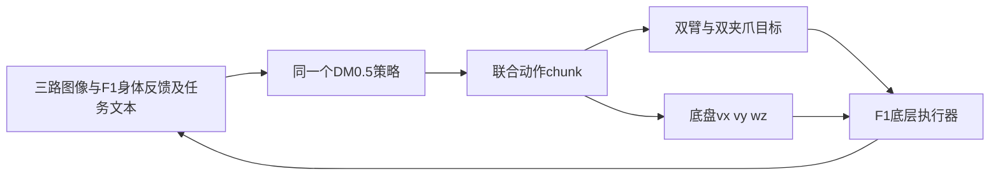

# F1 泡沫棉移动操作：最终数据审查与训练路线

日期：2026-09-14。机器人身份由用户确认：采集与部署均为新的自研 F1，构造类似 G2。
后续补充：body5只是已确认的字段数，尚非已确认的腰部机械自由度；已发现一条双循环底盘阶段错配。
详见 [最新训练前补充](body_mapping_and_cycle_review.md)。
本次直接检查最终数据，不依赖补标生成脚本。当前结论对应数据审查，尚无新任务训练或真机成功率结果。

用户后续已明确本轮目标为朴素端到端全身 VLA；当前动作/状态维度、视频和处理计划以
[当前训练方案](../training_plan.md) 为准：双臂与双夹爪保留，21D输入/19D输出。任务已迁移至 `F1/foam_sort_whole_body/`。

## 结论与当前状态

数据已同步追平：801 条 episode、2,403 个文件、639,224,060,381 字节，约 639.22 GB。
最后一个文件于北京时间 9 月 12 日 12:41 完成下载。最后运行快照源端缺件和下载错误均为 0。
9 月 14 日按用户要求停止并禁用了同步服务，确认 inactive/dead、MainPID=0、无 Docker 同步实例；
后续不再自动补拉。`transfer/status.json` 已更新为 complete / stopped_by_user；`hqftp status` 显示完成。
数据盘约剩 940 GiB。旧报告中缺少的 `all_data_2_derived/episode_000117` 已补齐。

这批数据可以作为 F1 移动操作的学习资产。直接把后补底盘消息视为真实全身动作监督则证据不足。
应先修正字段和时间轴，保留手臂/夹爪示教，给底盘弱标签单独的用途与评估边界。
对“固定位置抓取—移动—放置—返回”，本轮使用一个模型联合输出手臂、夹爪和底盘动作，
底盘弱标签明确参与实验损失；不以补采实测底盘数据作为开始离线实验的前提。

## 检查范围及能证明什么

| 检查 | 覆盖 | 结果与边界 |
|---|---|---|
| 文件与元数据 | 全部 801 条、2,403 文件 | 本地大小、源清单与下载记录吻合；各批编号连续 |
| MCAP 摘要与消息索引 | 全部 801 MCAP | 与 YAML 的 topic/数量一致 |
| 非图像消息 CDR 解码 | 全部 11,195,164 条 | 无解码错误或 NaN/Inf，已检查 CRC 均通过 |
| 已读取数据块 CRC | 496,016 个非零 CRC 块 | 通过；不是全部视觉数据块的全文件认证 |
| 相机 log 时间 | 三路全部消息索引 | 检查间隔、共同有效时间段；不是图像 header 时间 |
| 相机 header 时间 | 801 条 × 3 路 × 7 个采样窗口 | 16,048 个有效采样，16,033 个唯一帧；属于抽样 |
| 图像像素 | 13 条代表 episode 的阶段预览 | 226 张 JPEG 成功解码；人工查看部分拼图，未逐帧标注全部成败 |

相机时间戳抽样通过 CDR 前缀读取，已与标准 ROS 消息完整解码交叉核对。
文件可读、消息自洽、动作成功、训练有效是不同层次的结论。本次没有全量重新计算 639 GB 的
SHA，也没有把本地 SHA 与源端独立提供的校验和比较。

## 数据规模

采集时间由 metadata/MCAP 的 Unix 时间戳换算为北京时间。累计时长相加各条录制时长，
不包含条目之间的等待。GB 为十进制。

| 批次 | episode | 大小 GB | 采集时间（2026） | 累计小时 |
|---|---:|---:|---|---:|
| all_data_derived | 200 | 251.627 | 9/3 10:36–19:56 | 3.505 |
| all_data_1_derived | 100 | 79.060 | 9/4 10:04–12:19 | 1.115 |
| all_data_2_derived | 301 | 189.404 | 9/4 13:59–19:04 | 2.692 |
| all_data_3_derived | 200 | 119.133 | 9/5 10:43–15:45 | 1.727 |
| 合计 | **801** | **639.224** | 9/3–9/5 | **9.039** |

共有 14,103,370 条 ROS 消息，其中 2,908,206 条为三路图像消息；它们不是同步后的训练帧数。
图像抽查分辨率：头部 1280×720，左右腕各 848×480。

## 最终数据到底记录了哪些身体信息

| 部分 | 最终消息证据 | 对本任务的含义 |
|---|---|---|
| 双臂反馈 | `/hal/joint_states` 中 `arm_l_j1..7`、`arm_r_j1..7` | 14 个测量状态字段 |
| 双臂示教 | `/lead/joint_states` 的左右各 7 维 | 可作为候选示教目标；与最终执行器命令的对应仍需 F1 控制合同 |
| 头部 | `/hal` 中 `head_j1..3` | 有状态，未发现头部动作 topic |
| 身体/腰部 | `/hal` 中 `body_j1..5` | 有 5 个状态字段，未发现对应腰部动作 topic |
| 手部占位 | `/hal` 中 12 个 `hand_*` 字段 | 全数据均为 0，不能当作有效灵巧手控制示教 |
| 夹爪 | 两路 `/motion_ctl/gripper/*` 命令与 `*/state` | 与上述 12 个手部占位字段是不同接口 |
| 底盘 | `/move/State` 的 pose、speed | 全部为后补估计；当前 topic 集合没有真实底盘命令、独立里程计、TF |
| TCP | `/lead/*_tcp` 与 `/state/*_arm/tcp_pos` | 坐标系与数值尺度不同，不能直接互换 |

F1 的 `/hal` **34 个字段 = 双臂 14 + 头 3 + body 5 + 手部占位 12**。
旧饮料瓶任务的 **34D = 双臂 14 + O10 双手 20**。维数恰好相等不代表字段相等。

801 条均有明显左臂运动；以“某关节单条范围超过 5 个原始数值单位”作粗筛，800 条也有明显右臂运动。
因此应保留双臂信息。右夹爪命令与反馈全数据均为 100，缺少右夹爪开闭变化的示教。
这不能支持“右手会抓各种物体”的结论，但也不能因为右夹爪固定而删掉右臂。

身体/腰部每条最大关节变化量的中位数约 0.0968，最大 0.2451 个原始单位；
双臂对应中位数约为左 101.08、右 36.58。整个数据中 `body_j4` 约在 -53.086 至 -52.213，
`body_j3` 约在 -42.144 至 -42.028。**这些数据更接近固定腰姿态下的移动操作，
缺少学习主动调腰的丰富动作覆盖。** 测量微小变化不等于主动腰部示教命令。

关节数值量级很像“度”，机器人 TCP 平移量级很像“毫米”，Pico/lead TCP 则是另一量级和 frame。
这是基于数据的强提示，尚未把单位认定为已验证。ROS 常规使用米、弧度，例外需显式说明；
转换器必须按 F1 字段合同处理，不能仅凭消息类型猜单位。[ROS REP-103 官方原文](https://raw.githubusercontent.com/ros-infrastructure/rep/master/rep-0103.rst)

## 固定路线后补底盘：可用，但用途要分清

全 801 条 JSON 都明确声明 `estimated_weak_label_not_measured_odometry`。
每条假设同样的全向底盘、后退 0.5 m、横移 1.6 m、yaw=0，再返回；
740 条标为 camera_global_motion，记录 confidence=0.55，另外 61 条有 fallback、confidence=0.25。
这些 confidence 没有独立准确率标定。

直接解码 979,690 条 `/move/State` 后发现：

- 全部轨迹位置范围都是 `[0.5, 1.6, 0]`，角速度全为 0。
- 位移与速度数值导数基本一致，逐条 RMSE 的中位数约为 x=0.000377、y=0.000319；
  没有出现位姿静止但速度持续非零的区间。单位和 frame 未认证，这不是实际物理速度误差。
- 少量末尾采样没有恰好落在数学终点，最大末点距离仅约 0.000339，
  不能将其解释为真实机器人返回误差，也不应据此判定任务失败。
- 速度范数峰值的中位数约 1.178，最大 4.160692（按补标口径为 m/s）。
  最大值在 `all_data_2_derived/episode_000256` 的起点后约 5.885 秒。
- 每条 `/move/State` 的 log 和 publish 时间都逐消息复制匹配 `/hal`；
  这证明它们在构造时对上了同一时间序列，不能作为独立传感器交叉验证。

**固定的是几何路线，不必然固定实际速度、启动时刻、停顿、滑移和控制器响应。**
因此，同一路径的后补数据可以服务于阶段标记、固定场景先验和明确标识的弱监督实验；
若目标是让 VLA 直接给底盘连续速度，仍需对照实际底盘执行记录或新采验证。

需要区分三种数据：

| 数据 | 表示什么 | 当前可用性 |
|---|---|---|
| 阶段 | 抓取、携带移动、放置、返回 | 可先人工核对，再用于切段/阶段学习 |
| 状态 | 真实或估计的位姿、速度 | 当前底盘是估计，腰/臂有反馈 |
| 动作 | 当时实际发送的控制目标 | 有双臂候选示教与夹爪命令，底盘和腰命令缺失 |

位姿微分得到的速度与控制命令不是天然同一个量。即使两者数值接近，也有执行延迟、限幅、
底层闭环和采样问题。当前 4.16 的峰值是**补标数值**，不能宣布机器人真实跑了 4.16 m/s；
也不能在未知 F1 能力时直接作为可执行指令。先核对该段画面与接口允许范围。

### 底盘姿态的特殊字段编码

补充核对（2026-09-14）：新增供应商文档明确规定 `/move/State` 的 `odometry.orientation.w` 存yaw弧度。
因此下述全零值在本协议下是yaw=0，不能仅因不符合标准四元数就判坏数据；完整说明见[动作接口映射](../action_interface_contract.md)。

979,690 条底盘消息的 quaternion 全部为 `(0,0,0,0)`。
JSON 说明是把 yaw 弧度直接存入 `orientation.w`，本数据 yaw 又恒为 0。
全零四元数不能表示标准姿态。

导出时应保留“这是后补 yaw”的来源，并显式导出 yaw 标量；若目标格式要求标准四元数，
再按 yaw 编码为 `(0,0,sin(yaw/2),cos(yaw/2))`。这是面向标准姿态工具的格式适配，不会把弱标签变成实测真值。
不要对全零四元数直接归一化。

## 时间轴是训练前必须处理的实际问题

### 相机时钟

相机抽样约定：`offset = header_time - mcap_log_time`。正值表示 header 比 log 晚。

1. `all_data_1_derived` 的 100 条和 `all_data_2_derived` 的 301 条，
   左腕稳态 header 都比 log 约晚 **1.317 秒**。直接把不同 topic 的 header 拼到同一时间轴会错配。
2. 666 条在首部探针出现 header 相对稳态明显异常；最极端的一帧相差约 6000.8 秒。
   这可能涉及缓存首帧、时间基准或驱动行为，不能把偏差直接解释成真实图像传输晚了 100 分钟。
3. 三条在约 3 秒处仍抽到了异常首次消息：
   `all_data_1_derived/episode_000059` 左腕、`all_data_2_derived/episode_000175` 右腕、
   `all_data_3_derived/episode_000012` 右腕。因此统一裁掉开头 0.5 秒不足以解决。
4. 773 个无帧采样窗口全部落在开头两种探针，其他设定窗口都有帧。
   开始录 bag 不等于三路相机都已进入稳定状态。

建议：先按每条/每路确定新鲜且共同有效的起点，剔除陈旧首帧；建立时钟映射并用可见手臂运动、
抓放事件核对。MCAP log 可作当前审计公共参考轴，但它不是已证明的传感器曝光时间。
没有完成这一步前，不应盲目统一 header，也不应给所有相机套同一个固定偏移。

### 反馈断档与帧间隔

`all_data_2_derived/episode_000055` 的 `/hal` 与 `/move` 在起点后
**32.178959–34.779042 秒之间有 2.600083 秒断档**；夹爪反馈及实际 TCP 也有约 2.58 秒断档，
而 lead 命令仍持续。应先隔离跨越该断档的训练窗口，不能用跨 2.6 秒的线性插值伪装连续反馈。

头相机全量 log 索引中有 777 条出现大于 `max(100ms, 3×本条中位间隔)` 的间隔，
最大约 0.5335 秒（`all_data_2_derived/episode_000264`）。这是时间间隔复核提示，
不是 777 条全部报废。应记录每帧龄期、按时间对齐、对长空洞裁窗或掩码，
避免用相同 frame index 直接拼 30 Hz 相机和约 33 Hz 示教命令。

## 已建立的筛选结果

筛选以清单表达，原始 801 条全部保留。下面是**处理优先级**，不是训练集通过数量。

| 队列 | 条数 | 当前动作 |
|---|---:|---|
| P0 | 4 | 隔离反馈断档/晚到首帧相关窗口并精查 |
| P1 | 460 | 先审相机时钟映射、偏移变化或底盘速度模板 |
| P2 | 312 | 先审启动帧、阶段回退与其他标签问题 |
| P3 | 25 | 常规画面与任务结果抽查 |

P0 为 `all_data_1_derived/000059`、`all_data_2_derived/000055`、
`all_data_2_derived/000175`、`all_data_3_derived/000012`。
队列中的速度阈值只是复核触发值，不是 F1 已验证的速度上限。

审计清单将底盘“实测命令监督”和腰部动作监督 mask 设为 0，表示对应实测命令缺失。
这不是本次模型训练的最终 loss mask：当前端到端实验单独将底盘弱标签损失权重设为 1.0，
见 `models/DM0.5/experiment.yaml`。手臂/夹爪在时钟、字段和结果审查通过后进入训练清单。
尚未给任何一条打“全循环任务成功”标签，没有自动删除或自动批准正式训练。

下一步筛选应做到片段级：标出成功抓住、移动开始/结束、成功放下、返回到位；
连续有效区间通过后再构建 action chunk，禁止 chunk 跨越反馈空洞或时钟跳变。
按采集批次/时间块划分训练验证，不把同一 episode 的相邻帧随机拆到两边。

## 全身 VLA 相比原上肢任务的变化

核心变化是身体各部分改变彼此的观察与可达性：底盘移动会改变整个场景和手到物体的关系，
腰部运动会改变相机与手臂的基座，抓住物体时的移动又受到携带与放置要求约束。
它需要统一时间、坐标与执行接口，并包含相应协调动作的示教。

| 方面 | 原固定底座上肢任务 | F1 移动操作 |
|---|---|---|
| 状态 | 双臂、手/夹爪、图像 | 再考虑底盘、腰部及其坐标和可用反馈 |
| 动作 | 关节位置/增量、开度 | 可能混合关节目标与底盘速度，分别编码 |
| 时间 | 抓放短程局部动作 | 抓取—携带—到位—放置—返回的长程阶段 |
| 评估 | 抓取/放置准确性 | 再包括携带不掉、导航到位、返回和全循环成功 |

全身 VLA 不要求网络直接输出电机力矩。例如 π0.5 原论文的移动机器人由策略联合输出
双臂/夹爪/躯干目标和底盘速度，再由底层控制器跟踪。
这表明该设计可行，但不证明当前 DM0.5 项目已经具备 F1 的全身执行链路。
[π0.5 原论文 IV-E](https://www.physicalintelligence.company/download/pi05.pdf)

当前数据有底盘平移场景和双臂运动，但 yaw/角速度恒零、腰部变化很小、缺腰部动作命令。
适合先研究这类固定腰姿态的移动操作；不能据此声称模型已学会主动调腰、转向或任意全身协调。

## SLAM、导航与 VLA 的分工

SLAM/定位回答“地图是什么、机器人在哪里”；规划器决定路线；控制器根据实时误差产生速度，
任务逻辑决定何时抓取、移动和放下。SLAM 本身不负责全部底盘动作，也不自动解决腰部控制。
[Nav2 状态估计](https://docs.nav2.org/jazzy/getting_started/navigation_concepts/state_estimation/)
[Nav2 规划与控制](https://docs.nav2.org/jazzy/getting_started/navigation_concepts/navigation_servers/)

固定场景不一定每次都运行在线建图；已有地图定位、里程计加局部目标控制等方案都可能适用。
关键是闭环确认到位，而不是仅靠“运行固定秒数”推断到位。

本轮按用户目标采用的端到端基线：

不使用外部抓取成功规则切换导航，也不由导航替代策略生成底盘动作。底层伺服执行目标仍然必要，
它与高层任务解耦是不同层次。可以先用当前后补底盘标签做联合训练，评估其效果。
后续真实底盘命令/反馈有助于量化标签误差，但不是当前离线 baseline 的准入条件。
只与同一补标模板比较离线 loss 不能证明真实控制能力，最终仍看完整循环结果。

## DM0.5 复用与新目录

新任务已经建立在 `F1/foam_sort_whole_body/`。其职责是场景、字段、审计、筛选、
训练配方和评估；通用模型仍复用 `DM0.5/opendm/`。F1 实际执行接口需要独立适配，
不能因为构造类似就直接调用 G2 GDK。

代码核查证据：

- `DM0.5/g2_sort/data_tools/g2_contract.py` 固定 34D=14 臂+20 手。
- `DM0.5/opendm/opendm/model/dm05/dm05_arch.py` 已提供动作投影维数调整接口，
  所以 34D 不是通用模型不可变上限。
- `DM0.5/opendm/opendm/data/transforms.py` 相对动作路径直接执行 `action-state`，
  推理再 `state+action`。如果 state 是底盘位姿、action 是速度，这种整向量相减在物理量上错误。
- 原 G2 NewLoRA 已为“臂相对、手绝对”做专门编码；F1 同样需要按字段编码与自己的归一化统计。
- `G2Teleop/scripts/12_g2_powered_f710.py` 的现有主入口明确
  腰只读、无底盘输出；它不是已经完成的 F1 全身控制器。

原始数据虽然历史路径带 `dm05`，本次通过新任务配置引用即可，无需为名称整齐再次搬动或复制大数据。

## 产物与复现

- [任务入口](../../README.md)
- [场景配置](../../configs/scenario.yaml)
- [字段合同草案](../../configs/data_contract.draft.yaml)
- [元数据审计汇总](../../results/20260914/metadata_audit/summary.json)
- [全部非图像消息审计汇总](../../results/20260914/mcap_audit/summary.json)
- [相机时间戳抽样汇总](../../results/20260914/camera_timestamps/summary.json)
- [合并复核队列 CSV](../../results/20260914/screening/review_queue.csv)
- [字段监督与复核清单 JSONL](../../results/20260914/screening/review_manifest.jsonl)
- [阶段图像预览](../../results/20260914/previews/index.html)
- [六条完整三路相机视频](../../results/20260914/videos/index.html)
- [按批次统计的问题清单](../../results/20260914/screening/issues_by_batch.csv)
- [当前端到端实验与处理计划](whole_body_experiment_proposal.md)

执行入口为 `scripts/run_audit.sh`。审计没有启动模型训练或任何 F1/G2 动作。
