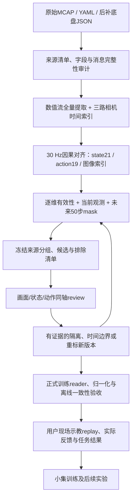

# F1数据处理管线：字段、参数、脚本与复现

本文说明泡沫任务怎样把原始MCAP转成候选数据：字段布局、实际时间规则、mask、脚本和复现命令。跨任务可复用的原因、流程及退出条件统一见[示教数据工作流](../../../docs/dataset_workflow.md)。

当前范围与剩余工作只见[当前方案](../training_plan.md)；发布门槛见[数据集验收](../dataset_acceptance.md)，历史问题处理见[清洗决策记录](cleaning_decisions.md)，底盘缺失监督的特殊处理见[底盘标签修复](chassis_label_repair.md)。本文不是另一份进度表。

## 1. 范围与原则

原始数据位于6000D的 `/mnt/dm05_nvme/dm05/datasets/f1_foam_sort/raw/`，四批合计801份录制、2403个文件，约639.22 GB。MCAP、YAML和后补底盘JSON始终保留原状；筛选用清单表示，修改有效性用新派生包表示。数据原位置、初始审计范围和批次来源见[数据审查记录](../archive/raw_dataset_audit.md)。

本任务不需要逐帧画物体框，也不需要把每条录像手工剪成30秒。模型读取的是当前观测和未来动作chunk，原始录制可以长短不同。需要的是**质量review及其覆盖记录**：抓取、携带、放下、返程是否成立，有无人工补料/接触、失败重试、复位、漏标或错标。多循环和人工干预可以用源时间区间、事件标记和mask表达，不必重新编码或物理切视频。

处理粒度由证据决定：单帧缺失先影响局部样本，数值断档断开未来动作窗口，缺失一段真实动作监督就隔离该段；只有整条标签不可信或用户已选择排除时，才移出整条来源。正常等待、保持夹爪和返回都可能是任务内容，静止本身不是删除理由。

## 2. 从原始数据到训练候选



流程后半段是验收顺序，不是完成状态。发现标签与画面冲突时，应返回数据判断；不能因为数值dry-run已经通过，就跳过语义复核。

### 2.1 来源包字段合同：21D状态，19D联合动作

| 列，左闭右开 | state，21D | action，19D |
|---|---|---|
| `0:7` | 左臂HAL反馈7维 | 左臂lead绝对目标7维 |
| `7:14` | 右臂HAL反馈7维 | 右臂lead绝对目标7维 |
| `14:15` | 左夹爪反馈 | 左夹爪命令 |
| `15:16` | 右夹爪反馈 | 右夹爪命令 |
| `16:21` / `16:19` | `body_j1..5`原始反馈 | 后补底盘`vx/vy/wz` |

三路图像按head、left、right顺序，任务文本另作输入。双臂、双夹爪均保留；身体和头部不作策略输出，执行时须保持与所选示教相容的姿态。

上表描述现有清洗/关节回放来源包。2026-09-16[正式训练recipe](../training/dm05_eef_delta_recipe.md)另定策略state19/action23：取源state前16维，加入已复核后补轨迹在当前时刻的底盘速度估计3维，移除模型输入中的body5；同一重建轨迹还提供未来速度监督。推理读取`/move/State.speed`，后补估计保留来源标记；本次文档修订没有改写已有21D/19D包或处理脚本。

`/hal/joint_states`原始34个字段是臂14＋头3＋body5＋hand占位12，与旧G2的臂14＋手20含义不同。取值按关节名字映射，不按相同维数复用G2顺序或归一化。body5是躯干电机反馈，不能拆成“底盘3＋腰2”；双夹爪来自独立topic。

`/lead`表示普通遥操作目标候选，HAL表示反馈。候选控制源码显示普通lead与UDP来自同一硬件角度缓存，左7后右7、单位为度；Placo变号/偏置已发生在上游，录下来的lead不能再变换一次。异步取样、限位和控制延迟仍可能使目标与反馈不同，lead也不是执行确认。夹爪0全开、100闭合，不能把这个尺度当作毫米。数值提取保持原尺度；动作按字段归一化，禁止直接对21D/19D做整向量`action-state`。接口证据见[主从映射参考](../../../reference/20260914_action_mapping_followup/README.md)和[动作接口合同](../action_interface_contract.md)。

### 2.2 时间：建立因果索引，保留时钟不确定性

以MCAP log时间作为公共记录轴，建立30 Hz格点。对格点`t`，各数值流取不晚于`t`的最近样本；每路相机取不晚于`t`的最近时间戳候选帧。数值或相机log年龄超过100 ms则无效，禁止取未来消息补齐当前输入。

相机候选要求header合法、递增，且`header-log`相对本流稳态中位数的偏差不超过250 ms；稳态从录制开始5秒后估计。原始log/header均保留。三路索引指向各自原始相机帧数组，不是对齐包行号，也不能用相同帧号拼接约30 Hz相机与约33 Hz关节流。

100 ms是新鲜度初筛，250 ms是时间戳异常初筛，**都不是允许的曝光/动作错位指标**。log是接收记录时间，header来源仍需结合驱动和图像事件核对。例如左腕约+1.317秒的批次偏差不能直接解释成曝光延迟，不能按该数统一平移图片；本流中位数筛选也不会自动修复稳定偏差和慢变偏差。

### 2.3 有效性：未来数值全检查，相机只检查当前观测

| 字段 | 规则 |
|---|---|
| `state_valid[N,21]` | 逐维数值有限、来源存在、年龄合格 |
| `action_candidate_valid[N,19]` | 逐维命令/弱标签满足技术条件，并叠加已确认问题的mask |
| `observation_candidate_valid[N]` | 当前state全部有效，且当前三路图像索引与年龄有效 |
| `joint_frame_candidate_valid[N]` | 当前观测有效，且当前19D动作全部有效 |
| `future_signal_action_candidate_valid[N]` | 该格点state和action全部有效，不要求图像 |
| `chunk_start_candidate_valid[N]` | 起点观测有效，未来50步全部state/action有效且不越界 |

50步时间槽约1.67秒。对起点`i`，检查`[i,i+50)`全部数值状态与动作，图像仅要求起点三路当前观测有效；未来图像不是该chunk的模型输入。未来不足50步、跨数值断档、跨未知动作尾段或已标明的不连续边界，均不能作为完整动作块。以后新增人工干预或循环边界，也必须重新计算chunk mask。

因此只屏蔽异常段内的起点是不够的：段前49个起点也可能带着未来动作跨入异常。不能重复最后一帧非零速度来补未来监督。`training_approved=false`是数据质量状态，不是额外的用户权限确认流程。

### 2.4 来源分组、归一化与可追溯

v1按每批原录制的采集时间排序，后10%作验证，固定720训练/81验证来源。后续排除只从父集合减去来源，子片段继承`parent_split`；不能每筛一次重新随机划分，也不能让同一原MCAP的相邻片段跨训练/验证。重复审计再检查数值轨迹、绝对时间重叠、抽样JPEG和运动块，未检出重复不等于不存在近重复。

最终归一化只使用入选训练来源中有效监督；被mask的保留原值不能重新混入统计。分字段编码，并为右夹爪、`wz`等常量维提供非零尺度。报告采样单位和抓取/移动/放置/返回/等待的占比，避免以总loss掩盖移动阶段表现。

## 3. 脚本、依赖与产物

全部离线审计在6000D运行，工作目录为 `/home/xza_100850113/projects/F1/foam_sort_whole_body`。Python 3.10+独立环境依赖见[requirements-audit.txt](../../requirements-audit.txt)：`mcap==1.4.0`、`mcap-ros2-support==0.5.7`、`numpy==2.2.6`、`PyYAML==6.0.3`、`Pillow==12.3.0`。视频渲染另用`ffmpeg/ffprobe`；Bash包装器用`flock`，无需在6000D安装F1整套ROS。

历史解释器为`/tmp/f1-foam-audit-venv/bin/python`，跨重启须检查；可用`F1_AUDIT_PYTHON`指定已验证环境。F1现场复用自己的系统Python/ROS/消息overlay，不复制6000D的venv。

| 阶段与入口 | 输入 | 输出与用途 |
|---|---|---|
| [run_audit.sh](../../scripts/run_audit.sh)：`metadata/mcap/cameras/screening` | 原始三类文件 | `metadata_audit/`、`mcap_audit/`、`camera_timestamps/`、`screening/`；包装[元数据](../../scripts/audit_metadata.py)、[MCAP](../../scripts/audit_mcap.py)、[header抽样](../../scripts/audit_camera_timestamps.py)、[队列](../../scripts/build_review_queue.py)审计 |
| [extract_cleaning_signals.py](../../scripts/extract_cleaning_signals.py) | 原始MCAP | `signals/<batch>/<episode>.npz/.json`；7类数值流，原值float64、log时间int64、字段顺序与来源指纹 |
| [index_cleaning_cameras.py](../../scripts/index_cleaning_cameras.py) | 原始MCAP | `cameras/<batch>/<episode>.npz/.json`；全部三路log/header时间、候选mask和异常统计，不解码全部像素 |
| [build_cleaning_dataset.py](../../scripts/build_cleaning_dataset.py) | signals、cameras、初审、[清洗配置](../../configs/cleaning_v1.yaml)、[问题清单](../../configs/review_overrides.yaml) | `aligned/`、`episode_manifest.jsonl`、`technical_windows.csv`、`source_split.json`、复核队列、配置快照及summary |
| [validate_cleaning_dataset.py](../../scripts/validate_cleaning_dataset.py) | 对齐产物与原提取流 | `validation.json`；独立实现核验字段、因果选择、年龄、mask、50步规则和清单统计 |
| [review_cleaning_cycle_candidates.py](../../scripts/review_cleaning_cycle_candidates.py)、[prepare_cycle_review.py](../../scripts/prepare_cycle_review.py) | 夹爪事件候选、v1来源和图像证据 | `cycle_review/`及历史`cleaning_v2_review/`目录；后者支持`prepare/validate/export`的源时间逻辑切片，不要求所有录像手工精裁 |
| [prepare_demo_candidates.py](../../scripts/prepare_demo_candidates.py)、[prepare_demo_revision.py](../../scripts/prepare_demo_revision.py) | 冻结父来源、排除配置和证据哈希 | `candidates.jsonl`、`excluded.jsonl`、`selection.json`；继承来源分组，不修改动作值 |
| [audit_demo_signals.py](../../scripts/audit_demo_signals.py)、[追加分析](../../scripts/audit_demo_signal_followup.py) | 指定候选及signal/aligned/JSON | `signals/`数值审计、模板拟合、lead/HAL末端诊断、`tail_reset_candidates.jsonl` |
| [audit_demo_clocks.py](../../scripts/audit_demo_clocks.py)、[图像与重复审计](../../scripts/audit_demo_duplicates_images.py) | 候选、相机索引和原始MCAP | `clocks/`及`content/`，分别验证时间/索引与抽样实际JPEG；记录抽查覆盖 |
| [audit_demo_visual_evidence.py](../../scripts/audit_demo_visual_evidence.py)、[范围审计](../../scripts/audit_documented_f1_ranges.py) | 历史选定原始区间、反馈、标签和接口文档范围 | 000256等专项证据、关节范围比较；范围告警不是自动裁幅依据 |
| [analyze_demo_tail_impact.py](../../scripts/analyze_demo_tail_impact.py)、[prepare_demo_tail_masks.py](../../scripts/prepare_demo_tail_masks.py) | 788末端证据、冻结778来源与旧包 | `analysis/`和`conservative_masks/`；量化被截返程，再另存保守mask包 |
| [788独立核验](../../scripts/validate_demo_788_audit.py)、[778 mask独立核验](../../scripts/validate_demo_tail_masks.py) | 对应历史版本及其固定证据 | 各版`validation.json`；这两项绑定历史目录/数量，不是任意新清单的通用验证器 |
| [三路视频](../../scripts/render_three_camera_videos.py)、[尾段页面](../../scripts/build_tail_review_page.py)、[000083诊断预览](../../scripts/build_replay_000083_preview.py) | 原始图像、标签/反馈、指定回放包 | HTML、MP4、帧时间映射与图像证据；000083入口仅用于复现已撤回候选的诊断 |
| [export_replay_bundle.py](../../scripts/export_replay_bundle.py)、[replay.sh](../../scripts/replay.sh) | 明确版本的aligned NPZ/JSON、连续有效`[start,stop)` | `manifest.json`、`frames.jsonl`，以及inspect/dry-run日志；不是训练reader的三路图像验收 |

### 3.1 复现时不要覆盖冻结结果

[run_cleaning_v1.sh](../../scripts/run_cleaning_v1.sh)的`all/assemble/validate`固定操作`results/cleaning_v1`；`all`可复用完整且指纹匹配的提取结果，`assemble`不重读全部MCAP。它没有通用输出目录环境变量。保留历史版本时，应直接调用底层脚本并指定新的输出目录，而不是误以为设置`F1_AUDIT_OUTPUT`会改变这个包装器的路径。

以下命令在**6000D终端、任务目录**复现技术组装与独立验证，复用已有初审及不变的数值/相机索引，日志在新目录的`pipeline.log`。更换复现目录名即可另存；目录已存在就退出。它不运行新一轮视觉质量审查，也不启动训练或机器人。

```bash
set -euo pipefail
cd /home/xza_100850113/projects/F1/foam_sort_whole_body
export F1_AUDIT_PYTHON=/tmp/f1-foam-audit-venv/bin/python
test -x "$F1_AUDIT_PYTHON"
export F1_PIPELINE_RUN="$PWD/results/reproduce_20260915"
mkdir "$F1_PIPELINE_RUN"
ln -s "$PWD/results/cleaning_v1/signals" "$F1_PIPELINE_RUN/signals"
ln -s "$PWD/results/cleaning_v1/cameras" "$F1_PIPELINE_RUN/cameras"
{
  "$F1_AUDIT_PYTHON" scripts/build_cleaning_dataset.py \
    --config configs/cleaning_v1.yaml --output "$F1_PIPELINE_RUN"
  "$F1_AUDIT_PYTHON" scripts/validate_cleaning_dataset.py \
    --output "$F1_PIPELINE_RUN"
} 2>&1 | tee "$F1_PIPELINE_RUN/pipeline.log"
```

若确需从原始MCAP重新提取，在新目录中省略上面的两个`ln -s`，先调用`extract_cleaning_signals.py --source RAW --output NEW/signals`和`index_cleaning_cameras.py --source RAW --output NEW/cameras`。初审可通过`F1_DATA_ROOT`、`F1_AUDIT_OUTPUT`与`run_audit.sh`另存；同时在新配置中让`source_audit`指向新审计目录。完整读取大文件前先判断本次变更是否真的涉及提取层。

来源修订用`prepare_demo_revision.py --config configs/demo_775_selection.json --output NEW_SELECTION`可以重现历史775选择；其父路径、数量与证据哈希来自配置。**这个脚本只产生选择清单，不会自动套用尾段mask。** 历史775复用的实际mask入口是[mask_manifest.jsonl](../../results/demo_775_selection/mask_manifest.jsonl)，复用关系见[核验结果](../../results/demo_775_selection/mask_reuse_validation.json)。导出器只检查传给它的包，不会自动读取旁边的排除报告；必须明确选用该mask清单指向的文件。

当前来源与mask入口应从[训练方案](../training_plan.md)获取，不能继续将历史775路径当作最新版。[reuse_demo_masks.py](../../scripts/reuse_demo_masks.py)可将新的冻结来源子集与指定父mask清单按episode连接，逐包验哈希、分组和全部未来窗口，再输出新`mask_manifest.jsonl`与`mask_reuse_validation.json`；不复制数组或放宽有效性。

末端派生脚本目前固定校验778份来源，并引用788审计的尾段证据；`--output`可另存新目录，但不能把775清单直接当成通用输入。`audit_demo_visual_evidence.py`等专项入口也绑定历史来源。扩展到新批次时需要显式参数化并保存新版本，不能改完脚本继续沿用旧报告中的哈希或“验证通过”。

### 3.2 哈希究竟证明了什么

保存源MCAP路径、大小、mtime，保存配置/排除证据快照、派生NPZ/JSON的SHA256、父候选哈希、mask版本和所用脚本哈希。每份输出能追溯到原录制及其时间，来源选择和mask版本分别表达，避免只看到一个目录名就以为全部选择已自动生效。

历史全批原始MCAP身份检查主要是**大小和mtime**；没有重新扫描约639 GB计算全量原始SHA256，也没有与独立源端SHA逐一比对。派生包SHA256、抽样JPEG payload SHA、已读块CRC各有自己的覆盖范围，不能混写成“全部原始图像完整性已认证”。例如788复查解码的是每来源三相机早/中/晚共7092张JPEG，不是约283万帧全部像素。

新mask的独立核验应同时证明：旧包未变，非mask数组逐字节相同，没有把旧无效值升级为有效，保留的每个chunk都满足未来窗口规则；仅“总数看起来合理”不足以证明没有误改。

### 3.3 上半身复核、局部启动mask和底盘背景筛查

[audit_775_upper_body.py](../../scripts/audit_775_upper_body.py)独立复算上半身数值保鲜、恒目标/反馈背离、夹爪范围、来源分组和50步窗口。恒目标持续至少1秒且HAL背离超过5°是诊断初筛，普通跟踪延迟不直接判错；末端和中途分别统计。证据见[上半身报告](../../results/demo_775_phase_review/upper_body/findings.md)。

启动旧目标也可能污染未来监督。`all_data_derived/episode_000080`最初目标与HAL明显不符，随后左J5目标在0.304–0.334秒跳变15.697°。没有用插值改造这段目标，而是另存前11格的完整19D监督mask，保留时间和数值。[prepare_startup_mask_revision.py](../../scripts/prepare_startup_mask_revision.py)使用显式配置、区间和证据SHA，配置快照见[startup_masks_v1](../../results/demo_775_phase_review/startup_masks_v1/summary.json)；独立验证证明恰好移除10个跨跳窗口，其余起点保持。该处理不等于定位采集程序版本。

底盘阶段的筛查链路为：

1. [cache_base_phase_frames.py](../../scripts/cache_base_phase_frames.py)只读原MCAP，每0.5秒查询最新因果头图，保留原log/header、JPEG SHA和原图索引；同时提取全部HAL头3/body5。只解码选中的图片，不改变原始视频。缓存按候选和方法SHA绑定，指纹一致才能续跑。
2. [validate_base_frame_cache.py](../../scripts/validate_base_frame_cache.py)独立用前向遍历验证每个因果选择、完整查询格点、缓存SHA、原HAL身体反馈、重复/冻结帧风险。相同图片、过旧查询保留诊断记录，不当作底盘静止。
3. [head_background_motion.py](../../scripts/head_background_motion.py)在中央六个区域估计背景位移，使用相位相关、位移后相关性及方向一致性；不可靠返回`uncertain`。输出为480像素宽图片上的像素位移，不是m/s。真实错标案例和合成验证见[方法验证](../../results/demo_775_phase_review/motion_method/index.html)。
4. [audit_base_phase_cache.py](../../scripts/audit_base_phase_cache.py)对原头图log之间的全部base样本及起点保持值判定是否全零，并检查同段头/身体反馈。头部0.3°、身体0.2°是排查混杂运动的诊断门槛；合并连续段还检查累计姿态变化。连续至少1秒、零标签而背景动是优先复核；非零标签而图像低位移是另一类候选。记录是否涉及尾界前仍有监督的格点，不能只看尾后异常。
5. [extract_base_phase_evidence.py](../../scripts/extract_base_phase_evidence.py)根据显式cases重新读取指定原JPEG及原base/HAL消息，验证与缓存一致，输出原图、原始样本和拼图。**查看固定柜体、地缝、支架等证据后再确定排除；自动命中只用于排队。** 本轮原图判读记录见[三份确认记录](../../results/demo_775_phase_review/manual_review/confirmed_findings.json)。

低图像位移不证明底盘静止；手臂、人物、遮挡、地面视差或头部未记录的运动都可能混杂。没有命中也不等于整条正确。固定路线允许尝试重建弱监督，但每条启停/阶段必须对照真实背景运动；不能按全画面运动直接定位底盘，不能将像素速度直接填入`vx/vy`。若疑点分布广，先在小批来源上建立可复核的重标方法，避免大量删条后仍留下同类错误。

后续的[底盘审核工作台](chassis_label_repair.md)将完整视频、原速度与两大移动窗口、背景指标、手臂关节角和夹爪放在共同原log时间轴，人工任务锚点和中间转折另存草稿。锚点先用于缩小搜索范围，不直接当底盘启停。按用户流程图进行的[配方核验](../../results/base_anchor_review_20260915/recipe_audit/findings.md)发现最终速度与配方自洽、六段时间比例固定；需要验证的关键是配方窗口/分段是否符合真实运动。正常时间戳和可读CDR不能替代该验证。

收到源码后的[机制审查与反例](../../results/base_script_audit_20260915/report.md)补充三点：不能用录像前48%/后52%及最大图像运动簇定义任务阶段；六个任务锚点不等于六个移动段，真实停顿和内部转折需单独记录；重跑缓存必须绑定源、算法、参数和人工标记的身份，不能只看path/消息数。修复另存新版本，先过[底盘专项验收](../dataset_acceptance.md#底盘重标的专项验收)，再更改训练有效性。“排除”只代表隔离监督，不代表修复或验收。

## 4. 问题与处置依据

已踩过的坑、原始证据、处理及尚未解决的边界统一维护在[清洗决策记录](cleaning_decisions.md#已遇到的坑证据处理与边界)。通用规则见[示教数据工作流](../../../docs/dataset_workflow.md)，本页只保留F1参数与复现方法。

## 5. 历史版本怎样演变

版本变更的原因和证据统一见[清洗决策记录](cleaning_decisions.md#历史选择与mask版本)，当前选择只见[当前方案](../training_plan.md)。不要从旧报告的总数推导当前可训练数量。

## 6. 从清洗结果走向训练与replay

重标另存候选后，按[发布验收](../dataset_acceptance.md)重建受影响的mask、chunk和统计，使用正式训练reader独立核对。既有replay bundle reader只覆盖数值命令构造，不替代带三路图像的训练读取验收。数据通过后按[replay操作](../replay_runbook.md)交接现场；部署与备份规则仅维护在[F1工作约定](../../../AGENTS.md)。

[compose_base_candidate.py](../../scripts/compose_base_candidate.py)把已绑定来源的底盘import目录与当前候选、mask按episode连接，输出新21D/19D候选包。仅修改动作16:19列，保留所有父mask；未知保持NaN，未审提议仅可预览，重新计算50步窗口且不放宽旧chunk限制。本工具不放宽尾界、不自动发布训练版本；用法与首个真实包核验见[000057合成记录](../../results/base_relabel_v2_000057/README.md)。

### 按正式recipe审核每一批派生数据

完整编码定义以[训练recipe](../training/dm05_eef_delta_recipe.md)为准；以下是清洗到模型样本之间必须核对的接口，不另立一套配方。

| 清洗检查 | 为什么影响正式训练 | 必须保留的证据/处理 |
|---|---|---|
| 来源state21/action19与策略state19/action23分开 | state19不是旧action19；不能把body列当底盘，也不能继续用14＋2＋3关节目标作为本版最终策略输出 | source、policy布局及reader版本分别绑定，pad32的后9维无监督 |
| 当前底盘估计与未来速度标签分别有效 | 当前速度未知会污染输入；未来标签有效不能反推当前观测有效 | unknown保持无效；记录重建版本、原时间与置信边界。t处输入等于chunk首项是合同事实，验证未来k=1..49及保持速度基线 |
| 后补速度与实测反馈的分布 | 固定距离和生成曲线积分正确不证明逐时刻速度真实；训练估计状态与线上反馈可能明显不同 | 按阶段比较起停、方向、幅值和延迟，使用[replay新证据](../incidents/replay_failures_and_lessons.md)。不擅自换输入、放大标签或删掉当前底盘3维 |
| 有效执行目标先映射，再计算FK | 原超限关节目标的EEF位置可能不可执行；IK之后clip会再次改变目标位姿 | 原lead、映射后目标、逐维clip数量/幅度、限位与FK合同SHA都保留；reader不能二次clip |
| 当前HAL锚点与H50共享锚点 | 对未来反馈作差、逐步累加或混用左右参考系都会变成另一类动作 | 复用已验的EEF编解码；核对m/mm、度、rotation6D前两行、工具端点；反馈不冒充目标 |
| 复位mask和完整返程分别定位 | lead恒定可以是正常保持，也可能是漏录复位目标，不能统一裁末几秒 | 原技术mask保留；新尾界需独立原图/信号证据，所有跨unknown/复位的H50窗口无效，不复制末速度补监督 |
| 相机索引与解码范围 | 同帧号不等于同一时刻，缩略图不等于训练原图，抽样解码不等于全图通过 | 三路原JPEG因果索引、header/log、有效性与解码覆盖留痕；训练腕图不做几何增强，验证不随机增强 |
| split、采样与统计 | 长视频不应仅因帧多占据训练；小批统计不一定覆盖验证姿态 | 继承源录制split；先均匀选录制再选有效起点；仅正式train有效数据拟合，报告state裁剪/反量化，不能用val扩范围 |
| 常量与mask语义 | 停车和右夹爪保持是有效监督；零方差和padding不能混为一谈 | 右夹爪100按固定夹爪量程编码；wz常量单独处理；mask是bool不是权重，NaN先有限填充再屏蔽；不重复共享Normalize/ActionRelative |

自动背景运动支持区间可能只覆盖运动中段，不能直接把0.5/1.6米距离分配给该短区间。尤其旧`triage_pool.py`在分类前已去掉尾mask之后的匹配：**其输出没有“返程越过mask”，不能独立证明mask没有截断返程。** 尾界审查须回到未经该裁切的背景证据及头/身体反馈，区分返程、收臂遮挡和后续人工移动；不从这个盲区推断所有尾界都错。

### 复位监督的可选重建方法

mask隔离不会恢复复位目标。选择完整任务时，不能用被屏蔽的收臂区间宣称已包含复位监督；是否开展重建及当前状态只见[当前方案](../training_plan.md)。

**可以另建HAL轨迹重标候选。** 复位反馈仍在时，可将未来实测关节位置构造成待跟踪的位置轨迹，明确标记为`feedback_derived_future_position_target`，不声称找回原始复位指令。输入保持当前反馈，未来目标的时间偏移须与执行频率、chunk执行步数和重规划方式一致。同时间`action(t)=HAL(t)`在只执行首步的方式下有重复当前姿态的风险，但含未来姿态的chunk并非必然无法运动。前段lead指令与尾段HAL反馈直接拼接也有时序差，需检查接缝、轨迹速度与实际跟随；保留相机/数值原有无效mask，不外推录制末端未知未来。此处澄清可选处理方法，当前清单尚未执行HAL重标或放行复位尾段。
