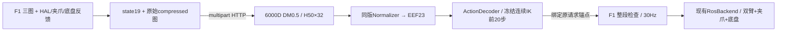

# Foam 推理：6000D 服务与 F1 客户端

4F-F1已接入5K/20K/25K，分别为7892/7894/7896；现场开机、录包自检和恢复起点命令统一见[4F-F1操作流程](../../docs/robots/4F-F1_startup.md)。机器人使用`inference.f1-29.*.json`，勿套用旧D070机器配置。`inference.json`仍保留空checkpoint模板。模型release与checkpoint绑定归一化，不复用G2统计。完成度和待办看[当前方案](training_plan.md)；下文保留通用接口说明，旧机历史示例以机器人专属流程为准。

## 复用关系

**2026-09-20新增独立demo入口：**`inference_replan_{5k,20k,25k,70k}.sh`。使用5mm/0.05°IK，H50内最多执行前20点；后续点失败时只执行此前两臂都通过的点，提前重观测。首点失败最多额外重采3次，持续失败原地暂停，Enter继续、Ctrl-C结束。采用显式`f1_ik_valid_prefix_replan_v1`合同，旧固定前缀入口不自动改变。完整参数、验证、现场命令和回退见[版本说明](../results/deployments/20260920-4F-ik-replan-v1/README.md)，当前现场条件见[当前方案](training_plan.md)。以下图表描述原固定前缀基线。



| 环节 | 实现与复用边界 |
|---|---|
| 服务/模型 | [f1_inference](../models/DM0.5/f1_inference/policy.py)，参考DM0.5 multipart模式；使用共享模型加载、F1 state tokens、三图验证预处理、collator与generation_inputs |
| EEF→joints | 复用 `f1_training.execution.ActionDecoder` 与 `f1_ikfk_demo_v1`；整段固定原观测FK锚点，23维分别反归一化，不重复Placo变换；任一步IK失败整段拒绝 |
| 机器人观测 | [f1_policy_client](../robot/f1_policy_client/observation.py)：arm14度＋夹爪2＋实际底盘vx/vy/wz；body5单独检查，三图顺序head/left/right |
| 命令输出 | 复用 `f1_replay.RosBackend`：`/motion_ctl/joint_ctl`、左右GripperCommand、`/move/ManualMoveCmd`；沿用DDS参数查询、二进制SHA、命令活动监听、录包及停车 |
| 时序 | H50生成、10 Euler、前20步30Hz；同步块末停车/保持后重新观测，含推理等待，**不是无缝0.667秒闭环**；不补发迟到命令 |
| 身体 | [身体参考](../configs/inference_body_reference.json)来自已现场回放192首帧，沿用0.5度容差；020/096/093起姿对照最大差<0.145度，不代表772条姿态覆盖或碰撞验收 |

冻结的 `f1_training`、`f1_data`、共享DM0.5源码和训练recipe均不修改；这些文件在checkpoint绑定中。
新增服务包与客户端包独立，F1不需要torch、NumPy、SciPy、Pillow或权重。
IK输出以 `reject` 检查，不能再次clip改变EEF。夹爪0–100、底盘现有范围、腕部耦合、首步差与新鲜度分别检查。
相机使用F1本地monotonic接收时间，header只记录，不跨主机比较。
相机0.2秒、三图接收差0.1秒、响应年龄2秒为初始软件预算，需shadow实测，不是硬件规格。

## 6000D 检查与模型启动

6000D终端，工作目录 `/home/user/projects/F1/foam_sort_whole_body`：

```bash
cd /home/user/projects/F1/foam_sort_whole_body
bash scripts/inference_server.sh inspect
bash scripts/inference_client.sh inspect
```

两者不初始化ROS、不加载模型。server inspect读取正式release/统计SHA，空checkpoint显示
`checkpoint_not_selected`；`serve` 在空checkpoint时退出。填入后还校验adapter权重、base配置、recipe、
33份源码与统计绑定，不重扫772条数据或拟合新统计。

服务沿用训练镜像 `opendm:g2-34d-fa2`、Python `/opt/conda/envs/opendm/bin/python`，另起独立容器。
先用 `nvidia-smi` 核对空闲GPU，将下面的 `F1_INFERENCE_GPU` 填成该卡编号，不复用正在训练的卡。
容器内仅一张卡，配置仍为 `cuda:0`。6000D同一目录运行（这是未执行的启动模板）：

```bash
export F1_INFERENCE_GPU=填写空闲GPU编号
mkdir -p results/inference_server_logs
sg docker -c 'docker run --rm --name f1-foam-inference --network host \
  --gpus "device=$F1_INFERENCE_GPU" \
  --mount type=bind,src=/home/user/projects,dst=/home/user/projects,readonly \
  --mount type=bind,src=/mnt/dm05_nvme/dm05,dst=/mnt/dm05_nvme/dm05,readonly \
  --env PYTHONDONTWRITEBYTECODE=1 --env NO_ALBUMENTATIONS_UPDATE=1 \
  --env F1_INFERENCE_PYTHON=/opt/conda/envs/opendm/bin/python \
  --entrypoint bash opendm:g2-34d-fa2 \
  /home/user/projects/F1/foam_sort_whole_body/scripts/inference_server.sh serve' \
  2>&1 | tee "results/inference_server_logs/$(date +%Y%m%dT%H%M%S).log"
```

默认监听6000D `127.0.0.1:7892`。`GET /health` 返回完整模型绑定。
`POST /process_frame` 接收文件 `head/left/right`＋JSON表单 `metadata`，字段为
`contract, request_id, observation_monotonic_ns, state19, reference_joints14_deg`。
响应回显请求/锚点，返回H20关节、夹爪、底盘；诊断保留H50物理预测及预处理/模型/IK耗时。
客户端拒绝身份、绑定变化、过期与不完整前缀。服务不排队积压旧观测。

## 发布、端口与F1现场操作

先按 [F1发布约定](../../AGENTS.md)备份并发布独立新版本，以下未来路径尚未部署。
最小文件为 `robot/f1_policy_client/*.py`、现有 `robot/f1_replay/*.py`、
`scripts/inference_client.sh`、`configs/{inference,replay_f1,inference_body_reference}.json`。
继续引用现有SHA绑定command monitor动态库，不重编相机或控制器。
复用 `deploy/sync_project.py` 的清单/包校验；其默认prepare收集较广，实际发布只同步上述明确文件，
既有目标升级先备份，不直接覆盖current。

持久隧道只提供登录，没有转发模型端口。6000D另一个终端，任意目录：

```bash
ssh -F /dev/null -i /home/user/.ssh/id_ed25519_f1 \
  -o IdentitiesOnly=yes -o BatchMode=yes -o StrictHostKeyChecking=yes \
  -o HostKeyAlias=f1-d070 -o ExitOnForwardFailure=yes \
  -o ServerAliveInterval=30 -o ServerAliveCountMax=3 \
  -p 22022 -N -R 127.0.0.1:7892:127.0.0.1:7892 user@127.0.0.1
```

F1仍使用配置原值 `http://127.0.0.1:7892`。该新连接依赖既有登录隧道，不改变专用密钥权限；
实际端口链路与吞吐待验收。F1本地终端把 `F1_INFERENCE_TASK` 设为新release的
`workspace/F1/foam_sort_whole_body`绝对路径后运行：

```bash
cd "$F1_INFERENCE_TASK"
bash scripts/inference_client.sh check-env
bash scripts/inference_client.sh preflight
bash scripts/inference_client.sh shadow --chunks 10
```

脚本复用Jazzy、现有f1/agv消息与CycloneDDS。preflight只订阅/查询；shadow请求真实模型、累计拒绝，
不创建控制发布者。身体不符192参考时，沿用现有姿态准备工具与对应示教目标；推理不自动调整身体。

模型输出与接口策略验收后，用户在F1现场终端运行：

```bash
cd "$F1_INFERENCE_TASK"
bash scripts/inference_client.sh execute --chunks 0
```

按Enter开始、Ctrl-C结束；与replay共用锁。v4先创建命令发布端点供rosbag发现（此时不发送消息），
全部必录topic就绪且模型动作校验通过后才派发。见[录包顺序修复](../results/deployments/20260918-inference-ab-v4/README.md)。
失败/超时/停止复用零底盘及新鲜HAL臂保持，不自动打开夹爪。
`--chunks 1`仅执行一个完整20步前缀；`0`持续至停止，不包含任务完成识别或自动复位。

v6保留2秒观测有效期：丢弃过期响应，在停车状态重新取图/state请求，连续3次过期仍退出。
过期请求不消耗有限`--chunks`预算，实际HTTP总数和过期次数分别记录。其他动作/硬件拒绝仍停止execute。
[过期重试验证](../results/deployments/20260918-inference-ab-v6/README.md)。

F1日志：`/home/user/Bruno/F1/foam_sort_whole_body/runtime/inference/<运行ID>/`，含
`events.jsonl`、`report.json`、原始三图、逐请求`response.json`；execute另有rosbag。
shadow不自动录整段rosbag，已保存实际模型观测。

## 推进顺序与限制

1. 用户指定checkpoint，校验绑定、启动独立服务，保持当前训练和IK基线。
2. 发布最小客户端、验证端口与三相机，shadow检查端到端/模型/IK耗时、过期率及拒绝。
3. 检查推理执行映射。v3独立覆盖回放profile：wz上限0.8rad/s并绑定实际controller参数；
   夹爪映射到0..100、允许正常开合，原始预测及映射记录同时保存。
   相机暂时不齐等待最多1秒，保留100ms三图差及200ms新鲜度；v5推理首步门槛5°，起姿仍2°，硬件保护保留。
   [v5首步差值验证](../results/deployments/20260918-inference-ab-v5/README.md)。
   [v3部署验证与命令](../results/deployments/20260918-inference-ab-v3/README.md)。
4. 用户现场执行通过检查的前缀，验收首步、动态、碰撞、抓放和停车。数学IK/CPU测试不能替代实机验收。

v3按用户授权映射夹爪，wz保留模型输出；关节IK目标保持原值。冗余分支已知缺口沿用[冻结IK recipe](training/ik_fk_demo_recipe.md)。
不需要重写IK、重装F1系统、重洗数据或修改正式训练recipe来完成上述接线。
