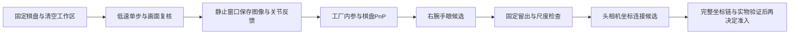

# HARNESS 棋盘与相机手眼标定：现场采集与外参候选

**2026-11-04：完成26次真实低速单步、25组静止采集及右腕手眼／当前头部姿态的外参候选计算。** 20组用于拟合，5组独立留出；右腕固定棋盘留出残差最大约0.437mm，头／腕交叉一致性最大约0.462mm。本批采集结束，临时控制会话已关闭，生产控制权空闲。

本轮采用桌面棋盘固定、右腕相机随右臂改变姿态的方法，先求右腕相机与右臂原生 EEF 的关系，再通过同一棋盘连接头相机。用户明确要求后续不再挪板，因此通过机器人观察角调整获得覆盖；移动前的探查动作与正式固定板样本分开保留。

**11月5日后续已按用户决定完成粗标定交付。** 相机工厂参数、原25姿态结果和实际执行器坐标候选保留；新增13次空夹爪小步、5段只读RGB-D及两次返回同一开度的指尖参考检查。用户接受卷尺与视觉约8mm差异，要求先用于开发rollout再按实物结果修正；当前[交付包](../../artifacts/20261105-calibration-continuation/coarse-calibration-handoff.json)为`coarse/development`。没有本轮手臂或头身动作，原精密验收未被改写成通过。



## 授权、执行入口与本轮范围

- 用户本轮明确允许代理配合现场人员控制机器人进行标定，要求低速、观察全景并避免碰撞；棋盘贴好后，又明确要求不再移动棋盘。动作前的手部离开确认属于本次现场协作，不以静默等待代替确认。
- 物理动作复用机器人已经部署的 **F1infra 有线主备 V38** 程序。该编号属于工作台；没有给 HARNESS 分配或借用控制框架 V 号。
- 临时进程使用独立 runtime、仅回环监听的 HTTP 端口及临时 profile；只把手臂速度上限与加速度上限分别降低为 **2°/s、2°/s²**。生产 profile、部署 current、模型与训练身份保持原有状态。
- 临时进程与原控制程序使用同一共享控制锁，保留实际命令来源检查、硬件身份与运行参数合同、关节限位、反馈新鲜度、租约续期、取消和释放逻辑。未向 DAgger／RLT 伪造 START，也未运行策略或改变原生产控制参数。
- 每次只提交一个经过审阅的右臂关节目标，等待动作结果、释放控制权并查看头部／右腕图像后再决定下一步。实际逐步范围以动作回执为准，不能把本次授权扩展成自动抓取、插入或任意连续运动授权。

原工作台没有完整的手臂自碰和环境避障能力；它的地面检查也不能覆盖桌面、棋盘、线缆及相机安装件。本轮全景观察、清空障碍、低速和有界步骤是现场操作条件，不构成已验证的无碰撞规划器。取消回执与控制锁释放不应单独当作物理急停证明。

## 方法与坐标含义

固定棋盘在外参采集期间保持不动，头部及躯干保持本轮姿态。右腕相机刚性安装于右臂末端；采集覆盖多个旋转轴，并在观察范围允许时加入小幅位置变化，避免把同一轴上的许多相近角度误当作充分覆盖。

以下采用 `T_A_B` 表示把 B 坐标中的点转换到 A 坐标。`native` 是右臂原生 SDK 参考系；`eef` 是原生 FK 输出的末端／法兰定义，尚不是实测夹持中心：

```text
T_native_board = T_native_eef · T_eef_right_camera · T_right_camera_board
T_native_head_camera = T_native_board · inverse(T_head_camera_board)
```

手眼输入使用实际 HAL 反馈计算的原生 FK，不使用请求目标冒充到达姿态。头相机与右腕相机需要采用同一个物理棋盘原点和轴方向；矩阵名称不能替代方向校验。现有角点分析对正立棋盘做行列同时反转的 180° 归一化，原始编号与派生编号均留存；这依赖两相机看到同一固定棋盘且朝向一致的假设，尚需物理原点核验。

这条路线得到的是相机与右臂原生参考系的候选关系。它**没有标定 TCP／夹持中心、夹持物偏移或整机 base 到右臂原生参考系的链路**。头部、腰部、身体姿态或相机安装发生变化后，不能在缺少已验证运动学链的情况下继续沿用当前固定变换。

## 最终样本分组与数量

已保存 **25 个姿态**，每个窗口保留头／右腕各4张RGB，以及原始深度、CameraInfo和窗口内全部收到的HAL反馈；共200张RGB均检出完整54角点。每个姿态只选一对图像用于计算，不把同姿态重复帧当独立样本。

固定留出为 `capture-008`、`capture-012`、`capture-016`、`capture-020`、`capture-025`，其余20组拟合。025是在该姿态采集与正式拟合前追加预留的第五组，见[划分声明](../../artifacts/20261104-handeye-session/split-plan.json)。所有留出均未参与手眼、头部候选或训练子集拟合。

`step-001`、`step-002` 是正式固定板批次前的低速／视野探查动作。对应动作原件保留，但移动前图像不进入正式固定板手眼求解；正式采集从 `capture-001` 开始。动作编号与采集编号不是一一同号关系，不能仅按文件名数字配对。

最终动作范围为 **`step-001`–`step-026`**，26次均返回 `succeeded` 并确认租约释放。正式姿态为 `capture-001`–`capture-025`：001是第二次移板固定后的初始姿态；002起在 `step-(采集编号+1)` 后停稳采集。009／017各有前两张腕图因HAL尚未到达、最近反馈接收配对超过50ms而排除，后续帧可用；没有为了保留它们放宽门槛。

固定留出不得参与阈值调节；若之后用于方案选择，需要明确转为开发验证并补充新的独立留出。

## 最终候选与独立验证

[结果摘要](../../artifacts/20261104-handeye-session/final-candidate/summary.json)与[完整矩阵及验证](../../artifacts/20261104-handeye-session/final-candidate/candidates.json)已保存。以下毫米数均按名义22mm棋盘尺度计算，是本批样本的一致性指标，不是独立实物测量误差。

| 5组独立留出指标 | 平移RMS／最大 | 旋转RMS／最大 |
|---|---:|---:|
| 右腕推算的固定棋盘 | 0.280／0.437mm | 0.0419／0.0564° |
| 头相机推算的固定棋盘 | 0.112／0.211mm | 0.0120／0.0185° |
| 头／腕棋盘交叉一致性 | 0.309／0.462mm | 0.0385／0.0547° |

采用OpenCV PARK。`T_eef_right_camera`平移约为 `[92.155, -23.069, 61.616]mm`，相机原点距默认EEF约113.23mm；`T_native_right_head`平移约为 `[134.764, 293.500, -59.945]mm`。旋转与完整4×4矩阵、头部逆变换均见原结果；不能仅复制这三个平移数代替刚体变换。

训练姿态的最大相对旋转为19.49°，旋转覆盖秩3；全部25姿态范围20.52°。训练EEF位置覆盖约8.16×23.66×21.20mm。训练留一法的手眼变化最大0.376mm／0.0472°；前／后八姿态子集相对全训练结果分别可偏约2.72／2.65mm，说明局部覆盖仍有敏感性，不能将候选推广到未验证的全工作空间。

前七组开发诊断中，TSAI因有效转动不足返回单位阵／零平移，该结果明确记为失败占位；最终采用预定的PARK，不按留出成绩挑选算法。仅固定平面、固定头姿的头图验证也不是头部外参的独立三维真值。

## 已有真实证据与审计口径

| 层次 | 本批可确认的事实 | 不代表什么 |
|---|---|---|
| 单步动作 | 26次各记录一次动作请求，全部终态为 `succeeded`，控制权均释放 | 不等于标定精度、TCP 到位或整条路径无碰撞 |
| 静止采集 | 上述已核对窗口均记录 `complete_window=true`、无缺失 topic，采集节点 `command_publishers=0` | 这里只说明采集节点零输出；整轮此前确实发生了授权动作 |
| 关节静止性 | 已核对窗口的最大关节变化范围约不超过 0.0061° | 这是收到的 HAL 反馈范围，不是独立物理测量，也不是编码器源时钟验收 |
| 图像与内参 | 原始图像、CameraInfo、源时间戳与接收时间戳保存在每个 capture 的清单及 blobs 中 | 不是工作台独立 JPG 请求之间的硬件同步保证 |
| 时间配对 | 采集保存窗口内的关节反馈；派生分析记录所选图像与邻近 HAL 接收时间差 | `source_clock_verified` 仍为 false，不称已完成跨设备源时钟同步 |
| 几何分析 | 25姿态全部通过输入质量检查，完成20训练／5留出及训练子集敏感度分析 | 像素残差小不等于毫米位置准确；候选未进入任务准入 |

证据入口如下；逐帧角点、参数、哈希及全部请求不复制到本报告：

- [本问题原始产物目录](../../artifacts/20261104-handeye-session/)：原始文件保留，后续分析另存。
- [动作审计汇总](../../artifacts/20261104-handeye-session/motion-evidence-summary.json)、[完整动作证据](../../artifacts/20261104-handeye-session/remote-evidence/)、[末步回执](../../artifacts/20261104-handeye-session/step-026/result.json)：实际请求、计划、反馈、取消／释放及前中后观察；最初两步不作为正式固定板数据。
- [正式首个采集清单](../../artifacts/20261104-handeye-session/capture-001/capture.json)、[静止窗口汇总](../../artifacts/20261104-handeye-session/capture-001/local-summary.json)、[控制所有者窗口](../../artifacts/20261104-handeye-session/capture-001/owner-window.json)。
- [最后采集窗口汇总](../../artifacts/20261104-handeye-session/capture-025/local-summary.json)、[首个姿态的派生视觉分析](../../artifacts/20261104-handeye-session/capture-001/analysis/view-summary.json)。
- [会话关闭回执](../../artifacts/20261104-handeye-session/closure.json)：08:50:18 UTC确认临时端口关闭，生产PID／profile保持、控制权可用、未观测外部命令；半秒22轴反馈最大变化约0.00137°，没有在最后采集后发送动作。
- [数据与坐标审计](../../artifacts/20261104-handeye-session/session-audit.json)：独立复核原图哈希、25组划分、4×4刚体矩阵与头部逆矩阵、留出平移残差；保存采集期间头／身参考姿态及变化范围。
- [设备身份补读](../../artifacts/20261104-handeye-session/device-identity.json)：结束后读取boot ID、相机型号／序列与固件、当前头身姿态，关联25份原始清单；头部为Orbbec Gemini 335Lg、右腕为D405。补读不冒充逐帧采集时的设备绑定，深度数值单位仍未核实。
- [单步包装的 fake 检查回执](../../artifacts/20261104-handeye-session/step-wrapper-fake-check.json)：正常完成、缺轴拒绝、越界停止和会话字段脱敏属于软件验证，不能替代真实动作与标定结果。

会话 cookie、租约令牌及其他凭据不写入本报告、日志正文或可公开网页。运行产物与本报告不因存在链接而自动进入 Why&How 公共目录。

## 当前尺度与精度限制

1. **使用工厂内参，不冒充重新标定完成。** 首批头部 RGB 为 1280×720，右腕 RGB 为 640×480；K、畸变模型、分辨率和 optical frame 以每次保存的 CameraInfo 为准。本轮尚未完成独立相机内参重标及跨位置验证。
2. **原候选保留名义 22mm，已有卷尺初核。** 图案为 10×7 方格、9×6 内角点。用户确认A4原尺寸打印，并量得横向8格距176mm、纵向4格距87.5–88mm，支持没有明显页面缩放；纵向每格范围21.875–22mm。卷尺读数精度、纸张平整度及粘贴变形未充分约束，不能据此宣称毫米级尺度精度；敏感度检查见下节。
3. **平面棋盘与小范围姿态可能病态。** 完整角点、较低重投影误差或程序返回矩阵都不证明多轴运动覆盖充分。需检查留出残差、不同子集稳定性、平面姿态歧义和相机—末端位移是否符合实际安装。
4. **RGB-D 仍需另验。** 保存深度与设备参数不等于验证深度尺度、RGB／Depth 外参或边缘对齐；不能靠 resize 代替几何注册。
5. **机械与插孔预算尚未闭合。** 原生 FK 数值一致性不等于物理几何准确，名义 URDF 也不等于已校准的世界坐标。TCP、在手物体位姿、桌面／孔口及机械跟踪误差需分别验证，不能承诺“1mm 必达”。

## 候选状态与接续

**当前状态：本批采集和候选计算完成，实物精度及任务准入未验收。** 机器人留在最后采样姿态，临时控制会话已关闭；没有将候选写入生产控制或自动抓取／插孔参数，也没有据此开启HARNESS真机任务闭环。

后续在同一报告补齐尺度精度、角点物理编号、跨位置／姿态物理检查，并按[交接合同](../../docs/operations/CALIBRATION_HANDOFF.md)补齐RGB-D、TCP、原生参考系到整机base、场景几何及跟踪误差预算。现有候选保留 `accepted=false`、`bundle_admission=false`、`motion_admitted=false`；不能靠改这几个字段代替实测。

实施合同见[方案第4.2节](20261112-implementation-plan.md#42-a4-棋盘可以用但要完成四层标定)，当前权威状态仍由[STATUS](../STATUS.md)在本轮收尾时合并更新。

## 继续验收：打印实测、坐标链与深度复核

用户要求继续剩余标定，并补充只有卷尺。此轮没有重新开启低速控制会话、取得控制权或发动作；只读读取相机静态变换、参数、当前画面与生产状态，使用原25组数据及纯数值模型计算。现场仍保持棋盘固定，未要求按厘米重新摆放。

### 打印尺寸已有现场读数

源SVG确认为297×210mm，图案220×154mm，10×7方格、每格22mm，与[实施方案](20261112-implementation-plan.md#42-a4-棋盘可以用但要完成四层标定)相同。用户报告横向“第一个黑格左边到第五个黑格左边”17.6cm：同一行跨8个格距，每格22mm；纵向“第一个黑格上边到第三个黑格上边”8.8／8.75cm，跨4个格距，每格21.875–22mm。原话与推导见[实测记录](../../artifacts/20261104-handeye-session/verification/print-scale-measured.json)。

这足以排除明显的页面适配缩放，不要求重印；但读数区间不是精密量具的不确定度证书。固定横向22mm、将纵向取该区间端点及中点，仅在原20训练姿态重新求PnP/PARK，原5留出不参与此诊断：端点相对原候选使右腕外参平移变化约0.93mm、头部外参约5.28mm。它是参数对尺度的敏感性，不是实测抓取误差，也不意味着需要直接改成21.875mm。原候选及原始样本不变，见[尺度敏感度](../../artifacts/20261104-handeye-session/verification/print-scale-sensitivity.json)。

### 实际IK与标定参考系仍有几何差异

核对实际原生数值环境使用的URDF及映射哈希，均与本地检查文件一致。机器人现有Pinocchio 3.7.0仅计算25组保存角度；独立URDF逐关节矩阵计算与其最大矩阵元素差为2.06e-10，未调用ROS或硬件输出。见[原生Pinocchio复核](../../artifacts/20261104-handeye-session/verification/deployed-pinocchio-check.json)。

比较关系为 `T_world_Link7 = T_world_native · T_native_EEF · T_EEF_Link7`。用80组模型虚拟姿态求两端固定变换，40组未参与拟合的虚拟姿态平移最大残差2.355mm，原25组采集姿态最大0.887mm。这里的`world`根为URDF的`base_link`，不是经过实物测量的世界坐标；未将拟合矩阵准入执行。

原生DH的对应长段为314mm，实际URDF为311mm。仅在内存诊断副本把该段改为314mm，40组数值验证最大残差降到0.00393mm，支持几何差异为主要原因。这复核了已有[2026-09-28模型审计](../../../F1-4242/docs/MODEL_AUDIT.md)的结论，不是新发现的物理连杆长度，也没有证明3mm应归属哪个link原点。未改生产URDF、模型映射、SDK或控制参数。完整数据见[几何诊断](../../artifacts/20261104-handeye-session/verification/frame-chain-geometry-diagnostic.json)。

后续不能只将`native_right`重命名为`world`或应用一个固定偏移便声称完整接线。需要明确采用的数值链、工具端定义及实体验证；使用原生运动学进行目标求解也不能代替真实TCP和碰撞几何验收。

### RGB-D参数已补读，平面一致性尚不足以准入

只读取得头部／右腕`tf_static`、右腕Depth→Color外参及两路深度metadata。头部`depth_registration=false`，右腕`align_depth.enable=false`；原始深度须通过光学坐标变换投影，不能用同像素索引或resize代替配准。右腕厂商外参按列优先解析，与独立TF组合最大元素差小于1e-6。见[参数与静态变换](../../artifacts/20261104-handeye-session/verification/camera-geometry-read.json)。

本机RealSense源代码的深度发布调用`fix_depth_scale`，将单位转换到0.001m；源代码片段和哈希已记录，但源文件存在不等于已完成当前二进制与源码构建身份绑定。头部`enable_depth_scale=true`也不是数值尺度的独立实测。厂商参考为[RealSense投影说明](https://dev.realsenseai.com/docs/projection-in-realsense-sdk-2-0/)及[Orbbec参数说明](https://orbbec.github.io/OrbbecSDK_ROS2/en/source/camera_devices/4_application_guide/launch_parameters.html)。

以两路16UC1深度的0.001m单位假设、存档CameraInfo和补读TF，将深度点真实投影到彩色光学系，再与同姿态棋盘PnP平面比较。预先固定棋盘内部ROI，不按平面残差剔除点，不拟合深度修正；这项分析保持原20训练／5留出划分，未用于挑选手眼参数。

| 原5组留出的深度／RGB平面比较 | 头部 | 右腕 |
|---|---:|---:|
| 各姿态有符号中位误差的中位数 | −0.324mm | +3.318mm |
| 最差姿态RMS | 1.944mm | 5.465mm |
| 最差姿态绝对误差P95 | 3.937mm | 9.924mm |

这些是深度与RGB棋盘估计的一致性，不是外部真值精度；尺度、工厂内参、纸张表面与深度偏差尚未独立分离。右腕结果不足以承诺精密插孔，不直接套用经验深度补偿。结果与逐帧哈希见[深度平面检查](../../artifacts/20261104-handeye-session/verification/depth-plane-check.json)。

### 下一步现场配合与完成边界

打印粗尺度核对已完成，用户无需再挪棋盘。现有工具是卷尺；它不能独立把夹爪真实夹持中心定位到所需精度。当前夹爪张开图像及固定桌面棋盘样本也不满足TCP枢轴标定的“同一工具实体点在多个姿态保持同一固定参考点”条件，不能把原25组相机样本直接喂给TCP求解器。

规则方块可用于后续在手偏移及实际抓取验证，但“夹一次积木”不等于TCP标定。若采用测量法，需要真实工具安装参考到两指接触面的尺寸及开度定义；若采用枢轴法，需要与实际工具刚性关联且已知偏移的尖头／可靠定位座，以及独立留出接触姿态。尖头自身的TCP不能自动冒充夹爪夹持中心。现场参考与方法未明确前，不要求用户把手伸进夹爪，也不发送接触动作。

本轮结束边界仍为：已完成进一步只读诊断、卷尺尺度初核与模型问题定位；**未完成精度验收、物理TCP、插孔几何或任务闭环**。接续优先处理数值链一致性、深度误差来源及可测的工具参考，再进行实际定位验证，不能用增加相同棋盘样本数量掩盖这些问题。

## 进一步接续：执行器坐标候选与新位置静止复核

用户继续授权后，先保存[分析声明](../../artifacts/20261104-handeye-session/continuation/analysis-plan.json)，按实际执行器坐标兼容性选择模型，不按留出成绩挑选模型或方法。此轮仍然零动作、零控制权申请，未重开临时低速会话。原25姿态、原生候选及上轮检查原件均保留。

### 将候选直接定义在实际执行器坐标中

使用此前实际Pinocchio计算的`base_link/world → arm_R_Link7`位姿，沿用原20训练／5留出、固定PARK方法，单独求解`T_Link7_right_camera`与`T_world_head_camera`。这不使用上一节拟合的SDK→URDF固定变换，也不修改任何生产几何。选择这一参考系只解决软件输入定义的一致性，不能消除实体连杆、安装与标零误差。

| 执行器坐标候选的原5组留出 | 平移RMS／最大 | 旋转RMS／最大 |
|---|---:|---:|
| 右腕推算固定棋盘 | 0.281／0.433mm | 0.0421／0.0567° |
| 头相机推算固定棋盘 | 0.112／0.211mm | 0.0120／0.0185° |
| 头／腕交叉一致性 | 0.314／0.457mm | 0.0387／0.0551° |

训练子集的右腕外参平移变化仍可达约2.14mm，不能据上述较小残差扩大工作空间。原生候选和执行器候选不是可以混用的两份矩阵：前者配原生SDK EEF，后者配URDF Link7。后者仍不等于实际夹持中心。结果与来源哈希见[执行器坐标候选](../../artifacts/20261104-handeye-session/continuation/executor-frame-candidate.json)。

### 一段新的静止采集，未混入原固定棋盘批次

通过已核对入口和启动身份的生产进程环境，进行10秒原生ROS只读采集。保留462条HAL、头部18组RGB／Depth帧、右腕17组RGB／Depth帧及CameraInfo；HAL覆盖9.220秒，22轴最大变化0.00549°，采集前后控制权空闲且未观测活动命令。第一次按错误进程名称发现环境时即停止，未启动采集或动作；核对实际`server.py`入口后再采集，见[尝试记录](../../artifacts/20261104-handeye-session/continuation/capture-attempts.json)及[新采集原件](../../artifacts/20261104-handeye-session/continuation/repeatability-capture/capture.json)。

头部图像角点相对原批次移动最多35.12px，而头／身反馈中位数与原参考相同。原固定棋盘准入检查返回false，未放宽2px门槛，也未把新数据加入原25姿态求解。图像变化本身不能唯一证明棋盘移动或相机安装变化；后续以两路独立观测交叉核对，用户无需再挪板。

保持两份候选完全不变，用新采集的棋盘PnP及实际FK检查17对画面（接收配对≤50ms）：原生候选头／腕棋盘原点差RMS0.209mm、最大0.306mm；执行器候选RMS0.205mm、最大0.306mm，后者旋转差最大0.115°。头相机推算的棋盘位姿相对原来变化约51.5mm／11°，两路一致性支持此局部新图像位置仍可互相解释。它不是外部真值、TCP精度或新机械臂姿态覆盖，见[新位置交叉检查](../../artifacts/20261104-handeye-session/continuation/fresh-crossview-check.json)。

### 深度变化包含显著的帧间噪声

对原20训练姿态（不读取5留出）的每姿态4张深度图进行分解：ROI由彩色棋盘平面与深度像素射线决定，不依赖观测深度值筛选。分别统计原始偏差、帧间标准差、棋盘上的空间变化、方格边缘／内部及奇偶格。逐姿态减去平面趋势只用于诊断，不作为相机修正或上线滤波。

| 指标 | 头部 | 右腕 |
|---|---:|---:|
| 原20训练姿态的典型像素帧间标准差 | 0.485mm | 2.432mm |
| 新静止采集的典型像素帧间标准差 | 0.618mm | 2.555mm |
| 新静止采集相对RGB棋盘平面的原始RMS | 1.779mm | 5.261mm |

这里“典型”指ROI内逐像素标准差的中位数；原训练列再对20姿态取中位数，新采集使用头18帧／右腕17帧。空间趋势与奇偶格偏差同时存在，说明不能仅靠减去一个固定毫米值处理，也不能把短窗平均后的诊断残差写成真实精度。仍未独立区分深度系统误差、RGB内参、打印尺度和纸面形状，详见[训练分解](../../artifacts/20261104-handeye-session/continuation/depth-decomposition.json)与[新静止重复性](../../artifacts/20261104-handeye-session/continuation/fresh-depth-repeatability.json)。

### 已交付的接入候选与剩余现场条件

[相机接入审阅包](../../artifacts/20261104-handeye-session/continuation/camera-integration-candidate.json)汇集实际执行器模型哈希、坐标方向、头身参考、两路原始CameraInfo、RGB-D变换及证据；标记`not_runtime_configuration=true`、`accepted=false`、`motion_admitted=false`。真实TCP、场景几何、跟踪验证及误差／间隙预算明确为空，不产生可运行控制配置。

下一步现场仍需要可测、可重复定位的工具实体参考，才能确定真实夹持中心并验证定位。只有现有卷尺时，不将粗尺寸读数或一次夹块冒充精确TCP；保持纸张和设备即可，不要求用户继续调整位置。深度可进一步研究平面／已知几何约束，但当前结果没有准入精密插孔，也未替换正式感知或控制服务。

## 用户摆放木块后的非接触尺寸检查

用户提供“高是6，长宽是3，放好了”，结合前述卷尺单位暂按厘米记录，即约30×30×60mm；用户未在该句再次显式注明单位，读数也没有精密不确定度。这是本轮摆放木块的粗尺寸，不自动填为正式插孔任务的已验收物块尺寸或孔隙预算，原话见[用户尺寸记录](../../artifacts/20261104-handeye-session/block-check/user-dimensions.json)。

头部与右腕均看见棋盘右侧竖放的木质长方体。右腕的部分棋盘被夹爪遮挡，因此本次仅使用头部完整54角点建立当前棋盘平面，不要求用户移板，也不移动机器人取景。4秒只读采集保存160条HAL、两路各6张RGB及6张Depth；HAL覆盖3.180秒，22轴最大变化0.00412°，无控制权申请、动作或夹取。头部棋盘PnP重投影RMS为0.0946px，仍采用工厂内参与名义22mm格距。

对两路原始图像中木块顶面的同名四角进行人工目视标注，使用原生手眼候选、头部外参与当前反馈FK建立双目关系，经畸变校正后三角化。**用户给的30×30×60mm没有参与拟合或角点优化，只用于事后比较。** 原生像素坐标及源图哈希保存在[角点记录](../../artifacts/20261104-handeye-session/block-check/block-corner-annotations.json)，不是自动分割或自动物体检测的验收。

| 本次非接触检查 | 结果 |
|---|---:|
| 双目估算可见顶面两方向边长 | 28.89×27.20mm |
| 双目估算顶面至棋盘平面的平均高度 | 58.40mm |
| 头部深度估计高度，6帧中位数 | 55.86mm |
| 右腕深度估计高度，6帧中位数 | 56.93mm |
| 双目三角化后头部／右腕像素重投影RMS | 0.341／0.700px |

结果与用户约30×30×60mm的卷尺读数在粗尺度上相符，不能解释为精密几何验收。可见顶面角点不一定等于含倒角的最大外廓；目前也未独立验证纸板厚度与木块底面是否处在完全相同的支撑平面。仅将人工角点各扰动±2px进行诊断，1000组扰动的高度2.5–97.5百分位为55.34–61.23mm；它不是完整置信区间，更没有包含外参、工厂内参和尺度的全部误差。

完整计算及逐帧深度见[尺寸核对结果](../../artifacts/20261104-handeye-session/block-check/block-size-check.json)，原始采集见[block-capture](../../artifacts/20261104-handeye-session/block-check/block-capture/capture.json)。物块位置和尺寸只作为只读验证，`accepted=false`、`motion_admitted=false`、`tcp_calibrated=false`。此步没有测到真实夹持中心、夹持物偏移、可达性、插孔尺寸或实际跟踪误差；下一步物理TCP条件仍以上节为准，用户无需再移动当前棋盘和木块。

## 用户提供的OmniPicker官方资料对照

用户指定的[智元页面](https://www.agibot.com/filepage/news)是OmniPicker产品手册。结合用户确认、项目配置及现场宽／窄指垫和连杆外形，产品级对应成立，无需用户继续寻找另一个型号名；未据此认证实物版本或安装精度。

官方尺寸图标注张开总高143mm、闭合153mm，总长不能当作固定TCP偏移。页面所附“3D model”压缩包实际仅含后端盖STEP，并非完整夹指机构。图纸和包内容已留存[来源及哈希](../../artifacts/20261104-handeye-session/omnipicker-reference/source-index.json)，[对照结论](../../artifacts/20261104-handeye-session/omnipicker-reference/comparison.json)仍标记TCP未完成。

接续缺的是F1模型末端到实际安装基准（含转接件）的关系，以及指定开度下的实体夹持参考；不能用总高或端盖CAD补造这些变换。本次无硬件动作、拆卸或参数写入，也未要求用户购买量具；先用已取得的资料确定安装链，再给具体测量点。

## 代理自行核对安装基准：已定位名义安装盘，实物尺寸未认证

用户表示不了解安装关系，要求代理自行查看。本轮直接检查现有末端STL、URDF、原生DH及先前保存的现场图像，不再要求用户辨认机械坐标或先行测量。新建产物在[mount-audit](../../artifacts/20261104-handeye-session/mount-audit/)，没有修改原模型、控制参数或发动作。

将`arm_R_Link7.STL`作三个正交投影后可见它只包含腕部叉架和端部圆盘，未包含OmniPicker。网格最外端有139个三角面位于Link7的`y=-95mm`平面。原生DH最后固定行给出的末端原点同为`[0,-95,0]mm`，方向按该行的90°旋转确定。固定近端关节，仅在数学模型中变化后三轴100组，检验此末端定义与URDF的对应关系，最大平移差约0.00054mm；该数字仅说明模型计算相容，不是机械精度。

使用已绑定执行器外参和木块检查时的反馈，将名义安装盘投影到该次头部图像，中心约在像素`[888,452]`，与画面腕部／夹爪接口附近相符。证据见[三视图](../../artifacts/20261104-handeye-session/mount-audit/link7-orthographic.png)、[安装基准局部投影](../../artifacts/20261104-handeye-session/mount-audit/head-mount-detail.png)和[数值核对](../../artifacts/20261104-handeye-session/mount-audit/nominal-mount-audit.json)。黄色轮廓和红色中心是模型投影标记，不能冒充实物检测或实测法兰中心。

由此可以将“原生95mm末端”定位为名义腕部安装接口的候选基准，而不是两指之间的实际夹持中心。实际转接件厚度、安装转角、垫片及指垫接触位置仍未独立认证；不能仅凭投影吻合，就给出已验收的`EEF→TCP`。

尝试读取新的现场画面时，已配置的反向SSH入口连续两次在banner阶段超时，未获得新图像，也未在机器人上执行检查命令。本段视觉核对使用此前保存的木块检查图，不称当前实时画面；[连接记录](../../artifacts/20261104-handeye-session/mount-audit/connection-check.json)保留事实。已询问现场网页是否仍有实时画面，未改变隧道配置或重启服务。恢复连接后先只读复核现场与设备身份，再决定是否需要额外观察角度。

### 2026-11-05 重开后的只读接续

用户回复“我重新开了”后，SSH与4242工作台均已恢复，boot ID与此前不同，生产网页进程为2598。实际状态中关节和相机均为空，头／右腕JPEG接口均返回503；基础启动接口为`idle`、`existing_pids=[]`且脚本身份核验通过，motor_ctl与kinematics未运行。网页`connected=true`和`control.available=true`不能解释为机器人传感器已就绪。证据见[重连检查](../../artifacts/20261104-handeye-session/reconnect-20261105/status.json)。

此次只读检查零控制请求、零新增命令publisher，未启动驱动或发送动作。基础启动入口同时包含电机、三相机、升降、全身与手柄节点；由于尚无现场画面和关节反馈，已请用户按现场原开机流程启动基础服务，不要求移动棋盘或木块。恢复观测后需重新核对设备与头身姿态，原候选不因重启而自动晋升或自动作废；当前仍未完成TCP和物理准入。

## 2026-11-05 观测恢复与空夹爪实体参考测量

用户再次要求继续完成标定，随后明确本线程只负责标定。此时基础服务已启动，三相机与34项关节反馈恢复；另一次摆放桶后，棋盘移至头部画面左侧，部分被左腕支架遮挡，并已离开右腕画面。没有要求用户重印或再次挪动棋盘。新证据集中在[接续目录](../../artifacts/20261105-calibration-continuation/)。

### 设备、头身姿态与图像复核

三次4秒原生采集在右夹爪反馈0、12、18时分别完成，每次保留头／腕各6组RGB与深度。共72个图像blob逐一核验，所有CameraInfo首尾值与原采集一致，见[采集核验](../../artifacts/20261105-calibration-continuation/capture-verification.json)。首次设备查询因工作台环境缺少相机消息包而失败；改用实际相机进程环境后，只读GetDeviceInfo确认头部`EXAMPLE-HEAD-CAMERA`、右腕`000000000002`、左腕`000000000003`与原设备一致，见[设备回读](../../artifacts/20261105-calibration-continuation/camera-identity-native-env.json)。

身体反馈相对原参考最大改变约0.780°，不能沿用旧的固定头相机world变换。保持原相机候选、URDF和映射身份，先由旧姿态求`T_head_Link3_camera`，再用当前姿态传播；模型预测头部变化26.288mm／1.286°。独立重算矩阵一致，但这不是新身体姿态的实物精度认证。头部可见右侧8×6内角点，按纸边界核对其原棋盘列1–8后得到六帧约0.152–0.159px重投影RMS；右腕当前没有棋盘，未给新的棋盘跨视角一致性结论。见[重启几何复核](../../artifacts/20261105-calibration-continuation/reboot-geometry-check.json)。

木块双目顶角检查仅作诊断：首版误选了一个侧面轮廓点，保留失败原件；复看图像后改为顶面边交点。修订后可见边约26.8–36.3mm、高约63.6–67.9mm，仍有人工取点与模型传播误差，不用于标定晋升。见[修订说明与结果](../../artifacts/20261105-calibration-continuation/block-stereo-topface-check.json)。

### 实际动作与空爪测量范围

深度诊断显示，最初可见指垫区域距桌面约135–146mm，木块顶面约62–63mm；原地闭爪不能夹到桌面木块。为补齐被图像裁切的指垫轮廓，经头部全景／腕部图像逐步复核，通过生产F1infra V38既有owner进行9次右空夹爪小步：反馈0→2→4→…→18，均收到`succeeded`、实际位置到位且释放控制权。没有手臂、左夹爪、头身或底盘动作请求；没有关闭到100，也没有夹持或接触木块。动作原件见[完整审计](../../artifacts/20261105-calibration-continuation/motion-audit-reviewed.json)。

每次保留原租约、命令来源／新鲜度检查、有限目标和停止／释放；客户端另检查所有22个非夹爪关节相对该步参考变化小于0.1°。各步最大采样偏差0.00525°，整段联合采样范围最大0.00982°；它们是反馈统计，不是独立机械静止证明。原25姿态会话保持关闭，没有重用旧租约或更改生产配置。新步骤只发右夹爪命令，不能将原手臂2°/s上限说成本轮夹爪速度单位。

夹爪指垫沿纵向弯曲，不能强行拟合成两块完整平面或用可见ROI中心代替实体TCP。12开度时右边界仍裁切；18时轮廓基本进入视野，因此停止继续收拢并采集。后续求解以两指内侧末端边的明确实体参考为准，并绑定实际开度；尚未夹持的木块不参与持物变换拟合。固定开度视觉参考、通用TCP、实际持物偏移与全程任务准入分开记录。

## 按用户决定交付粗标定：两次回程验证完成

用户按图用卷尺测得两内侧前缘净距“11cm”，并确认手与卷尺已离开。视觉实体边缘估计101.778mm，差8.222mm。随后用户明确决定：“误差我觉得是正常的，差不多就可以了……多个验证一下……真机rollout的时候出现了差错我们再返工”。因此本轮按开发用粗标定收尾，不继续把精密认证作为交付阻塞；原始视觉结果与卷尺读数均保留，没有缩放深度或调整矩阵去匹配110mm。

粗工具参考定义为：A取窄指黑胶内侧最前缘的可见实体点；B取宽指黑胶前缘与A相同Link7侧向截面的实测交点；工具原点为A/B中点，坐标轴保持Link7。它不是隐藏完整指垫的面积中心，也不是加载后的物块中心。闭合反馈18时，`T_Link7_tip_reference`平移为`[2.792,-236.286,8.557]mm`。定义、原件与敏感度见[实体边缘结果](../../artifacts/20261105-calibration-continuation/tcp-preparation/opening-18-tip-edge-reference.json)。

用户确认离开后，继续通过同一既有owner做两次往返：18→16→18、18→20→18。各只需两个2单位空爪动作，每次到位、释放控制权并检查新画面；返回后各采4秒RGB-D。重新追踪同一实体点，并保持原边缘截面定义与阈值，结果如下：

| 复核 | 参考中心相对初次18的变化 | 视觉净距变化 |
|---|---:|---:|
| 18→16→18 | 0.188mm | −0.949mm |
| 18→20→18 | 0.384mm | −1.160mm |

这两项是实测回程重复性，不能称为绝对定位误差或掩盖8.22mm卷尺差。本次合计13次右空爪动作、5段原生采集、120个图像blob哈希核验；13步全部成功，最终反馈18、控制权空闲且无实际命令活动。非夹爪轴各步最大偏差0.00525°，全段联合采样范围最大0.02673°。完整[最终证据核验](../../artifacts/20261105-calibration-continuation/final-evidence-audit.json)与[会话关闭](../../artifacts/20261105-calibration-continuation/closure.json)已保存；动作脚本遇到关闭标记即拒绝再次执行。

交付身份`coarse-aea05cd220e75f10`，入口为[粗标定主包](../../artifacts/20261105-calibration-continuation/coarse-calibration-handoff.json)，工具分包为[粗指尖参考](../../artifacts/20261105-calibration-continuation/tcp-preparation/coarse-tcp-development.json)。五个刚体变换、相机到工具链、来源哈希、原工具矩阵未改及两回程已核验，见[交付核验](../../artifacts/20261105-calibration-continuation/handoff-verification.json)。

该包绑定当前安装、实际IK的`base_link/world → arm_R_Link7`及闭合反馈18。头部身体姿态已按新反馈模型传播；完整跨姿态物理精度、不同开度／加载压缩、持物偏移和精密插孔留待后续rollout观察与修正。本标定线程未启动Harness推理、改正式九报告bundle、改生产参数或发送START；粗标定完成与完整任务运行结果分开。
