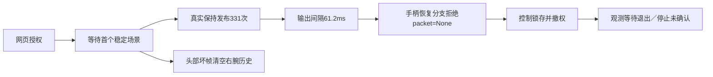

# HARNESS完整开发流程：实现与真机故障复盘

**11月9日已首次真实抓起方块，完整任务尚未成功。** 最新独立包已接通启动复用和预抓距离选择；转移被后续插入的夹爪/桶沿几何拒绝。本文保留各轮证据，当前部署与真实边界见[STATUS](../STATUS.md)。

本页按运行保留历史证据，不将旧包失败改写成新包成功。后续已接入经验快照、自动提案和独立验证的软件流程，真实晋升与收益仍未证明；机器人关闭期间只做离线工作，当前状态与未部署边界以STATUS为准。

## 完整开发版证据

- 最终包：`f1061b77a2f52f685ff270aa930b5a0e3d004e66fce40c4e212110132f6d4b8d`，266文件；[安装回执](../../artifacts/full-development-20261105/final-install-receipt.json)。
- 软件359项通过：[测试回执](../../artifacts/full-development-20261105/wrapup-software-tests.xml)。本次启动故障修复未再运行测试。
- 原生导入及站点配置检查通过，见同目录`final-native-check.log`和`final-native-site-check.log`；检查不等于owner实际启动。
- [网页连接回执](../../artifacts/full-development-20261105/workspace-activation.json)当时connected=true、can_start=true，没有自动START。
- [保存场景原生数值](../../artifacts/20261105-live-scene-review/native-best-candidate-result.json)：approach2.126秒／25目标，grasp0.421秒／8目标；transfer因J5+178°及J7−90°拒绝，后续未通过。没有真实动作成功结论。

## 首条失败及修复

实际运行：`web-56fa8d44a8bd4956a0e4b1fd74490c28`。原始[owner日志](../../runs/workspace/web-56fa8d44a8bd4956a0e4b1fd74490c28/owner.log)末尾为`ModuleNotFoundError: No module named 'move'`。ROS启动合同本身ok=true；Harness启动器仅source通用ROS，遗漏现有机器人工作台一直加载的F1及AGV环境。

页面此前读取日志尾部后再截首1000字符，导致真正异常被参数清单挤掉。现在优先显示native结构化error/reason；原日志不修改。停止未确认来自对已退出owner的查询失败，本条trace没有web_authorization_submitted事件。

[修复回执](../../artifacts/full-development-20261105/owner-startup-fix/receipt.json)记录源码身份和连接阻塞。现有native包及生产V47不修改；修复作用于6000D调度启动器，连接恢复后重启调度服务即可加载。只重启入口、不重放旧任务，也不放宽关节或碰撞保护。

## 11月6日恢复

22009连接已恢复，现有AGV环境的`move.msg.State`实际导入成功，来源为`/home/user/workspace/agv/install/move/lib/python3.12/site-packages/move/__init__.py`。重启修复后的本地调度服务，infra GET确认connected=true、can_start=true、current_run=null。未启动owner、未提交开始请求、未重放旧任务，也未新增测试或模型调用。

[进程与源码身份](../../artifacts/full-development-20261105/owner-startup-fix/activation.json)及[infra恢复状态](../../artifacts/full-development-20261105/owner-startup-fix/infra-state.json)为本次启用回执。此前失败记录保留；这次仅证明依赖导入和页面入口恢复，真实owner启动与完整任务仍待后续运行。

## 11月6日baseline启动链修复

用户任务`web-d4677541b6d54edaa81847603d63c7c0`在辅助服务启动前报`development_robot_boot_changed_recheck_required`。旧代码直接比较标定采集boot与当前boot，却没有独立复核消费流程；readiness继而把开发配置误报成缺少精密标定。原始日志保持不变。

新增boot_capture／boot_recheck：每次网页冻结任务后、辅助服务前，在机器人原生环境只读读取head/right序列号、4路CameraInfo、至少300ms头身反馈及模型SHA。验证当前boot在采集中未变化、数据新鲜且原姿态容差保持，收据绑定任务hash和原始证据hash；不改原calibration、标定SHA、精度身份或权限。数据不符仍拒绝，报告实际原因；失败原始采样也收回本次目录。

真实检查发现私有ROS Context误用全局executor，已改为显式SingleThreadedExecutor；随后发现native/entry.py缺少main保护，spawn子进程重入native解析器并误解析harness-web，已补保护并用真实Python spawn加载路径回归。空异常reason也能在网页保留错误类型，不再被参数清单淹没。

最终验证：

- [软件回归](../../artifacts/baseline-startup-20261106/software-tests.xml)：385项通过；最后executor／spawn／网页针对回归42项通过，Ruff通过。
- [最终安装回执](../../artifacts/baseline-startup-20261106/install-spawn-receipt.json)：独立包`0ed10fb26ac8cbfb3c4d633cffa88d92394913b340c67d0889b6e20ff5b6d1aa`，控制manifest与此前一致；生产V47不变。
- [真实启动结果](../../artifacts/baseline-startup-20261106/native-startup-check/web-3825c89872de40c99333fe070dc9b3b6/startup-result.json)：新boot复核、辅助服务、owner启动、baseline准备通过，停在等待网页授权；START请求0，无技能提交，检查进程已关闭。
- 原标定SHA仍`d7175be6b25a0a6d5fbe1cb12bfe657ffa077c12424d93f07521cfee91338ab2`；新boot为`00000000-0000-4000-8000-000000000001`，head/body最大偏差约0.191°，小于原0.5°阈值；相机与模型身份一致。
- [infra状态](../../artifacts/baseline-startup-20261106/infra-state.json)及[调度启用](../../artifacts/baseline-startup-20261106/workspace-activation.json)：connected=true、can_start=true、current_run=null，不自动重试历史任务。

这些证据覆盖启动故障修复，不能宣称物理任务已跑通。转移阶段原生数值J5／J7限位拒绝仍未解决，下一条动作日志另行判断。

## 11月6日授权后撤权与页面等待修复

实际用户run为`web-984374fe9c0c492cbc214fe28052f479`。网页授权epoch1后约8.872ms，owner以`runtime_latched:RuntimeError: 无法读取自身发布者RMW身份`撤权至epoch2。控制journal和policy chunks为0字节，没有技能提交或执行记录；这不是抓取或插入失败，也不能据此冒称实测停稳。完整小日志另存[原运行证据](../../artifacts/baseline-runtime-20261106/failed-user-run-evidence.json)，历史原件不修改。

根因是Harness owner沿用通用ROS默认FastDDS，而冻结控制桥的`publisher_gid()`调用CycloneDDS实现。owner现在显式沿用生产的`rmw_cyclonedds_cpp`、既有Cyclone XML和SUBNET发现配置；图像／观测服务维持原环境，发布者身份校验没有放宽。原生诊断在独立非控制topic创建publisher，用冻结版本GID函数取得有效身份，随后销毁；0次publish、0个控制publisher，[回执](../../artifacts/baseline-runtime-20261106/publisher-gid-native-probe.json)。

原planner仅等待`authorized=True`，漏看短暂授权后一直等待；页面又把历史`owner_authorized`当成当前状态。现用prepare原子回执绑定task/session/owner/generation/epoch，撤权或身份变化即退出；运行监督持续读取当前权限，保留首次撤权原因，正常`task_finished`与故障区别处理。清理的session关闭不会覆盖原故障；停止未确认仍独立记录，未伪造成功或停止。

- [完整软件回归](../../artifacts/baseline-runtime-20261106/software-tests-native-access.xml)：413项通过；针对修改文件的Ruff语法／未定义错误检查通过。默认沙箱禁止socket造成的18项环境失败另存`software-tests.xml`，实际权限下复核全部通过；默认全风格Ruff仍有既存风格项，没有声称全风格清洁。
- [新安装回执](../../artifacts/baseline-runtime-20261106/install-receipt.json)：独立包`b9dccd675a018ecf40de7c9572afe5e9f16e76bd8f86f26a0ef12098acd174a6`，控制manifest与原包一致。生产V47、原标定及原限位不变。
- [新检查原生证据](../../artifacts/baseline-runtime-20261106/cyclone-startup-native-evidence.json)：owner实际ready，task_prepared=1，authorization和skill事件=0，control／policy chunks均0字节。检查脚本误查顶层session_id而非perception_context，导致自身报准备超时；[另行核对](../../artifacts/baseline-runtime-20261106/startup-evidence-audit.json)保留原失败回执，不把该脚本记成通过。实际planner已打印waiting_for=infra_start，检查进程已关闭。
- [清理与现况](../../artifacts/baseline-runtime-20261106/post-failure-current-state-summary.json)：04:32:19 UTC确认无Harness／f1dagger进程与owner/plan/verify socket；独立52帧关节采样覆盖1.0198秒、臂最大变化0.0007004°。这证明采样时稳定，不回填原失败run的stop_confirmation，也不宣称全系统零publisher。
- [调度启用](../../artifacts/baseline-runtime-20261106/workspace-activation.json)及[infra状态](../../artifacts/baseline-runtime-20261106/infra-state.json)：新包已启用，connected=true、can_start=true、current_run=null。旧run失败及停止未确认仍保留在历史，不自动重试。
- 本轮没有付费模型调用、训练、自动START或技能重试。完整动作成功和转移IK问题仍未验收；这些修复只覆盖已复现故障。

## 11月6日首个技能前观测失败与耗时

用户新run `web-e685282f771241f485315ed11e8ea496`已通过DDS检查与网页授权，但第一项`approach_grasp`在提交前获取有效观测失败。planner报`status: HTTP request failed: timed out`，后续状态读取报`observe: frame_feedback_skew`。原生trace没有skill提交、开始或结果；774条control来源为603次harness_hold、41次ik_recovery_hold及130次hold，不是零输出，也不是已执行抓取。PyRUA的moved=true仅为工具动作能力标志。

从[网关服务原日志](../../artifacts/baseline-runtime-20261106/observation-failure-services.json)可确认场景反复在`frame_feedback_skew`、`mask_worker_rejected_frame`、`unverified_pairing`间失败，没有稳定有效观测。前者当前检查相机接收时间与右臂最新反馈是否在50ms内；分割非200的具体原因被客户端通用异常隐藏，尚不能断言物体颜色、遮挡或配置是哪一项。HTTP和Unix服务器均支持多线程，status超时的具体根因未确认，不能归咎单线程服务器。gateway双shutdown异常发生于收尾，与最初阻断分开。

6000D同一单调时钟：请求→复核3.849秒，复核→授权提交17.519秒，总21.368秒；Python首项调用5.054秒异常。workspace时间记录31.019秒结束，trace在34.122秒确认收集。原生独立时钟：授权→task_finished撤权5.329秒，撤权→实测停稳0.539秒；本次stop_confirmation=owner_hold_completed。两台单调时钟不直接相减。

当前主要启动成本为每run重新准备辅助服务、owner、planner及网络；现有日志不足以进一步精确拆分17.519秒。动作期另有逐IK点settle_ms=300的结构性开销：保存场景approach25点至少7.5秒停稳、grasp8点至少2.4秒，尚未计移动、观测、求解。完整路径修通后，无恢复任务暂按含冷启动1–2分钟工程预算，非实测或完成承诺。优化方向是常驻只读服务、任务作用域隔离，以及另行验证中间点连续执行／技能边界停稳，不能靠放宽时效或限位掩盖故障。

本轮取回约93.3MB原始记录，但[收集结果](../../runs/workspace/web-e685282f771241f485315ed11e8ea496/collected/result.json)的seal因`seal_requires_existing_DAgger_F1_and_shared_on_PYTHONPATH`失败，应单独修复。源证据为本run的workspace-run.json、trace.jsonl、planner/result.json及collected/owner/harness/trace.jsonl。本次仅只读诊断并更新状态，没有重新授权、运动或付费API调用。

## 11月6日观测、路径与故障分级修复

本轮沿用户完整baseline目标处理，不自动重放任务、不新增shadow或分段START要求。源码修复没有修改生产控制V47；标定原件及其粗精度身份保留。baseline及本轮诊断没有模型API调用。

### 已确认根因与修复

- **颜色合同**：图像解码为BGR、固定颜色分割按RGB读取，导致真实图像错误拒绝。统一RGB后48份真实存档图像回放全部通过，深度合同不变。
- **配对与反馈**：取每路最新完整RGB-D对，右腕与头相机各自关联本路时刻的真实反馈；固定头相机无需与右腕使用同一个接收时刻。原始帧时间、右腕50ms反馈偏差、200ms反馈时效和500ms图像时效不改写。
- **计算与传输**：深度注册缓存固定光线，输出逐像素一致；ARM双路注册约311→73ms。固定颜色分割复用同一实现并按配置身份在机器人本地执行，省去RGB跨SSH往返；SAM仍使用远端服务，不隐式替代算法。
- **路径执行**：中间IK路点在首次实际发布后的新鲜反馈到位后推进，不再每点额外等待300ms；末点及夹爪动作边界仍实测停稳。25点接近可去掉7.2秒固定等待，这不是已测物理耗时。
- **转移IK**：原最短转腕路径把J5/J7推到限位；登记净空点、反向分三段转腕后，两组真实保存起点的接近、抓取、转移、对准、插入、释放均原生数值通过。转移57目标、计算约5.8秒、限速理论运动下限24.4秒、内部模拟约46.3秒，技能预算登记为有界90秒，原反馈与输出watchdog不延长。
- **收集和诊断**：seal的原生audit依赖由独立只读进程明确加载；旧失败run另封存完整证据且不改原件，不算自主成功。网页保留具体失败技能和原因，服务／owner／任务准备分段记时。派生视频、索引或封存失败不反向改变原始动作结果。

### 原生未授权集成结果

以下检查只启动未授权owner和真实观测，没有网页START、技能提交或运动授权。五组新场景只是此次诊断采样目标，不是产品运行门槛；未达到目标的原始回执保留。

| 开发候选 | 检查run末尾 | 20秒采样情况 | 结论 |
|---|---|---|---|
| d46a070e7e79 | 49c33e00a5024003b39602b3ec876f1b | 0组有效 | 跨相机共时要求与原始投影、传输耗时阻挡观测 |
| cf6c6740ad78 | 536806d96332435981a2ba909757ae19 | 2组有效 | 投影优化生效，整图SSH往返仍占时效预算 |
| 309fadf99c96 | 2e9f5d84e0434a2f9768ffcf4d55a478 | 4组有效 | 本地分割已生效；头帧进计算时已老260–490ms，仍有过期与窗口重置 |
| c04ab0374e61 | 3832db99f7714198841ed50c57eea80b | 5组有效，检查通过 | owner与baseline准备完成；仅未授权观测检查，头部时间戳冲突仍未彻底解决 |

第三候选之前合并软件回归为490项通过，随后remote的结果身份和绝对期限又有针对性修正。最终交付源码的全量回归为 **535项通过，13.32秒**，见[最终软件回执](../../artifacts/baseline-completion-20261106/final-delivery-pytest.txt)；它证明软件检查通过，不证明真实抓取或插孔。

### 最后一次真实观测检查与交付边界

候选 `c04ab0374e61` 的[原生检查回执](../../artifacts/baseline-completion-20261106/native-startup-check/web-3832db99f7714198841ed50c57eea80b/startup-result.json)记录：baseline准备24.014秒，第一组有效scene为24.866秒；5组scene跨度9.7219秒，最大相邻间隔5.2519秒。检查无网页START、无技能提交、无运动授权。该结果证明真实观测能够形成有效scene，不等于连续高频稳定；头部时间戳冲突及较大场景间隔仍须从后续日志观察，不能宣布已彻底消除。

最终独立包 `7768aad71ca8` 已安装，见[安装回执](../../artifacts/baseline-completion-20261106/delivery-bundle-install-receipt.json)。相对上述实测候选，源码仅改变 `control.py` 的verifier RPC等待5→12秒，以及 `skill_services.py` 的VerifyService新观测等待3→10秒；观测与owner bridge代码相同，原运动watchdog、反馈／图像新鲜度和生产控制manifest不变。[交付差异回执](../../artifacts/baseline-completion-20261106/delivery-delta.json)明确 `whole_delivery_bundle_live_task_tested=false`：最终包没有完整真机任务验证，安装也不代表已切换infra。实际入口启用与部署指向由STATUS及启用回执单独记录。

### 证据容量与故障分级

原scene归档上限1GiB仅容纳约210组当前格式样本，可能在完整任务中耗尽。按每组5,114,880 bytes、360秒任务预算、最高10Hz及25%余量计算，需求为23,016,960,000 bytes，本轮登记24GiB上限；它是cap而非预分配，实际按新证据写入。只读磁盘检查可用625,613,254,656 bytes（约625GB），公式、空间采样及边界见[归档预算](../../artifacts/baseline-completion-20261106/archive-budget.json)。实际磁盘／原件写入故障仍是硬门槛，未将容量问题降为忽略数据。

软件已按[故障分级与有界恢复](../../docs/FAULT_POLICY.md)区分实际限位／碰撞、反馈失联、未知／部分发布和原件故障，与候选拒绝、纯时效零发布重规划、等待新scene和诊断警告。重新验证先核对身份、哈希、相机、几何及当前物体关系，再判断纯过期；重扫由worker执行，owner实时循环不做FK。各恢复路径仍受原技能期限、授权和反馈保护约束；此处记录软件实现边界，不宣称真实故障恢复或完整任务已经成功。

证据入口：[软件与整包产物](../../artifacts/baseline-completion-20261106/)、[感知修复](../../artifacts/perception-repair-20261106/independent-camera-summary.json)、[真实第三包时序](../../artifacts/perception-repair-20261106/scene-timing-third.jsonl)、[完整路径数值交接](../../artifacts/20261106-transfer-path/handoff.json)、[发布与反馈路点核对](../../artifacts/baseline-motion-20261106/feedback-and-waypoint-review.json)。

## 11月6日真实授权后的保持输出锁存与横向审查

用户使用开发包 `7768aad71ca8` 启动 `web-c43fb57e77744a0697a2f852e7cd9599`，仍未进入第一个抓取接近技能。此次真正终止任务的是保持输出间隔超过原保护门槛，随后继承的手柄恢复分支拒绝了网页模式的空手柄包；感知同时因头相机坏帧反复丢失右腕稳定历史。两条原因分别处理，不能把后续“观测等待时权限变化”当成最初故障。

这条实际失败说明此前535项软件回归和未授权观测检查没有覆盖真实网页授权后的完整控制生命周期。本轮补齐运行时横向检查与针对性修复；原失败、停止未确认和能力未验收的事实保留。本节记录已取得证据和源码修复，新整包身份、全量回归及实际部署结果由后续回执补齐，不能提前写成完整真机成功。

### 实际发布与终止证据

[原生审查汇总](../../artifacts/owner-stationary-fault-20261106/audit-summary.json)关联网页run与机器人记录 `f1_hil_20261106T053509Z_ee594488`。331条control全部为 `harness_hold`，含331次joint_command和1次right_gripper_command；接受技能为0、技能首次实际发布为0。因此应表述为“尚未执行抓取技能，但有真实保持及夹爪命令发布”，不能表述成零输出。是否具备运动能力的工具标志也不能代替这些发布记录。

授权后3.6486秒首次记录publication_failed，3.6674秒记录authority_revoked。原生输出诊断为 `target_age_ms=14.3`、`output_gap_ms=61.2`，输出enabled为两臂false、规划速度和加速度为0，故原运行时将其归为 `StationaryOutputTimingFault`。此前最后一次完整发布耗时46.324ms；全部成功发布耗时中位5.845ms、P95 15.129ms、P99 18.534ms。当前循环target阶段另耗13.559ms，说明不能仅把问题归因于“主循环固定频率不够”。

已有日志只能定位到发布长尾及随后输出采样间隔超限，不能确定46ms具体耗在哪个内部调用，也不能证明感知计算直接造成它。本轮在反馈读取、目标检查、输出采样、命令检查、碰撞检查、endpoint检查及各topic独占校验／publish处增加分项耗时，保留原stage、局部发布、原时间及失败证据语义。见[发布耗时补证回执](../../artifacts/owner-stationary-fault-20261106/publish-timing-receipt.json)。没有提高原50ms输出保护阈值，也没有将部分发布当作成功。

### 网页owner与继承路径的遗漏

本次实证恢复失败位于继承的 `pause_stationary_output`：网页Harness本来就不接收手柄，`packet=None`是正常模式；通用手柄分支却因此返回false，原生日志为 `output_timing_recovery_rejected / control_not_eligible`。之后控制锁存，planner以 `observation_wait_authority_changed`退出。这不是需要用户接手柄或进入RLT才能运行的理由。

横向审查还发现一条独立的软件缺口：反馈缺失／目标过期走继承的 `pause_runtime_condition`时，通用分支内部直接调用父类disconnect，可能绕过Harness桥的显式撤权，使控制监督状态与任务授权状态不同步。它是本轮源码和注入回归确认的遗漏，**不是本次实际run已经发生反馈失联的证据**。故障锁存后若控制循环只提前return、不消费网页控制消息，STOP也无法完成原有请求生命周期；这同样需要独立适配，不能伪造停稳确认。

本轮源码按以下边界处理：

- 只有原运行时已经证实的静止、disabled、安全保持姿态，且本任务没有已发布技能、待执行候选或数值计算，才能进入网页保持等待。保持等待不授予新动作，也不生成手柄包。
- 等待期间继续核对连续成功保持输出和真实递增反馈，达到原停稳条件后要求一份新的scene。运动、部分／未知发布、反馈失联及身份变化不能套用这个恢复分支。
- 反馈缺失／目标过期明确撤销Harness桥权限并清理候选；反馈恢复只恢复保持和STOP处理，不自动重新启动已撤权任务。新运动仍需新的网页run／owner身份。
- 硬故障期间保留网页状态及STOP请求消费；若没有实际保持发布与实测停稳，只能记录cancel_requested，不能报measured_stationary。

这些路径用实际 `WebHarnessPolicyEngine → SupervisedControlLoop → OwnerBridge → TaskEngine` 类组合、假transport注入时序／反馈故障，避免只测某一个桥方法。针对检查结果见[运行时集成测试](../../artifacts/runtime-integration-20261106/native-integration-tests.txt)；这是软件运行时分支验证，不是实际机器人故障恢复验收。发布模块针对回归13项通过；其额外手柄静止组当时26项通过、1项旧语音提示期待失败，该原始回执保持，不能合并宣称该组全部通过。

### 头相机故障为何持续阻挡首技能

[本次感知审查](../../artifacts/perception-repair-20261106/failure-c43fb57e/diagnosis.json)与[原生gateway trace](../../artifacts/perception-repair-20261106/failure-c43fb57e/gateway-trace.jsonl)显示，planner取到5份真实scene，编号7／11／15／17／18，全部 `stationary=false`。期间多次出现 `capture_faults:duplicate_source_stamp:head`，另有scene或处理／传输过期等待；尚无skill提交。整条原生相机审计记录head重复源时间戳29次，左右腕各0次；这包含收尾窗口，不能全部归入授权后的3.67秒。

此前独立只读采样已确认头相机存在“相同source timestamp、不同像素”，不是相同消息的无害重送。完全相同source＋blob的重送已经仅丢弃新消息；不同像素的身份冲突仍必须保留拒绝。真正的软件耦合错误是：右腕stationary、tracking和in_hand历史原本都在头部验证之后更新，且任何头坏帧都会清掉整组历史。单纯保留旧历史还不够，因为坏头期间根本没有采到新的右腕证据。

本轮将现有右腕证据计算移到头部判据之前：只有右腕配对、标定身份、对应真实反馈、FK、mask及物体几何都通过，才更新该路独立历史。有限定的头部观测缺失使用 `SecondaryCameraUnavailable`，撤下完整scene并清理头部fixture可见证据，保留已经更新的右腕历史；头相机恢复后，才能重新输出完整scene。普通ValueError、右腕错误、头部标定／clock／头身参考变化仍按硬错误清理，不借“坏帧”掩盖身份错误。

独立历史使用右腕原始采集时间，不用最新snapshot时间续命；原最大证据间隔、source推进和owner scope继续约束。typed失败之后仍重新核对owner context，同一capture换epoch或授权变化不会继承旧在手证据。新增回归覆盖坏头连续3帧时右腕真实推进、实测抬升形成在手证据、恢复头帧形成完整稳定scene、超过gap、同capture换epoch，以及标定／clock／reference异常与重复帧同时出现时仍拒绝。75项感知相关回归通过，见[独立右腕证据修复回执](../../artifacts/perception-repair-20261106/failure-c43fb57e/independent-primary-repair.json)；新软件的现场连续效果尚待后续运行。

### 计算负载检查与未采取的假设性调整

本次日志确认上一轮缓存／并行已生效：缓存命中时pipeline约81.7ms，未命中样本约174–224ms。实际运行的头部view约120–181ms、腕部注册约40–83ms，比独立像素回放慢；这提示需测量运行负载，但不足以将控制输出长尾归因于OpenCV线程竞争。

[原生线程默认值](../../artifacts/runtime-integration-20261106/native-thread-defaults.json)为11个CPU、OpenCV默认11线程，OMP／OpenBLAS／MKL环境变量均未设置。[同一保存像素的线程对照](../../artifacts/runtime-integration-20261106/thread-profile-result.json)输出完全一致，11线程warm中位155.69ms、最大173.80ms，1线程warm中位169.43ms、最大209.79ms。该独立回放中单线程更慢，不能据此声称限制线程能修复实时发布；本轮没有据此改生产驱动或降低原保护。下一条运行依靠新增发布分项耗时判断长尾来源。

### 原件、停止状态与535项回归的覆盖边界

失败原件已另行取回206,174,162 bytes并封存，原生审计含524份观测、524份payload、331条control、0条policy chunks；integrity_complete=true只说明原件完整。封存仍为 `autonomous_success=false`、`verified_placement=false`、`training_ready=false`，原停止未确认保留，见[收集与封存回执](../../artifacts/runtime-integration-20261106/collection-result.json)。不能将收集／派生视频成功当成动作成功，也不能根据task_outcome=pending_review覆盖网页已记录的运行异常。

05:45:41 UTC另做了[独立只读反馈采样](../../artifacts/runtime-integration-20261106/post-failure-feedback.json)：52帧跨1.0197秒，源时间严格递增，14个臂关节齐全，最大变化约0.000639°；owner／plan／verify socket不存在。它仅证明该采样窗口内臂反馈稳定，不补写原run的stop_confirmation。只读探针没有创建控制publisher或publish；ROS图中仍能看到来源未识别的joint／移动topic发布端，因此不能把“本探针零发布”写成“全系统零publisher”。

535项既有本地suite主要证明Harness协议、状态机、假后端及已登记几何逻辑；此前原生检查停在未授权阶段，没有进入网页授权后的真实保持发布，也没有覆盖 `packet=None` 的继承恢复路径、反馈恢复时桥权限同步，以及头坏帧与右腕时序历史共同作用。它们均是覆盖缺口，原通过回执仍真实，但“测试通过所以真机全流程已无问题”的推论不成立。

本轮增加运行时类组合注入、右腕独立证据回归和发布分项诊断；新包的全量数字、安装／启用身份与真实运行结果由本次最终交付回执另行补入。到本节记录时，不新增完整抓取／插孔成功结论，不自动重放旧任务，不修改既有标定精度身份或生产V47。

### 本轮最终冻结与部署

本次恢复竞态与STOP二次故障修复后，最终[Harness全量回归](../../artifacts/runtime-integration-20261106/final-harness-tests.txt)为568项通过，[跨工程真实组件组合](../../artifacts/runtime-integration-20261106/final-native-integration-tests.txt)为32项通过。后者使用实际ControlLoop、F1Owner、WebHarness与TaskEngine及假传输，覆盖packet=None静止等待、STOP、反馈撤权、已发／在途不恢复及故障中的二次记录异常；不启动ROS或电机动作。扩展stationary回归另有一条既有音频期望不匹配，未冒称全部DAgger测试通过。新维护入口为scripts/check_native_integration.py，必须与Harness本地回归一起检查控制生命周期。

精确退役scene补丁处理暂停已经恢复、旧scene才提交的竞态：仅当前scope精确匹配被退役scene的请求获得可查询零执行拒绝；陌生scene／身份变化仍拒绝，丢回执先查原ID。runner不重置观测期限，也不消耗数值重规划额度。锁存后的控制消息消费若再次遇原件／未知异常，保留首因并锁存；不会因反馈恢复清掉新故障，错误日志自身失败也不退出监督。

最终独立包`4222ba5f675c`已安装并切换infra，真实任务API确认connected=true、can_start=true、current_run=null，见[交付汇总](../../artifacts/runtime-integration-20261106/delivery-summary.json)、[切换](../../artifacts/runtime-integration-20261106/workspace-activation.json)与[实际页面后端](../../artifacts/runtime-integration-20261106/infra-state-after.json)。原生未授权检查准备22.519秒、第一组有效scene24.979秒、29.066秒完成5组采样；未发START或提交技能，检查进程已关闭。这只是本轮诊断采样，不成为产品动作门槛。

本包包含DAgger开发源适配，开发control manifest已改变，生产V47没有切换。历史失败与停止未确认未回填；独立稳定反馈和失败原件收集另留证。原生真实授权后的恢复效果、实际抓取／转移／插孔以及61ms长尾的具体分项原因仍待新物理日志；不能以本轮检查宣布完整任务已成功或所有现场问题已消除。

## 11月6日第二次门槛调查：采集永久锁存与任务级超时

最新run为web-84364d5b34044cd88774a473ddee53ec，实际4222ba5f675c。第一项approach_grasp未提交；146次读取等待30.000秒，最终capture_faults:source_time_reversed:head。3838条控制为保持、0技能接受／发布；没有publication_failed或web_harness_timing_wait。发布间隔最大31.749ms、发布耗时最大21.273ms；碰撞检查最大20.477ms、joint topic发布最大0.864ms，不能归咎网络。首次撤权task_finished，781.988ms后实测停稳，977组图像与原件完整封存。[控制审计](../../artifacts/gate-audit-20261106/control-audit.json)保留计数、分项和原件SHA。

[网关原日志](../../artifacts/gate-audit-20261106/gateway-trace.jsonl)首次倒退故障展示早于网页授权约435.6ms；47条scene_timing无成功，29次pipeline均在前置fault检查退出，未运行右腕图像处理或独立停稳历史。未记录触发异常的stream、前后source或原始Frame，不能断言RGB还是Depth、真实重启还是迟到乱序；反复显示fault不等于反复发生倒序。owner录制头部RGB有22次重复而无倒序，只覆盖另一消费者的已录窗口。[感知审计](../../artifacts/gate-audit-20261106/perception-audit.json)记录完整边界。

ObservationBuffer.add把source_time_reversed写永久self.faults，后续递增帧只清transient duplicate；source_clock_verified=false亦如此。[纯内存复现](../../artifacts/gate-audit-20261106/sticky-fault-reproduction.json)使用100→90→110→120，后两次仍invalid，证明延长30秒无效。sequence_not_increasing采用同类永久集合，须一起审计。上一轮只解耦明确duplicate_head等暂缺，本次更早的永久fault使该分支未运行。

门槛分级实施不完整：采集故障范围、30秒准备期限、候选不可达／几何拒绝后的require()终止、动作后10秒暂缺仍存在任务级退出。RLT原则是坏帧拒收／暂停动作不等于结束任务，但其现有源时钟倒退也锁存，不能声称直接复制即可解决。整改顺序见[当时的整改方案](20261112-implementation-plan.md#04-门槛整改方案与实现边界2026-11-06)：采集身份与epoch→结构化等待→分技能证据与零执行恢复→整包验证／完整rollout→性能。

本轮只读取历史日志、做无网络／无机器人纯内存复现，并更新方案与状态；未改运行源码、放宽参数、部署新包或发START。新增整改尚未完成，不将上一轮软件通过数再作为本轮修复结果。

## 11月6日门槛整改实施与独立包交付

本轮按0.4计划修改采集、scene、runner、原生owner和网页等待状态。最终独立开发包为`8aa99b4af228a831d74c4c81034fa24a273f42677072d79be51c6eac7b620d97`，infra已切换并只读确认connected=true、can_start=true、current_run=null；未发START、未提交技能、未调用Astra，也未替换生产V47。源码控制manifest为775192bcb30e8355a21ca494a286b8978c58b06b943fc5398827a8012711b6b4。完整[交付回执](../../artifacts/gate-repair-20261106/delivery-summary.json)分别记录几何检查通过与源身份扩展检查未通过。

### 已落地的恢复语义

- 对100→90→110→120的原故障序列，90拒收且不降低高水位，110／120解除临时故障；序号倒退同样不永久锁存。每个诊断保存camera、stream、序号、源／接收时间、内容哈希、publisher字段及采集epoch。异常样本最多16MiB，额度耗尽仅停止诊断样本保存。
- 明确publisher替换／设备重置凭证对应的新epoch接口会清旧帧及历史，分辨率／解码硬故障不因此清除。暂缺数据输出结构化waiting／needs_attention，30秒仅提示并继续使用300秒共享执行预算。预算到期前未提交动作的路径返回待处理，不再让固定Python程序抛异常冒充控制端故障。
- 头部特定坏帧期间，右腕可生成不含孔口的只读场景，支持抓持后置验证／在手检查／reobserve；首抓没有独立净空走廊证据，仍要求完整场景。转移／插入／释放不得使用缺孔位的只读场景。
- 数值层枚举最多4个登记方块对称姿态，保留IK、实际FK扫掠与场景检查；候选编号绑定证明，替换成其他姿态会拒绝。owner首发前候选拒绝仅接近／转移可在证明实测及保持锚点安全、绑定未变、零实际发布后换候选。已发布、未知发布或不安全锚点均不能走重试。
- 动作后暂缺新证据只重新验证，保持同一请求与after_ns；运动不重放。原技能期限与heartbeat仍约束。明确失败和pending_review由baseline分支保留，不能未确认就继续释放。任务恢复成功后清理先前attention，旧失败仍在trace保留。
- planner写原子progress，infra显示等待技能／原因；待处理与异常分别显示。保持、停止已请求、实测停稳与最终成功继续分别留证。

### 验证结果与ROS现场差异

[最终全量回归](../../artifacts/gate-repair-20261106/final-regression.txt)578项通过，[原生组合](../../artifacts/gate-repair-20261106/native-regression.txt)35项通过。原生新增测试实际走WebHarness、ControlLoop、OwnerBridge与TaskEngine，证明候选零发布可更换、已发布拒绝撤权、unsafe anchor不能软化；假transport不代表真实运动。动作后缺证据→再次验证→成功及取消后迟到成功丢弃亦有回归。

真实只读检查暴露两个接口问题：rclpy用inspect.signature.bind(one_arg)判断单参数回调，因此可选第二参数拿不到MessageInfo；现已改为必填第二参数，并兼容字典／对象。随后实际只读订阅确认机器人Jazzy/Cyclone的MessageInfo只有source_timestamp、received_timestamp和两个为空的sequence字段，**根本没有publisher_gid**。ROS图能查到一个endpoint GID，但它不是逐帧来源，未用它伪造Frame身份。软件publisher重建接口通过，真实自动触发仍未接通，需后续设备重启回执或受控订阅重建；无证据的持续时钟重置仍需停止后新任务重建采集。单帧异常恢复不依赖此字段。

完整[现场MessageInfo证据](../../artifacts/gate-repair-20261106/messageinfo-readonly.json)及两次publisher检查失败原件保留；最后字典兼容修改另有[2项针对回归](../../artifacts/gate-repair-20261106/final-ros-callback-tests.txt)。没有把扩展检查失败改成通过或加成阻止现有baseline的新门槛。

最终包真实未授权检查：准备21.709秒、首个有效scene22.964秒、30.895秒内取得5组新有效scene。实际场景准入满足已有合同；publisher身份扩展断言未通过，原因如上。owner／辅助检查进程关闭后才切换空闲infra，确认无活动任务。该次不是rollout，无物理抓持／插孔成功证据。

下一步由用户点击一次完整baseline，核对新包的首次实际技能发布、阶段结果和停止封存。约23秒冷启动、碰撞检查长尾、相机驱动时钟原因、真实采集重启触发与复杂堆叠仍是后续问题，不宣称全部现场问题已经消失。

## 11月6日8aa99包首技能规划期静止时序中断

新run为web-9eece669e48f4fae92e0bcd3980d2e46，核对实际包8aa99b4af228。授权后1.228841秒接收approach_grasp，再约194.8ms在output_sample阶段失败；121条control均harness_hold、0技能发布和0waypoint。planner的moved:true是工具元数据，不能作为实际抓取证据。

故障样本enabled两臂false、速度／加速度为零，输出间隔51.512703ms。上一采样至发布完成23.000407ms，其中collision_check21.904050ms、joint publish0.557563ms；下一周期到采样28.186227ms，其中target阶段28.056762ms。target内部未进一步细分，不断言其全部为碰撞。来源为本地检查／目标阶段长尾，非Astra或网络推理。原静止恢复的bridge排除future，engine排除pending/running，导致已受理但未执行也不准静止恢复，这是前轮覆盖遗漏。

撤权epoch2后281.1ms发生task_finished→epoch3，471.8ms后session_closed→epoch4；owner账本无web_stop和hold_ack，owner最终正常保存退出。STOP读身份和发送之间很可能与收尾竞态，具体原RPC错误已被web_process通用包装丢失，不能声称错误码实证。95组图像封存完整，但停止未确认保留。

用户随后明确要求解释为何不能取消此门槛。整改应把已证实静止HOLD的50ms硬中断改成诊断，计算中不等同运动中；真实运动的断流、反馈、限位和碰撞分开保留。新帧、旧候选和实际发布身份仍要正确绑定。停止链需独立修复，不能只隐藏未确认提示。本轮仅调查留证，未修改运行源码或自动START。[完整诊断及原件哈希](../../artifacts/gate-followup-20261106/diagnosis.json)。

## 11月6日用户取消静止50ms硬中断后的交付

用户“取消”明确承接取消静止HOLD的50ms任务中断。最终独立包a46899e237e7859de888abe058a73da06643c87e3942985dbd1ffe42ec812524已安装并切换infra，真实后端connected=true、can_start=true、current_run=null；三个变更控制源码文件哈希与包一致。生产V47保持，未自动START或执行动作。[部署核对](../../artifacts/static-timing-warning-20261106/deployment-verification.json)与[切换回执](../../artifacts/static-timing-warning-20261106/workspace-activation.json)留证。

修改限于F1Owner保存原selected16、WebHarness的静止告警分类和ControlLoop的告警处理。原输出已分类disabled／零规划速度加速度／目标为上次发布，且原实测和保持姿态／反馈检查通过时，再确认完整selected16未改变、当前source=harness_hold；时序超限仅记录stationary_output_timing_warning。当周期没有写命令，owner保留已发布位置，下一周期按正常逻辑采样／检查；不撤任务权限、不丢计算、不增加200ms恢复等待，也不伪造新观测时间。计算中的候选仍受原deadline、身份、时效和首次发布复检约束。

实际运动、目标过期、反馈失效、非法姿态、非零规划动态、其他已锁存错误及部分／未知发布不被此告警分支豁免。日志保留原output gap和零发布证据；底层保留原输出采样分类，网页语义改为任务继续。RLT／手柄原恢复路径不切换。

[42项原生集成](../../artifacts/static-timing-warning-20261106/native-tests.txt)通过。新增7项覆盖idle、future、pending、previously_published后的静止保持，以及stale_feedback、unsafe_pose、moving_output仍拒绝。原先静止等待测试显式关闭本次告警hook以继续验证旧fallback；当前web默认不走该等待前置。语法检查通过。本次没有因局部控制改动重跑未变化的578项Harness套件，没有真实动作成功结论。

停止确认会话竞态、具体target阶段开销与相机驱动重启身份没有混入本次小补丁，仍保留待办。下一步从infra运行完整baseline并按真实日志核对。

## 11月6日a468包首动作前复核失败与停止收尾审计

本次web-88865af5446f4e38a9bdc5ff783f057b实际运行a46899e237e7。网页开始后22.853秒提交授权、31.161秒记录任务失败、31.969秒记录停止未确认；44.070秒完成证据收集。2次approach受理、0技能发布、0实测waypoint；671条控制为628条harness_hold、20条ik_recovery_hold、23条hold。289组观测完整封存不代表动作成功。本轮仅调查及更新文档，没有运行新测试、模型调用、服务切换或START。[诊断和原件哈希](../../artifacts/gate-followup-20261106/latest-chain-diagnosis.json)。

首次受理时头RGB已542.408ms、Depth531.501ms，而外层观测仅326.630ms。受理入口只查外层，规划入口再查所有测量，于49ms后报告planning_measurements_expired；已标零发布可重试并自动换新请求。因此用户看到的早期失败不是最终任务终止点。第二次4.841571秒生成25点候选，再等新场景和复核565.786ms，因revalidation_object_or_hole_changed终止。

感知拟合及稳定判断承认方块四重对称，revalidation却直接比较SO(3)角差。保存观测13→31的方块平移1.622426mm、原角差87.326230°、对称后3.164158°，孔口不变；配置阈值位置1.695021mm、角度5°。该组说明坐标分支跳变会被错误判成场景变化，但失败事件没有保存实际复核输入，不能认定worker一定用了31。接近阶段也套插孔剩余间隙，阶段容差需要拆分；修复必须贯穿实际抓持／EEF目标及路径，不能只将角度比较取模。

第二候选拒绝明确在首次发布前，当前非纯时效错误仍统一撤权。建议废弃旧候选、换真实新观测并有界重规划，保留原路径／反馈／身份与发布记录检查；不直接继续旧动作。软件应明确区分候选失效、任务待处理和真实控制故障。

静止告警在授权期7次50.1–71.4ms均继续，修复确实生效；撤权后319.328ms已有measured_stationary(publication_id646)。随后finish_task、session_closed改变epoch，撤权后744.976ms又因handoff_hold/web_task_revoked未被告警hook覆盖，将61.1ms静止间隔升级硬故障并关闭owner。网页STOP没有入账，原RPC错误被通用包装丢失，状态查询失败距workspace_failure约807ms，不是12秒超时。实际停稳存在与网页未确认同时成立，不能伪造STOP回执或猜定原错误码。

建议依次完成诊断字段与停止收尾所有权、几何等价／阶段容差、统一零发布恢复、同一真实时序组合检查，再交付现有一次网页开始的完整任务。先前42项覆盖没有包含本次几何分支与撤权后收尾，不能将局部通过写成完整baseline就绪。相机重复时间戳／重启识别、约23秒冷启动和规划／控制长尾，以及尚未实际执行的抓持／转移／插孔仍分别列为已知风险或未验范围。

## 11月6日整链修复完成与infra交付

按停止收尾、几何一致性、零发布恢复和组合验证顺序完成实施。最终独立开发包994487a7f497已接通infra，connected=true、can_start=true、current_run=null；269个安装文件哈希全部一致。中间候选9061872e63ad仅安装用于数值复算、未激活。未自动START、未执行机器人动作、未调用模型API，生产控制V47保持原状。

STOP绑定本任务稳定身份，兼容本任务finish／close引起的epoch变化，拒绝旧任务及未来epoch。网页取得真实停稳回执后关闭会话；后续清理异常单独记录，不覆盖停稳证据。撤权后的已验证静止保持沿用时序告警。最后发布前候选失效会清空已批准目标，避免保留任务权限重规划时漏发旧目标。

方块四重对称贯穿场景姿态、在手变换、目标和实际工具扫掠；原始观测不改写。接近／转移／撤离采用明确的15mm自由空间终点误差上限，受已有工具余量和净空约束；这是终点误差容差，不是运动距离限制，也不用于抓持、对准、插入或释放。插孔仍按剩余间隙约束。此前把插孔容差套到空中接近，叠加长工具姿态误差，会造成后续误拒绝。

提交同时检查依赖图像和反馈时间。已登记技能的时效／场景失效，在owner证明零发布且身份、反馈及保持锚点有效时废弃候选，以新观测最多追加两次请求；未实际发生的纠偏／重抓不扣预算，重试共用原技能期限。部分或未知发布不重放。复核日志补存实际输入及结构化差值，供后续精确复算。

最终源码[594项Harness回归](../../artifacts/chain-repair-20261106/regression.txt)、[44项原生组合](../../artifacts/chain-repair-20261106/native-tests.txt)通过；另补清理异常保留停稳回执后，[27项生命周期检查](../../artifacts/chain-repair-20261106/final-lifecycle-tests.txt)通过。后者与前述套件有重叠，不相加宣称独立用例数量。覆盖过期、新请求、真实场景变化、方块等价姿态、撤权、finish／close与STOP组合。

[原生复算](../../artifacts/chain-repair-20261106/saved-replay-native.txt)使用历史25个关节目标及故障附近观测13→31，在实际机器人FK模型上完成25点和25段工具扫掠，墙钟235.79ms。历史精确worker输入未保存，不能称为原故障逐输入重放；数值复算使用记录时钟，不启动ROS、owner或发布器。复算相关源码与最终包哈希一致，见[部署核对](../../artifacts/chain-repair-20261106/deployment-verification.json)、[安装回执](../../artifacts/chain-repair-20261106/bundle-final-install-receipt.json)及[切换回执](../../artifacts/chain-repair-20261106/workspace-activation.json)。

下一步由用户从原infra任务页启动完整固定技能baseline。尚无新包真机抓持／转移／插孔成功证据；约23秒冷启动、控制检查长尾、采集重启自动识别仍是独立待办，软件通过不代替全程物理验收。

## 11月6日首段实际运动、日志故障与网页重新准备

994包的web-460bed先发生新观测重试衔接错误：规划测量过期已正确标零发布重试，观察器正常阶段变化却在共享readiness中漏登记，变成owner_perception_stage_advanced待处理。停止确认本条真实通过，233.4ms收到measured_stationary；前后静止告警也生效。已修共享分类，不复用旧观测，不延长技能期限；CLI退出2的待审结果在网页保留具体原因，不再一律显示异常。

随后web-61ba33实际发生464次harness_skill发布，跨度5.574秒，两个不同目标；首点约0.507秒后切到第二点，尚未抓取。故障时目标已保持约5.07秒，规划速度／加速度为零、剩余轨迹时间零，最后150ms实测右臂最大变化0.000288°。上一碰撞计算27.285ms及发布1.293ms，叠加本轮目标处理20.906ms，产生50.474ms采样间隔。旧分类只接受两臂disabled，漏掉已完成轨迹但仍enabled的等待。

新增独立的完成命令时序分类，沿用原deadband及原认证轨迹完成语义，同时要求完整目标不变、最后实际发布一致、当前反馈和安全锚点有效。只有WebHarness处理此分类；失败周期不发布、不推进路径点，不将其当作物理到位。真正运动、新目标、夹爪变化、未完成轨迹、失联及不安全姿态继续拒绝。

首个实际到达点的settle_required是numpy.bool_，导致独立Harness异步journal线程在JSON序列化时退出；原生journal.partial的writer_error=null属于另一写入器，不可用来否定此故障。已在来源转为原生标量并记录写入失败事件身份。日志错误不再截断撤权、丢弃旧目标或STOP；只有实际保持反馈可以确认停止，缺证据保持未确认。START在日志故障时仍不能授权。本条原件仍为partial，未补造成功或停稳。

infra原先停止未确认后永久禁用开始，且服务重启可能丢失该状态。现在明确点击开始可以重新准备，取得新owner按原停止窗口和阈值形成的真实连续停稳证据后，才授权新任务。新证据不覆盖历史STOP；活动状态异常退出同样保留恢复要求。准备中取消不授权、不自动续跑旧动作。

中间60fd包上线期间用户启动web-0c558失败在owner初始化前、owner日志为空。只读检查证实共享runtime/owner.sock仍存在但连接errno111，无人监听。新快照为owner／plan／verify／numerics分配每任务独立IPC目录，引用及审阅哈希同步，保留原控制锁，不删除旧文件。空日志保留退出码和具体路径占用原因。60fd为中间包，其实际用户运行历史保留。

[诊断与原件哈希](../../artifacts/stage-recovery-20261106/diagnosis.json)、[残留socket检查](../../artifacts/stage-recovery-20261106/stale-owner-socket.json)、[最终软件回归](../../artifacts/stage-recovery-20261106/release-regression.txt)、[56项原生组合](../../artifacts/stage-recovery-20261106/native-final-56.txt)及最终部署回执在同一产物目录。

独立未解决项：第二点右第6关节稳态误差0.34933°，超过Harness全路径统一0.3°；现有机器人RLT/profile使用1°到位容差。不能将二者全局互换，下一步应按自由空间途经点与接触／插孔分阶段，并结合实际末端误差和扫掠几何验证。当前时序修复不会推进未到位路径点，完整抓持插孔仍未通过。

## 2026-11-06：从统一关节门槛到实测推进，停止与数据收尾

**最终独立包 e456e846d1e9 已接通 infra，数据后端 F1infra Harness统一数据 V43 已上线；真实全程仍未验收。** 用户要求先完整运行并按反馈优化。本轮取消测试型截止／误分类，保留物理限位、碰撞、反馈、权限及未知动作不重放，没有发送 START 或模型API调用，生产控制V47保持。

31da 的 web-339f… 与最近 web-2dde…b307612a 均到接近第二点后等待。后者815次技能发布，最终第6关节偏差0.340868°；保存反馈在机器人原生FK中计算为0.970mm／0.01067rad，工具路径检查通过。新空中到位合同按新鲜反馈及实际几何处理统一0.3°拒绝，未改变抓持／插孔精度。保存复算耗时231.6ms暴露“计算时长误当反馈年龄”问题：现在结果只适用于同请求／epoch／点及仍等价的当前实测姿态；当前反馈200ms合同仍保留。候选计算输入年龄也不直接拒绝完整任务，真正发布前仍需新场景复核。

停止时反复重设 `hold_measured_right` 使命令目标随漂移移动，导致停稳无法确认；现只在一次保持事件开始时捕获锚点，同次task的finish/STOP不重复捕获。日志保持每次更新状态但只记录阶段转换。固定导出水位避免追逐不断增加的尾部，大事件以行哈希引用并保留原件；录像生成只依赖原始录制完整性，镜像或视频派生错误不覆盖物理与原件结果。

新收集器从该任务网关取回owner实际引用的RGB-D及内参。对最近真实失败运行只读补验：40个引用全部按哈希取回，共46,041,454字节，无缺失；没有再复制已保存的RGB原生视频包。证据见本轮scene-audit，历史失败仍保留。

infra统一原数据页分类与播放器，原138条身份及审核保持；实际读取20条Harness记录（其中8条完整，其余恢复），最新失败原帧时间轴1356组可读。原6000D预览worker无需另建已开始后台生成历史三路视频；不能把排队当作已完成。静态页面继续V42，数据后端V43；任务运行历史保留编排维度，与原生owner身份关联。

[642项Harness](../../artifacts/tracking-data-20261106/regression-release.txt)、[57项原生组合](../../artifacts/tracking-data-20261106/native-release.txt)、[27项infra](../../artifacts/tracking-data-20261106/infra-tests-release.txt)、[原生FK](../../artifacts/tracking-data-20261106/native-tracking-replay.txt)、[场景补验](../../artifacts/tracking-data-20261106/scene-audit-result.json)、[最终安装](../../artifacts/tracking-data-20261106/release-final-install-receipt.json)、[切换](../../artifacts/tracking-data-20261106/release-activation.json)、[269文件及真实页面](../../artifacts/tracking-data-20261106/release-verification.json)、[实际数据页](../../artifacts/tracking-data-20261106/infra-data-verification.json)。c6c7为未激活的中间候选，保留内容身份，不覆盖为新包。

未完成：首条新版本真实完整动作、抓持可见性与插入结果、真实STOP锚点效果、现场持续感知及耗时。精密标定认证、采集重启自动识别、复杂堆叠、真实经验独立验证、Astra对照和BC/RLT技能仍在后续范围。当前软件可运行不表示这些已验收。

## 2026-11-06 后续：纠正未覆盖的运动中50ms硬中断

用户运行 e456 的 web-69e0a52d2bc745c9a92dd3a86c8ddcaf 后已推进接近路径点0–3，随后仍中断。真实输出间隔52.263270ms、目标年龄33.837374ms、上一publication832；本失败周期零发布，仍处于certified_target轨迹。之前只软化静止／轨迹完成的50ms分支，未覆盖运动中分支，与用户取消测试型中断的预期不一致，已明确承认。

4a5231ee172b仅对web Harness的明确纯时序零发布故障告警恢复。原生owner先丢弃超时输出并重置到最后已发布位置，runtime复查新鲜反馈和实测／保持安全，任务仍绑定同请求、epoch和当前点；下周期重新approve并走原平滑、限速、限位、碰撞和发布检查。未成功周期不记control或技能publication，不重发技能／预算，不向其他RLT模式开放。目标过期、权限、反馈、部分发布和安全锚点失败仍阻断。

[保存样本](../../artifacts/moving-timing-20261106/recorded-gap.json)、[原样本分类](../../artifacts/moving-timing-20261106/saved-classification.json)、[59项原生组合](../../artifacts/moving-timing-20261106/native.txt)、[安装](../../artifacts/moving-timing-20261106/release-install-receipt.json)、[服务切换](../../artifacts/moving-timing-20261106/release-activation.json)及[线上核对](../../artifacts/moving-timing-20261106/release-verification.json)。扩大检查75通过、1项既有RLT音频测试未产生预期事件，源码与前包一致，记录为独立限制而非全部通过。没有由agent发送START、模型调用或改生产V47；新包真实恢复和全程仍待现场验收。

## 2026-11-06 最新真实轨迹、成功案例与经验接线审计

本轮只读审计用户运行web-9a0e7b4675a544a9906c4b9da1f4ea03，没有控制代码变更、部署、START、训练或付费模型调用。当前包4a5231ee172b完成接近index0–15约15.6秒，index16持续127.7秒；尚未闭爪。网页任务总时长175.2秒，用户STOP后0.670秒确认measured_stationary。248次纯时序告警没有中断任务，上轮50ms修复在本条生效。

右臂J7目标−63.01449°、实测−61.56513°，末5秒波动仅0.00091°，为稳定偏差而非持续接近。0.3°严格到位失败后，1°条件又阻止几何复核，index16复核次数为零。使用相同冻结原生FK对保存数据计算：arm_R_Link7参考点误差0.74218mm，方向1.15447°，配置指尖参考误差4.92186mm。两处位置参考不能混用；未进行此姿态的全环境扫掠验收，不能推断不存在碰撞或已满足插孔。物理跟随偏差的根源仍未查明，不能当接触力。

实际路线为外退→抬高→原地转腕→预抓。画面见右臂离开桌面右侧，后期腕图看不到方块；两次mask_uncertain_requires_new_prompt不是此次停点主因，但显示后续感知风险。当前路径来自固定几何规则及首个可行方块对称候选，IK偏好关节限位中点，未消费用户成功动作先验。历史B1250记录ea906579具有操作者成功审核，9293policy+94hold、无人工/RLT，命令轨迹约44.7秒；旧录像本轮未独立逐帧复审。旧原始关节和当前明显不同；旧EEF原始坐标不同，不能直接叠加XYZ，本轮已将两条保存关节用同一当前FK重算，仅用于对照，不作为旧标定或任务布局等价证明。

恢复缺口不是仅缺一个prompt：owner未到位持续等待，没有阶段停滞结果；baseline只在确认抓空和部分对准/插入failure时恢复。Astra同样调用阻塞技能，无法在等待中介入。engine的重复技能防护要求注册恢复，但接近/转移没有checkpoint/resume；现有retreat只是沿孔口法向上移，不是通用原路回退。需要先完成当前请求与实测保持，再按当前几何重算剩余路径或阶段撤离，不能删防重复保护或盲目重放。

经验API确有候选、独立验证、晋升和固定快照实现，但web_process未传快照，baseline不读，结束无提案hook；仅找到synthetic样例，当前真实site也未登记独立验证场景身份。本次保存工程诊断候选，未晋升或应用。代码进度合同问题应修代码，不能靠经验文本绕过。优先级为进度/阶段恢复→成功姿态先验→网页经验接入，再进行baseline/Astra对照。

证据：[运行审计](../../artifacts/trajectory-review-20261106/latest-rollout-summary.json)、[逐点数据](../../artifacts/trajectory-review-20261106/latest-rollout-waypoints.csv)、[头部与右腕图像抽帧](../../artifacts/trajectory-review-20261106/latest-contact-sheet.jpg)、[共同原生FK](../../artifacts/trajectory-review-20261106/native-fk-result.json)、[成功先验审计](../../artifacts/trajectory-review-20261106/success-reuse-audit.json)、[恢复/经验审计](../../artifacts/trajectory-review-20261106/recovery-experience-audit.json)、[未验证工程候选](../../artifacts/trajectory-review-20261106/run-lesson-candidate.json)。原生4512组三路RGB、8359控制记录、0drop约1.845GB已收齐；记录completed只代表封存，物理结果是取消/待审。视频派生状态本轮未查。

## 2026-11-06 Astra连接失败与启动/收尾耗时P0

最新Astra d685准备21.806秒，授权后90.239秒报ConnectError，0技能提交/首次发布，保持8083条，最终停稳确认。实际supervisor具有代理，web_process.spawn却用_safe_environment剥离代理。无认证TLS对照：直连5.02秒失败，既有代理0.127秒成功；本轮没有付费API请求，旧失败没有用量回执，不能断言旧账单为零。

7条运行按各自主机monotonic时钟审计，首次发布用本地授权发送加机器人同钟差得到下界、本地收到事件得到上界，不混减两主机时钟。最近baseline首动28.86–29.48秒，前条30.46–30.89秒，更早39.34–39.69和46.11–46.64秒。冷准备约23秒由复核5.6、辅助6.0、owner11.3、准备/新owner停稳0.5组成，授权后首动5.4秒。结束后同步collect另阻塞下一次开始160秒和94秒，不计入首动时长，但必须同列P0。

新独立包ba93ff43d079接入infra：仅planner保留代理/CA，本地RPC绕过代理，worker仍独立最小env；连接5秒、写15秒、池5秒与读90秒分开，记录请求开始、失败阶段和耗时，不自动重试未知远端请求。网页读取failure.json展示具体码；复制boot回执合并，两层辅助服务并行，harness-web不创建无手柄消费者的ManualPlanner（其他模式保持）。已使用原组件，不引入另一套控制框架。

79项启动/网页/装配针对回归、14项手动规划模式回归、59项原生组合通过；新包269文件哈希和实际infra接线核对通过。配置比较确认几何/感知/任务仅改变发布路径和任务ID；初次比较未归一化任务ID而失败，修正身份比较后通过，原始几何未修改。没有真机START、训练或新模型调用；启动提速与模型返回未作现场验收。生产BC/RLT仍V47。

接下来并行P0为：原生封存后异步复制（先拆原collector持锁合同）；首抓视野丢失重捕获；自由空间进度判定与接近/转移checkpoint/resume。之后用真实成功姿态先验改善路径，再接运行后经验提案、独立验证和固定快照消费。启动变快不能代替这些闭环能力。

证据：[耗时审计](../../artifacts/startup-astra-20261106/latency-audit.json)、[Astra审计](../../artifacts/startup-astra-20261106/astra-audit.json)、[TLS探针](../../artifacts/startup-astra-20261106/astra-network-probe.json)、[79项回归](../../artifacts/startup-astra-20261106/targeted-tests.txt)、[原生/手动规划回执](../../artifacts/startup-astra-20261106/parallel-native-check.json)、[安装](../../artifacts/startup-astra-20261106/release-install-receipt.json)、[切换](../../artifacts/startup-astra-20261106/release-activation.json)、[线上核对](../../artifacts/startup-astra-20261106/release-verification.json)。

## 2026-11-06 本轮部署测试授权与闭环候选（尚未部署）

用户明确授权助手在部署测试时点击infra开始，覆盖本轮完整单方块验证。实际检查发现22009先banner超时、再连接拒绝；旧调度服务日志为`infra_reverse_tunnel_lost`后退出，19843也拒绝连接。已请求恢复现有通道，未发送START或付费模型请求。最后登记机器人包ba93ff43d079，不把它写成仍在线。

候选d78cf0780452含272文件；中间f371b6d6e3b4未部署，后续候选补齐了路径排序。自由空间删除1°关节偏差前置过滤，实际FK检查同时覆盖EEF和配置指尖误差及当前/下一路径扫掠。新鲜反馈2秒无变化触发已运动失败结果、固定保持和实测停稳，接近/转移/撤离才返回checkpoint；恢复绑定任务、epoch、原请求及共享两次预算。确认零发布的重规划恢复预算，未知/部分发布不走该分支；人工STOP清checkpoint。原生组合新增真实ControlLoop与假传输的停滞→保持→STOP检查。

腕目标丢失时只允许显式登记的头部新RGB-D重新测量，独立相机身份仍检查，跨视角重置在手跟随证据。保存图1340像素方块mask与孔口/三参照通过；现场深度拟合与持续追踪未验。ea906579成功记录提取阶段软关节姿态、共同FK朝向参考，实际IK从当前反馈开始。候选按几何路长、旋转、成功朝向与预估相机投影排序，原IK/碰撞照常验证；改为显式排除被拒候选，避免排序后拒3号却把0/1/2号一起跳过。保存场景得到1、0、3、2顺序，1号0.528m/0号0.617m仅几何路长，不是完整数值可达或真机收益证明。

导出拆成持已有共享控制锁的原件哈希封存与不持控制锁的后台复制。sealed reader绑定原run、请求、manifest与文件哈希，新控制端占锁时仍可复制旧封存，原件变化拒收；队列独立进程、每job最多两次，失败partial保留，崩溃后结果重复处理幂等。停止结果不因导出成功改写。启动冻结真实模式经验快照，baseline只编译登记序列，Astra读取同源指南；结束复盘JSON记录事实，成功恢复才产生待验证候选。当前无真实晋升，首个识别模板与默认插入恢复相同，不声称已有学习收益。

本地675项Harness、60项原生组合、6项数值求解检查通过；最终site冻结与保存图通过。第一轮失败包括collector缺省task_id兼容、PlanService测试桩缺可选先验字段，均修复后重跑；回环socket检查在具备回环网络权限的进程通过，不混称沙箱拒绝为代码故障。实际部署、冷启动收益、Astra有效响应、全程放置、停止后再次开始及真实经验独立验证均未完成。

证据：[最终候选](../../artifacts/closed-loop-20261106/candidate-prepared.json)、[675项](../../artifacts/closed-loop-20261106/regression-ready.txt)、[60项](../../artifacts/closed-loop-20261106/native-ready.txt)、[6项](../../artifacts/closed-loop-20261106/native-numerics.txt)、[成功先验](../../artifacts/closed-loop-20261106/success-posture-prior.json)、[保存场景排序](../../artifacts/closed-loop-20261106/saved-candidate-ranking.json)、[保存图与配置](../../artifacts/closed-loop-20261106/saved-mask-and-freeze-ready.json)、[网络阻塞](../../artifacts/closed-loop-20261106/network-check.json)。恢复后先运行本轮`deploy_prepared.py`安装/核对候选，再恢复服务，按已授权的infra入口进行真实baseline和Astra验证；不得修改旧失败原件或绕过控制独占。

## 2026-11-09 恢复实测与infra同目标对照

旧标定继续使用，1fd9a75dc0c1已激活；ddce真实Astra任务到接近index12停滞，先保持并确认停稳，然后Astra实际请求resume。完整抓取尚未完成。此次接口对照将故障范围缩小到实际关节跟随与接近/恢复规划，不能归因于用户未确认的机械阻挡。

ddce对应本地`web-41646bffe2b54563b29de0754f669803`、原生`f1_hil_20261109T030548Z_a0c9665d`。index0–11完成；右腕J6发布60°、实测55.496°，末端约差19.7mm；motion_stalled触发后测得静止。两次恢复零发布复核的位置差分别9.44/5.36mm、对称对齐旋转差12.19/7.34°，均未发恢复运动；后续supported_upright_face_not_observed结束待审。实际infra显示stop_confirmation=measured_stationary、export_state=completed，can_start=true。没有成功经验晋升。

按用户要求在控制空闲时通过infra原姿态API对照（未改生产控制代码/标定）：

| 请求 | 实测结果 | 结论 |
|---|---|---|
| J6=60°，其他关节保持当前姿态 | 56次反馈55.4956–55.4960°，约5.7秒后infra报未跟随并保持 | 换调用方同样不能到位，不能只删除Harness到位检查 |
| J6=50°，向限位内部运动 | 0.838秒到位，实测50.170°，infra反馈验证通过 | 命令/反馈链路可用，不能把55.5°说成反馈冻结 |

两者均用同一个角度制`JointState`主题与`RosTransport`发布组件。infra按关节目标生成轨迹；Harness多了对象坐标、IK、技能/恢复状态机。接口相同不等于上层轨迹相同。当前命令合同J6为±60°，合同的physical_hard_limits本来标记unverified；一次特定姿态下的55.5°平台不构成全局硬限位标定。安装启动参数为arm_control_mode=3、arm_impedance_type=1、右臂k=[4,4,3,2.5,2,2,2]、d=[0.4]×7；这不是本轮实时参数服务读回，不据此修改增益或判断静态误差原因。

两次动作均结束、停止、释放；现场留在约50°腕部姿态，未自动复位。下一步按执行主线修复：接近/恢复目标避免重新命中未跟随姿态；检查小顶面拟合与视图切换引起的目标波动；再做完整抓取验证。旧标定精度继续后置。

证据：[汇总](../../artifacts/infra-harness-interface-20261109/comparison-summary.json)、[60°原始接口/反馈](../../artifacts/infra-harness-interface-20261109/execute.jsonl)、[50°原始接口/反馈](../../artifacts/infra-harness-interface-20261109/execute-50.jsonl)、[驱动启动参数和部署进程](../../artifacts/infra-harness-interface-20261109/driver-params.txt)。没有新API模型请求或训练。

## 2026-11-09 用户反馈驱动的启动与整链复核

用户最新反馈包括“启动到首动接近一分钟”和infra评价“明明伸手能抓，为什么先抬升、弯肘然后停住”。本轮核对实际原始记录，并沿用旧标定；优化启动同时处理成功姿态没有真正进入抓取几何、相机阶段不一致以及发布前复核语义的问题。任务仍是完整单块流程，未改成短距离演示。

已取得一次真实接近技能成功：78d7包的ad599运行准备12.05秒，第一条动作发布事件在点击后23.93秒收到，9个路径点完成并通过到位后新观测验证。随后抓取前切换到腕部表面拟合，持续得不到有效场景，助手主动STOP并确认停稳；没有闭爪、插孔或成功经验晋升。该条为baseline，不能与旧Astra的42.57秒直接计算同模式提速百分比。

### 诊断与已实现修复

1. **启动串行与冗余模型往返**：控制端初始化和辅助服务重叠；Astra第一请求加入真实工具观测摘要，保留技能前新观测。用户b055运行准备18.32秒、第一模型6.97秒/第二模型8.53秒、首次发布42.57秒；e053包准备13.34秒，第一模型9.15秒后直接执行技能，省去纯观察轮次，但因路径未通过没有首动。
2. **成功数据只有软排序，实际抓取俯仰仍旧**：复用成功ea906579的抓取俯仰，以当前方块边为闭合轴，构造四个对称候选；保留原TCP及抓取点。保存场景水平方案从旧28点/腕60°变为9点/腕约10.87°，仅为离线结果；真实ad599完成9点且未复现旧腕部60°停滞。
3. **真实阶段名未贯通感知**：engine将prepared映射为observe，初版头部优先分支漏接observe，造成离线头部方案与实机腕部方案不一致。已覆盖真实phase与相机的组合；随后发现grasp提交时过早切相机，41021候选改为实测夹爪仍处于已登记张开范围时维持头部方案，闭爪后恢复实际姿态测量。
4. **粗包围盒误拒**：c2feb运行零发布；新头部观测位姿变化约0.8mm后，旋转工具AABB与目标AABB重叠。原生FK保存回放证实加入方向分离后起点及完整路径均分离。原15mm余量、旋转曲率补偿及实际碰撞检查保留，不删除碰撞约束。
5. **把新路线结构当旧计划身份**：3fe运行中新观测将四段绕行变成一段直达；旧代码要求新旧内部点数完全一致，误报stage_binding_mismatch。原候选仍逐段做最新场景FK扫掠，只比较最新任务终点；候选原始身份仍单独绑定。另修正重算浮点末位导致的精确JSON哈希歧义，数值容差1e-10，非物理精度放宽。两条真实保存候选的3/11个实际FK点完整回放通过；回放钟固定于保存观测附近，耗时字段0不代表实机计算耗时。
6. **新帧等待被当场景故障**：86ea运行遇到重复头部帧后退出；统一为既有new_consistent_source_frames_required等待，不修改时间戳、不伪造新帧。发布前新场景路线不成立也统一为零发布有界重规划，仍由owner证明未执行。

### 验证和发布记录

同一轮保留各不可变包及失败原件：e053 → c2feb → 3fe180 → 86ea77 → 78d7de → 41021。生产BC/RLT控制V47、infra后端V43未改；Harness产品V整数仍未分配。这些包不等同于“已证明完整真机能力”。

- 整合回归698项、原生组合60项；随后相机阶段/重复帧/测量闭爪交接76项针对检查通过。
- [启动和任务审计](../../artifacts/rollout-grasp-20261109/run-audit.json)、[用户原评价](../../artifacts/rollout-followup-20261109/user-reviews.jsonl)。
- [原生完整链路回放](../../artifacts/rollout-sweep-20261109/complete-revalidation-fixed.json)、[扫掠误拒前](../../artifacts/rollout-phase-20261109/sweep-diagnostic.log)、[方向分离后](../../artifacts/rollout-phase-20261109/sweep-refined.log)。
- [整合回归](../../artifacts/rollout-chain-20261109/regression.txt)、[原生组合](../../artifacts/rollout-chain-20261109/native-tests.txt)、[相机交接检查](../../artifacts/rollout-grasp-20261109/targeted.txt)。
- [最新安装](../../artifacts/rollout-grasp-20261109/release-install-receipt.json)、[最新激活](../../artifacts/rollout-grasp-20261109/activation.json)。真实最新结果在下面补记；禁止将运行中状态预写成功。

### 同轮后续：真实恢复与抓取边界

cd7bc1运行08d9从此前预抓姿态开始，准备13.576秒，首次发布事件17.799秒。接近发生motion_stalled后，baseline实际发起resume并再次发布，接近后验成功；不是只有恢复API调用。进入grasp后，第一次新场景扫掠失败正确返回no_motion/retryable并重规划，第二次候选被拒待审；最终停稳确认、原件导出completed。无闭爪、插孔或经验晋升。

原生保存回放进一步定位为工具包围盒对桌面间隙14.8885mm，略低于既有15mm规划余量，差0.1115mm；另一工具盒32.04mm。此为规划余量检查，不能称为实测碰撞。5014候选改为在登记积木高度内部自动选择抓取点，保留TCP、原横向位置、15mm工具余量，并用已有1mm物体余量留储备；对该最新场景上移约1.11mm。两个保存场景均通过原生IK、工具/物体扫掠并生成8个抓取/提起路径点。配置来源和证据在新冻结site登记。

[抓取桌面净空](../../artifacts/rollout-quality-20261109/grasp-table-clearance.json)、[高度搜索原生回放](../../artifacts/rollout-height-20261109/grasp-height-report.json)、[704项整合回归](../../artifacts/rollout-height-20261109/regression.txt)、[60项原生组合](../../artifacts/rollout-height-20261109/native-tests.txt)、[5014安装](../../artifacts/rollout-height-20261109/release-install-receipt.json)。头部预抓期间跳过无用腕部像素计算；已知分割/表面质量失败归入新样本等待，保留坏帧无效和原任务预算。后续真实物理结果不以这些保存回放代替。

### 本轮收尾事实（5014包）

最新e204运行准备17.701秒，未发生技能发布。三次零发布复核拒绝分别为：头部方块估计朝向变化约6.58°；位置变化0.84mm、朝向0.64°但held从False变None；以及重算任务目标变化。三次重规划用尽后待审，停止measured_stationary，原件export=completed。此结果说明阶段内观测稳定与离散证据语义仍未收敛，不能宣布启动首动稳定达标，更不能宣布抓取插孔完成。

最新部署为5014ee592432，272文件校验通过，当前本地src与冻结manifest完全一致。infra仍作为唯一操作入口，任务模式已恢复用户原Astra；停止以后没有再发START。08d9的真实接近resume成功作为运行证据保存，尚未晋升为独立验证经验。当前阶段不切换BC/RLT、不更新模型权重、不重做用户要求沿用的标定。

下一轮先统一“位姿测量变化／证据暂不足／物理状态改变”在observe、approach、grasp中的语义和传播，再减少有效观测到提交的往返等待；采用本轮完整保存序列做阶段连续验证。随后完成真实抓取与提起、转移插孔、Astra对照。不能用继续放宽一个阈值代替这一整段衔接。

## 2026-11-09 阶段证据与启动长尾继续复核

用户离开后要求不私自执行全程、仅做保守小幅验证。本轮没有发送START，没有模型调用或机器人动作。当前线上保持5014，本地候选只修改接近前的held证据比较和诊断。

e204三次复核的原始观测对分别回放：第一对约6.58°朝向变化仍拒绝；第二对的False→None在两次有效张开夹爪、无附件时不再使接近计划失效；第三对场景比较通过，原先后续goal_changed尚未被本修复解决。持物转移/插孔和闭合夹爪不使用该例外。原始时间戳、位姿、候选、扫掠检查均保留。范围仅为场景比较，不能替代完整原生IK/发布证据。

启动记录显示冷准备本身12–18秒，最新设备复核6.031秒、辅助服务就绪4.713秒、之后等待owner6.210秒；此前Astra首次发布42.574秒还包含模型和观测工作。已实现的并行初始化与首次观测预取不能消除姿态抖动导致的废弃重规划；因此顺序保持证据语义→感知/提交衔接→启动长尾→真实抓持与后续阶段。

回执归于`artifacts/stage-evidence-20261109/`。沙箱内整套检查有21项因socket/bwrap权限失败（697通过），保留regression.txt；允许本机测试通信后另存regression-local-sockets.txt，不掩盖环境失败。原生组合60项通过，无ROS动作。

本轮收尾：允许本机测试通信后718项通过（15.26秒），原生组合60项通过。新包350eb99f0bd2安装并校验272文件，空闲调度切换成功；激活回执记录start_sent=false、can_start=true、can_stop=false。没有机器人动作、没有模型调用，也没有新增经验晋升。旧5014记录与全部失败原件保留。

## 2026-11-09 组合观测与目标参照统一（c97ef15c756b）

本轮继续用户离开期间的离线工作，没有机器人动作。现有observe_with_status本已携带摄取后的owner状态，调用方仍先读status；正常路径现一次组合读即可，失败时才补status，保留epoch/撤权/readiness/时间预算。49项相关检查覆盖正常单往返、读图失败后状态判断、epoch改变、保持和故障。

e204完整三条原始候选在原生环境只调用forward_pose/forward_path，未求解新路径、未构建ROS或owner。旧代码第三条手腕目标变化19.6526mm，但登记指尖仅0.5818mm、角度4.6866°；第一条指尖差0.2201mm、角度6.5783°；第二条指尖差0.1766mm、角度0.6446°。接近姿态目标在登记指尖定义，因此仅approach_grasp的几何目标和FK终点比较改为该参照；原候选身份、实际全部工具扫掠、角差及接触技能精度继续检查。

新原生回放第二/第三条各3点全通过，第一条仍角差拒绝。729项Harness回归和60项原生组合通过；冻结c97ef15c756b，272文件hash核对通过，仅空闲调度切换，start_sent=false。未测真实首动收益、抓持成功或经验晋升。归档时钟用于旧证据身份校验，proof elapsed_ms=0不是性能结论。原始/新复算及墙钟计算时间在`artifacts/observation-handoff-20261109/{replay-result,replay-fixed-result}.json`，部署/激活/回归回执同目录。

## 2026-11-09 朝向与冷发现独立对照（两个候选均未上线）

用户离开期间只做原件回放、合成检查及只读ROS采样，没有START、运动或模型调用。线上和运行源码保持c97ef15c756b；不把试验改善当成已修复。

朝向：现有深度点95%径向裁剪+最小面积矩形在e204六帧给出约-4.81°至2.41°。尝试按已登记法向、实测平面高度将选中点沿相机射线投回平面，仅估计边缘方向，平移和残差仍用原始深度。六帧候选约-0.204°，但独立旧Astra记录11帧中出现6.22°、24.08°、6.91°与-4.76°离群。13项连续旋转、像素栅格、非平面拒绝检查虽通过，不能推翻真实失败。候选已从运行代码撤回；实验函数、测试、原始cloud、图片、差异patch及源码身份核对保留于`artifacts/yaw-diagnosis-20261109/`。下一步应处理边缘支持不足和观测证据，不用该候选假装解决抖动。

启动：慢条boot捕获3.494秒中首条关节在3.174秒到达，设备服务约0.75/0.87秒返回；快条捕获0.514秒，首关节0.194秒。实际复核环境Fast DDS，owner显式Cyclone。交替各两次只读_collect_native：Fast完整0.695/3.020秒，Cyclone两次约8.33秒失败，虽有四路CameraInfo和大量关节样本但device_info为空。记录来自真实只读节点，command_publishers=0；没有改驱动/标定。不可将两种中间件差异直接当根因并统一配置；下一步研究复用只读发现会话，逐任务仍取新反馈/设备回应。完整原始捕获与比较在`artifacts/boot-discovery-20261109/`。

## 2026-11-09 只读设备发现连接复用组件（未部署）

在Fast DDS对照结果基础上，将原_collect_native资源拆出NativeBootSession；单次入口仍创建/关闭session，后续infra可持有只读连接。collect每次新建BootSamples及服务future；不复用序列号回复、旧关节或CameraInfo结果。spin_idle仅处理并丢弃空闲样本，防止累积应用缓存；原源时间与接收时间保持，receipt-only语义未提升。窗口仍要求原300ms观测范围、500ms时效，服务类型/profile变化不能套用旧session。每次capture_boot_recheck仍核对标定/model/身体/设备身份并独立写证据，未绕过build_boot_receipt。

33项针对检查通过，覆盖缺新数据/缺新服务回应时拒绝旧成功、服务类型变化、串行/关闭、profile变化与重复原验证器。真实只读5次采集全部成功，初始化0.297s，采集0.404/0.340/0.321/0.313/0.327s；完整原标定复核另3次成功，初始化0.301s，采集+写回执0.505/0.321/0.312s。每次请求身份独立，反馈接收时间晚于上一轮结束，设备回应每轮重取。临时回执清理，原始完整raw复制到产物中，没有改正在使用的标定、没有START、没有动作publisher或模型调用。

组件尚未接入infra持久进程，当前线上c97ef15c756b不含此改动。不要把局部0.3秒称为网页首动或P95提升。后续须实现只读服务所属进程/异常回退/并发请求隔离，明确固定profile及每任务身份后再集成发布。源码、回归与真实原件见`artifacts/boot-session-20261109/`。

该组件完整Harness回归736项通过（具体耗时见regression.txt）；没有修改owner/授权循环，真实全程仍未验收。

## 2026-11-09 只读复核接入infra（9a6b0c43b37b，未启动动作）

新增私有stdio boot-worker，由infra调度创建和关闭；只提供本项目独立web运行目录的复核请求，不暴露动作API。复用订阅/client资源，每请求重新采样、重新查询设备，refresh_boot_site与原冷入口共用完整验证代码。请求绑定唯一ID、site及task_hash；同ID同绑定幂等，改变绑定拒绝。只允许派发前无可用worker走冷路径；派发后超时/失联为未知，不另起进程覆盖同一份证据。任务STOP在准备期取消等待，失败原件仍取回；服务关闭释放只读节点。该改动不复用运动owner或授权。

真实集成探针调用与infra相同的freeze_site/copy_site/prepare_boot_recheck，明示未调用start_services、start_owner或START；四份配置与原件在artifacts/boot-integration-20261109/readonly-probes下，不作为任务成功或数据页rollout。前三次使用同一只读实例，复核+下载1.267/1.020/0.958秒，配置复制另0.477/0.434/0.426秒；关闭worker后第四次冷路径3.358秒，复制0.453秒。四个请求ID不同，任务hash不同，每次新反馈/设备回应均通过原标定验证。该结果只覆盖启动复核段，尚无新包点击到首动或物理任务收益结论。

69项针对检查通过（另1项需要socket的HTTP检查纳入全套）；750项完整回归与60项原生组合通过。包9a6b0c43b37b安装274文件hash核对通过，空闲调度切换，warm_boot_recheck=true；只读worker实际ready已记录。未发START、没有owner、没有模型调用或机器人动作。生产BC/RLT保持。后续需要朝向边缘证据/整技能连续性与owner初始化优化，完整闭环目标仍未完成。

## 2026-11-09 剩余初始化剖析与可见边缘候选

本轮仍仅只读与数值工作，无owner、START、机器人动作或API调用；线上9a6b0c43b37b不变。67个Harness src/native文件与已部署manifest逐一比较无差异。调度GET显示空闲、can_start=true；本地最新真实运行仍web-7c0767b33636496eac472d596f36619f，没有把诊断探针写成新rollout。

两次独立原生进程模拟初始化中使用profile预设作为纯数值种子，不冒充实测姿态。配置加载0.060/0.061秒、身份0.012/0.013秒、设备参数/进程合同查询0.676/0.671秒、碰撞模型构建3.504/3.494秒。原始e204 ik_warmup.json两侧合计48.309毫秒，因此不优先移除预热。进一步cProfile显示碰撞网格结构创建约2.26秒，URDF/MJCF转换约0.87秒；同源MJCF缓存后构建仍2.414秒。原件、诊断脚本与远端路径在artifacts/owner-startup-profile-20261109。

已安装Coal接口实测支持StdVec append及addSubModel，不支持列表构造。批量共享顶点候选与原算法33组比较完全一致，但构建2.30–2.33秒，对照2.15秒，否决该性能候选，未改共享源码。另用Coal saveToBinary/loadFromBinary保存原有凸包和原三角网格，校验字节hash后加载独立对象/距离请求；子步骤加载0.486/0.468秒，对照重建2.050秒，一次保存0.604秒。33组普通/强制精细网格计算的距离、safe、关节标记、最近碰撞对相同，最大距离差0。该诊断通过浅复制静态索引元数据后替换全部几何对象验证库行为，不是已装配的运行时缓存；生产接线仍须实现完整源身份、缓存原子生成、损坏回源和进程隔离，原owner/CoM/碰撞准入不变。

感知方面，原始RGB-D重新构造颜色mask，按登记30×30×60mm竖直盒体尝试全轮廓拟合。最新6帧yaw范围−16.96°至−10.39°；独立Astra 11帧−13.07°至26.20°，即使IoU约0.85–0.91也不能证明朝向稳定。放大图可见手部遮挡积木轮廓，完整盒体投影强行匹配可见轮廓产生歧义，因此候选否决；不调整在线角差、不部署新的朝向估计。对照图、每帧结果及silhouette-decision.json在artifacts/yaw-diagnosis-20261109。进一步须使用受支持的可见边缘/多视角证据，并把接近→闭爪→持物的证据切换作为同一问题处理。

## 2026-11-09 首次真实抓持与分段程序调整

用户返回现场并授权操作后，安装/激活独立包`9b1f069da1a8`，infra固定baseline运行`harness-50ebda1d360c540fac2f`。真实方块夹起，接近经历一次停滞→保持→恢复→成功，随后grasp、verify_grasp、inspect_in_hand通过；transfer在零发布时返回待处理，最后实测停稳。未插孔/释放、未宣称全程成功，未晋升真实经验。用户确认可以在收到提示后复位，截至本段记录尚未提示其复位。

准备耗时10.618秒，点击到首次实际发布事件回到调度端17.587秒（包含回传延迟），总运行50.535秒，baseline模型调用0。任务原件及图像已封存，后台导出completed；录像派生状态独立于原件，不由export completed推断所有视频已生成。[运行汇总](../../artifacts/pregrasp-routing-20261109/rollout-summary.json)、[原始任务](../../runs/workspace/web-47004be958f5450aa378611c3faa6b83/workspace-run.json)、[腕部抓持画面](../../artifacts/pregrasp-routing-20261109/during-right.jpg)。

本轮代码包含两项已部署变更：一是静态碰撞几何缓存，绑定网格/库/架构/源码、原子提交、校验失败回原构建；二是8cm预抓受阻时可选登记6cm，复核绑定该距离，保持原抓取点、提起高度及碰撞余量。完整776项Harness和60项原生组合通过，278文件核对。原生热缓存30次hit、0错误，网格装配约0.485秒、CollisionGate约1.676秒；33组距离/碰撞/最近对与原实现一致。冷构建首次保存约4.030秒，不把热命中时间当冷启动保证。

- [回归](../../artifacts/pregrasp-routing-20261109/regression.txt)、[原生组合](../../artifacts/pregrasp-routing-20261109/native-tests.txt)、[安装](../../artifacts/pregrasp-routing-20261109/release-install-receipt.json)、[激活](../../artifacts/pregrasp-routing-20261109/activation.json)。
- [缓存原生对照](../../artifacts/mesh-cache-integration-20261109/native-cache-1.json)，缓存中间包2eec已被9b1f继承；生产infra V43及BC/RLT V47不变。
- [预抓保存场景复算](../../artifacts/pregrasp-routing-20261109/latest-plan-diagnosis.json)为3点原生IK通过；此前eb91旧用户Astra条全候选拒绝，不能改写为新包成功。

真实在手变换复算：当前约20°抓持下，registered/shortest_staged/direct_lift三种路径均在预检后续插入时，工具与桶壁、桶沿及桶盖保护几何冲突；四个方块对称朝向都不成立。障碍和路径点完整保存在[分段诊断](../../artifacts/pregrasp-routing-20261109/transfer-diagnosis.json)。这类问题应在抓姿选择时联看插入条件，不通过删碰撞检查或不断换时间阈值解决。

保存初始场景联合搜索中，80°候选抓取与转移数值通过，但转移有256°腕部跨度，未部署、未执行。进一步搜索得到65°/顶部接触参考58.9mm、方块对称转移variant2的直接路线：接近26点、抓取/提起11点、转移20点；转移只有2个几何目标。该搜索只使用预测附件，不代替实测抓姿，`complete_numeric`字段仅指该脚本中的接近/抓取/转移三个阶段，不是完整放置成功。[较短路线诊断](../../artifacts/pregrasp-routing-20261109/short-route-diagnosis.json)。

用户新方向已纳入实施方案：精细抓取→固定净空快速转移→精细放置→离孔、向机器人右侧绕桶、复位。多块复用程序，但每块后刷新受影响场景和目标ID。当前已部署baseline仍结束于verify_placed，避桶复位/多块循环还没有实现；Astra的正常路线将复用固定程序，异常才做任务级决策。下一步先完成候选后续插入/离孔数值验证与实际抓姿兼容，再安排现场复位验证。

### 固定程序候选部署及真实复核限制

65°短路线随后完成align2点、insert3点、release1点、retreat3点原生复算。固定程序配置通过已登记object_grasp_eef表达，不新增模型调用；candidate_order只优先已验证方块分支，仍保留其余候选、排除列表和完整路径验证。代码ede8103cae60，777项Harness回归，生产控制manifest保持不变。[最终站点几何重放](../../artifacts/fixed-transfer-20261109/registered-program-replay.json)。

首配置将可选中转点写null，正式准入视为未填写；9761任务2.86秒在辅助服务准备时退出，未开始技能，stop_confirmation=null原样保留。重新装配为独立direct站点，省略可选字段并重新绑定审核哈希；先经真实只读boot复核，再原生完整site admission通过。未修改冻结错误站点，也没有放宽任何物理条件。[新鲜准入回执](../../artifacts/fixed-transfer-direct-20261109/fresh-native-site-readiness.json)。

用户已现场复位并确认手离开。6795/dfb6b4a5条38.157秒、0首发，三个接近请求依次在新观测复核被measurements_expired、actual_path_sweep_blocked、object_or_hole_changed拒绝；有效授权下有界零发布重规划已发生，终止后实测停稳。需要分别解析输入时间、实际FK扫掠及新旧物体/孔口变化，不能把三个原因合并成关节阈值，也不能以保存场景通过替代当前观测。

[最终安装](../../artifacts/fixed-transfer-direct-20261109/release-install-receipt.json)、[激活](../../artifacts/fixed-transfer-direct-20261109/activation.json)、[真实结果](../../artifacts/fixed-transfer-direct-20261109/rollout-summary.json)。当前UI保持fixed；Astra模式未复测，放置后右侧避桶回位/多块循环未实现，用户尚未取得全程成功结果。

### 2026-11-09 新观测复核与最新接近失败联合诊断

复核修正候选b8e8f2a19db5只安装未激活，线上仍ede8103cae60/direct。零发布候选过期现在等待新的源测量并完整复核，保持原请求、epoch与截止时间；不缓存旧证明。新场景只重建语义终点，实际冻结FK路径独立扫掠，避免新建议路线误拒旧可行路线。首段目标余量离开规则要求严格正分离、连续不逼近和段末完整余量，桶、桌面、邻物及已知附件不适用。

原生保存输入对照：旧热复核111ms过期，新约76ms通过23段；第二份旧实际扫掠拒绝，新约84ms通过25段。第二份的保守起始间距约14.651mm、第一段末15.996mm，原15mm规划余量仅在单调离开的首段按上述证明处理。第三份7.36°场景朝向变化仍拒绝。冷复核仍会过期，新的owner等待恢复以不续期为前提。790项Harness与60项原生零输出组合通过；这些不是真机全程成功。

排查中发现新真实条harness-b3ce3f69999825fcced8，14.54秒、零发布、measured_stationary、原件导出完成。四个接近候选均scene_sweep_blocked。保存观测相对前场景位置约差4mm、方块对称朝向约差40°；实际工具终点及转向受桶壁/桶沿约束。增加到12/16cm后撤和额外4/8cm抬升的离线路线枚举无几何解，60–80°水平接近联合候选也未通过；竖直接近80°有几何候选，但中途转向在原生腕关节约束附近未收敛，不据1.75mm残差放宽限位或下发。

只读新相机可见桌上方块、张开夹爪和无人手工作区；右腕顶面清晰，头部顶面较小。与旧头部截图比较无法支持40°真实旋转的断言，下一步先重放双相机位姿证据，避免围绕可能错误的yaw反复调路径。本轮没有发起START、没有付费模型调用，未改线上标定或控制限制。

数据留证同时暴露一类缺口：规划尚未产出候选就失败时，owner trace没有完整规划输入，scene manifest的required为空。原生视频/反馈封存完整与失败规划RGB-D可重放应分别表述；后续补派发输入留证及导出测试，旧封存不改写。

证据统一在[revalidation-precontact-20261109](../../artifacts/revalidation-precontact-20261109/)：benchmark、保存路径证明、最新候选失败、水平/竖直接近对照、当前双相机截图及回归回执。前置分析在[revalidation-chain-20261109](../../artifacts/revalidation-chain-20261109/)；中间9e5fb344e01e要求held=False不适合当前held未知的接近证据，未激活，由b8e8f2a19db5候选替代，未把held改写为False。

### 2026-11-09 双视图、抓姿前瞻与腕部冗余联合修复

用户暂停后再次明确要求修复朝向与抓姿兼容性。本轮取回b3ce3f的6份观测、24个RGB-D原件并按哈希校验，重放各帧自己的实测关节及同帧FK。头部竖直顶面拟合yaw约25.17–33.11°，右腕约0.015–2.384°；代表帧的选中顶面点分别约153/2822。头部的小面积噪声斑经过径向裁剪后，最小面积矩形不再可靠代表方块边缘；去裁剪、改射线投影或直接拟合平面法线也未给出稳定通用解。因此采用已标定右腕的完整物体位姿，头部保留桶口测量，而非拼接头部位置/腕部朝向。没有更改粗标定或宣称毫米精度。

实际CalibratedScenePipeline回放全部6帧成功，暖处理约50–58ms；另两条历史记录共17帧检验遮挡回退，目标被遮挡或顶面不足仍明确失败。桌面竖直先验只在闭爪前使用，闭爪后的在手测量不沿用。水平预抓会把方块顶面投到腕图像外（诊断y约−97像素）；改为竖直接近，并在候选时投影完整顶面以保留下一观测视野。投影通过不证明无遮挡，实际阶段仍需新观测。

接近和闭爪前新增后续放置几何检查：预测附件→转移→对准→插入→释放。预测附件仅用于选择可行抓姿，不写成真实在手状态，也不替代转移时的实测附件和原生IK。初版700c6b9f93cc六帧数值全链通过，但最终关节审查仍有J6=60°，故未激活。单纯改35–75°倾角、换方块分支或增大旧示教姿态权重，没有消除该问题；过大的旧姿态权重反而让末端目标不收敛，候选全部保留在诊断产物，未部署。

最终使用显式`wrist_center_nullspace`软偏好：令期望增量只含J6向0的分量，按`N = I − pinv(J) J`投影，再交给原受约束QP；姿态cost为0.1，伪逆相对截断1e−5。该目标不是命令，不增加硬门槛；关节限位、耦合腕约束、速度、0.5mm求解收敛判据及逐步实际FK扫掠保持。旧成功姿态仍用于候选排序，不再被日志误记为当前IK目标。最终冻结包f35d9b3f934d在同6帧全链通过：每帧J6最大35.758–37.220°，J7绝对最大约53.86°，耦合腕指标最大约87.73°（原上界110.5°）；原方案J6达到60°。整链纯数值计算5.90–6.26秒，不是实际任务耗时，也不是点击首动时间。

同时修复零候选失败留证：owner在派发规划前记录绑定观测/关节参考，导出器已有递归哈希发现可据此保存原始RGB-D；真实REMOTE_READER测试覆盖“没有任何候选产出”的情形。旧封存不改写，本轮恢复原件另存。

798项Harness回归、60项原生零输出组合和8项求解针对检查通过。首次全套在沙箱内21项因socket/bwrap权限受限失败，回执保留；允许本地测试socket后798项全部通过。最终278文件与配置哈希核对、新鲜只读站点准入通过，旧服务确认空闲/实测停稳/导出完成后切换；infra反向入口和零动作预热就绪。没有发送START或付费模型调用，生产BC/RLT V47和infra V43未替换。独立Harness控制manifest更新仅包含该任务的可选求解扩展。

**仍未完成：** 新包真实关节跟随、抓取后的在手重估和插孔；两路遮挡时的主动重观察泛化；离孔右移回位、多块循环、真实经验晋升。先前55.5°平台的硬件原因尚未确证，本轮是在规划上避开该区域，不能报告硬件故障已解决。下一次现场运行需分别检查新观测、实际抓持、转移、插入与释放后证据。

证据：[双相机及独立回放](../../artifacts/yaw-crossview-20261109/)、[未部署中间候选及数值反例](../../artifacts/wrist-route-20261109/)、[最终全链汇总](../../artifacts/wrist-redundancy-20261109/chain-summary.json)、[安装清单](../../artifacts/wrist-redundancy-20261109/remote-files-verified.json)、[激活及就绪](../../artifacts/wrist-redundancy-20261109/post-activation.json)。当前软件包f35d9b3f934d，产品V号仍未分配，不借用生产控制V47。

### 2026-11-09 用户最新运行dd829：绕行与到位状态分开归因

用户运行harness-dd8292358671b10b9967后反馈仍大幅抬臂、转肘再接近，并要求比较成功数据及给解决方案。本轮只读取证/生成分析产物并更新方案，没有修改运行代码、配置、服务或发起START。

真实运行62.760秒，准备7.882秒、收到首发事件15.760秒。三个approach请求均通过原生规划/复核并发布，依次在开爪前空中末点index27/29、2/4、1/3停滞；两次保持、实测停稳、新观测、resume均发生，最后停止确认成功。所有提交右臂关节在登记范围内，J6指令最大35.353°、实测35.233°，耦合腕指标最大88.27°，不是本次IK或限位失败。

直接根因位于OwnerBridge.after_publication：每tick先以严格0.3°重设reached，任务空间异步证明只在future完成时将其置true；下一tick重新不满足严格值并清空settled_since。三个停滞点关节误差约0.409/0.433/0.455°，任务空间证明在数秒内多次accepted（末端误差8.41/7.42/7.69mm，属于空中合同），但开爪前300ms到位窗口无法连续累计，最终误入2秒无进展路径。应保存绑定请求/epoch/路点/实测姿态的有效证明，在反馈新鲜且姿态等价时持续累计；偏离、换点、取消和失鲜才失效。此结论不授权把插入精度扩大到空中容差。

路线方面，冻结配置65°抓姿、vertical预抓6/8cm及腕部完整顶面可见条件，触发skills.py的后退→抬到预抓高度→原地转向→前移四段模板。首候选EEF路径0.5177m，先抬213mm再横移225mm；系统没有小臂必须垂直桌面的物理要求。真实反馈统一原生FK对照：旧用户确认成功B1250从开始到既有8.007秒抓取前选点，手腕前伸87mm、高度下降6.4mm；本次失败接近峰值抬升213.7mm。J1/J3/J5实际跨度约114.9/152.3/141.8°，旧段18.8/1.3/2.1°。旧阶段选点为此前启发式划分，布局不同且未做物体相对配准；可据此评价形态，不能直接回放旧绝对关节。

低倾角放置还需纠正诊断口径。按当前工具盒、58.9mm抓点、12mm配置进给及理想水平孔口，20/45/55/65°的工具最低离盖约3.87/11.90/17.08/23.16mm，而统一工具余量为15mm。旧真实持物direct_lift扫掠中两个朝向margin=0无工具实体碰撞、margin=1mm即被盖/沿拒绝，另外两个仍有桶壁实体碰撞。因此“所有低姿态物理不可插”证据不足；也不能据此删掉全部余量，因为粗标定/持物误差尚不支持亚毫米净空。应以成功轨迹审查模型/TCP/抓点/真实释放条件，并区分实体与膨胀拒绝。

下一版方案为到位状态P0修复、成功完整低位接近模板、孔口几何/余量复核、感知随路线交接及全臂连续性共同交付；J6优化继续保留有效证据，但不再单独代表整体路径改善。只旋转夹爪不会改变夹爪-物体附件关系；确需换握时必须另有支撑重抓方案。此次分析没有完成新动作验收。

完整证据集中于[trajectory-review-20261109](../../artifacts/trajectory-review-20261109/)：[失败账本](../../artifacts/trajectory-review-20261109/latest-failure-audit.json)、[成功对照汇总](../../artifacts/trajectory-review-20261109/demo-comparison-summary.json)、[XY/XZ轨迹图](../../artifacts/trajectory-review-20261109/approach-comparison.svg)、[几何/余量复算](../../artifacts/trajectory-review-20261109/approach-geometry-audit.json)。本次RGB-D清单required/collected均32、missing为0，证明上一轮零候选留证改动已形成可追查现场资料。

## 2026-11-09 连续轨迹、成功模板与最新启动诊断

最终候选f9947d41f0e1已安装独立目录，未激活、未START。807项Harness/60项原生集成/9项数值检查通过；六份保存场景在预测附件与明确停稳假设下通过完整链路及独立FK路径复核，不能作为真实机械精度或成功证据。源码与数值覆盖模块哈希一致，见[汇总](../../artifacts/demo-stream-release-20261109/verification-summary.json)。

修复包括时间参考推进、异步到位证明持续累计、全臂示教冗余投影、支持面离开从求解接触FK衔接、沿法线单调提升。最初未投影的全臂软目标曾与末端目标竞争，在约0.66mm处停滞；投影后接近通过。带横向/高度残差的示教离桌段随后被真实附件扫掠拒绝，改成支撑法线提升后全链通过。没有放宽原生IK精度或实际碰撞检查。

新候选明确将工具15mm额外膨胀设为告警，几何实体重叠仍拒绝；夹持物1mm余量、12mm插入深度保持。代表保存场景接近候选J1/J3/J5行程约1.49°/0.87°/3.70°；旧失败真机约115°/152°/142°是不同场景实测，不把此对照称为新包真机改善。[路径汇总](../../artifacts/demo-stream-candidate-20261109/chain-summary.json)、[最终独立复核](../../artifacts/demo-stream-candidate-20261109/validated2-chain-results.json)。

用户最新fb6cea仍运行f35d9b3f934d，14.63秒，已获得网页授权但首次observe返回孔口证据缺失，尚无技能提交。最终measured_stationary、export completed，两端状态接口均can_start=true。头部保存图中方孔可见；旧ROI内搜索框[393,342,458,402]得0像素，诊断框[390,300,460,380]得1381像素，中心[422.98,332.96]。这是检测范围问题，尚不能判断桶或视角变化，也没有从2D检测擅自改写3D孔位。[检测对照](../../artifacts/demo-stream-20261109/latest-start-mask-diagnosis.json)、[保存图](../../artifacts/demo-stream-20261109/latest-start-head.jpg)。下一步是当前桶口重定位/搜索恢复与准确诊断，而非再调关节误差。

## 2026-11-09 孔口搜索恢复与合并上线

新独立包8f1d6b1ebf2b已替换f35d9b3f934d成为infra实际入口；f9947d41f0e1保留未激活历史。旧服务在当前任务review、实测停稳、导出完成且can_stop=false后正常退出；新服务PID2504478，反向19843、机器人实际4242和零输出预热服务就绪。没有START或付费模型调用。

本次重新采集6对头部RGB-D，源时间差约0.018–33.355ms，保留原时间、未宣称精密硬同步。所有帧均识别方孔和三个桶盖特征；当前孔位相对旧目标约(+33,0,+9)mm，三特征间距偏差最大约0.99mm，拟合平面95%残差约1.59–1.79mm。这是旧粗标定下估计，不能据此确证桶移动或相机移动。搜索恢复仅覆盖注册工作区；不是任意桶位泛化。

软件同步更新孔口目标与bucket角色障碍，保留桌面独立；观测失效清缓存，缺失当前孔口与已定位后遮挡分开诊断，暂时缺深度/特征在原预算内等待新证据。三特征身份不一致不晋升为可用几何。修正外环掩膜反馈造成搜索框逐帧增长的问题。61项针对回归通过；第一次沙箱内3项socket权限失败，放行本地测试socket后通过。281文件和站点哈希一致，新鲜只读准入通过，准备实测copy0.47s+boot/download2.44s，不作为点击到首次运动的耗时。

实际安装包使用保存起点与此次测得孔位完成接近、抓取、转移、对准、插入、释放的原生IK和独立路径复核，用时6.67s。附件与后续反馈是预测回放，非真机放置。继承连续轨迹、跨tick到位证明和成功B1250分段姿态功能；真实全程、避桶右移复位、多块、经验晋升仍待验/待实现。

证据集中于[fixture-relocalization-20261109](../../artifacts/fixture-relocalization-20261109/)：capture-validation.json、regression.txt、validated2-chain-results.json、workspace-boot-probe.json、remote-files-verified.json、activation.json、post-activation.json。版本号未分配，当前以独立包内容身份定位，不借用生产控制版本号。

## 2026-11-09 连续接近成功后的抓取与Astra等待审计

8f1d6b1ebf2b两条baseline（6dd293、9a7b14）已连续接近成功但未闭爪，最新Astra6e4c0b在接近动作后缺有效场景、由用户274.77秒时取消。全部停止已实测确认。本轮只读调查及保存输入/原生FK复算，没有新的控制修改、部署或START。

baseline首条在grasp闭爪前index13停滞，指尖4.5379mm、姿态0.6057°，最大关节0.2345°；闭爪100从未发布。容差函数goal_position_m错误借用孔口有效间隙2.695mm减夹持物余量1mm，变成1.695mm用于抓取。仅改成通用xy=2mm仍不足覆盖首条，需按真实夹持几何判定或有界修正。首条重抓本地同身份URDF复算为regrasp_approach_sweep_blocked，仅目标方块拒绝current→above段，桶体通过；诊断正则遗漏regrasp前缀导致网页只剩RuntimeError。

第二条原生独立复核精确复现：grasp首次目标平移1.799mm被1.695mm拒绝，随后实际路径端点含姿态杠杆上界为1.800/2.377mm；三次grasp均零发布。regrasp目标变化2.44–9.35mm也被同一尺度拒绝。这是阶段判据耦合，不能用全链15mm或取消真实碰撞来掩盖。接近阶段已推进成功，旧0.3°逐样点等待并非本次根因。

Astra首次API响应7.611秒，3170输入/247输出token，API未提供可拆分内部思考时间；单Python工具约253.93秒，只执行observe→approach_grasp。首动作事件约点击后20.95秒，末点约23.77秒；之后24次fresh_post_motion_scene_missing每10秒重试，没有grasp。网关尾部显示object_not_visible_in_either_calibrated_view、right mask_uncertain和间歇feedback_expired。画面可见积木并不等同有效几何，离线压缩视频按固定0.2秒采样不能稳定复现原始跟踪失败，具体跟踪框/颜色/采样状态根因仍待查，不将其当作相机掉线或网关提前崩溃。

验证服务10秒返回pending后，owner内部立即再次验证，只有原任务300秒总期限，错误不返回Astra；因此模型无法决定恢复。STOP后工具才interrupted返回，planner还开始第二次API请求，无响应/用量回执，计费未知。应修动作后场景重新获取、验证等待有界升级及STOP传播，而非换推理强度。

证据：[三条汇总](../../artifacts/grasp-handoff-audit-20261109/run-summary.json)、[六请求误差复现](../../artifacts/grasp-handoff-audit-20261109/diagnosis.json)、[网关尾部](../../artifacts/grasp-handoff-audit-20261109/astra-gateway-tail.jsonl)。当前baseline/Astra共用感知、IK、技能和owner；Astra接口只有已注册skill名，冻结任务仍square-1到square-hole-1，多目标选取是计划而非已交付能力，当前经验快照为空。

## 2026-11-09 Astra五分钟等待后的离线修复

机器人由用户关闭，全部工作离线，无SSH F1、START、模型调用或线上服务切换。当前候选70b3d2865255，已生成原生包与未激活站点；线上仍8f1d6b1ebf2b。产品V号未分配。

源码修复覆盖：验证2秒一次、两次升级具体错误；owner验证checkpoint经recheck只读续接，取消/其他运动失效；Astra每次请求和工具前后检查权限；抓取不借用孔口间隙且闭爪前允许已证明空爪的有界resume；原生错误保留regrasp_approach前缀。抓取前搜索可使用同任务近期物体包围盒投影，重获后的几何仍来自当前深度。6张历史JPEG均可重获，但使用计划末点近似相机，未声称完全复现在线动态跟踪故障。

834项Harness、60项真实原生组件假传输检查通过；无真机/原生IK全链新候选验收。配准缓存只预计算带内参/畸变/旋转身份的射线，当前深度和位姿不缓存；合成640×480中位27.591→23.161ms，输出逐像素一致。已有20.05度/秒下示教五段参考下界合计6.426秒，不包含插入、夹爪、停稳、感知或当前起点，因此不能据此承诺15秒。

失败事实以JSON内容身份保存，三条历史运行分别4/6/1类聚合事件；Astra24次缺场景等待归入一个事实，物理根因不从错误码猜造。修复经验验证漏洞：独立场景成功还须实际执行候选技能序列，新增typed trigger；旧v1审核不能未经序列复核直接晋升。真实晋升数量仍0，baseline原插入恢复与经验模板相同，没有新增真实行为收益。

证据：[全部产物](../../artifacts/offline-closure-20261109/candidate-prepared.json)、[834项回归](../../artifacts/offline-closure-20261109/full-regression.txt)、[60项原生](../../artifacts/offline-closure-20261109/native-integration.txt)、[配准对照](../../artifacts/offline-closure-20261109/registration-benchmark.json)、[历史诊断事实与分段耗时](../../artifacts/offline-closure-20261109/saved-run-reports.json)。后续仍需实测残差修正、完整离孔右移复位和真实全程验收，不将这轮称为完整闭环交付。

同轮补充：用本地绑定URDF（bc21c6f3…）及原HAL关节映射独立计算FK，与旧包6条错误码、两条端点平移/旋转原生结果逐一对齐，再对同一冻结候选执行新复核。6/6通过原实际工具/持物扫掠及新目标参照检查；不重算IK、不连接机器人。详见[冻结路径复核](../../artifacts/offline-closure-20261109/saved-path-revalidation.json)。该证据确认候选误拒修正，不证明实际4.54mm跟随残差消失。

## 2026-11-09 本地原生求解环境、返程与完整周期搜索

建立HARNESS独立`.venv-numerics`，固定沿用F1数值依赖：numpy2.2.6、pin3.7.0、pin-pink4.3.0、qpsolvers4.13.0、proxsuite0.7.3、ruckig0.19.4、mujoco3.3.7。没有ROS实例、机器人连接、START、付费模型调用或部署切换。原生求解使用绑定URDF/关节符号映射、原碰撞和限位；资产缓存写本轮产物目录。

真实保存场景重新求解接近→抓取→转移→对准→插入→释放通过，纯CPU求解约3.22秒。另实现离孔、移到机器人右侧桶边之外、返回就绪的几何候选；直接右侧回位、外侧下降和高位回位按实际工具扫掠选可行短路线。默认保存场景需高位回位，空爪路线约0.596m，四段原生IK/碰撞均通过。把原home关节作为所有返程段的软偏好使参考下界约8.36→7.94秒；这是数值参考，不是实测执行加速。

进一步按抓姿/转移/对齐组合搜索10个分支：2条完整数值抓放复位链可行，最佳参考16.224秒，加当前登记停稳20.124秒，不包含感知、求解、控制跟随和API。另一可行分支约23.10秒，不能因为末段直返就假定整周期更快。当前设置尚不支持15秒已达标结论；优先整周期转腕/冗余优化，未提高原速度限额。

放置后的独立观测模块仅输出当前孔口，保留开放夹爪、实测停稳、标定和身份要求，不编造消失积木位姿。运行owner/PlanService/完成判据尚未接入该分支，新技能未公开登记；既有baseline仍以verify_placed结束。另补recheck成功归档关联原motion到位证据，防止只验证的新请求因没有新运动而被误判。

844项Harness、60项原生假传输组合通过。代码比70b3d离线包更新，未再次冻结或部署。证据：[本轮汇总](../../artifacts/return-cycle-20261109/summary.json)、[整周期搜索](../../artifacts/return-cycle-20261109/cycle-search-results.json)、[完整原生抓放](../../artifacts/return-cycle-20261109/native-full-chain-results.json)、[返程原生](../../artifacts/return-cycle-20261109/native-return-task_start-prior-results.json)、[回归](../../artifacts/return-cycle-20261109/full-regression.txt)。

## 2026-11-09 离线返程运行接线

完整返程进入显式任务合同，旧任务默认技能及hash保持。owner在已确认放置且任务授权返程时提供placement_verified；baseline/Astra继续withdraw_reset。规划复用原数值服务与当前桶体几何，离孔后右移，再经完整扫掠选择返回就绪路线。恢复用原checkpoint/resume和只验证recheck；放置后禁止重抓/再次释放。

放置与复位结果在finish_task、后端solved、封存审计中分开。放置成功且返程失败仍保留verified_placement，autonomous_success为false；整周期计时要求同owner/task/session/epoch的完整技能成功和实测返程，撤权/缺结果不输出完整耗时。返程观测与放置后显式observe等待上限4秒，消除新阶段再次等待300秒的可能。只忽略未参与返程的腕相机纯采样故障，头部与身份故障仍保留。

[862项Harness回归](../../artifacts/return-runtime-20261109/full-regression.txt)、[60项原生假传输](../../artifacts/return-runtime-20261109/native-integration.txt)。[原生返程服务链](../../artifacts/return-runtime-20261109/runtime-native-results.json)使用保存场景和此前原生求解的预测释放点，四段27点，PlanService/路径复核/到位检查/VerifyService通过；输入中新时间和停稳是明确的离线假设，不能当作新采集证据或真机成功。没有连接机器人、调用模型或部署。

上轮整周期参考加停稳20.12秒结论未改善；本轮主要完成执行与完成判据接线。配套候选、真实动态阶段切换、4.54mm闭爪前残差、目标接触区重抓撤离与RSI策略生成仍待完成。下一步比较右侧净空后的关节路径与现Cartesian返程，按整周期减少转腕，原速度/限位/碰撞不变。[汇总和源码身份](../../artifacts/return-runtime-20261109/summary.json)。

## 2026-11-09 返程捷径反例、经验程序与候选冻结

原生FK/工具扫掠与机器人碰撞复算发现：右侧净空后直接关节回home仍会撞桶，0.5°和0.1°两种采样在约11%处一致拒绝。61个登记来源的中间姿态候选中找到保留绕行的一条，参考返程8.0032→7.1130秒，四次停稳和原限速不变；0.1°复核通过。仅离线预测释放状态，尚未改运行路径或证明真实耗时改善，详见[结果](../../artifacts/return-optimization-20261109/joint-search-results.json)。

`recovery_programs.py`提供固定JSON程序与受限PyRUA编译；`learning_review.py`把失败归为程序候选或待工程分析，不从MD执行代码。三条真实日志形成两条候选、八项工程诊断；按trace摘要去重，尚无独立真机晋升。程序编译与反例检查纳入[874项回归](../../artifacts/learning-programs-20261109/full-regression.txt)。真实失败候选的验收只证明证据/分类/隔离，不证明策略有效，见[回执](../../artifacts/learning-programs-20261109/saved-failures-review.json)。

新冻结包f2627810a86a包含上述源码与上一轮返程接线，独立site显式登记withdraw_reset及原home右臂关节、机器人右轴；289个包文件/9配置核对，离线准入通过。准备时发现历史controller-reuse回执路径被替换，已恢复原始字节并让历史证据保持原hash；新配置与包身份另行绑定。未连接机器人、未部署、未付费调用；更短关节返程不在新包内。[候选](../../artifacts/full-return-candidate-20261109/candidate-prepared.json)。

## 2026-11-09 稳态闭爪残差与正式程序验证接线

原control journal最后78个样本显示右臂参考与submitted已收敛到约3e-11°，平滑器remaining为0；测量仍有约0.234°最大跟随差，最后一秒每关节峰峰值小于0.0063°。原生FK对同一保存状态复算得到腕原点1.991mm、登记指尖4.537mm、朝向0.010568rad。末点13后才是闭爪14，没有闭爪100发布。这个停点不能再归因于未发完指令；实际机械/阻抗/负载原因不能由编码器单独认定，也不把关节差解释成力。[原件摘要与复算](../../artifacts/preclosure-residual-20261109/report.json)。

形式化候选登记到ExperienceStore隔离区；program_verifier按owner日志实际父子请求检查补验证或续接：同任务/会话/owner/epoch、原checkpoint、停稳时间顺序、已知发布及真实成功结果。补验证新请求有运动即拒绝，抓取续接缺闭爪前证明即拒绝；完整周期任务还要求返程实测结果。晋升前重算v3回执，RPent快照保存程序结构与身份，baseline识别同一登记程序，Astra继续读同一快照。当前程序本来是内建恢复，登记不是行为自修改。

49项新增反例/隔离/端到端synthetic晋升检查包含跨作用域、重复请求、撤权、未停稳、未发布、原件改动、回执伪改、复制发现运行和无关成功；[923项全回归通过](../../artifacts/formal-verification-20261109/full-regression.txt)。本轮没有owner/控制变动，沿用上一轮60项假传输结果。三条旧真实失败自动登记两条待验证候选，零真实晋升，不改原run文件、不连接机器人、不付费调用、不部署。源码比冻结候选f2627810a86a更新。[汇总](../../artifacts/formal-verification-20261109/summary.json)。

## 2026-11-09 返程重复轮询与独立反馈修复

新增返程测试复现：同一头部帧被更快轮询重复取得时，只要附带无关右腕采样故障，旧逻辑就反复进入pipeline，触发new_return_frames_required并清空停稳历史。改为仅对参与当前阶段的camera+stream判断帧推进；返程无关腕采样错误不触发旧头帧重处理。正常放置确认变化只使正在处理的旧阶段场景失效，不当作任务撤权清空全部历史；完整context仍在发布前核对。

固定头相机的机身参考继续用图像时刻反馈（图像500ms要求）；返程当前空爪/关节状态另读取真实最新反馈，保留200ms要求和真实时间。合成RGB-D经真实pipeline与本地Unix RPC验证新帧、重复轮询、跨相机同source时间戳、反馈陈旧、闭爪、相机身份错误及阶段竞态。此处RPC owner为测试fixture，不是真实owner跨进程完成。新增8项，总[931项Harness通过](../../artifacts/return-phase-20261109/full-regression.txt)；[60项原生假传输](../../artifacts/return-phase-20261109/native-integration.txt)本轮重新通过。

[原生重规划反事实](../../artifacts/preclosure-residual-20261109/replan-counterfactual.json)冻结原物体观测、从保存实测姿态重算，14为首闭爪点；新名义指尖仅比原目标变0.477mm，若关节跟随偏差保持，则残差仍4.539mm。该恒偏模型不是实机校验，更不是补偿已解决；重抓起始到上方的proposal拒绝来自目标square-1自身，非桶/邻物。下一步不能继续重复resume冒充改善，应结合捕获几何、实测跟随和有界纠偏/接触离开设计。

本轮不连接机器人、不部署、不付费调用；源码继续比f2627810a86a更新。15秒仍未达到。[汇总及源码身份](../../artifacts/return-phase-20261109/summary.json)。

## 2026-11-09 空爪重抓接触退出

原失败重抓在current→above段被目标square-1本身拒绝。新增登记的空爪目标接触退出：先张爪且所有关节不变，保持当前朝向沿原登记提起方向离开，再于净空区调整到重抓预位。几何证明对每个工具盒选择初始最近分离面；每段平移必须覆盖旋转角对全部角点的最坏靠近量，终点恢复原完整净空，非目标障碍保留普通扫掠。这不同于删除目标障碍后直接执行；原数值解生成后和新场景复核时分别重验整条FK路径。

张爪/退出/净空调整属于自由空间阶段，采用既有自由空间定位预算；最终闭爪、支撑提起和插孔的原阶段要求不被套用该预算。张爪必须只改变夹爪且目标为原release_opening；退出全过程保持张开。几何trace绑定阶段名与contact标志，不能修改候选JSON添加豁免。抓后放置lookahead已明确选择真正闭爪阶段，避免把新退出阶段误当作抓取点。

原保存场景通过五阶段27点的原生FK/IK/机器人碰撞/环境复核及owner证明结构、五个名义到位检查。复核中的新时间与到位状态是显式虚拟值，物体几何冻结，不能当作新相机采集或真机恢复。纯几何反例覆盖穿过目标、先深入再退、旋转、邻物/桌面、终点未清空、未知/持物、错误目标和多个工具盒；序列与合同篡改检查合计17项新增。[948项Harness](../../artifacts/contact-departure-20261109/full-regression.txt)、[60项原生假传输](../../artifacts/contact-departure-20261109/native-integration.txt)通过。

本轮不连接机器人、无模型调用、不部署。仍未解决4.54mm实际跟随残差，也没有证明真实退出中目标不移动或整周期15秒。[汇总](../../artifacts/contact-departure-20261109/summary.json)、[原生候选](../../artifacts/contact-departure-20261109/native-plan.json)、[复核与名义到位](../../artifacts/contact-departure-20261109/native-revalidation.json)。

## 2026-11-09 成功抓取跟随对照与封存诊断

历史成功B1250控制原件中，首次闭爪起于7.698秒，随后重新张开，第二次起于8.233秒；不能将整条成功标签分配给两次尝试。逐观测按右臂实际编码器时间关联此前完整关节发布，使用原生FK及当前登记工具参考点计算，两个闭爪前300ms窗口的指令/反馈参考点残差中位6.410/7.370mm；本次失败末秒4.542mm、右关节变化最大0.005788°。历史窗口仍在运动且历史物体相对姿态/工具物理标定未知，以上是跟随诊断，不是夹持误差或可放宽毫米数。[可重现脚本及摘要绑定报告](../../artifacts/grasp-tracking-comparison-20261109/report.json)。

新增tracking_diagnostics接入summarize_run：自动从原trace、control、observations生成不可变补充JSON，保留请求/epoch/task、发布完整性、目标/提交/反馈差、编码器跨度与变化、实际夹爪主题发送。重复时间戳只计一次，冲突与失效显式记录；没有checkpoint的Astra等待不生成臆测的关节问题。原失败事实/程序候选/已存在experience-review保持身份，不因补诊断自动晋升。保存三条真实失败在独立review-memory目录复核：停滞条27个独立右臂时间戳、跨度0.9604秒、末反馈距checkpoint8.455ms，无该请求闭爪主题发送。[自动输出](../../artifacts/grasp-tracking-comparison-20261109/automatic-review.json)。

返程保留原语义终点的直线试验：right_of_bucket→above_ready扫掠碰桶；above_ready→ready可行但仅将参考1.8516秒降到1.7663秒，0.1°采样检查耗时约0.998秒，因此不作为在线提速实现。原7.11秒不同转弯候选仍未接入，本次没有把纯数值时间当真机收益。[对照](../../artifacts/grasp-tracking-comparison-20261109/return-stage-probe.json)。

16项新增针对检查涵盖身份串线、部分发布、夹爪主题、重复/冲突/失效时间、原件不变和复盘幂等；[964项Harness通过](../../artifacts/grasp-tracking-comparison-20261109/full-regression.txt)。本轮未改owner/控制/恢复，60项原生组合沿用上一轮。未连接机器人、未付费调用、未部署；抓取捕获判据/实际残差、完整周期和15秒仍未完成。

## 2026-11-09 纠偏响应假设与重新冻结

基于真实停滞末点，语义目标不变，驱动参考按`reference += 0.5 * (semantic_goal - measured)`更新右七轴，最多两次，左右夹爪和其他轴不参与补偿。四种明确的反事实响应分别是旧偏差保持、旧偏差消失、机械不动和偏差反向。恒偏情况下预测指尖4.537→2.268→1.134mm；偏差反向时4.537→6.803→3.402mm，机械不动一直4.537mm。报告同时标注无改善/恶化策略应在第一步返回，后续数值只是未加监测的反例。没有硬件辨识、接触力估计或真实纠偏成功。[报告](../../artifacts/preclosure-correction-20261109/hypotheses.json)。

八条命令候选按0.01°细分，经原mapping、机器人碰撞gate与已有抓取阶段环境扫掠通过；只沿用该阶段原有目标接触语义，不新增碰撞豁免。场景冻结为旧观测，路径可行不能替代实际响应。运行代码未启用自动补偿，也未放宽到位条件；后续设计必须分离物理到位目标与驱动参考，按实际反馈改进决定继续/退出，不能拿预测反馈冒充观测。

已用当前源码重新生成未部署候选`7834018e3c76c27f2691ff22aa931cd5921fd1daf024a5e926b225e504bbe90b`，292文件、9份配置校验通过。原控制manifest保持`c66cf7230bdb7d275982fff69cd9efafd80c1ab1b0c025698eb41eac1b6519b6`，完整返程task hash保持`83708b1c6402770782c044e81c85a4bc7bc0418e67d23b782a55b86f4a387a02`；旧controller-reuse和粗标定原件逐字节保留。冻结含当前等待/取消、返程观测、目标撤离、经验验证与跟随诊断源码；不含反事实补偿或7.11秒实验捷径。

使用实际安装器的安全解包检查，然后预加载并核对解包模块路径/摘要，运行214项针对检查，含60项原生控制/owner假传输；通过前后均确认没有转回工作区实现。964项全回归沿用相同源码上一轮结果。未启动ROS、未连接F1、未调用模型、未切换infra；产品V整数尚未分配，不以bundle短摘要冒充正式产品版本。[候选回执](../../artifacts/preclosure-correction-20261109/candidate-prepared.json)、[解包验证](../../artifacts/preclosure-correction-20261109/frozen-verification.json)。真实闭环、实际纠偏、独立经验晋升和15秒仍未完成。

## 2026-11-09 完整程序原生数值回放与验证丢失注入

新增维护脚本`HARNESS/scripts/replay_full_owner.py`，从冻结候选的本地检查配置读取task/fixture，构造真实PlanService并执行原配置/粗标定身份检查；仅在内存重定位本地owner引用和数值模型路径，原配置不改。完整固定程序通过真实TaskEngine/OwnerBridge/VerifyService推进，原生FK/IK、mapping和碰撞gate执行；理想跟随、刚性夹持、新帧与反馈为明确mock。Engine为FAKE、结果synthetic、trace逐行simulation；硬件合同观测字段synthetic=false只为执行未修改的验证器，报告明确所有几何均非真实采集。没有bwrap/RPC/ROS/相机/平滑/接触/STOP封存覆盖。

[七例汇总](../../artifacts/full-owner-replay-20261109/summary.json)：名义接近→抓取→在手检查→转移→对准→插入→释放→放置验证→离孔/右移/返程成功；在approach_grasp、verify_placed、withdraw_reset完成后，分别注入验证器两次缺场景，随后一次recheck完成全程。逐请求检查recheck没有plan调用和模拟运动输出。grasp后持续缺场景时，六次真实2秒条件等待共12.0016秒，使用两次recheck后pending_review，未继续转移/释放。故障只位于验证器交付通道，owner live scene仍有效，不能当作真实目标分割丢失重现。

一份原场景另做模拟积木原生X轴+2mm、孔口X轴+10mm平移，桶几何随孔口更新，两例均全程通过；它们是参数变体，不是独立实测布局。源文件摘要在运行前后核对，每条独立保存report/plans/mock-publications/owner trace。最初临时脚本出现的mock附件过早绑定和本地配置路径错误只修离线夹具，没有据此修改运行代码或放宽硬件合同。

名义虚拟22.42秒：转移5.76、返程9.56，合计15.32秒/68.3%。返程参考8.003秒中，leave_hole0.277、right_of_bucket1.127、above_ready4.747、ready1.852；这些都是参考时长，不是真实速度。数值计算时虚拟时钟暂停，回放wall约6.99秒单独记录，不能与虚拟时间当作实测分项相加。两种平移虚拟周期分别22.44/22.58秒；15秒仍未达，优先优化完整转移/右移后返程，而非缩短LLM输出。

本轮运行源码未改，964项Harness与214项解包检查沿用相同源码既有回执；七个新增整程序检查单列，不冒充新增真机或全回归。新增脚本/说明未重新打包部署，线上8f1d与冻结候选783不变，未连接机器人、未调用模型。后续仍需4.54mm实测残差方案、动态RGB-D/跨进程重放、整周期优化与真实经验独立晋升。[使用与边界](../../docs/OFFLINE_REPLAY.md)。

## 2026-11-09 登记短返程与完整程序提速

离线搜索72个有限笛卡尔折点，46个通过原生数值检查；原8.003秒返程参考的主要开销在above_ready后再下降。新登记变体1–3保留leave_hole/right_of_bucket，随后在侧方位置向就绪位置移动25%的折点上转过一半朝向，再到就绪。三种折点的向上/外侧偏移分别(20,0)、(80,0)、(20,80)mm，是程序路点参数，不是新增动作容差或最大移动限制。每条仍检查全部障碍与实际FK扫掠，原速度/限位/机器人碰撞/四个停稳点不变。0保留原几何策略，直接/侧方下降可行时仍优先0；旧策略要求above_ready或几何无解时优先1，失败再按登记顺序选择。

候选编号贯穿PlanService、revalidation和check_waypoint，篡改编号不能借用另一条路径的证明。返程几何拒绝保留具体错误类别、可进入下一候选；身份/配置错误不吞掉，规划仍以原起点重试。新场景引起路线扫掠拒绝时按既有scene-change处理，不复用过时证明。14项新增检查覆盖同一起点回退、原始身份错误、变体绑定/到位、邻物碰撞、平移和未登记值；[978项Harness](../../artifacts/return-candidates-20261109/full-regression.txt)及[60项原生假传输](../../artifacts/return-candidates-20261109/native-integration.txt)通过。

[完整mock对照](../../artifacts/return-candidates-20261109/summary.json)名义返程参考8.003229→6.195546秒，返程虚拟9.56→7.74秒，整周期22.42→20.60秒，节省1.82虚拟秒。原参考速度20.0535°/s、四个300ms停稳均相同；数值计算/真实感知不包含在虚拟时间中。积木+2mm、桶/孔口X轴±10mm三种模拟平移虚拟周期20.62/20.70/20.38秒，全程通过。返程短暂验证交付丢失一次recheck完成；持续丢失两次recheck后pending_review，已确认放置保留但不误报返程成功。恢复均零规划/零模拟动作输出，不能拿mock当真实经验晋升。

四条名义/平移返程进一步按每轴最多0.1°步长检查，共4,923点经过原mapping、机器人碰撞gate和工具环境扫掠，全部通过；这仍是同一模型和模拟场景，不是实测机械间隙。检查耗时约2.8–2.9秒/条，仅用于离线审查，没有加入在线关键路径。[稠密检查](../../artifacts/return-candidates-20261109/dense-return.json)。

冻结新候选2f96e5da017ff729f1463674f093b7759eb577e9bbd4d8247405a340fc32f3df，292文件/9份配置核对，旧粗标定与controller-reuse原件不变，控制manifest仍c66cf7230bdb7d275982fff69cd9efafd80c1ab1b0c025698eb41eac1b6519b6，task hash仍83708b1c6402770782c044e81c85a4bc7bc0418e67d23b782a55b86f4a387a02。解包后235项针对检查通过并核对实际导入来源，包含原生60项；产品V未分配，未部署/未联网机器人/未付费调用。[冻结回执](../../artifacts/return-candidates-20261109/candidate-prepared.json)、[解包检查](../../artifacts/return-candidates-20261109/frozen-verification.json)。

旧783候选及此前7.11秒关节捷径搜索保留为历史，后者未启用。新脚本须使用新local-inspection，旧manifest不能认证当前变化后的源码。仍未解决真实4.54mm抓取残差、动态RGB-D交接、完整真机周期及独立真实经验晋升；20.60虚拟秒也未达15秒目标。下一步优先转移冗余与实测抓取合同，不把离线程序优化宣称为自动RSI收益。

## 2026-11-09 原软件输出、验证恢复与响应证据

维护回放新增`--follower approved-output`，真实F1Owner、RadianArmTrajectory和Ruckig在纯内存transport上运行；不创建socket、ROS publisher或设备句柄。使用本地原控制配置30°/s、100°/s²、600°/s³，文件和实际导入模块摘要留证，现场配置一致性未重新验证。FAKE任务引擎和模拟标记保持，理想执行器现在跟随平滑后输出，夹持偏移也在实际模拟提交姿态上计算；没有把参考末点当成当前末端。

四个完整程序案例及独立输出审计均通过：[汇总](../../artifacts/output-replay-20261109/summary.json)、[矩阵](../../artifacts/output-replay-20261109/matrix.json)。名义全程23.60虚拟秒，相比同一候选理想跟随20.60秒增加3秒；其中抓取2.94→3.54、转移5.76→6.12、返程7.74→9.18秒。输出平滑开销不能忽略，虚拟时钟仍在真实计算/验证等待期间暂停，所以不把23.60秒称为物理周期，也不与回放wall直接相加。

接近/返程后各两次缺场景时，一次recheck后全程完成，验证等待实际约4秒；接近后持续缺场景六次等待12.001秒，两次recheck后pending_review，未进入grasp。场景丢失仍只作用于verifier交付通道，不等于真实RGB-D/分割故障复现。recheck仍有保持publisher回执，但新参考为零、保持指令变化为零，不能笼统用“零publisher”描述恢复。

新增维护审计脚本`audit_replay_output.py`独立重建规划时场景，用每周期提交输出而非参考轨迹检查：所有发布完整、左臂不变、采样最大关节速度约22.207°/s，低于本地30°/s配置。转移和空爪返程按不大于0.1°关节间隔检查原生映射/gate与工具/夹持物扫掠，名义2,811点、三个完成例共8,434点通过。抓取/插入的接触语义、连续时间加速度/jerk、物理执行器、完整ControlLoop、STOP/封存未由此新增检查覆盖；不宣称真实抓持或全链已验收。

旧真实失败`web-4f0b01f9a62a49158e9a6fde6d4b8952`的抓取checkpoint前300ms有8个独立有效右臂编码器，保持提交后800–1400ms有18个；按编码器时间匹配此前最后完整发布，两个窗口指令各自恒定。J6参考变化0.234317°、实测窗口均值变化0.043855°，其他关节比值约0.188–0.885。七轴同时变化、有限响应窗口不能辨识摩擦/耦合/力，也不是长期稳态增益；它限制了此前恒定单位增益偏差模型的可信度。没有把半步补偿试算接入运行。[响应证据](../../artifacts/preclosure-response-20261109/hold-response.json)。

转移从不同早期前缀直达末点的7种候选中，前5种被工具/夹持物扫掠拒绝；通过者最好参考5.311→5.062秒，0.1°检查约2秒，只节省约0.249参考秒。没有把该离线捷径加到在线关键路径，后续应联合优化抓姿、转移和返程的冗余，而非单段直线化。[捷径检查](../../artifacts/transfer-shortcut-20261109/probe.json)。

本轮只改维护脚本/文档并新增证据，运行源码未改，978项Harness、60项原生、235项解包检查仍为既有相同候选回执，不重复增加计数。机器人未连接、未部署、无付费模型调用；2f96候选和线上8f1d身份不变，真实经验晋升仍为零。

## 2026-11-09 分割拒绝帧的事务修复与实际RGB序列对照

`ConfiguredMaskProvider`的夹具组先依据主孔移动所有prompt，之后才检查其余必要mask、测量区域和身份重叠。旧实现将这一移动直接写回共享跟踪状态，后续失败不撤回；构造主孔移动20px但anchor缺失的帧，可使下一帧恢复原画面后仍无法从原搜索框恢复。新增四项测试，旧实现三项失败、一项正常移动通过；覆盖必要特征缺失、后置重叠拒绝、segmenter异常和正常整组提交。[修复前](../../artifacts/mask-transaction-20261109/before.txt)。

修改仅为分割调用内的prompt工作副本，在全部检查通过后提交；异常不覆盖上一有效状态。没有修改检测分数、面积、几何或运动阈值；允许的可选特征缺失仍沿原合同处理，下游RGB-D几何拒绝不等同这一分割事务。52项相关感知与982项Harness全回归通过，新包实际解包导入后287项针对检查通过（含60项原生假传输），导入来源/摘要前后核对。[汇总](../../artifacts/mask-transaction-20261109/summary.json)。

另从原始Astra归档`right_wrist.pack`按`frames.jsonl`索引取JPEG，逐帧核验payload hash，用每帧实际接收时间、同条编码器/full22和原生FK计算相机姿态；约5Hz抽样，25条反馈缺失或超过50ms匹配偏差的采样未用于比较。1,181张有效JPEG中，原搜索和新增投影提示各成功1,181次；提示仅使用最后测量的世界位姿，30秒后停用，不因看到像素而刷新旧3D测量。30秒窗口内135帧、之后997帧均无组间收益。它测试的是此前搜索投影策略，并非本轮事务修复的效用证据。[回放](../../artifacts/mask-transaction-20261109/recorded-search.json)。

该结果未复现线上持续目标丢失，不能根据少量近似JPEG重获就宣称根因是搜索框。JPEG压缩、采样节奏、在线状态初始化和原RGB-D链路差异仍未分离；没有对应失败瞬间深度，后续应补有界失败快照和同run归档。诊断快照不能阻塞控制发布，也不能凭快照配额拒绝动作；此项尚未实现，不把采集方案写成已有数据。

新未部署候选`f6ef0b7ff290b5947935dcad45a92213145274bd04991b16a86dc28218d18b4e`，292文件/9配置，较2f96仅包内`src/f1_harness/mask_service.py`变化；原控制manifest、完整返程task和粗标定字节不变。配套`local-inspection`已生成，运行源码改变后应使用此配置核对身份，不改旧包；产品V未分配，线上最后确认仍8f1d。[候选](../../artifacts/mask-transaction-20261109/candidate-prepared.json)、[解包验证](../../artifacts/mask-transaction-20261109/frozen-verification.json)。本轮未连接机器人、未部署、无付费模型调用，物理残差、真实全程、15秒和经验晋升仍未完成。

## 2026-11-09 感知拒绝输入的有界采集与归档

新增SceneFailureRecorder，在LiveSceneObserver的失败路径保存当次输入、源/接收时间、相机参数、匹配反馈、末端和处理前搜索框/提示。原始Observation与匹配反馈分开，不刷新旧时间或伪造缺失字段。只接收已授权task范围，正常SceneContextAdvanced不记录；单实例8份、每身份/原因2份、64MiB预留、1份排队，缓存字节只保留引用、后台线程做哈希/写盘。失败快照是诊断，不参与动作授权或成功判据。

实现检查中发现诊断后台与正常场景共同写同一哈希文件可能形成“已有但尚未写完”的竞争，因此诊断改用独立scene-failures/blobs目录。缓存淘汰、写盘失败、容量/队列不足和诊断目录初始化失败均不新增动作门槛；后两者的跳过/错误随scene_timing记录。关闭最多等待1秒，未完成文件保持.partial，不声称全部写完。

原REMOTE_READER按owner_instance/session/task ID/task hash筛选已完成JSON，原owner引用的RGB-D先分配导出空间；诊断文件及blob追加到`owner/scene/failures`。原scene.complete仍表示owner必需证据，诊断capture_complete/export_complete/缺失单列。导出范围明确为封存时完成的匹配快照，非穷尽录像；旧数据没有对应失败深度时仍不可重建。

新增18项测试覆盖缓存淘汰后字节固定、原始时间不变、写盘失败、后台阻塞与队列丢弃、同内容正常归档仍可继续、配额和未授权隔离、状态副本、真实observer错误路径、诊断错误不拒绝有效scene、真实导出脚本、四种跨运行身份拒绝、原证据预算优先、部分快照/缺blob及封存后篡改。[62项针对](../../artifacts/scene-failure-capture-20261109/targeted-final.txt)、[1000项Harness](../../artifacts/scene-failure-capture-20261109/full-regression-complete.txt)通过。初次默认沙箱下Unix socket检查权限拒绝单列在targeted.txt，授权本机IPC环境最终全回归通过；无机器人/ROS/付费模型。

冻结候选`82a623f2c0f0e36d489606b27deabd6d8a76d3b5bc8f92388ad135a29124bc52`，293文件/9配置；较f6ef仅collect/live_scene/mask_service及新增scene_failures变化，控制manifest、完整返程task和粗标定原件保持。实际解包模块摘要前后核对、349项针对测试通过（含60项原生假传输）；产品V未分配，未部署。快照不是完整时间序列，诊断重放仍需匹配mask配置/代码，远程worker不提供搜索状态时明确为空。[候选](../../artifacts/scene-failure-capture-20261109/candidate-prepared.json)、[解包验证](../../artifacts/scene-failure-capture-20261109/frozen-verification.json)、[汇总](../../artifacts/scene-failure-capture-20261109/summary.json)。

本轮补齐未来失败复现证据，不冒充修好了旧记录的全部根因。暂无新增真实快照，真实抓放复位、4.54mm残差纠正、15秒目标和独立真实经验晋升仍待完成；下一步诊断重放工具与整周期姿态优化可继续离线推进。

## 2026-11-09 失败RGB-D离线重放工具

维护脚本`replay_scene_failure.py`接通捕获器保存的输入、实际固定颜色分割和单帧几何；检验所有RGB/Depth/CameraInfo摘要，恢复分割前搜索框。记录匹配反馈、原时间、配置/源码摘要及库版本；历史搜索提示只报告，无法重建的历史不伪造。旧快照没有mask配置摘要，输出明确未认证所提供配置身份；单帧不能作为已抓持/已放置或经验晋升证据。

17项新增测试覆盖实际捕获→导出脚本→解包→重放往返、错误输入/范围/模型后端、无效反馈和输出不覆盖，与相关旧测试共42项通过；另实际CLI运行解析构造样例，字节和报告留在`artifacts/scene-failure-replay-20261109`。没有新的机器人输入、部署或模型调用；仅维护工具和测试/文档变化，不改冻结候选82a的运行代码。旧线上五分钟丢失仍需动态原始数据复现，15秒和真实闭环未完成。

## 2026-11-09 整周期登记候选对照及软排序

8种接近/转移候选优先级完整回放均23.60虚拟秒，实际均选接近3/转移1；单独原生求解记录其他接近场景扫掠拒绝，以及转移0/2/3的J6=60°、J2=-94°、J7≈90°限位终止。首次试验复制配置后未重绑定reviewed-file摘要，4条在初始化即拒绝，原记录保留initial-unbound；随后明确登记仅candidate_order变化，原代码/模型/控制/标定和任务身份全部校验，不跳过准入。

软排序候选接近[3,0,1,2]、转移[1,0,2,3]完成名义、物体+2mm、孔口±10mm四例，总12次完整模拟。名义转移规划1.886172→1.171814秒，模拟输出时刻/指令/测量/新参考逐帧一致，周期仍23.60秒；单次采样不作为统计性能结论。独立原生/场景输出审计转移1259点+返程1552点通过，左臂保持，最大采样速度22.207°/s。候选只保存在cycle-branches-20261109/preferred-order-site，没有部署/真实经验晋升。

耗时拆分：路径参考合计14.382秒，登记停稳13×0.3=3.9秒，平滑/真实观测计算另计；仅优化规划不能达到15秒。端点差/原参考速度下界8.857秒忽略碰撞和动态约束，不能当作可行方案。下一步应联合抓姿、转移、返程优化与纯自由空间阶段衔接。全部脚本、原回放、每候选拒绝诊断、输入身份、输出审计及summary位于artifacts/cycle-branches-20261109；未改运行模块/部署/模型，无机器人连接。

## 2026-11-09 连续空爪返程候选

新增默认false的return_route.continuous_transit，显式true且timed_reference才标记right_of_bucket/return_bend连续通过；离孔/最终/夹爪强制停稳仍保留。stage_requires_stop检查允许的阶段名及布尔类型，计划传递标记，重验证重建登记提案并比对；owner不接受缺少其他必要边界的计划。没有改原控制进程、限速、抓取/插入或规划参考路点。

新增16项检查，1033项全回归、原生60项假传输、解包370项通过。新包0772826a91d1共293文件/9配置，只有trajectory、return_scene、return_route、owner_bridge、skill_services、revalidation六模块改变；标准站点仍false。另创建已绑定摘要的true实验站点，继承上轮接近3/转移1软排序，没有部署或产品V分配。

四组名义/物体+2mm/孔口±10mm真实PlanService+OwnerBridge+F1Owner/Ruckig模拟全程完成，虚拟周期22.14/22.16/22.26/21.92秒。名义关节参考路点与前次逐点完全一致，停稳索引[2,7,14,21]→[2,21]；返程9.18→7.72秒。独立实际模拟输出检查共10,891点（转移及空爪返程），原生/场景通过，峰值采样速度29.9238°/s低于本地profile30°/s；没有证明连续加速度/jerk或真实动态性能。

验证器短缺两次经一次recheck完成，持续短缺两次recheck共约12.002秒验证等待后pending_review，均保留已确认放置、保持输出不变/零新参考，未重放动作；两例另运行输出审计。不将验证器注入当物理相机断流。证据与脚本在artifacts/continuous-return-20261109。机器人离线，无模型调用，真实残差/场景丢失/15秒与经验晋升仍未完成。

## 2026-11-09 规划尝试自动留证与效率建议

PlanService在成功返回的首条geometry_trace附candidate_evaluation，最多4个注册候选的rejected/planned、原生诊断和perf_counter耗时，绑定请求/epoch/观测、任务/标定/fixture及整个本地包源码摘要。源码摘要每规划进程缓存一次，不在控制环读取；诊断摘要失败只记录错误类型，继续有效计划。run_review从既有候选事件产生planning-candidates隔离JSON和MD；不从文字生成关节动作，也不接入现有已发布经验。

18项新增反例及相关76项通过，1051项全回归、解包391项（含原生60假传输）通过。完整默认原生F1Owner/Ruckig模拟23.60秒，全部输出时刻/指令/测量与旧默认逐帧一致。自动建议转移[1,0,2,3]，原失败尝试748.44ms，synthetic/执行关闭/未验证；不把此费用当实测加速。旧Astra b0ffea和baseline4f0b只读审阅无新尝试字段，0条新建议，无补造。真实独立验证和自动发布消费尚未完成。

新包ee36e7be720b有294文件/9配置，相对077仅planning_lessons、skill_services、run_review三模块变化；控制/任务/粗标定身份不变，continuous_transit默认false，未部署/未连接机器人/未调用模型/未分配产品V。全部新脚本、模拟、JSON/MD候选、原件摘要与回执在artifacts/planning-lessons-20261109。物理闭环、4.54mm残差、真实RGB-D根因与15秒仍未完成。

## 2026-11-09 自动建议独立对照与抓姿整周期排查

维护比较器compare_planning_order核对完整10项技能和owner放置证明、原件内容、三条不同trace、不同于发现条的配对几何、全部站点配置及运行身份。仅允许排序和离线owner路径变化；比较planner非fixture字段，避免其他设置差异混入。实际建议首候选必须采用、候选不可删除、模拟输出/时刻逐帧一致。19项检查与原建议18项共37项通过；没有改运行模块，不重复未改动的1051项回归。两组合成场景原/新顺序4条完整模拟，规划1.892→1.146、1.914→1.178秒；周期23.62/23.70虚拟秒不变。最终回执为order-validation-20261109/final-comparisons，旧检查回执保留；真实晋升/部署为0。

再比较7个抓姿配置：示教与显式10/15/20/25/30/35度，同工具接触点/示教曲线/限位/平滑profile，全部显式启用相同顺序偏好与连续返程。只有示教和20度完整22.14虚拟秒。10度直接保存输入复算得grasp_has_no_placement_route；15/25/30/35度均到持物转移后候选耗尽。15度候选1受肩部边界，25–35度在首抬升目标失败，提示下一步联合抓姿与持物升高/转移，而非只调接近方向。证据在grasp-pitch-cycle-20261109/summary.json，所有失败保留，没有按更短失败时长宣称加速。

发现模拟报告汇总all_results_synthetic硬编码为true，原生失败结果实际保留false默认值；本研究逐项记录该不一致，以fake模式/模拟事件/内存传输明确来源。历史原件不改，修正回放器汇总列入下一步；不是新增真机失败或成功。运行候选ee36、线上8f1d保持，没有连接机器人、模型调用或部署。

## 2026-11-09 协调抬升转腕与完整模拟提速

两个保存持物场景的32个比例/对称候选中4个原生求解与0.1度FK扫掠通过；示教抓姿0.33比例转移参考5.311→3.885秒，25度抓姿原不可转移也得到可行解。实验probe只在独立进程覆盖提案，不是运行功能；随后正式在skills/skill_services接入0/0.33登记配方，保持原物体抬升端点、孔口终点、示教曲线与全部原保护，并通过重验证配方身份反例。13项新增针对检查，1090项全Harness通过。

新候选be42d5740ca1（完整身份见candidate-prepared）294文件/9配置，仅两运行模块变化，原控制manifest/任务/粗标定不变。解包429项检查通过，含原生60项假传输；候选和continuous_return均默认关闭，试验副本显式启用。9条完整程序：原默认23.60、连续返程22.14、协调20.72、协调+25度20.78；方块+2mm/孔口±10mm为20.74/20.82/20.50，短缺场景补验证后20.80，持续故障待审。8条输出审计18,396点通过，峰值采样29.9994度/秒，本地profile仍30；无物理验收。

短故障实际验证等待4.001秒、一次recheck，持续故障12.002秒、两次recheck，无新运动参考重放。虚拟时钟不计同步求解和验证等待；20.72不是物理任务耗时。原默认参考除返程约1.84e-12度数值差外一致，输出最大差0.000302度、发布时刻相同，明确不声称逐字节相同。所有候选/完整回放/输出检查/源码身份集中于artifacts/coordinated-transfer-20261109/summary.json。

维护回放器新增replay_evidence，将实际原生结果标记与执行来源分开。all_results_synthetic按真实字段统计，失败默认false保留；FAKE engine、模拟事件和模拟输出独立核对，不能把缺标记失败归为物理。7项新检查、成功与原生数值失败两条脚本通过，旧报告未改；回执位于artifacts/replay-provenance-20261109/summary.json。没有连接机器人、部署、调用付费模型或晋升真实经验；15秒、动态感知、真实残差与物理闭环仍未完成。

## 2026-11-09 分阶段参考速度与更快方案拒绝

trajectory新增phase reference选择，skill_services规划/到位校验与revalidation绑定同一配方、参考anchor。仅转移和空爪返程可覆盖；接近/抓取/插入/夹爪边界不变，原控制profile不改。15项新增检查，1105项完整回归及解包444项通过（含原生60假传输）；新包4704d4dcc1c4共294文件/9配置，仅trajectory/skill_services/revalidation三模块变化，默认无覆盖，未部署。

五组名义完整模拟为20.72、19.56、19.08、18.76、17.92秒，分别base/转移30/返程30/两段25/两段30。两段30虽程序成功、速度符合原profile，实际平滑返程183个细分点未过桶几何；单障碍复算定位bucket。因此其名义和布局结果全部保留但不用于宣称可用提速，不放宽扫掠或限位。validate_cycles在该审计失败后终止，未伪写后续输出通过。

改为转移30/返程25，名义18.36、方块+2mm/孔口±10mm为18.40/18.46/18.22，返程短缺后18.44完成、转移持续短缺两次补验证后待审。六条混合配方实际输出11,706点通过；本地30/100/600 profile保持，采样峰值约30。同步规划/验证另3.457秒，虚拟运动不是物理墙钟；15秒仍未达。

失败与选定配方形成有源decision.json（task/bundle/profile/config/audit绑定、synthetic、不可执行/未晋升），人读Markdown同目录；工程规则补入AGENTS：时序/速度改动必须看实际原平滑输出，参考通过和程序成功不够。当前运行侧仍缺完整输出预测/环境扫掠，应在规划侧补候选预测/回退，不能靠更多任意执行门槛。所有原件和回执集中于artifacts/phase-speed-20261109/summary.json，机器人关闭、无模型调用或部署。

## 2026-11-09 原输出器预览与已知反例复现

新增维护组件output_preview，使用原F1Owner/Ruckig和MemoryTransport，从静止初始状态、参考时序计算输出，后续测量仅跟随自身预测。输入不带未来测量/发布结果；disabled参考保持自身上次输出。5000样本与协作式15秒计算预算有界，非法时间、状态、标记、未来hold泄漏、超时及部分发布12项检查通过。不是运行时新增门槛或在线控制器状态克隆。

preview_replay_output核对原模拟源码/全部配置，显式限定名义无恢复的完整模拟。30/25和30/30两条918/896点输出，与历史实际模拟逐点一致，最大差0。环境扫掠从原audit_replay_output提取到共用output_sweeps；预览2180/2113个细分点的结果与旧原件及新审计完全一致，前者通过，后者同样183处桶边失败。因此结果不依赖读取后续实测来制造一致性，但参考时间和阶段场景仍来自归档，不是独立预测在线时序。

普通计时预览2.661/2.606秒、扫掠5.400/5.128秒；cProfile另存sweep-profile.pstats，主要成本为原生碰撞与工具/物体几何，FK较小。带分析器耗时不用于正式速度对照。不能直接把约8秒检查放入每次启动；下一步处理状态/时序合同与计算复用，再接候选回退。维护脚本/测试外无运行源码变化，4704候选及线上8f1d不变、未部署，无机器人或模型调用。summary.json记录所有证据哈希及未完成项，真实15秒/经验晋升仍未达。

## 2026-11-09 原平滑器运动状态分支

先确认Ruckig Trajectory不支持copy/deepcopy/pickle；未假设可以跨进程传输。新增output_branch限定完成sample的原ApprovedArmOutput/RadianArmTrajectory，deepcopy可变状态，已有证书通过只读at_time/duration视图保留；原适配器只创建新轨迹，不重写已有证书。禁止未提交提案、未采样参考与故障，不清零v/a/filter或重算弧度位置。此为离线同线程分支，不修改原控制或执行权限。

8项原生unittest全部通过，包括强制沿原certified fallback制动时逐点相同、运动状态不清零、原状态/证书未被候选计算修改及拒绝边界。check_output_branches读取前轮已校验的参考时序/源码身份，在抓取/转移/返程各两个点建立分支，两条共12例（10例运动），5503个后续关节输出与原件完全一致。参考时序来自归档，不是在线前瞻；没有重复环境验收，已失败30/30配方仍失败。

复制本身0.045–0.069ms，纯平滑器后续5.5–44.3ms；与含owner/机器人碰撞/环境扫掠的约8秒不同口径，不宣布物理/启动提速。收据、每个切点原生状态、源文件哈希集中artifacts/output-branch-20261109/summary.json。运行包4704/线上8f1d均不变，机器人关闭、无模型调用、无真机经验晋升；接续状态交接、未来时序与检查加速。

## 2026-11-09 精确矩阵验证缓存

基于上轮profile，geometry.transform的有限值/齐次行/旋转检查按完整float64字节做256项LRU复用；返回当前输入视图，不缓存可变矩阵或碰撞判定。无量化、无容差变化，异常不缓存。10项新增原位变更/非法/修复/跨dtype/非连续视图/微小变化/容量检查通过；初始两项测试错误地要求reshape对象身份，改为原合同的共享存储断言，没有改运行语义迎合测试。

候选6da426edb8f7共294文件/9配置，相对4704仅geometry变化，原控制manifest、完整返程任务与粗标定保持。受限沙箱首轮22项完整回归和1项解包检查被本地socket权限拦住，保留失败日志；获准仅本机假传输后1127通过/8跳过，解包461通过。8跳过为独立数值环境分支检查，沿用前轮单独原生回执，不记为本轮通过。

新mixed/both30完整程序模拟分别18.36/17.92虚拟秒。mixed全部参考/输出/测量/时间逐点相同；both30独立重算参考最大差7.295e-9度，平滑后0.0004486度，因此初版比较脚本的全字节断言失败，原脚本/失败日志保留。修正研究口径：用同一份旧输出构造几何查询，交替三次旧/新纯函数对照，2180/2113点所有判定相同，旧183处失败时间/细分位置相同；不把不同数值重算混入函数性能对照，也不宣称新的所有输出逐字节一致。

纯几何中位分别1.870→0.790秒、1.735→0.741秒；新生成输出另做原生/环境独立审计，mixed通过，both30仍同样183处失败、不采用。名义同步函数合计3.457→2.031秒，只是各一条离线测量；动作与现实感知/网络/模型等待另计。原件、三轮计时、失败位置、身份及限制集中artifacts/geometry-cache-20261109/summary.json。未连接机器人、未部署、未调用模型、未晋升真实经验；15秒、在线预览和真实闭环仍未完成。

## 2026-11-09 离孔后右移转腕协调

从最新mixed保存返程输入试验0/.17/.33/.5/.67/.83/1共7个右移旋转比例；工具扫掠和原生求解均通过，参考时间4.984最低至3.669秒。首轮探查适配器未继承ReturnGeometry，被fixture_return_scope_required拒绝；原失败脚本/结果保留，修正为派生场景后才得到有效数值结果，不将初轮失败计为几何否决。

运行新增return_route.rotation_fraction=0/.33/.5，默认0，仅改return_route/return_scene。离孔目标/姿态保持，右移时先转向部分原就绪朝向，再根据旋转工具外沿补足向右距离；不缩小原余量，后续登记折点和就绪仍经过工具/IK/实际输出检查。原独立重验证重新生成同配方，配置变化不能复用旧目标。14项新增检查、1141项全回归（8项独立原生分支跳过）及475项解包检查通过，新包0b3e293a5ffa共294文件/9配置，控制manifest/任务/粗标定保持。

四条完整模拟默认18.36/.33为17.14/.5为16.84/.5配返程30参考为16.62虚拟秒；最后方案返程4.78秒、同步函数另1.914秒。四条输出扫掠通过，原控制profile30/100/600不变。方块+2mm、孔口±10mm三条为16.66/16.70/16.60；返程短缺观测一次recheck后16.70完成，转移持续缺观测两次recheck后待审，不进入插入释放。选定6条9782个细分输出通过，来自同一场景合成变化，不是物理泛化验收。

默认几何测试保持；独立原生重算参考差2.626e-8度、平滑输出差0.000271度，周期/时刻相同，所以不宣称默认模拟全字节一致。工程决定JSON+MD绑定旧30/30桶边失败与新路线，说明失败应按路径/姿态/profile条件理解，不形成普遍25度/秒上限；synthetic/未晋升/执行关闭。所有证据在artifacts/return-coordination-20261109/summary.json；标准站点关闭优化，机器人未连接、未部署、未调用模型。15秒、真实RGB-D/闭爪残差、在线预览与真实经验晋升仍未完成。

## 2026-11-09 协调后返程候选与负向经验

在0b3e候选的最新保存返程起点，用同一原生PlanService比较旋转0.33/0.5各4个已有候选，全部参考可行。完整运行直接0.5、外侧0.33、0.5的折点1/2/3共5条，完整虚拟时间16.62/16.70/16.70/16.86/16.58秒；实际模拟输出9,132细分点全部通过。原16.62计划的candidate_evaluation已选择0，之前“可能仍用折点”的假设被原件否定，不把显式顺序配置重复算成改进。

最短参考2.892秒不是唯一最快实际返程；外侧0.5参考3.083秒而实际返程4.74，相对直接4.78只快两帧。仅同一场景、单次理想跟随，不采纳此微小差异，不变更标准配置或控制。JSON工程决定保留原配方、绑定前轮决定和本轮汇总；MD解释弱收益为何不晋升，不是自动发布RSI。

汇总首轮source_files全字典相等断言因试验站点路径不同失败；原脚本及失败日志保留。修正后对当前每个文件核对原hash，运行代码字典严格相同；站点只允许候选顺序/旋转比例及对应reviewed plan摘要变化，其余配置同源。原控制profile一致，输出审计全通过。证据在artifacts/return-variants-20261109；没有运行模块变更、打包、全回归、机器人连接、部署或付费模型调用。下一步转向全周期阶段边界和平滑/同步开销，物理闭环及15秒仍未达。

## 2026-11-09 反馈驱动到位重查

原异步几何证明通过但反馈变化时统一等100ms。首版立即重查冻结为9786301a456f，名义16.46虚拟秒但检查36→66、同步计算1.914→2.271秒；额外开销大于运动节省，不采用。其全回归1144/解包478/原控制假传输60及6条输出证据保留。首轮本地socket因沙箱22/1项失败，失败日志保留；仅本机IPC授权后通过，没有机器人/ROS/模型调用。

修订版先保存有效但过期证明的当前反馈锚点，新反馈变化在既有stop_delta范围内时提前安排计算；几何失败/上下文不符仍原100ms，原时间戳/任务epoch/单future/到位证明/300ms停稳不变。重复时间戳不推进，取消/切段/停滞清理。3项新增调度检查及既有相关共18项通过，完整1144（8项独立原生环境检查跳过）、解包478、原控制60通过。候选5818a23ac776共294文件/9配置，仅owner_bridge变化，控制manifest/任务/粗标定保持；标准运动优化仍关闭，未部署。

名义完整16.32虚拟秒、返程4.64、同步1.949秒，几何仍36次；三种平移16.34/16.40/16.36；短缺场景16.40完成，持续缺场景两次补验证后待审9.54，不进入插入释放。6条9726个转移/返程输出细分点通过。停稳点相同，但完成时刻变化导致后续测量锚点与数值参考最大差0.0000931度，不称逐字节不变。统计计时均各单条，不构成真实提速结论。

首版汇总起初未归一化配置中部署owner路径而断言失败，确认唯一差异为冻结包身份路径后，按明确旧/新bundle前缀替换后严格比较；当前每个源文件摘要仍逐项校验，没有忽略业务配置差异。工程JSON+MD保留首版不采用原因及修订范围，不自动晋升真实经验。全部产物见artifacts/arrival-refresh-paced-20261109，前版见arrival-refresh-20261109。15秒、物理闭环、真实RGB-D及闭爪残差仍未完成；下一步审查零位移align及阶段衔接等价性。

## 2026-11-09 静止对准与补验证成功后的插入交接

新增stationary_alignment恒定计划识别，严格align/全16维目标与保持指令精确一致，不以数值容差偷换零位移。owner在原重验证有效、没有发布动作、实测历史覆盖原静止窗口后，异步复用既有waypoint几何验证器，再要求新场景；没有新运动参考、保持输出不变、结果no_motion。非恒定/证明失败/反馈变化回原流程，缺夹爪反馈与取消撤权。restart_readiness的反馈窗口算法抽成内部复用，授权条件仍原路径检查。

首轮新增测试误断言已受理result字典应为空，11项失败都在该断言，修正为lifecycle未完成后通过；没有改运行语义迎合断言。首51ac候选完整1164/解包498/原控制60通过，但原生回放发现模拟器硬编码首参数intent，wrapper首参数为验证函数而报错；改为唯一SkillIntent类型识别，原失败报告保留。随后对准缺观测回放又发现真实状态机问题：align补验证成功后needs_correction仍True，下一insert被failed_insertion_requires_retreat_and_alignment拒绝。engine在成功align分支清理纠正标志和当前failure，失败/待审不清理，3项新增成功/待审/失败反例通过。

最终6ef618b42810相对5818仅engine/owner_bridge变化并新增stationary_alignment，295文件/9配置，原控制manifest/任务/粗标定保持。1167项全回归通过（8项独立数值环境分支跳过）、解包504、原控制假传输60通过。名义对准0.48→0.12、完整16.32→15.96虚拟秒，单条同步1.952秒；3种平移15.98/16.04/16.00。对准/返程短缺场景一次recheck后16.04完成；对准持续两次后待审9.68，转移持续9.54待审，都不插入/释放。8条12335个转移/返程输出细分点通过，每条静止对准的原窗口、新几何、无新参考与保持不变另行断言。

两条模拟故障调用原run_review，在独立quarantined-experience目录各得一条诊断候选、合并一个策略；正式登记discovery_identity_or_mode_missing未决，零晋升，未伪造真实身份。工程JSON/MD绑定首候选失败与最终修复。当前failure_corpus只采技能结果/验证等待升级/停滞，编排准入拒绝未全留证，列入下一步，不能用经验忽略这些拒绝。机器人未连接、未部署、未付费调用；15秒、真实RGB-D/闭爪残差、物理全程仍未完成。产物在artifacts/stationary-alignment-recovery-20261109，首失败原件在stationary-alignment-20261109。

## 2026-11-09 准入拒绝诊断与工程经验闭环

新增admission_diagnostics，由engine的prepare/submit拒绝路径调用，原错误、mailbox、授权、恢复预算与已有幂等回执不改。任务/owner/epoch绑定、64项去重/丢弃计数、此前发布事实明确；AsyncOwnerJournal使用独立可选队列，必须记录队列仍保持原故障语义。failure_corpus按完整有效原时间戳关联前一结果，缺失/相同时不猜；新旧拒绝回执去重。learning_review将准入拒绝输出工程JSON/MD，不分类为物理插入失败或生成运动程序。

明确注入旧对准成功后纠正状态残留，实际engine拒绝插入，审阅得到1项工程问题、0程序候选、0晋升，重复运行幂等。此为测试故障注入，非真机发现；正常状态修复已有继承的verification_continuation反例。24项新增检查覆盖原错误不变、跨会话不归因、已发布请求、诊断过载/序列化失败、异步写入重排、缺失时间和旧回执保留。初次针对测试的失败为测试误用接口/缺必需证据/忽视已有128字符schema，修正fixture后69项相关通过。

全套第一次受限环境22项socket/bwrap失败，授权本机IPC后7项仍因将basetemp放长产物目录而超Unix socket路径上限；改默认短临时路径1191通过、8项独立数值环境检查跳过，不更改运行门槛。原控制60假传输通过、解包564项通过。新包8b8f11bcbd2e为296文件/9配置，较6ef仅新增admission_diagnostics并改engine/evidence/failure_corpus/learning_review；原控制manifest、完整任务与粗标定保持。未分配产品V、未连接机器人、未部署、无付费模型调用。

正常完整模拟15.96虚拟秒，同步计算单条1.928秒，与6ef的798条模拟输出/发布时间完全一致；短缺一次recheck后16.04完成，同步5.917秒含约4秒验证等待；持续缺场景两次recheck后待审9.68虚拟秒，同步13.405秒含约12秒等待，无插入/释放。三条原生输出4385细分点通过，范围限转移和空爪返程。真实RGB-D、4.54mm闭爪残差、实际15秒周期与独立经验晋升仍未达成。后续继续审查可复用数值计算和阶段衔接，不重复已否决的候选搜索。

证据集中于[本轮汇总](../../artifacts/admission-diagnostics-20261109/summary.json)、[人读判断](../../artifacts/admission-diagnostics-20261109/decision.md)、[候选身份](../../artifacts/admission-diagnostics-20261109/candidate-prepared.json)。完整回归/解包/原生及两次环境失败回执均保留在同目录；fault_reproduction指向明确合成的拒绝原件与工程审阅。

## 2026-11-09 数值耗时分析与单次查询投影复用

在8b8候选完整原生模拟上采cProfile，定位7282次_points_clear和70659次包围盒比较；多个桶块共用坐标系，却重复转换同一组角点。profile含原保护与初始化、且插桩会放大耗时，不能用其11.367秒作为真实任务时长。隔离候选只复用单次查询内的精确frame投影，捕获7282个原输入五轮交替比较，中位0.636→0.371秒，82次拒绝全部保持。首次采集脚本缺replay_evidence导入路径，修正scripts搜索路径后才产出有效证据；失败回执保留。

正式geometry实现使用pose精确字节，局部字典最多32项，超出照常计算。只复用local和本次padding后的min/max，不缓存障碍边界/判定或跨调用姿态。8项新检查涵盖随机旋转/共享frame与逐障碍独立检查、边界接触、不同bounds、1e-12差、输入修改、容量和原半空间/错误顺序；相关77项通过。

完整1199项回归通过、8项原生数值环境专用检查跳过，解包572项（含原控制60项假传输）通过。候选ef28d79013d6相对8b8仅geometry变化，296文件/9配置身份、原控制manifest/任务/粗标定保持；无产品V、部署、机器人连接或付费调用。

使用固定历史输出重建两组实际几何查询，五轮交替比较：当前正常1778次中位0.636→0.483秒，旧失败2113次0.752→0.584秒；全部判定一致，旧183个桶边失败的位置完全保持。该比较含完整工具/持物几何，口径不同于最初点集查询；不是IK或全周期统计。

新候选正常完整15.96虚拟秒，798帧submitted及时间与8b8完全一致；同步计算单条1.928→1.655秒，仅单次整链测量，不作统计性部署承诺。孔口+10mm完整16.04/同步1.700秒，短缺观测一次recheck后16.04/同步5.659秒（含约4秒验证等待）。三条5354个转移/空爪返程输出细分点通过，未证明真实接触/动态RGB-D/4.54mm残差或真实15秒。

证据：[汇总](../../artifacts/projection-reuse-20261109/summary.json)、[固定查询对照](../../artifacts/projection-reuse-20261109/geometry-comparison.json)、[工程决定](../../artifacts/projection-reuse-20261109/decision.md)。同目录decision.json作为隔离工程经验，未晋升真实策略；原profile、初始捕获及错误回执在同级numerical-profile-20261109。下一步检查剩余数值/原控制重复工作可复用的身份边界，不删除原保护或缓存动态碰撞判定。

## 2026-11-09 自由空间参考推进速度对照

从ef28的rotate50-fast离线站点复制三份，仅修改plan中的transfer_above_hole/withdraw_reset参考速度30→40/50/60并更新reviewed_files；其他文件、任务和原输出profile逐字节相同。参考速度不是执行器限速，原30°/s、100°/s²、600°/s³保持；接近/抓取/插入/释放及实测确认条件不变。运行源码未改，无新包/V/部署/机器人连接/模型调用；未重复未改动的1199/572项pytest，前轮回执继承而非本轮新测试。

三条完整程序均成功返回，虚拟周期15.70/15.66/15.56秒；独立实际输出检查只有40通过1719点。50在转移96点、返程404点失败，总500；60总702点失败。首失败逐障碍分解均涉及工具与bucket，tool_margin_m=0而object_clear=true；这属于模拟工具外形与桶模型扫掠，不推断实际碰撞，也不是过大余量。即使采样峰值均约30°/s、原生参考通过，也不能证明平滑输出可用。

40追加方块+2mm、孔口+10/−10mm、align两次缺场景后恢复，分别15.72/15.86/15.66/15.78虚拟秒，全部完整且输出通过；合计五例8607细分点。短缺例1次recheck继续，单条同步5.675秒含约4秒验证等待；正常同步1.668秒另计。40作为当前声明范围内的离线首选，50/60保留否决原件；不推广40为普遍安全值、不晋升真实经验。

汇总脚本核对全部报告及审计源hash、相同profile、完整技能链、唯一两个配置差异、候选ef28身份；[汇总](../../artifacts/reference-lead-20261109/summary.json)、[失败组件](../../artifacts/reference-lead-20261109/failure-components.json)、[工程决定](../../artifacts/reference-lead-20261109/decision.md)均已保存。下一步实际平滑输出感知的候选规划／状态预测优先；不能用旧未来输出作在线预测输入，不能靠取消桶模型或扩大跟随容差追15秒。真实RGB-D、4.54mm闭爪残差、全程物理完成和真实经验晋升仍待现场。

## 2026-11-09 当前状态与计划的前缀输出预测

新增维护脚本segment_preview.py，复用output_branch复制已提交原平滑器状态（弧度v/a/滤波/只读制动证书），不reset、不读后续录制/观测/到位时刻。仅自由空间常夹爪段，验证当前输出与输入理想反馈一致、声明50Hz时序、登记段起点及trajectory合同；到下一参考边界停止。采样/计算预算是离线工具约束，不是机器人动作条件。原replay_full_owner可选--preview-segments，首次段参考前生成/审计，再继续模拟用于独立对比。首版仅预测的40条保留在reference-40，最终带前置审计的三条在forecast-40/50/60。

三条完整运行仍15.70/15.66/15.56虚拟秒，与上一轮完整源输出逐帧相同。9个前缀550个reference/submitted/measured预测与后续模拟精确相同；创建时的输出计数、原采样时间、状态与已知先前输出绑定，未传入未来样本。40三个前缀1141点审计通过；50/60在转移与返程首失败均提前命中，与旧完整审计的时间/细分位置相同。总2800点前缀审计，不替代完整范围500/702失败计数。几何审计用已知计划观测，场景/刚性夹持/执行器反馈仍是模拟假设。

预测耗时三例合计分别16.51/13.52/11.38ms，原生及任务场景审计2.128/1.652/1.368秒。该成本会抵消当前提速，且缺参考边界之后的到位/停稳/跨段覆盖，不能直接接入在线控制关键路径。尚无IPC实时状态快照、动态场景更新或取消合同，不宣称在线路径预测已完成。

8项新增原生unittest、8项已有原状态分支测试和19项维护pytest通过；普通环境跳过的8项就是本轮已独立执行的新原生测试。没有运行代码/冻结候选变化，全部src/f1_harness与ef28 manifest一致；未部署、未连机器人、未调用模型，1199/572旧回执不重复算本轮。汇总含原件hash、逐帧比较、首失败与源非干扰证据，[汇总](../../artifacts/segment-preview-20261109/summary.json)、[工程判断](../../artifacts/segment-preview-20261109/decision.md)。下一步补覆盖和审计性能，不读未来数据，不新增长等待；实际15秒、抓放复位及4.54mm残差/真实RGB-D仍未验收。

## 2026-11-09 原判据并行审计与冷启动对照

上一轮compare.py进程已终止并留下完整comparison.json，核对原件后提取sweep_blocks维护模块；未重启机器人或线上服务。模块保留插值舍入后的跨块锚点、原生/环境检查、完整有序结果；9项检查通过。首次测试随机数据未触发声称的舍入差，已用显式1.0→0.1校正反例，没有修改算法逃避断言。

compare_reusable.py使用独立原生进程再跑三轮交替对照，40/50/60审计中位2.106/1.667/1.397→1.087/0.830/0.696秒，全部2800点及388个前缀失败保持，每种方法重复三轮。初始化2.189秒另计，不在点击开始时临时建池；源运行模块及候选ef28不变，完整周期未提速。JSON/MD工程决定明确execution_enabled=false/promotion=false；无真实经验晋升。[机器回执](../../artifacts/parallel-sweep-20261109/summary.json)、[结论](../../artifacts/parallel-sweep-20261109/decision.md)。

## 2026-11-09 条件式路点尾段与全部已知失败覆盖

segment_preview新增可选post_boundary_samples，默认0保留旧行为；固定50Hz继续同参考而不推进下一段、不读未来实测。原回放可选生成100帧条件尾段，生成后独立执行原程序；只有同请求/参考/连续发布条件成立时对照，失效后停止匹配。所有预测仍仅诊断，不产生执行权限或修改控制输出。

三组9段1450个预测中1149个适用样本精确匹配（599新增尾段），剩余301个假设不冒充实际。40无失败；50/60新增273/541尾段失败，原完整500/702个失败位置全复现。完整源程序输出/时刻与旧报告精确相同，候选ef28运行模块身份保持。11项原生预测检查含3项新增、28项维护通过；普通11跳过均单独在原生环境执行。5419稠密点串/并行三轮判定一致，审计中位3.425/3.303/3.232→预热1.720/1.679/1.649秒，初始化2.188秒另计。

未连接F1、部署或调用模型；没有更新控制profile、默认速度或真实经验。实际停稳、源状态传递、动态场景/取消和物理闭环仍待验证，15秒未完成。[完整回执](../../artifacts/boundary-hold-preview-20261109/summary.json)、[判断与下一步](../../artifacts/boundary-hold-preview-20261109/decision.md)。

## 2026-11-09 同状态条件段推荐与首失败拒绝

新增维护工具segment_candidates，绑定会话/请求/任务epoch/标定、原计划摘要、完整场景与控制内部状态/profile/原证书的进程内身份；取消、变化、预算或异常不生成可执行决定。原回放可选比较60/50/40，不改变原提案；名义与孔位+10mm两例均推荐转移40、短离孔60、返程主段40。后段推荐仍绑定旧实际状态，不可在采用前段提速后直接复用。

初版串行比较9.412/9.485秒，已保留源码快照before-early-exit及完整审计。首扫掠反例提前拒绝后5.778/5.742秒，两例原第一失败位置和推荐候选全部检查点保持，省去已否决后缀2077/2132点，实际检查3045/3034点。部分拒绝显式标记，部分通过不得推荐；原生异常保持原异常。两种场景各优化前/后共四条完整模拟785/793帧及所有时刻逐帧等于原件，虚拟15.70/15.86秒不变。

9项候选原生、11项既有预测原生、29项维护通过；普通20跳过已单独执行。运行src与ef28冻结内容保持，无机器人/模型/部署/真实经验晋升。当前推荐成本仍过大且取消仅在调用边界，未接入在线owner；后续优先排序与规划进程合同。[完整说明](../../artifacts/segment-candidates-20261109/decision.md)、[最终验证](../../artifacts/segment-candidates-20261109/summary-early.json)。

## 2026-11-09 段候选排序经验的独立生成/读取对照

segment_preferences复用planning_lessons.planning_scope，维护工具代码/profile/条件段身份补充；完整条件审计才能生成有发现运行和推荐摘要的JSON/MD。可选回放读取固定文件快照，只重排全部登记候选，不复用判断。坏scope/内容/冲突建议回到原顺序，不新增任务中断；优先候选失败后继续、取消仍废弃推荐。

名义发现运行sim-4fb85362d3生成三条建议，两个不同布局分别baseline先和preferred先比较。孔位+10mm 5.720→3.497秒、积木+2mm 5.825→3.459秒，试算7→3，推荐仍40/60/40；全部1861/1846点重新审计，源输出/时刻和旧无推荐模拟相同（15.86/15.72虚拟秒）。每例一次配对，不能泛化统计或称真实任务提速。

新增12项纯排序及2项原生消费/回退/取消检查，合计11项候选原生、11项预测原生、41项维护通过；5条完整模拟来源/代码/快照摘要独立核对。运行src与ef28保持，无机器人、模型调用、部署或真实经验晋升。[完整证据](../../artifacts/segment-preferences-20261109/summary.json)、[经验及边界](../../artifacts/segment-preferences-20261109/decision.md)。

## 2026-11-09 本地预热审计进程生命周期

新增维护工具audit_workers，复用ipc.send/receive的65536字节限制和site._safe_environment过滤，实际两个独立NumericalDispatcher子进程；不含owner/硬件传输。请求绑定generation/batch/request/context/job摘要及序号，单进程单在途、结果按原顺序；取消/超时/协议/原生异常清空结果与通道并回收自有组。重复start拒绝且保留原池，并发请求busy不排队，显式重启新generation。

首次受限环境12项本机socket发送PermissionError、1项纯转换通过，原件保留；获准仅本机IPC后13项通过，补重复启动/并发/初始化取消后16项通过，另41项维护通过。真实数值三组各三轮交替对照，1847/1801/1771点、0/500/702失败及位置完全保持；串行中位3.457/3.308/3.227→预热1.833/1.747/1.725秒，初始化2.157秒单列。最大job JSON49250字节，同两PID/代次复用9批后均wait回收。

尚未与完整候选/排序消费或线上控制集成，父服务异常死亡回收未覆盖；数值资产仍由不可变审核工位提供，不把spec路径摘要当作自动资产认证。机器人/模型/部署均无，运行src与ef28保持，真实经验零晋升。[总结](../../artifacts/audit-workers-20261109/summary.json)、[工程决定](../../artifacts/audit-workers-20261109/decision.md)。

## 2026-11-09 预热数值进程与完整候选比较

维护脚本新增每波两块的有序首反例处理和回放可选进程池，原程序及运行源码ef28保持。七条完整模拟（发现一次、三组串行/进程配对）通过，推荐40/60/40、首失败/通过点和源输出逐帧相同。无排序孔位+10mm的7次评估5.808→4.086秒，3034前缀点、并行额外算2点；排序后孔位/积木各3次、1861/1846点，3.467→2.476及3.436→2.442秒。冷启动2.15–2.19秒，含冷时比同配置串行慢，不能逐任务创建池。

17项生命周期、45项维护、11项原生候选通过；三个池六个子进程均回收。数据只证明单次配对的离线计算改善，候选未被控制执行、真实经验未晋升，无部署/机器人/付费调用。父进程异常死亡回收和实际服务状态交接未完成。[工程判断](../../artifacts/candidate-workers-20261109/decision.md)、[源码/回执摘要](../../artifacts/candidate-workers-20261109/summary.json)。

## 2026-11-09 数值工作进程父死亡退出

维护启动器新增PR_SET_PDEATHSIG(SIGKILL)和登记后父PID检查，保留IPC/PID exec数值进程，后者复核信号。Linux创建线程语义要求主线程warmup，短命线程不创建子进程，正常map/取消不变。四种假计算父死亡、错误父PID和线程约束新增6项，原17项保持；45维护和11原生候选通过。

两组真实原生模型加载后的父SIGKILL，空闲/暂停共四worker均内核SIGKILL，隔离subreaper实际wait回收；第二组新池加载成功。另三组5419点，原0/500/702失败位置完全保持，正常复用三批后回收。运行src与ef28相同，无部署/机器人/付费API。本轮不宣称新性能收益；不可变资产/实际规划交接与消费、真实感知和闭爪残差仍待解决。[工程判断](../../artifacts/audit-parent-lifecycle-20261109/decision.md)、[机器回执](../../artifacts/audit-parent-lifecycle-20261109/summary.json)。

## 2026-11-09 常驻数值依赖快照

复用117项F1依赖清单和已有缓存扩展，118文件/57.1MB独立只读复制；三处开发差异逐项登记，模型URDF/映射/网格本体未变。快照asset_id贯穿进程握手、请求/回复和排序scope，旧经验不静默迁移。

metadata-only先后漏掉同长度修改及目录新增，失败回执保留；逐块全量hash通过但候选比较7.463秒，源码副本与报告另存。最终完整初始化校验＋inotify失效、不支持通知则逐次完整核验，七候选4.052秒、冷启动2.244秒。两条全链15.86虚拟秒、所有源输出/首反例/推荐一致；三组5419点及0/500/702失败一致，预热审计回到约1.72–1.83秒。

57维护、27生命周期/身份、11原生候选通过，运行src仍ef28，无部署/机器人/API，真实晋升0。下一步实际规划状态与发布前消费；本轮不证明物理15秒、动态RGB-D或4.54mm残差解决。[判断](../../artifacts/audit-assets-20261109/decision.md)、[源码与回执](../../artifacts/audit-assets-20261109/summary.json)。

## 2026-11-09 分段候选实际消费与排序复用

完成FAKE专用逐段消费：当段完整检查、新状态重算后段，保留原JointProposal与运行src。七例中六次模拟完成、一次持续缺观测两次recheck后待审，无后续插入/释放；转移/返程11,150点原生扫掠通过。独立经验布局793帧与未排序消费精确一致，试算7→3、4.059→2.454秒，冷启动另2.283秒。45维护/18原生检查通过，其中消费新增7项，导入旧候选11项。

第一次“持续缺失”4次注入实际恢复，预期待审错误导致实验退出1，保留原件；另建100次注入后满足待审。名义15.70虚拟秒未降，真实时钟/反馈/IPC交接仍缺；没有机器人、部署或付费API。见[本轮结论](../../artifacts/simulated-consumption-20261109/decision.md)及[哈希核对](../../artifacts/simulated-consumption-20261109/summary.json)。

## 2026-11-09 静止状态跨进程与时间平移

实现规划专用静止状态快照与恢复，移动证书不适用、不引入等待门槛；12项原生检查通过，测量与命令分开保留。完整模拟三段经独立数值进程恢复，516点预测精确，源785帧保持；本机IPC初始受限失败留证，授权数值IPC后完成。非零证书fixture首次修改Ruckig getter副本，零时长断言失败保留，修正fixture后通过。

持续健康采样后，原生静止状态不变，但2.501秒起点平移相对2.500秒出现最多0.295°输出差。dt亚纳秒尾差归一隔离试验恢复三段一致；完整名义模拟1853点输出审计通过、周期15.70虚拟秒，但输出较原算法最多变0.052881°。运行src及共享控制源码未改，无机器人/部署/API。实际异步消费、更多布局/时序对照和物理闭环待完成，见[本轮结论](../../artifacts/stationary-handoff-20261109/decision.md)。

## 2026-11-09 dt扩展对照、回放窗口与冻结候选

八场景原/归一16条选定对照26,855点通过（归一13,781），48组间隔/时钟原点8,256点支持稳定化且真抖动保持。修回放夹具300ms端点导致的两条抖动失败，真实感知未改；另两条名义输出不变。合入F1适配后47原生/60原控制假传输检查通过，新增控制源码scope的13排序检查通过。

冻结75d7dfebe4ea，296项，相对ef28仅arm_output与控制manifest；实际冻结控制模块两条3,648点，输出与对应实验包装一致。原生完整包非F1 boot拒绝、旧manifest草稿拒绝均保留，以离线加载和派生新回执完成，没有取消检查或伪造现场验收。V号未分配，未部署/无API/无机器人；名义优化配方15.70虚拟秒，真实闭环未完成。[结论](../../artifacts/timing-robustness-20261109/decision.md)、[汇总](../../artifacts/timing-robustness-20261109/summary.json)。

## 2026-11-09 条件命令预测与物理反馈分开

新增共享适配保留完整发布回执/独立反馈与两类时钟，预测无measured16；移动状态下构造关节/夹爪偏差不重置平滑器，不推断到位。68项针对检查通过；新旧名义785帧动作精确相同，四条6436个转移/返程扫掠点通过。新接口三条实际条件内937个预测匹配，持续缺观测两次只读补验证后待审，无插入/释放。

初次加载旧manifest拒绝源码变化，失败保留；新实验包94c1d66eb2b1核对297文件，相对75d7只增command_forecast.py，实验site非部署默认。机器人未连接，无API/部署/真实经验晋升。15.70虚拟秒之外串行候选约6.24秒，不宣称提速或15秒达标；生产异步结果接收/真实反馈偏差修正仍未完成。[详细证据](../../artifacts/command-feedback-20261109/decision.md)。

## 2026-11-09 基础几何异步链路的墙钟回放

回放新增墙钟模式，控制持续采样、规划独立进程，原OwnerBridge完成重验/结果消费。第一版同进程线程夹具GIL争用造成101.22ms原watchdog拒绝，失败保留；不是生产故障结论。进程版正常17.467、每次规划+0.6秒21.664成功模拟，最大间隔20.10–20.28ms；取消后1.171秒返回的结果未运动，62拍保持；持续缺观测6次验证共12.002秒后待审，无插入/释放。

五例含虚拟对照共6696个转移/返程输出点通过，虚拟785帧与此前逐帧相同；3项辅助检查通过。所有worker回收、归档源码核对，IPC初次限制和汇总字段读取错误均保留。基础异步规划已验证，新平滑输出候选异步接入仍未实现；冷启动约2.24秒另计，真实相机/网络/API未模拟。未改生产源码/部署/控制包，未晋升真实经验。[证据与下一步](../../artifacts/wall-clock-replay-20261109/decision.md)。
