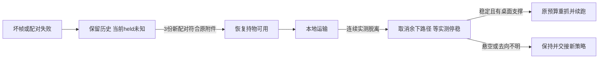
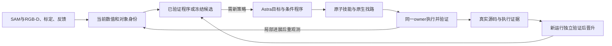

# SAM 与抓持恢复：部署复盘

**2026-11-17：V32最新真机已抓持并分段上抬，运输发布后因右腕USB断开而停止。** 当前首动33.60秒、全程158秒；抓持验证仅0.65秒，主要等待在运输求解及预览后重复计算。夹爪稳定性独立快判仍未接入，现有状态字段混合命令回填与CAN反馈。见[本条现场复盘](#v32正常真机运输中相机断开与抓后等待2026-11-17)；当前部署保持V32／infra V56，本轮只有只读分析。

**离线通过与物理成功分开。** 最新99秒失败运行只有17份稀疏RGB-D快照，另补采当前8秒数据；实际输出回放的后续反馈是模拟。已有失败历史确实可召回，成功程序仍为0。下一步先由用户测试正常摆放，再验证横躺自主探索、独立成功证据和无模型程序复用。

本页保留全部历史失败与当时结论；下方旧“最新／当前”均只适用于对应版本，不覆盖V32的部署事实或尚未完成的物理验收。

## 历史版本导读

**2026-11-16最新：V27首条正常摆放真实空抓，首动56.8秒。** 运动遮挡后的SAM2回退把手部跟踪沿用为积木身份，换到头视图后目标跳约15厘米；漏抓事实又被后续抖动清空，重抓中断。任务读取与视觉耦合增加一轮模型，未来运输预览仍同步挡在首动前。见[本次现场诊断](#v27正常摆放空抓延迟与经验消费核查2026-11-16)。

**此前离线通过不覆盖本次运动身份与恢复缺口，经验生产链也有部署遗漏。** 协调器已是V27，后台导出／审阅仍是旧代码；本次失败已存盘但未进入跨运行模型经验。下一步先修正常基线和真实经验消费，再验证横躺自主探索；下方历史“最新”只适用于对应日期／版本，不覆盖本段。

**2026-11-13最新横躺V25：** Astra在旧候选失败后提出3个新抓姿，第一项因部分场景的普通预览抛异常而中断，最终主动stuck；零任务运动发布。通用回执／一次补观测修复已在开发源通过保存观测复现与针对检查，尚未部署；头部重复源时间戳及实际抓取可行性仍待处理，见[本条复盘](#v25横躺新方案被部分场景预览异常中断2026-11-13)。

**V23已部署（2026-11-12）：** 原始帧证明第一条运行在模型等待期间发生目标移位，旧框在新图分割桌面阴影；旧图初始化现有SAM再跟踪当前帧已修并上线。预算／回执保留已由并行共享V22带入，V23保留两路线共同能力。

正式零输出、实际失败输入对照、ARM只读与三端核验完成；后续机械反馈模拟，完整真机任务／真实脱手恢复、姿态估计变化及最新放置证据不足仍待验。以下历史结论按版本读取，最新证据见文末V23节。

**2026-11-12 14:32／14:35（北京时间）两条V20现场均未发布抓取运动。** 订阅模型正常返回；横躺输入中物体包围盒与桌面相冲突，立放虽规划成功，却先被姿态变化复核拒绝，再被错误共用的4秒观测预算截断本地重试。后者已用冻结源码和实际回执离线复现。详见[最新两条现场](#v20两条现场横躺几何冲突与立放续跑预算缺陷2026-11-12)；下面接入验收通过不代表原子技能已稳定。

**2026-11-12最新：用户确认原API额度耗尽，Astra已切换官方ChatGPT订阅入口 V20；混合V18保持。** 真实账号授权、Astra medium看图与工具往返，以及包含订阅传输层的正式全链零输出通过；真机结果仍待现场。详见[文末V20节](#v20chatgpt订阅备用接入与部署2026-11-12)；下方V15的429细分类缺失仍是原始日志事实。

**2026-11-12最新现场补充：V15第一轮Astra请求返回HTTP 429，任务路径规划尚未开始。** 本条只能确认模型服务请求被拒，不能判断具体限流／额度细因，更不能当作V15运输能力反例。服务错误分类与恢复方案、上游研究见[文末429节](#v15首条模型429与框架能力边界2026-11-12)；下文部署与运动验证范围保持原结论。

**最新结论（2026-11-12）：Astra原子运输与关节搜索V15已部署，混合V13保持。** 原V10运输失败输入已通过正式PyRUA／RPC／owner接续和实际软件输出审计，另一保存场景完整抓放回放及ARM核验通过；未发送START。后续反馈模拟，完整真机任务与真实脱手恢复仍未验证。

[V15部署节](#v15原子运输部署与arm补验2026-11-12)给出当前版本和模拟边界；[原子运动实施节](#原子运动基本功统一碰撞边界与关节空间搜索2026-11-11未部署)保留初次候选过程；[V10现场节](#v10首条现场运输零发布与路径规划缺口2026-11-11)保留实际失败。下面按版本保存历史，“当前部署”“未修复”只适用于所属检查，现状以STATUS为准。

**最新补充（2026-11-11，V6）：横躺场景168.88秒没有运动，4轮模型等待153.81秒。** 抓前感知仍用直立6cm物体合同解释横躺观测，登记底部进入桌面下约3cm；预览拒绝抛异常又中断本地候选程序。模型实际尝试连续转腕，但未形成可执行方案。

当前仍部署V6，前条抓稳后运输／持物历史问题继续有效；本轮只有原件与代码审计，没有新增API、动作或修复上线。最新依据见文末“V6横躺场景”，以下按历史版本保留当时结论。

**2026-11-10补充：4f6611实跑并未解决实时感知阻塞，现已部署粗任务质量告警修正4c95226a2d2d。** 用户8692条实际有5轮Astra调用，但感知处理与固定睡眠合计超过500ms、静止证据反复重建，未提交操作。按用户明确要求先粗后精，视觉年龄及历史不足统一降警，不以性能优化作为上线前置。

用户随后要求停止测试直接部署，本包未形成最终全链路验收回执。原始时间、真实stationary、实时反馈及动作后成功证据保持；不能把质量降级冒充精度或物理成功。

## 粗任务告警修正与直接部署

- 包：`4c95226a2d2d`，前版`4f661135dc19`；9源码文件变更，控制源码／标定／物理参数／infra不变。
- 500ms视觉预算：感知、观察、规划、复核、owner接收与首发均告警，不换成新的2s等任意硬期限。连续历史不足可推进，实际检测到运动仍需等待动作完成及新观测；不伪造停稳或成功。
- 已完成的性能修正随包保留：同图同框不重复分割、视图独立锁、处理耗时计入轮询周期。本轮不再追加性能研究。
- 用户取消前164项策略回归通过，32项LiveScene回归通过。旧策略实际F1 CPU＋SAM连续4秒对照处理中位413.7→240.2ms，仅代表子流程；最终policy的完整回放报告未生成，取消后没有补跑，不能用该对照代表最终全链路。
- 部署仅核对文件身份及服务健康，不发START。用户明确豁免本轮追加验收记录在[发布回执](../../artifacts/coarse-quality-release-20261110/release-validation.json)，`passed=false`，没有补造通过。
- 证据：[故障时序](../../artifacts/sam-live-latency-20261110/runtime-statistics.json)、[策略回归](../../artifacts/sam-live-latency-20261110/quality-policy-receipt.json)、[激活](../../artifacts/coarse-quality-release-20261110/activation.json)。

## dddee与53a4：换姿可解，但抓持证据在运动中丢失

本轮仅只读审计，不修改生产代码、不回放动作或START。用户确认旧55e9姿态有真实碰桶风险；本轮不能继续把不同摆放都归因于旧碰撞或500ms门槛。

- dddee：物体与孔口平面距离210.5→292.3mm，默认pitch30与调整pitch10均预览可行。早期obs:111仍有square-1但缺孔，geometry_context统一要求object+hole，模型因此重框错误目标。7轮模型53.34秒，点击66.41秒调用motion；owner受理后0.823秒收到STOP，数值规划347ms已完成，未实际发布。证据[几何审计](../../artifacts/run-dddee-geometry-review-20261110/analysis.json)。
- 53a4：10次实际模型调用合计100.53秒，全条164.79秒。约41秒首个接近动作；动作后漏追踪，到84.74秒模型才继续已有完成动作的证据检查并开始grasp。约88.63秒闭爪首发、88.99秒关闭状态到位确认、89.01秒开始lift、90.87秒lift完成（点击基准为跨主机近似；同F1时钟闭爪首发至lift386.76ms，到位确认至lift19.74ms）。637条harness_skill实际输出，确实接近、闭爪并提起。
- 夹爪状态来自/motion_ctl/gripper/right/state的right_gripper_position；Harness层不是把目标写成反馈，但未审计厂商HAL内部，不能将35ms后状态100解释为机械闭合完成或抓牢，更不是力反馈。
- 53a4最后一条提起前有效观测在授权后79.888秒（gripper18/open），恢复时已128.587秒，漏掉整个提起。117条抓持证据held从未True，已闭爪样本还发生5mm/5度相对姿态后缀断裂；验证要求连续至少3帧及EEF移动>10mm，停稳后继续等静止帧无法补回证明。因此verify_grasp失败，place_held_block根本未被调用，不是运输路线执行失败。
- 当前线上是SAM2ImagePredictor逐帧框分割；2D提示仅几何全流程接受后commit，上一框只扩8px。pregrasp有投影提示，闭爪后清除，未接在手目标投影／在线video predictor。接近前后真实重框从[330,211,417,322]到[369,49,485,201]；运动变化远超搜索边距。孔及辅助锚点仍HSV固定阈值。实际mask分数/面积未落诊断，无法将失败精确归因到score0.9单项。

建议顺序：①运动跟踪与几何准入解耦、接近／在手FK提示与视频跟踪；②闭爪状态＋正常提起前段确认持物，缺证据做有界主动恢复，确认后零额外LLM调用固定运输；③按技能提供物体／孔／障碍状态并准确指明缺失对象，接SAM桶盖／孔口／锚点；④预览执行合并、无进展阶段预算和候选去重；⑤基于真实映射修正TCP/工具包络，不把离线FK残差当绝对精度。具体实现与目标仍为方案，未写成完成项。

## 离线修复：视频跟踪与真实数据回放（未部署）

用户授权按顺序修复并用真实数据验证，机器人关闭期间不部署、不发动作。本轮实现源代码候选，不改变线上4c95226a2d2d，也没有付费LLM调用。仍须完成抓持／运输状态机、准确实体诊断、桶孔SAM和LLM有界交互，不能称全流程验收通过。

### 实现

- `sam_tracking.py`以固定上游SAM2VideoPredictor执行记忆编码和传播，仅适配增量RGB输入与有限状态存储。保留初始条件帧和最近32帧非条件记忆，最多16条独立轨迹；当前帧像素保留一份，重复源帧幂等，不计新证据。真实47帧回放已跨越裁剪边界。
- `sam_service.py`增加带stream/object/source身份的HTTP视频请求与结果，显式`enable_streaming`预热视频模型。生产掩码配置显式`sam_streaming`，只有离线配置启用，未静默改变部署默认。
- 视频目标存在分数与图像掩码IoU分数分开，不将旧0.9阈值应用到另一种分数；像素仍须通过当前深度／几何，绝不因此产生held或成功。
- `mask_service.py`保存不随几何事务回滚的2D搜索状态；`scene_pipeline.py`传原始源身份，闭爪后根据实测EEF与候选在手偏移预测搜索范围。预测仅用于找像素，不作为物体位姿证据。任务／采集身份改变清空关联，包含事务已经开始的情况。

### 真实回放发现并修正的问题

1. 视频预测器直接框初始化，只分出积木部分表面；47帧全部非空，但与图像分割最低IoU仅0.750，叠加图显示缺侧面，判为不可接受。改为图像预测器完整掩码初始化视频记忆后，最低IoU为0.965。IoU是两算法一致性，不是人工真值准确率。
2. 新增FK投影范围带碰撞余量，直接优先当图像提示过宽，真实RGB-D对照只剩1/50场景。改为保留投影范围内已有紧掩码框，大框作为重新搜索范围后，图像与视频分支均恢复47/50场景；失败候选回执独立保留，没有覆盖成成功。
3. 历史运动RGB查看12个关键帧：接近／夹持／运输均看到目标；释放后旧逐帧框分割漂到桌面，视频记忆仍跟住积木。681个5Hz抽样帧均有视频掩码不代表681帧正确，未建立逐帧人工标签。

| 证据 | 实测 | 能证明的范围 |
|---|---|---|
| 连续静止源RGB | 47独立帧；视频推理中位25.95ms／P95 30.75ms | 6000D GPU视频运行与身份／裁剪；非运动、非真机耗时 |
| 实际HTTP→生产掩码提供器 | 47帧视频index连续，刻意几何拒收不回退；后续HTTP中位54.40ms | 真实通信与掩码事务，不含3D或动作 |
| 真实RGB-D＋HAL＋原生FK＋生产场景流水线 | 164原始blob校验，50快照→47场景，45完整物体＋孔口、2仅物体，3重复源帧拒收 | 同候选源码image/video对照；不是已部署旧版对照，不含owner／LLM |
| 历史ad551639真实运动RGB | 681帧，原始源时间不改，含抓取／运输／释放；视频中位26.77ms | RGB运动跟踪，缺深度，非最新53a4且非任务成功验收 |
| 针对性软件回归 | 58通过 | 搜索、事务、源身份、投影和场景合同，非58次真机成功 |

RGB-D比较中图像分支中位123.36ms、视频130.27ms；视频在此静止场景并不更快，不能宣传整任务提速。真实原生FK在独立numerics环境计算，结果绑定capture哈希及输入HAL；感知在GPU环境消费，避免为回放混装两套依赖。

最新53a4的本地owner归档为0字节，完整运动RGB-D尚未取回；7ae12等记录按既有`f1_primary_metadata_local`合同只留元数据，不能把`collected:true`当成本地原件齐全。当前用已有ad551639 RGB原件补运动分割对照，不能替代最新提起随动证据验收。后续需机器人开机取回缺失原件，再部署；软件剩余项继续离线推进。

产物集中在[离线验证目录](../../artifacts/offline-closed-loop-20261110)：[RGB-D回执](../../artifacts/offline-closed-loop-20261110/rgbd-pipeline.json)、[历史运动对照](../../artifacts/offline-closed-loop-20261110/historical-motion-comparison.png)、[58项回归](../../artifacts/offline-closed-loop-20261110/targeted-regression.txt)。最终事务内scope清理修正有针对回归；RGB-D回执保留其实际测试源码哈希，不冒充之后源码完全相同。

## 离线接续：抓持分层、程序衔接与模型无进展预算（未部署）

已实现粗任务位置随动证据与精细旋转解耦，不将姿态估计抖动直接等同于未抓住；仍要求闭爪稳定、独立相机／反馈样本和实际随动，重复帧与静止帧不能补造抓持成功。这项修改还不能弥补53a4整个提起缺帧，提起前段确认和主动恢复仍待补。

新增`pick_and_place`与`grasp_and_place`，同一PyRUA cell串联正常技能；verify_grasp非成功即返回，不会因加入快捷程序直接跳过抓持判断。正常链路10阶段和验证失败不运输已在真实PyRUA、模拟backend验证；隔离worker回归通过。压缩工作流说明并保留owner检查点与失败语义，尚未用新模型响应证明调用数下降。

`PlannerProgress`按结构化工具回执追踪推进：新完成技能、新出现的实体证据、每阶段至多两个不同可行预览、一次显式图像恢复可延续规划；帧号变化、同一候选、accepted搜索提示及stdout自称成功不算动作进展。连续3个模型工具回合无上述进展即结束进一步模型请求，返回pending_review及最后失败／检查点，由既有finish/cancel路径收尾；不修改owner授权、运动到位或物理成功判据。网页同时保留底层失败原因。该预算不能替代主动恢复，也尚未在每次execute_skill前实现候选去重。

初次直接重放旧ledger发现其中没有`scene_entities`，会漏计真实重新观察。保留该失败回执后，用旧日志stdout保存的真实observation经当前F1Robot摘要重新投影；只处理一一对应的单观测cell，未补造不存在的字段。线上监控只读结构化回执，不解析模型stdout。

| 验证 | 结果 | 范围 |
|---|---|---|
| 148项定向回归 | 通过，含实际隔离worker／PyRUA／网页失败说明 | backend与模型为替身，无硬件输出、无付费API |
| 旧55e9工具回执 | 第4个模型Python回合耗尽无进展预算 | 反事实重放，不能声称真实耗时改善或已找到替代动作 |
| dddee换姿可行条 | 7个记录回合未被提前截断 | 使用原记录可行预览；不证明新模型选择相同 |
| 53a4抓起条 | 9个记录回合未被提前截断 | 仍保留verify_grasp失败，未伪造运输／任务成功 |

证据：[重放程序](../../artifacts/offline-closed-loop-20261110/replay_planner_progress.py)、[带原件身份的三条结果](../../artifacts/offline-closed-loop-20261110/planner-progress-reprojected.json)。当前仍须完成连续真实RGB-D→owner→零输出全流程；上述交互回放不能替代它。

## 离线接续：提起中抓持监控与明确抓空恢复（未部署）

感知新增非随动证据：同一目标连续独立相机／反馈样本中，夹爪状态稳定、物体世界位置保持、手臂实际移动，才能判断未附着。未知、重复帧、仍在闭爪、相机身份变化和缺失夹爪稳定合同均不作抓空。已证明未附着可在后续静止验证时保留，但新任务身份、观测中断、夹爪变化或物体位置变化会使证明失效。

owner在正常grasp_lift的流式发布期间读取已有live_observation，不等待额外网络或分割，不增加新的停顿门槛。只消费提起开始后的图像与状态、当前标定及对应闭爪反馈；随动确认写事件，明确未附着则结束剩余抬升、保持，再由现有反馈确认实测停稳。返回`grasp_not_attached`，不把部分执行冒充零动作，也不提供重放旧grasp的检查点。

PyRUA程序只对实测抓空且已停稳的结果，或verify_grasp明确失败，使用任务登记的一次regrasp；授权技能列表未含regrasp或预算为0时不调用。未知持物不松爪重抓，第二次失败不循环；成功重抓仍须verify_grasp才运输。真实重新抓取所需新几何与碰撞检查继续由原owner负责。缺视觉证据时主动换视点的恢复尚未实现，本项不能代表该分支已完成。

- 203项定向回归通过，包括实际owner在流式轨迹尚未到末端时发现抓空／记录随动、停止确认与一次重抓、坏观测不触发抓空，以及感知证明跨静止窗口保留／跨任务清除。[回执](../../artifacts/offline-closed-loop-20261110/grasp-targeted.xml)。输入为测试构造，未接真机。
- 60项真实DAgger ControlLoop／WebHarness假传输集成通过，未启ROS／动作输出。[回执](../../artifacts/offline-closed-loop-20261110/grasp-native-integration.xml)。
- 53a4真实117条已记录物体／末端／夹爪／源时间经现判据重放：正随动0、非随动0；104条为运动证据不足，5条独立样本不足，8条尚未闭爪。没有把缺失的48.70秒提起数据变成抓稳或抓空。该回放不含原始RGB-D重新分割、owner或模型。[程序](../../artifacts/offline-closed-loop-20261110/replay_grasp_evidence.py)与[证据回执](../../artifacts/offline-closed-loop-20261110/grasp-evidence-replay.json)。

## 离线接续：合并几何预览与缺失实体诊断（未部署）

旧`inspect_plan`在Python内依次observe→geometry→preview，后两项remote又分别请求新观测；合并后为一次observe_with_status再一次含geometry的owner preview。几何提供器和数值预览消费同一Observation对象、同一反馈快照，返回共同observation_id。中途新观测不替换正在解释的输入；真实execute仍重新绑定，不缓存直接执行权限。

部分场景返回当前已有物体位姿、entities和missing_entities，缺失桶／孔位姿时obstacles为null而非空列表。`missing_geometry_entities`诊断经过原数值错误投影和PyRUA ledger仍保留具体object_id、role与恢复方向；统一注明矩阵布局、米制与world/object/TCP变换含义。身份、标定、授权和原运动约束保持；partial preview仅输出诊断，不把缺失碰撞几何发送给动作规划。

真实dddee obs111原件含square-1及其位姿，缺square-hole-1；旧日志只报object_and_hole_pose_required，当前正式场景检查明确返回aperture／square-hole-1／relocalize_fixture_and_aperture。此回放未重新运行RGB-D分割、FK或模型，不能算完成孔口恢复。当前桶几何仍随孔口位姿更新，按技能解耦桶定位与精对孔要与SAM桶盖／孔口接入一起完成。

- [真实缺孔反例重放](../../artifacts/offline-closed-loop-20261110/missing-entity-replay.json)，[程序](../../artifacts/offline-closed-loop-20261110/replay_missing_entity.py)。
- [159项定向回归](../../artifacts/offline-closed-loop-20261110/geometry-context-targeted.xml)：覆盖新观测并发到达时几何／预览同源、partial不规划、撤权不读为可执行、真实PyRUA ledger与remote单次观察调用。
- [60项原控制假传输集成](../../artifacts/offline-closed-loop-20261110/geometry-native-integration.xml)。无ROS、机器人输出、付费API或部署。

## 离线桶孔SAM、批量提示与图像合并请求（未部署）

本轮补齐桶盖、方孔、三角孔、侧槽及U槽的SAM提示路径；不读取私密API文件，不调用模型、不连接机器人、不部署。保存头部图的框与正负点由人工审阅提供，不能记作Astra自动找孔成功；单帧叠图见[五区域SAM结果](../../artifacts/offline-closed-loop-20261110/fixture-sam-masks.png)，来源与模型身份见[单帧回执](../../artifacts/offline-closed-loop-20261110/fixture-sam-single-frame.json)。

实现变化：

- `locate_entities`通过现有RPent/PyRUA与`locate_target`RPC一次提交最多8个同图实体提示；校验源图、任务代次、相机参数与ROI，正负点映射到真实去畸变图。批次全部验证后才排队；无效点不会部分改写搜索框。
- 初始规划上下文直接给注册ID与角色，不增加额外查询轮次；缺孔时提示孔／锚点，不能继续只框积木。仅恢复夹具提示保留已有抓持随动状态，目标重新定位才撤销目标的旧证据。
- 同图静态目标使用一次HTTP上传，服务器在同一编码图上执行多个SAM提示；移动积木可单独启用视频记忆。批次响应绑定图像、模型及实体顺序，错误身份不能错配掩码。
- 原先孔外环作为下一帧框会增长；已改为原始分割掩码跟踪。桶盖包含孔口，其上下文重叠不再按两个目标身份冲突处理，避免所有孔口搜索更新被抑制。物体间的真实身份重叠检查仍保留。

使用同一50份保存RGB-D、164个校验原件与HAL反馈，经原生FK、实际GPU SAM HTTP、正式CalibratedScenePipeline回放：

| 配置／阶段 | 中位处理耗时 | 场景／完整物体＋孔口 | 对照解释 |
|---|---:|---:|---|
| 全SAM逐目标图像请求 | 387.95ms | 47／45 | 本轮优化前离线候选，不是线上旧HSV方案 |
| 全SAM逐目标视频请求 | 512.60ms | 47／45 | 所有静态孔口也分别维护视频状态 |
| 仅图像合批，中间候选 | 160.40ms | 47／45 | 位姿输出与优化前图像分支逐元素一致 |
| 图像合批＋桶盖上下文修正，最终候选 | 157.00ms | 47／45 | 比第一行降低59.53%，额外启用了孔口搜索更新 |
| 积木视频＋静态区域合批，最终候选 | 154.88ms | 47／45 | 比第二行降低69.79%；同时改变了静态区域跟踪方式，非单变量合批对照 |

各分支均3份重复源帧拒收，不改原时间。最终候选与原图像分支相比，积木平移不变，孔口估计最大平移变化1.048mm、转角3.057°；与原全视频分支相比孔口为0.919mm／3.091°。这些是算法估计差异，没有人工三维真值，不能称物理精度或更准确；桶盖掩码目前仍未用于独立于孔口的粗桶定位。静止片段不覆盖53a4的整个提起缺帧。

最终215项相关测试通过，包括实际RPent/PyRUA接线、隔离worker、本地HTTP、部分场景启动、提示原子性、身份拒绝、孔口恢复不清抓持、外环及上下文跟踪。最初8项／随后2项运行因执行沙箱禁止本地socket失败，改在允许本地socket的离线环境完成，不修改产品判断来绕过。新增外环测试最初使用了不存在的`radius_px`参数，修为生产合同`inner_px/outer_px`后通过，未改生产合同迁就测试。

[冻结源码摘要及比较](../../artifacts/offline-closed-loop-20261110/fixture-sam-verification.json)、[最终真实RGB-D回执](../../artifacts/offline-closed-loop-20261110/rgbd-all-sam-context.json)、[215项回执](../../artifacts/offline-closed-loop-20261110/fixture-final.xml)。本轮不含owner动作输出、真实模型生成、完整运动RGB-D或真机验收；这些继续留在待办，线上仍为4c95226a2d2d。

另补实际TaskEngine→RPent HTTP→PyRUA→图像／多实体提示RPC两项启动检查通过，包含任务代次改变拒绝。模型和相机在该检查中为明确标注的合成输入，owner没有动作传输；证明注册实体上下文和批量提示可走正式接口，不等于真实模型／真实图像任务通过。[启动回执](../../artifacts/offline-closed-loop-20261110/fixture-real-bootstrap.xml)。

## 独立桶体参考与完整owner回放（未部署）

离线候选现在可在精确方孔暂时缺失时，通过当前SAM锚点与深度得到桶体参考，让粗接近和运输继续接受实际规划。对孔／插入／释放不使用该参考冒充实测孔口。正常与去孔掩码的真实RGB-D均经过正式感知组件；后续原生规划、owner输出与物理成功分别记录。

本节早期完整owner回放未通过：接近后抓取IK出现数值反例，尚未闭爪。该历史失败保留；后续原生候选衔接、路径抽稀与精对孔参考修复已让同场景十阶段通过，见下节。后续反馈／持物仍为模拟，不能据此部署或宣称真实视觉闭环。

### 实现与数据

- 新增`FixturePose`，绑定原登记参考、当前测量位姿、原生坐标系和证据；三点RGB-D刚体配准使用冻结参考相机与当前实测头部位姿，不能混淆相机移动与桶移动。
- 2D分割成功但精确方孔缺失／拟合失败时，可保留实测物体＋桶体，不创建孔口实体或插入成功。桶障碍随桶体更新，桌面独立；阶段复核比较桶体，孔口暂时消失不重定义运输目标。
- `inspect_plan`明确返回`fixture_transit_available`、`missing_entities`和`aperture_required_for`；精细动作仍要求实测孔口。
- `rgbd-independent-fixture.json`：正常50输入→47场景／45完整／45桶体。图像／混合分支中位159.34／154.83ms。
- `rgbd-fixture-without-aperture.json`：在真实SAM结果上只移除方孔掩码，原RGB-D不改；47场景／0完整孔口／45桶体。图像／混合中位152.68／147.37ms。两条都保留3份重复源帧拒收；此为故障注入，不是实际遮挡泛化成功。
- [原生对照](../../artifacts/offline-closed-loop-20261110/fixture-native-plan.json)：真实保存观测`940`、对应HAL与原生FK；正常和去孔分支均规划成功，22个接近路点完全相同，计算约0.50／0.49秒。无owner、无发布器，不代表全链运动成功。
- 本地配置由`prepare_fixture_site.py`派生独立诊断目录，当前Harness源码快照与原模型SHA核验；不改旧冻结包、不伪造新标定、不激活机器人。脚本初次遇到旧机器人URDF路径，改为绑定本机相同内容资产；未绕过正式验证。

### 完整owner反例

[回放报告](../../artifacts/offline-closed-loop-20261110/fixture-owner-output/sim-922297d7c7/report.json)使用当前PlanService、实际F1Owner/Ruckig及内存输出；初始几何来自上述实际SAM/RGB-D，后续观测、夹持与反馈是明确标记的理想模拟。不是实际连续运动RGB-D验收。

接近完成，虚拟动作时间4.92秒（不含同步计算，不能当现场速度）；下一步grasp在stage0／goal2／笛卡尔中间点1/2失败，残差0.711513947mm、旋转误差约1.42e-6rad、3000次迭代。最小约束余量0.3485rad、活动平面为空；这些排除了该记录中已报告的限位触发，但不能证明目标可达或直接归因为精度门槛。保留失败report与实际模拟输出，未松门槛重写成功。下一步检查姿态软偏好、收敛与接近到抓取的候选连贯性，随后跑同一完整链。

### 模型交互与验证

可行初始预览只通过结构化ledger提供结果，完整结果仍留在PyRUA变量；失败继续展开几何和缺失实体，并在首轮主动附图。所有预览诊断同样有界摘要。重复自动附图按阶段、技能参数与失败类型去重，变化的request／observation ID不算新策略；模型显式看图仍可用。

[历史反馈消融](../../artifacts/offline-closed-loop-20261110/initial-context-replay.json)保留dddee原结构化回执，只移除重复几何stdout，9306→1275 UTF-8字节，减少约86.3%。原stdout已截断，初次尝试解析发现不能作为完整几何，最终只作原始文本消融，不补造缺失内容。此非计费token或真实模型延迟提升。

149项几何／复核检查、78项交互／桶体相关检查分别通过（有重叠，不相加）；60项原控制假传输、2项实际RPC/PyRUA假相机启动通过。证据位于`offline-closed-loop-20261110`的`independent-fixture-tests.xml`、`fixture-planner-feedback-tests.xml`、`independent-fixture-native.xml`、`fixture-feedback-bootstrap.xml`。无新模型调用、无机器人连接；主动未知抓持恢复、真实模型提示、失败执行去重及完整owner全链仍待完成。

## 原生候选衔接、路径抽稀与精对孔参考修复（未部署）

同一真实SAM初始场景现已完成注册PyRUA程序的十阶段owner零输出回放。定位并修复三个连贯性问题：预抓位置可达不等于后续抓取可达；细路径安全不等于抽稀路径安全；粗桶体参考不能与精细孔口目标混用于插孔碰撞模型。

这些证据覆盖原生IK、F1Owner/Ruckig与内存接收，不覆盖真实后续RGB-D、真实抓持、Astra生成或硬件。机器人保持关闭，无连接、无部署、无API调用；生产包不变。

### 从反例到修复

1. [同输入姿态软偏好消融](../../artifacts/offline-closed-loop-20261110/grasp-ik-cost-ablation.json)：原权重、0、0.01和0.001仍在同一抓取中间点附近失败，残差约0.7115～0.7391mm，不能靠取消示教偏好解决。原生候选对照中，10°方案后续抓取失败，20°／30°variant2能求得接近、接触和提起路径。`native_grasp_lookahead`在选择接近方案时用其预测终点检查后续原生抓取；执行仍必须新测量，不把预测当持物证据。离线配置启用，原部署默认未变。
2. 首次选中新抓姿后，执行前复核拒绝。[细路径／抽稀对照](../../artifacts/offline-closed-loop-20261110/sparse-path-diagnostic.json)证明132个内部检查均通过，但9个输出路点的第5段连接碰目标。`HarnessNumerics`现在对准备输出的连接段用同一工具／附件扫掠检查；若抽稀改变可行性，递归保留已求得的中间点，不重新放宽接触、限位或容差。[修正回执](../../artifacts/offline-closed-loop-20261110/sparse-path-fixed.json)返回10路点，全部连接段通过。该回执沿用了诊断字段名`dense_checks/dense_failures`，修正后的142次含抽稀检查，其中1次为被拒绝并细分的shortcut，不是最终路径失败。
3. 接近、抓取、运输通过后，align四个朝向均在`aligned_insertion_preview`报告`rim_x_low`夹持物碰撞。该保存场景精孔口相对粗参考偏移约[-1.913,-1.209,0.019]mm，旧代码目标用精孔、整个桶模型却始终用粗参考，导致模型开孔与任务目标不一致。修正为粗运输使用独立桶参考，精对孔阶段目标与桶模型共用实测孔口参考；桌面不移动，不删除桶口障碍、不扩大开孔。

### 全链及实际模拟输出证据

- [最终原生身份绑定回放](../../artifacts/offline-closed-loop-20261110/fixture-owner-bound-native/sim-f42f1ea84f/report.json)：注册`pick_and_place`完成接近、抓取、验证持物、运输、检查在手姿态、对准、插入、释放、验证放置、撤离复位。真实初始输入，后续状态／物体刚性夹持／视觉结果为明确模拟；1402条F1Owner输出仅落内存。报告直接登记当前`harness_compute.py`身份，派生源码快照也包含该改动，不沿用旧控制源码冒充新数值实现。
- 首次完整回放[运输／返程输出审计](../../artifacts/offline-closed-loop-20261110/fine-frame-output-audit.json)：2756个插值检查点，最大采样关节速度约30°/s，输出完整、左臂不动、覆盖扫掠通过。审计场景显式传入skill，避免粗运输被错误重建成精孔口参考。
- 首次完整回放[抓取输出审计](../../artifacts/offline-closed-loop-20261110/fine-frame-grasp-audit.json)：437个检查点，接触、闭爪保持和支撑面离开分别检查；实际选择的抓姿从proposal重建。夹持是假设，不证明摩擦、力或实际抓稳。独立接近／插孔等输出审计尚未覆盖，不能把两份审计说成所有阶段均独立通过。
- 补齐原生数值源码身份后的最终回放也已完成同范围[运输／返程审计](../../artifacts/offline-closed-loop-20261110/bound-native-output-audit.json)及[抓取审计](../../artifacts/offline-closed-loop-20261110/bound-native-grasp-audit.json)，均通过；1402输出、2756运输／返程插值点和437抓取检查点与前次一致。保留两次独立原件。
- 11项原生数值模块检查、133项场景／候选／复核检查、60项真实控制假传输及7项抓取阶段审计检查通过；各有独立XML回执。初次测试环境缺pytest、缓存重定向错误及合成绕路样例不符合保守包围盒的失败均未修改生产保护；改用既有测试环境及正确分段测试后通过。
- 保留`fixture-owner-registered`、`fixture-owner-continuation`、`fixture-owner-preserved-path`原失败，不覆盖为成功。新报告在`fixture-owner-bound-native`；这次没有新真机耗时或LLM调用成本数据。

剩余：未知持物证据的主动恢复、真实模型SAM提示及执行去重、连续真实运动RGB-D与完整工具链、其他阶段输出独立审计。完整离线任务返回成功不缩减这些验收范围。

## 纯规划失败复用与模型失败历史（未部署）

重复请求不再重复消耗完全相同的失败数值计算，且下一轮模型明确看到最近失败策略及次数。该改动只省去已证明重复的工作，不新增位姿门槛、不把旧失败当作新场景结论，不缓存可执行计划或成功授权。

同一真实保存SAM场景与HAL输入，第一次规划7.48秒；只换请求／观测ID、物理输入相同，第二次0.57秒且重新求解的可行路径完全一致。合成移动目标1mm后重新计算7.57秒。此为本地重复规划收益，不是实际LLM token费用、点击首动或任务速度测量。

### 实现合同

- `candidate_failures.py`以任务／owner／session／epoch／标定、采集身份、全部SkillGeometry、fixture、完整22维参考、16维保持值、技能参数和候选variant绑定。浮点位姿与关节不取整；输入不能序列化时正常计算而非阻塞。128项有界进程内记录，不跨部署保存。
- 只复用确定性的几何／可达性失败；超时、网络失败、身份错误、成功结果不缓存。接近后抓取预检失败仅在底层也是确定性失败时复用。权限、新观测准入和执行复核仍在原位置；这不是新增动作授权或已发布动作的重放机制。
- 模型诊断保留原失败code／碰撞实体，附`reused_failure`、原请求ID和需改变候选／实测几何的提示。`PlannerProgress`只保存最近3种失败策略的小摘要及次数；新请求ID不清零、成功推进阶段后清除。此历史为建议，改变场景仍可计算；连续无进展仍受原3轮预算约束。
- 实际PyRUA ledger→ResponsesPlanner回归确认第二次反馈包含同策略尝试2次和原诊断；第三次无进展停止下一次模型调用。模型返回为测试替身，不是实际Astra策略改善证据。

### 真实保存输入的原生对照

[原生对照回执](../../artifacts/offline-closed-loop-20261110/candidate-reuse-native.json)，对应`replay_candidate_reuse.py`，实际初始数据沿用`fixture-owner-chain-input.json`，未建立任何机器人连接或硬件发布器。

| 输入 | 规划实测墙钟 | 原生solve_path次数 | 结果 |
|---|---:|---:|---|
| 初次真实保存输入 | 7.480秒 | 5 | 30°／variant2，10路点 |
| 同物理输入、新请求及观测ID | 0.570秒 | 3 | 复用3项候选失败，可行路径重新求解且逐值相同 |
| 同原件派生目标X增加1mm | 7.568秒 | 5 | 不复用原失败，重新得到9路点；这行是合成位置扰动 |

首次计算仍有约7秒，未因此宣布首次启动提速。优化只在确实重复的数值输入下生效；视觉／关节噪声造成的新输入不会被当成旧失败。

### 全流程与接口验收边界

- 新快照`fixture-site-decf1289be06251d`的[完整owner回放](../../artifacts/offline-closed-loop-20261110/fixture-owner-candidate-reuse/sim-624b1d3240/report.json)十阶段完成；后续观测、刚性夹持和执行反馈仍明确模拟。模型无调用。
- [运输／返程输出审计](../../artifacts/offline-closed-loop-20261110/candidate-reuse-output-audit.json)与[抓取输出审计](../../artifacts/offline-closed-loop-20261110/candidate-reuse-grasp-audit.json)通过；范围沿用前节，不覆盖所有接触阶段的独立审计。
- 169项场景／候选／规划器回归、15项模型反馈检查、60项原控制假传输、2项本机真实RPC启动通过，分别保存XML，有交叉项不相加。初次RPC因沙箱不允许socket失败，获准后仅运行127.0.0.1测试，未连接机器人／远端模型。测试构造器原先绕过初始化，补齐缓存成员；没有为测试修改正式准入条件。
- 仍未完成：真实Astra新响应／自动SAM提示、连续真实运动RGB-D全链、未知抓持主动恢复、其他阶段独立输出扫掠。部署仍为4c95226a2d2d。

## 本包55e9现场反例：感知已消费，预览未转执行

真实包为4c95226a2d2d。首次提示后51个scene_timing样本全部error=None，49个stationary=true、10个年龄告警可继续；pipeline中位258.62ms、P95 283.80ms。一次短暂右腕反馈过期随后恢复，未撤权终止。

9次模型请求（8次完成合计56.16秒，第9次由用户STOP取消）。第2轮默认接近预览8候选被scene_sweep_blocked拒绝，第4轮模型生成新姿态同样碰桶壁；第5轮移位预览因object_and_hole_pose_required未成立，第8轮移位预览成功。全程0技能受理／0技能首发，7587控制记录均保持，STOP后约523ms实测停稳。预览`planned=true`并不是动作执行；此条未到IK执行或关节到位阶段。

只读结论：旧500ms问题确实已转警告；现在需要核对碰撞代理几何和模型反复看图／查询／预览而不执行的工具链。尚未证明桶壁碰撞是真实碰撞或代理误判；未改源码、未发START、未补跑测试。证据：[本条统计](../../artifacts/sam-live-latency-20261110/diagnostic-55e9/summary.json)、[实际模型工具记录](../../runs/workspace/web-55e9f5a97e794f6d99aa741e2e133b25/planner/trace.jsonl)。

## 前轮记录（保持历史事实）

**2026-11-10，授权合同与完整回放修复包 `4f661135dc19` 已部署，完成发布前验收。** 用户ce5ff条暴露第二个启动错误：控制端只在嵌套 `perception_context` 提供任务代次，启动器却与不存在的顶层字段比较。启动及每轮模型现在共用真实嵌套scope检查，失败时记录具体差异字段。

按用户新增要求，本轮先复现真实失败记录、贯通真实RPC看图提示，再运行历史场景完整动作零输出回放；回放发现插入目标和成功边界重合导致约82nm舍入误差被判失败，已统一为1µm绝对数值等价。物理目标和控制配置保持；回放10阶段成功不等于真实Astra、SAM和物理任务已成功。

## ce5ff授权接口与发布前完整回放

旧包首次缺提示交接已从0339条的22次／4003ms改善到ce5ff条1次／100.13ms，但随后把嵌套generation=1与缺失顶层None比较，误报 `planner_bootstrap_authority_changed`。真实授权没有因此改变；后续控制端确认停稳。测试夹具先前虚构了顶层generation，所以单元检查没有暴露接口错位。本次保留实际ce5ff授权JSON作为重放输入，并增加直接采用真实TaskEngine.status的RPC集成。

修复范围：启动和每轮模型读取同一任务scope，绑定owner/session/task/hash/generation/epoch；正常phase/request推进不算换任务，真实代次改变仍拒绝。诊断记录具体字段，避免再次只给笼统authority_changed。

完整历史动作回放先暴露维护驱动漏传 `grasp_selection_for(intent)`，已与正式控制入口对齐；没有通过伪造成功或改任务参数解决。随后接近、抓取、运输、对准成功，插入目标恰是深度判据边界，IK/FK末点比目标浅82.42nm。正式感知与回放现在调用同一 `insertion_depth_reached`：1µm内为数值相等，2µm及0.1mm浅插仍拒绝，XY／yaw／tilt与视觉证据保持。该epsilon不是毫米级放宽或深度加大。

| 验证 | 实际结果 | 边界 |
|---|---|---|
| 保存ce5ff状态 | 旧包复现authority_changed；新包进入看图恢复 | 读取保存状态，无硬件 |
| 正式接口链 | TaskEngine→Gateway/RPent→run_task→PyRUA图像→LiveScene提示回执通过；新代次拒绝 | 模型和像素为测试替身 |
| 历史完整动作 | 10阶段全success，935条实际F1Owner/Ruckig内存提交 | 保存初始几何，后续理想反馈／刚性夹持模拟，无实际LLM/SAM |
| 独立输出审计 | 转移＋返程1900个细分扫掠点通过，采样速度符合回放30°/s profile | 接触阶段、实际机械跟随和真实profile一致性另验 |
| 回归 | 最终冻结171项、原控制60项通过 | 不等于171次真机成功 |

回放虚拟周期18.70秒与计算7.92秒不能当真机速度。完整输出与历史输入有SHA绑定，所有数据标为回放，不晋升真实经验。该要求已写入AGENTS，作为每次发布前验收，不在正式机器人任务中增加中断条件。

证据：[实际失败状态重放](../../artifacts/authority-contract-20261110/saved-authority-replay.json)、[真实RPC检查](../../artifacts/authority-contract-20261110/real-rpc-bootstrap-tests.json)、[完整动作及输出审计](../../artifacts/authority-rollout-20261110/full-owner/receipt.json)、[最终验收绑定](../../artifacts/authority-rollout-20261110/release-validation.json)。[部署与三端核验](../../artifacts/authority-rollout-20261110/post-activation.json)已通过，SAM就绪，未START。旧未通过候选fd1207c526e2仅上传未激活，失败回执保留，不改写成通过。

## 前次启动等待修复（被本轮授权合同修复接续）

**2026-11-10，启动衔接修复包 `1d8d42cf5771` 已部署，替代 `66cb138fd9ca`；配套 F1infra 停止反馈区分 V54（静态，后端仍 V53）。** 用户真实运行揭示：SAM 等当前目标提示，而启动器等待完整几何；等待预算尾端又被误判成网络超时，Astra 未进入看图。新包明确把缺提示交给 Astra，区分本地预算与真实传输故障。

冻结回归、实际 HTTP 反例和零发布者只读启动通过，三端均可开始，SAM GPU 子进程在线。本次没有发送 START 或模型生成；尚不能宣布新包真机全流程成功。下方保留首次 SAM 部署与保存帧测量，不能代替新任务启动验证。

## 用户实跑暴露的初始选框衔接缺口

真实运行 `web-0339bb1946374e53a26ddca2bbd0d77a` 中，21 次观测正常返回缺提示／缺目标；第22次恰逢总预算4002.995ms，裁短后的HTTP socket超时被写成连接故障。Astra请求和模型返回均为0；部署后的SAM计数也为0，未进入目标分割或技能动作。相机画面仍在线。控制端有 `web_stop_confirmed: measured_stationary`，任务失败事件却覆盖了网页停止阶段结果。

| 环节 | 原行为 | 修复后行为 |
|---|---|---|
| SAM首次没有目标提示 | 在几何入口重复等待4秒，模型尚未获得看图机会 | 首个明确缺提示／双视图无目标，经状态检查立即交给Astra看图框选 |
| 本地预算尾端HTTP超时 | `HarnessError`，被标为传输失败，跳过感知恢复 | 仅实际socket超时且本地裁短预算已到才归等待结束；保留最初感知原因 |
| 真网络故障与授权变化 | 中止 | 保留；不重放动作，不伪造新观测 |
| 停止阶段显示 | 后续任务失败覆盖已停稳 | 明确停止回执独立保留，任务总体仍失败 |

同一真实本机RPent HTTP反例（合成200ms预算，无机器人）在旧冻结包201.20ms时报传输故障；新包200.96ms正确返回缺目标原因、`transport_error=null`。这证明错误分类已修，不是整条任务耗时提升。真实HTTP→Astra初始观测函数的回归还覆盖首次缺SAM提示直接进入看图分支。

冻结包148项定向回归、60项原控制假传输集成、12项浏览器回归通过。323文件／13配置核验，真实只读启动零动作发布者；协调器1994869与SAM子进程1994872就绪。工作台V54只更新停止卡脚本，后端2054186未重启，205条目录身份／审核及配置保持。完整动作、真实Astra框选、持续分割与泛化仍待下一条用户实跑。

- [失败原件审计](../../artifacts/sam-bootstrap-20261110/before-run-audit.json)
- [真实HTTP前后反例](../../artifacts/observation-bootstrap-20261110/http-deadline-before-after.json)、[冻结回归](../../artifacts/observation-bootstrap-20261110/frozen-tests.json)
- [新包部署](../../artifacts/sam-bootstrap-20261110/activation.json)、[三端可开始](../../artifacts/sam-bootstrap-20261110/post-activation.json)、[SAM进程](../../artifacts/sam-bootstrap-20261110/sam-deployed-health.json)

## 首次 SAM 部署记录（已被上方启动修复替代）

**2026-11-10，最终包 `66cb138fd9ca` 已激活，F1infra Astra任务入口 V53 已部署。** SAM2.1 Tiny 在 GPU0 常驻，由协调器负责预热与回收；目标分割不再回退到颜色。保留最新 Astra Fast／medium、连接池、启动优化及阶段日志。使用方式见 [SAM运行说明](../../docs/operations/SAM_RUNTIME.md)。

保存帧和真实 F1 图像通道通过，不代表真机任务已成功。本轮没有发送 START，也没有调用模型生成；框提示在回放中由人工指定，Astra 实际选框及全程动作留待现场运行。

## 已完成与证据

| 项目 | 改变／实测 | 边界 |
|---|---|---|
| 目标分割 | 当前图紧框 → SAM 掩码 → RGB-D 几何；不采用旧颜色搜索框作为目标 | 桶孔及桶盖锚点仍用已有几何检测 |
| 五张真实保存帧 | 四张接近帧＋一张抓起失败帧，5/5得到有效积木几何 | 人工框提示；不是5次抓取成功 |
| 6000D GPU RPC | 20次：中位39.06ms，P95 43.62ms | 包含编码与本机通信；不是任务耗时 |
| F1→6000D→F1 | 15次：中位70.74ms，P95 130.70ms | 真SSH图像通道、保存图片；无动作 |
| 抓持证据 | 坏帧隔离已建立证明，三份新一致样本在原恢复窗内复核 | 不沿用陈旧场景；身份变化、松爪、反馈故障清除 |
| 正常流程 | 抓稳验证 → 固定运输 → 桶上方在手检查 → 精对孔 | 无需在运输之间增加模型回合 |
| 粗细阶段 | 闭爪8mm，自由提起15mm；超8mm的粗到位记录告警 | 原目标、夹爪指令、扫掠语义未变；插孔独立 |
| 核验 | 核心冻结1758通过／70原生跳过；原控制60通过；原生输出52通过／70子项 | 不能相加为真机验收 |
| 发布 | 323文件／13配置核对，零发布者只读boot；正式SAM父子进程及三端可开始核验通过 | 尚无此包真机完整rollout |

两个几何估计的保存帧位置差为0.226–0.326mm，仅说明这四帧换分割后估计接近，不是对标真实尺寸的精度认证。SAM采用逐帧提示分割与轮廓更新，本轮没有启用视频记忆追踪。

## 部署过程中修正

首次GPU依赖下载经代理缓慢且进程退出；保留缓存后，验证官方PyPI直连并补齐两项大依赖。仅安装命令绕过包下载代理，Astra仍使用既有VPN。

HTTP常驻连接初测中位93.13ms；关闭服务端Nagle延迟后，相同20请求降至39.06ms。此为本机RPC对照，不宣称整项任务同比提速。

合并期间最新启动优化已独立发布到 `e754583399ce`，因此以该包重新冻结。首次 `66a30a46180e` 激活核验发现协调器漏接SAM启动调用；没有把协调器在线当成完成。单文件修正版 `66cb138fd9ca` 通过真实入口＋真实GPU子进程的启动／就绪／回收检查，并重新只读boot、安装、切换。前包保留历史身份，不改写冻结内容。

## 原始回执

- [GPU RPC](../../artifacts/sam-rollout-20261110/gpu-benchmark.json)、[F1图像通道](../../artifacts/sam-rollout-20261110/f1-transport-benchmark.json)。
- [四帧GPU几何](../../artifacts/sam-rollout-20261110/gpu-full-pipeline-replay.json)、[在手失败帧GPU几何](../../artifacts/sam-rollout-20261110/gpu-held-scene-replay.json)。
- [原生抓取目标不变与分阶段判据](../../artifacts/sam-rollout-20261110/grasp-contract.json)、[核心冻结回归](../../artifacts/sam-rollout-20261110/frozen-tests.txt)。
- [真实入口与SAM启停](../../artifacts/sam-lifecycle-20261110/lifecycle-check.json)、[最终部署与健康](../../artifacts/sam-lifecycle-20261110/sam-deployed-health.json)、[最终激活](../../artifacts/sam-lifecycle-20261110/activation.json)。

下一步从infra运行单块完整任务，检查实际框提示、抓取验证后是否直接运输、桶上方几何及插入返程。多形状、堆叠、实际成功率与经验晋升均未由本轮证明。

## 未知抓持主动恢复与插入深度合同（离线候选，未部署）

已把“抓持未知后继续静止等”改为任务明确授权的一次闭爪观察动作。保存真实初始场景的完整owner回放中，未知→观察后有证据的分支完成运输、插入、释放和返程；始终未知的分支只观察一次后返回待处理。后续物体与视觉证据是模拟，不能据此宣称SAM已经在真实提起中恢复。

本轮还通过完整回放发现两个接线问题：正式owner给语义原因加前缀，导致程序没有调用恢复；以及插入目标12mm、实际约11.978mm时，原1微米边界触发无效重试。二者均保留失败回执后修正。当前部署仍为4c95226a2d2d，没有机器人连接、付费模型调用或新发布V号。

### 执行与证据

- 新技能`recover_grasp`需要任务授权、已完成grasp且verify_grasp尚未解决；目标必须当前可见且抓持未知、夹爪反馈闭合。每次抓取最多一次实际观察动作，新成功重抓才能恢复预算。未知发布和旧请求不能重发。
- 保持当前方向与夹爪，沿物体法向使用现有正常提起距离。同时检查“目标仍在原处”的单调退出路径和“目标可能附着”的工具／持物路径。假设附件只供碰撞计算，不写成held=True。原生IK、复核和实测路点均保留相应检查。
- 观察过程中复用提起随动监控；明确抓空先保持并确认，再由程序使用既有重抓预算。观察完成仍调用真实语义验证；没有证据不能按动作到位报成功。
- PyRUA认识正式`post_motion_verification_unavailable:grasp_held_evidence_missing`及原始语义原因，进入主动恢复时不先耗尽两次静止重查。正常分支确认后直接调用运输，无中间模型轮次；未知结果不循环、不开爪、不进入运输。
- 技能默认不加入旧Task授权。离线派生站点同步更新task、planner、verifier和scope身份；保留旧14技能合同兼容。首次派生遗漏服务task同步的验证失败保留，没有放松身份检查。
- 粗插入增加显式`insertion_depth_tolerance_m`，本候选2mm来自已有insert的goal_position_m，规划／感知必须绑定一致且不大于该到位容差。目标仍12mm；视觉最低接受10mm，孔口、横向、朝向和可见实测证据仍分别验证。默认未配置为0，精密分支不使用粗容差；这不是新增精度认证，更不能称物理插孔已成功。

### 回放结果与限制

| 回放 | 结果 | 原始证据 |
|---|---|---|
| 首次正式owner未知分支 | 仍重查三次，无恢复；发现原因前缀不匹配 | `fixture-owner-grasp-recovery/sim-7511195369/report.json` |
| 修前缀后 | 恢复与运输通过；插入三次失败，深度不足22.42／20.01／17.16微米 | `fixture-owner-grasp-recovery-bound/sim-b22ee5e1ce/report.json` |
| 当前未知→有证据 | 12次技能调用，包括一次主动观察；完成返程；1469条实际软件owner输出 | `fixture-owner-recovery-depth/sim-ec860054f9/report.json` |
| 当前始终未知 | 4次技能调用，观察一次后pending_review；493条软件owner输出，无运输 | `fixture-owner-recovery-unknown/sim-6684b21caa/report.json` |

当前代码／站点快照`fixture-site-baad0c2a61e076e2`，均在本节同一产物目录。观察动作179个插值点的两种碰撞假设、夹爪保持和发布检查通过；抓取437点、运输／返程2642点也分别通过。接近／精对孔／插入的独立实际输出全覆盖审计仍未完成。回放使用真实保存的SAM初始场景，后续观测、执行器随动和附件明确模拟；没有连续真实图像、RPC全链或实际Astra生成，不把虚拟动作时间当真机延迟。

239项相关回归、60项原控制假传输通过；41项本地RPC／隔离worker检查包含mock模型，有交叉项不相加。首次隔离worker因本地socket权限失败，获准后原测试通过；未访问机器人或远端API。最终几何修改后的RPC／worker回执沿用其实际测试时源码，不冒充完整最终冻结包验收。

汇总与完整哈希：[主动恢复回执](../../artifacts/offline-closed-loop-20261110/grasp-recovery-summary.json)。其他回执：`grasp-observation-depth-final.xml`、`grasp-observation-native-final.xml`、`grasp-observation-rpc-worker-final.xml`及`grasp-recovery-final-{output,transit,grasp}-audit.json`。后续剩余阶段审计已完成，实际模型提示与新反例见下节；最新53a4缺失提起原件仍需机器人开机后取回。

## 实际Astra提示、真实RGB-D与接近反例（未部署）

本轮第一次使用实际Astra对该保存场景给出桶孔／积木提示，替换此前人工审核提示。提示能够生成完整SAM几何场景，但原生接近仍失败，所以本轮全链结论是未通过；不能把此前手工提示初始场景的成功迁移为模型场景成功。机器人没有连接、启动或部署。

通过现有代理使用既有ResponsesPlanner，模型返回确认`gpt-6-astra`、`medium`。第一轮同时给头／腕真实原图裁片，但模型只返回头部六实体；第二次单独请求右腕积木。没有人工替换返回框或点，也没有把漏返回视图写成完成。两次分别11.149／2.919秒，input 1511／743、output 510／89，共2853 tokens；不推算账单金额。

新诊断入口`probe_recorded_entity_hints.py`保留源帧、ROI、展示尺寸和原件SHA，使用正式`source_search_box`／`rectified_search_box`转换。调用语义为现有实体定位，但该诊断不是完整F1Robot／PyRUA／RPC循环；历史回放在提示阶段暂停，原始帧时间不改，不冒充实时视觉延迟。

| 真实模型提示下的方案 | 输入／有效场景／完整场景／桶体 | 中位处理 |
| --- | --- | --- |
| 全SAM图像合批 | 50／47／45／45 | 164.66ms |
| 全实体视频跟踪 | 50／47／45／45 | 512.92ms |
| 混合配置的图像对照 | 50／47／45／45 | 159.53ms |
| 积木视频、静态桶孔图像合批 | 50／47／45／45 | 227.75ms |

均有3份重复源帧如实拒收。全视频比混合慢，不能把前次手工提示下155ms当成本轮实际值。没有人工逐像素／三维真值，场景有效数不是分割准确率。首次误用缺httpx的原生数值环境，尚未进入分割即失败；改用已有主环境成功，未安装或混装依赖。

将图像分支首个完整场景940和对应真实HAL反馈传给正式原生owner零输出回放：`approach_grasp`返回`registered_candidates_exhausted`，候选包含桶壁`wall_x_low`及目标接触扫掠拒绝，0实际运动。相对此前成功回放使用的人工提示场景，该次积木估计平移差约0.216mm、朝向差4.854°，孔口差0.520mm／2.189°，桶体差2.036mm／2.165°。这些只是两种估计差异，不代表哪一种是真值，也尚不能单独归因哪一差异造成候选拒绝。

下一步必须让真实Astra读取这次具体几何和碰撞原因、提出不同抓姿并走原生预览；不能改回人工框、消除碰撞检查或把该失败换写为成功。完成后再接完整工具循环与未知抓持恢复。真实模型提示输入、API用量、感知回执、失败owner报告和源码摘要见[本轮总回执](../../artifacts/offline-closed-loop-20261110/actual-astra-vision-summary.json)。

此前恢复成功场景另完成全输出审计：1469条实际软件F1Owner/Ruckig输出全部按请求覆盖；新增接近820、对准978、插入130、释放23个插值检查点，与既有抓取437、观察179、运输／返程2642点合并通过。静止调用、发布完整性、左臂保持和采样限速同时检查。`cycle-audit-fault-tests.xml`16项通过；首次审计错误要求接近时夹爪不变，已按既有注册张爪合同修正审计器，未改运行门槛。证据[全输出审计](../../artifacts/offline-closed-loop-20261110/recovery-complete-output-audit.json)只适用于原模拟恢复场景，不适用于本节新的Astra失败场景，也不是连续碰撞证明或硬件成功。

## 实际模型改姿、工具包络反馈与完整owner模拟（未部署）

本轮沿上述真实模型提示生成的同一初始场景继续，没有改回人工框或改变测量位姿。先用实际Astra读取原几何与失败记录，3轮产生6种不同连续抓姿，全部被原生扫掠拒绝；该对话20242 tokens、模型累计24.60秒。只读段级诊断确认首个候选起点清晰，但预抓终点的工具包络碰桶／目标，不能用“换路径”解决所有终点问题。

旧几何接口仅给TCP点、物体和障碍，缺少模型推理所需的夹爪／腕部包络。本轮在`geometry_context`提供注册工具盒子的TCP相对位姿；碰撞回执补起点／终点清晰状态、`collision_location`和被拒绝段的起止TCP。内部分段位姿显式变换回API原生world系，owner解析与模型摘要保留完整16元素矩阵，不误截成8元素。没有改变任何碰撞、限位、路径或成功判据，额外几何计算只在拒绝分支。61项相关检查验证盒子世界角点等价、非单位坐标变换及起点／终点／扫掠三种失败；60项原控制假传输通过。

实际模型获得工具包络和前次失败后，3轮共6预览，第5个`approach_grasp`可行。其连续抓姿为物体相对TCP，改变了朝向、横向偏移及接近方向／距离；直接保留原始返回参数，未由开发者替换。第6个备用`move_tcp`因IK未到位失败，保留该回执，没有与第5个成功混淆。成功对话模型累计43.44秒、28965 tokens；这不是受控性能对照，不能宣称减少轮数或延迟。该诊断每个原生预览另起进程，含冷初始化，不能当线上常驻数值服务耗时。

`replay_full_owner.py`新增显式保存请求入口，经正式MotionParameters验证后传给注册`pick_and_place`，报告绑定请求文件SHA。使用该真实模型参数与实际SAM初始场景，随后反馈／刚性附件／视觉结果明确模拟，12技能调用完成接近、抓取、未知抓持观察恢复、运输、对准、插入、释放、验证与返程。共1325条实际F1Owner/Ruckig软件输出；虚拟周期26.5秒、回放墙钟13.53秒均非真实机器人耗时，回放本身未调用模型。

新场景独立输出审计通过：接近921、抓取466、观察恢复152、运输1001、对准683、插入126、释放23、返程1276个插值点；所有请求覆盖，静止保持／发布完整性／左臂不变／采样限速通过。完整[汇总及原件哈希](../../artifacts/offline-closed-loop-20261110/astra-replanned-cycle-summary.json)、[全输出审计](../../artifacts/offline-closed-loop-20261110/astra-replanned-complete-audit.json)。旧手工提示场景也在本轮运行代码下完成一次恢复程序对照，但不替代新场景证据。

本轮仍是分段连接：实际模型定位→保存RGB-D/SAM→实际模型／原生预览→注册程序／模拟owner，尚未经过完整ResponsesPlanner.run、隔离PyRUA worker和RPent RPC的同一正式入口。新的抓取点是否真实夹牢、TCP和夹爪反馈可靠性不由刚性附件模拟证明。最新53a4运动RGB-D仍缺失，未部署／未连接机器人。下一步优先把候选检查和可行后执行纳入实际PyRUA调用，消除逐候选模型往返，并补连续真实运动视觉；不能因模拟成功宣布整体目标完成。

## 正式RPC完整程序与实际Astra反例（离线，未部署）

本轮接通正式`run_task`、bwrap隔离PyRUA、RPent HTTP、Unix owner接口和实际F1Owner/Ruckig内存输出。使用hardware合同测试接口，明确标注MemoryTransport及模拟反馈；没有连接机器人。保存的初始场景来自实际Astra提示／真实RGB-D／SAM，运动后的图像占位、几何和刚性夹持均为模拟，不能称连续真实视觉验收。

修正了三个回放器接线错误：录制身份漏填实际本机boot ID；控制tick覆盖请求快照而非仅刷新live scene；验证器原始返回被回放器强制改成synthetic而不符合hardware合同。没有修改生产身份／场景校验或伪造反馈来源。三个失败目录均保留。零输出审计新增显式memory fixture准入，联合检查报告、录制身份、模拟事件及输出，不能仅凭hardware模式或success字段当作离线证据；25项审计相关回归通过。

| 同一正式入口 | 结果 | 实测范围 |
|---|---|---|
| 已保存Astra抓姿＋脚本化模型 | 12次技能调用完成含未知抓持主动恢复的全程；1682条软件输出 | 37.67秒回放墙钟；0 API调用；后续反馈模拟 |
| 实际Astra原指令 | 3轮后无进展退出，0技能完成 | 模型12.12秒、43928总tokens；任务未完成 |
| 实际Astra复用变量／批量候选指令 | 首轮同cell检查6候选；后续执行一次move_tcp，再尝试抓姿仍失败，finish stuck | 5轮、模型24.30秒、103440总tokens；未抓取；不是提速成功对照 |

保存程序运行的输出审计覆盖全部请求：接近953、抓取483、未知持物恢复158、对准703、插入130、释放24个插值点及运输／返程审计均通过；发布完整性、左臂保持、采样限速通过。报告保留hardware合同字段，外层明确无物理输出。已完成的只是保存程序及正式接口路径，不冒充实际模型全任务成功。证据：[正式入口汇总](../../artifacts/offline-closed-loop-20261110/formal-rpc-progress-summary.json)、[全输出审计](../../artifacts/offline-closed-loop-20261110/formal-rpc-complete-audit.json)。

实际对话发现初始已有几何却再次查询，且失败历史丢弃连续姿态参数。本轮明确暴露worker已有`initial_plan`／`g`，说明同cell有界候选预览及首个可行后执行，完整保留最近失败的连续姿态、方向和中间点。43项相关含隔离worker检查通过。实际模型已遵循首轮批量候选，但仍未找到抓取解，不能靠增加模型轮数或删除碰撞检查称通过。

另修重复反馈：只在stdout字典与结构化工具记录逐项完全相同时去重；新计算、额外几何、截断内容、异常及checkpoint保留，原始trace/capture不改。26项反馈／进展检查通过。对上述真实批量对话回放，工具反馈35751→28638 UTF-8字节（约19.9%），不是计费token或API时延收益；新去重尚未再运行付费模型。证据：[精确去重回放](../../artifacts/offline-closed-loop-20261110/formal-feedback-dedup-replay.json)。

下一步仍需完整实际模型成功链：改善几何诊断与候选策略的信息质量，减少重复上下文；连接初始缺几何时的实际看图→SAM提示路径，并覆盖未知持物失败和取消收尾。连续运动RGB-D、HAL反馈语义和物理TCP仍待实测；机器人关闭期间不部署。当前不能将分段真实视觉或模拟抓放改称全部验收完成。

## 结构化几何、抓持恢复与放置建议（离线，未部署）

保存的可行模型抓姿已再次完成正式工具链全程及全部输出审计，但实际Astra的新候选仍未完成任务。此次发现的不只是阈值：完整几何经过stdout会被截断、长异常在解析前被截断丢失碰撞身份、粗参考选择被误解为没有精确孔口，以及已有放置预测未从owner返回模型。修正信息链路后仍需改善候选生成，不能把保存程序成功写成模型泛化成功。

所有运行仅在本机内存执行端，未连接机器人或部署。保存RGB-D经真实SAM生成初始场景；全流程中的运动后反馈与附件状态为模拟，不能证明物理夹牢、插入或连续运动分割。

### 结构化几何与主动恢复

- `planner_geometry`将重复障碍坐标变换提取为引用，完整几何由结构化ledger传递，worker仍保留原始`g`。真实初始几何压缩9056→6902字节且可精确还原，新增当前TCP的物体相对姿态，避免模型只有名义抓姿参考。80项上下文／RPC相关检查通过；不是实际token收益。
- `formal-rpc-astra-structured/sim-c6be4be27a`真实模型3轮、52746总tokens、模型16.96秒，产生接近与抓取，但未知持物后的观察路径拒绝。没有完成运输或任务。
- 对该保存恢复输入重算发现，原竖直观察的第一段实际IK含横移和旋转，最保守向外离开接触面余量约−0.215mm。新增按最近接触面向外上方的两种备选，位移长度沿用、夹爪闭合不变、空手／持物两种假设仍检查。保存原生检查转为通过，首段余量约+1.375mm；68项针对性及60项控制检查通过。
- `formal-rpc-outward-recovery/sim-ba1c9cca86`用上述真实模型参数回放，完成抓取、未知恢复、验证、运输，在对准的未来插入预检拒绝。它不是运输失败；该夹持姿态的工具在插入终点碰到桶模型。

前两项诊断证据分别为`structured-geometry-replay.json`、`structured-grasp-departure-diagnostic.json`与`structured-grasp-outward-recovery.json`，均在本实验产物目录。

### 抓前放置建议及长诊断修正

`numerical_failure_detail`先解析内部异常，再对允许字段清洗和限长；不再先切16KB导致JSON失效。大小预算优先保留碰撞实体、阶段及起终点类型，重复候选中的大数组先裁剪，不再把所有字符串诊断删除。

原`grasp_route_lookahead`虽能检查未来放置，但owner预览未返回它。另外粗接近使用桶体参考时`aperture_measured=false`，即使同帧包含真实孔口也跳过了可选预测。现在仅在实测孔口存在时，以相同抓姿和独立精对孔场景生成建议；原粗动作目标和准入不变，缺孔不阻塞。`placement_advisory`通过实际PyRUA ledger返回`predicted_clear`／`predicted_blocked`／`unavailable`及一个紧凑障碍原因，明确为预测附件、未经未来原生IK验证、无动作授权。

同一保存初始场景的两条真实模型抓姿对照：

| 抓姿来源 | 原生接近／抓取预检 | 新放置建议 | 单次本地预览 |
|---|---|---|---|
| structured运行选中姿态 | 通过 | 插入终点工具碰桶`wall_x_low`，3条转移分支均无放置路线 | 0.455秒 |
| 先前模型preview-4姿态 | 通过 | 3条转移分支预测放置畅通 | 0.639秒 |

这是两条候选的诊断有效性对照，不是性能统计或精度提升。123项针对性、60项原生控制集成通过。[原生对照](../../artifacts/offline-closed-loop-20261110/placement-advisory-measured-comparison.json)。

### 正式入口结果与剩余缺口

| 运行 | 结果 | 证据范围 |
|---|---|---|
| 保存preview-4程序，`sim-5515c29c95` | 36.73秒完成含未知抓持恢复的全程；1683条owner软件输出全请求审计通过 | 0模型调用；初始场景保存、运动后模拟 |
| 实际Astra，`sim-d45ed01d4e` | 3轮、12候选全拒绝，0技能完成，37.88秒退出 | 模型19.91秒、59166总tokens；未完成任务 |

全输出审计覆盖接近955、抓取483、恢复161、对准701、插入128、释放25个插值检查点及运输／返程；发布完整性、左臂保持与原限速通过。[本轮汇总](../../artifacts/offline-closed-loop-20261110/placement-advisory-summary.json)与[全请求审计](../../artifacts/offline-closed-loop-20261110/placement-known-cycle-audit.json)。

实际模型会在批量结果中再次打印长诊断。本轮进一步将解析完整且与ledger逐项完全相同的诊断字段替换为记录索引引用，保留候选编号、新计算、未知／截断输出和原始trace。33项反馈检查通过，两回合真实反馈31960→22931字节，约减少28.3%；未再付费调用，不能报告token或延迟改善。此最后反馈投影修改发生在上述完整回放后，其验收是实际历史工具结果重放；最终源码全链验收仍未完成。[反馈投影回执](../../artifacts/offline-closed-loop-20261110/placement-feedback-replay.json)。

下一步：从失败候选的接近终点／抓取终点／路径扫掠分类中提取可用几何约束，改善连续候选生成，避免重复角度猜测；不得塞入已知成功姿态来冒充新场景泛化。随后连接正式缺几何入口到真实SAM提示，并补运动RGB-D验收。现有静止RGB-D和历史运动RGB不能替代最新提起期间缺失的深度数据；机器人开机前继续离线，不部署。

## 双相机提示覆盖与正式工具感知回放（未部署）

本轮修正了可复现的提示丢失：`LiveSceneObserver`原先只有一个`pending_target_hint`，模型同轮连续提交头部桶孔和右腕积木时，后一条可覆盖前一条。SAM没有收到头部提示，自然不能生成桶孔；这类失败不应继续归因为SAM算得慢或让模型反复重框。不能据此倒推所有历史失败都是同一原因。

已改成按相机保留提示，同一已展示图像／scope内按实体合并，新提示只替换同名实体。每路独立等待下一真实源帧；相机重启、授权／任务身份变化仍丢弃旧提示，不放宽身份或新帧条件。71项针对性和2项正式RPC启动回归通过。本轮0新增API调用、0机器人连接，未部署。

### 同一真实RGB-D与模型提示的前后对照

新`replay_hint_pipeline.py`读取已保存的实际Astra工具调用，通过真实bwrap隔离worker、F1Robot、RPent HTTP、独立图像通道及正式坐标映射提交提示，再由生产SAM／CalibratedScenePipeline处理50份原始RGB-D与实测HAL的原生FK。没有直接把已算好的像素框塞入分割器，也没有使用人工点提示。逐实体注册名称和已有掩码配置保持，头部与右腕的模型展示图哈希与原对话逐一一致。

| 相同输入、相同模型提示 | 旧单槽行为故障注入 | 修正后 |
|---|---:|---:|
| 真正应用提示的相机 | 仅右腕 | 头部＋右腕 |
| 有效场景 | 2/50 | 46/50 |
| 完整积木＋孔口场景 | 0/50 | 44/50 |
| 独立桶体参考 | 0/50 | 44/50 |
| 孔口搜索失败 | 44次 | 0次 |

修正后仍有首帧提示尚未应用、3份重复源帧以及2份部分场景，均如实保留。单次管线处理中位约169ms；旧单槽分支约102ms因为未处理完整头部目标，不能把二者称速度优化对照。回放为暂停历史数据处理，原时间戳未改，**不是实时摄像头吞吐或运动连续性验收**。

保存了实际掩码及叠加图，抽看头部前后、右腕中后4张：积木轮廓排除了夹爪／桌面，桶盖、方孔及辅助孔位置与可见图像对应。这是抽样图像复核，未建立逐像素标签或三维真值。[头部示例](../../artifacts/offline-closed-loop-20261110/formal-hint-sam-rgbd-final/head-002.png)、[腕部示例](../../artifacts/offline-closed-loop-20261110/formal-hint-sam-rgbd-final/right-020.png)。

首次回放器把部分场景合法裁减相机帧误判为来源变化，已只修正回放断言：所有保留帧必须逐字段等于原始样本，接收时间不改。失败目录保留；最终正常／故障注入两次均记录执行前源码哈希并确认结束时未变化。

### 新感知结果进入正式执行链

生成的场景文件随后作为正式run_task→隔离PyRUA→RPent HTTP／Unix→原生owner的输入。保存的实际模型抓姿完成接近、抓取、未知抓持观察恢复、运输、对准、插入、释放、验证和返程；回放墙钟47.71秒。2233条软件输出全部请求有审计覆盖，原限速、左臂保持、发布完整性与扫掠检查通过；接近875、抓取422、恢复158、对准1393、插入167、释放25个插值检查点及运输／返程均通过。

该动作回放使用的场景文件与最终冻结感知回放生成的文件**逐字节相同**，哈希为`35e2cdba73afa432ff8ec6283e374ab20b167030c90a557732b550a3c836b481`。这证明新工具提示所得几何可被执行链消费，不是沿用未分割的旧场景。

仍分清边界：定位调用及抓姿程序均为实际模型历史响应的回放；感知和执行通过有身份绑定的文件衔接，尚非同一实时模型任务；运动后反馈／附件模拟。实际Astra自主选姿仍保留上一轮12候选全拒绝反例。最新提起的连续RGB-D、物理抓牢、TCP实测和新摆放泛化未通过，整体目标未完成。本轮SAM本机服务已停止释放资源。

完整回执：[前后对照与数据衔接](../../artifacts/offline-closed-loop-20261110/formal-hint-pipeline-summary.json)、[感知原件](../../artifacts/offline-closed-loop-20261110/formal-hint-sam-rgbd-final/report.json)、[全请求输出审计](../../artifacts/offline-closed-loop-20261110/formal-hint-cycle-audit.json)。

## 端点几何建议与真实失败候选对照（未部署）

实际Astra此前12个候选的原生复查明确为5个端点冲突、4个连接路径冲突、3个IK未收敛。不能统一解释为SAM识别失败，也不能只提高候选次数。新增`endpoint_clearance_hint`：固定工具朝向，计算整个工具包络对单个盒状障碍的分离轴与平移量，以物体坐标返回，并用原碰撞函数复核平移后的端点。障碍坐标系的余量合同保持；该字段仅为规划建议，明确不验证抓取接触、IK、其他障碍或连接路径，不授权从碰撞起点自动撤离。

提示已贯通数值异常、owner、PyRUA模型ledger及限长投影；初次回归发现adapter再次丢掉嵌套字段，已补显式投影后通过。旋转坐标协变、多工具盒、原拒绝保持、缺包络／半空间不生成建议、路径冲突不伪装端点偏移均覆盖。117项定向与60项原控制假传输通过。第一次数值对照正确拒绝旧冻结源码身份，重新生成独立离线site后执行，没有绕过身份核对或修改旧包。

| 保存真实模型候选的数值对照 | 结果 | 解释 |
|---|---|---|
| 原12候选 | 仍0个通过；5个新增脱离向量约11–96mm | 原判定不变，诊断更具体 |
| 5个按建议平移的数值探针 | 1个接近及抓取预检通过，放置预测仍受阻 | 不是模型自主结果，也没有证明夹爪能夹住 |
| 其余平移探针 | 提起碰撞、路径碰撞或IK失败 | 单障碍端点修正不能当完整解决方案 |
| 既有实际模型可行抓姿对照 | 接近通过、3个运输分支预测放置畅通 | 保留旧能力，不将它硬编码为新默认 |

新代码使用同一真实SAM场景、保存实际模型程序，重新经过正式run_task／隔离PyRUA／RPent／原生owner完成12次技能调用和返程，墙钟47.81秒，2238条软件输出全部请求审计通过。抓取428、未知抓持恢复157、接近876、对准1392、插入166、释放24个插值检查点及运输返程均通过；运动后观测／执行器反馈模拟，不能算物理抓持或新的实际模型全程。

数值对照与来源：[汇总](../../artifacts/offline-closed-loop-20261110/endpoint-guidance/summary.json)；完整保存程序：[回放](../../artifacts/offline-closed-loop-20261110/endpoint-guidance/full-cycle/sim-c64ac54a59/report.json)、[全请求输出审计](../../artifacts/offline-closed-loop-20261110/endpoint-guidance/cycle-audit.json)。实际Astra新对照另行记录，不把数值探针的结果写成模型能力提升。

### 实际Astra新调用：编排完成，恢复输出审计失败

冻结同一源码后，通过既有7890代理调用实际gpt-6-astra／medium／fast，3次请求共输入55232、输出1390、总token56622，其中缓存输入31131。模型等待18.13秒、整个离线任务63.66秒。第一轮批量6候选中2个接近可行但放置预测受阻，第二轮对已有候选改变倾角，第一个新候选可行，随即同一PyRUA程序完成12次技能调用；第三次模型请求仅finish。正常抓取→恢复→运输→放置→返程中间没有新增LLM往返。

对照前次同保存场景实际模型3调用／12候选全拒绝／59166 tokens／模型19.91秒，本次为3调用／7候选／模拟编排完成／56622 tokens／18.13秒。这是两次不同生成轨迹，不能证明端点提示单因素收益或稳定提速；新模型第二轮主要根据放置建议改姿，未显式按脱离向量平移。新调用初始几何来自实际SAM保存场景，运动后反馈与附件模拟，尚非同会话实时SAM。

**不能发布为验收通过：** 程序返回success之后，独立输出审计发现`recover_grasp`中工具包络与桶壁`wall_x_low`相交；首个违规插值点在固定朝向下需要约0.882mm的单障碍脱离量。这是模型几何结果，不是物理碰撞实测。恢复的空手／可能持物两种假设均未通过；实际输出全部发布、左臂保持及原速度限制通过。其他阶段接近488、抓取427、对准1012、插入135、释放25个插值检查点及运输返程通过。全请求总审计明确false，未覆盖的唯一请求就是该失败恢复，原始失败没有改写。

当前已保存模型选出的完整连续参数，后续不必再付费生成相同策略。下一步核对恢复阶段原生规划路点、抽稀／参考时序与实际F1Owner/Ruckig输出，修正导致曲线偏离的环节，再重放该候选及旧成功控制；不能仅因误差小就忽略桶壁。真实机器人保持断开、未部署。

[实际模型用量与结果](../../artifacts/offline-closed-loop-20261110/endpoint-guidance/actual-astra-summary.json)、[恢复输出失败](../../artifacts/offline-closed-loop-20261110/endpoint-guidance/astra-recovery-audit.json)、[首个失败点定位](../../artifacts/offline-closed-loop-20261110/endpoint-guidance/astra-recovery-first-failure.json)、[全请求拒绝回执](../../artifacts/offline-closed-loop-20261110/endpoint-guidance/astra-cycle-audit.json)。

## 恢复参考节奏与平滑输出一致性（未部署）

本轮不重新调用模型，而是保存并重放上一轮实际Astra选中的连续抓姿。原恢复动作5个关节路点之间，以不超过0.1°的关节插值重建176个FK采样，工具／持物及空手脱离检查均通过；上一轮实际F1Owner/Ruckig平滑输出仍有桶壁冲突。由此将问题定位到参考路径与平滑输出的差异，不能归因于SAM或继续放宽碰撞条件。[原参考审计](../../artifacts/offline-closed-loop-20261110/recovery-output-consistency/reference-report.json)。

同一目标／姿态／原输出限制下，从明确的静止指令状态做50Hz参考节奏对照。该对照使用真实输出平滑代码，尚非原始抖动／动量的精确重放，后续正式全程另验。

| 恢复参考速度 | 参考时长 | 持物假设冲突采样 | 空手脱离检查 |
|---|---:|---:|---|
| 原约20.05°/s | 0.900s | 81 | 未通过 |
| 15°/s | 1.190s | 0 | 未通过 |
| 10°/s | 1.765s | 0 | 通过 |
| 5°/s | 3.502s | 0 | 通过 |

运行代码仅增加`recover_grasp`显式参考速度配置能力；默认配方不变。本次独立离线站点登记10°/s，计划和重验证读取同一配置。没有修改关节目标、几何、其他阶段参考速度、原输出速度／加速度／jerk限制，也没有新增静止等待或成功判据。94项定向／60项原控制假传输检查通过；最初误写测试文件名的0测试失败回执保留，没有计入通过数。

### 正式owner全程与实际输出审计

两条均从真实SAM初始场景出发，经正式run_task、隔离PyRUA、RPent HTTP／Unix及原生owner执行；程序输入为保存的实际模型参数，运动后的视觉／附件／反馈模拟。两条均完成抓取、未知抓持观察恢复、运输、对准、插入、释放、验证和返程，不再只检查恢复段终点。

| 保存候选 | 全程墙钟 | 实际软件输出 | 恢复插值检查点 | 全请求审计 |
|---|---:|---:|---:|---|
| 上一轮实际Astra新抓姿，原恢复输出失败 | 44.28s | 2061 | 284 | 通过 |
| 此前已通过的实际Astra抓姿对照 | 48.49s | 2271 | 177 | 通过 |

上述墙钟不含新的模型推理，不能与上一轮63.66秒（含18.13秒模型等待）直接比较并宣称提速。全请求覆盖、工具／持物扫掠、原限速、左臂保持与发布完整性均通过。适用范围为同一真实初始场景的两个保存抓姿，不能推广为任意姿态的平滑路径保证，也不证明物理接触、抓牢或连续视觉。未连接机器人、未部署、0新增API调用。

完整证据：[汇总](../../artifacts/offline-closed-loop-20261110/recovery-output-consistency/summary.json)、[新抓姿全请求审计](../../artifacts/offline-closed-loop-20261110/recovery-output-consistency/new-cycle-audit.json)、[旧抓姿全请求审计](../../artifacts/offline-closed-loop-20261110/recovery-output-consistency/control-cycle-audit.json)。下一步继续把实际模型定位、SAM感知和执行合入同一正式会话；连续提起RGB-D仍需机器人开机补取或只读采集，当前静止源帧及模拟反馈不能替代。

## 同会话实际SAM与Astra：进展证据修复及运输数值反例（未部署）

本轮把原来分段的模型提示／SAM场景／owner回放接入同一个正式任务：`run_task → 隔离PyRUA → RPent → 原始RGB-D的实际SAM → owner消费 → 内存动作输出`。机器人关闭，未连接或部署。初始视觉为原始保存数据、提示可来自保存模型调用或本轮实际Astra；**第一条动作之后的反馈、附件与观测明确模拟，不能称连续真机视觉验收**。回放按观察请求推进，原始源时间不改，原始感知事件与虚拟owner事件分开保存。

### 接线与实际模型发现的缺陷

- 新增只读感知子进程隔离SAM客户端依赖，不传模型凭据。两路提示使用正式图像身份与坐标映射；控制线程通过队列接收已完成场景，不执行分割。保存提示回放逐字段核对当时模型展示图身份。
- 首次回放发现离线Unix封装多出`ValueError:`前缀，使缺提示被误当等待；只在回放适配恢复原观察器错误语义，保留传输错误。报告同时修正列表中Path不能序列化的问题。失败原件保留。
- 第二次回放完成运输后，原生输出因59.3ms间隔保持；GC记录显示同段全代回收47.29ms。增加显式离线`--defer-fixture-cyclic-gc`，将保留大量审计对象的循环GC延后，原生产代码／控制间隔保护不变。带该选项的墙钟不作为生产调度性能证明。
- 第一条实际Astra会话发现真实运行缺陷：`inspect_plan`取得新完整几何，轨迹预览失败时却没有`scene_entities`进入进展记录，导致定位恢复仍计无进展。现在从实测geometry实体记录传递语义证据；不从`planned`、完整状态标签、提示accepted或时间戳推导进展。
- 保存实际工具回执对照，无进展计数从`1→2→3/结束`变为`1→0→1`。同实体重复查询不能重置预算，原连续3轮上限未变。35项相关检查通过；回放错误／证据时钟12项检查通过，测试有交叉不相加。

### 本轮结果与用量

| 分支 | 实际模型调用 | 墙钟 | 实际软件输出 | 结果 |
|---|---:|---:|---:|---|
| 保存实际提示／抓姿，同会话实际SAM | 0 | 38.22s | 1739 | 完整抓放返程，全请求输出审计通过 |
| 实际Astra，实体记录修正前 | 3 | 29.15s | 1284（保持） | 第3轮无进展退出，未产生动作 |
| 实际Astra，实体记录修正后 | 7 | 83.70s | 3990 | 接近、抓取、观察恢复、主动换姿执行；运输失败，未放置 |

保存程序成功与实际新生成程序失败分别保留，不能用前者替代后者。修正前实际模型18.56秒、31,288 tokens；修正后47.25秒、153,515 tokens，其中122,952输入tokens命中缓存。本轮合计10次实际调用、184,803 tokens，未查询账单价格，不推算美元；没有证明模型提速或token减少。新会话控制虚拟时钟开始至首动作37.91秒，非网页点击时间，仍需优化。

实际Astra第一轮只提示腕部积木便调用observe，约4秒等待期间头部未被提示；第二轮才提示桶孔和锚点。修正后30份请求推进的原始快照中9份生成场景、19份缺孔、2份重复源帧；这不是分割准确率，更不能据此说SAM19次分错。下一步应合并初始多视角提示并按缺失实体立即反馈，避免无提示时重复分割和模型绕行。

### 新运输失败的定位

新模型选出的抓姿通过接近与抓取，但`placement_advisory.predicted_clear`只代表几何检查，`numerical_feasibility_checked=false`。抓持模拟恢复后，四条运输候选仍有IK／扫掠失败；模型随后执行一次`move_tcp`换姿，再试运输仍失败，最后明确finish stuck，未释放或报成功。

已保存新抓姿并进行零API原生数值对照：**预测抓取结束点**的四条运输候选为3条`bounded_IK_did_not_reach_goal`、1条`scene_sweep_blocked`；**观察恢复后**同样3条IK失败、1条扫掠失败。这不是只有恢复动作把本来可行的姿态改坏，也不证明所有可能路线不可达。应把运输数值可行性作为抓前选择建议，区分几何通过与原生路径通过，不能再让模型把二者等同；失败仍可换抓姿／路径，不新增粗任务的一票否决门槛。

本条已实际输出的接近613、抓取442、恢复683、主动换姿151个插值检查点通过；原限速、发布完整性、左臂保持通过。初版全请求审计漏盖两条零动作拒绝期间的保持输出，明确返回false；补充终态`no_motion=true`且实际输出未变、无新运动参考的覆盖条件，13项含反例检查通过。修正后的输出覆盖审计通过仅说明已发路径，不改变任务pending_review结论。

证据统一在[同会话目录](../../artifacts/offline-closed-loop-20261110/same-session-perception)：[汇总与实际用量](../../artifacts/offline-closed-loop-20261110/same-session-perception/summary.json)、[实际工具进展对照](../../artifacts/offline-closed-loop-20261110/same-session-perception/entity-ledger-replay.json)、[运输前后数值对照](../../artifacts/offline-closed-loop-20261110/same-session-perception/transfer-diagnostic.json)、[实际输出覆盖](../../artifacts/offline-closed-loop-20261110/same-session-perception/astra-output-coverage-final.json)。下一步先复用这些失败数据补运输数值建议及初始提示效率，再调用模型验证；连续运动RGB-D、变化摆放和开机后部署／真机验收仍未完成。

## 运输原生预检、初始提示合批与模型摘要（未部署）

抓前新增运输原生数值建议，实际执行不额外计算这段预测，也不因建议失败拒绝接近。初始定位说明统一为同一cell按相机提交可见的积木／桶体／孔口提示，再请求测量与预览；已删除“仅框积木后observe”的冲突指令。部署仍为4c95226a2d2d，机器人未连接。

原生对照复用三条保存的实际模型抓姿：上轮失败抓姿提前得到四条运输失败；一条旧成功抓姿找到variant 1；另一条曾在观察恢复后成功的抓姿，从预测抓取终点直接运输仍失败。因此结果只说明预测终点的已注册直接路线，不是全局无解。模型摘要使用`direct_transfer_unresolved`，保留`recovery_checked=false`及原几何判断；超时／服务异常仍为未知。三条普通接近与预检接近的目标数组完全相同；单次预检约1.28–1.43秒，普通规划约0.39–0.55秒，非生产延迟承诺。[原生对照](../../artifacts/offline-closed-loop-20261110/transport-native-preview/comparison.json)。

实际Astra初始提示已在一轮完成两视角：同一保存RGB-D中12次请求产生11份场景、1份重复源帧拒收，无缺孔提示等待。人工查看right/head第三份掩码叠加图，积木、方孔及桶盖主体被定位；未建立像素真值，不能称分割精度验收。4次模型调用26.69秒、69,820 tokens（42,316缓存输入），全运行48.24秒；11次预览仅1次接近可行，该候选运输原生可行但精放置几何建议受阻，最终stuck、零技能请求。2234条保持输出审计通过不代表任务完成。与前次7调用153,515 tokens不是同终点对照，不报告完成任务提速。

本轮进一步发现并修正`inspect_plan`摘要遗漏：返回值的`preview.placement_advisory`、阶段可见性等字段原先不会进入赋值cell的模型ledger。现在按实际owner嵌套返回投影，并在提示中明确`inspect_plan` envelope、直接preview及`placement_advisory.transport_numerics`的路径。此前实际模型误读顶层transport_numerics／wrist_view；字段说明修正后的新模型行为尚未实测。真实owner→PyRUA赋值回归与其余定向56项通过；前次68项有交叉，不相加。运输接线原控制检查60项通过。

最终离线site为`fixture-site-ae12e1a983a22f12`：保存实际提示／抓姿经实际SAM、正式run_task、隔离PyRUA、RPent、owner完成12次技能调用及返程，39.19秒、1790条软件输出全请求审计通过；抓取485、观察恢复182、接近955、对准688、插入129、释放24个插值点及运输返程检查通过。ledger已收到原生运输建议与可见性，正常执行不改变。运动后反馈／物体附件仍明确模拟；保存抓姿接近后腕图预测不可见，因此本条的模拟恢复成功不能证明真实运动跟踪。前一候选39.15秒1787输出也保留，不能混成新模型成功。

下一步先复用[本轮唯一可行接近反例](../../artifacts/offline-closed-loop-20261110/transport-native-preview/astra-feasible-approach-placement-conflict.json)，核对粗抓取／原生运输与精放置建议的参考及碰撞差异，改进候选覆盖；再验证实际模型的字段消费，不盲目付费重试。连续运动RGB-D、变化摆放、物理TCP与开机后部署仍未完成。完整[汇总](../../artifacts/offline-closed-loop-20261110/transport-native-preview/summary.json)保留每条来源、用量、输出审计和限制。

## 分阶段放置预测与可见性软建议：实际模型离线全程通过（未部署）

本轮实际Astra通过正式工具链完成两次自由换位、接近、抓取、一次未知抓持观察恢复、运输、对准、插入、释放、验证及返程；6963条F1Owner/Ruckig软件输出全请求审计通过。初始为实际Astra定位、实际SAM和原始RGB-D；运动后的执行器、附件及几何仍明确模拟，不能写成连续真实视觉或真机成功。机器人未连接，部署仍为4c95226a2d2d。

### 两个根因与修正

1. 保存反例复算：粗桶体参考与精孔口参考相差2.2239mm／3.2732°。旧精放置预测将精孔口障碍场景提前用于抓取，使原生粗抓取可行、预测抓取却碰wall_x_low；单障碍脱离量约0.382mm。这是模型差异，不是物理碰撞测量。`grasp_route_lookahead`现按执行阶段用场景：抓取与运输维持粗场景，到align才换精孔口目标及相应障碍；没有放宽碰撞／限位或移动实际目标。原反例修正后仍在align碰wall_x_high，说明消除错误阶段不等于该抓姿全程可行。[复现](../../artifacts/offline-closed-loop-20261110/placement-reference-audit/diagnosis.json)与[修正对照](../../artifacts/offline-closed-loop-20261110/placement-reference-audit/comparison.json)。第一次对照因旧site源码身份不符被正确拒绝；重新生成离线site后执行，没有绕过身份检查。
2. 真实模型生成了`visible`布尔前置筛选，源于启动指令要求腕部完整可见。离线按物体轴与尺寸生成48候选，35.19秒找到3个接近、抓取、原生运输及放置几何均通过的候选，三者顶面投影都不完整；不是无可行几何。现在明确可见性只作排序，不能过滤全部可行抓姿；持物仍要求真实证据，缺证据由已授权观察恢复处理。提示同时要求考虑名义抓姿与物体面朝向，避免只在当前腕部yaw附近微调。48候选是诊断，不是新运行默认或真实抓牢证明。[有限搜索原件](../../artifacts/offline-closed-loop-20261110/placement-reference-audit/family-probe.json)。

### 实际运行与审计

| 分支 | 实际调用／tokens | 墙钟 | 软件输出与结果 |
|---|---:|---:|---|
| 只修阶段预测 | 4／77,061 | 45.97s | 2126条保持，零技能动作，待处理 |
| 同时修可见性指令与选姿覆盖 | 7／199,307 | 143.48s | 6963输出，14次技能调用含恢复，完整放置返程 |

成功分支模型请求累计44.61秒、153,058缓存输入tokens；首次实际软件位移距虚拟输出开始39.63秒，不是网页点击时间。初始10次原始RGB-D请求9场景、1重复帧拒收。两次自由换位及之后动态反馈均模拟；没有新的运动RGB-D。全请求检查覆盖move_tcp两段334／329、接近852、抓取633、观察恢复345、对准1033、插入141、释放25个插值点及运输返程；原限速、左臂固定、保持、输出完整与环境扫掠均通过。此为一次实际模型成功轨迹，不是泛化成功率或生产耗时验收。

本轮72项几何／运输回归、60项原控制假传输、36项planner合同检查通过，测试有重叠不相加。成功运行冻结site为`fixture-site-7bc8ade18f2d8bbe`。之后仅做反馈压缩：模型把相同诊断改名打印为diagnostics／placement时，现通过逐值严格相等映射到原ledger引用，保留新计算与完整原件。31项相关检查通过；对上述真实7回合逐项反解验证，工具反馈82247→73041 UTF-8字节，减少11.2%，没有新API，不声称计费tokens或真实模型延迟降低。这个最后反馈变更尚未参与新模型全程。

本轮合计11次实际调用、276,368 tokens。[汇总与来源](../../artifacts/offline-closed-loop-20261110/placement-reference-audit/summary.json)、[成功轨迹全输出审计](../../artifacts/offline-closed-loop-20261110/placement-reference-audit/astra-visibility-advisory/cycle-audit.json)、[反馈压缩逐值回放](../../artifacts/offline-closed-loop-20261110/placement-reference-audit/feedback-alias-replay.json)。成功策略另保存为offline_candidate_not_promoted，不进入已验证真实经验库。

下一步优先减少模型逐批生成低可行性姿态的往返：复用现有几何预测先筛选／排序物体相对候选，再用原生数值求解，保留模型提出新策略的能力；不把48候选全串行求解35秒直接搬进启动。后续仍需验证新反馈与候选流程的实际全程、变化摆放留出场景及连续运动RGB-D。最新53a4本地owner归档仍不完整，机器人开机后才能取回原件／采集及部署；当前不能标记总目标完成。

## 本地几何建议与不同朝向优先：离线候选，未部署

本轮将本地抓姿建议接入正式几何上下文与模型指令，减少模型无依据猜数值。保存场景中，优先不同朝向将找到可行解的原生检查从4候选20.09秒减至2候选7.51秒；额外几何建议约0.58秒。所选参数完成正式保存程序抓放返程，1876条软件输出全请求审计通过；没有新增API调用、机器人连接或部署。

### 实现与反例

`grasp_suggestions.py`复用现有proposal、抓后几何预测及软排序。当前方块名义TCP保留一个种子，物体坐标四个面方向、四个倾角和三个按物体宽度缩放的接触偏移产生48个额外种子；这是有限搜索建议，不是动作白名单，也不是接触成立证明。返回最多六个带状态的参数，模型仍可提交其他连续参数。几何预测按粗抓取／精放置阶段使用场景，腕部可见性只影响代价；缺精孔时仅预测接近。已持物不再生成抓取建议，几何建议失败不覆盖原几何接口结果。

旧48候选原生诊断耗时35.19秒；相同48候选仅几何预测0.566秒，原生可行3个全部保留，但仍有几何可行而原生不可行的候选，不能将几何预测当执行准入。初版按路径代价排序，前三个相近倾角耗尽3000次IK迭代，各约6秒；因此改为同几何等级优先不同朝向，再尝试同朝向的偏移，不改IK容差、迭代上限或碰撞结论。

| 同一保存场景／反馈的选姿对照 | 仅路径代价排序 | 不同朝向优先 |
|---|---:|---:|
| 几何建议（含名义种子） | 0.574秒 | 0.577秒 |
| 找到原生可行解前的候选数 | 4 | 2 |
| 原生检查累计 | 20.087秒 | 7.510秒 |

原生部分减少约62.6%，单次场景对照，不能外推网页启动或模型总耗时。输入为保存RGB-D派生场景及离线反馈，不是新真机测量。有限候选不保证变化摆放、接触力学或真实抓牢；后续还需检查无进展IK计算和实际模型消费。

### 正式链验证与边界

冻结site为`fixture-site-a5d8daeac5e4ebb0`。保存的实际Astra双视角定位提示经隔离工具链传入实际SAM，使用原始RGB-D、不改源时间；此次按请求读取两份场景。执行程序使用上一步选出的参数，模型是脚本替身，不是新Astra调用。正式RPC/PyRUA/owner经历接近、抓取、未知抓持、一次观察恢复、运输、对准、插入、释放、验证、返程，41.43秒完成；运动后反馈与附件为模拟。该时间不包含前面的候选搜索，不能与之前实际Astra143.48秒直接比较。

1876条实际F1Owner/Ruckig软件输出全请求覆盖；抓取574、恢复190、接近961、对准685、插入131、释放24个插值检查点及运输／返程扫掠均通过，原限速与左臂保持。36项定向检查含实际bwrap工具调用，60项原控制假传输通过。首次隔离worker检查因沙箱禁止Unix socket失败，获准本机IPC后重跑通过；没有为了检查改生产协议。测试不证明实际模型会使用新建议或运动中SAM不断跟，最新连续运动RGB-D仍缺失。

[汇总与源身份](../../artifacts/offline-closed-loop-20261110/geometric-search/summary.json) · [全请求输出审计](../../artifacts/offline-closed-loop-20261110/geometric-search/cycle-audit.json)。本轮SAM辅助服务已关闭，生产仍为`4c95226a2d2d`。

## 实际Astra消费本地建议与跨帧反例（未部署）

本轮实际模型使用`g.grasp_suggestions`批量预览，第一次提交在新观测下被拒后，主动将接近方向改为带向上分量的路径，随后一个程序完成抓放返程。实际4次调用、69,099 tokens、92.78秒；4442条F1Owner/Ruckig软件输出全请求审计通过。机器人未连接，初始原始RGB-D与SAM真实，运动后反馈、几何和附件模拟。源码仍为前节冻结site，没有为这次模型结果修改运行代码。

| 同一录制上的两次实际模型成功轨迹 | 前次无本地建议 | 本次有本地建议及反馈压缩 |
|---|---:|---:|
| 实际模型调用 | 7 | 4 |
| total tokens | 199,307 | 69,099 |
| 其中缓存输入tokens | 153,058 | 48,660 |
| 模型累计响应耗时 | 44.61秒 | 29.72秒 |
| 全任务墙钟 | 143.48秒 | 92.78秒 |
| 首位移距离线输出开始 | 39.63秒 | 43.84秒 |

这是两个单次模型样本，策略和中间场景消费不同，不是受控重复统计；不能用token数量直接推美元账单。总耗时降低不等于首动改善，首动依旧不合要求。第四次模型调用为任务结束工具；正常抓取、未知抓持观察恢复、运输、插孔与返程在第三个Python cell内完成，没有逐技能模型往返。

### 预览可行、提交拒绝的具体原因

同参数的预览与提交关节完全相同，物体平移估计变化0.177mm、旋转2.761°，孔口变化0.444mm／1.456°。原水平接近在前帧可行，在提交帧因工具扫掠目标物体被拒；不是新增门槛、授权丢失或把预览当实际动作。实际输出证明该次失败未发运动，模型随后调整方向继续。

额外四项原生交叉检查保留了反例：水平策略在预览帧通过、提交帧拒绝；模型新倾斜策略在预览帧通过，但移回旧提交帧仍数值失败，真实成功发生在之后的新场景。不能把新方向写成通用修复，也不能为避开该差异锁死旧观测。下一步是候选对观测变化的稳定性、姿态估计波动和无进展数值计算，继续保留真实碰撞与状态绑定。

### 验证范围

完整输出审计覆盖抓取734、观察恢复187、接近913、对准1153、插入148、释放25个插值检查点及运输／返程；限速、左臂固定、所有请求输出与失败请求保持均通过。初始真实图像按观察请求推进静止录制，不能证明运动中视频跟踪。尚无独立TCP绝对误差、物理抓持和连续运动RGB-D验收。

[汇总与来源](../../artifacts/offline-closed-loop-20261110/geometric-search/astra-suggestions/summary.json) · [全输出审计](../../artifacts/offline-closed-loop-20261110/geometric-search/astra-suggestions/cycle-audit.json) · [跨帧反例](../../artifacts/offline-closed-loop-20261110/geometric-search/astra-suggestions/recheck-variation.json)。实际模型程序另存`actual-program.json`，状态为未晋升离线候选。本轮4次新增API调用，SAM临时服务已关闭，生产未部署。

## 末端误差停滞检测与原生候选提速（未部署）

本轮定位数值空耗：失败候选的位置残差约200次求解后已停在1.520mm附近，但关节仍在微动，原仅按关节增量判断的停滞计数一直为零，最终耗尽3000循环。新候选按同一路点末端误差的累计改善判断求解是否继续；48个保存候选判定全部保持，耗时35.19→6.40秒。正式保存程序全程及1878条软件输出审计通过，尚未部署或新调用模型。

### 排除的猜测与实际修正

先做只读仪表与离线干预，怀疑名义姿态偏好同末端目标竞争。把静态姿态偏好投影到雅可比零空间后，仍约6.18秒失败、残差约1.520mm，未采纳该修改。原版本后段位置残差从迭代200的1.520118582mm到2937的1.520113042mm，只有纳米级改善；无激活限位面，关节仍微动。这不证明几何全局不可达，但说明继续该数值搜索没有有效改善。

`HarnessNumerics`新增`CartesianProgress`：对同一插值路点累计位置／旋转改善，分辨率分别为既有求解容差的0.1%；连续25次无有效改善则返回原候选失败代码，附`cartesian_no_progress`原因。路点切换重置，有效改善重置；在原到位判断之后检查，不改变任何成功容差。它可能提前放弃极慢收敛候选，因此仍需其他场景验证，不能宣称数学上保留所有解。owner、限长诊断和PyRUA结构化反馈保留原因，模型指令说明这是局部数值搜索停滞，不是全局不可达。

| 保存输入对照 | 修正前 | 修正后 |
|---|---:|---:|
| 单失败候选耗时 | 6.053秒 | 0.454秒 |
| 单失败候选实际QP求解数 | 2937 | 197 |
| 全48候选耗时 | 35.192秒 | 6.402秒 |
| 可行候选 | 3 | 3 |
| 48候选判定改变 | — | 0 |

48项参数逐项一致；原三个可行候选均保留，耗时约1.3–1.4秒。没有用“快速返回失败”冒充找到更多解。仪表产物`convergence.json`沿用了早期scope中的source unchanged文字，汇总已明确纠正：该分支没有猴子补丁改变求解，但正式数值源码确实新增了停滞检测，冻结身份分别留存。

### 正式全链与验证边界

最终冻结`fixture-site-119ca828adceb7f8`包含诊断字段接线。实际SAM读取保存原始RGB-D、保存实际模型定位提示通过正式工具提交；模型程序为脚本替身。接近、抓取、未知抓持、一次观察恢复、运输、对孔、插入、释放、验证、返程完成，墙钟41.00秒。1878条实际F1Owner/Ruckig软件输出全请求覆盖，抓取573、恢复190、接近958、对准689、插入130、释放24个插值点及运输返程扫掠均通过；运动后执行器与几何模拟。

16项数值模块、36项owner／模型反馈、60项原控制假传输检查通过。首次DAgger pytest因既有cache路径解析报错，改用独立`/tmp`测试缓存后运行成功，未改测试断言。没有新增API、机器人连接或部署，SAM临时服务已关闭。首动实际模型数据仍为上一节43.84秒，不能将候选计算提速直接折算成网页收益；连续运动RGB-D和变化摆放仍待验。

## owner完成回执自动收尾与重复结束清理（未部署）

任务已获得放置验证和所需返程终态时，主进程向owner请求正式finish回执；owner确认自主成功才生成成功声明并结束模型循环。待执行请求、部分任务、失败、未知或STOP不走成功捷径，worker打印“成功”不算完成证据。主任务返回复用收到的回执，保持原owner对任务结果的决定权。

本轮将保存程序回放改为真正经过`ResponsesPlanner.run`的工具循环，模型响应仍明确为脚本，没有调用付费API。实际初始SAM／原始RGB-D、RPC、隔离PyRUA、owner和F1Owner/Ruckig接通；运动后图像与几何、附件、执行器反馈模拟，不是连续运动视觉或真机成功。

首次全程回放成功，但原件显示两次`task_finished`：`arm.close()`触发backend.cancel又结束一次。修正为仅清理阶段复用已收到的同session结束回执；新任务／新session使旧回执失效，有待处理请求仍先取消，超时未收到回执不冒充已确认。第二次冻结候选全程确认仅一次任务结束，原失败回执保留。

| 验证 | 结果与边界 |
|---|---|
| 最终冻结候选 | `fixture-site-78a78718c386874a`；无产品V、未部署 |
| 正式回放 | `sim-eeada3815f`，12次技能调用含一次持物观察恢复，完整返程；41.51秒，不含实际模型推理 |
| 自动收尾 | 脚本模型请求1次，owner自动finish1次，`task_finished`1次；无下一轮模型请求 |
| 软件输出 | 1885条，全请求覆盖、扫掠、原限速、左臂保持与发布完整性通过；有限插值，不证明连续或实机间隙 |
| 检查 | 165项定向、60项原控制假传输通过 |
| 历史多余调用 | 前次实际Astra最后一轮只调用finish，7.165秒／24579 total tokens，其中20813 cached input；本轮验证取消这条路径，未重新实测API收益 |

扩大测试发现7项旧readiness测试替身缺生产组件已有的`segment`字段，实际生产流水线在构造时设置该字段。补齐测试替身后原断言通过，未修改正式感知逻辑或放宽判据；初次失败XML保留。

来源和机器回执见[汇总](../../artifacts/offline-closed-loop-20261110/automatic-completion/summary.json)及[最终输出审计](../../artifacts/offline-closed-loop-20261110/automatic-completion/cycle-audit-final.json)。本轮0新增API，临时SAM服务已关闭；部署仍为4c95226a2d2d。下一步处理预览至提交的实际静止帧朝向波动及首动耗时，连续运动RGB-D、留出场景和物理TCP仍待验，目标不能标记完成。

## 跨帧保守扫掠误拒与剩余IK反例（未部署）

同一实际Astra离线运行的两份动作前真实观测，关节反馈相同、积木估计朝向变化约2.76°。原水平接近路径在第二帧被目标积木扫掠检查拒绝；201个瞬时姿态和200段更细扫掠均通过，定位为5°旋转区间的保守包络误拒。离散采样本身不作为执行许可，新源码仅对粗包络未分离区间最多二分4层，所有子段继续保留原工具盒、物理余量和曲率上界；未获分离证明仍拒绝。解析圆弧反例同时检查外侧净空、途中真实相交、正余量和坐标变换，原生FK及输出复核不变。

修正后该直接路径的几何在两帧均通过，但第二帧同一抓姿随后仍出现`grasp_continuation_unreachable`。原姿态偏好、置零偏好、零空间投影三组诊断都停在约0.951mm位置残差，无活跃关节限位；雅可比最小奇异值约2.22e-4、3.10e-8、2.07e-4。证据支持局部近奇异求解停滞，不能证明全局不可达；本轮未修改生产IK权重或容差。下一步应让同一PyRUA程序在明确零发布的规划失败后尝试不同抓姿／路径，而非把该姿态改成自动执行或继续空等LLM。

| 对照／验收 | 结果与范围 |
|---|---|
| 相同参数两帧对照 | `probe-matched.json`确认全部12个候选参数逐值相同、完整原生可行判定不变；原3／2个可行候选保留 |
| 重排建议对照 | `probe-refined.json`重新排序后第2／5号参数身份改变，不能按相同序号宣称旧失败变成功；新排序中的另一候选单列全程 |
| 保存成功程序 | `sim-f02f20588f`：42.19秒、1913条F1Owner/Ruckig软件输出，全请求审计通过 |
| 另一候选程序 | `sim-1e881121b8`：44.84秒、2038条软件输出，全请求审计通过 |
| 运行来源 | 初始实际SAM和原始RGB-D、保存模型提示及程序；运动后反馈／附件／几何模拟；0新增API、0机器人连接 |
| 检查 | 48项扫掠／技能＋89项几何／恢复＋1项完整本地RPC传输通过，另60项原控制假传输通过 |

几何建议计算由两帧约0.70／0.57秒增至0.92／0.89秒，细分有计算开销，不宣称整体提速。首动实际模型数据仍43.84秒，本轮两条保存程序耗时不含新模型推理，不能与此前92.78秒直接比较。首次扩展测试命令引用两个不存在的文件名，未运行；更正后1项本地IPC被沙箱禁止，单独升级本机权限后通过，未改断言或运行逻辑。

冻结候选`fixture-site-bcdba2b8ba9fbbb8`，生产仍4c95226a2d2d；临时SAM服务已停止。来源与机器回执见[汇总](../../artifacts/offline-closed-loop-20261110/cross-frame-audit/summary.json)、[两帧相同参数对照](../../artifacts/offline-closed-loop-20261110/cross-frame-audit/probe-matched.json)、[IK诊断](../../artifacts/offline-closed-loop-20261110/cross-frame-audit/ik-diagnostic.json)。连续运动RGB-D、物理TCP及变化摆放留出验证仍未完成。

前述数值停滞修正另见[汇总与来源](../../artifacts/offline-closed-loop-20261110/ik-objective-audit/summary.json)及[全输出审计](../../artifacts/offline-closed-loop-20261110/ik-objective-audit/cycle-audit.json)。其中当时提出的自动模型收尾与跨帧调查已由上方后续章节接续，新的首动、用量与连续运动视觉仍待验。

## 同程序有限换姿与控制端拒绝回执（未部署）

为减少每次选姿失败后的模型往返，离线候选新增`pick_with_candidates`，同一次Python执行内检查最多6个不同参数候选，可行即提交，再衔接抓取、验证、固定运输、精对孔和返程。Astra可以使用当前几何建议或自己生成连续参数，不把保存成功抓姿作为白名单。实际模型的新首动效率仍未测；本节不把保存程序的耗时称为模型提速。

替换依据必须来自原始接近请求：owner明确零发布、终态、数值候选耗尽，且没有恢复／验证检查点。已运动、控制权变化、未知发布不能换候选重做接近；后续resume即便零发布失败，也不能覆盖原来已经运动的事实。失败详情保留于正式ledger，程序只补有限的候选索引／请求关联，不重复输出完整几何。

| 验收 | 本次证据与范围 |
| --- | --- |
| 正式入口完整回放 | `sim-80ee989d52`：前两项预览不可行，第三项成功；12次技能调用含未知持物观察恢复，最终抓放返程完成 |
| 图像与模型来源 | 保存真实RGB-D、实际SAM、保存真实模型定位提示；执行程序保存回放，仅1次脚本模型请求，0实际API调用 |
| 软件输出 | 2049条实际F1Owner/Ruckig输出，所有请求覆盖；抓取／观察恢复／运输／普通阶段扫掠、原限速及完整发布检查通过 |
| 耗时 | 回放44.8165秒；不包含新模型推理，不是网页首动或真机任务耗时 |
| 程序检查 | 48项候选／规划器／收尾检查及60项原生控制检查通过，含隔离worker；另1项真实OwnerBridge生成拒绝回执、由PyRUA消费后换候选的检查通过 |
| 未覆盖 | 全程中的后续反馈／几何／物体附件模拟；完整回放未触发“预览成功但提交拒绝”，该回执消费仅由独立合成测试覆盖；连续运动RGB-D及变化摆放尚未验证 |

首次新增回执测试把`engine.results`中已有的queued记录误当作终态，断言失败；测试改为等待completed后通过，未修改生产逻辑或判据。初次失败XML保留，最终回执另存。冻结运行源码`fixture-site-5fc362fcbeaab60b`，后续仅补测试及文档，审计核对运行源码身份一致。当前进程扫描没有本轮SAM服务，未连接机器人或部署。

完整来源见[汇总](../../artifacts/offline-closed-loop-20261110/local-candidate-program/summary.json)、[全请求输出审计](../../artifacts/offline-closed-loop-20261110/local-candidate-program/cycle-audit.json)、[控制端回执消费](../../artifacts/offline-closed-loop-20261110/local-candidate-program/owner-receipt-final.xml)。下一步验证实际Astra消费新程序的首动效率；最新提起段RGB-D仍需开机取回／只读采集，不能据本节宣称整个目标完成。

## 实际Astra两轮执行与关节插值反例（未部署）

本轮实际模型沿7890代理、正式ResponsesPlanner、隔离PyRUA和本机RPent调用，第一轮提交双视角提示并inspect_plan，第二轮调用`pick_and_place()`；12次技能调用完成抓取、未知持物观察恢复、运输、插孔与返程，没有多余模型收尾。实际初始SAM产出两份场景，后续视觉、反馈及物体附件模拟。默认抓姿这次可行，不能据此声称实际模型已使用新候选列表助手。

程序报告成功，但独立全请求输出审计失败，故本条仍为反例而非验收通过。抓取／观察恢复／运输审计通过；接近输出1047个细分样本中154个环境失败，对应31个实际输出区间，障碍均为目标积木包络。没有机器人运动，不据包络相交推断已经发生物理碰撞。

| 指标 | 前次实际模型单条 | 本次实际模型单条 |
| --- | ---: | ---: |
| 模型调用 | 4 | 2 |
| 总tokens | 69,099 | 18,679 |
| 其中缓存输入 | 48,660 | 8,284 |
| 模型调用累计秒 | 29.72 | 18.14 |
| 离线全程秒 | 92.78 | 68.09 |
| 首位移距离线输出起点秒 | 43.84 | 27.11 |
| 全请求输出审计 | 通过 | **失败** |

这是不同模型采样／场景估计／路径下的单条观察，不是控制变量统计，也不是网页点击或物理速度对照。两轮请求均返回`gpt-6-astra`、`medium`、`fast`，第一轮12.60秒，第二轮5.54秒；初次看图→提示→预览工具段4.44秒。当前不能用低token或更快首动掩盖输出反例。

进一步诊断区分了离散路点、关节插值和输出平滑：同场景原10路点之间的笛卡尔扫掠全部通过；按实际参考的关节线性插值细分到每步不大于0.1°后，731样本有43个失败。实际失败区间的参考姿态也有相交，说明问题在平滑前已经存在。`HarnessNumerics.emit_target`用笛卡尔端点扫掠决定是否丢弃中间IK状态，没有验证被保留关节端点间的实际FK曲线；下一步应让抽稀保持关节插值几何，并再检查真实Ruckig软件输出，而非只调慢或放宽碰撞包络。

前节“进程扫描没有本轮SAM服务”的结论需更正：受限沙箱看不到外部进程，本轮升级只读核对发现PID3248389仍在，健康回执模型hash与既有配置一致。重复启动进程因端口占用退出，实际回放复用原服务；结束时按完整argv核对后SIGTERM清理该任务服务，不处理其他GPU任务。运行代码没有因本轮诊断改变，生产仍4c95226a2d2d。

证据：[实际模型与来源汇总](../../artifacts/offline-closed-loop-20261110/local-candidate-program/astra-actual/summary.json)、[失败的全输出审计](../../artifacts/offline-closed-loop-20261110/local-candidate-program/astra-actual/cycle-audit.json)、[关节插值诊断](../../artifacts/offline-closed-loop-20261110/local-candidate-program/astra-actual/approach-diagnostic.json)。原失败结果保留；连续真实运动RGB-D、物理TCP及变化摆放验收仍缺，未部署。

## 关节插值抽稀修正与剩余输出反例（2026-11-11）

新增抽稀检查保持同一场景／接触权限：笛卡尔快捷连接通过后，再按HAL关节插值的FK曲线检查，不通过时保留原稠密IK中间点。采样沿用输出审计0.1°，是离线数值分辨率，不是新增实测到位门槛；FK检查后恢复当前IK状态，未知错误／期限不被吞掉。13项数值定向和60项原控制通过。首次pytest遇到既有缓存目录配置错误未执行，禁用缓存插件后13项通过，保留一项无效cache_dir配置告警。

同上节失败场景和默认抓姿，经新冻结site `37b63d207f7b992b` 运行 `sim-7a2611fd9f`：12次技能调用含持物观察恢复后完成抓放返程，44.96秒、2117条输出。此条使用保存几何与模拟反馈，未重跑SAM或付费模型。接近路点从10增至11，但总输出审计仍失败：接近1088细分样本有126个环境相交；抓取、观察恢复、运输、对准、插入、释放及返程相应检查通过。没有把失败数从154下降到126称为已修复。

接近规划从旧反例约2.44秒到本条3.27秒；新增插值检查有计算开销，非严格性能统计。接下来对新关节参考与平滑输出分别检查，保留原物理余量，不仅靠调慢掩盖路径不一致。用户此时确认机器人开机，允许接续原件取回和只读验收，但当前尚未连接、部署或发动作。

证据：[失败的总审计](../../artifacts/offline-closed-loop-20261110/joint-interpolation/cycle-audit.json)、[同场景回放](../../artifacts/offline-closed-loop-20261110/joint-interpolation/same-scene/sim-7a2611fd9f/report.json)、[13项定向](../../artifacts/offline-closed-loop-20261110/joint-interpolation-tests.xml)、[60项原控制](../../artifacts/offline-closed-loop-20261110/joint-interpolation/native-tests.xml)。未部署；连续实际运动视觉、物理TCP与抓持仍待验。

## SAM2有界技能闭环V1部署（2026-11-11）

V1已安装并激活，内容身份`d9d8b5efa52a`，继承另一项费用调整发布的`f765db843bf2`标准档medium，不覆盖回fast。337文件／13现场配置核对；只更新Harness源码及其独立控制快照中的harness_compute，BC／RLT生产V47未切换。本轮零新增付费模型调用、零START，用户执行真机测试。

关节抽稀修正后的同路径诊断确认：11路点关节参考的相交为0，剩余反例在平滑输出。相同路径参考约20°/s有126个失败采样，15／10／5°/s局部对照均为0；采用15°/s接近参考，恢复维持已验10°/s，其余阶段不变。随后按最终源码（保留外部修改的service_tier=default）重新冻结、跑完整程序；没有只凭局部探针部署，也未降低物理余量。

| 验证项 | 原反例／修改前 | 当前最终候选 | 适用范围 |
|---|---|---|---|
| 同失败场景接近输出 | 1088细分样本126失败 | 1155细分样本0失败 | 模拟反馈下实际F1Owner/Ruckig输出 |
| 同场景完整程序 | 2117输出总审计失败 | 2183输出总审计通过，46.28秒 | 保存几何与模拟后续反馈 |
| 正式RPC＋PyRUA＋实际初始SAM | 旧候选不能代表本次 | 2310输出总审计通过，49.78秒 | 保存模型程序，运动后观测模拟 |
| F1 ARM连续感知 | 旧500ms静止历史中断反例 | 15轮全部接收，0错误，3轮告警继续 | 4秒历史真实RGB-D／HAL实时节奏，实际候选SAM |
| 新现场只读启动 | 未测 | 同步0.447秒＋复核回传1.234秒 | 不含模型、owner启动及首动 |

上述耗时不是Astra真机全程或泛化成功率。最新2067项Harness回归通过、70项因环境跳过；60项原控制通过。全量检查修正三类测试问题：旧测试仍断言粗观测年龄硬拒绝；手工构造pipeline缺少新增状态；跟随证明测试的20mm位移不足以覆盖其15mm粗测量不确定度，改为明确40mm合成随动。IPC短批次检查在单独运行及安静全量运行均通过，未修改生产超时。

实际F1只读采集新增49份RGB-D、206组HAL及206组右夹爪反馈，0命令发布器。当前方块靠腕部遮挡，不据此声称当前完整场景已确认。另取回昨日运行约1.87GB原始RGB与反馈记录，缺失历史连续深度不能从RGB补造；运动中视觉抓持与物理TCP精度仍待本次现场数据。

部署前ARM核验脚本补齐与正式native/entry一致的RPent路径，并使用机器人本次启动只读复核后的site；早期脚本依赖和boot身份错误保留在产物，未通过放宽运行门槛解决。正式连续回放保持原始帧时间，墙钟只平移到历史起点；owner／verifier接收为内存替身，不伪造动作或成功。50份历史快照按实时节奏消费15轮，14轮在500ms内；1轮年龄告警与2轮静止历史不足仍正常送达下游。

部署配置启用积木视频记忆与桶盖／孔口SAM，无HSV颜色主线；仍要求当前图提示，离线人工提示不打进现场配置。新服务SAM health为streaming=true，6000D／F1／infra均can_start=true。用户下一次点击开始形成首条新版真实验证，未确认成功不能填成完成。

证据：[冻结发布验收](../../artifacts/sam-cycle-release-20261111/release-validation.json)、[安装](../../artifacts/sam-cycle-release-20261111/release-install-receipt.json)、[激活](../../artifacts/sam-cycle-release-20261111/activation.json)、[三端核验](../../artifacts/sam-cycle-release-20261111/post-activation.json)、[SAM能力](../../artifacts/sam-cycle-release-20261111/sam-live-health.json)、[F1连续感知](../../artifacts/sam-cycle-release-20261111/arm-perception-replay/result.json)、[当前只读采集](../../artifacts/sam-cycle-release-20261111/live-capture/capture.json)、[同场景输出总审计](../../artifacts/offline-closed-loop-20261110/joint-interpolation/pace15-final/cycle-audit.json)、[正式链输出总审计](../../artifacts/offline-closed-loop-20261110/joint-interpolation/formal-final/cycle-audit.json)。

## V1首轮无动作与模型等待（2026-11-11）

用户确认当前版本称V1；冻结源码、manifest和现场配置保留。首条`web-8970e304449344299411afdcbf52f579`在用户STOP前没有提交任何运动技能。此前“视频跟踪已启用”表述错误：仅验证服务支持streaming，未验证调用方开关；本次审计发现两视角`sam_streaming_objects`已配但`sam_streaming`缺失，冻结mask_service默认False，网关tracking均为null。此为发布接线／验收遗漏，不能算视觉能力已上线。

| 点击开始后 | 实际事件 |
|---|---|
| 6.70秒 | 启动准备结束 |
| 7.95秒 | 第一轮LLM发出 |
| 45.90秒 | 第一轮返回，耗时37.954秒 |
| 46.64秒 | 新观测已就绪 |
| 52.71秒 | 定位＋inspect_plan返回；几何完整、15路点、运输预测可行 |
| 52.90秒 | 第二轮LLM发出，尚未执行技能 |
| 78.75秒 | 用户停止；第二轮至少等待25.85秒 |
| 79.39秒 | 实测停止确认 |

首轮连接复用，pool等待约0.00002秒、请求写入0.00037秒、响应头等待37.787秒、正文读取0.104秒。供应方响应头报告processing 6472ms；余下约31.3秒不能从现有记录区分代理、供应方排队或边缘等待。首轮8348输入＋288输出＝8636 tokens、cached0、reasoning0（按回执），不能把整段37.95秒称为medium思考时间。第二轮没有响应／usage，费用未知；本轮没有新增API调用。

首轮模型程序只有双相机locate_entities、inspect_plan和打印。提示对于初始缺几何只明确“同cell定位后inspect_plan”，虽然完整执行helper已经存在，未确保正常可行分支衔接。预览完成后planner循环直接再次请求模型，用户等待中看不到明确“尚未提交动作”。工具moved=true来自修改定位状态，env_steps=0；不能作为硬件动作凭证。

实际两张LLM输入图里方块清晰可见，框与目标贴合；不像发布前只读截图的遮挡。最后提示后356ms已有成功场景。28份约1Hz采样scene_timing中位367ms、右腕SAM87ms、头SAM236ms，无采样处理错误；不是逐帧标签或精度验收。提示后3次feedback_expired:right和2次头帧时间重复有瞬时失效，之后恢复，8份超过感知预算仍继续。不能把这些短暂异常当作本次没动的主因。

模型生命周期另有缺口：常驻model_pool仅在POST前检查调用方连接；同步POST在飞时planner因STOP退出，pool仍可能完成请求，但没有独立落盘response／usage。机器人停止约0.65秒确认，不等于远端模型生成和计费已取消。后续需区分本地请求取消、供应方结果未知、已获得用量；不重试未知结果、不承诺断开即零费用。

整改顺序：①同程序明确定位／可行预览／执行宏，保持原授权和新观测复核；②模型阶段、在飞请求与取消后结果／用量可追踪，网页区分模型等待与动作；③启用实际SAM视频并验证tracking回执和源帧连续性；④排查响应头前长等待，再优化头部静态分割和反馈匹配。修复使用本条原始数据回归，V1冻结保留，新发布另编号。本轮没有改运行代码或配置。

证据：[诊断摘要与来源哈希](../../artifacts/v1-first-rollout-20261111/summary.json)、[视觉审计](../../artifacts/v1-first-rollout-20261111/vision/audit.json)、[网关日志原件](../../artifacts/v1-first-rollout-20261111/vision/gateway-trace.jsonl)、[实际模型程序](../../runs/workspace/web-8970e304449344299411afdcbf52f579/planner/task/cell_003.py)、[计时报告](../../runs/workspace/web-8970e304449344299411afdcbf52f579/timing-report.json)。

## V1后续执行宏与SAM视频候选（V2交接）

按用户要求避开模型输入输出、状态字典、提示与请求生命周期。显式`localize_and_pick`同cell定位、只读预览、可行后完整执行；43项宏相关／60项原控制通过。另一agent已将宏与其模型合同发布V2，本轮未部署、未调用付费API、未发START。

隔离V1加本轮宏／视频配置，初始实际SAM与正式RPC/PyRUA/owner完成12次技能、2502条内存输出全审计通过。1次保存程序响应，后续反馈模拟，53.54秒非真机耗时。共享源早期回放后被并发修改，审计拒收未计通过，最终使用隔离证据。

50份真实RGB-D：两配置均47场景／45完整，3重复源帧拒收。候选右腕47／头部31个不同源帧同stream递增；感知中位161.74→230.01ms，没有提速结论。候选仅增加两路sam_streaming:true，尚未上线。下一次从V2合并，不覆盖模型合同。证据及未改文件见[交接](../../docs/archive/EXECUTION_SAM_HANDOFF.md)。

## V2首条真机：视觉回流与恢复路径起点不一致（2026-11-11）

V2真实运行`harness-903c3cc43449b8f272ad`完成接近和抓起，尚未运输。首轮已执行完整宏，旧版只预览问题没有重现；运动后感知失效把宏多次打断，最后恢复动作出现可复现的几何起点不一致。本轮只读审计与离线数值消融，没有改运行代码、部署、付费API或START。

全程191.89秒，6轮模型共106.53秒（55.5%）；输入101909，其中缓存83914，输出1038。首轮12.55秒、7949输入，30.02秒首次发布；32.76秒接近到位，但随后直到63.37秒重定位补验才继续抓取。抓取65.51秒发布，106.44秒补验动作完成；169.94秒恢复中已证明随动，172.77秒恢复停滞，运输0次提交。

| 轮次 | 模型秒数 | 用途／结果 |
|---|---:|---|
| 1 | 12.55 | 双视角定位和完整宏，接近后目标测量丢失 |
| 2 | 16.73 | 重框并只读补验接近，再执行抓取；抓后再次丢失 |
| 3 | 23.21 | 重框补验抓取，持物验证缺随动证据；未同程序接恢复 |
| 4 | 17.78 | 复核并请求恢复，SAM要求新提示，零运动拒收 |
| 5 | 20.45 | 重框并恢复，随后tracking_sweep_blocked导致motion_stalled |
| 6 | 15.82 | 仅finish(stuck)，可由确定终态本地收尾 |

视觉原件显示：接近后代表性右腕SAM分数0.816／0.863、掩码面积足够，两路0.9门槛拒收；103个有分割详情的错误采样右腕均低于0.9。它们不是独立帧失败率。搜索区域与随后实际右腕物体位置错开，需同时修跟踪／投影与分数处理，不能只降低阈值接受错误轮廓。实际tracking全部null，V2尚未启用视频配置。成功场景采样中位365ms，7次观测等待约28秒；主要损耗是失败回流，而不是SAM一次计算几十秒。

重框时手已静止，持物窗口EEF位移仅0.02–0.04mm，反复静态观察无法补回提起证据。恢复时两份实际采样EEF移动41.59／71.36mm，相对物体偏差0.63／0.50mm，held=True；随后feedback_expired清空历史，held又变None。需要保留带来源的持物证据并复核当前有效性，将暂时不可用与明确抓空分开；不能把历史成立无条件当作当前永久有效。

恢复到位日志最终约5.94mm／0.321°，strict_tolerance为空，真实拒绝是tracking_sweep_blocked。保存反例原生消融复现：tracking用obs.state16重建已执行历史路径，规划却用trajectory.anchor，两起点差0.2624°／2.258mm；前者连原计划末点也拒绝，后者原计划及实际末点均通过。失败在第0段接触退出单调性，当前末点持物扫掠分别对桶、桌面和目标通过。修复应统一规划／发布前／执行中锚点，并分离历史段与当前剩余路径；不能简单用旧锚点隐去真实起点偏差。逐检查full22未保存，离线用规划身体姿态，数值近似实录而非逐位重演。

模型当前决策摘要正确记录approach/grasp完成；兼容state仍unobserved，且最终失败未传递曾成立的持物证据。第5轮要新提示却没有新图，最新右腕图距请求约31秒。后续优先动作复核一致性→运动视觉跟踪／本地重定位→持物证据与恢复阶段接续→去掉无新决策的模型收尾，最后再做提示和延迟优化。控制端自动导出另有metadata_collection_budget_exceeded；本轮按原路径定向补取owner与gateway原件，视频/全量RGB-D导出没有修好。

证据：[逐轮模型](../../artifacts/v2-rollout-audit-20261111/llm.json)、[视觉原件审计](../../artifacts/v2-rollout-audit-20261111/vision.json)、[恢复几何最小消融](../../artifacts/v2-rollout-audit-20261111/tracking-diagnostic.json)。

## 连续技能与视频跟踪V5部署（2026-11-11）

本轮按用户确认的 Less is more 主线实现：正常任务由可续跑PyRUA程序推进，视觉质量与粗持物确认本地处理，只有需要新定位／新决策时交回Astra。V5延续V2模型合同，使用标准档＋medium；原控制、速度、标定和碰撞／限位条件未改。当前上线身份与三端核验以STATUS为准，本轮未发送START、0新增付费模型调用。

软件完整链与真实反例检查支持本轮修复，但不等于已经完成真机闭环。初始RGB-D／SAM真实，完整动作回放中的后续物体状态和机械反馈为模拟，Astra程序使用保存响应；首轮模型耗时、真实抓稳到运输耗时、连续运动中的跟踪效果仍待用户本轮验收。

| 项目 | V2实际问题 | 本轮实现与证据 |
|---|---|---|
| 恢复路径复核 | 规划anchor与观测起点差0.2624°／2.258mm，重审旧段失败 | 复核共用已校验anchor，实测末点与扫掠保留；同反例约5.93mm位置偏差通过 |
| SAM质量 | 右腕0.816／0.863分即整轮拒收 | 分数改告警；无掩码／几何不可用仍拒收测量；可选实体身份冲突只剔除对应测量，不按分数猜身份 |
| 持物证明 | 已held=True被反馈间断清空，静止后无法重新证明 | 历史证明隔离保存，恢复后3份新独立测量复核；张爪／身份变化仍失效，失联不授权运动 |
| 孔口失败 | 无关孔口结果抹掉独立物体证据 | 返回物体独立观测，保留来源、具体缺失原因；缺桶体／孔口不能获得完整运动／插入资格 |
| 阶段衔接 | 重框后模型手写补验／后半段，容易漏恢复或停在半途 | `resume_pick(result,hints_by_camera)`消费原检查点、只读补验后接剩余宏；未知结果／STOP不重放 |
| 模型交接 | 要新提示没有新图；确定终态又问一轮finish | 补对应新图，按原因／阶段去重；明确不可续跑且实测停稳的终态本地结束 |
| 元数据导出 | 64MB隐含限制造成metadata_collection_budget_exceeded | 沿原任务总预算流式读取；本次真实88,817,556字节／20文件成功，F1原件81文件保留 |

实际失败的8份RGB-D快照中，5份具备匹配反馈／FK，旧记录均失败，新管线均返回物体测量；4份为物体独立证据，1份完整场景。剩余3份反馈失效不补造FK。此为独立失败帧重放，不重建缺失视频记忆，也不证明抓持或定位精度。

SAM实际视频开关已开启。50份原始连续RGB-D，经实际SAM模型处理，图像模式和视频模式均得到47场景／45完整场景，3份重复源帧拒收；视频有50条tracking回执。最终测得处理时间中位约165ms／231ms，**没有视频提速结论**。该数据主要静止，运动后少丢目标需现场验证，不用这组数字宣称泛化精度改善。

V5冻结源码／配置的正式RPC、隔离PyRUA、原生owner与实际软件输出接收端完成12次技能调用、2512条输出，全请求扫掠／发布／速度审计通过；回放54.27秒不是真机耗时。2104项软件回归、162项冻结重点回归、60项原控制通过，70项环境条件跳过。F1只读网页准备同步约0.54秒、采集复核回传约3.30秒，0命令发布，不是首动耗时。

发布过程保留不可变身份：V3在上线前发现缺孔口仍影响物体证据，撤销候选；V4曾切换上线，收尾补查头部独立物体观测的来源标注，修正后另冻结V5，不覆盖旧包。V4/V5都没有发送START。V5只比V4改相机来源标注，重新完成全链及输出审计。

未完成项：新的实际Astra是否选择续跑宏、首轮响应等待优化、停止后在飞请求用量留证、真实连续运动视觉、完整插孔与变化摆放，以及真实经验独立晋升。下一步由用户在原infra页面验收，按task/run身份对照视频、动作、持物证据和每轮模型原因。

证据：[最终发布](../../artifacts/continuous-rollout-view-fix-20261111/release-validation.json)、[实际输出全覆盖](../../artifacts/continuous-rollout-view-fix-20261111/cycle-audit.json)、[失败帧](../../artifacts/continuous-rollout-20261111/failed-frame-replay.json)、[原生路径反例](../../artifacts/continuous-rollout-20261111/tracking-diagnostic.json)、[视频调用](../../artifacts/continuous-rollout-20261111/video-pipeline.json)、[真实导出](../../artifacts/continuous-rollout-20261111/metadata-export-result.json)。

## V5真机运输后卡点与耗时（2026-11-11）

最新 `web-a457f1db2bf846e99a048c4e5db500a6` 已实际抓取、本地确认持物并运输，未进入inspect_in_hand／align／insert／release。抓稳到运输接受0.59秒，中间没有模型调用，证明该段自动化已接通；运输后几何识别失败仍阻塞闭环。本轮只读审计，0API、不重启服务、不发START、不改运行代码。

主要缺陷是持物几何与运输姿态合同矛盾：视频SAM仍输出非空物体mask，但抓后仍沿用世界Z±15°面法向限制。刚性持物关系传播至运输终点的倾角约19.34°，用到位前1.748ms的实测关节FK传播约19.36°；这是预测，不是新的视觉角度真值。右腕报observed_face_is_too_narrow／supported_upright_face_not_observed，头部回退因物体与孔口重叠被剔除，最终包装为object_not_visible_in_either_calibrated_view。

| 点击开始后 | 记录 |
|---:|---|
| 9.10s | 准备与授权完成 |
| 10.57–33.97s | 第1轮Astra 23.41s；完整宏因孔口缺失零动作返回 |
| 35.76–55.78s | 第2轮20.04s；正负点重定位孔口，同程序继续 |
| 75.91s | 首次运动发布回执 |
| 99.07s／100.23s | 抓取成功／本地持物确认成功 |
| 100.82s／107.54s | 运输接受／最后实测路点 |
| 111.45–119.50s | 动作后验证及两次补验失败，共12.06s |
| 120.70–210.96s | 第3轮等待响应头90.28s，无响应、用量未知 |
| 211.89s | 实测停稳确认，任务最终model_read_timeout |

前三段原生规划合计4.11秒；等待规划后的新场景复核合计25.68秒（接近11.25、抓取13.59、运输0.84）；实际首发到最后实测路点窗口合计9.88秒。等待接近／抓取时9／11份scene_timing没有错误，只有抓取窗口一次feedback_expired，多数有stationary_history_incomplete／measurement_gap质量告警。冻结owner_bridge复核入口仍硬要求latest.stationary：上述9/9及11/11份详细采样primary_evidence.stationary=false，两次实际revalidation_started观测均为true。主策略允许粗任务质量告警，入口仍实际等待这一布尔值；采样不是每控制周期完整状态，不能给每毫秒做唯一归因。

实际视频已有头部150／右腕151个不同源帧tracking。运输后代表性右腕score=1、面积约11470px，不是0.9分数拒收；SAM本身产生掩码不等于后续几何模型适用。修复顺序为持物法向与视角合同、owner复核条件、本地重定位／阶段续跑、初始孔口提示与模型往返，最后才评估机械速度。

连接问题独立：网页“任务服务连接中断：请求超时”来自浏览器5秒fetch/read超时；模型ReadTimeout为90秒。当前6000D状态约5ms，F1隧道状态5–73ms，infra状态14–116ms，均已停稳可开始；没有浏览器历史逐请求时延，不能断言瞬断由VPN或服务崩溃造成。前两轮供应方processing标记5.27／8.40秒，客户端耗时23.41／20.04秒；响应头等待差额不能全称模型思考，也不能单凭该值归因代理。

证据：[时间轴](../../artifacts/v5-runtime-audit-20261111/timing.json)、[视觉与几何](../../artifacts/v5-runtime-audit-20261111/vision.json)、[连接](../../artifacts/v5-runtime-audit-20261111/transport.json)、[姿态传播](../../artifacts/v5-runtime-audit-20261111/transport-normal.json)。

## V6持物感知与连续执行修复（2026-11-11）

V6 `7d135c2748b0` 已部署到原infra入口，标准档＋medium保持。只改三份运行源码与一项既有遮挡配置；正常动作宏、模型输入输出、关节控制、速度和标定未改。没有发送START，0新增付费模型生成。

| 问题 | V5实际表现 | V6实现／证据 | 尚不能得出的结论 |
|---|---|---|---|
| 持物法向 | 世界Z±15°；终点历史持物传播倾角19.36° | 以当前EEF传播已测附件面方向，只关联深度；真实面仍由当前深度拟合。19.36°反例、持物／隔离历史／张爪／夹爪变化／epoch变化检查通过 | 没有运输停点原RGB-D，不能声称该帧修复成功 |
| 新场景复核 | 接近11.25s、抓取13.59s等待，视觉静止历史不足 | owner统一使用已有粗任务告警策略；observed_motion仍不被当静止 | 不能直接扣除25秒作为实测提速 |
| 合法遮孔 | 分割身份层同时拒收物体与孔口 | 既有scene_validated_overlap_pairs新增方块—方孔；下游遮挡／独立fixture验证继续处理 | 不把被遮孔口当可见、不能盲插 |
| 阶段接续 | 抓稳到运输0.59s，无模型；到位后补验12.06s失败 | 保留本地有界补验、原请求查询和resume_pick，不增加新状态机；正式回放含补验恢复，全程12次技能 | 真机插孔和成功放置仍待验 |
| 失败原件 | 8份额度运输前耗尽 | 原有8份／64MiB预算保留半数及半空间给抓取后；错误按phase去重，后台写入不阻塞控制 | 不能补回已丢失历史深度 |
| 模型网络 | 第3轮90.28s超时 | 核实协调器走127.0.0.1:7890；无凭据探针3.14/0.39/0.67s、401，复用连接有效 | 不证明生成稳定，不归因VPN或已修90秒超时 |

验证：2114项软件通过、70项环境跳过；135项冻结重点和60项原控制通过。冻结正式RPC／隔离PyRUA／原生owner完成12次技能调用，2521条软件输出通过运输、抓取、恢复及全链扫掠／速度／发布审计。54.44秒是零输出回放耗时，初始真实连续RGB-D与SAM，后续机械／视觉模拟、模型程序回放，不是真机时长或实测提速。

本次8份真实失败快照中4份有匹配反馈，V5／V6均得到物体独立证据；另4份缺反馈／重复采集不补造数据。它们全部早于运输，不能用于证明新持物法向改动改善。修复代码的法向传播采用历史测量而非新鲜抓持证明，保持预测与测量分离。已向用户更正先前以为保存了运输原帧的表述。

只读实际网页准备同步0.46秒、采集复核回传1.32秒，命令publisher为0。切换前确认旧任务error且measured_stationary，切换后6000D／F1／infra均报告V6可开始。用户下一轮重点看接近是否少空等、运输后是否进入inspect/align，而非再抓一次；初始孔口重提示、模型响应等待和浏览器瞬时请求超时仍保留待办。

证据：[发布回执](../../artifacts/held-perception-repair-20261111/release-validation.json)、[三端状态](../../artifacts/held-perception-repair-20261111/post-activation.json)、[输出审计](../../artifacts/held-perception-repair-20261111/cycle-audit.json)、[同代理探针](../../artifacts/held-perception-repair-20261111/model-route-probe.json)。

## V6首条真机运输规划与持物历史丢失（2026-11-11）

本条`web-7a00951227b041fe8caa431b77bf4a38`首动36.14秒，抓取成功46.90秒、verify_grasp成功48.07秒。固定运输在确认抓稳后0.247秒即被接受，6.784秒规划后四候选全部拒绝，零运输发布。因此没有覆盖V5运输终点的视觉反例。用户153.60秒提交停止，最终measured_stationary。本轮只读审计，无代码修改、新API或动作。

| 模型轮次 | 模型等待 | 做了什么 |
|---|---:|---|
| R1 | 13.37s | 输出实体2D框并调用localize_and_pick；未手写SE3抓姿。本地完成接近、抓取和确认，然后运输规划失败 |
| R2 | 30.05s | 仅查询几何字段与可用策略，工具0.87s，无新动作 |
| R3 | 28.74s | 提议TCP负X6cm／升高16cm，再放置；预览因cartesian_motion_attachment_unknown拒绝 |
| R4 | 21.67s | inspect_in_hand及两次本地补验，共13.75s，三次held_evidence_missing |
| R5 | 未返回 | 152.04s开始，1.56s后用户STOP，无响应／用量记录 |

抓取成功至STOP共106.70秒，其中R2–R4模型等待80.46秒。4次已完成模型合计93.83秒、已知73044 tokens；不能把第5轮按0费用计。R2几何已有object_held=null，R3模型也知道历史抓稳，却未先处理当前附件有效性。R2“重新看见物体和孔口”重置无进展计数，但并未解决运输阻塞。四轮均连接复用，池等待约0.03ms；响应头前等待远高于供应方processing标记，不能全归为推理或VPN。

运输候选分别为：示教路线IK未收敛约1.192mm；两条替代路线右臂Link5/Link4与bodyLink5原生碰撞拒绝；另一侧路线关节2到−94°约束边界，IK停滞约0.534mm。这些是规划候选失败，不是实测关节跟随误差；数值停滞也不单独证明任务物理不可达。

持物历史消失链在同一F1时钟下已定位：verify_grasp成功后16.16秒仍held=True；16.87秒frame_feedback_skew隔离但保留历史；16.98秒unverified_pairing不在质量原因列表，直接invalidate清空；17.59秒有效图恢复却已没有历史。冻结V6代码重现该转移。后续170份样本身份一致、夹爪均100，手物相对位置对最后有效证据中位0.302mm／最大0.699mm，物体高度0.62494–0.62511m；163份只报insufficient_following_motion。没有测量证据支持明显滑落，错误是把坏样本当作历史持物事实失效，再要求静止的手重新证明提起。

90份抓后感知详情两路都有视频tracking，右腕score全1、非空；成功管线中位561ms。当前不是SAM一直没分出积木。V6法向关联出现17次，但运输未执行，不能宣称终点验收。owner复核stationary=false仍在0.99／1.31秒推进，对照前条11.25／13.59秒说明合同修复实际起效，未控制所有场景变量，不将整条首动改善全部归因于它。

用户新增要求：未来人把积木取走也必须检测并失败重试。修复应保留历史抓稳证据但持续更新当前held=True/None/False；坏样本暂不可用、恢复新帧可重确认，真实脱离则停止旧运输、废弃受影响计划、重新定位并按原恢复预算抓取。不能永久锁住held=True，也不能用张爪／可见性单一信号证明是否在手；对象不知去向时有界查找／交接，不无限重复静态检查。当前抓稳事实、当前可用性及插孔所需精姿态分开消费，复用现有接口，避免新增复杂分类体系。

原离线完整动作链后半段使用模拟几何／机械反馈，缺少本次配对故障与长暂停时序组合，因此不覆盖此失效。下一轮验收加入这条真实事件序列、静止重确认、真实取走／遮挡／滑落的区别与阶段续跑；不能再只依赖理想连续held反馈。

证据：[逐轮LLM](../../artifacts/v6-runtime-audit-20261111/llm.json)、[视觉及运输](../../artifacts/v6-runtime-audit-20261111/vision.json)、[冻结代码状态复现](../../artifacts/v6-runtime-audit-20261111/vision/history-loss-reproduction.json)。

## V6横躺场景零动作与直立几何假设（2026-11-11）

`web-4a8502f30a2d491b8d9074c264cada27`运行168.88秒，最终模型声明stuck；4轮响应合计153.81秒，占91.1%。实际控制记录仅有hold，owner没有运动技能／首发回执。PyRUA首轮`moved:true`来自定位提示与预览异常所在cell，不能当作机械运动证据。本轮只读审计原件与冻结V6，0新增API、未发送START、未改运行代码或部署。

| 轮次 | 模型等待 | 实际返回程序与停点 |
|---|---:|---|
| 1 | 37.66s | 两路实体提示后调用localize_and_pick；8个默认组合均因grasp_height_outside_registered_object拒绝 |
| 2 | 41.68s | 读取geometry并调用pick_with_candidates；首个候选因工具终点与桌面冲突抛异常，后5项未执行 |
| 3 | 41.66s | 提出连续80°抓姿、向上8cm预接近；规划在关节约−94°／60°边界停滞，IK拒绝 |
| 4 | 32.80s | finish(stuck)，明确没有执行抓取／放置 |

两张初始真实图像都已发给Astra，右腕图能看见横躺积木；没有证据说图片未送达。模型没有明确写出“侧抓→立起→再抓”的程序，但第三轮确实改变连续姿态，不能断言其完全没有意识到问题。已知输入tokens从8065增至28306，四轮合计输入69562／输出861；本轮没有新的生成测试。

**物体几何不适用于横躺场景。** 部署配置`gateway.local.json:192–216,505–519`仍用registered_upright法向及固定face_object的−0.06m偏移；冻结scene.py:21和scene_pipeline.py:583将观测面转换成竖直物体。第二轮返回3×3×6cm登记盒，长轴约[0,0,1]，物体原点[0.79143,−0.22141,0.51679]。用同次返回的斜桌面方程计算，登记底部中心在桌面下29.49mm，登记顶面在桌面上30.45mm。这是保存几何中的矛盾，尚非独立标定真值；与将横躺3cm厚物体顶面误当6cm高直立物体顶面一致。

默认抓高避桌后超出登记物体范围；后续六个推荐均已标predicted_blocked。冻结owner_bridge.py仅将HarnessError转为planned=False，跨数值进程返回的RuntimeError穿透RPC；安装宏没有接到正常失败字典，第一项即中断。因此本地有界候选接续在真实拒绝路径未闭环；修异常不代表剩余五项必然可行。V6 inspect_plan已在根层映射planned/current_scope，第三轮读取根字段符合实际合同，不列为本条缺陷。

**动作表达已有一部分，承托操作仍缺一段。** 已启用连续grasp_tcp_pose、接近方向和move_tcp，可提出侧抓／空中转腕；当前release必须先insert成功，move_tcp仅自由空间，regrasp要求当前空手。因此桌面承托放置→松爪→再定位重抓并非现有完整能力。抓取提起又沿物体局部Z，恢复横躺真实物体轴时必须同时将支撑面脱离方向与物体长轴区分，不能只改感知矩阵。

建议先修真实物体几何及支撑关系、结构化预览拒绝，然后用已有连续接口验证侧抓后直接空中转正／运输；只有抓持位置妨碍后续插孔时，再补通用承托放置与换抓。使用本条保存场景验证规划与候选接续，冻结后改变摆放进行真实验收；不以增加几个预置抓姿、放松碰撞或多问模型替代。

四轮连接都复用，供应方processing合计31.05秒，而客户端响应合计153.81秒。约122.76秒差额仍需链路／排队诊断；两种计时范围不同，不能把差额都归因代理或把153.81秒全称模型思考。模型等待与几何／程序失败是两个独立问题。

证据：[机器审计](../../artifacts/v6-lying-audit-20261111/audit.json)、[原始运行](../../runs/workspace/web-4a8502f30a2d491b8d9074c264cada27/workspace-run.json)、[模型程序](../../runs/workspace/web-4a8502f30a2d491b8d9074c264cada27/planner/task/cell_005.py)。

## V6之后架构修复实施（2026-11-11）

用户授权开始修复，第一轮源码及独立零输出验收完成，生产保持V6；没有分配新发布版本、没有部署或发送START。两条失败分开验收：横躺条处理物体几何与候选异常；抓稳条处理运输失败后的历史丢失、真实脱离与阶段恢复。模型标准档＋medium不变，没有新增付费模型调用。

**实际改善是历史不会被坏配对删除、已知候选拒绝不会中断整段程序、明确脱手能停稳并走已有恢复。尚未解决的是最新场景的可执行抓法与原现场运输路线。** 正常完整程序和模拟落桌重抓完整程序已通过实际软件输出审计，但缺少现场取走／滑落的连续RGB-D恢复记录，不能宣称真机恢复或完整任务成功。

### 修复内容与未扩大范围

- `reject_measurement`不再靠错误字符串名单决定是否销毁历史；明确的owner／任务／epoch／标定／采集身份变化和实测张爪仍清理对应证明。缺少一帧不当作换了相机。粗任务历史隔离不因任意超时消失，但隔离期没有当前held=True；缺失夹爪反馈也不能用于运动。
- 在原跟随证据内检查登记物体体积是否持续离开旧夹持位置；3份独立新配对才能形成明确脱离，遮挡和一次跳变仍为unknown。运输、自由空间移动、对准、插入和退避消费后台观测，控制tick不新增SAM、FK或RPC。
- 脱手复用owner保持与实测停稳合同，撤销旧持物／运输／精对准阶段证明；工具层查询同一请求直至停稳，不重发动作。PyRUA按原重抓预算续跑；当前物体稳定、登记桌面支撑和完整路径检查成立才重抓。悬空目标不会被追抓。
- 保留粗任务已登记的支撑面法向先验；用可见矩形的实测长短边匹配3×3×6cm物体轴，替代无条件沿面法向下移6cm。抬离支撑面的轴与物体长轴分开，碰撞、限位与误差合同没有放宽。
- 预览只把已知、零执行的规划拒绝转换为结构化planned=False；未知RPC／执行异常保留。重复实体不会因为刚完成一个技能就重新算作新进展。运输等持物阶段补留实际关节、夹爪、相对位姿及原帧身份，复用后台证据流。

### 实际数据与正式链结果

| 输入／链路 | 结果 | 证据及边界 |
|---|---|---|
| 抓稳条实际测量时序，包含skew→unverified_pairing | 新配对静止重确认可恢复；161份原unknown在候选生命周期中恢复为可用持物，发生4次重确认 | [测量层回放](../../artifacts/architecture-repair-20261111/held-history.json)保留原位姿／夹爪／时间／身份；未重新跑全段RGB-D，没有真实脱手 |
| 横躺条17份原始blob、4个失败快照、实际SAM | 四帧均映射为3×6cm可见面；登记物体最低点距估计桌面−0.83至−1.00mm，原诊断约−29.5mm | [实际感知](../../artifacts/architecture-repair-20261111/lying-perception-candidate.json)、[桌面关系](../../artifacts/architecture-repair-20261111/lying-table-clearance.json)；四帧分别冷进入，不把稀疏快照当连续运动或精度认证 |
| 最新原六候选→正式RPC／PyRUA | 六项都返回结构化拒绝，程序无异常，零运动，pending_review | [机器回执](../../artifacts/architecture-repair-20261111/repair-validation.json)链接原件；修了接续，不代表六项中已有可行抓法 |
| 正常完整程序→实际F1Owner／Ruckig内存接收器 | 完成放置确认与撤回复位；所有实际软件输出请求均被扫掠／原限速／发布完整性审计覆盖 | [完整输出审计](../../artifacts/architecture-repair-20261111/cycle-r3-audit.json) |
| 运输中模拟目标被取走、保持悬空 | 同一tick取消旧运动目标；查询原请求等实测停稳；本地重抓因不在登记支撑面而拒绝 | 无继续运输，pending_review；这是明确注入的负例，不是现场取走录像 |
| 运输中模拟目标落回原桌面 | 停稳→重抓→新持物验证→重新运输→放置确认→复位；没有重放旧抓取或未知动作 | [完整恢复输出审计](../../artifacts/architecture-repair-20261111/cycle-r3-table-complete-audit.json)、[重抓974个输出插值样本](../../artifacts/architecture-repair-20261111/regrasp-r3-table-audit.json)；原审计漏覆盖regrasp，初次coverage失败原件保留，补实际开爪／空载接近／闭爪／提起审计后通过 |

完整程序的初始图像／分割使用保存的真实RGB-D及实际SAM；后续相机几何、执行器反馈、附件与脱手是明确模拟。模型使用保存程序，不冒充新Astra响应。正常与落桌恢复的所有请求输出分别通过实际F1Owner／Ruckig扫掠、发布完整性和原profile限速审计；这些是软件路径证据，不是力、摩擦、滑落或物理成功证据。没有为验收连接机器人动作发布器。

### 尚未解决与接续位置

原四条运输候选用实际规划输入重放后仍全部拒绝：[数值原件](../../artifacts/architecture-repair-20261111/transport-native-r3.json)。原Astra提出的“TCP后退6cm、上移16cm”在原日志因held未知没进入规划；恢复持物前提后，该中间点[可以数值规划](../../artifacts/architecture-repair-20261111/transport-original-move-native.json)，但从预测FK到达点再接运输[仍全部拒绝](../../artifacts/architecture-repair-20261111/transport-after-waypoint-native.json)。后半段是预测刚性附件，未走实际owner输出审计，也未物理执行，不能登记为运输改善成功。

横躺场景的原六抓法仍无可执行路线。保持当前实测手姿的连续提案因桌面扫掠拒绝，调整腕姿后的提案进入原生IK但遇到关节约−94°／60°边界；这与原固定几何错误是不同问题。下一步应让Astra在纠正后的几何和原拒绝信息上提出新抓法／路线，使用现有连续grasp_tcp_pose与move_tcp验证；不再回到重复静止证明，也不加“躺倒物体”专用宏或放宽碰撞。

下一次发布前仍需完成实际失败场景的可执行路径、连续真实RGB-D及对应反馈验证，以及现场授权下的取走／滑落／重新抓取。新版本必须从发布登记串行分配。本轮没有分配、冻结或部署新的发布版本，只有独立、不可变的验收源码快照`f66e36ee051fd087238bf959a11d75f7731e164beda6de8494bdaaca85dbab34`，见[总回执](../../artifacts/architecture-repair-20261111/repair-validation.json)。

候选定向回归180项、原ControlLoop集成60项、原生Ruckig检查35项通过。可编辑工作树全量检查2143通过、70按环境跳过，另1项并行`web_process`入口改动的测试替身缺少root属性；没有覆盖该并行改动，独立候选快照同项通过。验收快照仅叠加本轮11个模块，避免把并行源码变化混入本轮结论。全量日志、早期失败及被替代的验收尝试均保留在同一产物目录。

## V7部署（2026-11-11）

用户随后明确要求“部署上线吧”，已将第一轮修复发布为 **F1 Harness 持物证据与条件恢复 V7**，替代V6。6000D、F1代理与原4242 infra均返回V7、可开始且当前未运行。标准档＋medium、原控制profile和物理参数保留，没有发送START或启动owner。

本次上线交付证据生命周期、条件恢复及候选接续修复。**最新横躺可执行抓法、原现场运输路线和真实脱手恢复仍未验证成功**；上述“尚未发布”是本节之前的软件验收状态，现由本次用户授权部署取代，不改写原现场失败或模拟边界。

发布登记持锁分配V7；从V6包仅叠加已验收11个模块，未纳入并行源码改动。新包`f66e36ee051fd087238bf959a11d75f7731e164beda6de8494bdaaca85dbab34`与r3验收快照的完整文件映射及内容身份一致，四条正式程序回执的生产源码哈希逐项绑定，无新增代码后沿用旧测试的问题。正常与模拟落桌恢复的实际软件输出审计通过，悬空脱手和原六候选拒绝按预期保持；后半程视觉／机械反馈及脱手注入仍为模拟，没有补写现场成功。

F1新目录安装核对339个包文件及13份站点配置；原infra只读启动复制约0.84秒、反馈复核回传约1.41秒，命令发布器为0、motion_authorized=false。该耗时不是网页点击到首动。旧任务`harness-24db6a08bae238098ce9`为error且measured_stationary，切换期间持有原control.lock，原任务记录保留。协调服务换到新不可变目录，机器人动作仍由现场用户通过原入口发起。

发布包、配置与三端证据见[发布验收](../../artifacts/architecture-repair-release-20261111/release-validation.json)、[安装回执](../../artifacts/architecture-repair-release-20261111/release-install-receipt.json)、[只读启动](../../artifacts/architecture-repair-release-20261111/workspace-boot-probe.json)、[三端核验](../../artifacts/architecture-repair-release-20261111/post-activation.json)和[权威登记](../../releases/registry.json)。连续真实RGB-D运动验收、现场滑落／取走恢复、抓取与运输路径仍按TODO接续。

## V7首条现场抓稳后运输与提交接续失败（2026-11-11）

**本条确实判定过抓取成功，失败发生在运输与替代动作接续。** `web-e5d7ddd37f664cd8b2184e9c2826db6e`／`harness-4bbf285facd216c87162`使用V7冻结包`f66e36ee051f`；grasp和verify_grasp均为success，0.295秒后本地接受运输，中间没有模型调用。没有完成运输、插入、释放或撤回，因此不能报告完整任务成功。

**V7修掉了历史永久丢失，但500ms采样间隔仍使当前持物反复隔离；提交拒绝和终态清理又有接线缺口。** 本轮只读取记录，使用保存观测和冻结源码做方法级复现，未修改生产代码、部署、模型配置或发START，新增API为0。后续仍从实测持物状态接运输，不重复抓取，不放宽真实碰撞与限位。

### 执行和耗时

全条220.95秒，首发布回执距网页请求49.63秒。四轮模型响应分别29.67、45.94、46.84、51.07秒，合计173.52秒；计时在各自同一主机时钟内相减，没有跨主机直接减monotonic。

| 阶段 | 实际结果 |
|---|---|
| 第一轮localize_and_pick完整程序 | 接近、抓取、抓持验证成功；运输6.89秒内四候选全拒绝，零运输发布 |
| 第二轮模型 | 仅取geometry和strategies，无动作；可由失败交接一次提供这些已有信息 |
| 第三轮模型 | 提出TCP上移至少16cm，再接place_held_block；move_tcp预览成功，提交时状态变化后未被owner接受 |
| 第四轮模型与收尾 | 明确声明Grasp was verified并finish(stuck)；随后cancel_skill未知ID异常覆盖业务结果 |

### 三个不同问题

**1. 运输路径仍无解。** 示教候选IK停滞、位置残差0.657mm；保持朝向候选右臂Link5与body_Link5计算间隙−0.758mm；外侧转腕候选Link4与body_Link5为−0.802mm；另一侧候选IK停滞、残差0.646mm且J2到−94°限位。它们是数值规划拒绝，不能称机器人实际撞到了。首轮predicted_feasible是预测抓后姿态建议；接近阶段预测附件与之后实测记录差7.56mm／15.93°，不是物理滑落证明。原预览没有保存全部预测关节与附件，尚不能把某项差值确定为碰撞根因。

**2. 质量告警重新变成阻塞。** 308份持物诊断中126份held=True、172份following_quarantine_waiting_samples，另10份是闭爪前／首次建立证据阶段。发生86次measured_following_revalidated，未出现held=False；验证后夹爪反馈均为100。相邻样本间隔中位566.23ms，307个间隔中223个超过配置的500ms；成功场景处理耗时中位581.10ms。

冻结`scene_pipeline._context`对超过500ms的间隔仍调用reject_measurement，同时把measurement_gap写入quality_warnings；后者没有阻止前者隔离当前证明。原预览观测:579刚恢复held=True，提交观测:580与其相隔599.023516ms，隔离起点恰为:579时间。提交帧相对原附件偏差0.1995mm、夹爪仍100、owner／任务／epoch未变。以这两帧原时间与测量初始化冻结边界，直接复现当前reference清空、历史进入quarantine。仅因采样节奏就启动三帧恢复，是本次已证实的缺陷；不能再简单把500改为更大的任意硬门槛。

场景日志另有mask_uncertain、两视角不可用、反馈过期及一条帧反馈偏斜，计数是错误切换次数，不代表全部失败帧；它们仍需分类处理。这些现象不支持“目标真实掉落”的结论，也不能因历史存在忽略真正失联或脱手。

**3. 零发布拒绝被误报为未知执行，清理又覆盖原因。** :580观测held=None且eef_object_pose=None；冻结引擎在move_tcp提交前抛cartesian_motion_attachment_unknown，但该拒绝不在保存可查询终态的分支，也漏在准入诊断列表之外。远端把提交异常统一转成查询同一ID，查询得到unknown_request，再返回submission_unknown_stop_and_query，pending ID仍保留。finally关闭时取消该ID再次抛unknown_request，使网页显示清理失败，而非原模型已声明的“抓稳、运输路线失败、替代动作未确定提交”。

原submit错误正文没有持久化，因此上述具体拒绝码是**原观测、原任务与重建已记录阶段在冻结代码中的确定性复现**，不能冒充原日志直接记录。方法级复现得到submit→cartesian_motion_attachment_unknown、query→unknown_request、cancel→unknown_request，results与publications均为空。它不是全链运动回放。

第三轮预览target与endpoint数值不同已另核对：前者是TCP、后者是原生EEF，使用现场工具偏置转换后完全一致，不列为本次错误目标；返回字段未明示坐标语义，可补说明。

### 修复方向与验收缺口

先分开采样质量、已建立的附件历史与当前新帧复核：粗任务仅有间隔变长应告警，不自动推翻当前有效新测量；当前反馈、身份、张爪与明确相对脱离仍按原保护处理，不能锁held=True。随后统一提交合同，明确入队前拒绝必须保留原ID、零发布事实和结构化原因；只有有依据的拒绝才能本地补验续跑，真实未知执行仍停住查原请求。清理错误单列，不能覆盖业务终态。

运输用本次实测附件／关节与具体失败，调用已有连续move_tcp修改中间路点与腕姿，验证整段后缀。把几何、完成阶段和失败原因一次交给Astra，去掉纯读字段和确定终态的额外轮次；不承诺按本条响应时间固定省时。网页应显示“抓稳已确认／运输未完成”，而不是让清理异常遮住所有阶段事实。

上一轮持物历史回放只验证保存位姿经坏配对后的恢复，完整正式链后半程视觉／执行器反馈为模拟，未覆盖本次约566ms真实节奏下的预览到提交竞态。新验收必须加入该现场时序、原:579/:580提交反例、全部零发布拒绝和异常收尾，再走正式零输出；现场恢复与完整抓放仍须独立验证。

证据：[持物与间隔复现](../../artifacts/v7-first-rollout-20261111/vision-audit.json)、[程序与提交复现](../../artifacts/v7-first-rollout-20261111/program-audit.json)、[运输数值审计](../../artifacts/v7-first-rollout-20261111/transport-audit.json)。原owner trace位于[本次运行](../../runs/workspace/web-e5d7ddd37f664cd8b2184e9c2826db6e/collected/owner/harness/trace.jsonl)，感知trace以SHA记录从F1只读取回，同产物目录保存复现脚本。

## V10持物连续性与请求接续实施和部署（2026-11-11）

**按用户“修复吧 并且部署上线”，Astra独立路由已发布持物连续性与请求接续V10，替代V7。** 修复本条566ms左右采样节奏引起的持物误隔离、提交前拒绝未保存结果以及清理错误覆盖终态；正常流程与明确零发布后的补观测由本地条件程序继续，标准档＋medium不变。公共协调器和VLA+Astra混合路由仍为V9，未纳入其并行修改。

**保存数据与软件链路证明接续改善，未证明物理全流程成功。** 同一批308份原测量中held有效从126增加到290，重确认从86降到4；原:580提交帧当前测量重新支持持物。原上移提案完成正式软件输出，但到达后的运输四候选仍拒绝；横躺抓取与现场取走／滑落恢复继续未完成。部署没有START、新硬件动作或付费模型生成。

### 改动及实际含义

- `scene_pipeline._context`：粗任务的正向采样间隔超预算只记质量告警，不清除当前可由新样本复核的历史；仍按原滚动时间窗、独立帧／反馈身份、夹爪及手物相对位置判断。严格模式间隔拒绝、时间倒退、失联、张爪和作用域变化保护保留。不是放大500ms阈值，也不是永久held=True。
- `TaskEngine.submit_skill`：通过身份核对的提交前拒绝保存原request ID、内容摘要、rejected/no_motion与具体原因。以后相同ID查询／重试返回同一拒绝，内容变化仍冲突；恢复新条件后用独立新ID。越权owner／任务／epoch／标定身份仍为协议拒绝。
- `RemoteTaskBackend`：只有明确拒绝且零发布的attachment_unknown才沿原观测期限补新观测继续；真实未知执行保持查询原请求，不盲重发。取消未知ID失败也继续finish_task撤权并单独留证；task_runner收尾不覆盖原业务结果，实测停稳仍由原监督器确认。
- `planner_context`：数值规划失败后用已有geometry工具把当前几何放入结构化账本和持续Python上下文，下一轮可以直接提出新路线；不新增分类器、调度器或模型调用。未证明实际现场少了几轮／节约多少秒，网页阶段展示仍有待办。

### 本次反例与验证分层

| 验证 | 结果与边界 |
|---|---|
| 原始测量回放 | 原位姿、关节、夹爪、帧身份、时间及错误转换经正式_context和_primary_evidence；V7重算逐份复现308个原held结果，V10为290 True／14未知／4 False，后者均在闭爪前张爪阶段，抓稳后无False。没有重算整条RGB-D/SAM，也没有合成物理滑落。 |
| 真实脱离保护软件反例 | 600ms节奏首次提起可建立证据，静止和长间隔不振荡；相对位置明确离开后held=False；张爪、反馈失效、身份变化不能保留True。测量为合成测试输入，不是现场取走验证。 |
| 正常正式全链 | 保存连续初始RGB-D经实际SAM，RPent/HTTP/Unix/PyRUA/F1Owner/Ruckig完整链通过，实际软件输出进入MemoryTransport；运输、抓取、补验和全周期输出审计均通过。后续机械／观测及模型程序为模拟／回放，不是现场成功。 |
| 本条持物场景正式接续 | 重建原已完成抓稳阶段，使用原scene、RGB-D原件与Astra上移提案；注入一次“预览有held、提交held未知”，得到可查询零发布拒绝，本地补新观测后新ID提交并完成move_tcp。后续运输pending_review、退出无异常；481个插值软件输出扫掠样本通过。初始完成阶段、后续持物和执行器反馈为模拟，不能证明现场恢复。 |
| 运输数值复算 | 原上移提案可规划；预测FK／刚性附件到达后四路线仍拒绝，额外离线“先提起再转向”试验也失败。没有把试验路线或放宽约束打入发布包。 |
| 软件与跨工程 | 工作区2149通过／70跳过；冻结候选原DAgger生命周期60通过。工作区含独立混合支线，正式链与发布包均绑定V7基线加本轮6模块；测试计数不代表真机能力。 |
| 实际环境只读启动 | 使用原infra freeze_site→warm boot→native admission入口，新采集窗口完整，0命令发布，未起owner／START；粗标定漂移为告警。 |

本条实际测量中的4次重确认来自仍需隔离的实际测量异常。保留历史不代表当前缺测也能运动；明确拒绝回执让程序能区别“尚未发布，可以补观测”与“结果未知，必须查询”。正常全链和本条失败接续分开验收，不能用前者的模拟持物成功覆盖后者的现场问题。

### 发布身份与接续

V10包`7f46fb6282e24f7a90280c8d9d63a36acbb6f642e7c6a165fd31f58e9c793c6a`包含339个声明文件，与零输出候选完整文件映射一致；F1独立安装13份site配置并校验。安装最初误调用并行混合支线的安装器，因Astra包没有混合专用websockets而在额外导入检查失败；当时未切换服务，改用该Astra冻结安装脚本并核对实际模块导入、全部manifest和原生只读准入后继续。没有修改冻结包或原生产venv。

停稳后取得原control.lock，只更新`strategy_routes.astra`并以原V9公共协调器重启。6000D／F1／4242均可开始、不可停止且显示V10，两个策略独立freeze验证正确；没有触发START。发布登记的`active_strategy_versions`为Astra=10、混合=9，顶层active_version=9继续代表公共协调器／默认混合运行包，不能当作Astra版本。

验收与部署：[发布验收](../../artifacts/continuity-release-20261111/release-validation.json)、[安装回执](../../artifacts/continuity-release-20261111/release-install-receipt.json)、[只读启动](../../artifacts/continuity-release-20261111/workspace-boot-probe.json)、[三端核验](../../artifacts/continuity-release-20261111/post-activation.json)、[路由核验](../../artifacts/continuity-release-20261111/route-verification.json)。测量对照：[V7重算](../../artifacts/continuity-repair-20261111/measured-before.json)、[V10重算](../../artifacts/continuity-repair-20261111/measured-after.json)；正式失败接续：[报告](../../artifacts/continuity-repair-20261111/formal-held-continuation/sim-976f02eb8a/report.json)、[输出审计](../../artifacts/continuity-repair-20261111/held-output-audit.json)。

下一步继续解决实测运输全后缀及横躺抓取，保持真实碰撞／限位保护；现场另验取走／滑落后的检测、保持、实测停稳与恢复。轻量监测实际频率、模型等待和无进展调用减少仍待量化，不将本版称为真机闭环完成。

## V10首条现场运输零发布与路径规划缺口（2026-11-11）

**这次主要是路径规划实现未完成，不能把四条路线拒绝理解为机器人没有可行通路。** 实际运行`web-edbcc660e4a94b0aa6159e6afd6ab304`／`harness-1c799a0f37d3359cd9b4`为Astra V10 `7f46fb6282e2`；抓取和抓稳验证成功，0.184秒后本地接受运输，8.034秒四条候选全部拒绝，`no_motion=true`。运输窗口826条控制全部`harness_hold`，只有接近和抓取有首发布；不是运输走到一半后物体掉落或发生碰撞。

**V10已修部分在实机起效，剩余规划缺口仍由实现负责。** 抓稳后99份持物样本91 True／8 unknown／0 False；采样中位582ms，已不因超过500ms反复隔离。四次短暂隔离都有owner的`feedback_expired:right`记录，随后恢复；夹爪保持100，附件平移偏差中位0.195mm、最大0.448mm，最后一帧仍held=True。没有支持真实脱手的证据，也不能据此声称真实取走恢复已验证。本轮只读日志与冻结数值复算，未发START、未新增模型调用、未改生产源码或部署。

### 五条实际尝试及失败含义

| 路线 | 拒绝位置与原因 | 说明 |
|---|---|---|
| 预设variant0示教路线 | 最后一段goal7，插值3/15；右臂Link5／body_Link5净空−1.224mm | 原三角网格同点扣余量后仍−1.186mm，不能简单当误报 |
| variant1保持朝向 | 横移goal1，插值78/82；同碰撞对−0.539mm | exact同点扣余量后仍−0.493mm |
| variant2外侧转腕 | 已完成转腕／升高的数值前缀，横移goal17，插值71/82；同碰撞对−0.058mm | exact同点扣余量后+0.704mm，证实这一点被凸包保守性误挡；前缀是规划计算，没有硬件执行 |
| variant3另一侧 | goal2横移，插值33/82；J2约−94°，IK停滞，残差0.713mm／0.001949rad | 这条局部求解无解不代表整任务物理不可达 |
| Astra连续move_tcp | 保持当前腕姿，从TCP z=0.6819m抬到孔口上18cm，即z=0.9486m，再向孔口偏置点横移；首段J6到60°，残差2.303mm | 总上抬26.67cm，预览即失败，未提交移动 |

本次前三条日志的负clearance不是原始实体穿透量：当前凸包距离减10mm机械臂膨胀余量得到该数。原碰撞器只在净空≤−2mm时触发原三角网格复核，而Harness的preventive检查按净空≤0拒绝，两者不一致。variant2原凸包距离约9.942mm，原三角网格距离10.703936mm；保留同样10mm后净空+0.703936mm。这里能确认粗检查误挡一个点，不能确认整条路径安全、连续无碰撞或物理精度足够。修复应统一复核合同，保留余量和真实碰撞保护，不把−0.058mm直接忽略。

冻结V10数值服务使用`harness_planning_started`中的原观测、full_reference与held_reference，四候选拒绝与现场浮点误差级一致。首次探针错误使用observation.state16作为held，约0.3°种子差异，结果保留为`observation-seed-probe.json`，不作精确复现证据；最终`reproduction.json`使用原held_reference。复算调用规划及原生距离检查，没有发布器或机器人动作。

**单项反事实补验：修精细复核接线仍不足以通路。** 仅在离线实例将exact回退边界对齐Harness现有0净空，保留10mm膨胀及所有IK／扫掠约束，variant2通过原第71/82点后，下一第72/82点的原网格距离只有8.398587mm，扣同样余量后−1.601413mm，仍应拒绝。因此碰撞复核确有局部实现错误，但主线仍需改变路径／姿态来绕开保护包络；不能宣称只修回退便可运输。此为数值反事实，未改生产保护或发动作。见[复算回执](../../artifacts/v10-first-rollout-20261111/transport/variant2-exact-boundary-counterfactual.json)及[运输审计汇总](../../artifacts/v10-first-rollout-20261111/transport/audit.json)。

### 为什么抓完才发现运不过去

R1首次模型输入没有后续运输未解提示；它调用完整`localize_and_pick`。该cell内部抓取预览已带`placement_advisory.status=direct_transfer_unresolved`及`transport_numerics.status=no_registered_route`，抓后预测四候选也全拒绝。但宏只按抓取本身planned/current_scope继续，直到抓稳并尝试运输失败后才返回模型。因此规划已经知道预设运输未找到，却没有把这条信息用于抓姿选择或及时策略决策。

这不是要求再给抓取增加硬门槛。应把抓姿、允许朝向和后续运输一起考虑，优先选择已经检查后缀的抓法；预测失败时提供明确路线决策，不继续把重复抓取成功当作整任务有进展。现有实现偏重有限模板加逐段局部IK，缺少受限位／碰撞约束的主动绕行与姿态调整；不能用新增更多固定模板替代这个缺口。

### 模型接续与终态

V10自动cell_004取得当前geometry，R2直接用`g`提出替代路线，没有V7那轮只读字段；接口交接已生效。本次网页corrections=1被映射成提示中“同一未解决原因至多1次不同恢复尝试”；R2一条路线失败后R3 finish(stuck)，与该软提示一致。模型原文仅说明唯一替代路径预览失败，没有声称预算耗尽；停止原因受软提示影响属于基于提示和行为的解释。硬无进展预算仍剩3轮，没有触发强制截断。应区分局部动作修正预算与零输出路线搜索语义，不用更多盲目模型调用掩盖路径问题。

全条111.00秒，首发布回执距点击40.30秒；3轮模型12.10／23.40／16.22秒，合计51.72秒、57,634 tokens，标准档＋medium。最后一轮只是声明stuck；owner撤权、保持及measured_stationary完成，网页review准确保留运输候选耗尽，V7的unknown_request清理异常未复现。比V7前条短，但场景、模型延迟、修正次数及提案不同，不是控变量提速证明。初次grasp还曾因新场景变更零发布拒绝，随后本地新观测重试成功，不是最终停点。

下一步依次核对精细碰撞复核的整条路径影响、改进抓姿到运输的连续路线选择、澄清路线恢复预算；继续使用原实测输入与正式零输出接收器审计实际平滑输出，再考虑发布。真实限位、反馈失联、未知请求与安全余量保持。现场完整抓放与取走恢复仍未通过。

证据：[汇总](../../artifacts/v10-first-rollout-20261111/summary.json)、[实测持物与发布审计](../../artifacts/v10-first-rollout-20261111/vision/summary.json)、[模型程序及预算审计](../../artifacts/v10-first-rollout-20261111/program-summary.json)、[冻结数值复现与详细网格距离](../../artifacts/v10-first-rollout-20261111/transport/reproduction.json)。逐份原件和哈希由相应摘要绑定，原运行日志不改写。

## 原子运动基本功：统一碰撞边界与关节空间搜索（2026-11-11，未部署）

**路线已落文档，第一轮基础能力已落源码：原子技能接口保持少量，内部承担完整的找路、检查与执行合同。** 用户的[问答](../../docs/archive/AGENTIC_HARNESS_QA_20261111.md)作为补充；当时在 AGENTS 登记的[原子技能设计原则](../../docs/ARCHITECTURE.md#原子技能与控制)是后续改动基准，已核对Harness VLA/RPent、PyRUA、ASPIRE、OMPL/RRT-Connect与MoveIt的对应依据。其他重要未来路线统一进入TODO，不将上游论文效果冒充F1结果。

**同一V10实际失败输入现在可得到完整运输候选，尚无新的真机成功证据。** 本轮不变部署、不发START、无新增付费模型调用；标准档＋medium和原infra入口保持。最终审计是PlanService→真实数值Unix RPC→F1Owner/Ruckig→内存传输，未跑完整PyRUA抓放链或ARM依赖／发布验收。

### 实现与预期效果

- `CollisionGate.check_preventive`在Harness实际使用的零净空边界调用原精细网格复核，保持10mm膨胀、全部原碰撞对与工具扩展；原生硬拒绝在前，无法被该复核覆盖。解决粗模型在另一阈值复核而误挡的问题。
- `harness_compute`复用一份场景扫掠检查，路径抽稀同时检查关节插值上的原生自碰撞；被挡捷径保留细路径，未知异常继续上抛，不丢保护。
- 可选`joint_space_transport`实现复用OMPL 2.0.1的RRTConnect；四条先验路线失败后才本地搜索右臂7自由度。端点以同一FK／实测容差生成候选，关节／耦合腕限位仍以原映射判定；端点优化的种子不是动作。左臂、两夹爪、头与身体保持原参考。
- 搜索中检查原生保护、工具／持物环境扫掠及右臂7个原生网格到桌面／桶的距离。粗搜索1°后，返回前按0.1°关节细分复核整条路径，不接受OMPL近似解；不能把采样检查称连续碰撞证明。
- 抓前运输预览使用同一个可选搜索实现，仍只作为预测建议；新场景复核重查固定候选的完整关节路径，沿现有请求、proposal、owner与恢复合同，不新建调度器。真正消费抓前未解建议、抓法联动选择仍待后续。
- 初版仍使用精确运输终点，目标区域／朝向自由度尚未实现。搜索默认关闭；依赖仅进入隔离开发overlay，未装入生产环境。依赖与轮子哈希见[锁定文件](../../configs/ompl-candidate-requirements.txt)及[来源回执](../../artifacts/atomic-motion-20261111/ompl-dependency.json)。

### 真实反例与实际软件输出

源运行仍为`web-edbcc660e4a94b0aa6159e6afd6ab304`；使用`harness_planning_started`的原`full_reference`、`held_reference`与实测附件，不用相邻视觉反馈替换命令起点。

| 验证 | 本轮结果 | 能说明什么 |
|---|---|---|
| 原variant2误挡点 | 原凸包−0.058mm；精细净空+0.704mm，现放行 | 相同安全余量下纠正误拒 |
| 紧接着的真实保护包络侵入 | 精细净空−1.601mm，仍拒绝 | 未放宽膨胀或把整条旧路线误判通过 |
| 新路径数值求解 | 单独搜索与细分约4秒；最终计划服务先试旧四条再搜索共14.93秒（不含后续新场景复核／执行） | 在该真实起点找到了不同关节路径；没有证明泛化或总体提速 |
| 最终F1Owner/Ruckig内存输出 | 251条完整软件输出，1354份细分检查；最大采样速度30°/s，符合原profile | 审计实际平滑输出，不只看稀疏目标 |
| 最终受测路径余量 | 原生自碰撞最小4.197mm，右臂本体到环境最小31.622mm，均已扣原生10mm膨胀 | 受测软件路径在所用模型与场景下通过；非物理精度保证 |
| 新增反例 | 在右臂Link5处注入障碍，拒绝且返回具体碰撞对／负净空 | 检查机械臂本体，而非只检查末端和积木 |
| 受影响回归 | HARNESS 118项、DAgger/原控制108项通过 | 覆盖预算、显式候选、近似解拒绝、抽稀、RPC与原控制合同；不是能力成功率 |

最终证据：[report.json](../../artifacts/atomic-motion-20261111/candidate-audit-733885c2/report.json)、[固定候选](../../artifacts/atomic-motion-20261111/candidate-audit-733885c2/proposal.json)、[实际内存输出](../../artifacts/atomic-motion-20261111/candidate-audit-733885c2/memory-outputs.json)、[审计脚本](../../artifacts/atomic-motion-20261111/audit_candidate.py)。前次独立随机路径亦通过：241条输出、1333份细分，自碰撞余量4.197mm、环境余量8.841mm，总规划15.19秒；[前次回执](../../artifacts/atomic-motion-20261111/candidate-audit-63c40bdb/report.json)保留，不用最佳一次掩盖随机差异。

**模拟范围：** 只有起点与场景来自真实运行；新场景复核的时间戳／帧序号是明确的测试注入，后续执行器理想跟随内存输出；没有新相机测量、力反馈、真实滑落／取走或物理停止证据。没有机器人连接、真实发布、部署准入或完整PyRUA任务。此结果仅证明该候选在保存场景与既有软件控制下可通过，不替代现场恢复验证。

### 尚未完成与接续

1. 先扩大实测起点、摆放与附件回归，检查随机搜索、取消／超时和未找到时的诊断。将完整RPC/PyRUA任务、ARM轮子／数值／控制时延验收补齐，再按发布登记冻结新版本；不直接在现有V10/V11启用未验候选。
2. 运输终点到精对准／插入的可接续性、目标区域与朝向自由度、挂载物与机器人本体接触排除、运动中新障碍独立验收；不能由“运输单段可行”推出全流程可行。
3. 真正消费抓前`direct_transfer_unresolved`，优先可运输的抓法；分开零输出搜索与物理修正预算。继续保留质量告警、真实限位／碰撞／失联与未知执行保护。
4. 总规划仍约15秒，下一步根据失败缓存和路径先验减少重复计算；不靠取消碰撞检查或加大随意容差提速。真实放置、取走／滑落恢复与轻量监测仍在重要TODO中。

## V15原子运输部署与ARM补验（2026-11-12）

**Astra原子运输与关节搜索V15已部署，混合V13与infra V55保持；未发START。** 这是前节原子运动候选的发布接续，不改写V10现场失败。用户从原infra选择Astra即可试验；完整真机抓放、真实脱手恢复尚未验证。

实际发布包为`df4552ab4284d45f0f9caab12f31cc8d7386a9ba8bb356d4613efc2da7401be5`。V14已安装独立目录但未启用：ARM三次均在7秒预算超时，保留为取消候选，未复用版本号。诊断显示主要时间用于完整原生碰撞细分，并非OMPL依赖不可用。V15保持0.1°细分、原10mm余量、原控制profile；终点优化加入较小关节位移偏好（仍按原位置／旋转误差验收），移除已被整段扫掠包含的重复端点扫掠，并将离线数值计算预算改为15秒、RPC16秒。该预算只用于后台求解／复核，未放宽控制输出、反馈或停止保护。

正式驱动也暴露了方法级测试遗漏：离线计划进程旧10秒RPC短于生产92秒整技能RPC，且子进程过滤PYTHONPATH，须明确绑定冻结控制树和锁定OMPL。按生产合同修正驱动后，真实失败输入才完成正式接续；没有用延长回放时间掩盖机器人控制超时。取消回放另遇HTTP服务关闭阻塞约488ms后继续计时，触发原静止输出保护；独立取消驱动把迟到计划排空移到关闭服务前，保留首轮失败原件，生产控制代码未改。

| 验收 | 事实与范围 |
|---|---|
| 实际V10失败输入 | 保留原规划事件`full_reference`／`held_reference`和附件；正式PyRUA→RPC→规划→新场景复核→F1Owner/Ruckig运输段成功，约19.23秒，约15.79秒至首输出。只运行运输后停止，任务总结果`pending_review`，没有冒充完整放置 |
| 实际软件输出 | 1011份内存输出包含等待保持；运输1678份细分检查无碰撞，原生／右臂环境扣余量最小净空4.1985／13.5246mm，实测软件速度最大30°/s；输出profile与ARM文件hash一致 |
| ARM冻结包 | 三次原始失败输入求解6.43／5.40／10.22秒，全通过；搜索耗时随机波动，不等于整技能耗时或物理成功 |
| 正常完整链 | 另一保存场景完成定位、抓取、补验、运输、对准、插入、释放验证及返回；初始连续RGB-D和SAM真实，模型程序回放、后半程反馈及几何模拟；四项输出审计通过 |
| 取消与保护 | 规划中取消，技能返回interrupted，迟到规划结果不发布；任务收尾为pending_review。未知错误／超时、原碰撞拒绝仍保留 |
| 软件与启动 | Astra适用回归2145通过／70项原生环境测试跳过，针对性75通过，原控制集成62通过；混合专属模块不在Astra包中。ARM正式只读boot零命令发布器、motion_authorized=false |
| 部署 | 切换前混合最新运行已终态且measured_stationary，持原control.lock切换；只改Astra路由和版本说明，6000D19843、F1转发19843及infra4242均核验通过 |

证据：[发布验收](../../artifacts/atomic-motion-release-20261112-v15/release-validation.json)、[正式运输报告](../../artifacts/atomic-motion-release-20261112-v15/formal-held-transport/sim-bed2d2793c/report.json)、[运输输出审计](../../artifacts/atomic-motion-release-20261112-v15/held-output-audit.json)、[ARM求解](../../artifacts/atomic-motion-release-20261112-v15/arm-numerical.json)、[三端部署核验](../../artifacts/atomic-motion-release-20261112-v15/post-activation.json)。早期V14超时和未通过的驱动运行留在相邻产物目录，未删除或改写成通过。

**模拟边界与剩余工作：** 真实运输输入的已完成抓取阶段由历史回执重建，后续时间身份、图像占位、场景与理想执行器跟随模拟；没有验证真实取走、打滑或持物监测恢复。两条保存场景不足以建立多布局／附件泛化；V10失败姿态的运输到精对准接续仍待独立验证。当前目标仍为精确运输终点，未实现通用目标区域／朝向自由度或动态障碍完整能力。用户现场结果必须另据实际发布、测量与视频判断，不承诺此次必然完成真机全流程。

## V15首条模型429与框架能力边界（2026-11-12）

**本次未进入任务路径规划，直接失败点是第一轮Astra请求HTTP 429；我方接入缺少精细诊断和暂时性服务错误恢复。** 这与V10抓稳后四路线拒绝、以及V13混合路线运动碰撞拒绝是不同故障。不能据此声称V15运动规划有新错误，也不能声称运动能力已经通过现场验证。

运行`web-c65a00d9890345c5918a4876c3ab87ce`／`harness-cf81f9a5546159ef818e`实际使用V15。全程41.988秒；首次请求等待27.623秒返回429，自动重试false，模型成功响应0。初始几何未就绪时已取得真实右腕与头部图像，尚待模型提供定位提示。owner没有skill_accepted、harness_planning_started或harness_skill_first_publication；初始化IK warmup不能计作任务轨迹求解。3034条控制记录均为保持用途，不应称零控制发布，终态measured_stationary。原件与哈希见[脱敏审计](../../artifacts/model-429-review-20261112/run-audit.json)。

响应只留下状态码、provider request ID与processing-ms。错误正文未持久化，model_pool响应头白名单丢弃Retry-After／限流字段，planner对非200直接抛model_http_429，页面归为“任务规划失败”。所以目前不能区分请求／token限流、额度或其他拒绝。响应头等待27.557秒、服务方processing1002ms、本地池等待约29.5微秒，不能把时间差直接判为代理或网络问题；本轮没有新增付费请求重现。

按[OpenAI错误说明](https://developers.openai.com/api/docs/guides/error-codes)与[限流说明](https://developers.openai.com/api/docs/guides/rate-limits)，应读取结构化错误类型／代码，临时限流遵循Retry-After，缺少时采用有界指数退避和抖动；额度／支出类拒绝不应靠反复调用恢复。建议在原连接池和planner透传有限白名单诊断，保持敏感正文过滤，并将页面错误显示为模型服务拒绝。等待可取消、有总预算，恢复时复核授权与观测；模型请求恢复不能重放已执行或结果未知的机器人动作。

### 上游调研与我们要解决的问题

本轮查阅官方源码／文档；“前沿框架”与“运动规划器”属于不同层，不能据项目名称认定它是F1任务上的SOTA。本地RPent／PyRUA／ASPIRE固定版本仍按upstreams.lock使用，本轮没有升级依赖或修改部署。

- **RPent：** [官方架构](https://rpent.readthedocs.io/en/latest/rst_source/development/architecture.html)把planner、toolkit与机器人适配分开。固定版RoboTwin的[move_to](https://github.com/RLinf/RPent/blob/886b3b274d3dd30bbc15615ea512d65ae90bc8b3/robots/robotwin/primitives.py#L255)交给环境plan_arm_path及原机器人的cuRobo路径；双Franka move_delta则是反馈驱动的局部TCP增量循环，不是任意场景全局避障。框架本身不替F1自动补齐避碰、附件建模或物理成功验证。
- **PyRUA-Lean：** 已锁定版本的[openai_runtime.py](https://github.com/DAGroup-PKU/PyRUA-Lean/blob/e8f01dca744421d70684adbbc1713fd4d92f8aca/src/pyrualean/openai_runtime.py)有429指数退避、抖动、episode预算及should_stop检查。它属于该项目的Chat Completions运行路径，不是本项目Responses适配已继承的行为；不直接照搬仿真长等待，也不把所有429无条件当暂时性错误。条件程序把正常控制、反馈和有界恢复放在同一cell中，减少逐动作模型往返。
- **MoveIt Task Constructor：** [官方教程](https://moveit.picknik.ai/main/doc/tutorials/pick_and_place_with_moveit_task_constructor/pick_and_place_with_moveit_task_constructor.html)将多阶段操作组合为完整方案，包含候选生成、IK、连接路径和场景变更。对F1最重要的借鉴是把抓姿、提起、运输后缀和放置入口联动选择，抓后再依据实测持物变换复核；无需为此整体替换现有owner或再造调度器。
- **cuRobo：** [当前官方运动规划文档](https://nvlabs.github.io/curobo/latest/getting-started/motion_planning.html)提供GPU多种子轨迹优化、RRT路径及后续优化、姿态与抓取阶段规划。它是后续求解性能对照候选；[模型构建文档](https://nvlabs.github.io/curobo/latest/getting-started/build_robot_model.html)明确需要碰撞球与自碰撞配对配置。F1若评估它，必须核对模型／附件／真实平滑输出与原保护一致，不能把换库或论文延迟当作能力验收。
- **ASPIRE：** [官方方法](https://research.nvidia.com/labs/gear/aspire/)强调记录原语输入、结果、视觉证据，从失败定位、修复、重执行验证，再沉淀可复用技能。可用于把真实失败变成独立回归集；模型自评或理想反馈不能替代物理验证。

**当前要完成的是：从当前测量姿态和持物关系出发，在真实关节、碰撞及控制约束下，持续完成抓取→运输→放置；证据不足或失败时从正确阶段恢复。** 原子能力对外接口少，内部应承担找路、执行与验证。Astra负责新目标、抓法和策略；正常步骤、本地持物检查及常见恢复留在PyRUA和本地技能中。

推进分两条：立即补模型服务的可诊断、可等待、可取消恢复；运动主线继续补运输目标区域／朝向自由度、抓姿与后续路径联动、精对准接续和真实持物／放置验证。能力回归分别统计搜索找到率与时延、实际输出安全余量、真实放置率、取走恢复结果和必要模型调用数。V15的两条保存场景与ARM数值通过不代表多场景泛化或完整真机成功。

本轮只读审计、官方资料研究和文档更新，0新增模型生成、未改生产代码／部署、未发送START。

## V20：ChatGPT订阅备用接入与部署（2026-11-12）

用户确认此次429来自原API余额耗尽，明确选择直接使用ChatGPT订阅用量，并完成F1 Harness独立授权。本轮只恢复接入，不扩大为限流调度框架；运动基本功和第2／3项讨论等待用户下一条现场结果。

最终部署为Astra V20、混合V18、infra V55。V19冻结期间另一条混合V18上线，因此取消V19，基于当前协调器重新登记V20，未复用编号、未覆盖混合策略。切换服务时现场空闲并持控制锁；Codex未发START。核验期间用户启动了混合V18任务，三端以同一运行身份核对，没有中断该任务；该条不是V20 Astra订阅试跑。

### 具体接法与边界

- 官方公共客户端OAuth：state／nonce／PKCE、OpenAI JWKS签名及issuer／audience校验，使用授权后返回的独立client ID。保护文件只在已忽略的`secrets/`目录，令牌不进入模型、IPC、日志、Git或机器人包；未读取API.MD私密正文，也没有复用Codex登录令牌。
- 官方`/v1/models`确认账号可用`gpt-6-astra`；公共`/v1/responses`使用`store=false, stream=true`。保留标准档／medium，仅移除该订阅通道不支持的输出上限参数，并将原函数工具放入命名空间。
- 实测裸函数强制选择返回400；仅一工具的协议测试改为等价的`required`。实测成功SSE缺少Content-Type头，因此验证实际SSE framing和`response.completed`，不因缺头拒绝有效结果；失败／中断流不向工具执行器返回部分程序。
- 复用原模型池、ResponsesPlanner和infra入口，仅Astra配置选择订阅。刷新令牌串行、原子写入；订阅失败不自动改走API、不重放已发送结果未知的请求。原API配置和混合V18接入保持，用户订阅用量仍受该账号及应用额度约束。

### 证据与实际改善

| 验证 | 结果与范围 |
|---|---|
| 真实订阅调用 | 红色测试图→函数调用→工具结果返回，两次均为Astra／medium，0机器人动作；这两次共194 tokens |
| 原429输入 | 原请求及两张SHA256核验原图，经冻结ResponsesPlanner／订阅模型池复验；模拟HTTP429与完整SSE各1次请求，不执行工具，不自动重试 |
| 正式全链 | SubscriptionClient→ModelPool→ResponsesPlanner→PyRUA→RPC→F1Owner／Ruckig，完成抓取、持物、运输、对准插入、释放验证与回程；初始连续RGB-D／SAM真实，模型程序、后半程场景及执行器反馈模拟，只有内存输出 |
| 输出与启动 | 运输、抓取、恢复、全周期四项实际软件输出审计通过；机器人只读启动0命令发布器；86项冻结接入／启动检查和62项原生生命周期检查通过 |
| 已上线核验 | 本地协调器、机器人隧道和infra三端相符；实际订阅池已取得模型目录200；Astra V20／混合V18，未由Codex启动任务 |

接入调试实际发出7次Responses POST：2次协议400、3次已留存成功用量共212 tokens、2次响应未保存用量；另一次目录连接超时未发生成。未知用量不估造为零，后续看ChatGPT应用用量。原离线报告的`paid_model_calls=1`是按`model_response`事件计数的旧字段：本次正式链用MockTransport和fixture响应，实际外网生成0次；原报告保留，最终验收回执明确该差异。

改善是原来首轮模型调用因余额拒绝，现在已能通过用户订阅完成真实视觉／工具往返，并在正式执行合同中接续完整响应；**没有据此宣称真机运输、放置或真实脱手恢复成功，也未修改V15原子运动参数。** 用户下一次要验证此接入，应在原infra选择Astra V20；混合V18仍用原API配置。

- [最终发布验收](../../artifacts/subscription-release-20261112/release-validation.json)
- [三端及订阅池核验](../../artifacts/subscription-release-20261112/post-activation.json)
- [实际失败输入复验](../../artifacts/subscription-release-20261112/saved-429-input-audit.json)、[真实协议用量及限制](../../artifacts/subscription-backup-20261112/live-protocol-audit.json)

### 官方依据与维护入口

采用[Sign in with ChatGPT公开客户端授权](https://developers.openai.com/siwc/token-sharing-open-source/sign-in)、[模型目录与推理](https://developers.openai.com/siwc/token-sharing-open-source/models-and-inference)、[当前参数限制](https://developers.openai.com/siwc/token-sharing-open-source/preview-limitations)和[凭据刷新／会话管理](https://developers.openai.com/siwc/token-sharing-open-source/profiles-and-sessions)。可在[ChatGPT用量设置](https://chatgpt.com/settings/usage)查看或调整Harness应用授权与额度。

当前选择在本地workspace配置的`chatgpt_subscription_credentials.astra`登记；删除该选择并在空闲期按正式流程重启可切回原API，不在任务中途热切。需要重新授权时复用`scripts/login_chatgpt.py`，只通过本机1455回调或安全端口转发，不将授权回调网址或凭据粘贴给模型。当前有效凭据仅由认证组件使用。

## V20两条现场：横躺几何冲突与立放续跑预算缺陷（2026-11-12）

本轮只读调查和离线复现，未修改生产代码、未部署、未调用模型、未启动机器人。两条均为Astra V20，模型身份及订阅来源核验正常，共5轮响应，无429。不能把“工具返回moved=true”当成机器人运动；两条owner均零任务运动首次发布，但保持输出持续。

### 第一条：初始横躺，未测试到抓后脱手恢复

北京时间14:32:11，`web-57bd65c4e49a463e99a169161dcdcee0`／`harness-dfbf35e167f2485187c1`，80.785秒，最后实测停稳。初始右腕图已是横躺积木，不是本条抓起来后掉落。

点击后10.34秒开始第一轮模型，28.21秒返回定位与`localize_and_pick`；默认四候选均以`grasp_height_outside_registered_object`拒绝。第二轮等待9.48秒，改查六个几何建议，五个工具／桌面扫掠拒绝，一个IK在关节限位附近不能收敛。第三轮又等21.10秒，只返回`finish(stuck)`。累计模型58.79秒；0技能接受、0任务运动首次发布，控制输出7552条harness_hold、68条hold和3条ik_recovery_hold。没有运输、重抓或放置，不能当作这些能力的现场验证。

**关键不是简单的旧“长轴强制竖直”问题。** 当前物体旋转矩阵已经表达横躺；但同一返回几何中的物体包围盒相对桌面半空间，两个快照分别为−29.843～+1.966mm、−29.295～+2.670mm，几乎整块登记在桌面下。已核对world坐标、米、row-major矩阵、`T_world_object`和`role=table`，不是拿桶盖当桌面；逆变换重算误差小于1e-12m。这足以解释为何避桌抬高后又超出登记物体的抓持高度，但**尚未重新拟合原RGB-D，无法确定物体登记、桌面估计、面匹配或标定哪个环节错误**，更不能直接取消碰撞保护。

模型声明stuck、物理结果pending_review，但attention为空，页面被映射为通用“任务异常结束”，隐藏了具体拒绝原因。此为独立的终态显示缺口。

### 第二条：立放规划成功，复核／重试接续失败

北京时间14:35:27，`web-69d8feffc3b3431f8362fa60d160f72a`／`harness-7c8f0add76c9d5fc825c`，85.183秒，最后实测停稳。按本机接收时间还原：

| 点击后时间 | 实际工作 |
|---|---|
| 0～约10秒 | 设备、感知、owner与planner启动 |
| 约10～31.7秒 | 第一轮Astra，21.77秒，返回定位和完整抓放宏 |
| 约31.7～51.2秒 | 本地处理19.45秒，其中抓前预览13.01秒；owner接收后规划及复核5.35秒 |
| 约51.3～82.5秒 | 第二轮Astra31.20秒，只返回finish(stuck) |
| 约85.2秒 | 收尾完成 |

抓前预览成功，owner内的approach_grasp也规划出15个路点。发布前新帧复核认为square-1旋转变化8.71098°超过5°，位置仅变化0.354638mm，因此零发布丢弃路径。原owner回执明确`no_motion=true,retryable=true`。

**已复现的软件错误：** `remote.py:361`在提交前设置4秒观测等待deadline，`:399`等待已接受后的规划与复核，实际5.3494秒也被算进去；回到`:366`仅约0.586ms便发现观测预算耗尽，根本没有尝试下一次新观测。`:129`还生成新的request ID、默认retryable=false，把原始可重试原因和诊断覆盖成`observation_readiness_timeout:readiness_budget_exhausted`。这不是没有相机数据，也不是视觉年龄门槛；本条年龄只告警。

267原始观测与282复核观测对应的两路图均已只读取回并核SHA。腕图两端积木均直立、肉眼无明显转动；目标ROI平均RGB差1.404/255，任一通道差超过20的像素比例为0。姿态估计不稳定是主要怀疑，但两张端点图不能证明中间绝无微动。源码已有方块90°对称性对齐，不能简单归因对称轴翻转；也不能未经新场景扫掠验证就把5°放宽。

本条8269份控制输出全为保持类，0抓取运动发布。此前14:35:05另有13.02秒短运行`web-6c0bb68eb5194886a51bd546a51bd267`，owner初始化反馈missing/stale退出，未到planner；它是单独的启动反馈故障。

### 当前能力结论和改进顺序

“可靠原子技能”必须同时覆盖当前几何、可行规划、提交复核、实际执行及失败续跑。**目前抓取原子能力还不能称稳定。** 前次软件验收覆盖保存场景与模拟反馈，没有充分覆盖本次横躺相对几何及“姿态估计变化＋规划耗时超过观测预算”的组合；这两条应成为真实失败回归，不能继续用理想跟随反馈作为修复已完成的证明。

V15→V20只改变模型接入模块和发布身份，原子运动代码未改；V10→V15确有运动／碰撞实现调整，但本次尚未进入运输搜索。当前不能把零动作直接归因OMPL，亦尚无同一输入下旧新版本的耗时／成功率对照。以前V10已有抓起证据，当前两个场景却未执行，说明交付能力仍有明显缺口；接口可用和软件回放不能替代现场有效性。

1. 先修明确的预算／回执续跑bug：采集等待与已受理计算耗时分开，保留总任务deadline、原有有界重试及owner零发布证明；保留原request ID、诊断和失败因果，不重放未知／部分执行动作。
2. 并行定位横躺的物体—桌面登记冲突与立放姿态估计变化，使用本条RGB-D和场景原件。接近阶段按真实捕获余量和新场景扫掠复核，精插孔另按精度要求；不盲调大4秒、5°或降低碰撞余量。
3. 用这两条真实输入沿预览→提交→复核→零发布重试完整验证；把已知本地候选接续留在程序内。已经确定停止时本地清楚收尾，减少额外31秒／21秒只换一句stuck；确需新抓法时再向Astra提供真实原因。

部署仍Astra V20／混合V18。本轮只有诊断与建议，未修复上线，完整真机抓放和真实脱手恢复仍未通过。

证据集中于[本轮审计目录](../../artifacts/v20-two-trials-review-20261112/)：[第一条](../../artifacts/v20-two-trials-review-20261112/first.json)、[第二条及原图核验](../../artifacts/v20-two-trials-review-20261112/second.json)、[几何重算](../../artifacts/v20-two-trials-review-20261112/table-clearance-recomputed.json)、[冻结源码续跑复现](../../artifacts/v20-two-trials-review-20261112/readiness.json)、[版本差异范围](../../artifacts/v20-two-trials-review-20261112/release-scope.json)。复现只模拟时钟和RPC，场景比较使用实际保存两帧；0模型请求、0硬件输出，不证明修复后物理成功。

## V20真实图像纠正归因与原子接续修复（2026-11-12，实施中）

第一条原始模型图显示横躺目标位于下方；观测304及后续新RGB-D显示积木已移到右上方并立放。旧提示 `[0.531,0.623,0.738,0.848]` 在当前帧选到桌面阴影，SAM重演7688像素；因此之前“登记盒体入桌约3cm”的算术成立，但不能据此判定物体原点、桌面或标定有3cm误差。

同一旧图初始化现有SAM视频记忆，再关联实际当前帧，分割5940像素并跟到真实积木。已接入 `LiveSceneObserver` 与 `ConfiguredMaskProvider`：旧图仅作跟踪初始化，不产生当前几何／持物证据。尚须连续管线及正式零输出验证。

`remote.py` 将已受理、终态、零发布的规划耗时排除出观测等待额度，保持任务期限、2次重规划及未受理拒绝的原等待上限；补验失败保留原请求、原诊断，增加观测失败上下文。真实5.35秒耗时反例可进入第二次观测，缺新观测时保留原回执。网页缺attention时保留模型明确stuck说明，不报笼统异常。114项针对性检查通过，另75项相关测试通过；计数不代表现场稳定。

产物：`HARNESS/artifacts/atomic-foundations-repair-20261112/` 内原图、SHA核对下载、gateway trace、旧提示重演与旧图初始化跟踪图。没有付费模型调用，没有硬件动作。8.71°姿态抖动的估计层与重复模型收尾仍需接续，未宣称已修。准备冻结时发现共享V21正在部署且登记尚未收尾，当前未覆盖现场配置，也未分配本轮版本。

## V23观测关联与续跑部署（2026-11-12）

已部署“F1 Harness 观测关联与零发布续跑 V23”，共享基线V22／infra V56保持；两路线同包，订阅标准档＋medium保持。现场前一任务终态review、measured_stationary、导出完成后持控制锁切换；未发送START。

### 实际改善

- 第一条实际初始图横躺，规划帧304及后续帧已立放且换位置。原提示直接作用新图分割桌面阴影7688像素；同一旧图初始化现有SAM后，新帧跟踪5940像素定位到真实积木。原入桌约3cm的算术正确，但对象已经错认，不能用它推断物体原点／桌面标定误差。保存图像、旧框和新框对照均在产物目录。
- 模型图像提示现在绑定原帧初始化跟踪；旧像素只作视觉记忆，当前深度／姿态／持物证据必须由新观测提供。没有新增分类器、姿态模型或调度框架，也未放宽碰撞或角度阈值。
- 本轮预算与回执改动先被并行共享V22合入：原5.35秒计算不再耗尽4秒观测额度；实际owner失败回执重演能够进入新观测／重规划，缺观测时仍保留原请求ID、原诊断与另列观测失败原因。重演没有把失败伪装为成功。
- 无attention的明确stuck保留原因，归pending_review；171项冻结相关回归通过。V23相对V22只新增live_scene／mask_service与release身份，保留全部共享能力。

### 验收与未完成范围

正式PyRUA／RPC／F1Owner／Ruckig零输出回放69.38秒，11类技能覆盖至withdraw_reset；实际内存输出的运输、抓取、恢复、全周期审计通过，感知trace确认旧图初始化已进入正式链。初始保存连续RGB-D和SAM真实，模型程序、后续场景／机械反馈模拟；不得作为现场恢复成功证据。实际V20失败图像与回执另行对照，未声称两条V20都已真机跑通。

ARM只读启动确认零命令发布，冻结350文件核验，两路线、三端及两订阅池核验通过。首次部署核验早于订阅池目录预热完成而失败；随后只读确认两池200并重新完成核验，没有发送生成请求。发布登记已指向V23。

用户再次要求上线后不扩大验收：独立按源时间节奏的连续复查脚本已准备但未运行。8.71°姿态估计变化尚未独立修正，当前修复保证零发布时可本地重新观察；进一步减少模型收尾调用和moved返回语义仍待做。刚结束的共享V22运行harness-0e280bd371123f643a0f为放置证据不足、实测停稳，本版不宣称解决该独立问题。完整真机抓放、真实脱手恢复仍待现场。

证据：[发布验收](../../artifacts/atomic-foundations-repair-20261112/release-validation.json)、[三端核验](../../artifacts/atomic-foundations-repair-20261112/post-activation.json)、[实际回执重演](../../artifacts/atomic-foundations-repair-20261112/readiness-replay.json)。冻结bundle `418c553aa80795f6f737733dcbdbef1075367a61511cbd252bb4a06fdb5c98f4`；原件及回放均未改写历史运行。

## V24三轮现场：旧图重复与抓取候选耗尽（2026-11-13）

最新`harness-6a2c9c67e5e7a7083827`共57.34秒，3轮模型等待37.73秒（约66%），7次抓前预览均拒绝、零抓取／放置动作发布，最终实测停稳。不是订阅故障或硬重试预算耗尽；Astra最后主动`finish(stuck)`。本轮只读审计，未修改代码或部署。

| 模型轮次 | 等待 | 实际程序与结果 |
|---|---:|---|
| 1 | 16.52秒 | 根据首轮两图给目标提示，`localize_and_pick`恢复定位；默认接近／抓取预览失败，工具约5.92秒 |
| 2 | 9.43秒 | `robo.geometry()`取前6个建议，再`pick_with_candidates`；工具约2.83秒，4个工具扫掠碰桶壁、2个碰目标积木，全部未提交 |
| 3 | 11.78秒 | 仅`finish(stuck)`，无新观察、无新策略或运动 |

三轮请求都重带同两张首轮图；只有初始两次图像请求，没有后续新拍图。输入tokens依次8051／20020／36161；主要膨胀来自累计工具反馈、矩阵与重复诊断，不可把全部等待归于图片。开发树与冻结V24仍将整个inputs历史逐轮发送；已存在结构化decision_context、ledger和本地完整宏／部分恢复，但旧图退出、当前摘要替代历史、纯数值拒绝与视觉歧义分离尚未完成。

任务`corrections=1`同时被软提示解释为同原因最多一次不同恢复；默认失败→一次6候选搜索→finish与该提示一致。但第2轮后硬预算仍剩2轮，且其他提示允许新连续策略，语义有冲突。候选搜索耗尽不是物理无解，不能把所有这种结果自动收尾；零发布规划搜索与实际动作修正预算需要明确区分。默认失败后本地候选尝试也尚未自动接在同一宏内，本次第2轮只负责串起已有工具。

碰撞拒绝来自当前登记几何与候选路径；六个明确候选起终点均通过，拒绝位于中间扫掠。默认诊断还含持物包络与桌面、工具与目标冲突，且诊断有截断。尚未独立复算精细碰撞边界／掩码，不能宣称真实必撞或视觉一定正确。第一轮`moved=True`与`env_steps=0`、`no_motion=True`并存，也是回执语义待修，不代表实际运动；控制记录全为保持来源。

本条归档没有SAM3种子采纳／回退元数据，服务加载SAM3不能证明本条所有初始化均实际用了SAM3；需要补留证才能评价临时recipe收益。下一步优先按需发图与反馈压缩、合并确定本地搜索、澄清恢复预算并复算本条拒绝；继续沿当前测量／owner合同，不放宽保护掩盖根因。

证据：[只读审计](../../artifacts/v24-three-round-review-20261113/review.json) · [模型与工具逐轮](../../runs/workspace/web-b7aea77719a446e08b6f1944bc9cf28e/planner/trace.jsonl) · [耗时](../../runs/workspace/web-b7aea77719a446e08b6f1944bc9cf28e/timing-report.json)。

## V25运输目标与搜索复算（2026-11-13）

最新真机 `web-e941d2a9802d49ca81f6af5b0027ead7` 已在同一程序中完成接近、抓取、抓稳验证，运输因数值候选耗尽零发布。本轮用原始起点、持物变换和场景复算，确认当前主要问题是运输目标／搜索，不是SAM分数门槛；所有对照均离线、零硬件输出，候选尚未部署。

建议把桶中心作为运输区域的优先点，允许选择区域内的可达位置与腕姿，然后用新测量精对孔。原精确目标上的seed修复和单独换桶中心均已有通过路径，但中心＋新搜索也有平滑输出失败，不能把任一局部结果扩大成稳定闭环。完整发布仍需正式全链、ARM及现场验收。

### 现场与输入

- 全条86.97秒，首次运动发布距点击43.23秒；模型三轮5.35／11.11／6.80秒，总23.26秒。请求图片数按顺序0／2／0：首轮明确申请初始化图，第二轮执行完整条件程序，第三轮收尾；不是全程零图。与前条37.73秒比较不是控制变量延迟实验。
- 原运输参考来自独立锚点重定位后的登记孔位坐标系原点，world约`[0.668925,-0.047437,0.771844]m`。注册桶包络的顶面中心约`[0.668609,-0.028157,0.770242]m`，相距19.35mm；中心是模型估计，非新增实测标定。
- 当前目标为参考点上方单一精确SE(3)；参考点沿顶面法向上移约4.3～4.7cm，物体当前低于顶面约16.7cm，故需上升约21cm。不是新增几十厘米的置信门槛。
- 三条模板在Cartesian插值中停滞且关节约束饱和，误差0.58～1.05mm是中间路点残差，不能冒充整个终点已到位。绕桶转腕现场计算超时，离线复算进一步触发模型自碰撞。第五关节搜索失败是`numerical_joint_search_no_valid_goal`，此前摘要丢掉此项。

### 对照结果

| 运输参考／IK偏好 | 数值规划 | 实际原生平滑输出审计 |
|---|---|---|
| 原参考点／每个seed都拉回当前关节 | 无有效终点 | 无可执行路径 |
| 原参考点／保留各seed冗余姿态 | 9路点，约3.08秒 | 206输出、1129细分检查通过，理想反馈4.12秒 |
| 桶中心／旧偏好 | 8路点，约3.13秒 | 163输出、841细分检查通过，理想反馈3.26秒 |
| 桶中心／保留各seed冗余姿态 | 9路点，约3.48秒 | 1.28秒处实际输出场景扫掠失败，候选不可采纳 |

计算耗时为6000D单次样本，OMPL有采样变化，不是ARM延迟或成功率统计。实际输出审计使用原F1Owner/Ruckig、原30°/s限速与场景检查，理想执行器跟随，无真实相机闭环、力觉或运动授权。两条通过路径不代表同布局的任意随机搜索路径均通过。

原目标通过路径继续接align时仍被桶沿模型拒绝；有一个端点平移提示约2.54mm，但只是单障碍局部几何建议，不是允许平移执行、真实碰撞证明或完整插入解。

### 约束边界与本轮源码

SAM非空mask低分为质量告警，本条有held与在手变换证据。运输额外工具padding已为0，持物margin为1mm；不能将所有拒绝统称SAM置信度。原F1关节／自碰撞／CoM保护之外，确有此前新增的`check_preventive`精细mesh非正净空拒绝，以及Harness桶／桌／工具／持物扫掠；前者比旧gate严格，不应谎称全是原系统自带。它们是模型物理约束，不是分类置信分；应评估几何误挡、细化模型或改变路线，不能因所有候选低分而强选一条模型已判碰撞的路。底层机器人自碰撞gate并不自动知道桶和桌。

本轮开发源码：多起点冗余偏好修复；首尾候选失败保留与4095字节摘要；预览输入观测／反馈留证；geometry_context保留未知held、来源与能力边界；SAM seed来源跨帧保留。97项Harness、22项原生数值、62项假传输生命周期通过，来源保留尚未接任务封存导出。无发布、无START、无生产配置改动，V25保持。

### 下一步

1. 以桶中心为偏好建立可采样的运输目标区域，不把位置、腕姿和中间Cartesian路点全部锁死；保留实际持物及物理约束。复用现有OMPL，不引入另一套规划框架。官方[GoalSampleableRegion／GoalStates](https://ompl.kavrakilab.org/goalRepresentation.html)支持多个目标状态；[MoveIt位置与朝向约束](https://moveit.picknik.ai/main/doc/how_to_guides/using_ompl_constrained_planning/ompl_constrained_planning.html)亦区分这些自由度。
2. 优先当前姿态与短路径，必要时探索不同肘腕分支；找到通过原生实际输出检查的可行路径就推进，不以采样耗尽宣称物理无解。不把启发式排序叫成功概率。
3. 原子运输到区域后本地重新观察，再精对孔；若只有接近区域的一段可行，将其作为独立受检观察子目标，而不是执行被拒绝整条路线的任意前缀。
4. 修复平滑轨迹与规划折线路径的可行性不一致，补当前案例正式完整零输出；处理后续align桶沿误挡／实测在手姿态，再做ARM与真机阶段验收。

证据：[原现场](../../runs/workspace/web-e941d2a9802d49ca81f6af5b0027ead7/timing-report.json)、[旧搜索复算日志](../../artifacts/atomic-boundaries-20261113/transfer-replay.log)、[终点优化诊断](../../artifacts/atomic-boundaries-20261113/joint-endpoint-review.json)、[2×2对照](../../artifacts/atomic-boundaries-20261113/center-comparison/report.json)、[原目标输出审计](../../artifacts/atomic-boundaries-20261113/native-output/report.json)、[中心输出审计](../../artifacts/atomic-boundaries-20261113/center-output/report.json)、[回归](../../artifacts/atomic-boundaries-20261113/tests-review.json)。

[交互运输回放](http://192.0.2.1:4243/?html=harness-transport-replay-20261113)已完成浏览器按钮／播放／滑条验收，0 JS异常。中心＋新seed路径输出失败具体为工具盒与桶角`wall_x_low`／`wall_y_low`模型相交；同段原生自碰撞检查与持物扫掠通过，工具额外padding=0，不能归为SAM置信分，也不证明实物接触。详见[扫掠复核](../../artifacts/atomic-boundaries-20261113/center-sweep-diagnostic.json)和[总回执](../../artifacts/atomic-boundaries-20261113/review.json)。

## V25横躺新方案被部分场景预览异常中断（2026-11-13）

本条`web-261af3e107e744378411937863861c9e`运行48.30秒，4轮模型合计32.87秒，零任务运动发布，结束实测停稳。Astra确实提出了新的连续抓姿，但第一项预览被不完整场景异常打断；不能归为LLM一开始拒绝横躺，也不能从候选拒绝推断物理不可抓。

开发源已将这类普通预览与inspect_plan的反馈统一，并对同一候选补一次观测；原准入和碰撞条件不变，没有写扶正策略。80项定向检查（含隔离worker）和62项原生假传输集成通过，真实保存观测复现通过；未部署、未跑本候选正式全链或ARM、没有硬件动作。相机源时间戳冲突及实际抓姿／路径仍待验证。

| 轮次 | 模型耗时 | 实际行为与结果 |
|---|---:|---|
| 1 | 4.62秒 | 数值定位不足，明确申请右腕／头部图片 |
| 2 | 10.13秒 | 图上提示并执行localize_and_pick；默认与6个建议预览全拒，均未提交动作 |
| 3 | 12.64秒 | 自行生成−90／−65／−115度三种对象相对抓姿；第一项preview抛full_scene_required_for_motion，后两项未检查 |
| 4 | 5.48秒 | finish(stuck)，此前idle_turns=1、remaining_idle_turns=2、exhausted=false |

图片请求按轮为0／2／0／0，旧图未自动重发；本条网页任务仍是将方块放入方孔，没有运行已学扶正程序。

### 两层失败分别解释

默认预览报grasp_height_outside_registered_object。6个建议里4个工具终点与桌面模型相交；另外2个起止端点均clear，分别在连接路径扫掠桶壁和桌面模型时被拒。这两项应研究连接路径，而不能概括成所有抓取终点都不可达。检查模型所见原图，横躺木块可见，两路提示框均指向真实物体；实际SAM mask未复核，不能据此宣称3D准确。首个返回登记盒最低点在桌面模型下2.11mm，与此前约30mm的错帧／横躺假设反例不同。

第三轮使用观测`:202`，geometry_scope=coarse_object_verification，仅square-1，fixture=None；质量告警为fixture_unavailable:capture_faults:duplicate_source_stamp:head。RemoteBackend的预览读取允许reobserve部分场景，随后engine拒绝将部分场景用于运动；普通preview(include_geometry=False)却把此情况抛成RPC异常，而inspect_plan(include_geometry=True)能返回结构化缺几何回执。宏第一项被异常退出，Astra未重新取完整场景便结束。

冻结V25与原始`:202`保存观测复现了False抛异常／True返回缺square-hole-1的差异。只模拟owner授权与反馈，观测时间／身份未改、数值规划0调用、硬件0输出。开发源在两种入口均返回planned=False和refresh_scene，部分场景仍不进入数值规划。

### 相机证据与边界

录制payload的976／977行head header stamp相同、JPEG哈希不同；978行新stamp在35.61ms后到达。用实际身份回放ObservationBuffer，重复冲突产生暂态故障、新stamp清除该故障。全条camera diagnostics记录head repeated_header_stamps=85、左右腕均0。此为JPEG身份回放，不是原始RGB-D或分割重放，不能由新RGB证明完整场景恢复。`:202`后没有planner新观测；owner记录`:205`因right反馈过期失效，未保存其scope，完整恢复未知。

控制日志4351条均为保持（4284 harness_hold、64 hold、3 ik_recovery_hold），没有带任务request_id的输出；owner没有skill_accepted／skill_result／first_publication。不能把“零任务运动”写成底层没有发送保持命令。旧经验复盘只记已执行技能，本条preview异常最终留下0候选，亦不是已经学习成功。

### 修复与下一步

普通preview把full_scene_required_for_motion转换成无动作、不可执行、具缺失实体与原质量原因的结构化回执，其余权限／反馈错误仍抛出。候选宏遇到缺场景不换抓姿，最多一次inspect_plan刷新当前同一候选；持续缺失返回grasp_candidate_scene_unavailable，权限变化立即返回，禁止未知动作重放。未修改engine准入、RemoteBackend等待逻辑、相机时间戳检测或碰撞条件。

下一步追查head图像／header绑定与连续RGB-D恢复，复验本条自主新抓姿及两个端点可行候选的连接路径；完成实际输出、正式全链和ARM后再冻结发布。此次软件修复不证明横躺可抓或自主扶正已学会。

证据：[模型与工具原件](../../runs/workspace/web-261af3e107e744378411937863861c9e/planner/trace.jsonl)、[冻结源复现](../../artifacts/horizontal-preview-20261113/partial-scene-replay.json)、[开发源复现](../../artifacts/horizontal-preview-20261113/partial-scene-candidate-replay.json)、[本轮验收边界](../../artifacts/horizontal-preview-20261113/review.json)。

## 五项问题复核与全技能推进原则（2026-11-13）

结论：SAM＋RGB-D／标定／传统几何可以继续作为本任务基础，不需要先增加生成式本地VLM。最新停点暴露的是阶段依赖、暂态采集错误与异常处理耦合；目前不能宣称精确抓放稳定，也不能把所有拒绝都归为SAM分割不准。

已将用户“能推进就推进，必要时接近重观测”的原则写入[AGENTS](../../AGENTS.md#progress_observe_replan-推进重观测与重规划2026-11-13用户确认)、[故障合同](../../docs/FAULT_POLICY.md#全技能共用的推进合同2026-11-13)、[项目开发验收Skill](../../skills/progress-observe-replan/SKILL.md)以及公共模型说明。只完成规则与说明接线，通用局部空间／可执行前段仍未实现，线上仍V25；没有部署、调用模型或硬件动作。

| 问题 | 代码／证据结论 | 实施方向 |
|---|---|---|
| SAM能否直接精确抓放 | SAM提供mask和追踪；3D来自深度配对、标定、面／盒拟合，持物与放置另有验证。当前precision_certified=false、uncertainty_m=null，2mm是配置容差 | 保留当前模型，先量化位置／旋转误差与近场闭环；不把mask非空当精度 |
| 为什么拒绝 | 默认抓高假设不成立；6建议里4终点模型碰桌，2端点clear但连接扫掠受阻。估计模型相交不是实测物理碰撞 | 区分模型假设、路径连接、原生保护；更新估计、改姿／换路或独立局部观察动作 |
| 新姿态为什么异常 | head重复源时间戳→只有积木→engine全场景拒绝→普通preview异常，3个新提案只到第一项 | 已有开发修复返回结构化缺测量并刷新同候选；仍需采集与真实新姿态复验 |
| 抓取为何依赖桶 | geometry_context已允许无精孔但有桶体；skill_services仍要桶体／孔参考，engine对部分场景全面禁动，skills统一检查插入参数且抓前预测要求运输路线 | 当前技能声明依赖，未来路线是建议；相关桶体障碍保留，精孔留到对准。不能仅删full_scene门槛 |
| 是否可0shot自主编排 | Task只支持placed／approach_grasp且必填hole_id，release绑定insert；新姿态接口不等于通用接触／支撑技能齐全 | Astra理解目标、检索能力、组合程序；用当前支撑／持物等可测事实表达技能前提，不加固定任务分类器或扶正答案 |

代码定位：`geometry_context.py:planning_entity_ids`、`skill_services.py:_scene`、`engine.py:_check_intent`、`skills.py:grasp_route_lookahead`与`propose`、`contracts.py:Task`。这些约束分别影响场景构造、规划与动作前提，需要一起拆分，不能只放宽提示词。

感知证据收窄：100帧HTTP追踪全非空只证明受测短RGB序列连续性，没有像素GT或RGB-D／物理成功。18份保存静止RGB-D的原始report标为request paced、robot_connected=false，已纠正SAM_RUNTIME的“按原时间节奏”描述。当前仍缺运动同步、完整遮挡／同类互换、抓空／滑落、孔口近场精度和完整抓放稳定性验收；历史0.355mm位置差伴8.711°姿态差说明还需旋转估计稳定性检查。

开源复核：[PyRUA运行原理](https://github.com/DAGroup-PKU/PyRUA-Lean/blob/main/docs/getting-started/how-it-works.md)将普通运动／mask失败作为结果，而API误用才抛异常；[ASPIRE任务分析](https://github.com/NVlabs/ASPIRE/blob/main/.claude/skills/iterative-debugging/skills/task-exploration.md)由模型提出操作类型与场景假设，随新证据修订；[MoveIt Task Constructor](https://moveit.picknik.ai/main/doc/tutorials/pick_and_place_with_moveit_task_constructor/pick_and_place_with_moveit_task_constructor.html)提供分阶段、备选和回退规划结构；[RPent记忆](https://rpent.readthedocs.io/en/latest/rst_source/guides/memory.html)区分探索与只读评估。它们支持任务理解、程序组合和反馈恢复，不证明F1已经具备局部安全推进，也不能直接照搬上游运输／释放高度。

实施顺序：①拆当前／未来几何依赖，追查head时间戳绑定并复验结构化预览；②同一owner接通局部运动→新观测→重规划及实际输出审计；③补通用支撑接触、松爪重抓与局部目标验证，让Astra自己探索；④绑定实际执行源码、独立验证晋升、变化摆放下无模型复用。每步分别报告软件、正式全链／ARM、部署和真机结果。

本次公共说明与相关软件回归59项通过，包含实际隔离worker；首次沙箱执行有2项因Unix socket权限失败，在允许本地socket的隔离测试环境复跑全部通过，机器人后端为模拟。项目Skill格式校验通过。该结果只验证现有接口／程序回归，没有测试尚未实现的局部推进或物理效果。[JUnit回执](../../artifacts/horizontal-preview-20261113/progress-contract-tests.xml)。

### 阶段依赖与局部动作程序开发修复

registered_transport下的几何预测运输无解返回transport_preview建议，required_path_skills仅保留当前抓取；实际执行运输依然检查同一障碍。历史hole_aligned模式为旧回放保留原合同。抓取阶段不再检查未来插入深度与插入参考高度，实际insert仍拒绝非法参数；当前抓取／提起的碰撞没有放宽。建议摘要保留direct_transfer_unresolved，不能把取消未来一票否决显示成未来路线已验证。

新增move_and_reobserve(candidates)通用PyRUA程序及自动生成API说明。目标由Astra提供，无固定距离、朝向或扶正顺序；候选逐个预览，通过原owner后执行第一个可行者，再reobserve。原始零发布数值拒绝才能换候选，未知发布／STOP／反馈故障返回；resume失败不能抹去原动作。观测失败保留motion_result和local_motion_completed，不错误标记整段零动作。各技能阶段可调用该程序，但仍依赖move_tcp现有场景、授权和持物合同，尚不支持只含积木观测时的局部避障。

新增测试经真实PyRUA与隔离worker验证预览拒绝后换目标、零发布后换目标、未知发布不换目标、resume失败不重放、移动完成但补观测失败保留结果。首次新测试使用非法矩阵，随后误将API规范化后的tuple／省略默认参数与原输入逐字比较；修正测试输入和断言后，最终[150项定向](../../artifacts/horizontal-preview-20261113/stage-progress-tests.xml)与[62项原生假传输](../../artifacts/horizontal-preview-20261113/stage-progress-native.xml)通过。没有实际Astra新决策或物理运动，本候选正式全链／ARM未完成，未部署。

剩余：全场景依赖与局部障碍表示、head采集时间戳故障、通用支撑放回与松爪重抓、程序验证晋升及无模型复用、真实精度与连续运动验收。这些仍是用户要求的闭环范围，不由本节局部软件通过替代。

## V27：五项问题的软件闭环与程序经验部署（2026-11-16）

**F1 Harness 阶段恢复与程序经验 V27 已部署，infra V56保持，V25可回退。** 这一版补齐用户指出的阶段依赖、局部推进、普通预览异常、支撑释放及经验复用接线；没有预写横躺扶正路线。完整离线、ARM只读和三端核验已完成，Codex未发START。V26作为取消候选保留，未上线。

**修复链路和证明物理能力分开。** 首次Astra探索、独立运行验证、后续程序复用已接入普通网页；目前机械结果验证范围是抓稳／放置，不能用它证明自然语言“扶正”成功或新布局泛化。用户随后决定先跑正常摆放、再跑横躺，真实两条结果另行审阅；本节不预填成功。

### 对五项问题的处理

1. **SAM定位与抓放。** 当前使用限定积木的SAM3初始化／重识别、SAM2追踪，结合RGB-D、手眼标定和机器人反馈形成数值状态。新增支撑面间距、对象各轴与法线夹角及原始来源／未知项；mask不是位姿、接触力或成功证明。头部相同源时间戳对应不同JPEG的驱动问题仍未修；仅对明确重复／不递增的头部帧沿用同作用域静态桶体测量，保留原测量时间与证据，不从旧记忆生成精孔。
2. **几何拒绝和局部推进。** registered_transport的未来运输未解只作策略建议，当前抓取不依赖未来插入参数；桶靠近当前路线时仍作为障碍。`move_and_reobserve`消费Astra给出的目标列表，逐条预览，执行首个通过当前运动约束的短段，再观察重算。预抓接近及单目标自由空间`move_tcp`也可调用通用关节路径搜索；无隐含扶正路线。未知／部分发布先查原请求，已完成动作不重放。
3. **新姿态抛异常。** `full_scene_required_for_motion`等普通场景缺失改成结构化结果，列表内可刷新同一候选一次。新数值反馈区分目标IK、原生端点和路径搜索阶段，并给原目标、最佳拟合FK/TCP及残差。两条保存横躺候选的目标分别超出当前URDF宽松臂长上界33.67／54.76mm，最佳IK残差51.11／72.20mm；没有进入原生端点碰撞检查或OMPL。旧“endpoint_clear”仅指几何包络，不是机械臂能到达；不放宽0.5mm求解容差去接受厘米误差，不把某两目标无解说成任务整体无解。
4. **任务和阶段。** Astra根据任务说明与当前状态决定子目标，技能只取当前所需测量，未来精孔不足不否决抓取。新增持物接近支撑面与`release_supported`：在原碰撞合同下接近，仅打开夹爪，再用新观测验证支撑／脱离；成功后清旧持物阶段和checkpoint，保留任务预算。支撑测量仍是几何证据，不伪造力觉。
5. **稳定性边界。** 旧图只在模型明确说明数值不足并请求后发送，消费后退出后续请求；旧stdout／计算结果压缩成归档身份，当前反馈和动作事实保留。正式回放和原生输出保护已验证，但运动遮挡／同类换实例、滑落、毫米误差和实际扶正尚无完整现场对照。全场景首次零图识别、运输区域目标／精对孔接续也仍在能力边界之外，见当前TODO。

### 普通网页的经验闭环

旧实现只有候选归档以及人工预置heldout身份后的验证接口，普通网页不会登记这些身份，因此“下一次会自动学会”此前没有生产接线。本版由owner在首个已受理动作前保存实际初始观测、作用域和内容身份；不用新时间戳冒充新布局，也不改旧run_identity。原始程序必须自包含，并通过隔离worker实际执行，主机将源码、RPC输入、回执和请求ID绑定。

新运行先复用已验证程序；没有适用的已验证记录时，选原始成功证据仍可复核的冻结候选，owner确认独立运行身份后才执行。封存时独立验证机械目标并晋升；后续同任务说明、标定及技能范围的程序可以零模型执行。相同布局的新运行明确记录`validation_scope=independent_run`和`generalization_proven=false`。任务说明精确绑定只防跨任务误用，不验证“扶正”等自然语言claim。

本轮联调还修复真实接续合同：owner状态显式提供已完成／已尝试技能；只在本次程序最后一个动作确为成功抓持验证、没有已有运输／放置尝试及待决动作时接本地放置尾段。运输失败保留旧verify_grasp阶段不重放整段；登记过程中失权也不接受或排队新动作。学习元数据不足只影响经验准入，不新增普通动作否决。

### 验收、部署与限制

- 2497项常规测试通过；原环境跳过的70项在冻结数值环境补齐，另有94个子测试；62项原生假传输生命周期通过。这些计数有交叠，不表示物理成功率。
- V27正式RPC零输出链69.36秒、12次技能调用，含抓持缺证后的恢复及完整放置／返程。3289条实际F1Owner／Ruckig内存输出，4项输出审计通过；初始保存RGB-D和实际SAM真实，模型响应回放，后续场景及反馈模拟。
- 原记录节奏下连续RGB-D共18／18次几何可用、0错误，处理p50／p95为239.61／264.18ms；取最新可用样本跳过31个，未改原时间戳。数据是保存的静止序列，不是运动追踪或毫米精度证明。
- ARM上冻结代码直接IK与自由空间关节搜索通过，使用注册profile起点，不是实测动作。fake-owner场景登记、当前真实相机／反馈只读启动准入通过；全过程无硬件命令发布器。
- 6000D、ARM、infra三端、双路线配置及双订阅池已核验，管理单元`f1-harness-workspace-v27.service`生效，V25配置保留。独立VLA8153端点仍不可用，不能称混合路线完整就绪。离线SAM19844验收后已停止，生产19842保持。

发布源为`f24308333d976f3676b3fef25b17a53750d5830a7ef7dc71d955c954c8ca6a12`。原tar358文件、严格协调器343个非wheel文件和离线生产源336文件分别核验；额外辅助脚本单列哈希。首次派生协调器曾以新回放驱动覆盖tar内旧脚本，未使用该目录部署；重新从原tar建立严格目录，回放驱动单列为诊断派生，原tar未变。ARM探针两次测试输入漏clock/acquisition字段的失败日志保留，补齐测试输入后通过，未修改生产合同。

[完整发布验收](../../artifacts/harness-closure-20261116-final/release-validation.json) · [全链与输出证据](../../artifacts/harness-closure-20261116-final/validation-summary.json) · [ARM数值](../../artifacts/harness-closure-20261116-final/arm-numerics.json) · [当前只读启动](../../artifacts/harness-closure-20261116-final/workspace-boot-probe.json) · [部署与三端核验](../../artifacts/harness-closure-20261116-final/post-activation.json) · [候选IK诊断](../../artifacts/closure-20261116/horizontal-joint-v27/report.json) · [当前状态及下一步](../STATUS.md)。

## V27正常摆放空抓、延迟与经验消费核查（2026-11-16）

**正常摆放本条失败，不能继续称原子能力稳定。** approach成功后抓取在高处合空，随后本地重抓拒绝，Astra报告stuck，之后用户停止。全条约79.72秒，首个动作发布回执在点击后56.776秒。用户要求分析，本次只读取原件、源码和进程身份并更新诊断文档，未改运行代码／配置、未重启服务、未调用新模型或发送硬件动作。

**history存在，但“每条rollout会自动学会经验”不成立。** 本条跨运行经验快照为空，失败事实归档2项，程序候选0、晋升0；还查到后台审阅进程仍使用旧版代码。需同时修任务基础能力和经验消费，不能用程序归档接口存在代替实际学习成效。

### 运行与耗时

原运行`web-8821213efb1747d5a5b3bf52830a55d5`／网页`harness-77602f935735305c6446`，冻结V27身份`f24308333d97`。比较的V25正常参考为`web-e941d2a9802d49ca81f6af5b0027ead7`：此前抓稳、运输失败，不是完整成功基线，也不是同初态严格A/B。

| 点击后时间 | 实际行为 | 问题与边界 |
|---|---|---|
| 0–9.63秒 | 启动、初始数值缺目标 | 两相机配置仍要求显式目标提示；无种子时先抛出／跳过，并未调用SAM3做全场搜索 |
| 9.63–19.18秒 | 第1轮模型5.46秒；工具首行`print(robo.task)`等待约4秒后异常 | 静态task属性调用当前视觉状态，后续observe/show未执行；模型已经明确申请图片 |
| 19.34–24.89秒 | 第2轮模型4.97秒；直接取两路图片 | 为补第一轮接口失败，多花一次模型调用 |
| 24.99–34.23秒 | 第3轮模型9.24秒；给框并调用`localize_and_pick` | 右腕SAM3提示初始化成功，后续本地连续尝试接近／抓取／恢复 |
| 34.28–56.78秒 | 定位、同步预览、执行时再规划 | owner预览15.030秒，包含两条未来运输预演，第二条IK超时；预览后至首发又6.078秒 |
| 56.78–72.30秒 | 接近完成，空抓，重抓拒绝 | 物体身份跳变导致抓错；漏抓已确认后退回unknown，恢复无后续发布 |
| 72.52–76.63秒 | 第4轮模型4.11秒 | 仅说明stuck；不是模型认为该积木物理不可抓 |

模型每轮图片数为`0/0/2/0`，没有重复发旧图。4轮模型合计23.779秒，V25参考3轮合计23.261秒；本条首动比参考43.234秒慢13.543秒。其中进入`localize_and_pick`晚9.292秒、该工具开始到preview回执多2.567秒、preview到首发多1.684秒。约9秒额外接口回合已实证，不能说15秒预览全是运输或将本条延迟全归Astra。未来运输预演和重复规划在V25已存在。

网页约200毫秒读进度，但模型、预览等阶段未独立发布；第3轮Python工具整段38.01秒后planner才拿到完整工具结果。终态result已stuck，progress仍停executing/regrasp，反馈粒度与终态同步都不足。

### 视觉、运动与恢复因果链

1. 右腕提示后SAM3成功找到目标，approach观测`:298`的物体位置为`(0.83760,-0.33695,0.54370)m`。运动中头相机目标被腕部相机遮挡；SAM3语义候选为0，系统回退SAM2提示分割，种子分数0.734。后续跟踪presence约0.996，但跟踪框落在手部相机位置，高分没有证明对象身份。
2. 腕部mask触边后，系统接受头视图作为当前积木。`:331`位置变为`(0.79016,-0.36983,0.68222)m`，三维变化150.068mm、Z升138.522mm。新鲜度／几何拟合通过不代表仍是同一物体；之后复核还使用同一错误头部测量，未纠正身份。
3. grasp闭爪TCP目标Z=0.9361m，比approach终点0.7876m反而上升148.6mm。关节／夹爪实际到位，失败后原图显示积木仍在桌上、手在高处合空，故是真实漏抓，非误判已抓稳。
4. `:349`右腕4个独立样本中，手移32.93mm、物体只移4.11mm，held=False，owner正确取消后续lift。下一帧物体估计变化11.61mm超过当前5mm跟踪容差，清掉`not_in_hand_reference`，held变None。手停后无法重建移动证据，直接regrasp因空手未确认被拒，34ms内结束且零发布；回执却写no_motion=False，语义仍需修。

头相机ROI为`[307,28,1229,720]`；`:333/:334`前一成功mask包围框加8px得到的ROI跟踪框`[663,225,756,284]`换算原图为`[970,253,1063,312]`，与真实木块约`[917,320]`分离。保留了精确SAM2回退源帧与trace；原始mask像素未归档，不能提供真实mask边缘叠图或把框当完整分割真值。

抓取／跟踪核心文件及regrasp guard在V25已有；本条证明旧缺陷暴露与验收覆盖不足，尚无严格对照证明V27导致SAM精度退化。修复方向是身份延续、遮挡后局部重观测、已确认事实与当前测量有效性分离，不是简单提高SAM分数、放宽碰撞或把unknown当空手。

### history与实际学习边界

- 单条任务内Python历史与工具反馈保留，旧图／旧stdout按现有策略压缩；原始请求／回执继续归档。
- 本次实际首请求`Verified snapshot`为`files:{}`。`ExperienceStore.snapshot()`只读取`corpus/global/*.md`，已保存的`failures/`和`learning/`不自动进入下一次模型上下文。当前没有可消费的程序候选目录；仅存盘不等于Astra获得教训。
- 本条`experience-review.json`记录grasp_not_attached和regrasp空手未知2项失败，但无物理根因自动提炼、无源码候选、无晋升。模型未提供`skill_candidate`，普通cell不会自动转换成可独立复用程序；本条零候选不能全归因于后台版本。
- 同时确认长期后台`export_worker`（PID2980601）仍是11月12日启动、`sam3-recipe-20261112/coordinator-6864ad3ac401/src`版本；协调器PID906235加载V27。旧`run_review.py`没有V27程序归档路径，本条审阅缺少新版本应写的`agent_programs`字段。主协调器升级未覆盖这个进程，程序归档／验证／晋升在生产尚未完整生效。生产48份失败记录和9条旧恢复候选不等于已学程序；9条均为固定模板（8条verify_completed_motion、1条resume_known_progress），`corpus/`与`program-candidates/`均不存在。
- 现有机制是外部记忆与程序经验，不是Astra权重在线训练。成功程序仍需实际源码绑定、独立结果验证后才可晋升；失败也应留下可检索的事实与适用条件，避免下次从空上下文重复，但不能把未经验证的归因自动作为执行规则。

后续优先：修正常视觉身份及漏抓恢复；拆静态任务读取与未来预演等待并补实时进度；将导出／审阅纳入同版生命周期，接通相关失败检索与真实候选提炼，最后用“本次沉淀→下次请求实际消费→独立验证→零模型复用”的回执验收。此前静止RGB-D与理想动作后反馈没覆盖本次换视图／遮挡、task getter和旧后台进程，应补进正式验收。

证据：[耗时审计](../../artifacts/v27-normal-20261116/latency-audit.json)、[视觉审计](../../artifacts/v27-normal-20261116/visual-audit.json)、[运动与恢复审计](../../artifacts/v27-normal-20261116/motion-analysis.json)、[history与进程身份审计](../../artifacts/v27-normal-20261116/history-audit.json)、[本条经验审阅](../../runs/workspace/web-8821213efb1747d5a5b3bf52830a55d5/experience-review.json)。

## V29基础修复、局部观察与经验消费（2026-11-17）

本轮从实际失败输入重新检查整个合同，而非只修Astra提示。继续复用固定RPent、PyRUA和原F1控制；对象身份、工具结果、动作证据、后台导出和独立验证各自承担明确职责。[上游源码对照](../../docs/UPSTREAM_REUSE.md#2026-11-17正常空抓后的源码对照)列出直接复用与本体适配。

V28旧场景软件全链通过，但新采RGB-D暴露完整抓姿与局部观察相互绑死，因此候选取消、从未激活。V29已完成共同链路修复、冻结零硬件输出、ARM只读与部署后三端验收；下述真实帧结果仍不是新的物理抓取成功。Codex本轮触发真机动作和START均为0。

### 真实反例推动的修复

| 原问题 | 本轮处理 | 验收边界 |
|---|---|---|
| SAM3语义为空，却回退任意SAM2框并跟到手 | 保持当前未知，按有来源的语义种子重识；跨相机结合注册物体尺度和实测手运动关联 | 341帧原运动RGB序列；缺连续深度，另用完整RGB-D关键帧检查3D |
| 静态task读取触发视觉异常，强制预览再重复规划 | 静态元数据本地读取，普通缺测以结构化结果返回；默认宏直接走owner规划，显式preview保留 | 正式首个Python cell、实际RPC链及进度事件；实时首动收益待新真机对照 |
| 抓空事实被一帧抖动清除，零发布还消耗重抓预算 | 历史事实与当前有效性分开；重观测后恢复已确认空手状态；按实际发布计数决定重试 | 原349–353序列及首次抓空的完整软件恢复；模拟反馈不作为物理抓稳证据 |
| 看见目标却无抓姿时所有能力一起消失 | 当前表面、可能占据和可见空间保留，pose/held保持未知；world非接触运动单独索取证据 | 不伪造物体坐标、不把未知空间当自由；路线仍由Astra提出并走同一owner |
| 失败记录落盘但下一次用不到，exporter仍旧版 | 检索带任务作用域的失败事实，真实cell归档；作业绑定处理器源码，补评审保留原件 | 历史探索≠自包含成功程序，独立验证后才晋升 |

原`:331`改用正确语义身份后，真实木块顶面有140个平面支持点、约29.57×25.13mm的可见跨度、1.303mm的95分位残差，且无竞争平面；此前只因顶面占mask点20.86%、低于25%被拒。占比现在是质量提示，仍通过原绝对支持、跨度、残差、竞争面和box注册检查。复算物体位置为`(0.852125,-0.342650,0.544055)m`，替代原错跟手部的`z=0.68222m`。与不同时刻的腕部测量接近不等于独立精度真值。

全部6个原完整RGB-D关键帧现可测位姿。新采旧布局9帧仍因真实窄面／竞争面给出局部观测；同步实际开爪反馈的4帧也保留局部观测。现场随后改变摆放的新布局15帧全部测得位姿；该变化不是本次机器人主动换视角取得，未由Codex发布动作。多相机失败分别保留，头部“未见目标”不再覆盖腕部的点数、跨度和残差。

### 程序与学习的实际含义

正常流程是：本地SAM与RGB-D给当前数值状态；先匹配已验证程序，缺策略时Astra写Python条件程序；原子技能通过同一owner规划、发布并验证结果；普通失败留在程序中恢复，需要新策略才回模型。图片只在Astra明确说明数值不足并申请时发送，旧图不自动重发。

每条rollout留下可检索的事实和探索源码，但不会自动成为可执行经验。原失败条有3个Astra cell，成功候选和晋升均为0。程序只有在源码、请求与真实结果绑定，自包含可重放，并在独立运行中通过机械结果验证后，才能进入后续零模型复用；同布局的新运行仍不证明新布局泛化，更不证明自然语言所说的“扶正”。

### 局部观察验收中发现的额外误拒

下述问题发生在V29候选验收阶段的局部观察实现中，不是对V27现场行为的追加归因。完整与局部观测原本应共用同一注册场景与控制策略，新分支却一度要求整个工具扫掠逐像素可见，并把最近表面当成传感器近界。前者已与原完整场景合同统一，后者改为有效深度返回的正向可见射线；真实深度空洞仍不产生新自由空间。

原11/10真实输入在刻意隐藏完整姿态的条件下，向上20mm通过了数值规划；F1Owner／Ruckig内存输出约19.88mm。但早期审计前60ms出现三段拒绝。独立FK复算确认约2.3微米的模型净距减少，最小净距仍约10.16mm，不能把它说成浮点错误或实际碰撞。

进一步核对实际配置才发现关键不一致：生产`tool_padding_policy=advisory`，原完整coarse场景的有效工具膨胀为0，15mm只是参考余量；新局部分支却直接将15mm作为硬限制，再要求严格单调离开。这是策略接线错误，不能通过挑选另一朝向或加入微米epsilon掩盖。V29已使用同一个有效余量接口贯穿规划、证书、实际输出与终点复核，保留原实体、未知体积和native检查；`required`分支继续使用其原约束。同一保存输出的179个审计样本，实际配置`advisory`全部通过，`required`仍拒绝其中3个，未用微米epsilon或改方向掩盖问题。[策略对照](../../artifacts/base-repair-v29-20261117/local-padding-policy-output-comparison.json)。

### V29最终验收与部署

| 验收 | 结果 | 证据与范围 |
|---|---|---|
| 冻结软件 | 2771项独立pytest用例，另94个原生子测试通过 | [软件资格](../../artifacts/base-repair-v29-20261117/software-qualification.json)；不作为物理成功率 |
| 正常完整链 | 10阶段、2383条实际F1Owner／Ruckig内存输出，51.355秒 | [正式全链](../../artifacts/base-repair-v29-20261117/full-validation/validation-summary.json)；初始RGB-D与SAM真实，后续场景／反馈模拟 |
| 抓空恢复完整链 | 14阶段、3092条输出，65.553秒，全部适用输出审计通过 | 同一正式全链；耗时不含实时Astra，不当作真机速度改善 |
| 局部观察 | 20mm目标实际FK位移19.876mm；完整与中断各150条输出通过，中断不重放 | [完整](../../artifacts/base-repair-v29-20261117/local-output-isolated/complete-audit.json)／[中断](../../artifacts/base-repair-v29-20261117/local-output-isolated/interrupted-audit.json)；刻意隐藏原可测pose的接口隔离、MemoryTransport与理想反馈，无动作后真实图像 |
| 真实感知回放 | 6关键帧均有目标pose；旧9帧／同步开爪4帧保持partial；新布局15帧pose与local环境同时保留 | [冻结感知绑定](../../artifacts/base-repair-v29-20261117/perception-qualification.json)；341移动RGB缺连续深度，全场景零图和物理精度未证明 |
| ARM与发布 | 独立安装、原生数值、当前相机／反馈只读启动、三端与双订阅池通过 | [发布验收](../../artifacts/base-repair-v29-20261117/release-validation.json)／[部署后核验](../../artifacts/base-repair-v29-20261117/post-activation.json)；未启动硬件owner或动作 |

当前真实目标pose和局部环境是独立能力：新布局15帧的pose、held、stationary及原时间与改前逐字段相同，仅增加当前环境证据。对已登记实体box，可使用独立PCA同意原法线范围、相机位于外侧且所有目标深度不反驳的可见面约束；开爪4帧中有锚点的两帧分别存在11／37个约59mm反证点，因此未生成该半空间。未为了取得正例删除这些点或填写完整姿态。[状态保留对照](../../artifacts/v27-normal-20261116/identity-fix/v29-object-only-state-preservation.json)。

生产历史核验14项通过：旧exporter排空退役，冻结V29处理器补审阅原失败，3个真实探索cell归档，旧原件和corpus不变。同任务作用域实际召回1条失败与1条探索，约3281字节、9.5ms；当前基础task的空instruction与旧run非空instruction不同作用域，召回0／0。成功程序候选、晋升仍均为0，不将失败源码自动记为学会。[生产历史回执](../../artifacts/base-repair-v29-20261117/production-history.json)。

运行包为`c4d46b2d94f10246d9caf443355f6d90968bf00cf15d01d10bdcea91bc8b15db`，管理单元`f1-harness-workspace-v29.service`；infra V56保持，V27原包与配置保留。诊断19844已回收，生产SAM19842保持，独立VLA8153未恢复。以上是激活时验收：当时下一步为用户正常测试，后续真实失败见下一节；没有新增真机成功或已学习的扶正脚本。

### V29正常摆放真机失败与只读定位（2026-11-17）

用户随后运行`web-0731f656c8614760a4a02d0f48230f3a`：接近完成，抓取没有发布，放置未完成。首动回执34.823秒，比V27对应失败条56.776秒缩短21.954秒；仍有框架异常造成的多余模型往返。不同摆放与失败阶段使这不是严格速度对照，也不表示物理稳定性已改善。

本次只有只读日志分析、原始数据重建和数值复算，没有修改运行源码、配置或部署，没有新增START／动作。结论是已定位、待修复；V29继续保持原发布身份。完整证据集中在[时序分析](../../artifacts/v29-normal-20261117/latency-analysis.json)、[运动分析](../../artifacts/v29-normal-20261117/motion-analysis.json)、[IPC重现](../../artifacts/v29-normal-20261117/ipc-analysis.json)和[历史审计](../../artifacts/v29-normal-20261117/history-analysis.json)。

| 模型轮次 | 实际工具用途与结果 | 模型／工具墙钟 |
|---|---|---|
| 1 | 读取task成功；state因`IPC message too large`异常，后面的两次show没有执行 | 5.305／0.158秒 |
| 2 | 仅重新获取已申请的腕部与头部图像 | 4.616／0.550秒 |
| 3 | 提供当前框提示，`localize_and_pick`同一cell连续完成接近并提交抓取规划；抓取零发布拒绝 | 8.897／12.654秒 |
| 4 | 请求当前几何；新观察49.6ms成功，随后`geometry_context` RPC约2秒超时 | 7.847／2.078秒 |
| 5 | 返回stuck，不声明已抓取或放置 | 6.744／0.005秒 |

图片计数为0／0／2／0／0，一次明确申请的批次，旧图没有继续发送。首轮上下文已说明目标mask需要新提示，模型也明确说明数值无法提供图像区域，因此请求视觉有依据；额外的第二轮来自状态通道异常截断程序。初始定位仍不可用时，按当前图像准则应是“请求视图→定位并执行”两个有效模型响应；不能声称此条已能一次零图启动。第三轮没有在接近与抓取之间再次问模型，V27的独立15.030秒预览也不再出现；owner本次接近规划4.674秒、等新场景0.727秒、复核0.055秒。

**大数据传输是新局部环境接口的明确缺口。** 原运行记录多次场景失效`IPC message too large`。使用失败`:4`的原始head RGB-D重建一份自由空间view，JSON为1,182,816字节，其中细深度base64为1,163,948字节；仅这一view构成的最小`update_scene`封包已达1,182,925字节，超过现有65,536字节IPC上限，并复现发送异常。原post-pipeline场景未归档，因此这证明实际帧的最低载荷已超限，不冒充整套感知管线重演。大深度应留在本地测量／规划通道，模型仍只消费有界数值摘要。

**+30°姿态由本地候选选择，不能归因于Astra要求竖起手臂。** Astra只调用`localize_and_pick(hints)`，没有给显式姿态。名义0°的两条历史示教重定向路线先后被工具与目标／桶壁模型拒绝，随后+30°候选通过；保持当前TCP朝向直接接近尚未试，历史路线受阻不证明直伸不可行。记录关节的原生FK显示接近约140.0mm、旋转48.58°，这是绑定模型下的复算，不是独立外部标定精度。

**抓取停在支撑起点模型，尚未发生抓空或真实碰撞。** 抓前预测检查曾通过，19个原生目标可解；接近后的视图从腕部切到头部，物体模型相对桌面最小间距由−0.929mm变为−1.307mm，越过原1mm支撑容差约0.307mm，触发`grasp_lift_sweep_blocked`，起点不清、终点清。该1mm物体／支撑合同与已改为advisory的15mm工具余量是两回事。需要修合法起始支撑与测量不确定性的处理，同时保留实际朝障碍深入和原生碰撞约束；不能把粗模型越界直接写成物理碰撞事实。

**经验记录与实际消费这次已经工作，但尚未学会成功程序。** V29处理器自动完成此条导出／审阅，新增1条失败事实、4个探索cell，程序候选0、晋升0；只读检索确认下次相同scope能读到。本次首个真实模型请求已包含V27的失败事实与探索摘要，证明跨运行消费真实发生。失败历史不是当前几何，也不是无需Astra即可执行的成功脚本。

下一步按顺序修跨服务大深度传输及有界回执、优先直接路径候选、桌面支撑起始接触，使用本条原件复验受影响链；修复前不再把重复正常试跑交给用户。正常基线通过后再继续横躺扶正与独立程序复用，不预写扶正解法。

## V31基础通路修复与经验兼容收尾（2026-11-17）

**V31已替代V29部署，当前可由用户重跑正常任务；本轮没有发送START或真机动作。** 原0731失败输入的传输与抓取拒绝已闭环，完整正常／抓空恢复回放、真实控制器内存输出、ARM只读和三端入口均通过。V30仅冻结后即发现旧经验身份兼容反例，已取消且从未上线；V31修复后重新冻结与验收，旧包保留。

**这次修复为Astra恢复了可用的观测与执行通路，但不构成自主学会。** 生产经验库确实会向下次同指令提供上一条失败与探索记录；新增请求日志把实际所用历史ID与输入哈希绑定。成功程序候选与晋升仍为0。下一轮比较真实策略与机械结果，不能拿开发者修复、历史读取或模拟成功作为学习结论。

### 三处现场问题的具体闭环

1. **多轮空转与无反馈。** 用原0731 RGB-D和原反馈跑实际SAM／几何，完整场景约1.98MB，head自由空间单view与原反例的1,182,816B一致。生产复用当前运行EvidenceStore保存原件，IPC只传4,835B内容引用；接收端核对store、SHA、观测、帧、时间与标定，恢复原完整深度。默认64KB限制保留，HTTP／worker／模型不携深度；ARM只承担机器人端职责，coordinator worker在6000D验收。缺文件／错身份仍报真实传输错误，不伪装成普通缺目标。零发布数值拒绝附当前有界几何，附加读取失败不覆盖动作回执或重放动作。
2. **复杂抓姿由谁选择。** 现在同一抓姿先试直接连接并以当前关节作默认数值参考，再试历史路线；预抓端点可按已有分离诊断调整，最终抓点／抓姿不改。原0°两端点的粗工具／目标分离提示约8.60／4.70mm，调整后静态采样清晰仍未得到连续扫掠证明；尝试更深细分无改善，已撤回该无效开销。最终仍选30°、实际TCP旋转约48.5°，不能说已解决竖前臂。失败按具体direct／historical路线保留，不说成原生碰撞或物理无解。
3. **抓取被支撑起点拒绝。** 前一接近测量在原支撑接触带，新旧角点变化满足已有接近复核合同，因此保留带原观测来源的支撑关系，并固定当前测量为离面起点基线。物体／桌面测量不挪动，不提高全局容差，仍检查不继续深入、终点净空、工具／桌面、桶体与原生限制。当前真实head测量下抓取及后续运输已通过实际平滑输出检查；后续持物／反馈为明确模拟，未伪称现场已经抓到。

### 旧经验兼容与验收来源

新增可选引用字段若默认写入`null`，会改变旧Observation序列化，进而让`validate_program_trial`重建的manifest不等于原件。以0731真实`program_trial_frozen`复现后，统一仅省略缺省的新字段，保留所有旧null及include／exclude／嵌套／JSON语义。旧trial原dict、SHA与完整审阅均通过；在独立副本生成1条失败、4个探索cell，0成功候选／晋升。生产374个文件的SHA与目录前后完全一致；没有为通过校验改写历史，也没有把模拟回放写进真实经验库。

冻结验收包括2811项独立pytest＋94个原生子测试，正常10阶段／2523条输出、抓空恢复14阶段／3211条输出；当前0731接近205／抓取156／运输286条输出、6个语义边界及真实下一观测9个FK／9个扫掠复核通过。连续原始静止RGB-D＋实际SAM的18帧全部可用，31个过时样本按最新帧策略跳过。完整流程后续反馈模拟，耗时不含实时Astra，静止深度序列不证明移动目标精度。

证据：[发布资格](../../artifacts/repair-v31-20261117/release-validation.json)、[完整回放](../../artifacts/repair-v31-20261117/full-validation/validation-summary.json)、[原失败运动](../../artifacts/repair-v31-20261117/motion-qualification.json)、[感知／IPC](../../artifacts/repair-v31-20261117/perception-qualification.json)、[模型实际请求绑定](../../artifacts/repair-v31-20261117/frozen-model-contract-result.json)、[生产经验只读](../../artifacts/repair-v31-20261117/production-history.json)、[部署收尾](../../artifacts/repair-v31-20261117/deployment-closure.json)。

下一条使用原正常任务指令，按[现场复盘判据](../../artifacts/repair-v31-20261117/next-rollout-review.json)检查：历史是否实际注入、每轮模型为何必要、实际选择何种姿态／路线、动作发布与物理成功、成功程序是否形成及是否独立晋升。它只用于诊断，不新增运动门槛。正常基线通过后再探索横躺扶正，不预写动作策略。

### V31上线后首条正常测试：99秒零发布（2026-11-17）

**V31没有达到正常基线要求。** 真实运行`web-97ec09e155db416c9cd1f283c31ce8e2`用99.231秒、7次技能请求全部零发布；V29前条60.753秒，34.823秒首动并完成接近。模型由5轮减到4轮，总耗时33.408→34.276秒，仅多0.868秒；主要退化在本地预览、重复求解与复核。此轮完成原件定位和纯native数值复现，未改runtime或部署。

**框架仍把测量方法／来源变化当作动作不能执行，且支撑修复只覆盖了旧样本的后段。** Astra已主动提出保持姿态向上35mm换视点，3次原生计划都成功却全部被复核挡住，不能归因于模型不尝试。当前旧失败历史进入了全部4次真实请求，但没有形成成功程序，无法声称学习有效。

四轮依次为明确取图（6.51秒）、定位并调用抓取宏（11.77秒）、提出35mm世界系观察动作（8.37秒）、结束stuck（7.62秒）；图像0／2／0／0。抓取宏本地44.81秒，其中4次approach提交共21.32秒、6个不同参数preview共16.20秒。一个preview成功后，相同参数又提交3次；两条native计划因桶的fresh／retained来源切换被拒，最后一条因预测抓取支撑起点被拒。两次可解接近对应物体位移仅0.60／0.99mm、桶位移0.59／0.35mm，来源检查在实际新场景扫掠前就丢弃计划。

初始obs67的物体包络最低点为−1.212099mm，超过原1mm支撑接触带约0.212mm。用冻结native复算原输入，17条展平路线失败为9条工具／目标包络、4条工具／桶包络、3条IK未找到、1条预测抓取支撑起点；最后这一条恰是接近已解出的30°variant0。17条不是17个唯一抓姿。V31的`retain_support_contact`只在完成接近后的`selected_scene`应用，首次接近中的预测抓取仍走旧规则；后续可解时的测量分别为−0.967／−0.749mm，末次重算回到−1.212339mm又失败。

观察动作另暴露了跨层自相矛盾：engine的`perception_context`根据`running or pending`的技能名设置phase。仅接受move_tcp、尚未发布任何动作，就令scene_pipeline退出pregrasp模式、移除registered_upright prior、将平面拟合阈值3mm改为1.5mm并停止重新face registration。拒绝后回到observe又恢复upright，重试再切measured_plane；时间线与原件已绑定，实测面法向倾角曾达3.80／5.26°。代码和阶段切换确证，具体5.036／6.270°姿态角差未做同帧A/B，不能称为真实物体旋转。完整场景中的world动作却仍要求所有对象角差小于旧5°，前两次因此被拒；最后一次因为方孔重新出现被拒。相关revalidation代码与V29完全同SHA，是遗留合同漏闭环。

头相机采集诊断另有208次重复源戳、3次逆序，导致孔缺测／恢复和fresh／retained切换；具体时间戳故障产生层仍未知。原RGB里积木持续存在、后续跟踪身份稳定；没有复现IPC超大消息。真实给模型的工具反馈还出现顶层`moved=true`与内部`no_motion=true`矛盾，源自PyRUA按stateful调用计moved；Astra最终仍明确说before motion，是否受其误导未证明。

上一轮固定输入和后续模拟反馈验收未覆盖本条完整／部分场景转换，以及零发布请求改变测量模式的组合。下一步按实际物理状态绑定视觉模式，统一world与对象目标的依赖复核，来源恢复后检查现有路径，支撑合同覆盖初始预测和执行，再用本条保存的真实稀疏观测并补采当前输入验证；不把旧回放通过称为正常真机已跑通。

证据：[时序／真实模型请求／历史](../../artifacts/v31-normal-20261117/latency-history.json)、[规划复核及原输入native复现](../../artifacts/v31-normal-20261117/revalidation-analysis.json)、[视觉／时间戳／模式切换](../../artifacts/v31-normal-20261117/vision-analysis.json)。

### 全链路共同合同审查（2026-11-17）

**问题不止本次5°角差，也不能靠放宽这一个参数闭环。** 同一事实在感知、规划、owner、PyRUA和经验验证中被不同方式解释：请求被当成物理状态、可选诊断被当成动作依赖、一次候选失败被当成程序结束、同名真实完成被当成无进展。用户已经明确的方向无需重新讨论；实现必须沿现有组件统一这些含义，不能再靠多份技能白名单和错误字符串分支逐处修补。

**本轮完成审查与反例，没有修复运行代码、重启服务、调用付费模型或输出真机动作。** 以V31冻结源、最新真实失败记录和当前生产方法为依据；新增反例使用解析RGB-D、模拟反馈、内存owner或编译程序。当前正常基线仍未通过，新发现的持物／放置／成功学习问题没有在最新零发布真机运行中发生，不将它们追加为本次现场原因。

#### 已确认的系统问题

| 共同问题 | 证据与实际影响 | 修复落点 |
|---|---|---|
| 请求意图改变测量事实 | 同一帧、开爪、零发布，仅把phase改为reobserve／regrasp／move_tcp等就移除姿态先验；新grasp／regrasp请求还清掉原持物参考 | owner的请求意图、发布事实、实测操纵状态分开；所有感知分支消费同一事实，不增加技能名白名单 |
| 当前动作被无关或未来依赖否决 | 完整场景的world移动被无关物体姿态／孔恢复挡住；局部场景允许。相同输入preview可规划，inspect仅多要诊断就拒绝。已解接近仍被预测抓取支撑问题淘汰 | 按当前动作参数和扫掠对象确定依赖；来源恢复后重验实际路径，未来抓取预测用于选择与提示；当前实际碰撞仍拒绝 |
| 恢复在各层含义不同 | 全部12个运动技能的共同零发布方法中，只有recover_grasp错误撤权且no_motion=false；两个候选宏遇到retryable零发布复核失败就返回，第二条不同候选未被调用 | 发布事实从owner账本获取；候选切换、同目标更新、已完成补验共用既有回执／预算；保留未知与部分发布不重放 |
| 持物、遮挡与末段补验未组合 | 已有持物证明换相机后被删除，三次新静止观测不能恢复；历史verify_grasp完成又挡住当前held未知时的recover_grasp。独立桶定位提前返回fixture_only，绕过已有有界孔遮挡分支 | 历史证据与当前有效性分开；允许成功后重新补验；桶体、当前孔、仍有效的历史孔分别消费，不把名义桶位变成精孔真值 |
| 分段成功被算成无进展 | 不同请求、目标、成功回执的move_tcp，监督器只认第一次同名成功；无新预览时第4次、每轮有新可行预览时第6次触发无进展结束 | 以真实请求完成／测量变化区分新进展和重复回执；不靠提高idle次数掩盖，静止重复读取仍不续命 |
| 带恢复的成功程序可能无法沉淀 | 程序中段Remote自动重试产生多个owner请求，sandbox只绑定最终请求；同一成功证据有内部重试时goal_match=None，无重试则通过。先截全局32条再匹配任务还会丢相关历史 | 完整绑定内部请求的外层调用归属，保留拒绝无关外部动作；历史先匹配作用域后限量；发现、独立验证、复用分别验收 |
| 附加经验与反馈会制造额外中断／等待 | 可选snapshot坏文件的异常未在任务入口降级；导出review暂态失败后job已completed，不再重试。成功preview后重复求解；复核诊断被投影丢失；moved按stateful调用计，出现顶层已动／内部零动冲突 | 经验不可用时不执行坏经验，但允许原零经验路径；归档和审阅完成分别记账。复用可重新核验的计算结果，模型一次收到发布事实、数值原因与已试方案 |

表中前两行包含现场已证实问题和同输入扩展反例；其余新增问题主要为生产方法离线复现。可选快照异常仅完成reader反例和入口源码核查，未跑完整启动；预览25秒与fallback保留16秒的预算差异仅为源码发现，不认定为本次现场原因。成功preview后重算的实际耗时则有本条记录。完整逐项位置、触发条件、测试缺口和边界见[感知审查](../../artifacts/system-contract-audit-20261117/findings-perception.json)、[规划恢复审查](../../artifacts/system-contract-audit-20261117/findings-planning.json)、[模型经验审查](../../artifacts/system-contract-audit-20261117/findings-model-experience.json)、[审阅失败复现](../../artifacts/system-contract-audit-20261117/export-review-reproduction.json)。

#### 为什么以前的测试没拦住

既有测试分别验证了“重复回执不续命”“外部无关动作不冒充程序成功”“首次抓稳补验”“独立桶定位”和“孔遮挡”，却没有验证它们组合后的相反情形：不同请求完成同名动作、合法内部重试、抓稳后暂失证据、独立桶定位期间的孔遮挡。部分测试还直接断言当前白名单／拒绝分支，缺少“拒绝后怎样继续到下一阶段”的验收。相关既有63项测试继续通过，与新反例同时成立，说明问题是覆盖合同与组合行为的缺口，不能靠测试总数证明闭环。

此前全流程中后续持物与成功反馈被模拟，能验证输出链但不能证明真实测量来源变化后还能前进。下一次验收必须组合正式感知、真实连续输入、当前阶段与实际发布事实；只在明确的动作接收端截断硬件输出，不由理想反馈把故障分支跳过。

#### 按三条共同链路整改与验收

1. **事实与阶段依赖。** 同帧只变待执行请求不改变实测物理状态；相同world目标在完整／局部场景及诊断开关下按同一所需证据判定。真实新增障碍重新扫掠，来源变化不直接代替碰撞结论。保持历史证明的来源与当前有效性，贯通换相机、成功后再补验和孔遮挡。
2. **候选执行与恢复。** 全12个运动技能统一零发布、部分发布、完成、补验结果；第一个候选普通失败且第二个可行时，能在同一程序中到达动作接收端。STOP、失联、未知发布和实际碰撞负例仍生效。成功预览的计算可重用但授权、反馈及当前路径继续核验；记录同参数重算次数和首动耗时。
3. **进展与经验绑定。** 4–6次不同请求的真实分段完成不被闲置监督器误停；重复回执与零发布调用不能冒充进展。实际Remote中段重试经sandbox绑定、owner核验和归档可形成候选，独立验证后可零模型复用；无关owner操作仍被拒。32条以上无关任务不能挤掉相关历史，可选快照和review故障分别可降级／补做。

最后以最新保存的真实稀疏观测和补采输入走正式零输出接收和输出审计，再交现场。不能以人为构造的成功反馈宣称物理抓放已通过；尚缺的真实位置／角度精度、跨视图遮挡和运动同步、全场景零图识别、横躺自主探索继续明确列出。当前head重复／逆序时间戳的实际故障层仍待定位，不能把源时间问题全归给SAM。

已保留的正确行为：真实模型图片为0／2／0／0、旧图不重发，失败history进入全部请求；程序发现→独立验证→复用实现存在，当前没有真实成功程序不等于存储未启用。原生碰撞／限位、唯一owner、停止与未知发布不重放仍是原控制事实。本轮未新增运动准入，也未做V16对照。

复现脚本、结果、冻结源身份及受查范围统一见[审查证据索引](../../artifacts/system-contract-audit-20261117/audit-summary.json)。本节与[TODO](../history/20261118-todo.md#全链路审查后的实施顺序2026-11-17)是后续整改入口，不代表修复完成。

## V32共同合同修复、冻结验收与部署（2026-11-17）

本次已完成上方审查提出的三条共同链路，部署 **F1 Harness 状态与恢复贯通 V32**。沿用原owner、PyRUA程序、请求与补验合同；没有预写扶正策略，也没有取消原生碰撞、限位、STOP或未知发布保护。默认只给数值，模型明确需要视觉辅助才发图。

| 共同链路 | 本次修复与组合验证 |
|---|---|
| 事实与阶段依赖 | 请求接受不再提前改变实测操纵状态；当前world路径重新扫掠，不因无关物体角差、孔恢复或测量来源切换直接丢弃。首次预测与实际抓取共用支撑关系；换相机、持物成功后补验、桶定位与孔遮挡分别保留来源及有效性 |
| 候选执行与恢复 | 全运动技能共用发布账本；零发布普通失败继续剩余候选，部分／未知发布不重放。成功预览复用计算，执行仍核验当前授权、反馈与路径；真实owner回执统一moved、no_motion及诊断 |
| 进展与经验绑定 | 不同请求完成同名分段算进展，重复回执不续命。Remote内部重试经sandbox完整绑定原程序，仍拒绝无关owner动作；相关history先匹配后限量，坏可选snapshot走零经验路径，归档与审阅独立可补做 |

**冻结验收：** 2890项pytest通过，综合回执绑定802份文件。完整控制依赖按冻结清单核对，正常10阶段／2541条F1Owner与Ruckig内存输出、首次抓空恢复14阶段／3262条输出及输出审计通过。最新实际失败的35mm world观察请求保留原参数、预算与原始两次观测，产生132条输出，189个细分扫掠样本通过，最终TCP上移34.7845mm。首次发布后采用明确标记的理想反馈，不证明实际抓稳、视角改善、真实Astra延迟或整任务成功。[综合验收](../../artifacts/contract-repair-20261117/release-validation.json) · [精确依赖全链](../../artifacts/contract-repair-20261117/full-validation-pinned/validation-summary.json) · [最新失败动作输出](../../artifacts/contract-repair-20261117/owner-world-frozen/qualification.json)。

**感知边界：** 当前8秒只读采集64快照，按原源时间运行真实SAM，处理37份均得完整粗几何，27份过时输入跳过；依赖原Astra逐实体历史搜索框，不能称自主零图识别。去掉提示后39次均有身份歧义并明确拒绝伪造目标。最新失败运行只保存17份稀疏快照，其中11份双视图产生完整粗场景、6份原腕部输入保留局部物体验证；不存在原99秒连续RGB-D。本轮没有独立三维真值或真实运动跟踪精度结论。[感知资格与失败分支](../../artifacts/contract-repair-20261117/perception/qualification.json)。

**经验边界：** 生产库只读验证最新真实失败与探索能被同scope召回；真实成功程序候选／晋升为0。106项冻结跨层测试覆盖Remote→sandbox→owner证据→独立验证及摘要合同，但不把模拟程序成功写入生产经验。真实发现、独立验证和后续无模型复用仍需现场分别证明。[生产history](../../artifacts/contract-repair-20261117/production-history.json) · [经验跨层验收](../../artifacts/contract-repair-20261117/experience/frozen-qualification.json)。

**部署与下一步：** bundle为`85d2ab249bce196fd0f2fdacf62185aa154154b99e758e6c80f91a8c22523af7`，Astra／混合两路线共享V32，infra V56保持；生产SAM、协调器与导出审阅源已核对，双订阅池200，6000D／机器人／4242可开始。诊断SAM已回收，未发START；独立VLA8153仍不可用，混合物理路线另验。readiness只证明就绪，正常首动／姿态／完整抓放、横躺自主扶正、真实经验学习均待用户测试。[激活](../../artifacts/contract-repair-20261117/activation.json) · [发布后核验](../../artifacts/contract-repair-20261117/post-activation.json) · [发布收尾](../../artifacts/contract-repair-20261117/deployment-closure.json)。

## V32正常真机：运输中相机断开与抓后等待（2026-11-17）

本条`web-ef2c4aefe83f4aae968d64e5d6ef66e0`已经完成接近、抓取、抓持确认和Astra提出的12cm上抬，之后开始运输，尚未确认到位便停止；未执行对孔、释放或返程。最终停机由右腕相机USB断流触发，不是Astra放弃或最后一条运输被碰撞否决。本节只分析日志与实际安装代码，没有修改运行源、重启服务或发送动作。

真正需要优化的是抓后规划接续，以及独立实测夹爪信号。当前视觉抓持确认已在提起中完成，单独验证仅0.65秒；将它改为稳定性快判不能单独消除后面近百秒等待。用户已澄清0.72–0.73只是示例，本机按现有0–100开合量分析。

### 现场时间与停点

以下为6000D收到回执相对点击开始的时间，不混减两台机器的单调时钟，也不冒充物理运动起始的精确时刻。

| 点击后 | 事件 |
|---|---|
| 33.60秒 | 接近动作首发布 |
| 48.60秒 | 抓取完成；提起中已得到视觉随动证据 |
| 49.71秒 | 独立verify_grasp完成，owner内耗时0.650秒 |
| 75.56秒 | 首次运输求解25.95秒后失败，零发布 |
| 122.90秒 | 12cm上抬首发布；较抓取完成约74秒 |
| 129.03秒 | 上抬完成；随后重观测 |
| 152.00秒 | 再次运输首发布；较抓取完成约103秒 |
| 155.33秒 | 右腕相机断帧，撤权并保持 |
| 158.00秒 | 协调端运行结束 |

最终运输已在追踪第13号路点，最后关节误差约7.87°，没有到位回执。09:21:59 UTC内核记录USB1-2的uvc `-71`、hub禁用及设备断开；驱动将该端口绑定右腕D405序列号000000000002，并记录device disconnected。右腕新帧耗尽而头／左路仍有帧，三路同步等待约2秒后触发控制端保护。约09:25:06驱动重新识别设备；线缆、接头、供电或运动牵拉的具体根因尚未定位，恢复枚举不代表运动稳定。此前静止保持有70.4ms输出间隔告警，但记录明确`task_interrupted=false`，不是本条终止原因。

### 等待发生在哪里

全程5次真实Astra响应合计32.735秒，图像0／2／0／0／0。第二轮已本地连续执行接近、抓取、验证及首次运输尝试，后续3轮分别检查运输变体、提出上抬并重观测、再次启动放置后缀。

首次运输求解25.95秒后只留下`numerical_stage_failed`，不能说所有路径都碰撞。变体1检查约7.14秒失败，诊断为有界IK超时。上抬程序35.26秒包含预览、再次求解、附件变化复核拒绝、宿主本地重试及实际约5秒运动；末次运输又先预览约6.50秒再求解约6.71秒。精确输入键的缓存未复用当前新观测计算，预览→提交仍明显重复。附件复核没有保存比较双方的完整快照，不能从错误名推定发生真实滑移。

另有已确认的超时合同问题：原生联合搜索允许15秒，warm pool租约RPC只有10秒，外层规划16秒；内层可先终止，并把具体错误包装成泛化失败。但本条缺少该次最内层异常原文，不能直接认定25.95秒失败完全由此造成。下一步需保留真实异常、统一预算、复用可重新核验的候选，并仅重算受影响路径；不能只扩大超时把等待加长。

### 夹爪稳定性与18的含义

本次4283条观测和15496条控制记录只有开合值0、18、100。0为起始张开，预抓阶段使用18，闭爪目标100；18来自旧配方已采集HAL18的张开／释放位置，属于配置，不是18°、18%抓持概率或本次自动估出的积木尺寸。原配置为`release_opening=18`、`grasp_opening=100`。

V32已有“夹爪稳定＋视觉随动／历史证据”组合，尚未实现独立角度快判。实际运行`motor_ctl_node`二进制显示`setPosition`将命令写入`current_position_`，`getPosition`直接读同字段，CAN `updateState`也可覆盖它；现有话题缺少来源及独立CAN测量时刻。故不能用稳定100直接证明夹物，也不能断言每个100都是回显。应先区分命令和独立实测，再以夹物区间／受阻稳定形成本地依据，视觉身份、几何和随动并行校核；空闭稳定不能误记为抓住。

### 历史经验与收益

5份原始模型请求都实际包含3条失败记录及1个探索cell，可执行策略为空，owner运行模式为discovery，没有复用已学程序。Astra的12cm上抬与旧35mm探索形式相似，但当前诊断及通用helper也可解释，未有证据证明由历史触发。V31同样读取history，V32又同时修改底层合同，不能用本次进展宣称经验已提升耗时或准确率。

本条新增2个失败事件、5个探索cell，成功程序候选／晋升为0；有1项未验证的运输候选顺序建议，估算0.659秒可避成本只是反事实值。局部抓持已成功，但模型没有提交自包含程序候选；不应把所有学习都绑定完整插孔任务成功，局部程序提炼与独立验证仍待闭环。

完整依据：[时间与相机](../../artifacts/v32-normal-20261117/timing-camera-analysis.json)、[规划接续](../../artifacts/v32-normal-20261117/planning-analysis.json)、[实测与驱动字段](../../artifacts/v32-normal-20261117/grasp-analysis.json)、[原始请求历史消费](../../artifacts/v32-normal-20261117/history-analysis.json)。
